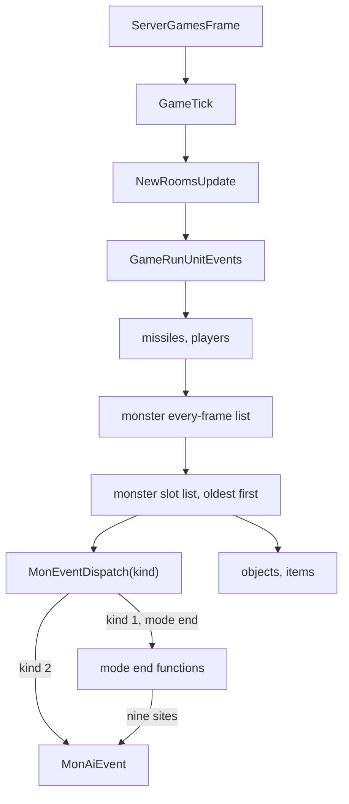

# 0001 — The monster AI machinery: the AI tick, the AI table, the AI state, target search, the command and the path request

> **Subsystem:** monsters/ai
> **Question:** when does a monster's (a summon's, a hireling's) AI run, who calls it and in which order, how does the
> AI table dispatch a row, what AI state does the unit carry, how is a target found, how does the AI command a mode or
> a skill, which path request does it make, and which draws does each part make on which seed?
> **Date:** 2026-10-27   **Plan:** 0052 (Phase 1, batch P1.1)   **Status:** open (the catalogue batches P1.2 onward
> read the 148 table rows and the 18 state rows)

Static reading of the pinned `Game.exe` in Ghidra (project copy `workspace/ghidra-r52`) and objdump, plus five
emulated maps (run:2026-10-27-ai-emu). Table dumps, AI-row usage and pool counts come from
`tools/ai_machinery_scan.py`; call-site lists from `tools/sweep_rbs3.py` (`callers`, `pushes`, `window`) and
`tools/sweep_rbs4.py` (`regarg`); the RNG reach from `re/ghidra_scripts/RngCallGraph.java`. Every kept output is under
`workspace/logs/r52/` (manifest `workspace/logs/r52/manifest.sha256`, one path base: that directory). Names below are
`re/symbols.csv` names; offsets are into the structures of [re/types/ai.h](../../../re/types/ai.h).

## Answer (summary)

- [I] **The AI tick is monster event kind 2**, `g_MonEventFuncs[2]` = `sub_005B1740_MonAiEvent`. It runs from the
  event queue in the monster pass of `GameRunUnitEvents` (missiles, players, **monsters**, objects, items; each type's
  every-frame list first, then the slot list of `frame & 63`, oldest record first), which `GameTick` calls once per
  frame after `NewRoomsUpdate`. The AI does not run every frame: it runs when its kind-2 event comes due, and nine
  mode-end sites call `g_MonEventFuncs[2]` directly. (fn:sub_005B1740_MonAiEvent@0x005B1740,
  data:g_MonEventFuncs@0x006E2490, fn:sub_005414D0_GameRunUnitEvents@0x005414D0, fn:sub_00541060_MonEventsRun@0x00541060,
  fn:sub_0052D870_GameTick@0x0052D870, fn:sub_005A8030_MonModeEndGeneric@0x005A8030, `ai-direct-calls.txt`)
- [I] **The next AI event is scheduled by the code that ends or refuses a mode.** `MonModeStartNeutral` queues it at
  `T + aidel` (15 when 0; `T + 45` under state 21) unless one is already pending later; the AI's own helpers queue it
  at `T + n` (`MonAiIdle` sets mode NU first, `MonAiDelay` keeps the mode, `MonAiDelayEarlier` only moves it earlier).
  30 call sites queue kind 2, 66 cancel it. (fn:sub_005A73E0_MonModeStartNeutral@0x005A73E0,
  fn:sub_005DE080_MonAiIdle@0x005DE080, fn:sub_005DE0F0_MonAiDelay@0x005DE0F0,
  fn:sub_005DE130_MonAiDelayEarlier@0x005DE130, tbl:MonStats.txt:aidel, `aiq-sites.txt`)
- [I] **The AI table** is `g_MonAiTable` (0x0073CA18): 148 rows of 16 bytes `{searchKind, init, think, alt}`,
  indexed by MonStats `AI` (`+0x1E`, s16; outside `[0, 148)` row 0), followed by 18 **state rows**
  `g_MonAiStateRows` (0x0073D358) indexed by the AI control's state word (1–17; states 10–12 only when
  0x00623470 allows). A row is dispatched in two steps: `MonAiInit` copies `think` (or `alt`) into `AiCtl.think`; on
  each AI event the row's `searchKind` runs the target search, then `AiCtl.think(game, unit, &ctx)` runs. 147
  distinct think functions over 148 rows; 146 rows are named by a MonStats row (`None` and `ShadowMasterNoInit` are
  not). (data:g_MonAiTable@0x0073CA18, data:g_MonAiStateRows@0x0073D358, fn:sub_005B15D0_MonAiEntryGet@0x005B15D0,
  fn:sub_005B0E00_MonAiInit@0x005B0E00, fn:sub_005B1650_MonAiTargetByKind@0x005B1650, `ai-rows.txt`)
- [C] **Row selection, three distances and three helper draws are emulated** (ADR-0015, ADR-0021): `MonAiEntryGet`'s
  row address (554 cases), the AI distance `(2·max + min) / 2` (240), the ring point of `MonAiWanderRing` with its 3–4
  unit-seed steps (200), `MonAiWalkToUnitType56`'s drawn path type 5 or 6 (120) and `MonAiStepAway`'s flee point and
  first boundary (200), all 1 314 matching with 0 traced accesses. The `[C]` covers each code's map up to its
  observed boundary. (run:2026-10-27-ai-emu)
- [I] **Target search** (row kinds 1, 2, 4, 5) walks the game's ten **target lists** at `Game+0x10F8`: lists 0–7 one
  per player slot (the player first, then its hirelings and summons), list 8 alignment-2 monsters, list 9 decoys.
  For a hostile searcher a player head counts only in the searcher's act, out of town and nearer than 55; range
  `aidist[difficulty]` (35 when 0); nearest by the AI distance, with a line test unless `AiCtl` flag `0x40` was set.
  A forced target (taunt, attract, confuse; `MonsterData+0x38`) is taken first; confusion draws one
  `RNG_RangePow2(unit seed, 2)`. (fn:sub_005DD7F0_MonAiFindTarget@0x005DD7F0,
  fn:sub_005DD610_MonAiForcedTarget@0x005DD610, fn:sub_005B1990_TargetListAdd@0x005B1990, struct:Game+0x10F8,
  tbl:MonStats.txt:aidist)
- [I] **The command.** Every AI action is a `MonCmd` run by `MonSetMode`: `MonAiSetMode(mode, x, y)`,
  `MonAiSetModeAtUnit(mode, target)`, `MonAiUseSkill(mode, skill, target, x, y)` (H2: used skill, `Unit+0xC4 |= 0x40`,
  path `+0x93 = 0`; on refusal `MonAiIdle(10)`), the move helpers around `MonAiMove`. (fn:sub_005DDFC0_MonAiSetMode@0x005DDFC0,
  fn:sub_005DDF90_MonAiSetModeAtUnit@0x005DDF90, fn:sub_005DEAD0_MonAiUseSkill@0x005DEAD0, fn:sub_005DEB60_MonAiMove@0x005DEB60,
  fn:sub_005A7C20_MonSetMode@0x005A7C20)
- [I] **The path request** is the command's target (a unit or a point), its path type (`MonCmd+0x15`: 100 no plan,
  101 → type 13 for an every-frame mode) and a one-shot override (`MonPathCtl+0x18/+0x1C/+0x20`: type, step parameter
  −126..126, byte ≤ 77). The types the AI can request are **1, 2, 5, 6, 7, 13 and 15** (and 0 and 8 set by the mode
  machine); the planner draws only for types 10 and 16 (the unit seed), which no AI path reaches, so **the AI's path
  plans draw nothing**. (fn:sub_005A63F0_MonMovePlan@0x005A63F0, fn:sub_005A6290_MonPathPlanType@0x005A6290,
  fn:sub_005DE190_MonAiPathOverride@0x005DE190, fn:sub_00649970_PathPlan@0x00649970, data:g_PathPlanFuncs@0x006EB6D8,
  `override-types.txt`, `rngcg-planfuncs.txt`)
- [I] **Draws.** The machinery draws on the **acting unit's seed** only, except one hostility test that draws on a
  candidate player's seed (state 146, `RNG_Range(·, 100)`); the per-AI think functions are the catalogue's.
  Hirelings enter through row 61 `Hireable` (state rows 4–7 for its states), summons through rows 1, 67, 69, 84, 86,
  101–112 and 117. (fn:sub_005DE200_MonAiWanderRing@0x005DE200, fn:sub_005DC970_AiHostileCandidate@0x005DC970,
  `rngcg-machinery.txt`, `ai-entries.txt`)

## Leads used

None. No community document was read; every claim is read from the code. Earlier findings are cited by their
anchors where this batch builds on them (anim/0001's event queue, drlg/0009's path types).

## Functions

| Address | Name | Role | Tag |
|---|---|---|---|
| `0x0052FC20` | `sub_0052FC20_ServerGamesFrame` | the server loop: paced by `timeGetTime`, `GameTick` on each live game of the 1 024 game slots | I |
| `0x005645E0` | `sub_005645E0_GameTickAlt` | the other caller of `GameTick` | I |
| `0x0052D870` | `sub_0052D870_GameTick` | the frame: `GameRunUnitEvents` after `NewRoomsUpdate` | I |
| `0x005414D0` | `sub_005414D0_GameRunUnitEvents` | per type: every-frame list, then the slot list | I |
| `0x00541060` | `sub_00541060_MonEventsRun` | the monster lists, records without a callback to `MonEventDispatch` | I |
| `0x005A7F80` | `sub_005A7F80_MonEventDispatch` | drops kind 2 while frozen and alive | I |
| `0x005B1740` | `sub_005B1740_MonAiEvent` | **the AI tick** (monster event kind 2) | I |
| `0x005B10E0` | `sub_005B10E0_MonAiPreChecks` | stun, doors, keep-near | I |
| `0x005B0F50` | `sub_005B0F50_MonAiOpenDoor` | `opendoors` monsters operate a door object on their cell | I |
| `0x005B0FF0` | `sub_005B0FF0_MonAiKeepNear` | leader and taunter following (`AiCtl+0x0C`) | I |
| `0x005B1650` | `sub_005B1650_MonAiTargetByKind` | the row's `searchKind` | I |
| `0x005B13E0` | `sub_005B13E0_MonSpcWalkCheck` | boss pause, unique teleport, `MonSpcWalk` re-target | I |
| `0x005B1140` | `sub_005B1140_MonAiBossSightPause` | 20-frame pause of a boss at its first player sight | I |
| `0x005B15D0` | `sub_005B15D0_MonAiEntryGet` | the table row of a unit and a state | C (map) |
| `0x005B0E00` | `sub_005B0E00_MonAiInit` | sets `AiCtl.state` and `AiCtl.think`, calls the row's `init` | I |
| `0x005B0CC0` / `0x005B0CD0` | `sub_005B0CC0_AiNone` / `sub_005B0CD0_AiIdle` | row 0 (returns), rows 1 and state 1 (idle 200 frames) | I |
| `0x0058EBC0` / `0x005A6490` | `sub_0058EBC0_AiCtlAlloc` / `sub_005A6490_MonPathCtlAlloc` | the two AI blocks of `MonsterInit` | I |
| `0x0058EDE0` / `0x0058EFA0` | `sub_0058EDE0_AiCtlParamsFree` / `sub_0058EFA0_AiCtlParamGet` | the parameter records at `AiCtl+0x20` | I |
| `0x005DD220` / `0x005DD230` | `sub_005DD220_AiCtlFlagTest` / `sub_005DD230_AiCtlFlagSet` | `AiCtl+0x08` bits (DX) | I |
| `0x005DD330` | `sub_005DD330_AiCtlFollowSet` | `AiCtl+0x0C/+0x10` | I |
| `0x005DD7F0` | `sub_005DD7F0_MonAiFindTarget` | the target search of row kinds 1, 2, 4, 5 | I |
| `0x005DD610` | `sub_005DD610_MonAiForcedTarget` | the forced target (`MonsterData+0x34/+0x38`) | I |
| `0x005DD510` | `sub_005DD510_MonAiPreferDecoy` | list 9 against the found target: a type-2 test plan | I |
| `0x005DDC30` | `sub_005DDC30_MonAiFindHostile` | forced target, else search kind 6 | I |
| `0x005DD0B0` | `sub_005DD0B0_AiUnitSearch` | the unit search by kind (`g_AiSearchKinds`) | I |
| `0x005DCE60` / `0x005DCEE0` / `0x005DCF70` / `0x005DD050` | `sub_005DCE60_AiSearchNearRooms` / `sub_005DCEE0_AiSearchNearClients` / `sub_005DCF70_AiSearchNearRoomsNoTown` / `sub_005DD050_AiSearchOwnerGroup` | the four walkers | I |
| `0x005DC970` | `sub_005DC970_AiHostileCandidate` | hostility test of a candidate (draws on a player's seed) | I |
| `0x005DC640` | `sub_005DC640_AiApproachPointTest` | three teleport-point tests toward a unit | I |
| `0x005DC530` | `sub_005DC530_AiDistToPoint` | the AI distance | C (map) |
| `0x005DC380` / `0x005DC480` / `0x005DC5C0` | `sub_005DC380_AiDistUnits` / `sub_005DC480_AiDistToPointSized` / `sub_005DC5C0_AiPathDistToPoint` | variants with sizes | I |
| `0x005DE890` / `0x005DE9D0` | `sub_005DE890_MonAiTargetOrIdle` / `sub_005DE9D0_MonAiTargetOrWait` | row kinds 1 and 4/5 | I |
| `0x005DDFC0` / `0x005DDF90` | `sub_005DDFC0_MonAiSetMode` / `sub_005DDF90_MonAiSetModeAtUnit` | a mode at a point / at a unit | I |
| `0x005DEAD0` / `0x005DE000` | `sub_005DEAD0_MonAiUseSkill` / `sub_005DE000_MonAiUseSeqSkill` | a skill in a mode < 16 / in mode 14 | I |
| `0x005DE080` / `0x005DE0F0` / `0x005DE130` | `sub_005DE080_MonAiIdle` / `sub_005DE0F0_MonAiDelay` / `sub_005DE130_MonAiDelayEarlier` | the next AI event | I |
| `0x005DEB60` | `sub_005DEB60_MonAiMove` | the move command and its fallback | I |
| `0x005DEC80` / `0x005DEF80` / `0x005DED40` / `0x005DECA0` | `sub_005DEC80_MonAiWalkToUnit` / `sub_005DEF80_MonAiWalkToUnitStop` / `sub_005DED40_MonAiWalkToUnitType13` / `sub_005DECA0_MonAiWalkToUnitOrZero` | walk to a unit | I |
| `0x005DED20` / `0x005DED00` | `sub_005DED20_MonAiRunToUnit` / `sub_005DED00_MonAiRunToUnitFlags` | run to a unit | I |
| `0x005DED90` / `0x005DEDE0` / `0x005DEE50` | `sub_005DED90_MonAiWalkToPoint` / `sub_005DEDE0_MonAiRunToPoint` / `sub_005DEE50_MonAiWalkToPointOrStop` | to a point | I |
| `0x005DE200` / `0x005DF400` | `sub_005DE200_MonAiWanderRing` / `sub_005DF400_MonAiWanderRingDirect` | a ring point around the unit | C (map, 0x005DE200) / I |
| `0x005DF530` / `0x005DF680` | `sub_005DF530_MonAiWanderNearUnit` / `sub_005DF680_MonAiRunNearUnit` | a ring point around another unit | I |
| `0x005DF7D0` | `sub_005DF7D0_MonAiWalkToUnitType56` | walk to a unit with a drawn path type | C (map) |
| `0x005DEFE0` | `sub_005DEFE0_MonAiStepAway` | a point away from a unit | C (map) |
| `0x005DE190` / `0x005A6260` | `sub_005DE190_MonAiPathOverride` / `sub_005A6260_AiPathOverrideSet` | the one-shot override | I |
| `0x005A63F0` / `0x005A6290` | `sub_005A63F0_MonMovePlan` / `sub_005A6290_MonPathPlanType` | the command's plan | I |
| `0x00649070` / `0x006490E0` | `sub_00649070_PathSetStopDist` / `sub_006490E0_PathSetByte94` | path `+0x93`, `+0x94` | I |
| `0x00679C80` / `0x00679ED0` / `0x00679F70` / `0x0067B850` / `0x0067C2D0` | `sub_00679C80_PathPlanGreedy` / `sub_00679ED0_PathPlanGreedyNear` / `sub_00679F70_PathPlanOnePoint` / `sub_0067B850_PathPlanType1` / `sub_0067C2D0_PathPlanType15` | planner entries of the AI's types | I |
| `0x0067AD00` / `0x0067AAA0` / `0x0067A630` | `sub_0067AD00_PathPlanSearch` / `sub_0067AAA0_PathSearchRun` / `sub_0067A630_PathSearchDirDraw` | types 0 and 16; the type-16 draw | I |
| `0x005B1880` / `0x005B1900` / `0x005B1990` / `0x005B1A90` | `sub_005B1880_TargetListAddPlayer` / `sub_005B1900_TargetListAttach` / `sub_005B1990_TargetListAdd` / `sub_005B1A90_TargetListRemove` | the target lists | I |
| `0x005B1A20` / `0x005B1B70` / `0x005B1BC0` / `0x005B1C00` | `sub_005B1A20_TargetListClear` / `sub_005B1B70_TargetListsClearAll` / `sub_005B1BC0_TargetListFind` / `sub_005B1C00_TargetNodeFlags` | list upkeep | I |
| `0x005730E0` / `0x00573100` / `0x00573120` / `0x005734E0` | `sub_005730E0_MonForcedTargetKind` / `sub_00573100_MonForcedTargetGuid` / `sub_00573120_MonForcedTargetClear` / `sub_005734E0_MonData54Get` | monster data getters | I |
| `0x005DD280` / `0x00621F20` | `sub_005DD280_AiLifePct` / `sub_00621F20_UnitLifePct` | life percent | I |
| `0x005DD290` / `0x00622AA0` | `sub_005DD290_AiLineClear` / `sub_00622AA0_UnitLineBlocked` | the line test | I |
| `0x005DD2B0` / `0x005DD2D0` | `sub_005DD2B0_AiMonState3or19` / `sub_005DD2D0_MonHasSkill` | `MonsterData+0x54` ∈ {3, 19}; a skill in `Skill1..8` | I |
| `0x006259B0` | `sub_006259B0_UnitAlignGet` | stat 172 of state list 105; 2 for other unit types | I |
| `0x006E3300` | `g_AiSearchKinds` | 13 search kinds `{walker, callback}` | I |
| `0x0073D358` | `g_MonAiStateRows` | the 18 state rows | I |

## Walkthrough

### 1. The tick, its caller and the order

- [I] **The frame.** `sub_0052FC20_ServerGamesFrame` runs one frame per interval (`timeGetTime`, the interval at
  0x00883D60) over the 1 024 game slots `0x00882D38`–`0x00883D37`, calling `GameTick` for each live one
  (0x0052FD17); `sub_005645E0_GameTickAlt` is `GameTick`'s other caller (0x00564603). `GameTick` increments
  `Game+0xA8`, runs two act passes, `NewRoomsUpdate`, then **`GameRunUnitEvents`** (0x0052D8EB), the client room sync
  and the timers (drlg/lifecycle § A). (fn:sub_0052FC20_ServerGamesFrame@0x0052FC20, fn:sub_005645E0_GameTickAlt@0x005645E0,
  fn:sub_0052D870_GameTick@0x0052D870)
- [I] **The pass.** `GameRunUnitEvents` writes `frame & 63` into the event control and runs, in order, missiles,
  players, **monsters**, objects, items; for each type the every-frame list (`MonEventsRun(0)`, no frame test) and
  then the slot list (`MonEventsRun(1)`, records whose frame equals `Game+0xA8`, walked from the oldest, each freed
  after its run) (0x005414EE–0x00541589; anim/0001 § 6). The AI event is always queued at a frame (`T + n`, n ≥ 1;
  `aiq-sites.txt`), so it runs in the monster slot pass, after every monster's every-frame event of that frame, in
  the order the events were queued. (fn:sub_005414D0_GameRunUnitEvents@0x005414D0, fn:sub_00541060_MonEventsRun@0x00541060,
  fn:sub_005416B0_EventQueueAt@0x005416B0)
- [I] **The dispatch.** A record without its own callback goes to `MonEventDispatch(kind, a, b)`, which drops every
  kind but 3, 4, 5, 8 and 12 while the unit has state 1 (`freeze`) and is alive (0x005A7F80), then calls
  `g_MonEventFuncs[kind]`. Kind 2 is `sub_005B1740_MonAiEvent` (dump `ai-tables.txt` `EV 2`). So a frozen monster loses
  a due AI event; `COMBAT_ApplyFreeze` queues a new one at `T + length + 1` (0x0057B3DC–0x0057B3E9).
  (fn:sub_005A7F80_MonEventDispatch@0x005A7F80, data:g_MonEventFuncs@0x006E2490, fn:COMBAT_ApplyFreeze@0x0057B230)
- [I] **The direct calls.** `g_MonEventFuncs[2]` is also loaded and called directly at nine sites, all mode ends:
  seven in `MonModeEndGeneric` (calls at 0x005A80F5, 0x005A813F, 0x005A818E, 0x005A81ED, 0x005A822E, 0x005A8267,
  0x005A82AD) and one each in `MonModeEndToS1` (0x005A83D1) and `MonModeEndToS1b` (0x005A8481), each skipped while
  frozen and alive (`xref-monevent2.txt`, `ai-direct-calls.txt`). There the AI runs inside the mode-end event of
  that frame, not from the queue. No other code references the AI event function (`xrefscan` of 0x005B1740: the
  table slot only). (fn:sub_005A8330_MonModeEndToS1@0x005A8330, fn:sub_005A83E0_MonModeEndToS1b@0x005A83E0)

- [I] **The event itself.** `MonAiEvent(ECX game, EDX unit)` builds a 9-dword `AiCtx` on its stack: `ctl =
  MonsterData+0x28`, `+0x04..+0x18 = 0`, `+0x1C` the MonStats record of `Unit+0x04`, `+0x20` the MonStats2 record of
  MonStats `+0x18` (0x005B1746–0x005B17F5); with either record missing it returns. It then runs, each stopping the
  event on a non-zero return: `MonAiPreChecks` (0x005B1806), `MonAiTargetByKind` (0x005B1817), `MonSpcWalkCheck`
  (0x005B1828), and finally `AiCtl.think(game, unit, &ctx)` (0x005B186F, after an `IsBadCodePtr` check that is fatal).
  The event's two arguments are not read. (fn:sub_005B1740_MonAiEvent@0x005B1740, struct:AiCtx+0x1C, struct:AiCtx+0x20)

### 2. When the next AI event comes (the AI's own clock)

- [I] **The 30 queueing sites** (`pushes 0x005417D0 4`, kind 2, `aiq-sites.txt`, frames from `aiq-windows.txt`):
  - `MonModeStartNeutral` (mode NU, and the refusal fallback of `MonSetMode`): only when no AI event is pending later
    than now (`UnitEventFirstFrame(2) ≤ T`): `T + 45` under state 21 (`stunned`), else `T + aidel` (u8 MonStats
    `+0x4F`; `+0x4F + difficulty` when `Game+0x6A` or `Game+0x74` is non-zero; 15 when 0) (0x005A7419–0x005A747D);
  - the AI helpers: `MonAiIdle(n)` (mode NU unless already NU, cancel kind 2, queue `T + max(n, 1)`; 300 calls),
    `MonAiDelay(n)` (cancel, queue `T + max(n, 1)`, mode unchanged; 49 calls), `MonAiDelayEarlier(n)` (queue
    `T + max(n, 1)` only when nothing is pending, the pending one is due now, or it is due at or after `T + n`;
    7 calls), `MonAiTargetOrWait` (`T + 20`);
  - mode ends and mode machinery: `MonKnockbackEnd` (`T + 1`, `T + 15`), 0x005A74E0 (`T + 15`), freeze
    (`T + length + 1`), 0x0057B170 (`T + ebx`), 0x0058594B (`T + eax + 1`), 0x005A3A6C (`T + 51`);
  - creation and restore: `SpawnOwnedMonster` (`T + 25`), `RoomInactiveUnitsRestore` (a saved delay), 0x00573780
    (`T + 2`, twice), `UnitInteract` and 0x0054CA10 (`T + 1`);
  - skill code: `SkillReviveDo` (`T + 25`), `SummonFinish` (`T + 15`), 0x005D1320 and `SkillDo126ImpInferno`
    (`T + 13`), `SkillDo44BladeSentinel`, `SkillDo71Taunt`, `MonFleeFrom` (`T + 1`), `SkillDo49Shadow` and
    `SkillDo16Valkyrie` (`T + 20`), and two AI helpers 0x005E8140, 0x005E8340 (`T + 1`).

  (fn:sub_005A73E0_MonModeStartNeutral@0x005A73E0, fn:sub_005DE080_MonAiIdle@0x005DE080,
  fn:sub_005DE0F0_MonAiDelay@0x005DE0F0, fn:sub_005DE130_MonAiDelayEarlier@0x005DE130,
  fn:sub_005A8520_MonKnockbackEnd@0x005A8520, fn:sub_0056D940_SpawnOwnedMonster@0x0056D940, tbl:MonStats.txt:aidel)
- [I] **What this means for the tick.** A monster that commands a mode usually gets its next AI event from that
  mode's end (`MonModeStartNeutral` at `T + aidel`, or a direct call at one of the nine mode ends); an idle monster
  with no target gets it from the idle delay of its row kind (§ 4, `MonAiTargetOrIdle`: 10 to 25 frames); an AI
  function may also queue it while a mode runs (`MonAiDelay`), and then the AI's next command replaces that mode.
  (fn:sub_005DE890_MonAiTargetOrIdle@0x005DE890, fn:sub_005A7C20_MonSetMode@0x005A7C20)

### 3. The AI table and its dispatch

- [I] **Layout.** `MonAiEntryGet(ECX unit, EDX state)` returns `0x0073D358 + 16·state` when `state ≠ 0` (states 10, 11
  and 12 only when `0x00623470` is true: the class's `MonModeAllowed`, MonStats `+0x0C` bit 6 (`boss`) clear and
  `+0x0E` bit 0 set; else it falls through), and otherwise `0x0073CA18 + 16·AI` with `AI` the s16 at MonStats `+0x1E`
  when `0 ≤ AI < 148` (`0x94`), else row 0 (0x005B15E5–0x005B1645). A non-monster or a monster without data reads
  address `0x1E` (a fault; no caller passes one). (fn:sub_005B15D0_MonAiEntryGet@0x005B15D0, 0x00623470,
  tbl:MonStats.txt:AI)
- [I] **The second table's bound.** `MonAiEntryGet` does not bound `EDX`: `MonAiInit` refuses `state ≥ 18` (signed,
  0x005B0E4D) before it stores one, so the stored state is 0..17 and the table holds 18 rows (`ST 0`–`ST 17`; the next
  dwords, 0x0073D478, are string pointers). The fall back to row 0 for an out-of-range `AI` is on the `EDX = 0` branch
  only. Seven state rows reuse a first-table think word: 1 `Idle`, 4 `Hireable` (with its `alt`), 5 `GoodNpcRanged`
  (row 60), 7 `NecroPet`, 15 `SuicideMinion`, and 10 and 17, which share 0x005E8020. (fn:sub_005B15D0_MonAiEntryGet@0x005B15D0,
  data:g_MonAiStateRows@0x0073D358, `ai-rows.txt`)
- [C] The row address map (states 0–9, 13–17; `AI` over the s16 range) matches the emulation in all 554 cases; the
  control without the upper bound fails all 143 cases that separate it. (run:2026-10-27-ai-emu, `entry`)
- [I] **The row** `{+0 searchKind, +4 init, +8 think, +C alt}` (`MonAiRow`). The stock table (`ai-rows.txt`): kinds 0
  (26 rows), 1 (104), 2 (16), 4 (1), 5 (1); 21 rows with an `init`, 14 with an `alt`; 147 distinct think functions,
  `0x005EB970` shared by rows 106 `ShadowMaster` and 143 `ShadowMasterNoInit`. Row 0 (`None`) is a bare `ret 4`
  (0x005B0CC0); row 1 (`Idle`) and state row 1 run `sub_005B0CD0_AiIdle`: with a room, `MonAiIdle(200)` (0x005B0CE0).
  The row order is `monai.txt`'s: its 148 data rows match the 148 table rows, and the 734 MonStats rows name 146 of
  them (`SURVEY rows=148 … used=146 unused=2`; unused: 0 `None`, 143 `ShadowMasterNoInit`). (data:g_MonAiTable@0x0073CA18,
  fn:sub_005B0CC0_AiNone@0x005B0CC0, fn:sub_005B0CD0_AiIdle@0x005B0CD0)
- [I] **The state rows** (`ST` lines): state 1 `AiIdle`; 2 `0x005B14E0` (back to state 0 when `MonsterData+0x54` is 3
  or 19 or the distance is below 4, else a ring walk near its target or idle; draws); 3 `0x005E5870` (init
  `0x005E5730`); 4 `0x005E52D0`/alt `0x005E5280` (the `Hireable` row's pair); 5 `0x005E7AC0`; 6 `0x005E7C10`; 7
  `0x005E4CF0` (the `NecroPet` row's function); 8 `0x005E7DC0`; 9 `0x005E7F80`; 10 and 17 `0x005E8020`; 11 `0x005E8140`
  (init `0x005E80E0`); 12 `0x005E8340`; 13 `0x005E5C50`; 14 `0x005E2610`; 15 `0x005E1D30` (the `SuicideMinion` row's);
  16 `0x005E2D80` (init `0x005E2CD0`). Who sets them (`pushes 0x005B0E00 2`, 33 calls): state 0 from `MonsterInit`,
  `SkillReviveDo`, `ImpDetach` and the restore paths; 5 and 6 by the `Hireable` think function (`0x005E5312`–`0x005E538F`);
  10 `CloakAreaCb` (`0x005D6612`); 11 `MonFleeFrom` (`0x005DDE10`); 13 one `SuperUniqueSpawn` case (`0x005A4C1A`, switch
  at `0x005A4BF7`); 15 `WhipChangeClass`; 16 `ImpAttach`; 7 calls pass a register. (data:g_MonAiStateRows@0x0073D358,
  fn:sub_005B0E00_MonAiInit@0x005B0E00, fn:sub_005DDD00_MonFleeFrom@0x005DDD00, fn:sub_005D18E0_ImpAttach@0x005D18E0)
- [I] **`MonAiInit(ECX game, EDX unit; ctl, state)`** returns at once unless game, unit and ctl are non-null, `state < 18`
  (signed) and the unit is a monster; a class at or past the MonStats count forces state 1. When `AiCtl.think` is
  non-zero, equals the `think` of the row of the **current** `AiCtl.state`, and that row has an `alt`: `AiCtl.state ←
  state`, `AiCtl.think ← alt`, done (0x005B0E77–0x005B0E99). Otherwise it clears `AiCtl+0x14/+0x18/+0x1C`, frees the
  parameter records, takes the row of the **new** state, calls its `init(game, unit, &blk)` with `blk` laid out as an
  `AiCtx` (ctl, six zeros, MonStats, MonStats2; it returns without setting anything when a record is missing), and
  sets `AiCtl.state ← state`, `AiCtl.think ← think` (`0x005B0CD0` when 0) (0x005B0EA5–0x005B0F2D). A unit with state 54
  takes the fatal path (0x005B0E14). (fn:sub_005B0E00_MonAiInit@0x005B0E00, fn:sub_0058EDE0_AiCtlParamsFree@0x0058EDE0)

### 4. The AI state on the unit, the context and the row kinds

- [I] **The blocks.** `MonsterInit` allocates three blocks into `MonsterData+0x28/+0x2C/+0x30`: `AiCtl` (0x40 bytes,
  `.\Ai\AiGeneral.cpp` line 0x1B, zeroed, `+0x0C = −1`, `+0x10 = 1`, `+0x2C = −1`, `+0x30 = 1`), `MonPathCtl` (0x24
  bytes, `.\MONSTER\MonsterMode.cpp`, zeroed) and a third (0x00572BA0), then `MonAiInit(ctl, 0)` (0x00574307).
  (fn:sub_00574250_MonsterInit@0x00574250, fn:sub_0058EBC0_AiCtlAlloc@0x0058EBC0, fn:sub_005A6490_MonPathCtlAlloc@0x005A6490,
  struct:AiCtl+0x0C, struct:MonPathCtl+0x18)
- [I] **`AiCtl` fields read by the machinery:** `+0x00` state, `+0x04` think, `+0x08` flags (u16; `0x08` set by the
  target search when it finds a target and the searcher is not alignment 2, `0x40` a one-shot "search without the
  line test" cleared by the search, `0x20` the unique-mod teleport flag, bit 0 by `MonAiMove`'s flag 1), `+0x0C/+0x10`
  a unit to keep near and its type (§ 5), `+0x14..+0x1C` AI variables, `+0x20/+0x24` parameter records (kind 10 holds a
  saved point), `+0x28..+0x34` the owner and the minion list. (struct:AiCtl+0x08, struct:AiCtl+0x2C,
  fn:sub_0058F030_MonSetOwner@0x0058F030, fn:sub_0058F380_MonGroupForEach@0x0058F380)
- [I] **The inactive save and restore** (drlg/lifecycle) keep, of all this, only the saved point of parameter record
  10 for `isSpawn`/`isMelee`/`interact`-class rows and three named classes, the owner link of classes 68 and 543, and
  a `MonsterData+0x0E` byte for classes 311 and 312 (record `+0x4C/+0x50`); the AI state word and think function are
  rebuilt by `MonAiInit(ctl, …)` on restore (0x0054286B). (fn:sub_00541FE0_InactiveMonAiSave@0x00541FE0,
  fn:sub_00541E20_InactiveMonAiRestore@0x00541E20, fn:sub_005424F0_InactiveMonstersRestore@0x005424F0)
- [I] **The row kind** (`MonAiTargetByKind`, a switch on row `+0`, 0x005B1663): 0 no search; 1 `MonAiTargetOrIdle`,
  the think function runs only with a target; 2 `MonAiFindTarget`, the think function runs either way; 4
  `MonAiTargetOrWait`, only with a target; 5 the same search, either way; 3 and above 5 stop the event (no stock row).
  The target goes to `ctx+0x08`, the distance to `ctx+0x14`, the melee test to `ctx+0x18`.
  (fn:sub_005B1650_MonAiTargetByKind@0x005B1650, struct:AiCtx+0x08)
- [I] **No target, row kind 1** (`MonAiTargetOrIdle`): a ring walk of radius 5 (`MonAiWanderRing(5)`) when
  `MonsterData+0x54` is 3 or 19, or when the unit's cell fails the collision pattern test (mask `0x40`), each only if
  `MonModeAllowed`; else `MonAiIdle(d')` with d the nearest checked player head's distance: `d' = 10` for `d < 25`,
  `d − 10` for `25 ≤ d < 35`, `25` for `d ≥ 35` (0x005DE890–0x005DE9C8). Kinds 4 and 5 (`MonAiTargetOrWait`): the same
  collision ring walk, else the AI event at `T + 20` with the mode unchanged. (fn:sub_005DE890_MonAiTargetOrIdle@0x005DE890,
  fn:sub_005DE9D0_MonAiTargetOrWait@0x005DE9D0, fn:sub_005DD2B0_AiMonState3or19@0x005DD2B0)

### 5. The pre-checks: stun, doors, following, bosses and `MonSpcWalk`

- [I] **`MonAiPreChecks`**: under state 21 `MonAiIdle(3)` and stop; then `MonAiOpenDoor`; then `MonAiKeepNear`.
  (fn:sub_005B10E0_MonAiPreChecks@0x005B10E0)
- [I] **Doors.** For a MonStats `opendoors` row (`+0x0C` bit 3) whose cell has collision bit `0x800`, search kind 8
  (the nearest object with `0x00621A70` set in mode 0); if its Objects record `+0x16D` is non-zero, operate it
  (`0x00584540(2, guid)`) and `MonAiIdle(5)`. (fn:sub_005B0F50_MonAiOpenDoor@0x005B0F50, tbl:MonStats.txt:opendoors)
- [I] **Leader and minion following** (`MonAiKeepNear`): when `AiCtl+0x0C ≠ −1` and `MonModeAllowed`, the unit
  `(AiCtl+0x10, AiCtl+0x0C)` is looked up; gone or dead clears the guid. At AI distance below 2 with `AiCtl+0x10 = 0`
  (a player) it steps 19 subtiles away (`MonAiStepAway(unit, 19, 1)`, then stop); at 21 or more it sets the override
  byte 40 and wanders to a ring point of radius 19 around that unit (`MonAiWanderNearUnit(unit, 19)`, 4 unit-seed
  steps); between, the AI goes on. `AiCtlFollowSet` writes the pair from `UniqueMinions` (minion → its boss),
  `SkillReviveDo`, `SummonFinish` and `SkillDo71Taunt`. (fn:sub_005B0FF0_MonAiKeepNear@0x005B0FF0,
  fn:sub_005DD330_AiCtlFollowSet@0x005DD330, fn:sub_005A0C00_UniqueMinions@0x005A0C00, fn:sub_005D8570_SkillDo71Taunt@0x005D8570)
- [I] **`MonSpcWalkCheck`** (only with a target): `MonAiBossSightPause` (class 250, a champion or unique, or a
  `boss`, at distance below 20 from a **player** target, `AiCtl` flag not yet set: set it, `UnitSetEvent(0)` and
  `MonAiIdle(20)`); `UModTeleportTry` (drlg/lifecycle); then, for an `isMelee` class allowed its mode, in a level with
  `MonSpcWalk` non-zero and the distance above it: a teleport-point test toward the target (`AiApproachPointTest`),
  else search kind 11, else `MonAiWanderRing(4)` and stop; a found point replaces the target. (fn:sub_005B13E0_MonSpcWalkCheck@0x005B13E0,
  fn:sub_005B1140_MonAiBossSightPause@0x005B1140, fn:sub_005B11F0_UModTeleportTry@0x005B11F0,
  fn:sub_005DC640_AiApproachPointTest@0x005DC640, tbl:Levels.txt:MonSpcWalk, tbl:MonStats.txt:isMelee)

### 6. Target search

- [I] **The lists.** `Game+0x10F8` holds ten list heads of 16-byte nodes `{unit, flags, next, prev}`
  (`.\GAME\Targets.cpp`); `Unit+0xD0` is the unit's list (11 none). Lists 0–7: `TargetListAddPlayer` (from
  `SUnitCreate`, a player, when fewer than 9 clients) takes the first free slot; `TargetListAttach(unit, i)` links a
  unit after player `i`'s node: `MERC_Init`, `MercRevive`, `SkillReviveDo`, the summon do functions (skeletons, golems,
  revives, vines, spirits, conversion, shadows, Dopplezon, Valkyrie) — 15 calls. Lists 8 and 9: `TargetListAdd(unit, 8
  or 9)` pushes at the head: 8 from `WandererSpawn` and two AI functions (0x005EDC50, 0x005EE3C0); 9 from the inactive
  restore, `MissileSpawnOwnedMonster`, Attract, the confuse callback, Bone Wall and Bone Prison (9 calls,
  `pushes 0x005B1990 2`). (fn:sub_005B1880_TargetListAddPlayer@0x005B1880, fn:sub_005B1900_TargetListAttach@0x005B1900,
  fn:sub_005B1990_TargetListAdd@0x005B1990, struct:Game+0x10F8)
- [I] **`MonAiFindTarget(ECX game, EDX unit; ctl, &dist, &melee)`** (0x005DD7F0):
  1. no room: 0. The line test is on unless `AiCtl` flag `0x40` (cleared here), the room is outdoors, `AiCtl` flag
     `0x08` is set, or the monster's `MonsterData+0x50` record has `+0x24` non-zero;
  2. `MonAiForcedTarget` first; a hit ends the search;
  3. a searcher of alignment 0 (`UnitAlignGet`): range `aidist[difficulty]` (u8 MonStats `+0x52 + Game+0x6D`), 35 when
     0. For lists 0–7: the **head** counts only when in the searcher's act (`Unit+0x18` byte), in a room and that room
     **not a town**; its distance updates the "nearest seen"; at 55 or more the whole list is skipped; a dead head
     counts as `0x7FFFFFFF`; then the head and the list's later nodes (no act or town test) are taken when nearer than
     the best so far and the line test passes (`UnitLineBlocked(unit, cand, 4) = 0`). List 8: act test, distance, line
     test. List 9 is searched apart for its nearest, and `MonAiPreferDecoy` chooses it over the found target when
     there is none, or the decoy is nearer than 6 and a type-2 test plan to the found target has no point (and search
     kind 7 finds nothing within 19);
  4. a searcher of another alignment: search kind 5 from its logic region (`LogicRegionIdAt`), list 9 as above;
  5. with a target: flag `0x08` (unless alignment 2), `*melee = InMeleeRange(unit, target, 0)`, `*dist` its distance;
     without: `*dist` the nearest head seen.

  (fn:sub_005DD7F0_MonAiFindTarget@0x005DD7F0, fn:sub_005DD510_MonAiPreferDecoy@0x005DD510, fn:sub_006259B0_UnitAlignGet@0x006259B0,
  fn:sub_00622AA0_UnitLineBlocked@0x00622AA0, fn:sub_00622C40_InMeleeRange@0x00622C40, fn:sub_0061AB00_RoomIsTown@0x0061AB00)
- [I] **The forced target** (`MonsterData+0x38` kind, `+0x34` guid): kinds 1, 2 and 4 look up the guid; kind 3
  (confusion) draws `RNG_RangePow2(unit seed, 2)` and with alignment 1, or a non-zero draw with alignment 0 or 2, sets
  alignment 1, searches kind 5 (or 6) and sets alignment 1 again; the unit taken must be a living player or monster, or
  an object. Otherwise the kind and guid are cleared. (fn:sub_005DD610_MonAiForcedTarget@0x005DD610,
  fn:sub_005730E0_MonForcedTargetKind@0x005730E0, fn:sub_00573120_MonForcedTargetClear@0x00573120, fn:RNG_RangePow2@0x00472210)
- [I] **The unit search** `AiUnitSearch(ECX game, EDX unit; out, param, kind)` takes `g_AiSearchKinds[kind] = {walker,
  callback}` (the callback from `param` when the table's is 0) and walks: 0 the near rooms' unit lists (`Room+0x74`,
  next `Unit+0xE8`); 1 the near rooms' client players (`Room+0x48`, count `+0x78`); 2 the near rooms that are not towns
  and hold a client; 3 the owner's minion group (`MonGroupForEach`). The kinds the code passes (`search-kinds.txt`,
  29 calls): 1 (19, own callbacks), 2, 3, 5, 6 (2), 7, 8, 9, 11, 12. Kind roles, read from their callbacks: 3 nearest
  living non-hostile monster, 4 a monster in mode 0 near, 5 the alignment-2 search, 6 and 7 the nearest hostile within
  49 with a line test, 8 a closed door, 9 the dead minions of the owner, 11 a hostile with a teleport point, 12 a
  count of living monsters of one class. (fn:sub_005DD0B0_AiUnitSearch@0x005DD0B0, data:g_AiSearchKinds@0x006E3300,
  fn:sub_005DCE60_AiSearchNearRooms@0x005DCE60, fn:sub_005DCEE0_AiSearchNearClients@0x005DCEE0,
  fn:sub_005DCF70_AiSearchNearRoomsNoTown@0x005DCF70, fn:sub_005DD050_AiSearchOwnerGroup@0x005DD050)
- [I] **The hostility test with a draw.** `AiHostileCandidate` (kinds 6, 7, 11) takes a living player or monster out
  of town; when the candidate has state 146 and is a **player**, it draws `RNG_Range(candidate seed, 100)` and refuses
  a candidate outside melee range on a draw below 80 (a monster with state 146 is refused inside melee range); then
  `UnitsHostile`. (fn:sub_005DC970_AiHostileCandidate@0x005DC970, fn:sub_00554200_UnitsHostile@0x00554200, fn:RNG_Range@0x0045C390)
- [I] **`TgtPlaceCheck`** is read by `MonSkillTargetOk` (skills/0003 § 12), which 13 calls in 10 AI functions use
  (0x005E0980, 0x005E8810, 0x005E9750, 0x005F1440, 0x005F1B60, 0x005F1DE0, 0x005F20A0, 0x005F2B10, 0x005F9A80 and the
  priest AI); the batches that hold those functions read the test. (fn:sub_005FD470_MonSkillTargetOk@0x005FD470)
- [I] **The AI distance** `AiDistToPoint(unit, x, y)`: `dx = |ux − x|`, `dy = |uy − y|`, `(2·max + min) / 2` with a
  signed division (`lea; cdq; sub; sar 1`, 0x005DC5A4–0x005DC5AB; the values are non-negative, so a floor), the
  position from path `+0x02/+0x06` (u16) for unit types 0, 1, 3 and from path `+0x0C/+0x10` for 2, 4, 5 (0 without a
  path). `AiDistUnits(a, b)` subtracts `UNIT_GetSizeX(a)` from both components (floor 0) first; `AiDistToPointSized`
  subtracts `size / 2 + 1`. (fn:sub_005DC530_AiDistToPoint@0x005DC530, fn:sub_005DC380_AiDistUnits@0x005DC380,
  fn:sub_005DC480_AiDistToPointSized@0x005DC480)
- [C] `AiDistToPoint`'s map matches the emulation in 240 cases over the six unit types; the control `(dx + dy) / 2`
  fails all 240. (run:2026-10-27-ai-emu, `dist`)

### 7. The command (H2) and the move helpers

- [I] **`MonCmd`** (0x20): `MonCmdInit(unit, mode, cmd)` (stack arguments) clears the used skill and the command,
  sets mode and unit, and `+0x15 = 101` when the mode is every-frame (`MonModeEveryFrame`), else 100. `MonSetMode(game,
  cmd, flag)` sets the path target (a unit at `+0x08`, else the point `+0x0C/+0x10`), path `+0x94 = 20`, plans
  (`MonMovePlan`, `+0x15`, `+0x18`, AL `= +0x1C`), and starts the mode; on refusal it runs `MonModeStartNeutral`
  (anim/0001 § 10). (fn:sub_005A7E60_MonCmdInit@0x005A7E60, fn:sub_005A7C20_MonSetMode@0x005A7C20, struct:MonCmd+0x15)
- [I] **`MonAiUseSkill(ECX game, EDX unit; mode, skill, target, x, y)`** (H2): for `mode < 16`: `MonCmdInit(mode)`;
  `UNIT_SetUsedSkill(SkillFindByOwner(unit, skill, −1))`; `Unit+0xC4 |= 0x40`; path `+0x93 = 0`
  (`PathSetStopDist(path, 1)`); target, x, y into the command; `MonSetMode(game, cmd, 0)`: 1 when it starts, else
  `MonAiIdle(10)` and 0 (0x005DEAD0–0x005DEB5B). `MonAiUseSeqSkill(skill, target, x, y)` does the same in mode 14
  without the `0x40` bit, for a skill row below the Skills count. 171 and 6 calls. (fn:sub_005DEAD0_MonAiUseSkill@0x005DEAD0,
  fn:sub_005DE000_MonAiUseSeqSkill@0x005DE000, fn:sub_006439B0_SkillFindByOwner@0x006439B0)
- [I] **`MonAiSetMode(mode, x, y)`** and **`MonAiSetModeAtUnit(mode, target)`** (34 and 169 calls) build a command at
  a point or a unit and run `MonSetMode(…, 1)`; `MonAiSetMode(0, 0, 0)` is the AI's self-removal (items/0001).
  (fn:sub_005DDFC0_MonAiSetMode@0x005DDFC0, fn:sub_005DDF90_MonAiSetModeAtUnit@0x005DDF90)
- [I] **`MonAiMove(ECX game, EDX unit; target, mode, x, y, stop, flags)`**: mode 15 (RN) becomes 2 (WL) under state
  60; path `+0x93 = stop − 1` (0 outside 1..19); the command at the unit or point; `MonSetMode(…, 1)`. On refusal:
  flag 4 cancels the AI event, flag 1 sets `AiCtl` bit 0, flag 2 steps the unit seed once and on `low mod 100 < 70`
  runs `MonAiWanderRing(4)` (1 returned), else `MonAiIdle(10)`. The walkers around it: `WalkToUnit(target, flags)`,
  `WalkToUnitStop(target, n)`, `WalkToUnitType13` (override type 13), `RunToUnit`, `RunToUnitFlags`, and the point
  forms `WalkToPoint`, `RunToPoint` (WL under state 60), `WalkToPointOrStop` (cancels the AI event on refusal).
  (fn:sub_005DEB60_MonAiMove@0x005DEB60, fn:sub_00649070_PathSetStopDist@0x00649070, fn:sub_005DEC80_MonAiWalkToUnit@0x005DEC80,
  fn:sub_005DEF80_MonAiWalkToUnitStop@0x005DEF80, fn:sub_005DED40_MonAiWalkToUnitType13@0x005DED40,
  fn:sub_005DED20_MonAiRunToUnit@0x005DED20, fn:sub_005DED00_MonAiRunToUnitFlags@0x005DED00,
  fn:sub_005DED90_MonAiWalkToPoint@0x005DED90, fn:sub_005DEDE0_MonAiRunToPoint@0x005DEDE0,
  fn:sub_005DEE50_MonAiWalkToPointOrStop@0x005DEE50, fn:sub_005DECA0_MonAiWalkToUnitOrZero@0x005DECA0)
- [I] **The ring point** (`MonAiWanderRing(r)`, 43 calls; `WanderRingDirect`, `WanderNearUnit`, `RunNearUnit` alike
  around another unit or with mode RN): step the unit seed; on an even low word `dy = r & 0xFF`, `dx =
  RangeB(seed, r & 0xFF)`, on an odd one `dx = r`, `dy = RangeB(seed, r)`; step, negate `dx` on an odd low; step,
  negate `dy` on an odd low; walk to `(x + dx, y + dy)` (`MonAiMove(0, 2, …, 1, 0)`). So 4 steps for `r ≥ 1`, 3 for
  `r = 0` (`RangeB` of 0 does not draw). (fn:sub_005DE200_MonAiWanderRing@0x005DE200, fn:sub_005DF400_MonAiWanderRingDirect@0x005DF400,
  fn:sub_005DF530_MonAiWanderNearUnit@0x005DF530, fn:sub_005DF680_MonAiRunNearUnit@0x005DF680, fn:RNG_RangeB@0x0045C3E0)
- [C] `MonAiWanderRing`'s map up to its call of `MonAiMove` (arguments and the unit seed at the boundary, site
  0x005DE313) matches the emulation in 200 cases; the control with the parity reversed fails the 177 that separate
  it. Not covered: `MonAiMove` and after. (run:2026-10-27-ai-emu, `ring`)
- [I] **`MonAiStepAway(other, d, flag)`**: the point `d & 0xFF` subtiles from the unit on each axis, away from
  `other` (0 on an equal axis); for `d & 0xFF > 5` first `MonAiPathOverride(0, d)`; then `MonAiMove(0, 2, x', y', 1,
  flag ? 4 : 0)`. No draw. **`MonAiWalkToUnitType56(target, byte, flag)`**: one unit-seed step; path override type 5
  when the new low byte is below `0x80`, else 6, with the byte; then `MonAiMove(target, 2, 0, 0, 1, flag ? 4 : 0)`
  (0x005DF7D8–0x005DF834; 51 calls). (fn:sub_005DEFE0_MonAiStepAway@0x005DEFE0, fn:sub_005DF7D0_MonAiWalkToUnitType56@0x005DF7D0)
- [C] Both maps up to their first boundary (`MonAiPathOverride` at sites 0x005DF105 and 0x005DF818, or `MonAiMove` at
  0x005DF122) match the emulation: 200 `flee` cases (8 with a null other return 0, 100 reach the override, 92 the
  move) and 120 `typedraw` cases; the controls fail all separating cases (69 and 120). (run:2026-10-27-ai-emu)

### 8. The path request

- [I] **Its parts.** The command's target unit or point; the path type `MonCmd+0x15`; the one-shot override in
  `MonPathCtl` (`+0x18` type, `+0x1C` step parameter, `+0x20` byte), set by `MonAiPathOverride(ECX unit, EDX type; param,
  byte)` (type 1 becomes 7; `param` outside −126..126 is fatal; the byte capped at 77) or `AiPathOverrideSet` directly;
  path `+0x93` (stop distance) and `+0x94 = 20`. `MonMovePlan` takes each non-zero override, clears all three, plans
  nothing for 100, maps 101 to 13, defaults the byte to 5 and calls `MonPathPlanType(type)`: path `+0x90 = byte`, the
  type, `PathPlan(path, unit, 0)`; with no point after types 2, 7, 9 or 13 it plans type 15. `MonPathCtl+0x10` takes
  the step parameter and `+0x14` is 10 when the plan was not type 1 and the path has a target unit, else −1.
  (fn:sub_005A63F0_MonMovePlan@0x005A63F0, fn:sub_005A6290_MonPathPlanType@0x005A6290, fn:sub_005DE190_MonAiPathOverride@0x005DE190,
  fn:sub_005A6260_AiPathOverrideSet@0x005A6260, struct:MonPathCtl+0x10)
- [I] **The types the AI passes.** `MonAiPathOverride`'s 103 calls (`override-types.txt`): EDX 0 (type unchanged) 55, 7
  12, 1 (→ 7) 6, 2 10, 13 7, 15 3, 5 1, and 9 from registers, now resolved: 13 at 0x005E12F8, 0x005F3817, 0x005F5447
  and 0x005F549B (`lea edx,[r+0xd]` on a zeroed register), 2 at 0x005F390C (`cmp eax,2; jne`) and 0x005FADD3
  (`lea edx,[ecx+0x2]`, ECX zeroed), 0 at 0x005F025C, 6 at 0x005ECBD7 (the third argument; both callers push 6) and
  5 or 6 at 0x005DF813 (drawn, § 7). `AiPathOverrideSet`'s 9 calls (`overrideset-types.txt`): the two inside
  `MonAiPathOverride`, 13 (`WalkToUnitType13`), 0 (0x005DF26D) and **1** five times (0x005E3BCC, 0x005E4300 and three
  in state row 13's 0x005E5C50). So the AI's path types are 1, 2, 5, 6, 7, 13 and 15, plus the default 13; the mode
  machine sets 0 after a get-hit start and 8 for knockback (0x005A7821). (`override-types.txt`, `overrideset-types.txt`)

  | type | planner (`g_PathPlanFuncs`) | flags (`0x006EB690`) | reached from the AI | draws |
  |---:|---|---|---|---|
  | 0 | `PathPlanSearch` 0x0067AD00 | `0x21900` | after a get-hit (no plan) | none |
  | 1 | `PathPlanType1` 0x0067B850 | `0x1900` | `AiPathOverrideSet(1)`, 5 calls | none |
  | 2, 5, 6 | `PathPlanGreedy` 0x00679C80 | 0 | overrides; type-2 test plans | none |
  | 7 | `PathPlanGreedyNear` 0x00679ED0 (greedy, then type 1 within `dx² + dy² < 325`) | `0x21900` | overrides | none |
  | 13 | `PathPlanGreedy` | `0x100` | every-frame default, overrides | none |
  | 15 | `PathPlanType15` 0x0067C2D0 | `0x800` | overrides; fallback after 2, 7, 9, 13 | none |
  | 8 | 0x0067A000 (knockback) | `0x1E600` | the mode machine | none |
  | 3, 9, 11, 12 | 0x00679E50, `PathPlanOnePoint`, 0x00679FD0, 0x00679E60 | 0, `0x1E800`, `0x1E604`, 0 | no AI call | none |
  | 4, 10, 14 | straight (`PathPlanStraight`: to unit, random walk, spiral) | `0x60000` | no AI call | 10: unit seed |
  | 16 | `PathPlanSearch` with the draw | 0 | no AI call | unit seed |

  (data:g_PathPlanFuncs@0x006EB6D8, 0x006EB690, fn:sub_00679C80_PathPlanGreedy@0x00679C80,
  fn:sub_00679ED0_PathPlanGreedyNear@0x00679ED0, fn:sub_00679F70_PathPlanOnePoint@0x00679F70,
  fn:sub_0067B850_PathPlanType1@0x0067B850, fn:sub_0067C2D0_PathPlanType15@0x0067C2D0, fn:sub_0067AD00_PathPlanSearch@0x0067AD00,
  fn:sub_00649760_PathPlanStraight@0x00649760)
- [I] **Whether the planner draws.** `RngCallGraph` over the 17 planner entries and `PathPlan` (`rngcg-planfuncs.txt`,
  115 functions, one indirect call: `PathPlan`'s own table call 0x00649BAE) finds four RNG functions: the random walk
  0x0067A240 (type 10) and 0x0067A740, 0x0067A690, 0x0067A630 under `PathSearchRun`, which step the seed at `[ctx +
  0x36FD4]` only when `ctx+0x36FD0` is set, and `PathSearchRun` sets it, with the seed `path→unit + 0x20`, only for
  request type 16 (0x0067AB74–0x0067ABA4). The type-16 setters (0x00663E12, 0x00663EE2) have no caller and no
  reference in the image (`xrefscan`). So no path the AI requests draws. (fn:sub_0067AAA0_PathSearchRun@0x0067AAA0,
  fn:sub_0067A630_PathSearchDirDraw@0x0067A630, fn:sub_0067A240_PathPlanRandomWalk@0x0067A240)
- [I] **The planner call sites from AI code** (`ai-plan-calls.txt`): `MonPathPlanType` (0x005A62EF, 0x005A634E, via
  `MonSetMode` → `MonMovePlan`); `MonModeStartSkill` (0x005A760D, 0x005A7638; base class 110 with the current type);
  0x005A77C0 (type 8, 0x005A7854); and three type-2 test plans that restore the path: `MonAiPreferDecoy` (0x005DD580),
  0x005E8F20 (0x005E912D) and 0x005FBDD0 (0x005FBFB7). `PathPlan` has 68 calls in all (`callers.txt`).
  (fn:sub_005A75C0_MonModeStartSkill@0x005A75C0, fn:sub_005DD510_MonAiPreferDecoy@0x005DD510)

### 9. Draws and seeds

- [I] **The machinery's own draws** (`rngcg-machinery.txt`: the 92 machinery functions and the tick as roots,
  stopping at `MonSetMode`, `PathPlan`, `MonModeStartNeutral` and the fatal entries; 2 231 functions reached, 116
  indirect calls not followed, the AI think functions among them):

  | function | seed | draws |
  |---|---|---|
  | `MonAiWanderRing`, `WanderRingDirect`, `WanderNearUnit`, `RunNearUnit` | acting unit | 4 steps (3 when `r = 0`) |
  | `MonAiMove`, refusal with flag 2 | acting unit | 1 step, then 4 more on `low mod 100 < 70` |
  | `MonAiWalkToUnitType56` | acting unit | 1 step |
  | `MonAiForcedTarget`, confusion | acting unit | 1 (`RangePow2`) |
  | `AiHostileCandidate`, player with state 146 | **the candidate player** | 1 (`Range 100`) |
  | state row 2 `0x005B14E0` | acting unit | 1 or 2 steps, then maybe a ring walk |
  | `UModTeleportTry` (`MonSpcWalkCheck`) | as drlg/lifecycle (`SpawnPosPick`) | — |
  | AI action helpers 0x005DF850, 0x005DF990, 0x005DFA00, 0x005DFBF0 (damage and missile helpers of a few AIs) | acting unit / other | catalogue |

  Reached below the roots but not the machinery's: the combat, missile and spawn functions behind the action helpers
  (0x005DFA00 → `COMBAT_ApplyDamage`, 0x005DFDB0 → `MissileCreate`), read with the AIs that call them.
  (fn:sub_005DEB60_MonAiMove@0x005DEB60, fn:sub_005DD610_MonAiForcedTarget@0x005DD610, fn:sub_005DC970_AiHostileCandidate@0x005DC970)
- [I] **Under `MonSetMode`** the animation machine draws once (an object's `Sync` start, anim/0001 § 11) and the
  skill start functions draw as plan 0045 found; the path plan draws nothing for the AI's types (§ 8). So the AI
  decision's draws are its think function's plus the helpers above, all on the acting unit's seed except the
  state-146 test. (fn:sub_005A7C20_MonSetMode@0x005A7C20)

### 10. Hirelings, summons and the plan's handed-over items

- [I] **Hirelings** (`ai-entries.txt`): every Hireling row's class (`roguehire`, `act2hire`, `act3hire`, `act5hire2`)
  uses row 61 `Hireable` (think 0x005E52D0, alt 0x005E5280). Without an owner, or with an owner that is not a player,
  it switches to state 5 (class 271, the rogue) or 6 and idles 10; with a player owner it keeps within 16–24 subtiles,
  wanders (ring 5) on a blocked cell with `RNG_RangePow2(unit seed, 128) < 6` or 12, picks a hostile within 25 out of
  town and fights through 0x005E5050, which calls `MERCAI_PickSkill` (0x005E51EA, 0x005E5229). The catalogue's
  hirelings batch reads it. (fn:MERCAI_PickSkill@0x005E4D30, fn:MERC_Init@0x00573270, tbl:Hireling.txt:Class)
- [I] **Summons**: Raise Skeleton, Skeletal Mage, the three golems and Valkyrie use row 67 `NecroPet` (also state 7);
  Dopplezon and Bone Prison row 1 `Idle`; Bone Wall 84; Hydra 86; the druid rows 107 `Raven`, 108 `DruidWolf`, 109
  `Totem`, 110 `Vines`, 111 `CycleOfLife`, 112 `DruidBear`; the assassin rows 101 `AssassinSentry`, 102
  `BladeCreeper`, 104 `DeathSentry`, 105 `ShadowWarrior`, 106 `ShadowMaster`; Overseer's whip 117 `SuicideMinion`;
  Impregnate 69 `VileDog` (from Skills `summon` and PetType `mclass1..4`). They enter the table like any monster
  (`SpawnOwnedMonster` → `MonAiInit`, 0x0056DA6A) and the target lists through `TargetListAttach`.
  (fn:sub_0056D940_SpawnOwnedMonster@0x0056D940, tbl:Skills.txt:summon, tbl:PetType.txt:mclass1)
- [I] **H4, the AI's side.** The AI commands only from its event (queued or one of the nine mode-end calls), and every
  command goes through `MonSetMode`, which replaces the current mode. A mode ends, from the AI's side, (a) when the AI
  event fires during it (an event queued by `MonAiDelay`, `MonAiDelayEarlier`, `MonAiTargetOrWait`, a skill or a
  restore while the mode runs) and the think function commands, or (b) at its own end, whose neutral start queues the
  next AI event. Whether 0050·P2's logs show (a) for the `*mv` modes is its ruling. (fn:sub_005DE0F0_MonAiDelay@0x005DE0F0,
  fn:sub_005A73E0_MonModeStartNeutral@0x005A73E0)
- [I] **H5, the town-follow case.** For a hostile searcher, a player head in a town room is never a target and its
  list's pets are skipped with it (0x005DD915–0x005DD923), and every AI path type ends in a planner that `PathPlan`
  runs only after `PathTargetNotTown` (drlg/lifecycle); of drlg/0009's nine "unfollowed" override calls, none passes
  4, 10 or 14 (§ 8). The teleports stay as drlg/lifecycle found. (fn:sub_005DD7F0_MonAiFindTarget@0x005DD7F0,
  fn:sub_006483A0_PathTargetNotTown@0x006483A0)

### 11. The unit lists (for ADR-0022)

- [I] **The game's unit hash lists**: `Game + g_UnitHashOffsets[type] + 4·(guid & 0x7F)`, offsets players `0x1120`,
  monsters `0x1320`, objects `0x1520`, items `0x1720`, missiles `0x1920`; type 5 the single list at `+0x1B20`; next
  `Unit+0xE4` (`GameFindUnit`). (fn:sub_00552F60_GameFindUnit@0x00552F60, data:g_UnitHashOffsets@0x006E10E0)
- [I] **The room unit lists**: `Room+0x74`, next `Unit+0xE8`, which the AI search walks over the near rooms; the
  client list of a room `Room+0x48`, count `+0x78`; the act's rooms from `ActRoomsHead`, next `Room+0x7C`, whose units
  (`Room+0x1C`, next `Unit+0xE0`) `ActUnitsFrameReset` walks each frame. (fn:sub_005DCE60_AiSearchNearRooms@0x005DCE60,
  fn:sub_005DCEE0_AiSearchNearClients@0x005DCEE0, fn:sub_0053B000_ActUnitsFrameReset@0x0053B000)
- [I] **The event lists**: `Game+0xB8` (per type the 64 frame slots and the every-frame list; `g_UnitTypeEventList`
  maps unit type to list), the unit's chain `Unit+0xDC` (anim/0001 § 6). **The target lists** `Game+0x10F8[10]` (§ 6)
  and **the minion groups** (`AiCtl+0x28..+0x34`). The clients: `Game+0x88`, next `+0x4A8`. (struct:Game+0xB8,
  data:g_UnitTypeEventList@0x006E0B9C, struct:Game+0x10F8)

### 12. Emulation (run:2026-10-27-ai-emu)

- [C] Five families, 1 314 cases, all matching, none stopped, no traced access outside the declared case memory
  (`check.txt`): `entry` 554, `dist` 240, `ring` 200, `typedraw` 120, `flee` 200; every negative control fails every
  case it separates (143, 240, 177, 120, 69) and every site control fails (the boundary cases 200, 120, 192). Each
  claim covers the function's map from its declared inputs (unit type, path fields, the MonStats `AI` word, the seed
  and arguments) to its return or its first observed boundary; nothing after a boundary. (run:2026-10-27-ai-emu)

### 13. For the review: tier, batches, boundary and log volume

- **Tier proposal** (a proposal, for the review to rule). The pool slots of Levels `mon1..10`, `nmon1..10`,
  `umon1..10` (1 753 slots over 63 AIs, `ai-pool.txt`): the top twelve AIs hold 43.0 % (GreaterMummy 85, Fetish 74,
  Scarab 71, Wraith 70, Mummy 70, Skeleton 57, CorruptArcher 57, SkeletonMage 57, Vampire 56, SkeletonBow 54, Fallen
  51, BatDemon 51); with FallenShaman (31; a leader that resurrects, and the class of the superunique Bishibosh),
  Andariel (row 34, the act I boss), NecroPet (row 67, the summon) and Hireable (row 61, the hireling): **16 AIs**,
  44.8 % of the slots. Ranged: CorruptArcher, SkeletonBow; casters: SkeletonMage, Vampire; resurrecting:
  GreaterMummy, FallenShaman. Reaching 50 % takes three more (PinHead 47, ClawViper 45, Goatman 44).
- **Batch list for P1.2 onward** (the whole table, owner question 8; 148 rows and 18 state rows, grouped by the
  think functions' address ranges and families; a proposal): **B1** rows 2–16 (0x005EFB80–0x005F1B60, act I–II pool
  melee and ranged); **B2** rows 17–30 and 33–40 (0x005F20A0–0x005F6530: the act II–III pool, Andariel 34);
  **B3** rows 43–58 except 51 and 54 (nests, Duriel 44, the Zakarum, Mephisto 50, Summoner, Izual, tentacles, Navi);
  **B4** rows 63–80 except 67 (SkeletonMage to the traps); **B5** rows 81–100 except 84, 86 (expansion acts, traps,
  Griswold, Smith, the towers); **B6** rows 113–147 except 117 (act V pool, siege, Nihlathak 128, the Ancients, the
  Baal rows and the Uber rows; bosses in their own sub-batch with Diablo 51); **summons** rows 1, 67, 69, 84, 86,
  101–112, 117, state rows 7, 15, 16; **hirelings** row 61, state rows 4–6, `MERCAI_PickSkill`; **towns and NPCs**
  rows 31, 32, 41, 42, 54, 59–62 (with Blood Raven 59), state rows 2, 3, 8–14, 17; row 0. Nine to eleven batches, as
  the plan estimates.
- **Boundary recommendation.** The AI decision's claim ends at (1) the command: the call of `MonSetMode` from an AI
  helper (its command block is the decision's output; the mode's frames are phase (4)'s, an oracle before 0050·P3),
  and the skill start behind `MonAiUseSkill` (skills/dispatch, plan 0046 boundary oracles); (2) the path plan inside
  it: a logged oracle of `PathPlan`'s exit (point count, the points, the unit seed, which § 8 predicts unchanged for
  the AI's types); (3) the catalogue's action helpers that create missiles or apply damage. In emulation the same
  three are ADR-0021 boundaries. In scope: the tick, the pre-checks, the target search with its two draws, the
  idle, delay and wander helpers.
- **Log windows and volume (an estimate, for the injected-logger question).** One AI event is one decision. Per
  event: an entry line at 0x005B1740 (frame, guid, class, `AiCtl.state`, think, unit seed), the search result after
  0x005B1817 (target, distance), each command at `MonSetMode`'s entry from an AI site (mode, target, point,
  `+0x15`, the override), the plan exit and the event's exit seed: about 4–5 lines, and 9 for a decision with a path
  plan and a refused command. Rate: a monster with no target thinks every 10–25 frames (§ 4); one in combat about
  once per mode plus `aidel` (1–15). With 10–40 monsters awake near one player that is about 15–60 events a second,
  2 000–4 000 per minute of play, 10 000–20 000 log lines per minute, uncapped. ADR-0014's filter (monsters in the
  logged character's rooms) and a cap per AI row (200 decisions per session) and per session (3 000) give at most
  about 15 000 lines per session, the size of plan 0045's runs (13 335 missile-frame lines in one, `MF.left`). The
  per-kind estimate: tick entry/exit 2 lines × every event; search 1 × kinds 1, 2, 4, 5 (128 of 148 rows); command 1–2
  × events that act; plan exit 1 × walk and run commands; the forced-target and state-146 draws are inside the entry
  and exit seeds and need no line. So **capped per-event breakpoints keep P2's logs bounded**; the injected logger is
  not needed for this plan. ADR-0022's frame windows (every event of every unit, uncapped) are a different case.

## Data touched

- tbl:MonStats.txt:AI (`+0x1E`), tbl:MonStats.txt:aidel (`+0x4F`), tbl:MonStats.txt:aidist (`+0x52`),
  tbl:MonStats.txt:aip1 (read by the think functions at `+0x56 + 6k + 2·difficulty`, k = 0..7, the catalogue's),
  tbl:MonStats.txt:opendoors, tbl:MonStats.txt:isMelee, tbl:MonStats.txt:Skill1 (`+0x170`, `MonHasSkill`),
  tbl:Levels.txt:MonSpcWalk, tbl:Hireling.txt:Class, tbl:Skills.txt:summon, tbl:PetType.txt:mclass1.
- struct:AiCtl+0x08, struct:AiCtl+0x0C, struct:AiCtx+0x14, struct:MonPathCtl+0x18, struct:MonCmd+0x15,
  struct:Game+0x10F8, struct:Game+0xA8.

## Dead ends

- drlg/0009 § 11 listed nine `MonAiPathOverride` calls as "not immediates", five of them "reading a byte at `+0x0D`
  or `+0x02` of a record". They are `lea edx,[reg+0xd]` and `lea edx,[ecx+0x2]` on a zeroed register: the immediates
  13 and 2 (§ 8). The note is carried into drlg/0009.
- Ghidra's decompile of 0x005DF7D0 shows the seed step as a discarded draw and loses the `EDX` it sets; objdump shows
  the step's low byte choosing the type (0x005DF7ED–0x005DF809). The emulation (`typedraw`) confirms the map.

## Open questions

- `0x00623470`'s gate for states 10–12 reads MonStats `+0x0E` bit 0; its column name is the archivist's (P0).
- `MonsterData+0x54` (the 3-or-19 test) has no named writer here; the catalogue batch that sets it names it.
- The third `MonsterInit` block (`MonsterData+0x30`, 0x00572BA0) is not read by the machinery.
- `Game+0x6A`'s meaning in the `aidel` choice stays anim/0001's.
- The two type-16 setters (0x00663E00, 0x00663ED0) have no reference in the image; a wine run that breaks on them
  would settle whether anything reaches them.
