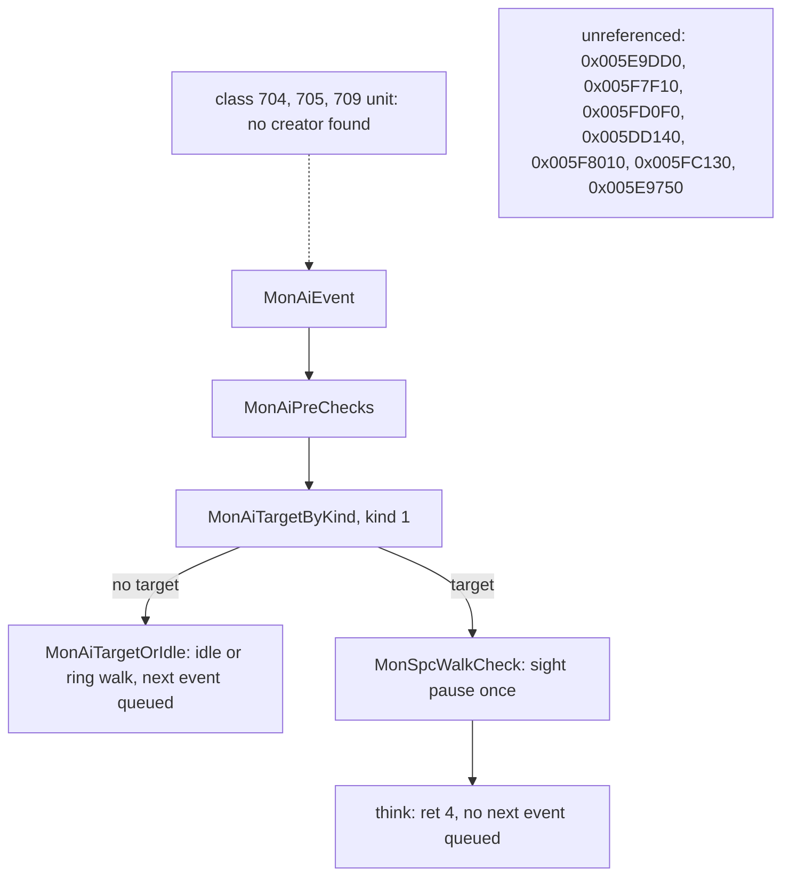

# 0016 — The Uber event: what drives Uber Mephisto, Uber Diablo and Uber Baal

> **Subsystem:** monsters/ai
> **Question:** what drives Uber Diablo, Uber Baal and Uber Mephisto, whose think functions (rows 147, 145, 146) only return: the event handlers on levels 133 to 136, the spawns and minion counts, the helpers with no reference from the AI table, Baal's class-709 teleport, and the 37 class and 3 state immediates of the batch 11 scan?
> **Date:** 2026-11-03   **Plan:** 0052 (Phase 1c)   **Status:** for review (`lane/r52n`)

Static reading of the pinned `Game.exe` in objdump (`workspace/logs/r52n/c1-asm.txt`, the ranges read; whole-image dump
`objdump -d -M intel`, sha256 `e0a3a565…`, not kept, regenerated from the pinned image), with the kept scans of
`workspace/logs/r52n/` (`manifest.sha256`, 14 lines): `c1-refs.py`/`c1-refs.txt`, `c1-classes.py`/`c1-classes.txt`,
`c1-sites.py`/`c1-sites.txt`, `c1-tables.py`/`c1-tables.txt`, `c1-unreached.txt`, `c1-diablo-diff.py`/`c1-diablo-diff.txt`,
`c1-rows.txt`, `c1-show.py`. Emulation: `tools/ai_uber_emu.py`, [run:2026-11-03-ai-uber](experiments.md#run2026-11-03-ai-uber). No game run.

## Answer (summary)

- [I] **No Uber-specific driver exists in this image, and nothing in it creates the three bosses.** Searched: the whole-image
  references of the helpers (absolute by `.reloc`, direct by a raw rel32 sweep, exports, RVA words), every operand naming the
  classes (§ 2), the data words holding them, the level ids 133–136 (§ 3), and the table paths (§ 4). (`c1-refs.txt`, `c1-classes.txt`,
  fn:sub_005E9DF0_AiUberDiablo@0x005E9DF0, fn:sub_005FD200_AiUberBaal@0x005FD200, fn:sub_005F81C0_AiUberMephisto@0x005F81C0)
- [I] **The driver of each boss, if one is ever created, is the generic machinery and nothing else.** All three:
  `MonAiEvent` (0x005B1740) with row kind 1. Without a target `MonAiTargetOrIdle` idles or ring-walks; with a target the
  boss sight pause fires once, then the think returns and **no next AI event is queued** by that event (§ 5). Uber Mephisto also has
  Conviction at level 20 from `UModAura`; none of the three commands a skill. (fn:sub_005B1740_MonAiEvent@0x005B1740,
  fn:sub_005DE890_MonAiTargetOrIdle@0x005DE890, fn:sub_005B1140_MonAiBossSightPause@0x005B1140)
- [I] **The helpers are unreferenced** after the kept scan: 0x005E9DD0, 0x005FD0F0, 0x005F7F10, 0x005DD140, and also 0x005F8010, 0x005FC130,
  0x005E9750: `RELOC=0 REL32=0 EXPORT=0 RVAWORD=0` each, with nine live controls hitting (§ 1). (`c1-refs.txt`)
- [I] **Baal's class-709 teleport is unreachable on the stock table:** 0x005FCB60 is called from rows 135 and 140 (and itself), and class 709 is on row 145
  alone. (0x005FD0C9, 0x005FD306, 0x005FCDED, tbl:MonStats.txt:AI)
- [I] **No event handler reads levels 133–136.** The eight readers of those ids are a preset filter, a portal-object test, a town-portal gate, a waypoint
  exit and DRLG build tests (§ 3). The `archaeology/0002` wording "the Uber Tristram handlers" named code that is not there (dated note filed). (fn:sub_005559A0_RoomPresetUnits@0x005559A0, fn:sub_0056D130_PortalObjectCreate@0x0056D130, 0x005BE2EE)
- [I] **The bosses' class-gated code that survives** is at creation (mods), at death (`cm2` and `std` once all three died), one combat test, one heal test and
  client display (§ 2, § 6). (fn:sub_005B1CF0_MonPostCreateBoss@0x005B1CF0, fn:sub_005A3250_UModQuestCompleteDeath@0x005A3250,
  fn:sub_005E0070_UberTristramDrop@0x005E0070)
- [C] The maps of § 7, ten families, 3 629 cases, 0 mismatches, each ending at its first callee or return (ADR-0021); not the callees and not reach.
  (run:2026-11-03-ai-uber)
- **Contradictions:** none with a reading of ai/0008 or ai/0012; one refinement (ai/0008's `flag` of 0x005F7F10 is a unit pointer, § 4) and
  ai/0012's open question closed, both with dated notes there.

## Leads used

No community source was read by this lane. ai/0014's verdicts C28 and C30 (Über Diablo's Pit Lords, Über Baal's specters) were `not covered`
for this reason; the classes those claims would need are the helpers of § 4, which no code calls in this image, so the realm behaviour they
describe is not in the file. (fn:sub_005E9DD0_UberDemonHoleSpawn@0x005E9DD0, fn:sub_005FD0F0_UberBaalMinionSpawn@0x005FD0F0)

## Functions

| Address | Name | Role | Conf |
|---|---|---|---|
| `0x005A3250` | `sub_005A3250_UModQuestCompleteDeath` | `g_UModEventFns` mod 22 event 1: per class, the death callee | I (map `[C]`, § 7) |
| `0x005DD140` | `sub_005DD140_UberCountCb` | search callback: counts living monsters within range by class; no reference | I (map `[C]`, § 7) |
| `0x004AFC10` | `sub_004AFC10_ClientState184Fx` | client, one caller (0x004B05B9): tests state 184 and not state 1 | I |
| `0x005E9DD0` | `sub_005E9DD0_UberDemonHoleSpawn` | one `demonhole` next to its argument; no reference | I (map `[C]`, § 7) |
| `0x005F7F10` | `sub_005F7F10_UberMinionSpawn` | one of classes 725–730; no reference | I (map `[C]`, § 7) |
| `0x005FD0F0` | `sub_005FD0F0_UberBaalMinionSpawn` | one of classes 732, 731; no reference | I (map `[C]` to `UnitGetRoom`, § 7) |
| `0x005E0070` | `sub_005E0070_UberTristramDrop` | the three flags, then the drop | I (map `[C]`, § 7) |

## Walkthrough

### 1. The helpers: the kept reference scan

- [I] `c1-refs.py` takes three views of the image: `ASM`, any operand naming an address inside the function in the linear objdump; `RELOC`, each of the image's
  63 121 HIGHLOW `.reloc` entries whose dword lands inside it (any absolute address in code or data carries one, so this does not depend on the sweep);
  `REL32`, every byte offset of `.text` holding `E8`, `E9` or `0F 8x` whose rel32 lands inside it, unaligned; plus the 24 exports and the 4-aligned
  RVA-sized words of `.rdata`, `.data` and `.rsrc`. Result: `0x005E9750`, `0x005E9DD0`, `0x005FC130`, `0x005FD0F0`, `0x005F7F10`, `0x005F8010`, `0x005DD140`
  have 0 of each from outside themselves. Two `ASM` hits for 0x005F7F10 (0x005F7EF5, 0x005F7EFD) are rel8 decodes inside the bytes before it, where ai/0008's range ends at
  0x005F7EF0 and `REL32`/`RELOC` give nothing. The nine `LIVE` controls hit: 0x005E9DF0, 0x005FD200, 0x005F81C0, 0x005E8480, 0x005FB410, 0x005A3250 by `RELOC`
  (0x0073D350, 0x0073D330, 0x0073D340, 0x0073D354 with 0x0073CD54, 0x0073CEE0, 0x0073C2CC) and 0x005E0070, 0x005FCB60, 0x005B1CF0 by `REL32`. (`c1-refs.txt`)
- [I] Scope of that "unreferenced": a computed address (a base plus an offset that lands inside) would have neither an entry nor a relocation pointing inside; no such base is known. A
  rel8 from the adjacent function is not swept: each helper is preceded by `int3` padding or a `ret`, so nothing falls into it. Runtime absence is case G4. (0x005E9DCC)

### 2. The 37 class immediates and the wider scan

- [I] `c1-classes.py` widens `b11-uber.py` to displacements, negative dwords and data words, and `c1-sites.py` classifies the sites by their read. Of the batch 11 scan's 37 immediates **20 are class tests, 12 not classes at
  all, and 5 record fields**, and the wider scan adds one class test, `add edi,0xfffffd40` at 0x004ACAC8 in `ClientMonNameBuild`; the displacements of the same values are frame slots and record fields. (`c1-sites.txt` `COUNTS`,
  fn:sub_004AC870_ClientMonNameBuild@0x004AC870)

  | sites | kind | reading |
  |---|---|---|
  | 0x004442F2, 0x00444309, 0x004443AD | not a class | index into `STRTABLE_GetByIndex` |
  | 0x004FBBD7, 0x00524D75, 0x0055C41E, 0x00571972, 0x005719A6, 0x0058BA3F, 0x005951F9, 0x0061A014, 0x0065D0B2 | not a class | a source line, alone or with a file pointer |
  | 0x00654A68, 0x00670B01, 0x00673667, 0x00673956, 0x00673CF3 | field | a record offset of a loader or maze table (0x298/0x2C0/0x344 arms), and a LvlPrest `Def` compare |
  | 0x004526D0/D7, 0x004ADFA3/AA, 0x004ACAC8 | class, client | range 704..709 skips the text path (0x004526DC, 0x004ADFAF), the name build's fixed strings |
  | 0x00454D3F/47/4F | class, client | with 243, 333, 242, 708, 707, 706, … a frame word = 4 |
  | 0x0046581C | class, client | 704 (with 543) calls 0x00470390(…, 3) with `EDX` 0x7A |
  | 0x0057D066 | class, server | 705 (with 243, 333) skips the `MonModeAllowed(6)` test in `COMBAT_GetHit` |
  | 0x0057D83B/42 | class, server | range 704..709 returns from `PreventHealHook` before its work |
  | 0x005A1748 | class, server | 704 in `UModAura`: Conviction level 20 (§ 6) |
  | 0x005B1E19, 0x005B1E89, 0x005B2013 | class, server | mods at creation (§ 6) |
  | 0x005DD189, 0x005DD19C, 0x005DD1B0 | class, unreferenced | the counter (§ 4) |
  | 0x005E0086 | class, server | the drop (§ 6) |
  | 0x005FCDED | class, server | Baal's teleport arm (§ 5) |

- [I] **No site passes 704, 705 or 709 as a class to a spawn function.** The ten data words equal to those values in `.rdata`/`.data` (`c1-classes.txt` `DATA`) are a prime list (0x006D016C), LvlPrest ids
  (0x006F01E8, 0x006F0228), halves of floats (0x006F4C4C, 0x006F4EE8, 0x00707B2C), a code pointer's low half (0x0073CA80), a UI block (0x0070DBA4) and two bit tables (0x0074B996, 0x0074BE0E). (`c1-classes.txt`)
- [I] **The 3 state immediates:** 0x005F7FFC, 0x005FD1EB (unreferenced helpers) and 0x005FB54F (`AiEvilHole`, live, only for class 711). Widening to every `push`/`mov` of `0xB8` (21 sites, `c1-classes.txt` `ST`) adds one reader, 0x004AFC29 (`UNIT_HasState(unit, 184)` in fn:sub_004AFC10_ClientState184Fx@0x004AFC10), and no other state
  use: the rest are skill 184 (`UModTeleport` 0x005A1619, `UModTeleportTry` 0x005B13AE, the client's 0x004ACD8A), a size or a line. `stats/0002`'s row lists setters, and they hold. (fn:STATE_Set@0x00639DB0, fn:UNIT_HasState@0x00639DF0)

### 3. Levels 133 to 136

- [I] `c1-classes.txt` `LVL` lists every `cmp`, `sub`, `add`, `lea`, `push` and `mov` of 0x85–0x88 (199 lines). Those that are level ids, from the read: **`RoomPresetUnits`** (0x005559F6–0x00555AA2, § below), **`PortalObjectCreate`** (0x0056D189–0x0056D19E: with level 39, in a town room,
  the object-60 portal passes a test at 0x0056D1A5), **`WaypointTravel`** (0x0058502D–0x00585045: with a town, 46 and 74, a stored 13), `ITEMUSE_TownPortal` (0x005BE2EE: level 136 refuses, as a town does),
  and the DRLG tests 0x0066C39B, 0x0066EBAD (133), 0x00672680 (133 with 19), 0x0067541C (134). The rest are not levels: frame sizes, source lines, table loaders' offsets, and states and skills read by value (0x0057C1A8 state 133, 0x00644157 state 134, 0x004976CB state 136; 0x005A8148 is class 136). (0x0056D189, 0x0058502D, 0x005BE2EE, fn:sub_00584F60_WaypointTravel@0x00584F60)
- [I] No code passes 133–136 as an immediate to a portal or level creator. With `CUBE_PandemoniumPortalStub` and `CUBE_PandemoniumFinalePortalStub` (`xor eax, eax`) that leaves the three openings of items/0008 § 5.2 closed. So these levels are not reached from stock play on this reading. (fn:CUBE_PandemoniumPortalStub@0x00594270, fn:CUBE_PandemoniumFinalePortalStub@0x00594280)
- [C] **The preset walk's filters** (`presets`, § 7), which drlg/0004 stated `[I]`: first pass, every unit that is not type 1 and has flags bit 0 clear: level 136 skips type-2 objects 26, 268, 269; levels 133 and 135 skip object 397; level 134 skips object 402 and increments `Game+0x1DE4` for any other type-2 object, skipping the one where the new value equals `Game+0x7C mod 3 + 3` (unsigned). The second pass (type 1) does not run on 136. Up to the first `PresetUnitSpawn` of the walk. (fn:sub_005559A0_RoomPresetUnits@0x005559A0, run:2026-11-03-ai-uber)
- [I] Past object 26 on level 136, `RoomGetLevelId` is called and its result discarded (0x00555A23–0x00555A2F). Object names (`c1-tables.txt`): 26 Gibbet, 268 wirt's body, 269 gold placeholder, 397 sparkly chest, 402 valley waypoint. (0x00555A29, tbl:Objects.txt:Name)
- [I] **The tables** (`c1-tables.txt`): levels 133–135 hold ordinary pools (133 `succubus8`, `succubuswitch9`, `corruptrogue6`, `cr_archer8`, `cr_lancer8`; 134 `swarm5`, `sandmaggot7`, `arach7`, `scarab8`; 135 `overseer6`, `dkmag3`, `megademon6`, `imp8`); level 136 has `MonDen` 0, `NumMon` 0 and no slot. (tbl:Levels.txt:mon1, tbl:Levels.txt:MonDen)

### 4. The spawns and the counts

- [I] **The three bosses.** No creator found (§ 2). The table has no path either: no Levels slot, SuperUniques `Class`, MonPreset `Place`, `minion`/`spawn`, `summon`, `PetType` or `NextInClass` names them (`tools/unreached.py`, `c1-unreached.txt`: 704–709 unreached; `c1-tables.txt` `SU uber []`, `MP uber []`). `MinGrp`/`MaxGrp` 1/1, `minion1`, `PartyMin` blank. (tool:unreached.py, tbl:MonStats.txt:minion1)
- [I] **Each helper makes one unit per call; with no caller there is no count.** No loop in any. (0x005E9DE5, 0x005F7FE5, 0x005FD1D6)
  - `0x005E9DD0(ECX game; unit)`: with a non-null `unit`, `SpawnNearUnitNoBox(unit, 711, mode 1, radius 4, 0x40)`. (0x005E9DE5)
  - `0x005F7F10(ECX game, EDX self; near)`: one step of `self`'s seed, `k = low & 7`, class `{725, 725, 726, 726, 727, 728, 729, 730}[k]`, `SpawnNearUnitNoBox(near or self, class, mode 8, radius 4, 0)`; `+0xC4 |= 0x4000000`, state 184. The eight modes are all 8. Its two leading position calls discard their results. (0x005F7FA3, 0x005F7FE5, 0x005F7FFC)
  - `0x005FD0F0(ECX game, EDX self)`: one step, `low & 1`: class 732 mode 1 or 731 mode 7 (733 with 8 is never indexed), `FreeNearFallback`, `SpawnAtPos`, `+0xC4 |= 0x4000000`, state 184. (0x005FD17D, 0x005FD1BC, 0x005FD1EB)
- [I] **`demonhole` (711)** runs the live `AiEvilHole` row, stock `aip1` 3 every `aip2` 25 frames (ai/0005 § 2.13), each spawn `SpawnClassByBase`'s class 712 `megademon6` (0x0063F18B–0x0063F1AE; −1 if the table holds no row 712) with state 184 and `+0xC4 |= 0x4020000`. Its one creator named in the code is the unreferenced 0x005E9DD0. So 3 per hole, had anything placed one. (0x005FB536, 0x005FB54F, fn:sub_0063EFA0_SpawnClassByBase@0x0063EFA0)
- [I] **`0x005DD140`** is a search callback `(EDX searcher; unit, block)`: for a living type-1 unit within `block+0x0C` by `AiDistUnits`: 704 → `+0x00`, 705 → `+0x04`, 709 → `+0x08`, 711 → `+0x14`, 712 → `+0x1C`, 731–733 → `+0x18`, any other → `+0x10`. It always returns 0. No search passes it. (fn:sub_005DD140_UberCountCb@0x005DD140, 0x005DD189–0x005DD210)
- [I] `sub_005F8010_PickPlayerWeighted`, `sub_005FC130_WeightedPickUnref` and `sub_005E9750_AiDiabloDecideUnref` keep ai/0008's and ai/0012's readings. 0x005E9750 against 0x005E8810: the ordered immediates differ (`c1-diablo-diff.txt` `IMMDIFF`, among them source lines 639/646 for 1356/1363), so the two are not one code at two addresses; the weights are not compared further, as neither table can matter for 0x005E9750 without a caller. (0x005E9750, 0x005E8810)

### 5. The driver, and Baal's teleport

- [I] **The event.** `MonAiEvent` runs `MonAiPreChecks`, `MonAiTargetByKind`, `MonSpcWalkCheck`, then `AiCtl.think` (ai/0001 § 1), and returns after the think with nothing more (0x005B186F–0x005B1876). Rows 145, 146, 147 are kind 1 (`c1-rows.txt`, the words at 0x0073D328, 0x0073D338, 0x0073D348), so with no target the think does not run and `MonAiTargetOrIdle` idles (a next event is queued) or ring-walks. (fn:sub_005B1650_MonAiTargetByKind@0x005B1650, tbl:MonAI.txt:AI)
- [I] **With a target,** for these classes: `MonAiBossSightPause` (`boss` 1 in the table) sets flag 0x10 at distance below 20 from a player, once, and `MonAiIdle(20)` stops that event. `UModTeleportTry` needs `AiCtl` flag 0x20, the handler of mod 26 (`g_UModHandlers[26]` is 0x005A1600), and no Uber class gets mod 26 (§ 6). `MonSpcWalk` needs `isMelee`, blank on all three, and levels 133–136 have 0. Then `ret 4`. (0x005B11C2, 0x005B121A, fn:sub_005A1600_UModTeleport@0x005A1600, tbl:MonStats.txt:isMelee)
- [I] **So the AI clock stops at the first event past the pause.** A think that queues nothing leaves no kind-2 record; ai/0001 § 2's other queuers are `MonModeStartNeutral` and the mode-end calls, so the next AI event needs a mode change from outside, such as a hit. What that looks like in play is case G1. The rows' `alt`s (Baal's, Diablo's; Mephisto has none) run once after a state switch, ending in `Idle(1)` (ai/0012 § 2.1). (fn:sub_005A73E0_MonModeStartNeutral@0x005A73E0, fn:sub_005E8480_AiDiabloAlt@0x005E8480, fn:sub_005FCF30_AiBaalAlt@0x005FCF30)
- [C] **The teleport arm** (`bact14`, § 7). `AiBaalAct` with `k` 14 and a target computes the point `U + 25·(U − T)/edge` for each axis, then for class 709 calls `MonAiUseSkill(mode = MonStats +0x184, skill = s16 +0x178, 0, T.x, T.y)`, the target's own point; any other class goes on to `SpawnPosPick` with the computed point. To `MonAiUseSkill` or `UnitGetRoom`. (0x005FCDED, 0x005FCE15, 0x005FCE31, run:2026-11-03-ai-uber)
- [I] Who reaches it: `AiBaalAct`'s calls are 0x005FD0C9 (row 135), 0x005FD306 (row 140) and its own two (0x005FCD80, 0x005FCE81), `c1-refs.txt`; `MonAI.md` has 709 on row 145 alone, whose think never calls it. (fn:sub_005FCB60_AiBaalAct@0x005FCB60)

### 6. What the classes do get

- [C] **At creation,** first call of `MonPostCreateBoss` by BaseId and class (`postc`): 704, 705, 709 `ModAppendApply(22, 1)`, 707 `(23, 1)`, 706, 708 `(6, 1)`, and the non-uber classes of each base their own first call (mod 22 or the quest hook 13, 20, 36). The later mods stay monsters/0003's `[I]`: 704 → 22, 30, 17, 8, 6; 705 → 22, 8, 6; 709 → 22, 18, 8, 6. Names (`c1-tables.txt`): 6 `fast`, 8 `resist`, 17 `lightning`, 18 `cold`, 22 `questcomplete`, 30 `aura`. (fn:sub_005B1CF0_MonPostCreateBoss@0x005B1CF0, run:2026-11-03-ai-uber)
- [C] **Conviction** (`aura`): `UModAura` with a non-zero flag, on class 704, reaches `UnitSkillAdd(unit, 123, 20, 1)` (the local seed before it not compared), and a non-704 class does not take that site. This reaches the arm monsters/0003 listed as not reached. The following `PlayerSetSkill` is not covered. (0x005A175C, fn:sub_005A1650_UModAura@0x005A1650, run:2026-11-03-ai-uber)
- [C] **At death,** `g_UModEventFns[6·22 + 1]` is 0x005A3250 (0x0073C2CC). Over all 734 classes, mode 0: 704, 705, 709 and no other reach `UberTristramDrop`, other classes have their own (`check.txt` `ARM`: 156, 229, 242, 256, 267, 479, 540–542) or none; any other mode, none. (`qdeath`, run:2026-11-03-ai-uber)
- [C] **The drop** (`drop`): 709 sets `Game+0x1DE8`, 705 `+0x1DEC`, 704 `+0x1DF0`, and with all three non-zero the unit's `+0xB8` becomes `cm2 ` and `DropItemAtUnit(game, unit, 7, &ilvl, 0, −1, 0)` runs; any other class takes the fatal line path 0xE6. The `std` copies (`Game+0x8C`, quality 2) after that call stay items/0010's `[I]`. (0x005E0108, fn:sub_00559A30_DropItemAtUnit@0x00559A30, run:2026-11-03-ai-uber)
- [I] The event slots of those mods (`g_UModEventFns`): 17 → events 1, 2, 4 (0x005A37D0, 0x005A29A0, 0x005A2BA0); 18 → events 1, 2 (0x005A3800, 0x005A2BD0); 6, 8, 30 none; so 704 and 709 carry enchant hooks, not read here. `Game+0x1DE0`–`+0x1DF0` are zeroed at 0x00530B1D and copied at 0x00450CDB; `+0x1DE0` has no other reader or writer. (data:g_UModEventFns@0x0073C0B8, 0x00530B1D, 0x00450CDB)

### 7. Emulation (run:2026-11-03-ai-uber)

- [C] Ten families, 3 629 cases, all matching, none stopped (`emu/check.txt`). What each declares and where it ends is the docstring of `tools/ai_uber_emu.py`; `ucount`, `dhole`, `umin`, `bmin`, `drop`, `presets`, `bact14`, `aura`, `postc` 240 each, `qdeath` 1 469 (every class in mode 0 and another mode, and a null unit). Controls fail every case they separate, the site control passes none. (run:2026-11-03-ai-uber)

  | family | function | separating (control) |
  |---|---|---|
  | `ucount` | 0x005DD140 | 21 `cmp`, 7 `cls` |
  | `dhole` | 0x005E9DD0 | site only (183 boundary, 57 return) |
  | `umin` | 0x005F7F10 | 210 `lo3` |
  | `bmin` | 0x005FD0F0 | 114 `lo3` |
  | `drop` | 0x005E0070 | 49 `cls` |
  | `qdeath` | 0x005A3250 | site only |
  | `presets` | 0x005559A0 | 30 `pass`, 21 `cnt` |
  | `bact14` | 0x005FCB60 | 87 `b709` |
  | `aura` | 0x005A1650 | site only |
  | `postc` | 0x005B1CF0 | 124 `base` |

- [I] **Not covered** (ADR-0021): reach, every callee, every store after a boundary: the mods after the first, the `std` copies, spawns of a walk past its first, `FreeNearFallback` and `SpawnAtPos` in 0x005FD0F0, so its class pick is compared as the frame's tables and `EDI`, not as a call. `qdeath`'s two byte tables and two jump tables are read from the image by the tool itself, so its map is the code against its own tables with the arms' call sites as the check. `aura`'s non-704 cases compare only the call site. `ucount` and `bact14` run with no MonStats2 row, size 0.

### 8. Cases that need the game (for a later harness or owner-play session)

None is scheduled by this lane; Phase 2 does not need them.

- **G1, forced (ADR-0010, -0013):** a Levels `mon` slot edited to `ubermephisto`, `uberdiablo`, `uberbaal` in a reachable level, the AI log on: think runs, no command, the clock stops, what a hit restarts. The claims of § 5 read no edited cell except the pool's, which is the delivery.
- **G2, forced, owner-play or harness:** kill the three in one game: the mod-22 death path, the flags, `cm2` then `std` per player.
- **G3, forced:** class 704's Conviction level in play.
- **G4, stock:** breakpoints on the seven unreferenced entries over a stock session with a live control (a `LIVE` row of `c1-refs.txt`), to meet § 1's scope with a window.
- **G5, needs an edited warp or portal stub:** the preset filters on 133–136 in a real walk, and drlg/0007's open question (133 → 17 with no back-link).

## Data touched

`MonStats` (`AI`, `boss`, `isMelee`, `minion1`, `MinGrp`, `MaxGrp`, `spawn`), `Levels` (133–136), `MonUMod`, `Objects`, `States` 184, `MonAI`. No meaning moves: no archivist entry.

## Dead ends

- A text diff of 0x005E9750 and 0x005E8810: register allocation differs throughout; only the immediates compare (`c1-diablo-diff.txt`).
- The `+0xC4 |= 0x4000000` flag as an Uber mark: seven other sites write it (0x00541FB1, 0x0056D8A4, 0x0057449B, 0x005CB042, 0x005CB089, 0x005CB4B8, 0x005F9DE6); no meaning drawn.

## Open questions

- Who else could set `AiCtl` flag 0x20 for an Uber class: only mod 26's handler is named (ai/0001); not scanned for other writers here.
- The realm-side behaviour (why the helpers stayed and their callers did not) cannot be read from this image.
