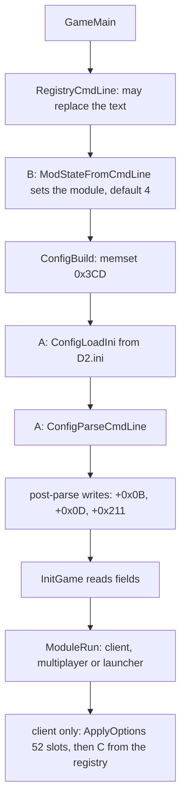

# 0001 — The switches: command-line options, chat commands, debug globals and flagged messages

> **Subsystem:** archaeology
> **Question:** which options does the game accept, what does each set, who reads it, and which ones change a specified outcome?
> **Date:** 2026-11-04   **Plan:** 0062 (Phase 1)   **Status:** for review (`lane/r62a`)

Static reading of the pinned `Game.exe`; no emulation and no harness (no value below needs one: plan 0062 owner question 3).
Kept scan: `python3 -I tools/switches_scan.py <game.exe> <section>`, outputs under `workspace/logs/r62a/` (`manifest.txt`,
one file per section; `dev/` and `dev/pass2/` hold the earlier passes, each with its manifest). Every count below is a line of those files.

## Answer (summary)

- [I] Three option parsers exist, not one. **A:** the 58-row `g_CmdLineOptions`, filled from `D2.ini` and then from the
  command line (§ 1, § 2). **B:** six module names, a separate `strtok` scan of the same command line (§ 3). **C:** nine
  rows registered with a second table parser that is reached only from the registry value `Default Command Line` (§ 4).
  (data:g_CmdLineOptions@0x00705040, fn:sub_004058A0_ConfigParseCmdLine@0x004058A0,
  fn:sub_00406340_ModStateFromCmdLine@0x00406340, fn:sub_0044B6B0_ClientInitOptions@0x0044B6B0)
- [I] **Of A's 58 rows, 17 have no reader and no writer in the traced code**: `-fr -i -nm -m -minfo -md -rare -unique
  -msglog -safe -nopk -cheats -teen -npl -lem -questall -openc`. They parse and no traced code follows ("no traced use", not "unused": `-fr -i -openc` rest on the pointer walk alone, § *What the scan covers*). `-opengl` has a reader that
  can't see it set, since the bootstrap clears the byte after parsing. So, within the traced code, the classic developer switches for monsters,
  items, invincibility and cheats do nothing in 1.14d. (`dead.txt`, 0x00406595, fn:sub_004064C0_GameMain@0x004064C0)
- [I] The switches that change a specified outcome are `-seed`, `-act`, `-txt`, `-direct`, `-nosave`, `-gametype`, the class
  rows with `-name`, `-arena`, `-ctemp` and the chat command `/players` (§ 7 names each one's section). `-nosave`
  is in no spec yet. *Corrected 2026-11-04 (`lane/r70`, from the `lane/s69` review): [save/d2s](../../specs/save/d2s.md) § C states it since plan 0062's Phase 3; § 7's State cells for `-nosave`, the class rows, `-name`, `-ctemp`, `-arena` and `/players` are stated. The review verified the cells for `-seed`, `-act`, `-txt`, `-direct` and `-gametype`.* (fn:sub_0044D580_ApplyNoSaveOption@0x0044D580, data:g_SaveEnabled@0x007310CC)
- [I] The in-game chat parser's own commands are `/fps`, `/framerate`, `/players`, `/nopickup` and the unslashed
  `soundchaosdebug`; no compare of a chat string against an immediate was found in the server range. (fn:sub_0047C420_ChatInputParse@0x0047C420, `compare.txt`)
- [I] `Game+0x1DC8`, the debug fault switch `GameTick` reads, has one identified writer, in a function nothing references: the
  `<ABEND> ` handler has 0 references, 0 pointers, 0 relative branches. `SetServerFps` is the same. In the stock image
  both stay at their initial state. (fn:sub_0052F630_HostAbendMsg@0x0052F630, fn:sub_0052DF80_SetServerFps@0x0052DF80, `findptr.txt`)
- [I] The second word of `g_SrvPacketTable` has **no reader**: the only code references to the table are the dispatcher's
  three, all on the handler word. So the table flags nothing as developer-only by any code path; 54 of the 102 opcodes
  carry 1 and it decides nothing. The candidates for removed messages are the 9 stub handlers and 11 null slots. (data:g_SrvPacketTable@0x006E0D18, fn:sub_0054D750_SrvPacketDispatch@0x0054D750, `packets.txt`)

## What the scan covers and can't see

- **Covered, A's rows.** 58 by the loop bound `0x14D8 / 0x5C` of both the ini reader and the lookup; 58 distinct switch names on
  55 distinct offsets (`table.txt`). Nothing else references the table's first row: the 13 code references to its span sit in `ConfigLoadIni`,
  `OptionFind` and `ConfigParseCmdLine`; a reference into a later row by its absolute address was not searched. (0x004054A0, 0x00405578, 0x00405920)
- **Covered, readers.** The config is a stack buffer of `sub_004064C0_GameMain`, 0x3CD bytes (0x004059A2 is the only
  `0x3CD` in `.text`). The scan walks it from every place the pointer is known to live: three globals written by the module
  entries (client 0x0044B8A9, multiplayer 0x00442153, launcher 0x004359D8), their loads, the 52 handler slots, and
  `InitGame`, `ClientRun`, `MultiplayerRun`/`MultiplayerInit`, `LauncherRun`, `LauncherNetCfg`, `0x0043B7A0` and the one
  `sub_0044B7A0_ClientGetConfig` call. Every escape it prints (`fields.txt`, 60) was read: the pushes go to
  `MPQ_OpenGameArchives`, which reads only `+0x211`, and to `ModuleRun`; `call X` lines with ECX live
  are the linear walk's over-approximation unless the callee reads ECX at entry (`entry-reads-ecx=`). The one such callee
  with a config ECX, `0x0043C180`, is a declared root. **The walk is not closed by construction:** it missed `0x0043B7A0`, whose config arrives in
  ECX from a register the walk had dropped, until the second net below showed `+0x225` hits outside it; that function is now a root. So a row's "None" is as strong as the two nets together, and weakest for the three small offsets named below.
- **Second net.** `disp.txt` counts, per offset over 1 067 138 disassembled instructions, every `[…+offset]` and `add/sub reg,offset`. For
  `-minfo -md -rare -cheats -teen -npl -lem -questall` the count is 0. For `-nm -m` it is one `sub reg,` each,
  on other values (0x004B094A, 0x0054E68F). For `-msglog`, `-unique`, `-safe`, `-nopk` the hits read here are other structures
  or frames: `DBG-MODULE` printing (0x00402CB5), CRT code (0x00688BE9), `sub esp`, the return of `0x0061DB70` (0x0044C989), and for `-nopk` two offsets from text-layout values (0x0047B463, 0x0047B905, bases not traced further). For `-fr` (97), `-i` (124) and `-openc` (129) the
  counts are too large to read one by one and the statement rests on the pointer walk alone.
- **Not visible.** (1) `objdump`'s linear sweep can misdecode around data in `.text`. (2) A reader that holds a pointer
  into the config from a `lea` of a neighbouring field and walks from it. (3) Indirect calls with the config in a register: three are printed
  (0x00435B2D, 0x00441FDA, 0x0043B7E8), each through a `+0x225`-style interface whose methods were not followed. (4) Inline byte-loop string compares that are not `repz cmps`
  and not a call: `compare.txt` sees calls of the named routines and `repz cmps` only; `strings.txt`'s word list is the
  only net over those. (5) The ret-only handler slots can't say which option they once served, and the slots are not indexed by
  row (52 slots, 58 rows, in an order that drifts). (6) The ini path and the registry values are read, not exercised. (7) What the launcher
  and multiplayer modules do with the fields no option writes (`+0x1EF`, `+0x209`, `+0x22D`, `+0x35E`, `+0x361` …) is out of this
  phase: they are inter-module state, listed at the end of `options.txt`.

## 1. Where the config comes from



- [I] `sub_004064C0_GameMain` takes the last `argv` as the text, then runs `RegistryCmdLine`, the module scan
  with a default of 4 (launcher), `ConfigBuild`, the post-parse writes, and `InitGame`. (fn:sub_004064C0_GameMain@0x004064C0)
- [I] `RegistryCmdLine`: empty text and registry `UseCmdLine` non-zero → the text is the registry's `CmdLine`, and `UseCmdLine` is cleared. Non-empty
  text is stored back as `CmdLine` with ` -skiptobnet` appended; empty with `UseCmdLine` 0 stores `-skiptobnet`. Under the service
  flag `0x0074C720`, `SvcCmdLine` replaces the text. (fn:sub_00405F00_RegistryCmdLine@0x00405F00, 0x00405FA0)
- [I] `ConfigBuild` zeroes 0x3CD bytes, reads every row from `D2.ini`, and parses the command line; so the command line wins and
  an ini can set any row. Row 21 (`-ama`) and row 36 (`-act`) default to 1 through `GetPrivateProfileIntA`'s default, written even when
  no ini exists. (fn:sub_004059A0_ConfigBuild@0x004059A0, fn:sub_00405450_ConfigLoadIni@0x00405450)
- [I] **Post-parse writes**, base `ebp−0x4D8`: `+0x211` = `0x00405EF0` (a function pointer `MPQ_OpenGameArchives` calls); `+0x0B` = 0,
  which kills `-opengl`; and if `+0x0A` (`-3dfx`) is 0, `+0x0D` (`-d3d`) = (`+0x08` (`-w`) == 0). So `-d3d` is what the build selects
  when not windowed, whatever was typed. (0x0040658B, 0x00406595, 0x004065A9)
- [I] Parsed options reach game code only in the client module: `ApplyOptions` has one caller, `ClientInitOptions`.
  The launcher and multiplayer modules read the config directly, and `InitGame` reads its fields before any module.
  (fn:sub_0044D9F0_ApplyOptions@0x0044D9F0, 0x0044B6E3)

## 2. Parser A's grammar

```c
// fn:sub_004058A0_ConfigParseCmdLine@0x004058A0, fn:sub_00405710_OptionNextSwitch@0x00405710 (trimmed)
for each index i of text:
  if text[i] == '-':
    token = text[i+1 .. next '-' or end]     // a value can't hold '-'
    if len(rest) > 0xFF: fatal string 0x103
    lower-case token in place (A..Z only)
    for n = len(token) down to 1:            // longest prefix that is a row's switch
      token[n] = 0; row = OptionFind(token); if row != -1: break
    value = original-case text after the n matched chars, then OptionTrimValue
    switch row.type: 0: byte = 1; 1: dword = atol(value); 2: strcpy(field, value)
```

- [I] The match is the **longest prefix**, so `-seed123`, `-act5` and `-w:foo` all work, and a word that merely starts with a one-letter switch
  sets it: `-invincible` sets `-i`, `-server` sets `-s` to `erver`, `-multiplayer` sets `-m`. `-w`, `-s`, `-i`, `-m` are the one-letter rows. (fn:sub_00405710_OptionNextSwitch@0x00405710, fn:sub_00405570_OptionFind@0x00405570)
- [I] `OptionTrimValue` skips leading space, tab, newline and `:`, and ends the value at the next one of them. (fn:sub_00405610_OptionTrimValue@0x00405610)
- [I] A type-2 value is copied with no bound on the command line (the ini reader bounds it at 0x1B), so a long value runs on into the next
  fields of the config; the token limit is 0xFF. (0x00405920 onward; 0x004054FC region for the ini)
- [C] `-seed -5` gives an empty value and no override, since the `-` ends the token (held from the earlier reading; fn:sub_004058A0_ConfigParseCmdLine@0x004058A0, 0x00405784, run:2026-10-16-sweep-roomk).

## 3. Parser B: the module names

- [I] `ModStateFromCmdLine` copies the text and splits it with `strtok(text, "-")`; for each token and each of six names it does
  `strncmp(token, name, strlen(name))` and, for a match other than index 1, sets the module state. The last match wins. (fn:sub_00406340_ModStateFromCmdLine@0x00406340, data:g_ModStateNames@0x007065C4)
- [I] `g_ModuleTable` holds {enter, leave} per state. `InitGame` loops `state = ModuleRun(config)` until 0. (data:g_ModuleTable@0x00706554, fn:sub_004059D0_ModuleRun@0x004059D0)

| Index | Name | Enter | Effect | Tag |
|---|---|---|---|---|
| 0 | `-modstate0` | | the `InitGame` loop does not run | [I] |
| 1 | `-client` | 0x0044B400 | excluded by the scan (`iVar6 != 1`); reached by return values, not by this switch | [I] |
| 2 | `-server` | null | `InitGame` skips archives and video, then `ModuleRun` fatals (string 0x133). No server module in this build. Also sets parser A's `-s`. | [I] |
| 3 | `-multiplayer` | 0x0043CBE0 | multiplayer module. Also parser A's `-m`, which has no reader | [I] |
| 4 | `-launcher` | 0x0042E590 | the default | [I] |
| 5 | `-expand` | 0x0044B400 | the client's entry again | [I] |

## 4. Parser C: the registry-only table

- [I] `ClientInitOptions` registers eight rows from `g_ClientOptionTable` and `-lng`, runs `ApplyOptions`, then parses the registry value
  `Default Command Line`, if it exists, with `OptionTableProcess`. The routine that would feed it `GetCommandLineA`, `0x006C50B0`, has no reference, so typing these on the command line reaches nothing of C. (fn:sub_0044B6B0_ClientInitOptions@0x0044B6B0, fn:sub_006C50B0_OptionTableProcessCmdLine@0x006C50B0, `findptr.txt`, `scmd.txt`)

| Row | Handler | What it does | Tag |
|---|---|---|---|
| `-?`, `-h`, `-help` | 0x0044B4E0 | a message box with the usage text at 0x006D5B20, once | [I] |
| `-set VALUE` | 0x0044B5E0 | writes `Default Command Line` | [I] |
| `-mode NAME` | 0x0044B600 | matches a 7-entry name table with one non-null name, `Game` (index 2), and stores the index in `0x0070EE4C`; `ClientRun` overwrites that word with 3 right after (0x0044B941), so no effect found | [I] |
| `-c` | 0x0044B550 | allocates 0x6000000 bytes, touches each 0x1000th, frees | [I] |
| `-r` | 0x0044B5A0 | toggles `0x007A2784` (read through 0x00451980; readers unfollowed) | [I] |
| `-p` | 0x0044B5B0 | toggles `0x007A277C` (read through 0x00451910; readers unfollowed) | [I] |
| `-lng FILE` | registered 0x0045127C | string into `0x007A0710`, read by `0x00451330` | [I] |

## 5. Parser A, every row

`T` is the type (0 byte flag, 1 integer, 2 string). "None" is the scan's result under § *What the scan covers*.
`table.txt` has section, key and default per row. Handler addresses are slots of `g_OptionApplyTable`, run with ECX = config. [I] throughout.

| Switch | T | Offset | Target and readers |
|---|---|---|---|
| `-crash` | 0 | `+0x004` | `InitGame` 0x00405C3F: dword == 1 → `sub_00407970_NullWriteCrash` |
| `-w`, `-window`, `-windowed` | 0 | `+0x008` | `InitGame` 0x00405CD2, 0x00405CF1 (video mode); 0x0044D760 → `g_RenderMode` = 1 and `0x007BB38C` = 1 |
| `-nofixaspect` | 0 | `+0x009` | `InitGame` 0x00405DE3; 0x0044D770: both clear `0x0072DA7C` through 0x004F5280 |
| `-3dfx` | 0 | `+0x00A` | `InitGame` 0x00405CB3 (mode 4); 0x0044D780 → `g_RenderMode` = 4 |
| `-opengl` | 0 | `+0x00B` | 0x0044D790 → `g_RenderMode` = 5, but the byte is cleared at 0x00406595: **never set** |
| `-rave` | 0 | `+0x00C` | 0x0044D7B0 → `g_RenderMode` = 7 |
| `-d3d` | 0 | `+0x00D` | overwritten at 0x004065A9 unless `-3dfx`; `InitGame` 0x00405CDD; 0x0044D7A0 → `g_RenderMode` = 6 |
| `-per` | 0 | `+0x00E` | `InitGame` 0x00405D2D: mode above 3 → 0x004F51E0(1) |
| `-lq` | 0 | `+0x00F` | `InitGame` 0x00405DA5 → toggles `0x0072DA50` |
| `-gamma` | 1 | `+0x010` | `InitGame` 0x00405DB0, 0x0044D7D0 → 0x004F5230 |
| `-vsync` | 0 | `+0x014` | `InitGame` 0x00405DBD, 0x0044D7E0 → `0x0072DA58` = 1, a word with **no reader** in the scan |
| `-fr` | 1 | `+0x015` | None traced (97 raw hits unread; walk only) |
| `-gametype` | 1 | `+0x019` | 0x0044D62D → `g_ClientGameMode` (34 other references); `ClientRun` 0x0044B927 (== 6), 0x0044B9C5 (exit switch); launcher and multiplayer write it |
| `-joinid` | 1 | `+0x01D` | 0x0044D636 (word) → `0x007A0520`, read at 0x0044F4AA for the join message 0x00477F70 |
| `-gamename` | 2 | `+0x01F` | 0x0044D61F → `g_ClientGameName`, read at 0x0044F459 for `ClientGameCreateMsg`; getter 0x0044B7C0 |
| `-s` | 2 | `+0x037` | 0x0044D5F5: unless `"0"`, → `0x0070EF20` (read 0x0044BCA2, 0x0044BCC0); getter 0x0044B820 |
| `-bn` | 2 | `+0x04F` | 0x0044D659 only tests it; the copy to `0x0070F028` takes **`+0x37`**, not this field (0x0044D66E) |
| `-mcpip` | 2 | `+0x067` | 0x0044D682 → `0x0070F130`, which nothing else references |
| `-nopk` | 0 | `+0x083` | None |
| `-openc` | 0 | `+0x084` | None traced (129 raw hits unread; walk only) |
| `-ama` `-pal` `-sor` `-nec` `-bar` | 0 | `+0x085`..`+0x089` | 0x0044D6B0 → `g_ClientClass` = 0, 3, 1, 2, 4; later bytes win. `+0x08A` → 5 and `+0x08B` → 6 have **no switch** (the launcher writes them, 0x00431E70) |
| `-i` | 0 | `+0x08C` | None traced (124 raw hits unread; walk only) |
| `-name` | 2 | `+0x0BD` | 0x0044D892: unless `"0"`, first 16 bytes → `g_ClientName`; also 0x0044E5C2, multiplayer and launcher |
| `-realm` | 2 | `+0x0D5` | 0x0044D902 → `0x007A0500` (read 0x00457FA8, 0x004696BA); launcher clears |
| `-ctemp` | 1 | `+0x1ED` | 0x0044D960 (low byte) → `g_CTemp`, overwriting the image's 1; `CTempGet` at 0x00477CEC and 0x00477FBC |
| `-nm` `-m` `-minfo` `-md` | 0,1,0,1 | `+0x1F1` `+0x1F2` `+0x1F6` `+0x1F7` | None |
| `-rare` `-unique` | 0 | `+0x1FB` `+0x1FC` | None |
| `-act` | 1 | `+0x1FF` | 0x0044D5A0: 0 skips; outside 1..5 fatal (strings 0xD26, 0xD27); else `SetStartAct(N − 1)` |
| `-npl` | 0 | `+0x203` | None |
| `-direct` | 0 | `+0x204` | `InitGame` 0x00405C55 → `sub_00406870_InitFileIO`'s argument |
| `-lem` | 0 | `+0x205` | None |
| `-nocompress` | 0 | `+0x206` | `InitGame` 0x00405D13 (inverted, fourth argument of 0x004FA520); 0x0044D9A0 → 0x005FE280 |
| `-arena` | 1 | `+0x207` | `ClientGameCreateMsg` 0x00477D33 (low word). The dword also overlaps the low word of `+0x209`, the message's next field *Corrected 2026-11-04 (`lane/r70`, from the `lane/s69` review): `+0x207` and `+0x209` are offsets of the config block `g_ClientConfig` (loaded at 0x00477D07), not of the message. The function copies the block's low word at `+0x207` to the message at `+0x25` (0x00477D33, 0x00477D3A) and the block's dword at `+0x209` to the message at `+0x27` (0x00477D3E, 0x00477D44); the message starts at `[ebp-0x30]` (0x00477CB0).* |
| `-txt` | 0 | `+0x215` | 0x0044D9C2 → `DATATBLS_SetCompileTxt(+0x215 == 0)` |
| `-log` | 0 | `+0x216` | 0x0044D840 → `sub_00624B50_LogEnableSet(1)`; `g_LogEnabled` read at 0x00624793, 0x00624950 |
| `-msglog` | 0 | `+0x217` | None |
| `-safe` | 0 | `+0x218` | None |
| `-nosave` | 0 | `+0x219` | 0x0044D580 → `g_SaveEnabled` = 0 (image 1) |
| `-seed` | 1 | `+0x21A` | 0x0044D860: non-zero → `GAME_SetSeedOverride` |
| `-cheats` | 0 | `+0x21E` | None |
| `-teen` | 0 | `+0x21F` | None |
| `-ns`, `-nosound` | 0 | `+0x220` | `InitGame` 0x00405E09 (skips 0x00514530); 0x004DCA38 |
| `-questall` | 0 | `+0x221` | None |
| `-build` | 0 | `+0x223` | launcher 0x004337C3: appends the text at 0x006D48D0 to its version line |
| `-sndbkg` | 0 | `+0x224` | `InitGame` 0x00405E1C; client 0x0044F4D4 → 0x00482260 |
| `-comint` | 1 | `+0x225` | 0x0044D970 → `0x007A05F4`; `ClientGetComInt`; `MultiplayerInit` 0x00441BA7; `LauncherRun` 0x00435B0E; `InitGame` 0x00405EC2. Used as an interface pointer. Non-zero skips the launcher's factory (0x0043B7A3; 0x00518C00's result stored at 0x0043B7D9), so a typed integer is called through (0x00405EC2 `+0x10`) |
| `-skiptobnet` | 0 | `+0x35D` | launcher 0x00435BB3 reads, 0x00435BD7 clears; also appended by `RegistryCmdLine` |

- [I] `g_OptionApplyTable`: 52 slots, 2 null, 39 distinct handlers, 16 of them a bare `ret`. One handler reads no field: 0x0044D920 always sets bit 0 of
  `g_ClientFlags`. (`handlers.txt`, data:g_OptionApplyTable@0x0070F488)

## 6. Chat and other commands

- [I] `sub_0047C420_ChatInputParse`, called once (0x0047CC4D), tests in this order: (fn:sub_0047C420_ChatInputParse@0x0047C420)

| Text | Compare | Effect | Tag |
|---|---|---|---|
| `/fps` | `stricmp` | 0x00477C60, then returns | [I] |
| `/framerate` | `stricmp` | 0x00477C00, then returns | [I] |
| `/players N` | `strnicmp` 8 | only in client modes 0, 1, 6, 8: `atol` clamped to 1..8, `SetPlayersOverride`, the text replaced by `players set to %d`, and the parse **goes on** with that text | [I] |
| `/nopickup` | `stricmp` | toggles `g_NoPickup`; while set, `0x00467AC0` skips units of type 4 (0x00467B16, 0x00467C46) | [I] |
| `soundchaosdebug` | `stricmp` | no slash; toggles `g_SoundChaos` through 0x004BABC0, and on turning off calls 0x004BAA50 | [I] |
| `/ignorepersist`, `/ignore`, `/squelch`, `/unignore`, `/unsquelch`, `/filtermsg`, `/unfiltermsg` | 0x0047B3B0 | ignore-list verbs, by name and by the interface slots they call; `/msg /m /whisper /w /help /?` are compared at 0x0047C7E2–0x0047C84C, unread beyond the compares | [I] |

- [I] In `compare.txt` the only hits in 0x0052F000–0x005FFFFF are `<ABEND> ` (0x0052F6A4) and `Cracked` (0x005764F9, 0x00579647, callers not read; not reached from the chat parser by anything read). No command table was found, on the server side or in the client. The plan's open question, whether 1.14d keeps a developer chat command, has the answer `soundchaosdebug` alone, within what the compare scan sees. (`compare.txt`)
- [I] `delete `, `extract `, `execute ` (0x0051F020–0x0051F07D, in `0x0051ED00`) are a further text-command parser, unread. Open question 2.

## 7. Behaviour-changing switches and the section each changes

| Switch | Effect | Section | State of the section |
|---|---|---|---|
| `-seed N` | map and game seed override | [rng/seeds](../../specs/rng/seeds.md) § Algorithm step 1; [chain](../../specs/chain/README.md) | stated |
| `-act N` | `g_StartAct`, grants in `PLAYER_InitBaseStats` | [player/creation](../../specs/player/creation.md) § Entry points and B5 | stated |
| `-txt` | compile tables from `.txt` | [data/excel](../../specs/data/excel.md) § B; [data/calc](../../specs/data/calc.md) § C; [data/strings](../../specs/data/strings.md) | stated |
| `-direct` | loose files first | [data/README](../../specs/data/README.md) § Data flow | stated |
| `-nosave` | [I] `sub_00531EB0_SaveViaCallback` returns 0 and `PLRSAVE_WriteFile` skips its body while `g_SaveEnabled` is 0 (0x00531ED1, 0x00532257) | [save/d2s](../../specs/save/d2s.md) § C. Writing a save | stated (plan 0062 Phase 3) *Corrected 2026-11-04 (`lane/r70`, from the `lane/s69` review): the cell read "not stated: Phase 3".* |
| `-gametype N` | `g_ClientGameMode`, the create message's type byte and the `/players` gate | [items/economy](../../specs/items/economy.md) § G (the create message); [player/party](../../specs/player/party.md) § E | stated for the value, not its source |
| `-ama` … `-bar`, `-name` | the create message's class and name bytes (0x00477CF6, `g_ClientName`) | [player/creation](../../specs/player/creation.md) § Entry points | stated (plan 0062 Phase 3) *Corrected 2026-11-04 (`lane/r70`, from the `lane/s69` review): the cell read "not stated: Phase 3", also for `-ctemp`.* |
| `-ctemp N` | replaces the class byte of the create and join messages, only when `sub_0047AA30_ClientFlagBit8` is set. Bit 8 of `g_ClientFlags` is 0 in the image (4); the two bit-0 setters leave it, and the one whole-word writer `sub_0047A9A0_ClientFlagsSet` has one call, 0x0045C8D2, in code that reads a message buffer. So the first game of a process can't see it | [player/creation](../../specs/player/creation.md) § Entry points | stated (plan 0062 Phase 3) *Corrected 2026-11-04 (`lane/r70`, from the `lane/s69` review): the cell read "not stated: Phase 3".* |
| `-arena N` | the config block's word at `+0x207` (copied to the create message's `+0x25`), and through the overlap the low word of the block's `+0x209` (copied to the message's `+0x27`), which `ClientGameCreateMsg` tests against 0 and, if 0, writes `4 | 0x100000` (0x00477D15, 0x00477D24) | [items/economy](../../specs/items/economy.md) § G | stated (plan 0062 Phase 3: [items/economy](../../specs/items/economy.md) § G10); server reader open (open question 1) *Corrected 2026-11-04 (`lane/r70`, from the `lane/s69` review): the cell read "not stated: Phase 3"; it is stated since plan 0062's Phase 3.* |
| `/players N` | `g_PlayersOverride` | [items/tc](../../specs/items/tc.md) § F; [player/party](../../specs/player/party.md) § E | stated; the client-mode gate 0, 1, 6, 8 was checked by plan 0062's Phase 3 *Corrected 2026-11-04 (`lane/r70`, from the `lane/s69` review): the cell read "to be checked".* |

- [I] **Answered in [archaeology/0003](0003-sound-draws.md): `-ns` changes draws only on the client player's seed `[0x007A6A70]+0x20`, and no server seed is on the draw-site list.** Skipped under `-ns`: the sound start and `0x004DCA30`'s body; through three state words and the sound tables, also the sound ticks and every sound return. The same-input session for the game seed ran (that finding's § 7): identical for one Harrogath walk `[C]`, no wider. (0x00405E09, 0x004DCA38, fn:sub_004E40A0_ClientPlayerRange@0x004E40A0)
- [I] Harness: `-w -ns -seed N` are what `tools/d2run.py` passes, `-act`, `-direct`, `-txt` on request. `-w` and `-ns` reach video and sound code only as far as read here; no spec names an outcome that depends on them. The sound path's draws are listed in [archaeology/0003](0003-sound-draws.md) § 3. (0x00405CD2, 0x00405E09, 0x004DCA38)
- [I] The rest change no specified outcome: the video rows, `-log`, `-build`, `-sndbkg`, `-nocompress`, the network addresses, `-comint`, `-skiptobnet`, `/fps`, `/framerate`, and `/nopickup` and `soundchaosdebug` (client input and client sound, which no spec covers).

## 8. Debug globals

- [I] `Game+0x1DC8` is read by `GameTick` at 0x0052D875 and written at 0x0052F6B7, in `sub_0052F630_HostAbendMsg`: a text starting `<ABEND> ` stores its ninth byte `& 0xF`. That function has no reference of any kind (`findptr.txt`). So the fault switch is unreachable in the stock image, a refinement of frame/0001's "written only by a host command". 0x00450C93–0x00450C99 in `0x00450950` copy the same offset between two objects whose type is unread. (fn:sub_0052F630_HostAbendMsg@0x0052F630, 0x0052D875, 0x00450C99)
- [I] `g_ServerFps` (25) has its setter `sub_0052DF80_SetServerFps` with no reference; `g_ServerLagFixed` (1) has one reference, its reader. Both are as frame/0001 says, now with a kept scan. (fn:sub_0052DF80_SetServerFps@0x0052DF80, data:g_ServerLagFixed@0x0073100C, `findptr.txt`)
- [I] `-log` and `g_LogEnabled` are the only logging switch with a reader; `-msglog` has none. (fn:sub_00624B50_LogEnableSet@0x00624B50)
- [I] The profile labels (`-Srv Process Game`, `--Srv Join Game`, … at 0x007439E0–0x00744160) have no direct code reference in `args.txt`; they are not read further here.

## 9. Developer messages

- [I] Plan 0061 has not read the table yet, so this is the Phase 1 pass only. Of 102 opcodes (1..0x66): 11 null (0x2B, 0x4A, 0x4E, 0x55–0x57, 0x5A–0x5C, 0x64, 0x65), 9 stubs, 82 with a body. (`packets.txt`, data:g_SrvPacketTable@0x006E0D18)
- [I] Stubs returning 3: 0x2C, 0x2D, 0x39, 0x45, 0x52. Stubs returning 0: 0x2E, 0x42, 0x43, 0x66. (0x0054B810, 0x0054B820, 0x0054BD00, 0x0054C420, 0x0054C930, 0x0054B920, 0x0054C360, 0x0054C370, 0x0054D740)
- [I] The flag word has no reader, and null slots carry 1 as well as 0, so it can't mark developer messages by anything the code does. Whether a body is developer-only needs the client's senders, which is plan 0061 P1.1's listing: no handler read here has a developer string or a debug gate. Bodies read for shape only: the ones of 14 lines or fewer, plus 0x3F, 0x5D, 0x5E (`FUN_0053FD10` gate, unread). (fn:sub_0054D750_SrvPacketDispatch@0x0054D750)

## Data touched

`struct:` the config (0x3CD bytes, § 5); `Game+0x1DC8`. `tbl:` none.

## Functions

| Address | Name | Role | Tag |
|---|---|---|---|
| `0x00405570` | `sub_00405570_OptionFind` | exact switch name → row, or −1 | I |
| `0x00405610` | `sub_00405610_OptionTrimValue` | trims the value | I |
| `0x00405710` | `sub_00405710_OptionNextSwitch` | one token: longest-prefix row and value | I |
| `0x004059A0` | `sub_004059A0_ConfigBuild` | zero, ini, command line | I |
| `0x004059D0` | `sub_004059D0_ModuleRun` | enter a module, run it with the config, leave | I |
| `0x00405F00` | `sub_00405F00_RegistryCmdLine` | § 1 | I |
| `0x00406340` | `sub_00406340_ModStateFromCmdLine` | parser B | I |
| `0x004064C0` | `sub_004064C0_GameMain` | owns the config; post-parse writes | I |
| `0x00407970` | `sub_00407970_NullWriteCrash` | writes address 0 | I |
| `0x0044B430`, `0x0044B8A0` | `sub_0044B430_ClientModuleEntry`, `sub_0044B8A0_ClientRun` | the client's run; stores `g_ClientConfig` | I |
| `0x0044B6B0` | `sub_0044B6B0_ClientInitOptions` | parser C and `ApplyOptions` | I |
| `0x0044B7A0`, `0x0044B7B0` | `sub_0044B7A0_ClientGetConfig`, `sub_0044B7B0_ClientGetComInt` | getters | I |
| `0x0044D580`, `0x0044D5F0`, `0x0044D650`, `0x0044D680`, `0x0044D6B0`, `0x0044D890`, `0x0044D960` | `sub_0044D580_ApplyNoSaveOption`, `sub_0044D5F0_ApplyNetOptions`, `sub_0044D650_ApplyBnOption`, `sub_0044D680_ApplyMcpOption`, `sub_0044D6B0_ApplyClassOptions`, `sub_0044D890_ApplyNameOption`, `sub_0044D960_ApplyCTempOption` | handlers, § 5 | I |
| `0x00451260` | `sub_00451260_RegisterLngOption` | registers `-lng` | I |
| `0x0047A980`, `0x0047A9A0`, `0x0047AA30` | `sub_0047A980_ClientFlagBit1`, `sub_0047A9A0_ClientFlagsSet`, `sub_0047AA30_ClientFlagBit8` | `g_ClientFlags` accessors | I |
| `0x0047AA10`, `0x0047AA20` | `sub_0047AA10_CTempSet`, `sub_0047AA20_CTempGet` | `g_CTemp` | I |
| `0x0047C420` | `sub_0047C420_ChatInputParse` | § 6 | I |
| `0x004BABC0` | `sub_004BABC0_SoundChaosToggle` | § 6 | I |
| `0x0052F630` | `sub_0052F630_HostAbendMsg` | § 8; no reference | I |
| `0x00530F30` | `sub_00530F30_SaveEnabledSet` | `g_SaveEnabled` = ECX | I |
| `0x00624B50` | `sub_00624B50_LogEnableSet` | `-log` | I |
| `0x006C4FB0`, `0x006C50B0` | `sub_006C4FB0_OptionTableProcess`, `sub_006C50B0_OptionTableProcessCmdLine` | parser C; the second has no reference | I |

Data: `g_ModuleTable`, `g_ModStateNames`, `g_ModuleState`, `g_ClientOptionTable`, `g_SaveEnabled`, `g_RenderMode`, `g_ClientFlags`, `g_CTemp`, `g_MultiplayerConfig`, `g_LauncherConfig`, `g_ClientConfig`, `g_ClientClass`, `g_ClientName`, `g_ClientGameName`, `g_NoPickup`, `g_SoundChaos`, `g_LogEnabled`: all `I`, in `re/symbols.csv`.

## Dead ends

- The `g_SrvPacketTable` flag as a "developer" marker: no reader (§ 9).
- `0x00402CA5`'s run of `[esi+0x215..0x21A]` looks like a config read; it is a GUID print in the `DBG-MODULE` line of `0x00402C60`.
- `grep`ping one offset over `.text` proves little for small offsets: `+0x08` alone has 18 875 hits. The pointer walk carries those.

## Open questions

1. What the server does with the create message's `+0x25` word (the config block's `+0x207`; *corrected 2026-11-04, `lane/r70`: the question said "`+0x207`" of the message*): read `SrvClientMsgDispatch` case 0 past the type byte (0x0053F100); plan 0061 P1 is the natural home.
2. `0x0051ED00`'s `delete`/`extract`/`execute` commands: read who feeds it the text. Lead only that it belongs to a patcher; nothing read says so.
3. `-r`, `-p`: follow `0x00451980` and `0x00451910`'s callers. Registry-only, so low value.
4. `0x00450950`'s copy of `+0x1DC8`: name the two objects. If one is a `Game`, it is a second writer.
5. Answered, see [archaeology/0003](0003-sound-draws.md); the same-input session ran as its § 6, result § 7 (one walk).
