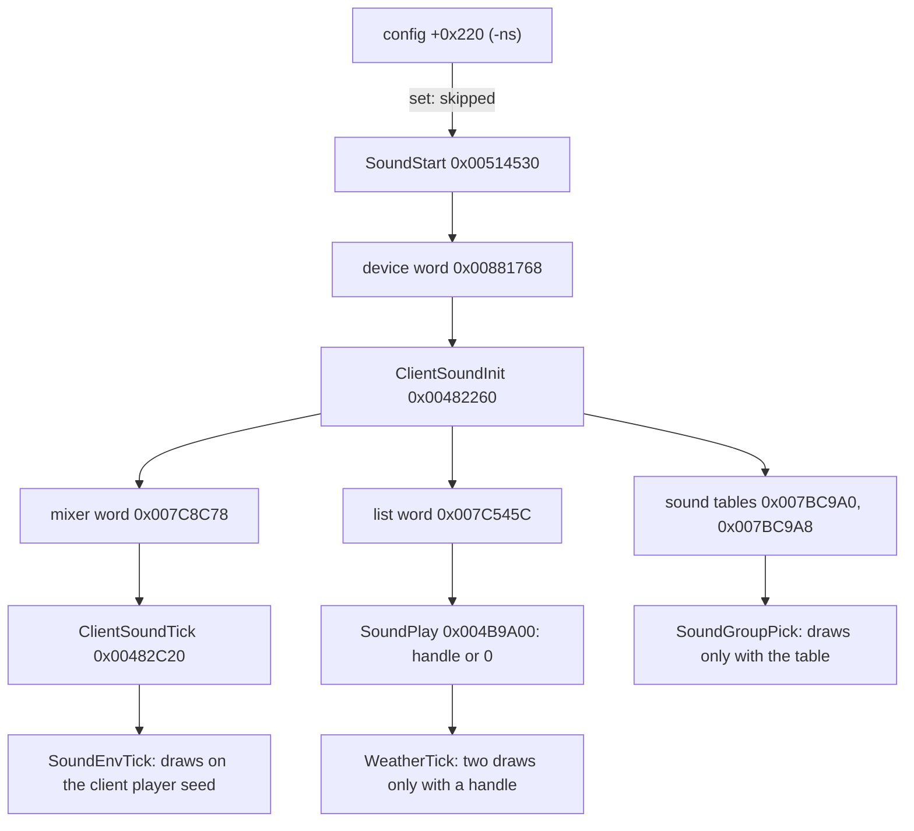

# 0003 — What `-ns` skips: does the sound path draw from a tracked seed?

> **Subsystem:** archaeology (the harness's `-ns`; the seed tree in [rng/seeds](../../specs/rng/seeds.md))
> **Question:** kept runs use `-ns` unless `--sound`. Does the code skipped under `-ns` draw from a seed a spec tracks, so that every kept run could differ from normal play?
> **Date:** 2026-11-04   **Plan:** 0062 (P1 lane check, open question 5)   **Status:** answered, inferred; the one direct test ran (§ 7): the game seed's stream is identical with and without sound for one scripted walk `[C]`, nothing wider

## Answer (summary)

- [I] **Sound changes draws, but only on one seed: the client's own player unit seed, `[0x007A6A70]+0x20`.** The skipped or
  sound-tested draws are 2 weather draws, the environment tick's and the group pick's draws, and the UI-style picks of § 3. All of them
  name that seed. So a kept `-ns` run has a different client player seed stream from a sound-on run. (fn:sub_004E40A0_ClientPlayerRange@0x004E40A0, 0x00473A10, `scan-playerseed.txt`, `scan-taint.txt`)
- [I] **The server's seeds are not on the list.** No draw site reached from a skipped body, and no draw behind a branch on a sound return, names the game seed, a server unit seed, a room seed or a level seed. No sound core function has a caller in the server range: the largest are in client code, and the one above it is 0x006BBEF9 (§ 2). So under `-ns` the server's chain has no direct change, as far as the direct edges go. "Client only" is read from the writers of `0x007A6A70` and the sites' base register; the scan did not look for server code that reads the client player's seed through another pointer (single-process play, one address space), and the spec says only that client units don't decide drops or spawns (rng/seeds step 7b, [C]). (`scan-skipped.txt`, `scan-api.txt`, `scan-pointers.txt`)
- [I] No branch on a sound return reaches the client's outgoing message call on one side only, and no skipped body reaches it by a direct edge. So the sound path sends no extra client message. (fn:sub_0052AE50_ClientSendMsg@0x0052AE50, `scan-taint.txt`, `scan-skipped.txt`)
- [I] What `-ns` can still change on the server side is **when inputs arrive**, not what the code draws: the NPC speech wait (`0x004A0770` returns 1 while the handle plays, 0 straight on under `-ns`), and the frame cost of the mixer. Under one seed this is the same class of difference as any two runs with different timing. (0x004A07A6, 0x00482C63)
- [C] **The checkers hold on the 20 logs run without `-ns`.** The run records have `--sound`, so `-ns` was absent; whether the device opened is unrecorded (below). Every checker with a seed stream gives 0 mismatches (table in § 5); three runs of checkers test nothing (named there). Only `monspawn.py check` was tested live, by one-bit mutations, and it asserts `gs` and `rs` on `P0`, `PX`, `RW4` lines, `rs` on `RW1` and `SP0` only: 8 of 16 flips were caught, `MT0`, `MTX`, `MU`, `RW1 gs`, `SPX`, `MU us` are not asserted (§ 5). The other checkers' liveness on these logs was not shown. Each [C] here is scoped to those counts. (run:2026-11-04-sound-logs, `mutation-control.txt`)
- [C] **The map-seed chain is the same with `-ns` omitted as with it set**, on the only same-seed comparison the kept logs allow: 63 of 63 level create seeds, and all 15 levels with room lists in both, 1152 rooms. Inputs differ, so this covers level and room seeds only, not the game seed, and a level or room seed is fixed by the map seed before any sound tick runs, so it could not show a later game-seed draw either way. The control (the next pair's `-ns` log, another seed) matched on 0. (run:2026-11-04-sound-logs, `pair.txt`, fn:DRLG_LevelCreate@0x00642AE0)
- **Not known:** (1) whether the game seed's stream is identical with and without sound under the same inputs: no such pair existed among the 20 kept logs, and the log checkers can't see an extra draw between their windows (§ 5). (2) Whether the device opened in those 20 runs: the logs don't record it, and if it failed they are `-ns` in effect (§ 5). (3) The 257 unfollowed indirect calls (§ 4). § 6 was the session for (1) and (2); § 7 is its result: (1) answered for one walk only, (2) answered for this harness's `--sound` only, not for the 20 logs.

**For the plan's ledger:** the evidence here is `[I]` and a checker's 0 can't see a game-seed draw between its windows, so no rerun of a kept run is ordered now, and none is cleared. The § 6 session has run (§ 7): it found no difference for one Harrogath walk (147 `gs` values), which clears nothing beyond that walk. Other acts, NPC speech, combat sounds and longer play are untested, and the harness's `-ns` stays as it is.

## Leads used

None. Written from the code and the kept logs.

## Functions

| Address | Name | Role | Tag |
|---|---|---|---|
| `0x00514530` | `sub_00514530_SoundStart` | the start `InitGame` skips under `-ns`; writes the device word by `0x005140A7` (`-ns` test at 0x00405E09) | I |
| `0x00482260` | `sub_00482260_ClientSoundInit` | device word non-zero: loads the tables, starts the mixer and the list | I |
| `0x00481950` | `sub_00481950_SoundTablesLoad` | `sounds.txt`, `soundenviron.txt`; the only writers of `0x007BC9A0`, `0x007BC9A8` not on close | I |
| `0x00482C20` | `sub_00482C20_ClientSoundTick` | per client frame while `0x007C8C78` is non-zero | I |
| `0x004B9A00` | `sub_004B9A00_SoundPlay` | 238 call sites; returns a handle, or 0 while `0x007C545C` is 0 | I |
| `0x004BA020` | `sub_004BA020_SoundListTick` | walks the list at `0x007C5458` | I |
| `0x004E42E0` | `sub_004E42E0_SoundEnvTick` | environment sounds; the skipped draws | I |
| `0x004DCA30` | `sub_004DCA30_MusicReset` | the second `-ns` reader; clears music state | I |
| `0x004DCAA0` | `sub_004DCAA0_MusicTick` | music, no draw | I |
| `0x004E40A0` | `sub_004E40A0_ClientPlayerRange` | `Range` on `[0x007A6A70]+0x20`, power-of-two form inline | I |
| `0x004E4100` | `sub_004E4100_ClientPlayerRangeLoHi` | calls it for `lo + r` | I |
| `0x004E4120` | `sub_004E4120_ClientPlayerRangeSym` | calls it for `r − n` | I |
| `0x00482680` | `sub_00482680_SoundGroupPick` | returns 0 with no draw while the table pointer is null | I |
| `0x004E0590` | `sub_004E0590_SoundVariantPick` | retries until the pick changes, at most 20 times | I |
| `0x00473910` | `sub_00473910_WeatherTick` | the thunder's two sound-tested draws | I |
| `0x00463DD0` | `sub_00463DD0_ClientPlayerGet` | returns `0x007A6A70` | I |
| `0x0052AE50` | `sub_0052AE50_ClientSendMsg` | size, 0, buffer; 9 callers, 0x00477D88–0x00478525 | I |

| `0x007A6A70` | `g_ClientPlayer` | the client's own player unit; writers 0x00463DC4, 0x00465993 | I |
| `0x00881768` | `g_SoundDevice` | device word, written at 0x005140A7 | I |
| `0x007C8C78` | `g_SoundMixer` | mixer word, written at 0x004DFB3F, cleared at 0x004DFA8C | I |
| `0x007C545C` | `g_SoundListActive` | list word, written at 0x004B9D00 and 0x004B9D41 | I |
| `0x007C5458` | `g_SoundList` | the playing list, empty while nothing plays | I |
| `0x007BC9A0` | `g_SoundsTable` | `sounds.txt` records, set at 0x004820A7 | I |

## 1. The readers of `-ns`

- [I] Two instructions read the flag: `InitGame` (0x00405E09, then `jne 0x405E36` over the call at 0x00405E25) and `sub_004DCA30_MusicReset` (0x004DCA38, `jne` to its `ret`). This is `options.txt`'s row and r62a's pointer walk. The other 36 raw `+0x220` hits in `disp.txt` were read by their shape: `sub esp` or `sub eax` immediates, a list link in 0x00506E90–0x0050778E, an `imul` on another structure (0x00644F6D), and the `0x00402BF5`, `0x00402D00`, `0x00404A21` group, which r62a places in another structure; the last group's readers are not traced further here. (`scan-gate.txt`, r62a `disp.txt`)
- [I] The first reader is what carries `-ns`. The second is called only from `ClientSoundInit`'s gated body (0x0048227D) and the video path (0x00482FD8), and it only clears words. (0x00482FD8, 0x004DCA41)
- [I] Skipping the start leaves three words at their initial values, and all later gates read one of them, directly or through a table loaded behind one: the device word `0x00881768` (`0x00513B50`), the mixer word `0x007C8C78` (written only at 0x004DFB3F and 0x004DFA8C), and the list word `0x007C545C` (written 1 only at 0x004B9D00 and 0x004B9D41). (`scan-gate.txt`)



## 2. The sound core

- [I] Six ranges serve the mixer, its list and its tick: `0x00481700–0x00482CA0`, `0x004B93A0–0x004BABF0`, `0x004DCA30–0x004DCE60`, `0x004DF630–0x004E0700`, `0x004E40A0–0x004E4700`, `0x00513A20–0x00516CF0`. The core is chosen by reading, not derived; the scan's list is `CORE` in the tool. (`tools/sound_draws_scan.py`)
- [I] It leaks nothing by a global: of the 83 globals the core writes by absolute address, no instruction outside it reads or writes one. (fn:sub_004B9A00_SoundPlay@0x004B9A00, `scan-leak.txt`) Its state leaves only through call returns, which § 3 follows.
- [I] Of the 74 core functions called from outside, the largest caller is below `0x00520000` for 73. The exception is `0x00515CE0`, called at 0x006BBED9 and 0x006BBEF9 in code around two imports (not read further), from no server function named in a spec. The core has no data pointers and no code immediates to its starts outside: 0 pointer hits and 0 immediates over 297 starts. (`scan-api.txt`, `scan-pointers.txt`)

## 3. The draw-site list

Every primitive call and multiplier site in the closures below. All are on `[0x007A6A70]+0x20`: via 0x004E40A3–0x004E40AA for the `0x004E40A0` family, and via the `0x00463DD0` result at 0x0047393F and `lea esi,[eax+0x20]` at 0x0047396E for the weather. `0x007A6A70`'s writers are client code (0x00463DC4, 0x00465993). All client, none on the server side.

| Site | Through | Runs under `-ns`? | Gate |
|---|---|---|---|
| 0x004E4535, 0x004E4544, 0x004E458A, 0x004E45A5, 0x004E45B4, 0x004E45DB | `SoundEnvTick` | no | mixer word, 0x00482C27 and 0x004E42F0 |
| 0x004BA062 | `SoundListTick`, `g_SoundChaos` only | no | 0x00482C27, and `g_SoundChaos` set by the chat word |
| 0x004826CF, 0x004826E4 | `SoundGroupPick`, from 0x004E01D0 (tick) and 0x004E061A | no | null table 0x00482680–0x00482687 |
| 0x00473A10, 0x00473A22 | `WeatherTick` after `SoundPlay` returns a handle | no | handle, 0x00473A00 |
| 0x004CB7BD | a unit sound, `0x004CB6A0` | **yes, and more often** | `0x004B9E90` false (list empty), 0x004CB7B2 |
| 0x004E05D1, 0x004E05EC | `SoundVariantPick` | **yes, and more often** | retry loop: `GroupPick` returns 0 again, so `0 == last` runs to 20 tries (0x004E0624) |
| 0x004B9ECC | body `0x004B9EB0` | not applicable | 0 calls, 0 pointers, 0 immediates: no static reference |

- [I] The rows above come from `scan-skipped.txt`'s 15 bodies (1 distinct multiplier site, `0x004E40C3`, the family) and `scan-taint.txt`'s branches. The taint scan took 24 queries plus the 7 table accessors, propagated through wrappers to 84 functions, 451 call sites, 86 branches, and closed each branch's two sides.
- [I] The scan's 14 one-sided lines sit under 8 branches. Six branches are the rows above (0x00473A00, 0x00482C27, 0x004CB7B2, 0x004E01CB, 0x004E0624, 0x004E42F0). Two are false positives, where the jcc tests another value after the call: 0x004C644B on `[ebx+0xF2]`, 0x004C649E on `[ebx+5]`, 6 of the lines. (0x004C6437, 0x004C6496)
- [I] Also on that seed and the same under both modes, since no sound state decides them: 0x004CB13F (after the branch's join at 0x004CB133), 0x004CB661 and 0x004CB68D (`0x004B9E10`, a distance test), 0x004CB984, 0x004CC3E0, 0x004739C0, 0x004739E6.
- [I] Other consumers of that seed, not sound and not on the list: `0x00472610` (three values stored at `0x007A89E4`, `0x007A8968`, `0x007A89C4`, the second also written by `WeatherTick`), 0x00476DF1 and 0x00476E03 (`RangeOffset`, two `±n` offsets stored at `0x007B9538` and `0x007B8D20`), 0x004A3176 (a count of `0x00466730` lookups), 0x004AE579 (`and 0x3F`, passed to `PathSetFacing` on a client unit, event 0x158), 0x004B44B2 (a value stored at `0x007C0DC4`), 0x004B4F4E (one of 5 string indices). Under sound these see a shifted stream. No spec or finding names any of them (grep over `docs/specs`, `docs/findings`: 0 files). Their closures reach the send call only through their large general callees, and these results were read to their stores and calls only, not traced further. (fn:sub_00463DD0_ClientPlayerGet@0x00463DD0, `scan-playerseed.txt`)
- [I] What the spec tracks of that seed is its creation, [rng/seeds](../../specs/rng/seeds.md) step 7b: one active-room draw at `UnitInit`. That draw and the active-room seed are not on this list: the sound closures don't reach `0x00465FD0`, by the same closures. So step 7b stands, and nothing in a spec states a later draw of this seed. (fn:sub_00465FD0_UnitInit@0x00465FD0, `scan-skipped.txt`)

## 4. What the scan covers and can't see

- [I] **Live control.** The closure finds 109, 2 and 1 draws from `DRLG_ActCreate`, `DRLG_RoomCreate`, `UnitSeedInit`, which specs say draw. The taint scan's two-sided close finds `0x004E40C3` at `0x004B9E90`'s branch 0x004CB7B2, where the code above has it. (`scan-control.txt`)
- [I] **Scope of the "no draw"** (fn:sub_00514530_SoundStart@0x00514530, fn:sub_00482C20_ClientSoundTick@0x00482C20). Direct calls and jumps from the named bodies, plus the jump tables read from the file; `objdump`'s linear sweep, 1 067 138 instructions, all 852 multiplier immediates. The primitives are the seven of [rng](../../specs/rng/README.md), named in the tool.
- [I] **Unfollowed: 257 indirect calls** in the union of the 15 skipped bodies: 75 in the core, 78 in `0x0040xxxx`, 104 in `0x006xxxxx`. The core's are `call reg` through object tables after the device-load path (the DirectSound shape; not resolved). The library's are shared by every closure: about 26 000 instructions and 165 indirect calls appear even from a two-line play body, by the allocator and fatal-error path. Three address-taken starts in the core were closed: `0x00513A20`, `0x00516250`, `0x006878A0`, 0 draws each. So a draw behind a COM or library callback is not excluded by this scan.
- [I] **Not a data-flow proof.** The taint scan's `consume` is a short window after each call. Its handle stores were read by hand: `0x007B8D2C`, `0x007BF24B`, `0x007C0DB8`, `0x007C8C80`, `0x007C8C84` are read back only as an argument to a core function or a test beside one (0x00476A0B, 0x004A0793, 0x004B3850, 0x004E43E0, 0x004E4470); `0x004A5ED5`'s return is dropped: the next instruction clears `edi` and stores it (0x004A5EDA). A return stored into a unit field and read far off would not show; 7 field stores were listed, the rest of each path not traced.
- [I] **Client sends.** `sub_0052AE50_ClientSendMsg` was taken from the create message's call (0x00477D88) and one other wrapper. The test is direct-edge reach; an indirect NPC callback such as `0x004A0770`'s `(*0x007BF258)(0)` is outside it.

## 5. The kept logs with sound on

**Which logs.** The run records with `--sound`: [drlg](../drlg/experiments.md) `gen-1-catacombs-owner`, `preset-play-act1..5`; [monsters](../monsters/experiments.md) `monspawn-s1, s2, s3`; [items](../items/experiments.md) `tc-champion-1`, `tc-quality-1, 2, 3`, seven `quests-s0-350N-owner-*`. 20 logs. The log header's `args=''` doesn't show `-ns`, so the identification is the record's command line.

| Checker | Logs | Events | Mismatches | Seed stream? |
|---|---|---|---|---|
| `drlg.py gen` | 6 | 81 991 checks (7 944, 22 855, 18 339, 11 535, 10 254, 11 064) | 0 | yes: map-seed chain, level and room seeds, both copies |
| `monspawn.py check` | 3 | 115 795 checks (2 659, 81 608, 31 528); inner `drlg gen` 6 816, 36 480, 19 710 and `roomk` 3 324, 23 427, 18 275 | 0 | yes: room and game seed at each window; 516 rooms' seeds predicted from the map seed; 916 unit seeds predicted from the game seed |
| `chain.py check` | 7 (3 world, 3 TC, one quest) | composition | 0 sub-checks failed | yes, with the retired oracles modelled |
| `tc.py replay` | 3 + 1 classic + 6 quest | 124, 1 269, 944; classic 485; quest 217 | 0 failed | yes, per call from the logged seed to `TCEND` |
| `quality.py check` | 4 | 65, 782, 574, 229 pairs | 0 failed | yes, per roll, exit seed asserted |
| `items_chain.py affixes` | 7 | 355 creations | 0 failed | yes, per item |
| `monpool.py check` | 7 | 4 737 | 0 | yes: game-seed draw 1 |
| `questdrops.py check` | 7 | bit writes | 0 | **no seed: tests nothing here** |
| `drlg.py roomk` on `gen-1-catacombs-owner` | 1 | 0 checks | 0 | **no room lines: tests nothing here** |
| `tc.py replay` on the Mephisto quest log | 1 | B6 only, no call | 0 | **no draws: tests nothing here** |

All kept under `workspace/logs/r63/`. (run:2026-11-04-sound-logs)

- [C] What `monspawn.py check` asserts on these logs, from 16 one-bit flips (8 caught, 8 not): a one-bit flip of `gs` or `rs` on a `P0`, `PX` or `RW4` line, or `rs` on `RW1`, `SP0`, makes `monspawn.py check` fail, so those assertions are live. A flip on `MT0`, `MTX`, `MU`, `RW1 gs`, `SPX` or `MU us` is **not** caught by `check`: these lines aren't asserted against the model on that log. The `gs` flips do break the stream walker below. (run:2026-11-04-sound-logs, `mutation-control.txt`)
- [C] Over the three monspawn logs, 51 814 logged game seeds walk as one stream: each change is reached by Step from the last, 0 breaks. Gaps between changes run from 1 to past 64 steps. (run:2026-11-04-sound-logs, `gs-stream-sound.txt`) So the stream wasn't reset, and it says nothing about extra steps: a draw on the game seed in a gap would count as a longer gap. **This is the logs' limit:** checkers resume from logged seeds, so a game-seed draw between their windows gives 0 mismatches. The static route is what says no such draw exists.
- [C] **The same-seed comparison.** No sound-on and `-ns` pair has the same seed and the same inputs: owner play has no steps file. Eight pairs share a seed (21–25 `preset-play-actN` against `acts35/a35-sN`, 12345 `monspawn-s1`, `s2` against `preset-12345-act1`, `act5`, 1 `gen-1-catacombs-owner` against `preset-1-act2-normal`), compared where the map seed alone decides: 63 levels in both, 63 equal create seeds; 15 levels with `RC` lines in both, all 15 with a common room sequence, 1152 rooms. Three pairs (seeds 23, 25, 1) have no level in common and test nothing. Control against another seed's log: 0 equal. (run:2026-11-04-sound-logs, `pair.txt`)
- **Whether sound played.** `--sound` proves `-ns` was absent, not that the device opened. Under wine with no output, `0x00881768` could stay 0. The owner's sessions are remembered as with music, and the thread counts in the logs (`[New LWP` 7–37 on sound-on logs, 3–12 on `-ns`) lean that way, but neither is evidence here: gdb attach time moves those counts. § 6 reads the word; § 7 read it on this harness: non-zero under `--sound`, 0 under `-ns`.

## 6. The case for the next harness run

Settles the two open items. Same slot, same save, the seed and steps fixed; the scripted Harrogath walk because it has no owner input and creates units in view. `<slot>` is a free slot; `sound-pair.gdb` is `tools/gdb/mon-spawn.gdb` plus the block below, to be written and hashed by the session's lane.

```
python3 -I tools/saves.py aside r63p
python3 -I tools/saves.py install r63p workspace/runtime/p16chars/act5/smpsor.d2s
# A1, A2 with -ns (the timing control: how far two -ns runs differ); B without
python3 -I tools/d2run.py --slot <slot> --seed 12345 --gdb <sound-pair.gdb> --steps tools/gdb/preset-harrogath-pop.steps --after 60 --log workspace/logs/<lane>/pair-A1.log
python3 -I tools/d2run.py --slot <slot> --seed 12345 --gdb <sound-pair.gdb> --steps tools/gdb/preset-harrogath-pop.steps --after 60 --log workspace/logs/<lane>/pair-A2.log
python3 -I tools/d2run.py --slot <slot> --seed 12345 --sound --gdb <sound-pair.gdb> --steps tools/gdb/preset-harrogath-pop.steps --after 60 --log workspace/logs/<lane>/pair-B.log
python3 -I tools/saves.py restore r63p

# the block: reads the words once, some 2000 client frames in
break *0x00482C20
ignore $bpnum 2000
commands
  silent
  x/wx 0x00881768
  x/wx 0x007C545C
  x/wx 0x007C8C78
  x/2wx *(int*)0x007A6A70+0x20
  continue
end
```

Compare the three logs' `gs` sequences (`tools/sound_pair.py stream`, then the values line by line, room activation order included).

- **Device word non-zero in B, 0 in A; `gs` sequences of A1, A2, B equal:** server side unaffected, the Answer's second bullet can be raised for this path.
- **A1 and A2 differ:** the steps don't fix the order, and the comparison can't separate; say so and compare per room instead.
- **A1 = A2, B differs:** find the first difference; if it's the timing of an input, it's the § Answer's fourth bullet; if it's an extra step with the same inputs, every kept run needs the question reopened.
- **Device word 0 in B:** this machine's wine gives no device under the harness, and the 20 logs need the owner's word on how they were played.
- The client seed should differ between A and B if `SoundEnvTick` ran; if it doesn't, the first bullet needs a second look.

## 7. Result of the § 6 session (2026-11-04, run:2026-11-04-sound-pair)

- [C] **The game seed's stream is identical with and without sound for the walk tested**: seed 12345, `smpsor.d2s` on Normal, the Harrogath pop steps, slot 2. 147 logged `gs` values and every seed field of every logged event line equal in order across `-ns` (A1, A2) and `--sound` (B); 14 level creations and the same room activation order. Scope: one act, one scripted walk of about 60 s. (run:2026-11-04-sound-pair, `workspace/logs/snd/`)
- [C] **The two `-ns` runs agree** on all of it. The § 6 branch "A1 and A2 differ" does not apply.
- [C] **The three words differ with the option**: `0x00881768` = `0x00DC519C`, `0x007C545C` and `0x007C8C78` = 1 at the 2000th hit of `0x00482C20` under `--sound` (B); all 0 under `-ns` (A1, A2). Read by gdb in each run. (run:2026-11-04-sound-pair, `pair-{A1,A2,B}.log` `SNDWORDS` lines)
- [I] **So the device opened under `--sound` on this harness.** That meaning is a reading: the words' names and writers (0x005140A7, 0x004DFB3F, 0x004B9D00) are `[I]` rows above, and no run recorded sound output. The 20 owner-played logs' own device state is still unrecorded.
- [I] **The client seed control does not separate sound.** `[0x007A6A70]+0x20` at that frame: A1 `d20415c0:5de8b65f`, A2 `ba498698:4b4d7291`, B `34310a76:0fc85e31`. It differs A vs B as the finding predicted, but it also differs between the two `-ns` runs, so that single sample can't be tied to the sound draws. The first Answer bullet stays `[I]`. The sample is at the 2000th client frame, which is a wall-clock count: the two `-ns` runs may stand at different server progress there, and the client player's seed is also drawn by non-sound client code. That, or a client-side seed that is not fixed by the game seed, would explain the difference; neither was tested and the initial value was not read, so the cause is open (question 3).
- [I] **A side result for the client/server split.** The client seed differed between A1 and A2 while all 2 565 seed-bearing server-side lines were equal, so a varying client seed did not reach any logged server seed in this walk. This is consistent with rng/seeds step 7b (client units don't decide drops or spawns) and does not raise it: one walk, and the lines logged are the tracer's, not every server draw.

## Data touched

`tbl:` none read by this lane. `sounds.txt` and `soundenviron.txt` are read by the game through `sub_00481950_SoundTablesLoad`. `struct:` client unit `+0x20` (seed), config `+0x220`.

## Dead ends

- `consume`'s first version counted any `jcc` after a call as a branch on the return: 0x004C644B, 0x004C649E, 0x0049D25A, 0x004CA172 test other values. Read by hand.
- `RNG_Range` at 0x004C9532–0x004C994A (`[esi+0x20]`) and `RangeOffset` at 0x004DE5CA (`[esi+0x1C]`) lie in the same address ranges and looked like the sound path. Neither is reached from a gate or a one-sided branch. (`scan-taint.txt`)
- A mutated `MU gs` as the control for the monspawn checker: not asserted, 0 mismatches. Kept as a row in `mutation-control.txt`.

## Open questions

1. Answered for one walk, § 7. Other acts, inputs with NPC speech or combat sounds, and longer sessions are not tested.
2. Whether the device opened in the 20 logs: not recorded; § 7 shows `--sound` opens it on this harness.
3. Why the client player's seed differs between two `-ns` runs at the same frame count (the initial value was not read).
4. The 75 core indirect calls: resolving the object tables would remove them from § 4; low value, since they sit after the device load and the callees would have to name a server seed.
5. Whether the NPC wait changes a kept run's order: only with an owner who clicks through speech; `0x004A0770` read to its first gate only.
