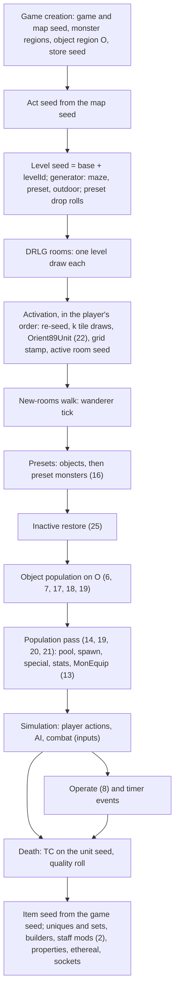

# 0001 — The boundary oracles of the core and enabler specs, and the order they compose in

> **Subsystem:** chain (seed to world, plan 0048)
> **Question:** which ADR-0004 boundary oracles do the core and enabler specs still name, which of them a reviewed model already replaces in a chained check, which a model could replace, and which stay inputs?
> **Date:** 2026-10-20   **Plan:** 0048 (Phase 0)   **Status:** open (Phase 0 inventory reviewed 2026-10-20, accepted with fixes; the Phase 1 assignment and the rulings on § 3.3 and § 4 are in the [plan 0048 log](../../plans/0048-seed-to-world.md#implementation-log))

Phase 0 reads; it makes no new code reading and runs nothing. Every row below rests on the spec or finding that names
the oracle, and carries that spec's anchors. The inventory was taken on `main` at `ad130d7`.

## Answer (summary)

- [C] **31 boundary oracles** are named in `docs/specs/{items,monsters,drlg,objects,rng,data}/`, counted once each
  (§ 2): by kind, 21 seed, 3 seed and result, 2 result, 5 value; by the spec that names them first, items 9, monsters 8,
  drlg 7, objects 6, data 1, rng 0. The kept command of § 1 finds 162 lines (169 matches) in 22 spec files, and § 6
  assigns each line to an oracle of § 2 or to a structural use (a heading, a link, the ADR's title, a definition or a
  "no oracle" statement). (fn:sub_0065FEC0_ItemApplyProps@0x0065FEC0, fn:sub_00555230_SUnitCreate@0x00555230,
  run:2026-10-15-items-chain, run:2026-10-15-objects)
- [C] **11 are already replaced in a chained check** (oracles 1, 3, 4, 5, 15, 26–31): the property roll, the builders,
  the ethereal and socket rolls, the drop quality roll, the presets-and-objects window (on logs with the object-region
  seed), the plan 0014 position predicates, the maze and outdoor windows, the preset drop rolls, the special-mods
  oracles and the tile placement. The spec text still calls some of them oracles (§ 5).
  (fn:ITEMS_DropRollQuality@0x00558640, fn:sub_00673B30_MazeLevelBuild@0x00673B30,
  fn:sub_00675360_OutdoorLevelBuild@0x00675360, run:2026-10-13-quality, run:2026-10-15-drlg-maze, run:2026-10-15-drlg-outdoor)
- [C] **`ITEMS_RollStaffMods` (oracle 2) is already modelled**: plan 0038 batch S2b added `affixes.staff_mods`, which
  predicts the exit seed of 105 stock rolls and the `item_singleskill` entries of 354 stock lists. It sits behind
  `--staff model`, and the default of `tools/affixes.py` and `tools/items_chain.py` is still the oracle. Phase 1 only
  has to make it the default in the chain. (fn:ITEMS_RollStaffMods@0x005C1260, run:2026-10-14-affixes,
  run:2026-10-15-items-chain, [items/0005 § Plan 0038 batch S2b](../items/0005-affixes.md#plan-0038-batch-s2b-2026-10-16))
- [C] **The object marks in the collision grid are already modelled** (plan 0027 Phase 2: all 1847 marks of
  run:2026-10-15-objects predicted). What stays a value oracle is the rest of the pass-entry grid snapshot (oracle 20):
  the marks of players, monsters that walked in, items and corpses. [monsters/spawn § Inputs and oracles](../../specs/monsters/spawn.md#inputs-and-oracles)
  still says the object marks are logged. (fn:UNIT_CollMarkRect@0x00620A70, fn:sub_0054EC90_RoomPopulate@0x0054EC90,
  run:2026-10-15-objects)
- [I] **10 oracles lie inside the chain and a reviewed model could replace them** (oracles 6, 7, 13, 14, 16, 17, 19, 20,
  21, 22, § 4). **5 stay inputs** (8, 12, 18, 24, 25: player actions, quest state, simulation). **4 are off the chain**
  (9, 10, 11, 23: the cube's cow portal, the hireling stock, the client's critters). The proposal of § 4 is for the
  architect to rule. (fn:sub_005559A0_RoomPresetUnits@0x005559A0, fn:sub_00552610_RoomObjectsPopulate@0x00552610,
  run:2026-10-15-objects)
- [I] **Activation order is an input beyond the per-room seeds.** The level seed and the active-room seed do not depend
  on it. The game seed (one step per server unit), the object-region seed (carried across rooms) and each room's near
  list (so its grid) do (§ 3.2). (fn:sub_00555230_SUnitCreate@0x00555230, fn:OBJRGN_Create@0x00546C60,
  fn:DUNGEON_NearRoomsBuild@0x00619800, run:2026-10-11-seed-tree-p1)
- [I] **Two inputs the plan's *Context* does not list** would be needed by Phase 2's drops: the game seed at each drop
  (an item's seed is drawn from the game seed, which simulation steps), and the killer's magic find (a property of the
  player's character). § 3.3 proposes them as input classes. (fn:sub_00552E90_ItemSeedInit@0x00552E90,
  fn:ITEMS_DropRollQuality@0x00558640, run:2026-10-11-seed-tree-p1, run:2026-10-12-quality)

## 1. Method and the kept recount

Every *Inputs and oracles* (or *Inputs and boundaries*) section of the 22 spec files below was read in full, together with
each line that matches `oracle`, and each finding those sections cite. A row of an inputs table counts as an oracle when
its kind names one (seed oracle, value oracle, seed and result oracle, boundary oracle, logged boundary) or the
spec's text calls the callee an oracle. Rows marked only as inputs, run-time state or DRLG state are listed separately
in § 3.1. Each oracle is listed once, under the spec that names it first, with every other spec that names it.

The kept recount, run from the repository root:

```sh
grep -rnio oracle docs/specs/{items,monsters,drlg,objects,rng,data}/ | cut -d: -f1,2 | LC_ALL=C sort -t: -k1,1 -k2,2n | uniq
```

On `ad130d7` it prints 162 lines from 22 files, and its output hashes to sha256
`fc6af9749b93c94e1ad35a96a820d34100378f722e2e0df74e7245c296daa3a0`. `python3 -I tools/oracle_ledger.py` makes the
same listing (same hash), prints the per-file totals and checks it against § 6. Leaving out `| cut … | uniq`
counts 169 matches, because 7 lines match twice. § 6 assigns each of the 162 lines. A spec edit moves line numbers,
so a later recount compares the per-file totals of § 6 first, then the lines.

## 2. The oracles

Kinds: **seed**, a callee that steps a seed whose exit state is taken from the log; **value**, a value or predicate
result taken from the log with no seed crossing it; **result**, a return value taken from the log; **seed and
result**, both. Status: **chained**, a reviewed model already replaces it in a chained check; **model, off by
default**; **Phase 1 candidate**, inside the chain, and a reviewed model could replace it; **input**, stays an input,
with its class; **off chain**, outside the seed-to-world chain, left as it is.

| # | Oracle | Named in | Kind | Status | Replacing model, or why it stays | Tag |
|---|---|---|---|---|---|---|
| 1 | `sub_0065FEC0_ItemApplyProps` (the property roll) | [items/affixes § Inputs and oracles](../../specs/items/affixes.md#inputs-and-oracles), the `ORACLE` marks C8, E6, F, J4; [items/uniques-sets § Inputs and oracles](../../specs/items/uniques-sets.md#inputs-and-oracles) | seed | chained | [items/properties](../../specs/items/properties.md) in `tools/items_chain.py` (plan 0024): 3 102 creations, 1 034 exit seeds predicted; 219 creations end to end | [C] (fn:sub_0065FEC0_ItemApplyProps@0x0065FEC0, run:2026-10-14-props-forced, run:2026-10-15-items-chain) |
| 2 | `ITEMS_RollStaffMods` | [items/affixes § Inputs and oracles](../../specs/items/affixes.md#inputs-and-oracles), § I, the marks D4, E7, F, G4, H2; [items/properties § Inputs and boundaries](../../specs/items/properties.md#inputs-and-boundaries) | seed | model, off by default | `affixes.staff_mods` (items/0005 § Plan 0038 batch S2b): `--staff model`, 105 stock exit seeds, 354 stock lists; the default switch is still `oracle` (`tools/items_chain.py` lines 290, 1247) | [C] (fn:ITEMS_RollStaffMods@0x005C1260, run:2026-10-14-affixes, run:2026-10-15-items-chain) |
| 3 | the rare, magic, superior and normal builders under a failed unique or set | [items/uniques-sets § Inputs and oracles](../../specs/items/uniques-sets.md#inputs-and-oracles), step `ORACLE` mark, § E | seed and result | chained | [items/affixes](../../specs/items/affixes.md) after `tools/uniques.py` (`tools/items_chain.py both`, 889 creations); the superior and normal fallbacks were never reached from a failed unique or set | [C] (fn:ITEMS_BuildRare@0x005C21A0, fn:ITEMS_BuildMagic@0x005565E0, run:2026-10-15-items-chain) |
| 4 | the ethereal and socket rolls (a "logged boundary") | [items/affixes § Inputs and oracles](../../specs/items/affixes.md#inputs-and-oracles) | seed | chained | [items/properties § F](../../specs/items/properties.md#f-ethereal-and-sockets), chained over run:2026-10-14-props and -props-forced | [C] (fn:sub_00556CA0_ItemRollEthereal@0x00556CA0, fn:sub_00556B60_ItemRollSockets@0x00556B60, run:2026-10-14-props-forced) |
| 5 | the drop quality roll `ITEMS_DropRollQuality` | [items/tc § H](../../specs/items/tc.md#h-item-pick-and-hand-off), § Draw order, the worked example; [items/README](../../specs/items/README.md); [items/quality](../../specs/items/quality.md) | seed and result | chained | [items/quality](../../specs/items/quality.md) (`tools/tc.py replay --quality model`, 9184 calls); 206 calls of two-client logs keep the oracle because no record gives those players' magic find (§ 3.3) | [C] (fn:ITEMS_DropRollQuality@0x00558640, run:2026-10-12-quality, run:2026-10-13-quality) |
| 6 | `TC_ResolveDrops` at an object's drop | [objects § Inputs and oracles](../../specs/objects/README.md#inputs-and-oracles) | seed | Phase 1 candidate | [items/tc](../../specs/items/tc.md) and the item chain on the object's unit seed; the object's unit seed is the creation's (rng/seeds 7a); when the player operates it is an input | [C] (fn:TC_ResolveDrops@0x0055A6D0, run:2026-10-15-objects) |
| 7 | the gold drop of `InitFn` 28 (item creation in the window) | [objects § Inputs and oracles](../../specs/objects/README.md#inputs-and-oracles), the `InitFn` table; [drlg/collision § Inputs and oracles](../../specs/drlg/collision.md#inputs-and-oracles) (the `0x200` item marks) | seed | Phase 1 candidate | item creation (rng/seeds 7a, two game-seed steps per item) with the gold amount of [items/economy](../../specs/items/economy.md); the 71 `0x200` marks then follow from [drlg/collision § F](../../specs/drlg/collision.md#f-unit-marks) | [C] (fn:OBJINIT_GoldPiles@0x0054F8C0, run:2026-10-15-objects) |
| 8 | the operate monster spawn `0x00582280` | [objects § Inputs and oracles](../../specs/objects/README.md#inputs-and-oracles) | seed | input (player action: the operate) | the spawn draws no object-region draw (2 spawns); the creation would be the monsters chain's, once the operate's frame and seeds are given | [C] (fn:OBJOP_Barrel@0x005868A0, run:2026-10-15-objects) |
| 9 | the cow portal's free-spot search `0x00545340` and `sub_0056D130_PortalObjectCreate` | [items/cube § Inputs and oracles](../../specs/items/cube.md#inputs-and-oracles), § L2, § L's diagrams and table, Open questions; [drlg/outdoor](../../specs/drlg/outdoor.md) (level 39) | seed and result | off chain | a player transmute; the draws on the game seed are not read (cube's open question), so a model needs a new reading, which plan 0048 does not plan | [I] (0x00545340, fn:sub_0056D130_PortalObjectCreate@0x0056D130, run:2026-10-15-cube) |
| 10 | `sub_00560200_InvPlaceItem` in the cube (success or failure only) | [items/cube § Inputs and oracles](../../specs/items/cube.md#inputs-and-oracles), the `ORACLE` mark of § G | result | off chain | a player transmute; the spot search order is now given by cube § G4 | [C] (fn:sub_00560200_InvPlaceItem@0x00560200, run:2026-10-15-cube) |
| 11 | `HIRE_BuildStock` on the store seed | [items/vendors § C1](../../specs/items/vendors.md) | seed | off chain | modelled by [hirelings](../../specs/hirelings/README.md) (`tools/hirelings.py`, run:2026-10-16-hirelings); a creation path the plan leaves as it is | [C] (fn:HIRE_BuildStock@0x00576070, run:2026-10-15-vendors, run:2026-10-16-hirelings) |
| 12 | the quest seed on entry to a scripted drop | [items/quest-drops § Inputs and oracles](../../specs/items/quest-drops.md#inputs-and-oracles) | seed (asserted; no value was taken) | input (quest state) | quest code that creates no item draws it too (0x0058E830, 0x00592E90, 0x0059B1C0, 0x0059EDC0, 0x005BD390), so its value at a drop is the game's quest history | [C] (run:2026-10-16-quest-drops) |
| 13 | `MonEquipInit`'s item creation | [monsters/stats § Inputs and oracles](../../specs/monsters/stats.md#inputs-and-oracles), B12, the diagrams | seed | Phase 1 candidate | the item chain (`tools/items_chain.py`) on the unit seed; never reached on the runs (no class with an `oninit` MonEquip row was met), so it stays `[I]` unless a run reaches one | [I] (fn:sub_005D6B60_MonEquipInit@0x005D6B60) |
| 14 | the unit seed after `SUnitCreate` | [monsters/spawn § Inputs and oracles](../../specs/monsters/spawn.md#inputs-and-oracles), § J; [monsters/special § Inputs and oracles](../../specs/monsters/special.md#inputs-and-oracles) | seed | Phase 1 candidate | the usual 2 steps are `MonStatsInit`'s, predicted by `tools/monstats.py`; the variant steps (6 and 15 on 2 of 916; 22 creations of run:2026-10-15-mon-stats) are `MonVariantRoll` on the unit seed for a class appended to the region, [monsters/pool § D](../../specs/monsters/pool.md#d-appearance-sets-sub_005bdb20_monvariantroll); that append and its draws are already modelled by `tools/mon_sweep.py pool` (plan 0038 batch S3a: the unit seed at `MonStatsInit` entry reproduced in 4568 of 4568 creations, [monsters/0001 § Plan 0038 batch S3a](../monsters/0001-level-pool.md#plan-0038-batch-s3a-2026-10-16)), but not inside `tools/monspawn.py`'s chain | [C] (fn:sub_00555230_SUnitCreate@0x00555230, fn:sub_005BDB20_MonVariantRoll@0x005BDB20, run:2026-10-13-mon-spawn, run:2026-10-15-mon-stats) |
| 15 | the presets, inactive-restore and objects window before the pass (room and game seed at `RW4`) | [monsters/spawn § Inputs and oracles](../../specs/monsters/spawn.md#inputs-and-oracles), § A2; [monsters/special § Inputs and oracles](../../specs/monsters/special.md#inputs-and-oracles) | seed | chained (except 16 and 17) | [objects](../../specs/objects/README.md) inside `tools/monspawn.py` on logs that carry the object-region seed: 338 pass entries predicted from the map seed; older logs keep the oracle | [C] (fn:sub_005559A0_RoomPresetUnits@0x005559A0, fn:sub_00552610_RoomObjectsPopulate@0x00552610, run:2026-10-15-objects) |
| 16 | the preset monsters of the presets window (`PresetUnitDispatch` type 1) | [objects § Inputs and oracles](../../specs/objects/README.md#inputs-and-oracles), § B mark, G4 (12 marks under them) | seed | Phase 1 candidate | the monsters chain (`MonSpawnTry`/`SUnitCreate`, `tools/monspecial.py`, `tools/monstats.py`) run inside `tools/objects.py`'s window; the superunique and MonPlace 2/3 spawns already are | [C] (fn:sub_0054E600_PresetMonSpawn@0x0054E600, run:2026-10-15-objects) |
| 17 | the monster and quest `InitFn`s: 46, 47, 54, 55, 62, 66, 68, 69, Zoo 79, pseudo-object 582 | [objects § Inputs and oracles](../../specs/objects/README.md#inputs-and-oracles), the `InitFn` table | seed | Phase 1 candidate (46); the others [I] | `InitFn` 46 (16 calls, 584 object-region draws) through the monsters chain; 47–69 were not reached; 79 and 582 pick their class from quest state (an input), their creation is modelled | [C] (fn:OBJINIT_CityDamnedSpawns@0x005506D0, run:2026-10-15-objects) |
| 18 | the state `InitFn`s (4, 6, 8, 9, 12, 14, 16, 17, 22, 26 in the run) | [objects § Inputs and oracles](../../specs/objects/README.md#inputs-and-oracles) | value | input (quest state and the player's history) | the mode or `interact` value set from game state; the unit-seed draw of the mode change is predicted | [C] (data:g_ObjInitFns@0x00731BC0, run:2026-10-15-objects) |
| 19 | the gate's DRLG parts: `RoomPopLevelId`, `LevelRoomCount`, room flags `0x30000`, the preset and town tests, the Chaos Sanctuary quest test | [monsters/spawn § Inputs and oracles](../../specs/monsters/spawn.md#inputs-and-oracles); [objects § Inputs and oracles](../../specs/objects/README.md#inputs-and-oracles), C1 | value | Phase 1 candidate (the DRLG parts); the quest test is an input (quest state) | the room records `tools/drlg.py gen` builds ([drlg/overview](../../specs/drlg/README.md), [drlg/preset](../../specs/drlg/preset.md)) | [C] (fn:sub_0061A1F0_RoomPopLevelId@0x0061A1F0, fn:sub_00642BE0_LevelRoomCount@0x00642BE0, fn:OBJ_PopulateGate@0x00552560, run:2026-10-15-objects) |
| 20 | the grid snapshot at pass entry (and at each preset special) | [drlg/collision § Inputs and oracles](../../specs/drlg/collision.md#inputs-and-oracles); [monsters/spawn § Inputs and oracles](../../specs/monsters/spawn.md#inputs-and-oracles); [monsters/special § Inputs and oracles](../../specs/monsters/special.md#inputs-and-oracles) (a "value input") | value | Phase 1 candidate, in part | the activation stamp ([drlg/collision § A](../../specs/drlg/collision.md#inputs-and-oracles)), the object marks (modelled) and the marks of the monsters the chain creates; the marks of players, walk-ins, items and corpses stay inputs (65 unit-bit cells in 15 of 360 pass rooms on run:2026-10-14-collision) | [C] (fn:sub_0054EC90_RoomPopulate@0x0054EC90, fn:sub_005A09E0_SpecialMonPlace@0x005A09E0, run:2026-10-14-collision, run:2026-10-15-objects) |
| 21 | the seed of another room at its first request in a pass | [drlg/collision § Inputs and oracles](../../specs/drlg/collision.md#inputs-and-oracles), § J; [monsters/spawn § Inputs and oracles](../../specs/monsters/spawn.md#inputs-and-oracles) | seed | Phase 1 candidate | that room's own seed, which a chain that carries every room's state predicts ([rng/seeds](../../specs/rng/seeds.md) step 6 and its later consumers); 2 calls | [C] (fn:sub_005B2700_SpawnPosOnTile@0x005B2700, run:2026-10-14-collision) |
| 22 | the unit creation of `sub_0066D9E0_Orient89Unit` | [drlg/room-tiles](../../specs/drlg/room-tiles.md) step 11, its note and Open questions; [rng/seeds](../../specs/rng/seeds.md) step note 6 ("rare oracle draws", the `Range(3)`) | seed | Phase 1 candidate | the `Range(3)` and the `0x20` flag are modelled (plan 0027 Phase 2); the creation (catapults 432–435, 524–525; objects 13–16, 60, 91, 92, 230) is `SUnitCreate`'s game-seed step (rng/seeds 7a) and the object or monster creation of [objects § G](../../specs/objects/README.md) or the monsters chain | [C] (fn:sub_0066D9E0_Orient89Unit@0x0066D9E0, run:2026-10-15-objects) |
| 23 | the room seed at the client's critter roll (`CR0`) | [monsters/pool § F](../../specs/monsters/pool.md), Evidence | seed | off chain (client side) | the critters are a client draw on the client room's seed; the chain covers what the server builds | [C] (fn:sub_0046C460_ClientCritters@0x0046C460, run:2026-10-12-mon-pool) |
| 24 | the unit-state functions and variables of the calc evaluator (`skill`, `miss`, `stat`, `sklvl`, 21 `skillcalc` codes) | [data/calc § Inputs](../../specs/data/calc.md) | value | input (simulation: ADR-0014 stats and skills phases) | no creation path of the chain evaluates a formula: the property roll needs none ([items/properties § Inputs and boundaries](../../specs/items/properties.md#inputs-and-boundaries)) | [C] (fn:SKILLS_CalcVar@0x00646460, fn:PROP_RollValue@0x0065E9E0, run:2026-10-16-calc, run:2026-10-14-props) |
| 25 | the AI and movement of a restored monster | [drlg/lifecycle § H](../../specs/drlg/lifecycle.md#h-the-restore) | result | input (simulation: ADR-0014 phase 4) | AI and pathing are monster AI's | [I] (fn:sub_00541E20_InactiveMonAiRestore@0x00541E20) |
| 26 | the position predicates on the plan 0014 logs (`CollisionTest`, `LogicRegionIdAt`, `SpawnClassCellTest`, `NearWarpTest`) | [monsters/spawn § Inputs and oracles](../../specs/monsters/spawn.md#inputs-and-oracles), § H marks; [drlg/collision § Inputs and oracles](../../specs/drlg/collision.md#inputs-and-oracles) | value | chained | [drlg/collision](../../specs/drlg/collision.md) (plan 0017) on logs with the snapshot; the plan 0014 logs hold no snapshot and keep them | [C] (fn:sub_0064D9B0_CollisionTest@0x0064D9B0, fn:sub_0054DB50_NearWarpTest@0x0054DB50, run:2026-10-14-collision) |
| 27 | the maze window (`MZ0`–`MZ1`) | [drlg/overview § Sub-generator boundaries](../../specs/drlg/README.md#sub-generator-boundaries), step 9; [drlg/maze](../../specs/drlg/maze.md) | seed | chained (plan 0022) | [drlg/maze](../../specs/drlg/maze.md) | [C] (fn:sub_00673B30_MazeLevelBuild@0x00673B30, run:2026-10-15-drlg-maze) |
| 28 | the outdoor act layouts (`OD0`–`OD1`) | [drlg/overview § Sub-generator boundaries](../../specs/drlg/README.md#sub-generator-boundaries), Open questions | seed | chained (plan 0026) | [drlg/outdoor](../../specs/drlg/outdoor.md) | [C] (fn:sub_00675360_OutdoorLevelBuild@0x00675360, run:2026-10-15-drlg-outdoor) |
| 29 | the preset-unit drop rolls | [drlg/overview § Sub-generator boundaries](../../specs/drlg/README.md#sub-generator-boundaries) | seed | chained (plan 0016) | [drlg/preset](../../specs/drlg/preset.md); `tools/drlg.py gen --preset-oracle` keeps the old switch | [C] (fn:DRLG_PresetUnitDropRolls@0x00667620, run:2026-10-13-drlg-preset) |
| 30 | the special mods, the mod handlers and the unique-minion setup (plan 0014) | [monsters/spawn § Inputs and oracles](../../specs/monsters/spawn.md#inputs-and-oracles); [monsters/special § Inputs and oracles](../../specs/monsters/special.md#inputs-and-oracles) | seed | chained (plan 0018) | [monsters/special](../../specs/monsters/special.md) (`tools/monspecial.py` in `tools/monspawn.py`) | [C] (fn:sub_005A0760_SpecialModsRoll@0x005A0760, fn:sub_005A2120_SpecialModsApply@0x005A2120, run:2026-10-14-mon-special) |
| 31 | the tile placement `SpawnPosOnTile` (plan 0014) | [monsters/spawn § Inputs and oracles](../../specs/monsters/spawn.md#inputs-and-oracles) | seed | chained (plan 0017) | [drlg/collision § J](../../specs/drlg/collision.md#j-spawnposontileroom-spawncol-1) | [C] (fn:sub_005B2700_SpawnPosOnTile@0x005B2700, run:2026-10-14-collision) |

Tallies (§ 2 rows): seed 21 (1, 2, 4, 6, 7, 8, 11, 12, 13, 14, 15, 16, 17, 21, 22, 23, 27–31), seed and result 3
(3, 5, 9), result 2 (10, 25), value 5 (18, 19, 20, 24, 26). Status: chained 11, model off by default 1,
Phase 1 candidate 10, input 5, off chain 4.

## 3. Composition

### 3.1 The order, from the game seed to a drop

- [C] Game creation seeds the game and the map (rng/seeds step 1), builds the monster regions (game draw 1) and the
  object region (game draw 2, the object-region seed `O`), then the store seed (one more game step).
  (fn:GAME_InitSeeds@0x0052C280, fn:sub_00530BF0_GameCreate@0x00530BF0, fn:sub_00547D20_MonRegionsInit@0x00547D20,
  fn:OBJRGN_Create@0x00546C60, fn:NPCSTORE_GetSeed@0x00536B40, run:2026-10-15-objects, run:2026-10-15-vendors)
- [C] An act's seed comes from the map seed; a level's seed is `levelSeedBase + levelId`; each DRLG room draws once on
  its level's seed; the generator (maze, preset, outdoor) and the preset drop rolls run on the level seed.
  (fn:DRLG_ActCreate@0x00642DA0, fn:DRLG_LevelCreate@0x00642AE0, fn:DRLG_RoomCreate@0x0066B3E0,
  fn:DRLG_PresetUnitDropRolls@0x00667620, run:2026-10-11-seed-tree, run:2026-10-12-drlg-gen)
- [C] Activation re-seeds the room, draws k times for its tiles (the `Orient89Unit` draw among them, oracle 22),
  stamps the collision grid from the active near rooms, and seeds the active room. (fn:sub_0066EE40_DrlgRoomReseed@0x0066EE40,
  fn:DRLG_RoomActivate@0x006422A0, fn:COLL_StampTileList@0x0064C790, run:2026-10-11-drlg-roomk, run:2026-10-14-collision)
- [C] Each new-rooms walk runs, per room of the act's list, the wanderer tick, then for an unpopulated room the presets
  (non-monsters, then monsters: oracle 16), the inactive restore, the object population (oracles 6, 7, 17, 18, 19)
  and the population pass (oracles 14, 19, 20, 21), each monster's creation stepping the game seed.
  (fn:sub_0052D160_NewRoomsUpdate@0x0052D160, fn:sub_005559A0_RoomPresetUnits@0x005559A0,
  fn:sub_00552610_RoomObjectsPopulate@0x00552610, fn:sub_0054EC90_RoomPopulate@0x0054EC90, run:2026-10-13-mon-spawn)
- [C] A monster's death resolves its TC on its unit seed, rolls each pick's quality on the same seed and creates each
  item, whose seed is drawn from the game seed; the item chain then runs uniques and sets, the builders, the staff mods
  (oracle 2), the ethereal and socket rolls and the automagic pick. (fn:MONSTER_DropItems@0x005A6600,
  fn:TC_ResolveDrops@0x0055A6D0, fn:ITEMS_DropRollQuality@0x00558640, fn:sub_00552E90_ItemSeedInit@0x00552E90,
  fn:sub_00557450_ItemCreateByQuality@0x00557450, run:2026-10-11-tc-drops, run:2026-10-15-items-chain)



The numbers in the diagram are the rows of § 2. Each fact in it is one of the bullets above.

### 3.2 Activation order (the plan's open question)

- [C] The level seed does not depend on the order in which levels are built, and the active-room seed does not
  depend on draws made on the room seed before activation; it depends on k. (fn:DRLG_LevelCreate@0x00642AE0,
  fn:sub_0066EE40_DrlgRoomReseed@0x0066EE40, run:2026-10-11-seed-tree, run:2026-10-11-seed-tree-p1)
- [C] Every server unit other than a player steps the game seed once at creation, and an item twice.
  (fn:sub_00555230_SUnitCreate@0x00555230, fn:sub_00552DF0_UnitSeedInit@0x00552DF0, run:2026-10-11-seed-tree-p1)
- [I] So the order of the population passes across rooms decides every unit seed after the first creation, and any
  unit created by simulation between two passes (a missile, a summon) shifts the rest. The game seed at a pass entry
  is a chained value only while no simulation unit was created since the previous pass; otherwise it is an input.
  (fn:sub_00555230_SUnitCreate@0x00555230, run:2026-10-13-mon-spawn)
- [C] The object-region seed is carried across every room, operate and timer event, so the order of the object
  populations decides each room's object draws. (fn:OBJRGN_Create@0x00546C60, run:2026-10-15-objects)
- [C] A room's near list at activation holds the near rooms already active, and the grid stamp reads their tiles.
  (fn:DUNGEON_NearRoomsBuild@0x00619800, run:2026-10-14-collision)
- [C] `NearWarpTest` can activate a room and step the level seed inside a population pass.
  (fn:sub_0054DB50_NearWarpTest@0x0054DB50, run:2026-10-14-collision)
- [I] The walk takes the rooms in the act's room list order, which the activations build. Activation order, and the
  frame of each walk relative to the simulation's game-seed consumers, is therefore an input of the chain beyond the
  per-room seeds. (fn:sub_0052D160_NewRoomsUpdate@0x0052D160, 0x0052D1C4)

### 3.3 Inputs the chain must still supply

The rows of the *Inputs* tables that are not oracles, and the inputs Phase 2's drops need. Input classes are those of
the plan's *Context* (player actions, the dying unit's seed at death, quest state, client settings), a simulation
phase (ADR-0014), or **proposed** where none fits.

| Input | Named in | Class or model | Tag |
|---|---|---|---|
| near list at activation (activation order) | [drlg/collision § Inputs and oracles](../../specs/drlg/collision.md#inputs-and-oracles) | player actions | [C] (fn:DUNGEON_NearRoomsBuild@0x00619800, run:2026-10-14-collision) |
| game seed at pass entry | [monsters/spawn § Inputs and oracles](../../specs/monsters/spawn.md#inputs-and-oracles) | chained while no simulation unit intervenes, else simulation (§ 3.2) | [C] (run:2026-10-13-mon-spawn) |
| logic-box list and grids | [monsters/spawn](../../specs/monsters/spawn.md#inputs-and-oracles), [drlg/collision](../../specs/drlg/collision.md#inputs-and-oracles) | modelled: [drlg/collision § G](../../specs/drlg/collision.md#g-logic-regions), checked at its exit (378 floods) | [C] (fn:sub_0066CA50_LogicBoxesFromGrid@0x0066CA50, run:2026-10-14-collision) |
| barrier grid of the flood | [drlg/collision § Inputs and oracles](../../specs/drlg/collision.md#inputs-and-oracles) | "not modelled": a Phase 1 candidate beside oracle 20 | [C] (fn:LOGIC_BarrierGridBuild@0x0066C870, run:2026-10-14-collision) |
| type-11 point at `NearWarpTest` | [drlg/collision § Inputs and oracles](../../specs/drlg/collision.md#inputs-and-oracles) | the point list of [drlg/warps § D](../../specs/drlg/warps.md#d-room-flags-and-level-points-from-a-preset-instance): a Phase 1 candidate | [C] (fn:sub_0054DB50_NearWarpTest@0x0054DB50, run:2026-10-14-collision) |
| when a player operates an object; when a timer event runs; trap effects | [objects § Inputs and oracles](../../specs/objects/README.md#inputs-and-oracles) | player actions; simulation | [C] (fn:OBJ_OperateDispatch@0x00584420, data:g_ObjEventFns@0x006E19B0, run:2026-10-15-objects) |
| quest bits, per-player counts of a script | [items/quest-drops § Inputs and oracles](../../specs/items/quest-drops.md#inputs-and-oracles) | quest state; client settings (player count) | [C] (run:2026-10-16-quest-drops) |
| the dying unit's seed at death | plan 0048 *Context* | simulation (combat draws on it) | [C] (fn:TC_ResolveDrops@0x0055A6D0, run:2026-10-11-tc-drops) |
| the game seed at each drop (the item's start word) | [items/uniques-sets § Inputs and oracles](../../specs/items/uniques-sets.md#inputs-and-oracles) (`ItemData+0x10`) | **proposed**: simulation, as the dying unit's seed | [C] (fn:sub_00552E90_ItemSeedInit@0x00552E90, run:2026-10-14-uniques) |
| the killer's magic find (and a summon's owner's) | [items/quality](../../specs/items/quality.md) | **proposed**: the player's character (its save) | [C] (fn:ITEMS_DropRollQuality@0x00558640, run:2026-10-12-quality) |

## 4. Proposed Phase 1 retirements (for the architect's ruling)

Proposed by the lane; the review of 2026-10-20 assigned all ten, with oracle 14 moved before 16 and 17 and the barrier grid and the type-11 point with oracle 20 (the [plan 0048 log](../../plans/0048-seed-to-world.md#implementation-log) holds the ruling). The proposal, in order of what each one unblocks for Phase 2's counts:

1. **Oracle 2, staff mods.** Make `--staff model` the default of the chained tools and of `tools/chain.py`. No new
   modelling: the model and its check exist (items/0005 § Plan 0038 batch S2b). Unblocks: 500 drops with **no**
   builder oracle.
2. **Oracles 16 and 17 (46), the window's monsters.** Run the monsters chain (`MonSpawnTry`, `SUnitCreate`'s game
   step, `tools/monspecial.py`, `tools/monstats.py`) inside `tools/objects.py`'s window, so that the room and game seed
   at pass entry are predicted in every room. Unblocks: 2 000 room populations with no seed oracle in the window.
3. **Oracle 14, the unit-seed variant steps.** Chain the region append and `MonVariantRoll` on the unit seed for a
   class appended to the region (pool § D), already modelled by `tools/mon_sweep.py pool` (plan 0038 batch S3a), into
   `tools/monspawn.py`, so that no creation takes its unit seed from the log.
4. **Oracle 22, the `Orient89Unit` creation.** Its game-seed step and the object or monster creation, so that the game
   seed stays chained through activation.
5. **Oracle 19, the gate's DRLG parts**, from the rooms `tools/drlg.py gen` builds; the Chaos Sanctuary quest test stays
   a quest-state input.
6. **Oracle 21, another room's seed**, carried as chain state.
7. **Oracle 20, the grid snapshot**, composed from the activation stamp, the modelled object marks and the chain's
   monster marks, with the player, walk-in, item and corpse marks kept as logged inputs and counted. The barrier grid
   and the type-11 point (§ 3.3) belong to the same step.
8. **Oracle 7, the gold piles' items**, so that the `0x200` marks are predicted too.
9. **Oracle 6, an object's drop**, from the object's unit seed through `tools/tc.py` and the item chain, the operate
   frame being an input.
10. **Oracle 13, MonEquip's items**: composed, inferred unless a run reaches a class with an `oninit` row (fn:sub_005D6B60_MonEquipInit@0x005D6B60). Phase 1 needs the
    MonEquip rows (there is no `docs/tables/MonEquip.md` yet) to say whether stock data can reach it.

Not proposed: 8, 12, 18, 24 and 25 stay inputs; 9, 10, 11 and 23 are off the chain.

## 5. Spec text that lags the models (for Phase 3)

Each is a sentence that still calls something an oracle or logged after a model replaced it. Phase 3 updates the
*Inputs and oracles* tables; nothing here is a new claim.

- [items/affixes § Inputs and oracles](../../specs/items/affixes.md#inputs-and-oracles) and § I ("stays an oracle", "keeps this
  roll as an oracle"), [items/properties § Inputs and boundaries](../../specs/items/properties.md#inputs-and-boundaries) and its open
  questions: oracle 2 has the S2b model. [C] (fn:ITEMS_RollStaffMods@0x005C1260, run:2026-10-15-items-chain)
- [items/uniques-sets § Inputs and oracles](../../specs/items/uniques-sets.md#inputs-and-oracles): the builder rows (oracle 3) are
  chained by `tools/items_chain.py both`. [C] (fn:ITEMS_BuildMagic@0x005565E0, run:2026-10-15-items-chain)
- [monsters/spawn § Inputs and oracles](../../specs/monsters/spawn.md#inputs-and-oracles), the grid snapshot row: "the object marks
  are still logged values" predates plan 0027 Phase 2, which predicts them. [C] (fn:UNIT_CollMarkRect@0x00620A70,
  run:2026-10-15-objects)
- [items/vendors § C1](../../specs/items/vendors.md): `HIRE_BuildStock` now has the hirelings model. [C]
  (fn:HIRE_BuildStock@0x00576070, run:2026-10-16-hirelings)
- [drlg/overview](../../specs/drlg/README.md) steps 9 ("the seed entering the maze oracle") and the level-seed note ("the named
  oracles"): the maze and outdoor windows are modelled. [C] (fn:sub_00673B30_MazeLevelBuild@0x00673B30, run:2026-10-15-drlg-maze)

## 6. Every mention, assigned

From the recount of § 1. **S** is a structural use: the heading *Inputs and oracles*, a link to it, the title of
ADR-0004, the definition of the two kinds, or a diagram participant. **N** is a statement that something is not, or
needs no, oracle. Every other line names the § 2 oracle given.

| Spec file | Lines | Assignment (lines → oracle, S or N) |
|---|---|---|
| data/calc.md | 2 | 82, 84 → 24 |
| drlg/README.md | 9 | 202, 518 → 27–29; 407, 408, 448 → 27; 444, 541 → 28; 450, 451 → 29 |
| drlg/collision.md | 11 | 96, 101, 551 → S; 107 → 20; 114, 949 → 7; 115, 736 → 21; 120, 917 → 26; 915 → 20, 21 |
| drlg/lifecycle.md | 1 | 729 → 25 |
| drlg/maze.md | 1 | 18 → 27 |
| drlg/outdoor.md | 1 | 52 → 9 |
| drlg/room-tiles.md | 4 | 559, 746, 1031, 1034 → 22 |
| items/README.md | 2 | 70, 88 → 5 |
| items/affixes.md | 27 | 132, 670, 877, 879 → S; 140, 157, 286, 309, 434, 498, 626, 745, 749, 782, 801 → 1; 143, 158, 369, 436, 499, 535, 553, 572, 750, 783 → 2; 700 → 1, 2; 843 → 1, 4 |
| items/cube.md | 11 | 149 → S; 151, 152, 760, 772, 773, 793, 830, 848, 1021 → 9; 556 → 10 |
| items/properties.md | 4 | 140 → N; 137, 875 → 2; 677 → 1 |
| items/quality.md | 2 | 480, 595 → 5 |
| items/quest-drops.md | 4 | 66, 82 → S; 90, 727 → 12 |
| items/tc.md | 10 | 589, 664, 806, 849, 884, 887, 889, 893, 940, 945 → 5 |
| items/uniques-sets.md | 17 | 132 → S; 135 → N; 35, 136, 148, 149, 150, 436, 527, 626, 627 → 3; 140, 147, 570 → 1; 87, 499, 519 → 1, 3 |
| items/vendors.md | 4 | 151, 227, 263, 265 → 11 |
| monsters/pool.md | 2 | 480, 707 → 23 |
| monsters/spawn.md | 16 | 112, 115, 116, 121 → S; 123, 140, 562, 563, 918 → 26; 125 → 30; 132, 234 → 15; 134 → 19; 136 → 20; 142 → 21; 143 → 14 |
| monsters/special.md | 6 | 122 → S; 140 → N; 124, 903 → 30; 133 → 14; 134 → 15 |
| monsters/stats.md | 6 | 126 → S; 38, 141, 205, 243, 601 → 13 |
| objects/README.md | 21 | 114, 119, 127, 559, 598, 837, 877, 1067 → S; 126, 298 → 19; 128, 129, 203 → 16; 130, 627, 628, 695 → 17; 131 → 18; 132 → 6; 133 → 7, 8; 622 → 7 |
| rng/seeds.md | 1 | 346 → 22 |

Totals: 162 lines in 22 files; 25 S, 3 N, 134 naming an oracle of § 2. Every oracle of § 2 is named by at least one line
except 31: monsters/spawn names the tile placement in the paragraph of lines 119–121, where only line 121's link
matches (it is assigned S). `python3 -I tools/oracle_ledger.py` parses this table, compares it with the specs line for line and exits 1 on any
difference; on `ad130d7` it reports these totals and 0 differences.

## Data touched

None read for this inventory; the specs' own `tbl:` anchors apply (for example tbl:MonStats2.txt:TotalPieces behind
oracle 14, tbl:Levels.txt:cmon1 behind oracle 23).

## Dead ends

- The plan's *Context* lists "the object marks into the collision grid" as an in-chain oracle. It was modelled in plan
  0027 Phase 2 ([drlg/collision § Inputs and oracles](../../specs/drlg/collision.md#inputs-and-oracles), object marks row); the
  monsters/spawn row that says otherwise is stale (§ 5). What remains is the rest of the snapshot, oracle 20.
- `ITEMS_RollStaffMods`, named by the plan as one to model, needs no modelling (oracle 2).

## Open questions

- Whether any stock MonEquip row with `oninit` set can reach `MonEquipInit`'s item creation (oracle 13): needs the
  MonEquip rows, which have no table doc yet (an archivist question, if Phase 1 is assigned oracle 13).
- ~~The two proposed input classes of § 3.3 (the game seed at a drop, the killer's magic find): for the architect.~~
  Ruled at the Phase 0 review: both are logged inputs of Phase 2, the first of class simulation, the second of the
  player's character (plan 0048 *Context*).
- Oracle 9's draws on the game seed are unread; a level-39 chain run would need them, or would take the game seed after
  the transmute as an input.
