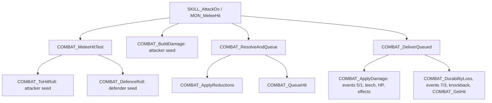
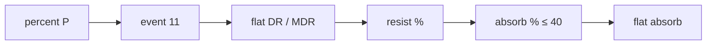

# 0001 — Combat formulas: to-hit, damage, defences and on-hit effects

> **Subsystem:** combat/formulas
> **Question:** when one unit attacks another, how does the server decide hit, block or avoid, build the damage of each
> type, reduce it on the defender, apply it and run the on-hit effects, and which seeds does each step draw on?
> **Date:** 2026-10-16   **Plan:** 0037 (Phases 1, 1b and 2)   **Status:** open (Phase 2 accepted with fixes 2026-10-16; resume lane landed 2026-10-16, crushing-blow pair closed 2026-10-17, resume lane accepted with fixes 2026-10-17)

The claims of §§ 1–14 are from a static reading of the pinned `Game.exe` (Ghidra decompile plus objdump disassembly
of every function cited) and stay `[I]` there; § 15 raises those that run:2026-10-16-combat reproduced to `[C]`. Unit types:
0 player, 1 monster, 3 missile. "Seed" means the unit seed at `struct:Unit+0x20`; every draw named below is one
step of that seed, either through an RNG function or inlined (`low · 0x6AC690C5 + high`, then `low % n` unsigned,
[rng/0001](../rng/0001-rng-core.md)). Integer division is signed and truncates toward zero unless stated;
`MulDiv(a, b, c)` is `fn:sub_00483360_MulDiv@0x00483360` ([monsters/0004 § 4](../monsters/0004-stats.md#4-monlvlstats-and-muldiv)).

## Answer (summary)

- [I] **The server combat module is `.\UNIT\SUnitDmg.cpp`** (debug paths at `0x0057C5C8`, `0x0057C985`), code
  `0x0057A830`–`0x0057EFFF`, plus the stat-event handlers at `0x005BFC60`–`0x005C0130`. A melee attack runs in one
  call at the attack's hit frame: hit test → damage build → reductions → queue → delivery (apply). The player's normal
  attack is `fn:SKILL_AttackDo@0x0056F070` (Skills `srvdofunc` 1); a monster's plain attack is
  `fn:MON_MeleeHit@0x005A5490` followed by `fn:COMBAT_DeliverQueued@0x0057D4F0`. (fn:COMBAT_MeleeHitTest@0x0057EC10,
  fn:COMBAT_ResolveAndQueue@0x0057DBF0, fn:COMBAT_ApplyDamage@0x0057C6C0)
- [I] **Chance to hit** = `100·AR / (AR + DEF)` (100 when both are 0), then `× 2·alvl / (alvl + dlvl)`, clamped to
  5..95, one draw `low % 100` on the **attacker's** seed, hit when the draw is below it. AR for a player is
  `(dex − 7)·5 + stat 19 + ToHitFactor`, raised by `MulDiv(AR, pct, 100)` with `pct` = item to-hit % (stat 119) +
  mastery + the skill's to-hit (or stat 325 for the normal attack); the levels are plain stat 12. So **`ToHitFactor`
  is an attack-rating term only**; no level bonus exists in this formula. A running player (mode 3) is hit without a
  roll. (fn:COMBAT_ToHitRoll@0x0057D9B0, fn:sub_00622560_PlayerBaseToHit@0x00622560, 0x0057DB01–0x0057DB30)
- [I] **Defence draws are on the defender's seed**, in this order: shield block (`toblock + BlockFactor`, the dexterity
  form only in an **expansion** game, capped at 75, divided by 3 when a player runs), then either evade (walking or
  running defender) or weapon block, then dodge (melee) or avoid (missile). (fn:COMBAT_DefenceRoll@0x0057DFB0,
  fn:COMBAT_AvoidRoll@0x0057DD60, fn:sub_00622720_UnitBlockChance@0x00622720)
- [I] **Damage build** (attacker seed): physical `lo + RangeB(hi − lo)` in 1/256 units with enhanced damage, the
  weapon's `StrBonus`/`DexBonus` shares and min/max percents, then critical/deadly strike (×2), each element's range,
  monster life/mana/stamina drain ranges, poison, an **unconditional** `RangeB(seed, 1)` on the burning field, the
  monster physical-to-element conversion and the monster `Crit` (×2). SrcDam scales every field by `/128`.
  (fn:COMBAT_BuildDamage@0x0057B7D0, fn:COMBAT_RollPhysical@0x0057B420, fn:COMBAT_RollElemStat@0x0057A8E0)
- [I] **Reductions** are a 12-row table (`data:g_DamageResistTable@0x00732980`): per field, subtract flat damage
  reduction (physical) or magic damage reduction (fire, lightning, cold, magic), then resistance %, then absorb %
  (capped at 40) and flat absorb. Player and hireling resistances get `ResistPenalty` in an expansion game and −20/−50
  in classic Nightmare/Hell, then the cap `75 + max-resist` (≤ 95; physical 50); monster resistances have no cap, and
  ≥ 100 means immune; pierce applies unless the monster is immune. (fn:COMBAT_ApplyReductions@0x0057C1E0,
  fn:COMBAT_ResistFor@0x0057BE00, fn:COMBAT_ReduceRow@0x0057BF80, fn:COMBAT_Absorb@0x0057BF10)
- [I] **On-hit effects** run as stat events of the attacker during delivery: crushing blow (`life / k`, k = 10 player
  or hireling, 4 monster, 8 boss or superunique, raised by the player-count life percent, doubled for missiles,
  reduced by physical resist), open wounds (a 200-frame state with `hpregen = −dmg`), freeze; each draws once on the
  attacker's seed. Leech uses `LifeStealDivisor`/`ManaStealDivisor` for player attackers and the monster's `Drain`.
  (fn:STATEVENT_CrushingBlow@0x005BFFC0, fn:STATEVENT_OpenWounds@0x005BFE60, fn:COMBAT_Leech@0x0057C420)
- [I] **The life change** is one write: `HP − total`, set to 0 when below 256 (one life), where `total` =
  physical + fire + lightning + magic + cold + poison after reductions (+ the drain field for a monster attacker); the kill
  flag `0x2` hands off to `COMBAT_GetHit`, which calls `sub_0057CCB0_UnitKilled` for a monster.
  (fn:COMBAT_GetHit@0x0057CEE0, fn:sub_0057CCB0_UnitKilled@0x0057CCB0, fn:COMBAT_ApplyDamage@0x0057C6C0, 0x0057C852–0x0057C874)
- [I] Four DifficultyLevels columns have combat readers: `ResistPenalty` (+0x00), `MonsterFreezeDivisor` (+0x14),
  `MonsterColdDivisor` (+0x18), `LifeStealDivisor`/`ManaStealDivisor` (+0x28/+0x2C); and **`HireableBossDamagePercent`
  (+0x38) is read** (a hireling hitting a boss), contrary to the [DifficultyLevels](../../tables/DifficultyLevels.md)
  "no reader" statement, through the record pointer kept in the reduction context. (fn:COMBAT_DamagePercent@0x0057C060,
  0x0057C0FE)

## Leads used

Phase 1b, fetched 2026-10-16 after §§ 1–12 were written (ADR-0007; each page read in the session, none shows code).
Agreement adds nothing to a tag. Details in § 13; the five `contradicted` verdicts (four behaviours) are required Phase 2 cases with
backlog entries (2026-10-16 "combat contradictions").

- [L] src:arreat-summit-character-basics: chance to hit `100·AR/(AR+DR)·2·alvl/(alvl+dlvl)`. **held with refinement**
  Detail: the percent is truncated first, then `·alvl·2/(alvl+dlvl)` in one signed divide; AR gets its percent by
  `MulDiv`; DEF includes stats 32/33 (§ 3).
- [L] src:arreat-summit-character-basics: melee chance to hit never below 5 % or above 95 %. **held**
  Detail: the clamp 5..95 in `COMBAT_ToHitRoll`, the same for missiles.
- [L] src:arreat-summit-character-basics: class bonus to the attacker's level (20/15/5/−10/−15). **contradicted**
  Detail: the constants are `ToHitFactor`, added to AR; the level term has no class bonus (§ 3.4). Phase 2 case;
  backlog "ToHitFactor" carries this reading.
- [L] src:arreat-summit-character-basics: `Total Blocking = (Blocking·(Dex − 15)) / (Clvl·2)`. **held with refinement**
  Detail: only in an expansion game; classic uses `toblock + BlockFactor`; level < 2 counts as 1 (§ 4).
- [L] src:arreat-summit-character-basics: blocking capped at 75 %. **held**
- [L] src:arreat-summit-character-basics: running reduces blocking to a third, with a cap of 25 %. **held with refinement**
  Detail: `÷ 3` for a player in mode 3 or 6 (not walking), after the 75 cap, so ≤ 25; a running player is also hit
  without a to-hit roll (not covered by the page).
- [L] src:arreat-summit-character-basics: Defense Rating = Dex / 4 without equipment. **held**
  Detail: `UNIT_GetDefense` adds `dex/4` to stat 31.
- [L] src:arreat-summit-difficulty: resistances −40 Nightmare, −100 Hell for players and hirelings. **held**
  Detail: `ResistPenalty` in an expansion game; classic uses −20/−50 constants (**not covered** by the LoD page).
- [L] src:arreat-summit-difficulty: life and mana stealing cut to 1/2 (Nightmare) and 1/3 (Hell). **held with refinement**
  Detail: `LifeStealDivisor`/`ManaStealDivisor` 1/2/3 divide the `<< 6` steal percent of player attackers only.
- [L] src:arreat-summit-difficulty: freezing and chilling cut to 1/2 and 1/4. **held with refinement**
  Detail: the divisors 1/2/4 apply to monster defenders only (freeze only when `coldeffect` < 0).
- [L] src:arreat-summit-difficulty: AI curses cut; Static Field floor 33 %/50 %. **not covered**
  Detail: readers named only (§ 12b (c)).
- [L] src:arreat-summit-resistances: default maximum 75 %, items raise it to at most 95 %. **held**
- [L] src:arreat-summit-resistances: minimum resistance −100 %. **held**
- [L] src:arreat-summit-resistances: magic resistance base 0 in every difficulty. **held**
  Detail: rows 0 and 4 (stats 36, 37) skip the penalty.
- [L] src:arreat-summit-resistances: cold resistance shortens chill; Half Freeze Duration halves it; Cannot Be Frozen
  removes it. **held**
- [L] src:arreat-summit-resistances: order Energy Shield, Bone/Cyclone Armor, DR/MDR, resistances, % absorb, direct
  absorb. **held with refinement**
  Detail: the PvP/hireling percent comes first; event 11 (`absorbdamage`) precedes DR/MDR, its handlers not read.
- [L] src:arreat-summit-amazon-passive: Dodge melee while standing, Avoid missiles while standing, Evade any attack
  while moving. **held**
- [L] src:arreat-summit-amazon-passive: Critical Strike doubles damage. **held with refinement**
  Detail: physical only; mastery crit, stat 337, then deadly strike, one doubling at most.
- [L] src:arreat-summit-monster-pages: immunity means 100 % resistance. **held with refinement**
  Detail: ≥ 100 is capped to 100 in `COMBAT_ReduceRow`; pierce does not apply to it.
- [L] src:purediablo-absorb: % absorb capped at 40 per element. **held**
- [L] src:purediablo-absorb: healing comes from absolute absorb only. **contradicted**
  Detail: both the % and the flat absorbed amounts go to `absorbHeal` (`+0x48`), healed by `UNIT_AddLifeCapped`.
- [L] src:purediablo-absorb: physical damage is not absorbed; integer reduction first, then % (capped at 50). **held**
- [L] src:purediablo-mechanics: open wounds per frame `(9·clvl + 31)/256` … `(45·clvl − 1319)/256`. **held**
  Detail: `band(L) + 40` equals each band; the per-frame tick of stat 74 is not read.
- [L] src:purediablo-mechanics: open wounds lasts 200 frames, reset on reapplication. **held**
- [L] src:purediablo-mechanics: open wounds modifier 0.25 on a player (melee), 0.5 on a boss, 1 otherwise. **held with refinement**
  Detail: `/4` on players and `/2` more for a missile; `/2` for champions and uniques (type flags `0x0C`); the test reads
  the type flags, not MonStats `boss`, and Andariel carries the unique flag, so she takes half (§ 15, 63 events).
- [L] src:purediablo-mechanics: crushing blow 1/4 normal monster, 1/10 player or hireling. **held**
- [L] src:purediablo-mechanics: crushing blow 1/8 on a boss or champion. **contradicted**
  Detail: 1/8 for MonStats `boss` and superuniques (`0x02`); champions and uniques take 1/4.
- [L] src:purediablo-mechanics: crushing blow does not scale with the player count. **contradicted**
  Detail: `k += MulDiv(k, PlayerHpPct(n), 100)` for monsters.
- [L] src:purediablo-mechanics: crushing blow affected by physical resistance only when positive. **held**
- [L] src:fextralife-d2r-crushing-blow: ranged hits halve crushing blow (1/8, 1/20, 1/16). **held**
  Detail: `k ·= 2` on event 6.
- [L] src:fextralife-d2r-crushing-blow: 1/8 for champions and uniques. **contradicted**
  Detail: as above (D2R page; 1.14d gives 1/4).
- [L] src:fextralife-d2r-crushing-blow: crushing blow scales with the player-count life bonus. **held with refinement**
  Detail: the bonus is `+50 %` per extra player on the divisor, so four players give 1/10 of 2.5× life, not 1/16.
- [L] src:fextralife-d2r-crushing-blow: no Hell cap on crushing blow. **held**
  Detail: no difficulty branch.
- [L] src:d2dfg-blizzard: a missile's `KnockBack` is a percent chance. **held** (*plan 0045 Phase 1b, 2026-10-20*)
  Detail: `RNG_Range(missile seed, 100) < KnockBack` in `MISSILE_ApplyDamage`, unless the unit is in state 54.

## Functions

| Address | Name | Role | Tag |
|---|---|---|---|
| `0x0056CA40` | `SKILL_AttackStart` | Skills `srvstfunc` 1 (Attack): no draw | I |
| `0x0056F070` | `SKILL_AttackDo` | Skills `srvdofunc` 1: player normal attack at the hit frame | I |
| `0x005A5490` | `MON_MeleeHit` | monster plain melee: hit test, `ResolveAndQueue` at SrcDam 128 | I |
| `0x005A5470` | `sub_005A5470_MonHitTest` | hit test only | I |
| `0x005A7670` | `sub_005A7670_MonAttackFrame` | monster attack frame without a skill: `MON_MeleeHit` then delivery | I |
| `0x005D9C80` | `sub_005D9C80_MonSkillAttackDo` | a monster skill do-function: `MonAttackStats`, `MON_MeleeHit`, delivery | I |
| `0x0057EC10` | `COMBAT_MeleeHitTest` | range, to-hit, defence roll → result word | I |
| `0x0057D9B0` | `COMBAT_ToHitRoll` | chance to hit and its draw | I |
| `0x0057D8A0` | `COMBAT_ToHitTargetMods` | ignore/fractional target defence, demon/undead to-hit | I |
| `0x006223F0` | `UNIT_GetDefense` | defence: `armorclass + dex/4`, percents, override | I |
| `0x0057D810` | `sub_0057D810_PreventHealHook` | on hit: stat 117 applies a state to a monster (state 52 checked, skills/0003 § 16) | C |
| `0x0057DFB0` | `COMBAT_DefenceRoll` | shield block, then `COMBAT_AvoidRoll` | I |
| `0x0057DD60` | `COMBAT_AvoidRoll` | evade, weapon block, dodge, avoid | I |
| `0x0057DCA0` | `sub_0057DCA0_WeaponBlockChance` | stat 348 by the held weapons' item type | I |
| `0x00622720` | `sub_00622720_UnitBlockChance` | block chance (existing name) | I |
| `0x00622D00` | `sub_00622D00_UnitIsMoving` | walk/run test of a unit | I |
| `0x00622C40` | `sub_00622C40_InMeleeRange` | melee range test | I |
| `0x0057B7D0` | `COMBAT_BuildDamage` | damage builder | I |
| `0x0057B420` | `COMBAT_RollPhysical` | physical roll | I |
| `0x0057A880` | `COMBAT_RollRange` | `lo..hi` roll with percents | I |
| `0x0057A8E0` | `COMBAT_RollElemStat` | one element's min/max stats rolled | I |
| `0x0057B660` | `sub_0057B660_UndeadDmgBonus` | +50 % (blunt) and stat 122 against undead | I |
| `0x0057B6A0` | `sub_0057B6A0_DmgVsMonType` | stat 180 by MonType | I |
| `0x005A5560` | `sub_005A5560_MonCritDouble` | MonStats `Crit` doubling | I |
| `0x0057DBF0` | `COMBAT_ResolveAndQueue` | build if needed, reductions, kill pre-test, queue | I |
| `0x0057C1E0` | `COMBAT_ApplyReductions` | the reduction pass | I |
| `0x0057BF80` | `COMBAT_ReduceRow` | one table row | I |
| `0x0057BE00` | `COMBAT_ResistFor` | effective resistance | I |
| `0x0057BF10` | `COMBAT_Absorb` | absorb percent and flat | I |
| `0x0057C060` | `COMBAT_DamagePercent` | PvP 17 %, hireling cases | I |
| `0x0057C140` | `COMBAT_LengthImmunities` | cannot-be-frozen, half freeze, shrine states | I |
| `0x00732980` | `g_DamageResistTable` | 12 × `ResistRow` | I |
| `0x0057CA80` | `COMBAT_QueueHit` | copy the packet onto the attacker's hit queue | I |
| `0x0057D690` | `sub_0057D690_QueuedHitFind` | find a queued hit | I |
| `0x0057C9F0` | `sub_0057C9F0_QueuedHitRemove` | remove it | I |
| `0x0057D4F0` | `COMBAT_DeliverQueued` | deliver: apply, events 7/3, durability, knockback, get-hit | I |
| `0x0057C6C0` | `COMBAT_ApplyDamage` | events 5/1 or 6/2, leech, HP, drains, stun, cold, freeze, poison, burn | I |
| `0x0057C420` | `COMBAT_Leech` | life and mana steal | I |
| `0x0057A980` | `UNIT_AddLifeCapped` | add life up to max | I |
| `0x0057AA00` | `UNIT_AddManaCapped` | add mana up to max | I |
| `0x0057AA60` | `sub_0057AA60_ManaDrain` | defender mana loss | I |
| `0x0057AAA0` | `sub_0057AAA0_StaminaDrain` | defender stamina loss | I |
| `0x0057AAE0` | `COMBAT_ApplyStun` | stun state 21 | I |
| `0x0057AF30` | `sub_0057AF30_MonColdEffect` | MonStats `coldeffect` of the difficulty | I |
| `0x0057AF80` | `COMBAT_ApplyCold` | cold state 11, shatter roll | I |
| `0x0057B230` | `COMBAT_ApplyFreeze` | freeze state 1 or the cold fallback | I |
| `0x0057AC50` | `COMBAT_ApplyPoison` | poison state 2 | I |
| `0x0057ADD0` | `COMBAT_ApplyBurn` | burning state 115 | I |
| `0x0057CEE0` | `COMBAT_GetHit` | hit class, knockback, get-hit, death hand-off (named only) | I |
| `0x0057CB00` | `sub_0057CB00_GetHitRoll` | get-hit decision, up to two `RangePow2` on the defender | I |
| `0x0057CE30` | `sub_0057CE30_HitClassPick` | hit class from a global counter (no RNG) | I |
| `0x0057D3D0` | `COMBAT_DurabilityLoss` | weapon and armour durability picks | I |
| `0x00559E30` | `ITEMS_DurabilityLossRoll` | 4 % / 10 % durability draw on the owner's seed | I |
| `0x005C0C30` | `UNIT_DispatchEvent` | run a unit's stat events of one id | I |
| `0x005C0AD0` | `UNIT_AddEvent` | add a stat event | I |
| `0x0056E740` | `sub_0056E740_AddStatEvent` | add by ItemStatCost `itemeventfunc` | I |
| `0x007325B0` | `g_StatEventFuncs` | the `itemeventfunc` handler table (1..31) | I |
| `0x005BFFC0` | `STATEVENT_CrushingBlow` | `itemeventfunc` 16 | I |
| `0x005BFE60` | `STATEVENT_OpenWounds` | `itemeventfunc` 15 | I |
| `0x005BFDA0` | `sub_005BFDA0_OpenWoundsBand` | level-banded open-wounds damage | I |
| `0x005BFC60` | `STATEVENT_Freeze` | `itemeventfunc` 14 | I |
| `0x0056E970` | `STATE_ApplyTimed` | put a timed state with one stat | I |
| `0x005ADF10` | `MISSILE_HitUnit` | missile collision with a unit (named only) | I |
| `0x005A89A0` | `MISSILE_BuildDamage` | missile packet from the missile's stats | C (skills/0002 § 6: 4 118 builds) |
| `0x005AD730` | `MISSILE_ApplyDamage` | missile: defence roll, `COMBAT_ApplyDamage` with reductions | I |
| `0x0063E9F0` | `MONSTATS_IsBoss` | MonStats `+0x0C` bit 6 | I |
| `0x0063E940` | `MONSTATS_IsDemon` | `+0x0D` bit 5 | I |
| `0x0063E990` | `MONSTATS_IsUndead` | `+0x0D` bit 3 or 4 | I |
| `0x0063EDC0` | `MONSTATS_IsPrimeEvil` | `+0x0C` bit 7 | I |
| `0x00639DF0` | `UNIT_HasState` | state test | I |
| `0x00645830` | `SKILLS_GetMasteryBonus` | mastery to-hit (0), damage (1), crit (2) for a weapon | I |
| `0x00535BC0` | `sub_00535BC0_UnitGetWeapon` | the weapon used | I |
| `0x00554200` | `sub_00554200_UnitsHostile` | hostility test | I |
| `0x00554010` | `sub_00554010_UnitGetGame` | `Unit+0x80` | I |
| `0x00583740` | `sub_00583740_AttackRatingCalc` | an AR computed outside the attack path (§ 3.4) | I |
| `0x004E9040` | `sub_004E9040_ClientAttackRating` | client display of AR (client copy) | I |
| `0x005A2620` | `sub_005A2620_MonDeathDamage` | reads `MonsterCEDamagePercent` | I |
| `0x005C9800` | `sub_005C9800_SorSkillStaticMin` | reads `StaticFieldMin` (expansion) | I |

## Walkthrough

### 1. The packet and the call shape

`re/types/combat.h` holds the 0x70-byte `DamagePacket`, the reduction context `ReduceCtx` and `ResistRow`.

- [I] The packet's fields by offset: `+0x08` physical, `+0x10` fire, `+0x14`/`+0x18` burning damage and length,
  `+0x1C` lightning, `+0x20` magic, `+0x24` cold, `+0x28`/`+0x2C` poison and length, `+0x30` cold length, `+0x34`
  freeze length, `+0x38`/`+0x3C`/`+0x40` life, mana and stamina steal, `+0x44` stun length, `+0x48` absorbed life,
  `+0x4C` total, `+0x54` damage frame rate, `+0x65`/`+0x68` conversion type and percent. The debug names of the
  resistance table name eleven of them ("Dam", "Fire", "Ligt", "Cold", "Magc", "CLen", "FLen", "PLen", "Pois",
  "Life", "Mana", "Stam"). (data:g_DamageResistTable@0x00732980, struct:DamagePacket+0x08, struct:DamagePacket+0x65)
- [I] The result word `+0x04`: `0x1` hit, `0x2` killed, `0x4` get-hit, `0x8` knockback, `0x10` blocked, `0x80`
  dodged, `0x100` avoided, `0x200` evaded (missiles), `0x2000` doubled (critical or deadly strike), `0x8000` weapon
  block. (fn:COMBAT_MeleeHitTest@0x0057EC10, fn:MISSILE_ApplyDamage@0x005AD730, struct:DamagePacket+0x04)
- [I] Calling convention of the core: `ECX` = game, `EDX` = attacker, first stack argument = defender
  (`COMBAT_MeleeHitTest`, `COMBAT_ResolveAndQueue`, `COMBAT_ApplyReductions`, `COMBAT_ApplyDamage`). In
  `COMBAT_ToHitRoll` `ECX` is the attacker and `EDX` the defender. (0x0057EC16–0x0057EC28, 0x0057D9BB–0x0057D9C2)



### 2. The attack events

- [I] **Player normal attack** (`SKILL_AttackDo`, Skills row 0 `srvdofunc` 1, table `0x007322B0 + 4·1`): with a
  missile weapon it creates a missile instead (`0x0056ECB0`). Otherwise it takes the target, zeroes a packet, sets
  `result = COMBAT_MeleeHitTest(target, AR% = stat 325, 0)`, sets `flags |= 0x2`, calls `COMBAT_BuildDamage(target,
  packet, 0, SrcDam 128)` **whatever the result**, then `COMBAT_ResolveAndQueue(target, packet, 128)` and
  `COMBAT_DeliverQueued(target, 0)`. So a player's damage draws happen on a miss too. (fn:SKILL_AttackDo@0x0056F070,
  0x0056F0E0–0x0056F1B0)
- [I] **Skill melee hits** (`0x005C7690` and the other do-functions that call `COMBAT_MeleeHitTest`) pass
  `SKILLS_GetToHit` as the AR percent and their own SrcDam to `COMBAT_ResolveAndQueue`; the skill's damage packet is
  phase (3)'s input. (fn:SKILLS_GetToHit@0x006449F0, 0x005C76B0)
  *2026-10-20 (plan 0046 batch `ama`), correction:* not all of them. Start 6 (Power Strike, Charged Strike,
  MonPowerStrike, MonIceSpear) and start 10 (Lightning Strike) pass **0** as the second argument; start 7 (Impale),
  do 7 (Jab) and do 13 (Fend, Zeal, Fury) pass `SKILLS_GetToHit` ([skills/0009 § 4](../skills/0009-amazon.md#4-the-melee-hits-start-6-7-10-and-do-7);
  the argument values `[C]` under ADR-0021 for start 6, 7, 10 and do 7, the AR-percent meaning still this bullet's
  `[I]`). (fn:sub_005DA940_SkillSt06Hit@0x005DA940, fn:sub_005DB020_SkillSt10LightningStrike@0x005DB020)
- [I] **Monster melee** (`MON_MeleeHit`): target, zeroed packet, `result = COMBAT_MeleeHitTest(target, 0, 0)`,
  `COMBAT_ResolveAndQueue(target, packet, 128)`; the builder runs **only when** the result has `0x1` and none of
  `0x8380`. `sub_005A7670_MonAttackFrame` (no skill) and `sub_005D9C80_MonSkillAttackDo` then call
  `COMBAT_DeliverQueued`; the skill do-function calls `sub_005A4F50_MonAttackStats` first, the plain frame does not (it
  ran at the mode change, `sub_005A7C20_MonSetMode`). (fn:MON_MeleeHit@0x005A5490, fn:sub_005A7670_MonAttackFrame@0x005A7670,
  fn:sub_005D9C80_MonSkillAttackDo@0x005D9C80, fn:sub_005A4F50_MonAttackStats@0x005A4F50, 0x0057DC1D–0x0057DC37)
- [I] **Missiles**: `MISSILE_HitUnit` calls `COMBAT_ToHitRoll(missile stat 19, missile = 1)` when the Missiles record
  byte `+0x18B` is set, builds the packet from the missile unit's own stats (`MISSILE_BuildDamage`: physical
  `RangeB(max − min) + min` on the **missile's** seed, the elements through the same mastery rolls), then
  `MISSILE_ApplyDamage`: knockback roll `RNG_Range(missile seed, 100) < Missiles +0xAE`, `COMBAT_DefenceRoll(defender,
  missile = 1, block only if physical ≠ 0)`, `+0x54 = stat 327`, `COMBAT_ApplyDamage(defender, reductions = 1)`,
  `COMBAT_GetHit`. The missile path is phase (3); here it is named and its packet is an input.
  (fn:MISSILE_HitUnit@0x005ADF10, fn:MISSILE_BuildDamage@0x005A89A0, fn:MISSILE_ApplyDamage@0x005AD730)
- [I] Mercenaries (hirelings) are monsters on the monster path; they differ in the branches that test
  `sub_0063EE90_HirelingType` (§§ 5, 7, 8, 9): crushing blow divisor 10, the 25 % hireling-against-hireling and the
  boss percent, leech with the player formula but without the divisors, and no monster drain rolls. So a mercenary
  case is needed in Phase 2. (fn:sub_0063EE90_HirelingType@0x0063EE90)

### 3. To-hit (`COMBAT_ToHitRoll`)

```c
// fn:COMBAT_ToHitRoll@0x0057D9B0 (attacker ECX, defender EDX; args arPct, isMissile)
dlvl = stat(def, 12); alvl = stat(att, 12);
DEF  = UNIT_GetDefense(def) + stat(def, isMissile ? 32 : 33);      // armorclass_vs_missile / vs_hth
if (att.type == PLAYER) {
    AR = PlayerBaseToHit(att);                                      // (dex-7)*5 + stat19 + CharStats.ToHitFactor
    COMBAT_ToHitTargetMods(att, def, &AR, &DEF);
    pct = (!isMissile && (w = UnitGetWeapon(att))) ? SKILLS_GetMasteryBonus(att, w, 0, 0) : 0;
    pct += UnitGetStat(att, 119) + arPct;                           // item_tohit_percent + caller's bonus
    if (def.type == MONSTER && MonStats(def).MonType > 0)
        for each (type, v) in stat 179 list of att: if MonType bit set: pct += v;   // attack_vs_montype
} else {
    AR  = stat(att, 19) + arPct + 5*stat(att, 2);                   // monster: tohit + bonus + 5*dex
    pct = UnitGetStat(att, 119);
}
AR += MulDiv(AR, pct, 100);
if (DEF < 0) { AR -= DEF; DEF = 0; }
if (AR  < 0) { DEF -= AR; AR = 0; }
if (DEF < 0) DEF = 0;
c = (AR + DEF) ? 100*AR / (AR + DEF) : 100;
c = c * alvl * 2 / (alvl + dlvl);
c = c <= 5 ? 5 : (c >= 95 ? 95 : c);
r = step(att.seed) % 100;                                           // draw: attacker seed
if (r < c) { sub_0057D810_PreventHealHook(); return 1; }  return 0;
```

- [I] As above, every division signed and 32-bit (`idiv`). `c` is the percent `100·AR/(AR+DEF)` truncated, then the
  level factor applied in one multiply and one divide: `(c·alvl·2) / (alvl + dlvl)`. (0x0057DB01–0x0057DB30)
- [I] The clamp: `c ≤ 5` → 5, `c ≥ 95` → 95. (0x0057DB22–0x0057DB30)
- [I] The draw is the inlined LCG on the attacker's seed (`ebx+0x20`), `low % 100` by the `0x51EB851F` multiply, hit
  when `r < c`. (0x0057DB35–0x0057DB79)
- [I] **Defence** (`UNIT_GetDefense`, any unit): `d = stat 31 + dex/4` (signed `/4`); `p = stat 171 + stat 16`
  (+ the Holy Shield bonus when state 101 is on: the skill's calc at Skills `+0x138` through `SKILLS_EvalCalc`);
  `d += d·p / 100`; then `+ MulDiv(d, stat 182, 100)` when stat 182 ≠ 0. (fn:UNIT_GetDefense@0x006223F0,
  tbl:ItemStatCost.txt:Stat)
- [I] **Target modifiers** (players only, `COMBAT_ToHitTargetMods`): stat 115 sets `DEF = 0` against a monster that
  is not boss, unique, superunique (type flags `0x0A`) or hireling; stat 116 is halved (signed) against a player, a
  boss, a superunique or a hireling, clamped to 0..100, and `DEF −= MulDiv(DEF, p, 100)`; stat 123 adds to AR
  against a demon, stat 124 against undead. (fn:COMBAT_ToHitTargetMods@0x0057D8A0, 0x0057D8BA, 0x0057D914)

#### 3.4 Where `ToHitFactor` enters

- [I] `ToHitFactor` (`CharStats+0x3C`) enters only through `PlayerBaseToHit`, i.e. into AR before the percent; the
  level term uses stat 12 of both units with no class constant. (fn:sub_00622560_PlayerBaseToHit@0x00622560,
  struct:CharStatsRec+0x3C, 0x0057DA20, 0x0057DA06)
- [I] `sub_00583740_AttackRatingCalc` computes `base + base·(skill ToHit + (lvl−1)·LevToHit + mastery + stat 119)/100`
  and then adds `ToHitFactor` a second time. Its only caller is `0x00583840` (a stat-by-id percent helper, case stat
  19), which is not on any attack path read here. So the double add does not reach the to-hit roll.
  (fn:sub_00583740_AttackRatingCalc@0x00583740, 0x00583890)
- [I] The client's character screen (`sub_004E9040_ClientAttackRating`) computes `base + base·(stat 119 + skill
  to-hit [+ stat 325])/100` with plain `/100` (not `MulDiv`). It is a client copy and presentation (ADR-0014 § Time);
  it agrees with the server's AR term. (fn:sub_004E9040_ClientAttackRating@0x004E9040)

### 4. Block, evade, weapon block, dodge, avoid

```c
// fn:COMBAT_MeleeHitTest@0x0057EC10 (game, attacker, defender, arPct, rangeExtra)
if (!hostile || types not player/monster) return 0;
auto = (def.type == PLAYER && def.mode == 3 /*run*/);
if (!InMeleeRange(att, def, (att.type==MONSTER)*2 + 1 - (rangeExtra ? weaponRange(att)+rangeExtra : 0))) return 0;
res = auto ? 1 : COMBAT_ToHitRoll(att, def, arPct, 0);
if (res & 1) {
    d = COMBAT_DefenceRoll(def, /*missile*/0, /*useBlock*/1);     // ECX = game
    if (d & 2) res |= 0x100;  if (d & 4) res |= 0x80;  if (d & 0x10) res |= 0x8000;  if (d & 1) res |= 0x10;
    if (d) res &= ~1;
}
if (res & 0x10) res &= ~1;
if ((res & 1) && !HasState(def, 54 /*uninterruptable*/)) res |= 4;
```

- [I] **Shield block** (`COMBAT_DefenceRoll`, `useBlock` ≠ 0): `b = UnitBlockChance(def, game.expansion)`. For a
  player: 0 without a shield in the hands; `b = stat 20 + CharStats BlockFactor`; in an **expansion** game `b =
  ((dex − 15)·b) / (2·max(lvl, 1))` (lvl < 2 counts as 1); capped at 75. For a monster: `b = stat 20` when MonStats
  `NoShldBlock` (`+0x0F` bit 2) is set or it holds a shield, else 0; capped at 75. Then a player that is moving
  (mode 2, 3 or 6 by `0x00621190`) and not in mode 2 (walk) gets `b /= 3`. If `b > 0`, one inlined draw on the
  **defender's** seed, blocked when `r < b`. (fn:COMBAT_DefenceRoll@0x0057DFB0, fn:sub_00622720_UnitBlockChance@0x00622720,
  0x0057DFD5, 0x0057E011–0x0057E01F, tbl:CharStats.txt:BlockFactor, tbl:MonStats.txt:NoShldBlock)
- [I] **When not blocked** (`COMBAT_AvoidRoll`, `missile` = the caller's flag): a player in mode 3 or 2, or a monster
  in mode 15 or 2, rolls **only evade**: stat 340 > 0 → one draw on the defender's seed, result 8 when `r < evade`.
  Otherwise: weapon block (stat 348 for the held weapon's item type, `sub_0057DCA0_WeaponBlockChance`) when > 0 and
  the unit's current skill check `0x0064F380` gives 13: `RNG_Range(def seed, 100) < wb` → 0x10; then dodge (stat
  338, melee) or avoid (stat 339, missile): `RNG_Range(def seed, 100) <` it → 4 or 2. Each draw only when its chance
  is > 0. (fn:COMBAT_AvoidRoll@0x0057DD60, fn:sub_0057DCA0_WeaponBlockChance@0x0057DCA0)
- [I] A player running (mode 3) is never rolled for to-hit (auto hit) but still blocks (at a third) or evades.
  (0x0057EC71–0x0057EC77)

### 5. The damage build (`COMBAT_BuildDamage`)

Called as `(game ECX, attacker EDX; defender, packet, critFlag, srcdam)`; `srcdam` 0 means 128.

1. [I] Links the weapon's stat lists to the attacker (`0x00535D10`), `flags |= 0x20`. For a player or a hireling
   attacker against a monster: stat 120 lowers the monster's stat 31 (not below 0) permanently; stat 121 adds to
   `edPct` against a demon; `sub_0057B660_UndeadDmgBonus` adds 50 for a blunt weapon (item type 57) plus stat 122
   against undead; `sub_0057B6A0_DmgVsMonType` adds stat 180 entries whose MonType bit matches. (0x0057B82A–0x0057B87D)
   *Corrected by [§ 20](#20-plan-0066-batch-s5e-part-2-stat-events-life-tick-and-the-damage-builder-run2026-11-16-sweep2-s5e2) (S5e part 2): the condition is a type-0 attacker or `UnitAlignGet` = 2, stat 120 is added
   to stat 31, and stats 121/122 count only when positive.*
2. [I] **Physical** unless `flags & 1`: `phys = COMBAT_RollPhysical(att, useStats = 1, weapon 0, …, edPct, phys,
   srcdam)` (0x0057B88B–0x0057B8AD):
   - min/max = stats 21/22 (or 23/24 when `0x0063D340` reports a two-handed hold); without a weapon at least 1/2.
     Both `<< 8`, plus stat 111 `<< 8`; min < 1 → 256; max ≤ min → min + 256.
   - `ed = edPct + stat 25`, clamped to ≥ −90 after adding, with a weapon, `StrBonus·str/100 + DexBonus·dex/100`
     (each signed `/100`, item `0x00629860`/`0x006298A0`) and `SKILLS_GetMasteryBonus(att, weapon, 0, 1)`; without a
     weapon, `+ str` (stat 0).
   - `lo = min + MulDiv(min, ed + stat 18, 100)`; `hi = max + MulDiv(max, ed + stat 17, 100)`; `v = phys + lo`, and
     if `hi > lo`, `v += RangeB(att seed, hi − lo)` (so `v ≤ phys + hi − 1`); `v = max(v, 0)`; if `srcdam ≠ 128`,
     `v = MulDiv(v, srcdam, 128)`. (fn:COMBAT_RollPhysical@0x0057B420, 0x0057B4BB–0x0057B628, tbl:Weapons.txt:StrBonus)
3. [I] **Critical / deadly strike**, only when the physical roll ran, short-circuit in this order, each draw
   `RNG_RangeOffset(att seed, 0, 100) < chance` only when its chance is > 0: the weapon mastery's crit
   (`SKILLS_GetMasteryBonus(…, 2)`, only when `critFlag` is 0 and a weapon is held), stat 337
   (`passive_critical_strike`), stat 141 (`item_deadlystrike`). Success: `result |= 0x2000`, `phys *= 2`.
   (0x0057B8A9–0x0057B92F, fn:RNG_RangeOffset@0x00472280)
4. [I] **Elements**, in this order: fire (stats 48/49, mastery stat 329), lightning (50/51, 330), cold (54/55, 331),
   magic (52/53, 357): `COMBAT_RollElemStat` returns the field unchanged (≥ 0) when `max·256 < 8`; otherwise
   `lo = (min<<8) + MulDiv(min<<8, m, 100)`, `hi = (max<<8) + MulDiv(max<<8, m, 100)`, `v = field + lo
   [+ RangeB(att seed, hi − lo) if hi > lo]`, `max(v, 0)`; then `v·srcdam/128` (signed shift) when `srcdam ≠ 128`.
   (fn:COMBAT_RollElemStat@0x0057A8E0, fn:COMBAT_RollRange@0x0057A880, 0x0057B932–0x0057BA4C)
5. [I] **Steal fields**: a monster attacker that is not a hireling rolls life (60/61), mana (62/63) and stamina
   (64/65) drain unless `flags & 4/8/0x10`, each `field += roll·srcdam/128`. Every other attacker adds stat 60 and
   stat 62 (percents) as they are, and sets `flags` 0x100/0x200/0x400 from stats 103/104/106. (0x0057BA55–0x0057BB5A)
   *Refined by [§ 20](#20-plan-0066-batch-s5e-part-2-stat-events-life-tick-and-the-damage-builder-run2026-11-16-sweep2-s5e2): only a player or hireling takes the second branch, its adds skipped under `flags & 4/8`.*
6. [I] **Poison**: stats 57/58 (no shift) with mastery 332 when stat 58 > 0, `COMBAT_RollRange`, then `·srcdam/128`;
   if non-zero, length `+= stat 101` when > 0, else `+= stat 59` and `/= stat 326` when > 1. **Cold length** `+=
   stat 56·srcdam/128` when cold > 0. **Stun** `+= stat 66·srcdam/128` when 0. (0x0057BB60–0x0057BC2C)
   *Corrected by [§ 20](#20-plan-0066-batch-s5e-part-2-stat-events-life-tick-and-the-damage-builder-run2026-11-16-sweep2-s5e2): the roll runs on every build with the poison field as its base and replaces it.*
7. [I] **Burning**: `burn += max(0, burn·srcdam + 316 + RangeB(att seed, 1)) / 128`, **unconditionally**; the
   `RangeB(…, 1)` steps the attacker's seed once and returns 0 on every build. Then `burnLen += stat 315·srcdam/128`
   when `burnLen ≠ 0`. So a plain attack ends with `burn = 2`, `burnLen = 0` (no burn applied, § 9). The constant 316
   is the `burningmin` stat id, which suggests a slip in the source; the code is as stated. (0x0057BC2F–0x0057BC8A)
8. [I] For a player or hireling attacker, unless `result & 0x20`: stat event 3 (`attackedinmelee`) of the defender
   runs here with the packet. (0x0057BC8D–0x0057BCAD, fn:UNIT_DispatchEvent@0x005C0C30)
9. [I] **Conversion** (`convType` ≠ 0): `m = MulDiv(phys, convPct, 100)`, `phys = max(phys − m, 0)`; type 10 draws
   `RNG_Range(att seed, 5) + 1`; 1 fire, 2 lightning, 3 magic `+= m`; 4 cold `+= m` and cold length ≥ 50; 5 poison
   `+= m/8` and length ≥ 50; 11 fire and burn length ≥ 50; 12 cold and freeze length ≥ 50. No writer of `convType`
   was found on the attack paths read (open question). (0x0057BCB2–0x0057BD71)
10. [I] **Monster `Crit`** (`sub_005A5560_MonCritDouble`, monster attacker with MonStats `Crit` ≠ 0): one inlined draw
    on the attacker's seed, `(u8)(low % 100) < Crit` doubles physical, fire, lightning, magic, cold and poison, and puts
    overlay 54 on the defender. (fn:sub_005A5560_MonCritDouble@0x005A5560, tbl:MonStats.txt:Crit)

### 6. Resolve, queue, deliver

- [I] `COMBAT_ResolveAndQueue(defender, packet, srcdam)`: when `result & 1` and none of `0x8380`: the builder (unless
  `flags & 2`), `COMBAT_ApplyReductions`, then the kill pre-test: `total = phys + fire + light + magic + cold + poison
  (+ lifeSteal when the attacker is a monster)`, `result |= 2` when `(total & ~0xFF) > (HP & ~0xFF)`. Always:
  `COMBAT_QueueHit` copies the packet onto the **attacker's** list `Unit+0xAC` with both units' type and id.
  (fn:COMBAT_ResolveAndQueue@0x0057DBF0, fn:COMBAT_QueueHit@0x0057CA80, struct:Unit+0xAC)
- [I] `COMBAT_DeliverQueued(defender, 0)`: finds the queued entry, checks melee range again; on a hit (and the
  attacker not dead) sets `flags = 0x20` and calls `COMBAT_ApplyDamage(defender, reductions = 0)`, puts overlay
  `+0x6C`, picks a hit class (`sub_0057CE30_HitClassPick`, a global counter, no draw), runs `COMBAT_DurabilityLoss`;
  then always events 7 (`domeleeattack`, attacker) and 3 (`attackedinmelee`, defender); on a hit the knockback
  `0x005D10C0`; then `COMBAT_GetHit` and removes the entry. (fn:COMBAT_DeliverQueued@0x0057D4F0, 0x0057D5B2–0x0057D662)
  *2026-10-27 (plan 0050 P1.3, `lane/p50d`), corrected:* the call at `0x0057D5EA` is
  `sub_00623C20_UnitBaseHitClass(attacker)`, OR-ed into the packet's `+0x60` when `+0x64` is 0 and the low nibble is
  empty (the attacker's weapon `hit class`, or MonStats2 `HitClass`); `HitClassPick` (the element nibble from a global
  counter) runs later, inside `COMBAT_GetHit` ([anim/0003 § 7](../anim/0003-movement-gates.md#7-the-hit-class)).
  (fn:sub_00623C20_UnitBaseHitClass@0x00623C20, fn:sub_0057CE30_HitClassPick@0x0057CE30)

### 7. Reductions (`COMBAT_ApplyReductions`)

```c
// fn:COMBAT_ApplyReductions@0x0057C1E0 (game, attacker, defender, packet)
ctx = { game, DifficultyRec(game.diff), att, def, attIsMon = att monster && !hireling,
        defIsMon = def monster && !hireling, pkt, reduce = {0, DR, MDR} };
DR  = stat(def,34) << 8;  if (DR  > 0 && pkt.frameRate > 0) DR  = MulDiv(DR,  pkt.frameRate, 1024);
MDR = stat(def,35) << 8;  if (MDR > 0 && pkt.frameRate > 0) MDR = MulDiv(MDR, pkt.frameRate, 1024);
P = COMBAT_DamagePercent(&ctx);
if (P != 100) for row in table: if (row.scaled && pkt[row.off] > 0) pkt[row.off] = MulDiv(pkt[row.off], P, 100);
UNIT_DispatchEvent(game, 11 /*absorbdamage*/, def, att, pkt);
COMBAT_LengthImmunities(&ctx);
bypass = def monster ? ((undead && flags&0x100) || (demon && flags&0x200) || (!undead && !demon && flags&0x400))
                     : (flags & 0x400) != 0;
for row in table (12): { if (row.monsterOnly && !ctx.attIsMon) break; COMBAT_ReduceRow(&ctx, row, bypass); }
pkt.total = phys + fire + light + magic + cold + poison + (ctx.attIsMon ? lifeSteal : 0);
```

| Row | Field | Resist | Max | Pierce | Absorb % / flat | Reduce | Scaled by P |
|---|---|---|---|---|---|---|---|
| 0 Dam | `+0x08` | 36 | — | — | — | DR | yes |
| 1 Fire | `+0x10` | 39 | 40 | 333 | 142 / 143 | MDR | yes |
| 2 Ligt | `+0x1C` | 41 | 42 | 334 | 144 / 145 | MDR | yes |
| 3 Cold | `+0x24` | 43 | 44 | 335 | 148 / 149 | MDR | yes |
| 4 Magc | `+0x20` | 37 | 38 | — | 146 / 147 | MDR | yes |
| 5 CLen | `+0x30` | 43 | 44 | 335 | — | — | no |
| 6 FLen | `+0x34` | 43 | 44 | 335 | — | — | no |
| 7 PLen | `+0x2C` | 110 | — | 336 | — | — | no |
| 8 Pois | `+0x28` | 45 | 46 | 336 | — | — | yes |
| 9–11 Life, Mana, Stam | `+0x38`, `+0x3C`, `+0x40` | — | — | — | — | — | yes (monster attackers only) |

- [I] The table above is `g_DamageResistTable`, 12 rows of 11 dwords (row `+0x1C` = monster-only, `+0x20` = scaled).
  (data:g_DamageResistTable@0x00732980, struct:ResistRow+0x1C)
- [I] **`COMBAT_ReduceRow`**: `v = field`; `v ≤ 0` → field = 0. `r = COMBAT_ResistFor`. Without bypass `d = v −
  reduce[slot]`; with bypass `d = v` and a positive `r` becomes 0. If `d > 0` and `r ≠ 0`: `r = min(r, 100)`, `d =
  MulDiv(d, 100 − r, 100)`. Without bypass `d = COMBAT_Absorb(d)`. `field = d` (it can be negative when DR exceeds
  it; the next field reads `> 0` only at the next pass). (fn:COMBAT_ReduceRow@0x0057BF80, 0x0057BFB4–0x0057C04D)
- [I] **`COMBAT_ResistFor`**: `r = def.stat(res)` (0 for none); pierce `r −= att.stat(pierce)` when a pierce stat
  exists and (`r < 100` or the defender is not a monster); when the **defender is not a monster** and the row is not
  physical (36) or magic (37): classic game (`game+0x70 = 0`): `−20` in Nightmare, `−50` in Hell; expansion:
  `+ DifficultyLevels.ResistPenalty`. Then `r < −99` → −100; `r ≥ 1` and defender not a monster → `min(r, cap)`
  with `cap = 75 + def.stat(max)` capped at 95, or 50 for row 0 (no max stat), 75 for the other rows without one; and
  `r = 0` for row 0 when the attacker has state 47 (sanctuary) and the defender is undead. Monster resistances are not
  capped. (fn:COMBAT_ResistFor@0x0057BE00, struct:ReduceCtx+0x04, tbl:DifficultyLevels.txt:ResistPenalty)
- [I] **`COMBAT_Absorb`**: `p = min(def.stat(absorbPct), 40)`; if `p > 0`, `a = MulDiv(d, p, 100)`, `absorbHeal += a`,
  `d −= a`; then `f = def.stat(absorbFlat) << 8`, if `f > 0`, `a = min(f, d)`, `absorbHeal += a`, `d −= a`.
  (fn:COMBAT_Absorb@0x0057BF10, 0x0057BF2A–0x0057BF6F)
- [I] **`COMBAT_DamagePercent`** (P): same unit or none → 100. Defender a player: attacker a player, a hireling, or a
  unit with `Unit+0xC4` bit 31 → **17**, else 100. Defender not a player: both hirelings → **25**; attacker a hireling
  and defender a boss → **`HireableBossDamagePercent`** (`DifficultyRec+0x38`); attacker a prime evil and defender
  with bit 31 → 200 for a hireling defender, else 400; else 100. (fn:COMBAT_DamagePercent@0x0057C060,
  0x0057C0B6, 0x0057C0D4, 0x0057C0FE, 0x0057C129–0x0057C132, tbl:DifficultyLevels.txt:HireableBossDamagePercent)
- [I] **`COMBAT_LengthImmunities`**: cold or freeze length > 0: defender stat 153 → both 0, else stat 118 → both
  halved; poison length → 0 under state 133; burn length → 0 under state 131. (fn:COMBAT_LengthImmunities@0x0057C140)
- [I] The reduction order per element is therefore: P (the PvP/hireling percent), event 11, flat DR or MDR,
  resistance %, absorb %, flat absorb. No minimum-damage floor exists in this path. (fn:COMBAT_ApplyReductions@0x0057C1E0)



### 8. Delivery (`COMBAT_ApplyDamage`)

In order, `(game, attacker; defender, doReductions, packet)`:

1. [I] Not hostile and not `flags & 0x1000` → clear result 1 and 2, return. Defender in town and the attacker not a
   monster with the town-capable MonStats bit → clear 2, return. A monster defender that is not `killable` → return.
   Dead → return. `0x00621D50` records the attacker. (0x0057C6D5–0x0057C78E)
2. [I] `doReductions` → `COMBAT_ApplyReductions` (missiles); the melee queue already did it. (0x0057C793–0x0057C7A0)
3. [I] Events, when `result & 1` and not `result & 0x20`: melee (`doReductions` = 0) → event 5 `domeleedamage` on the
   attacker, then event 1 `damagedinmelee` on the defender; missile → event 6 `domissiledamage` on the attacker unless
   `flags & 0x80`, then event 2 `damagedbymissile` on the defender (only when `flags & 0x20`). Each event runs the
   unit's handlers newest first (`UNIT_AddEvent` pushes at the head). (0x0057C7A5–0x0057C7F3, fn:UNIT_AddEvent@0x005C0AD0)
4. [I] `phys = min(phys, HP)`; `COMBAT_Leech` (§ 9); for a monster attacker with a hit, `0x005A4390`; `absorbHeal` to
   the defender (`UNIT_AddLifeCapped`, not when dead or under state 92); **HP −= total** only when `total > 0`
   (`test edi, edi` / `jle` at 0x0057C855–0x0057C857, named at the Phase 3 review), 0 when the result is below 256;
   mana `−= manaSteal` and stamina `−= stamSteal` on the defender (each 0 when below 256); stun; cold; freeze; poison;
   burn. (0x0057C7F8–0x0057C8D8)
5. [I] HP ≤ 0 → `result |= 2`; else clear 2 and, for a monster defender hit with `total ≠ 0`, reschedule its
   regeneration when stat 74 ≠ 0 and call `0x005D6410`. Killed and not `result & 0x20` → event 10 `killed` on the
   defender, event 9 `kill` on the attacker. (0x0057C8DD–0x0057C970)

### 9. Leech, stun, cold, freeze, poison, burn

- [I] **Leech** (`COMBAT_Leech`): returns when both steal fields are 0. `D = 100` for a non-monster defender, else
  MonStats `Drain` of the difficulty (`+0xA0 + d`); `D = 0` → no leech. Both fields `<< 6`. Player attacker: life
  `/= LifeStealDivisor`, mana `/= ManaStealDivisor` (`DifficultyRec+0x28/+0x2C`, signed, when ≠ 0). Then (players
  and hirelings): with `phys > 0`, mana gain `= MulDiv(phys, mana, 100)` [`MulDiv(·, D, 100)` when `D ≠ 100`] `/ 64`
  (signed) to the attacker capped at max mana; life gain likewise capped at max life; overlay 151 (life) or 152
  (mana); when both are non-zero, **`RNG_Range(attacker seed, 2)`** picks the overlay (0 → 151). Monster attacker (not
  a hireling, and `0x00645270` reports an owner type): the fields go back `>> 6`, `min(life, phys) + min(mana,
  def mana) + min(stam, def stamina)`, `MulDiv(·, D, 100)` when `D ≠ 100`, healed to the monster up to its max life,
  overlay 151. (fn:COMBAT_Leech@0x0057C420, 0x0057C47D–0x0057C4CE, 0x0057C560–0x0057C568,
  tbl:DifficultyLevels.txt:LifeStealDivisor, tbl:MonStats.txt:Drain)
- [I] The defender's mana and stamina loss in § 8 read the **same** packet fields after `COMBAT_Leech` scaled them
  (`<< 6` and divided, for players), so for a player attacker the defender loses `manaSteal·64/divisor` 1/256 mana.
  (0x0057C879–0x0057C889)
- [I] **Stun** (`COMBAT_ApplyStun`, length > 0): monster defender with type flag `0x08` (unique): one inlined draw on the
  **attacker's** seed, and the stun goes on only when `r ≥ 90` (`r < 90` returns). Then a boss returns, MonStats `+0x32` = 0 returns, a hireling's length is capped at 13 (from 12
  up); others are capped at 250; state 21 until `frame + length`. (fn:COMBAT_ApplyStun@0x0057AAE0, 0x0057AB17–0x0057AB44)
- [I] **Cold** (`COMBAT_ApplyCold`, length > 0): `ce = MonStats coldeffect[d]` (s8) for a monster (0 → no effect,
  return), −50 otherwise; a monster with `ce < 0` divides the length by `MonsterColdDivisor`; length ≥ 1; state 11
  until `frame + length` with stats 67, 68, 69 = `ce` (a longer chill extends, a shorter one does not shorten); then
  **one draw on the defender's seed**: `r < 20` and a monster without MonStats2 flag (`0x004638A0`) → state 107
  (shatter) on, else off. (fn:COMBAT_ApplyCold@0x0057AF80, 0x0057B00D the divisor read, 0x0057B0FA–0x0057B124 the draw
  and the 20 test, tbl:MonStats.txt:coldeffect,
  tbl:DifficultyLevels.txt:MonsterColdDivisor)
- [I] **Freeze** (`COMBAT_ApplyFreeze`): a player, a boss, a unique (`0x08`) or a hireling gets **cold** instead (with
  the same length); a monster under state 54 nothing; others need `coldeffect < 0`, length `/= MonsterFreezeDivisor`,
  state 1 until `frame + length`, mode change and a timer at `frame + 1 + length`. (fn:COMBAT_ApplyFreeze@0x0057B230,
  0x0057B2F1, tbl:DifficultyLevels.txt:MonsterFreezeDivisor)
- [I] **Poison** (`COMBAT_ApplyPoison`, damage and length > 0): state 2 with stat 74 (`hpregen`) `= −damage` until
  `frame + length`; an existing poison is replaced (length restarts) only when the new damage ≥ the old. Burn
  (`COMBAT_ApplyBurn`) is the same with state 115 and `burn`/`burnLen`. The per-frame tick of stat 74 is the
  regeneration code, not read here. (fn:COMBAT_ApplyPoison@0x0057AC50, fn:COMBAT_ApplyBurn@0x0057ADD0)

### 10. Stat events: crushing blow, open wounds, freeze

The handler table `g_StatEventFuncs` (`0x007325B0`) is indexed by ItemStatCost `itemeventfunc`; stats 134, 135, 136
register funcs 14, 15, 16 on events `domeleedamage` (5) and `domissiledamage` (6). The handler gets `(attacker,
defender, packet, stat id << 16 | layer)` and the event id in `EDX`. (data:g_StatEventFuncs@0x007325B0,
fn:sub_0056E740_AddStatEvent@0x0056E740, tbl:ItemStatCost.txt:itemeventfunc1)

- [I] **Crushing blow** (`STATEVENT_CrushingBlow`): `c = stat 136`; one inlined draw on the attacker's seed, success
  when `r < c`. `k = 10` (player defender), 10 (hireling), 4 (other monster), 8 (boss or superunique, flag `0x02`);
  for a monster that is not a hireling `k += MulDiv(k, PlayerHpPct(max(n, 1)), 100)` with `n` = stat 100; missile
  event `k *= 2`; `cb = HP / k`; `cb −= MulDiv(cb, min(stat 36, 100), 100)` when stat 36 > 0; `HP = max(HP − cb, 0)`,
  `result |= 2` when 0; overlay 147 when `cb > 0`. No difficulty or game-type branch. (fn:STATEVENT_CrushingBlow@0x005BFFC0,
  0x005C0031–0x005C00F6, fn:sub_005738F0_PlayerHpPct@0x005738F0)
- [I] **Open wounds** (`STATEVENT_OpenWounds`): `c = stat 135`, one inlined draw on the attacker's seed, `r < c`.
  `L = max(stat 12 of attacker, 1)`; `dmg = band(L) + 40` with `band` = `(L−1)·9` for `L ≤ 15`, `14·9 + (L−15)·18`
  for 16..30, `14·9 + 15·18 + (L−30)·27` for 31..45, `… + (L−45)·36` for 46..60, `… + (L−60)·45` above
  (`sub_005BFDA0_OpenWoundsBand`, table 9/18/27/36/45, `L < 2` → 0); player defender `/4`, and `/2` more for a
  missile; monster with type flags `0x0C` (champion or unique) `/2`. Then `STATE_ApplyTimed`: state 62 for 200 frames
  with stat 74 = `−dmg`. (fn:STATEVENT_OpenWounds@0x005BFE60, fn:sub_005BFDA0_OpenWoundsBand@0x005BFDA0,
  fn:STATE_ApplyTimed@0x0056E970, 0x005BFEEC–0x005BFF9B)
- [I] **Freeze** (`STATEVENT_Freeze`, stat 134): `c = ((x − 1)·4 − dlvl + 10 + alvl [−6 missile])·5 [/3 missile]`,
  `x = max(x − 1, 0)` first; clamped 0..100; one inlined draw on the attacker's seed; on success `len = (c − r)·2 + 25`
  clamped 25..250 into a fresh packet's freeze length and `COMBAT_ApplyDamage(defender, reductions = 1)`.
  (fn:STATEVENT_Freeze@0x005BFC60) *Corrected by [§ 20](#20-plan-0066-batch-s5e-part-2-stat-events-life-tick-and-the-damage-builder-run2026-11-16-sweep2-s5e2): the product is `x·4` with `x = max(stat 134 − 1, 0)`.*

### 11. Draws per event kind, and chaining

| Event kind (entry) | Draws in order | Seed |
|---|---|---|
| to-hit (`COMBAT_ToHitRoll`) | 1 (none when a running player is hit) | attacker |
| defence (`COMBAT_DefenceRoll`) | block if `b > 0`; then evade, or weapon block then dodge/avoid, each if > 0 | defender |
| build (`COMBAT_BuildDamage`) | phys `RangeB` if `hi > lo`; mastery crit, stat 337, stat 141 (each if > 0, until one hits); fire, light, cold, magic `RangeB` (if max ≥ 1 and `hi > lo`); monster life/mana/stamina drain (same rule); poison; **`RangeB(1)` always**; type 10 `Range(5)`; monster `Crit` (if ≠ 0) | attacker |
| apply (`COMBAT_ApplyDamage`) | handlers of events 5/1 (crushing blow, open wounds, freeze: 1 each if chance > 0; other handlers not read); leech overlay `Range(2)` if both fields; stun 1 (unique defender); cold 1 (if cold length > 0 and not immune) | attacker; cold on defender |
| delivery extras (`COMBAT_DeliverQueued`) | attacker weapon durability 1; defender armour pick `RangeB(7 slots)`, `RangeB(weight)`, durability 1; get-hit up to 2 `RangePow2` | attacker; defender |
| `MonAttackStats` | `El` percents < 100 and type 10 | monster |

- [I] Draw sites under the attack roots, by `tools/ghidra.sh rngcallgraph - 0x0056F070 0x005A7670 0x005D9C80`
  (static call graph, indirect calls not followed): `MonAttackStats`, `COMBAT_ToHitRoll`, `COMBAT_DefenceRoll`,
  `COMBAT_AvoidRoll`, `COMBAT_BuildDamage`, `COMBAT_RollPhysical`, `COMBAT_RollRange`, `RNG_RangeOffset`,
  `sub_005A5560_MonCritDouble`, `COMBAT_Leech`, `COMBAT_ApplyStun`, `COMBAT_ApplyCold`, `COMBAT_DurabilityLoss`,
  `ITEMS_DurabilityLossRoll`, `sub_0057CB00_GetHitRoll`, the mode-change check `0x0057EEC0` (state 42) and the
  monster death and drop paths. The event handlers are reached by indirect calls and were read one by one (§ 10).
  (fn:ITEMS_DurabilityLossRoll@0x00559E30, fn:COMBAT_DurabilityLoss@0x0057D3D0, fn:sub_0057CB00_GetHitRoll@0x0057CB00)
- [I] **Chaining (ADR-0014).** The attacker's seed is drawn by the to-hit, build and apply of one attack in one call,
  so those three are one event on that seed for Phase 2 ("attack event", entry seed at `SKILL_AttackDo`/`MON_MeleeHit`,
  exit after `COMBAT_DeliverQueued`). A **player's** consecutive normal attacks can chain on the player's seed when
  nothing else draws on it between them: the player's own defence rolls when hit (block, evade, dodge, avoid, armour
  durability, get-hit) are the known interleavings, so the logger must record defence events on the player's seed and
  the checker chains across them. A **monster's** seed is drawn by its AI between attacks (out of scope), so monster
  attack events resynchronise. Defence events on a monster defender resynchronise for the same reason; on the logged
  player they chain with the player's attacks. (fn:SKILL_AttackDo@0x0056F070, fn:COMBAT_DeliverQueued@0x0057D4F0)

### 12. Branches: difficulty, game type, players, hirelings, player against player

- [I] Classic against expansion: block's dexterity form (expansion only, § 4); the resistance penalty (classic
  −20/−50 constants, expansion `ResistPenalty`, § 7); `MonAttackStats`' classic ×10/12 damage and ×10/15 to-hit and the
  expansion player-count bonus ([monsters/0004 § 9](../monsters/0004-stats.md#9-to-hit-and-damage-at-attack-time-sub_005a4f50_monattackstats));
  `StaticFieldMin` read only in an expansion game (`sub_005C9800_SorSkillStaticMin`). (fn:sub_005C9800_SorSkillStaticMin@0x005C9800)
- [I] Difficulty: `ResistPenalty`, the cold, freeze and steal divisors, MonStats `Drain` and `coldeffect` per
  difficulty, MonStats damage/to-hit through MonLvl. No difficulty branch in to-hit, block, crushing blow or open wounds.
  (fn:COMBAT_ToHitRoll@0x0057D9B0, fn:COMBAT_DefenceRoll@0x0057DFB0, fn:STATEVENT_OpenWounds@0x005BFE60)
- [I] Players (`/players`): crushing blow's divisor (§ 10) and `MonAttackStats`' damage bonus; nothing else on these
  paths. (fn:STATEVENT_CrushingBlow@0x005BFFC0, fn:sub_005A4F20_PlayerDmgBonus@0x005A4F20)
- [C] *2026-11-15 (plan 0066 S5a part 2):* `MonAttackStats`' classic factors (562 of 600 classic Nightmare and Hell
  calls separating) and the expansion player-count bonus (`b` 16 at `/players 3`, 56 at `/players 8`, 0 in Normal)
  reproduce in all 19 750 compared calls; the `Align` = 1 exception, `n` ≥ 9 and the alignment test stay [I]
  ([experiments, S5a part 2](experiments.md#addendum-2026-11-15-plan-0066-batch-s5a-part-2-the-monattackstats-output-model-and-the-deliverys-boundary-draws-lanen66j)).
  (fn:sub_005A4F50_MonAttackStats@0x005A4F50, fn:sub_005A4F20_PlayerDmgBonus@0x005A4F20, run:2026-10-16-combat)
- [I] Player against player: P = 17 % on every scaled field (§ 7); stat events and leech run as for monsters with `D =
  100`. ADR-0008 is proposed, so this branch stays named only.
  (fn:COMBAT_DamagePercent@0x0057C060)
- [I] The noRatio question (monsters/0004 *Open questions*): `MonAttackStats` reads the elemental min/max at
  `MonLvlStatsOut+0x2C/+0x30`, which `MonLvlStats` writes only for ratio classes; for a `noRatio` class it writes the raw
  `El<e>MinD/MaxD` to `+0x24/+0x28` instead, so a `noRatio` monster's `El` attack sets min = max = 0 and only the
  duration (`+0x34`). (0x00653BC2–0x00653C2D, 0x005A5160, struct:MonLvlStatsOut+0x2C)
- [I] Other DifficultyLevels readers found on the way (not combat formulas): `MonsterCEDamagePercent` (+0x3C) in
  `sub_005A2620_MonDeathDamage` (a monster's death explosion, from its MonLvl life); `AiCurseDivisor` (+0x1C) in
  `0x004E6E30`, `0x004EDEA0`, `0x005C37A0`, `0x005C39C0`. (fn:sub_005A2620_MonDeathDamage@0x005A2620, 0x005A2709)

### 12b. Answers to the archivist's Phase 0 questions (backlog 2026-10-16 (a)–(e))

- [I] **(a) The mode `MonAttackStats` sees.** `sub_005A7C20_MonSetMode` passes the **new mode number** in `EDX` for every
  mode except 3 (get-hit) (0x005A7D34). `MonAttackStats` maps 5 → the `A2` columns, 7 and 8 → `S1`, everything else
  (14 `sequence` included) → `A1`; so a sequence monster entering mode 14 gets its `A1` triple, and its `S1` triple is
  read only when a skill do-function calls `MonAttackStats` with 7 or 8. The do-functions that pass an explicit mode
  are `0x005CAE40` (8; Skills `srvstfunc` 42, Fire Hit), `0x005CF900` (4, 5 or 8; `srvdofunc` 67, Charge and
  SerpentCharge), `0x005DB2D0` (8; `srvdofunc` 7, Jab), `0x005CE9F0` (5) and `sub_005D9C80_MonSkillAttackDo` (4); no
  `seq_*` skill was traced to one. `El<e>` applies only when `El<e>Mode` equals the mode passed, so the 10 `sandraider*`
  `El1Mode` `S1` (8) and the 17 `succubus*` `A2` (5) apply only through such a do-function, never through a plain mode
  change to a mode they lack. Which mode a sequence's frames run under is a Phase 2 case.
  (fn:sub_005A7C20_MonSetMode@0x005A7C20, fn:sub_005A4F50_MonAttackStats@0x005A4F50, 0x005CAF01, 0x005CFCB5–0x005CFCC3,
  0x005DB351, 0x005CEBB6, tbl:MonStats.txt:El1Mode)
- [I] **(b) `noRatio` offsets:** § 12 (min and max read at `+0x2C`/`+0x30`, written at `+0x24`/`+0x28` for `noRatio`;
  so 0). (struct:MonLvlStatsOut+0x2C)
- [I] **(c) DifficultyLevels readers:** `ResistPenalty` in `COMBAT_ResistFor` (expansion only); `MonsterFreezeDivisor`
  in `COMBAT_ApplyFreeze`; `MonsterColdDivisor` in `COMBAT_ApplyCold`; `AiCurseDivisor` in `0x004E6E30`, `0x004EDEA0`,
  `0x005C37A0`, `0x005C39C0` (curses, not read); `LifeStealDivisor`/`ManaStealDivisor` in `COMBAT_Leech` (player
  attackers); `HireableBossDamagePercent` in `COMBAT_DamagePercent`; `MonsterCEDamagePercent` in
  `sub_005A2620_MonDeathDamage`; `StaticFieldMin` in `sub_005C9800_SorSkillStaticMin` (expansion). The Hell
  discriminator (25 against 20) is therefore a Phase 2 case: a mercenary hitting a boss in Hell, whose scaled fields
  are `× 25 / 100`. (fn:COMBAT_ResistFor@0x0057BE00, fn:COMBAT_DamagePercent@0x0057C060, fn:COMBAT_Leech@0x0057C420,
  tbl:DifficultyLevels.txt:MonsterCEDamagePercent)
- [I] **(d) ElemTypes at a hit.** Two switches read the row number. `MonAttackStats` (monster `El` at attack time):
  1 fire, 2 lightning, 3 magic set the min/max stats; 4 cold also stat 56 = duration; 5 poison min and max `× 10`,
  stat 59 = duration `× 2`; 6, 7, 8 (life, mana, stamina drain) set stats 60/61, 62/63, 64/65; 9 `stun` sets only stat
  66 = duration; 10 `rand` draws `RNG_Range(seed, 5) + 1` and uses duration 25 when it is 0; 11 `burn` sets 316/317 and
  315; **12 `frze` falls to the default and sets nothing**. The builder's conversion switch (`convType`, § 5 step 9)
  takes 1–5, 10, 11 and 12 (12 = cold plus freeze length ≥ 50). On-hit States rows: 1 freeze, 2 poison, 11 cold, 21
  stunned, 62 open wounds, 107 shatter, 115 burning; 54 uninterruptable blocks get-hit and freeze; 47 sanctuary zeroes
  physical resist against undead; 92 death delay blocks the absorb heal; 101 holy shield adds defence; 131 and 133
  zero the burn and poison lengths. (0x005A5300–0x005A53D0, fn:COMBAT_BuildDamage@0x0057B7D0, tbl:States.txt:state)
- [I] **(e) ItemStatCost stats the formulas read** (by id; the reader in brackets): 0, 2, 12 (to-hit, build, open
  wounds); 16, 31, 171, 182 (defence); 17, 18, 21–25, 111 (physical roll); 19, 115, 116, 119, 123, 124, 179, 325 (to-hit);
  20 (block); 32, 33 (defence vs missile/melee); 34, 35 (DR, MDR); 36–46, 110, 333–336 (resistances, maxima, pierce);
  48–59, 101, 326, 329–332, 357 (elements, lengths, masteries); 60–66, 103, 104, 106 (steal, stun, bypass); 74
  (poison/open wounds bleed); 100 (crushing blow); 118, 153 (freeze immunity); 120, 121, 122, 180 (build bonuses);
  134, 135, 136, 141, 337 (on-hit chances); 142–149 (absorb); 315 (burn length); 327 (missile DR scaling); 338, 339,
  340, 348 (dodge, avoid, evade, weapon block). (tbl:ItemStatCost.txt:Stat)

### 13. Community cross-check (Phase 1b)

Seven sources were fetched on 2026-10-16 (registered in `docs/sources.md`): four Arreat Summit pages (Lord of
Destruction), two PureDiablo articles (1.10-era) and one D2R wiki page. The per-claim verdicts are in *Leads used*:
30 compared claims, 15 held, 9 held with refinement, 5 contradicted (four distinct behaviours: crushing blow on
champions and uniques is contradicted by two sources), 1 not covered (two claims), plus the classic penalty and the
running auto-hit as gaps noted inside other verdicts. Pages tried and not read: diablowiki.net (HTTP 403), diablo-archive.fandom.com (HTTP 402); search snippets
are not leads (ADR-0007). The `wiki.projectdiablo2.com` page was fetched but describes a mod and is not used.

- [I] Gaps the community describes and the finding had not read: none beyond the event-11 handlers (Energy Shield,
  Bone/Cyclone Armor) and the curse divisors, both outside this plan's code. (fn:COMBAT_ApplyReductions@0x0057C1E0)
- [I] Required Phase 2 cases from the contradictions, all on stock data: a player attack with `ToHitFactor` logged
  (Sorceress against Barbarian AR); a percent-absorb item (cold or fire) with the absorbed amount and the healing logged;
  crushing blow on a champion, a unique, a superunique and an act boss; crushing blow in a `/players 8` game.
  (fn:COMBAT_ToHitRoll@0x0057D9B0, fn:COMBAT_Absorb@0x0057BF10, fn:STATEVENT_CrushingBlow@0x005BFFC0)

### 14. Phase 2 static leftovers (Phase 1 review ruling 3)

Read on 2026-10-16 before the Phase 2 logs (objdump of the pinned image, Ghidra decompile of a per-worktree project).

- [I] **The progressive-charge hooks around the player's builder.** `COMBAT_PrgHooksBeforeBuild` (`0x005D3AC0`, called
  at `0x0056F163` before `COMBAT_BuildDamage`) and `COMBAT_PrgHooksAfterBuild` (`0x005D3BA0`, at `0x0056F182` after it)
  walk the state ids of the list at `DataTables +0x16C` (count `+0x170`); for each state the attacker has
  (`UNIT_HasState`) whose state stat list holds stat 350 (`modifierlist_skill`) naming a valid skill, they read that
  skill's `prgdam` byte (Skills `+0x44`) and call one hook only when the packet's result has bit `0x1`: `prgdam` 1 →
  `sub_005D3680_PrgDamEd` (before the build: the skill calc at Skills `+0x138` times the charge stat added to packet
  `+0x0C`), 2 → `sub_005D3790_PrgDamSteal` (packet `+0x38`/`+0x3C`), 3 → `sub_005D3880_PrgDamFreeze` (packet `+0x34`),
  4 → `sub_005D3970_PrgDamRelease`. None of the six functions calls an RNG function or inlines the LCG; their callees
  `0x0056E0C0`, `0x0056C8E0` and `0x00646CA0` (skill calc) were not read. (fn:COMBAT_PrgHooksBeforeBuild@0x005D3AC0,
  fn:COMBAT_PrgHooksAfterBuild@0x005D3BA0, fn:sub_005D3680_PrgDamEd@0x005D3680, tbl:Skills.txt:prgdam,
  tbl:ItemStatCost.txt:Stat)
- [I] **The finisher before delivery.** `COMBAT_PrgFinisher` (`0x005D5220`, called at `0x0056F1CE` on the queued hit
  found by `sub_0057D690_QueuedHitFind`) walks the same state list; for a state whose skill has a charge stat (Skills
  `aurastat1`, `+0x54`) above 0 it calls `RNG_Step` on the **attacker's** seed (`0x005D537B`), then the skill's
  progressive server functions (`srvprgfunc1..3`, `+0x30`, through the do-function table `0x007322B0`), `0x00571AA0`,
  and frees the state (`0x006277E0`, `0x00626CD0`). So an attack with a charged state draws at least once more on the
  attacker's seed. Phase 2 logs the four hooks and the `RNG_Step` site (`PRG` lines) and drops any event that has one.
  (fn:COMBAT_PrgFinisher@0x005D5220, fn:RNG_Step@0x0045C370, 0x005D537B, tbl:Skills.txt:aurastat1)
  *Corrected 2026-10-20 (plan 0045 P1.1, [skills/0001 § 12](../skills/0001-dispatch.md#12-progressive-charges)):*
  the step is a **peek**. The finisher copies the attacker's seed out (`sub_00650E70_Copy64Out` at `0x005D5374`), calls
  `RNG_Step` (`0x005D537B`), keeps its result and copies the seed back (`sub_00650E60_Copy64In` at `0x005D538C`), then
  passes the kept value to `0x00571AA0`; the attacker's seed is unchanged by that step. Draws of the `srvprgfunc` entries
  it then calls are not read. So "draws at least once more" above does not hold for the finisher's own step. [I]
  (fn:COMBAT_PrgFinisher@0x005D5220, 0x005D5368–0x005D538C, fn:sub_00650E70_Copy64Out@0x00650E70,
  fn:sub_00650E60_Copy64In@0x00650E60)
- [I] **"State 38" is a state flag.** The test at `0x0056F19A` is `UNIT_HasStateFlag(attacker, 38)` (`0x0063A7B0` →
  `sub_0063A130_UnitHasStateInMask` over the 40 flag bit-sets): flag bit 38 is States `meleeonly`, set on `wolf` (139)
  and `bear` (140), not state row 38 (`thunderstorm`). With it, `sub_0056C2D0_AttackDeliverMeleeOnly` sets attacker
  `+0xC4 |= 0x40` and calls `COMBAT_DeliverQueued` directly, skipping the finisher; it draws nothing of its own.
  (fn:UNIT_HasStateFlag@0x0063A7B0, fn:sub_0056C2D0_AttackDeliverMeleeOnly@0x0056C2D0, tbl:States.txt:meleeonly)
- [I] **The stat-74 tick.** `COMBAT_ApplyDamage` reschedules unit event type 3 at `frame + 1` (`0x0057C92F`); its
  handler `sub_00580810_RegenEvent` requeues itself at `frame + 1` and, unless the unit is dead, runs
  `sub_00580610_LifeRegenTick`: `hp = stat 6 + stat 74`; above stat 7 it is set to stat 7 and the `healthpot` (100)
  state list is freed; below 256 it is set to 256; then stat 6 is written; then stamina (`0x00580500`) and mana
  (`0x005806F0`). So the tick never takes life below 256 (one point): open wounds and poison bleed through it but do not
  kill. The state's end (its stat list freed at the end frame) was not read; Phase 2 measures it from the ticks.
  (fn:sub_00580810_RegenEvent@0x00580810, fn:sub_00580610_LifeRegenTick@0x00580610, 0x0058065B–0x0058066E)
- [I] **The debug stubs.** Every to-hit and defence draw is reported to an empty `__fastcall` stub before its test:
  `DEBUG_ToHitRollStub` (`0x005347B0`, `c` and `r`, from `0x0057DB72`), `DEBUG_DefenceRollStub` (`0x005347C0`, from the
  six draw sites of `COMBAT_DefenceRoll` and `COMBAT_AvoidRoll`, with the chance, the roll and a label pointer:
  `0x006E1738` block, `0x006E1730` weapon block, `0x006E1728` dodge, `0x006E1720` avoid, `0x006E1718` evade),
  `DEBUG_ReduceRowStub` (`0x005347D0`, each reduction row) and `DEBUG_AbsorbStub` (`0x005347E0`). Phase 2 breaks on
  the first two. (fn:DEBUG_ToHitRollStub@0x005347B0, fn:DEBUG_DefenceRollStub@0x005347C0, 0x0057E062)
- [I] **The monster `Crit` flag.** On a `Crit` doubling, `sub_005A5560_MonCritDouble` sets packet `+0x60 |= 0x10` when
  its high nibble is clear (`sub_00554650_PacketHitClassSet`), and puts overlay 54 on the defender only when the
  flag was already taken. (fn:sub_005A5560_MonCritDouble@0x005A5560, fn:sub_00554650_PacketHitClassSet@0x00554650)

- [I] **The monster tick.** A monster's regeneration is its own unit event, `sub_005A6920_MonRegenEvent` (`ECX` game,
  `EDX` unit; `0x00580610` is the player's): `s = stat 74` (full list), minus the base list's stat 74 when the unit
  has a state with flag 32 (`life`: `poison`, `preventheal`, `openwounds`; `0x0063A750` over `DataTables +0x14C`);
  with state 52 and `s ≥ 0` nothing; requeue at `frame + 1`; `s = 0` ends the event; `hp = stat 6 + s`, capped at
  stat 7 (the event removed), below 1 set to 0, written; at 0 the unit dies with the poisoner or the wounder as
  killer (`sub_0057CCB0_UnitKilled`). So bleed and poison kill monsters. (fn:sub_005A6920_MonRegenEvent@0x005A6920,
  0x005A6935–0x005A6A2B, tbl:States.txt:life)

### 15. Phase 2: per-event reproduction (run:2026-10-16-combat)

`tools/combat.py check` reproduces 15 358 logged events of 19 sessions with 0 mismatches, every logged seed asserted
(per-kind counts, chains and cases in [experiments](experiments.md#run2026-10-16-combat)). Value oracles throughout:
the stats of both units at the event's entry and their life, mana and stamina at each snapshot (ADR-0014), plus the
oracles named per claim. Boundary oracles: the stat-event handlers other than 15 and 16, `COMBAT_DurabilityLoss`, the
knockback, `COMBAT_GetHit`, `0x005A4390` (a monster's on-hit skill), a skill do-function's draws before the build and
any delivery on a later frame than the hit test (entry seeds asserted, exits taken).

- [C] **To-hit** (§ 3): `PlayerBaseToHit` = `(dex − 7)·5 + stat 19 + ToHitFactor` and `UNIT_GetDefense + stat 33`
  for 1 974 player attacks (Sorceress −15, Barbarian +20), the monster AR `stat 19 + 5·dex` and pct = stat 119, then
  `AR + MulDiv(AR, pct, 100)`, the swaps, `100·AR/(AR+DEF)`, `·2·alvl/(alvl+dlvl)`, the clamp 5..95 and one draw on the
  attacker's seed, `hit = r < c`, in 7 669 logged rolls (`THR`) of 7 822 melee events. `ToHitFactor` is an attack-rating term: the contradiction of
  src:arreat-summit-character-basics holds as read. Oracle: the player's percent (`THV`, mastery included).
  (fn:COMBAT_ToHitRoll@0x0057D9B0, fn:sub_00622560_PlayerBaseToHit@0x00622560, run:2026-10-16-combat)
- [C] **Shield block** (§ 4): the player's chance `((dex − 15)·(stat 20 + BlockFactor)) / (2·max(lvl, 1))` capped at 75
  in an expansion game (2 523 events) and `stat 20 + BlockFactor` in classic (395), the monster's `stat 20`, one draw
  on the defender's seed (the `/3` for a moving player is raised by the resume addendum, bullet *Resume lane,
  second sessions* below). Oracles: `UnitBlockChance`'s shield test and
  `UnitIsMoving`. Evade, weapon block, dodge and avoid stay `[I]` (no event; *raised in § 16*, 2026-10-20). (fn:COMBAT_DefenceRoll@0x0057DFB0,
  fn:sub_00622720_UnitBlockChance@0x00622720, run:2026-10-16-combat)
- [C] **The damage build** (§ 5): the physical roll (min/max, `+ stat 111`, enhanced damage with the weapon's
  `StrBonus`/`DexBonus` shares, the ≥ −90 clamp, `MulDiv` by `ed + stat 17/18`, `RangeB(hi − lo)`), deadly strike
  ×2 (250), the four element rolls, the monster drain rolls, poison and its length, cold length, the **unconditional
  `RangeB(seed, 1)`** in all 3 732 builds, and the monster `Crit` doubling (89, with packet `+0x60 |= 0x10`); the player's
  build runs on a miss (386). Oracles: the two-hand test, the mastery damage and crit (`RPT`, `RPM`, `BDC`), the edPct
  of step 1. Conversion stays `[I]`. (fn:COMBAT_BuildDamage@0x0057B7D0, fn:COMBAT_RollPhysical@0x0057B420,
  fn:SKILL_AttackDo@0x0056F070, run:2026-10-16-combat)
- [C] **Reductions** (§ 7): `g_DamageResistTable` row by row with flat DR and MDR (frame-rate scaled), resistance,
  absorb % (cap 40), the player penalty (`ResistPenalty` in expansion, −20/−50 in classic Nightmare/Hell: 138/208),
  the cap `min(75 + max, 95)`, one path over the table rows for every element (fire 381 events at the cap; cold 15,
  lightning 17 and poison 2 are under the plan's floor of about 30 and named in the run record; over the 40 logs of
  `c37r-run2.lst`, fire 2 115 at the cap, cold 27, lightning 17, poison 692, 0 mismatches, run record § resume lane
  second sessions), monster immunity
  ≥ 100 (fire 268, cold 158, lightning 72, poison 73), the bypass flags, `COMBAT_LengthImmunities` (stat 153), and
  P = `HireableBossDamagePercent` 50 (Normal, 2 events) and 35 (Nightmare, 78), one table read indexed by difficulty.
  Hell's 25 and the prime-evil 200 are raised by the resume addendum (bullet *Resume lane* below); the negative
  absorbed amount, magic at the cap or immune, pierce, flat absorb, PvP 17 % and 25 % stay `[I]` (last bullet).
  (fn:COMBAT_ApplyReductions@0x0057C1E0, fn:COMBAT_ResistFor@0x0057BE00, fn:COMBAT_Absorb@0x0057BF10,
  fn:COMBAT_DamagePercent@0x0057C060, run:2026-10-16-combat)
- [C] **Delivery** (§ 8): the kill pre-test, the life change `HP − total` (0 below 256), the absorbed life healed only
  when positive (`UNIT_AddLifeCapped`; 32 percent-absorb heals on the player: the contradiction of src:purediablo-absorb
  holds as read), the leech of players and the mercenary with the steal divisors and one `RNG_Range(attacker, 2)` when
  both fields are set (1 500), the cold draw on the defender's seed. The monster drain branch and the stun draw are
  raised by the resume addendum (bullet *Resume lane* below). (fn:COMBAT_ApplyDamage@0x0057C6C0, fn:COMBAT_Leech@0x0057C420, fn:COMBAT_ApplyCold@0x0057AF80,
  run:2026-10-16-combat)
- [C] **Crushing blow** (§ 10): one draw on the attacker's seed; `k` = 4 for normal monsters (247) and **uniques** (63:
  the 1/8 of src:fextralife-d2r-crushing-blow does not apply to them), raised by `PlayerHpPct` at /players 2, 3 and 8
  (5, 40, 124 events: the player count does scale it, against src:purediablo-mechanics), `cb −= MulDiv(cb, min(stat 36,
  100), 100)`. `k` = 8 for an act boss and superuniques is raised by the resume addendum (bullet *Resume lane, second
  sessions* below: 34 and 55); the champion branch stays `[I]` (last bullet, 0 labelled). (fn:STATEVENT_CrushingBlow@0x005BFFC0,
  run:2026-10-16-combat) *2026-10-20 (plan 0047 Phase 2):* champions carry `0x08` too, so 72 of these 163 "unique"
  defenders were champions; the champion branch is raised in § 16 (52 events, run:2026-10-20-shortfalls).
- [C] **Open wounds** (§ 10): one draw on the attacker's seed, `band(L) + 40`, `/2` on champions and uniques,
  state 62 for 200 frames with stat 74 = `−dmg` (246), the bleed ending at application frame + 200 (11 windows). On an
  act boss it is raised by the resume addendum (bullet *Resume lane* below); on a player it stays `[I]` (no event). (fn:STATEVENT_OpenWounds@0x005BFE60, run:2026-10-16-combat)
- [C] **The monster tick** (§ 14): `hp += stat 74 − base 74` under a life-flag state, cap at stat 7, one tick per
  frame, 6 181 ticks. The player's tick `0x00580610` stays `[I]`. (fn:sub_005A6920_MonRegenEvent@0x005A6920,
  run:2026-10-16-combat)
- [C] **`MonAttackStats` draws** (§ 12b (a)): one `Range(100)` per El group whose mode matches and whose percent is
  1..99, `Range(5)` for type 10, nothing else on the seed (5 060 calls, 167 with an El applied); chained to the attack
  it opens 2 795 times. Its output stats stay `[I]`. (fn:sub_005A4F50_MonAttackStats@0x005A4F50, run:2026-10-16-combat)
- [C] **Chaining** (§ 11): on the player's seed, consecutive attack, monster-attack and missile events chain (1 796,
  4 235, 1 505, 519 as first event), so no hidden draw lies between them on the paths taken; monster attacks
  resynchronise between attacks, as read. (run:2026-10-16-combat)
- [C] **Resume lane** (addendum 2026-10-16 to run:2026-10-16-combat: 18 more sessions, 37 786 events over the 37
  logs of the run list, 0 mismatches; Phase 2 review ruling (c)). Each branch below now passes the rare-branch floor of
  about 30 with 0 mismatches, its value oracles as in the bullets above:
  P = `HireableBossDamagePercent` **25 in Hell**, the same one table read indexed by difficulty (33 mercenary hits on
  Andariel, all with `RDP` P = 25, so the column read at row `+0x38` is `HireableBossDamagePercent` and not
  `MonsterCEDamagePercent`, which is 20 in Hell), with 50 (Normal, 2) and 35 (Nightmare, 78) of the first run; the prime-evil percent 200
  (Andariel against the mercenary, 154); **open wounds on an act boss** (51 applications on Andariel, 63 after the
  second sessions, state 62 for 200 frames, stat 74 = `−dmg`; 12 duration windows logged across their end in the run).
  *Corrected at the 2026-10-17 review:* Andariel's unit carries the unique type flag `0x08` in every one of these
  events (`EV0` `d.f` = `0x08`), so the `0x0C` test halves her wound like any unique's (stat 74 = −1 275 = −(2 551 ÷ 2)
  at attacker level 86). The run does not separate "the type flags" from "`0x0C` or MonStats `boss`" (Andariel has
  both), and an act boss without the flag was not met. [I] *(moved to the reading at the plan 0037 close, 2026-10-17)*
  The halving tests the type flags only, never MonStats `boss` (fn:STATEVENT_OpenWounds@0x005BFE60). The monster
  drain branch (fields `>> 6`, capped by the defender's damage, mana and stamina; 80: Nightmare 7, Hell 73); the stun
  draw on a unique (34); the resistance cap reached for poison (692). (fn:COMBAT_DamagePercent@0x0057C060,
  fn:STATEVENT_OpenWounds@0x005BFE60, fn:COMBAT_Leech@0x0057C420, fn:COMBAT_ApplyStun@0x0057AAE0,
  fn:COMBAT_ResistFor@0x0057BE00, tbl:DifficultyLevels.txt:HireableBossDamagePercent, run:2026-10-16-combat)
- [C] **Resume lane, second sessions** (2026-10-17, three more `CombatOW` sessions appended to the same addendum; 40
  logs, **40 655 events, 0 mismatches**). Crushing blow with `k` = 8 (the same one draw on the attacker's seed, the
  same player-count scaling and physical-resistance step as for `k` = 4, § 10) on an **act boss** (34: Andariel, Normal, /players 8) and on **superuniques** (55 over the run list, 33 of
  them from the new Frigid Highlands session, Normal, /players 8), passing the floor of about 30. From
  the same run list, also above the floor: the block `/3` for a **running** player (48 events, 47 melee and 1 missile,
  every one in player mode 3 with `DRM` `mv` set; the logged chance `DRR ch` equals `tdiv(b, 3)` taken **after** the
  75 cap: 45 expansion events at 75 → 25, 3 classic at 53 → 17) and the running player's hit without a to-hit draw (47:
  every melee event on a mode-3 player that reached a defence line had no `THR`, and none had one). These two were
  under the floor at the Phase 3 review (26, ruling (2)) and reached it in the resume sessions. Not met: a walking
  player (mode 2) under attack, so the mode-2 exception of the `/3` stays `[I]`, and `mv` was set in no other mode, so
  which modes `0x00621190` counts as moving stays a value oracle. (fn:STATEVENT_CrushingBlow@0x005BFFC0,
  fn:COMBAT_DefenceRoll@0x0057DFB0, fn:COMBAT_MeleeHitTest@0x0057EC10, run:2026-10-16-combat)
- [C] **Open-wounds halving and the resistance floor, counted at the 2026-10-17 review** (the checker re-run over
  `c37r-run2.lst` with a scratch counter around `openwounds` and `resist_for`; no new run; answers the 2026-10-16
  architect → reverser entry). Of the 1 880 open-wounds applications, the 383 on monsters with type flag `0x08`
  (63 Andariel, 320 other uniques, 87 of them also flagged `0x04`) were all asserted at `(band + 40) ÷ 2` (stat 74 =
  −1 275 or −1 253), the 1 497 on monsters without `0x0C` at the full `band + 40` (−2 551 or −2 506). A monster with the
  champion flag `0x04` and not `0x08` was never wounded, so the champion half of the `0x0C` test stays `[I]`.
  *2026-10-20 (plan 0047 Phase 2):* no stock spawn has `0x04` without `0x08` (§ 16), so the 87 were champions and
  that half cannot be separated on stock data.
  (fn:STATEVENT_OpenWounds@0x005BFE60, 0x005BFEEC–0x005BFF9B, run:2026-10-16-combat)
- [I] **The −100 resistance floor changes no logged value.** 214 resistance applications on the player came out at
  exactly −100 before the floor (73, 86 and 55 over three rows of the resistance table), and none below,
  so `r < −99 → −100` was taken but left the value as it was; a value below −100 was not met. (fn:COMBAT_ResistFor@0x0057BE00,
  run:2026-10-16-combat)
- [I] **Reproduced, but below the plan's rare-branch floor** (about 30 events; plan 0037 Phase 2, architect review
  2026-10-16, counts after the resume addendum). Each passed with 0 mismatches and stays `[I]` until a later run reaches
  the floor: crushing blow on champions (0 labelled); the negative absorbed amount that heals nothing (4); the
  resistance cap reached for cold and lightning (27, 17; the cap formula itself is `[C]` above); a total ≤ 0 leaving
  life unchanged (25 in the first run; the checker has no counter for it in the resume logs). Not reached at all: open wounds on a player, evade, weapon block, dodge, avoid,
  magic at the cap or immune, conversion, freeze, pierce, flat absorb, PvP 17 % and 25 %, the player's tick.
  (fn:COMBAT_Absorb@0x0057BF10, fn:STATEVENT_CrushingBlow@0x005BFFC0, run:2026-10-16-combat) *2026-10-20 (plan 0047
  Phase 2, § 16):* raised: crushing blow on champions (52), the lightning cap (42), magic immunity (36), the negative
  absorbed amount (186), the total ≤ 0 (488), evade, weapon block, dodge, avoid, freeze (81) and fire flat absorb (113);
  the cold cap over the two runs (27 + 4 = 31, Phase 2 review ruling 2); still under the floor: the mode-2 block (6);
  not reached: cold and lightning flat absorb, the
  magic cap (unstaged), open wounds on a player (plan 0044), conversion and pierce (plan 0045). *2026-10-21 (plan 0047
  Phase 2b, § 17):* lightning flat absorb raised (51); cold flat absorb named again, final (1).

### 16. Plan 0047 Phase 2: the shortfalls (run:2026-10-20-shortfalls)

31 sessions on slot 2 built for the branches § 15 left under the floor of about 30 (the record:
[experiments § run:2026-10-20-shortfalls](experiments.md#run2026-10-20-shortfalls)); `tools/combat.py check` over
`p47h-run.lst`: **0 mismatches over 18 737 events**, every seed asserted as in § 15. Counts are the checker's
(`workspace/logs/combat/p47h-check.txt`) and `p47h-defrolls.txt` (rolls by defender mode).

- [C] **Evade, weapon block, dodge and avoid** (§ 4, `COMBAT_AvoidRoll`): each a `Range(100)` on the defender's seed,
  success when `r < chance`, the chances stats 340, 348 (`WBC`, value oracle), 338 and 339: evade 46 rolls (31
  successes), weapon block 50 (30), dodge 172 (109), avoid 103 (68), every roll's value and exit seed asserted. A
  player in mode 2 or 3 rolled only evade (46 rolls: 42 in mode 3, 4 in mode 2) and never weapon block, dodge or
  avoid, while dodge, avoid and weapon block were rolled in modes 1, 7, 9, 13 and 16 by the same characters
  (`p47h-defrolls.txt`); evade was rolled in no other mode. (fn:COMBAT_AvoidRoll@0x0057DD60, fn:sub_0057DCA0_WeaponBlockChance@0x0057DCA0,
  run:2026-10-20-shortfalls)
- [I] **The weapon-block skill check `0x0064F380`**: 13 in all 34 + 15 + 1 `WBS` lines of the two-claw `CombatAss`,
  which rolled weapon block 50 times; 12 in the one `WBS` line of the one-claw `CombatAssO`, which rolled none. So 13
  goes with two claws in the hands; what the value stands for is not read (Phase 1 review ruling 3 (b)).
  (0x0057DDAB–0x0057DDB4, run:2026-10-20-shortfalls)
- [C] **Crushing blow on champions** takes `k` = 4 raised by the player count, like a normal monster: 52 events on
  `0x0C` defenders (40 in Nightmare at `/players` 8, `ow-nm-champs2`/`3`), every life value asserted. Champions carry
  `0x08` as well as `0x04` (164 of 7 474 monsters first seen in the 74 combat logs on disk; none with `0x04` alone,
  `p47h-monflags.txt`); `STATEVENT_CrushingBlow` reads neither flag, so the 1/8 of src:purediablo-mechanics and
  src:fextralife-d2r-crushing-blow does not apply to champions either. Re-labelled, the kept run has 72 such events
  of the 163 it counted as uniques. (fn:STATEVENT_CrushingBlow@0x005BFFC0, 0x005C0031–0x005C00F6,
  run:2026-10-20-shortfalls, run:2026-10-16-combat)
- [I] Open wounds' `0x0C` test (§ 10) stays split as § 15 says: a champion also carries `0x08`, so no stock spawn
  separates a `0x04`-only defender. (fn:STATEVENT_OpenWounds@0x005BFE60, run:2026-10-20-shortfalls)
- [C] **The lightning cap and magic immunity** (§ 7): the player's lightning resistance at the cap in 42
  applications (`CombatSorH`, 120 in Normal, so 75 applies), and a monster's magic resistance ≥ 100 (the Hell Lost
  City, whose Plague Bearers `zombie5` have `ResMa(H)` 100) in 36, each giving the logged field. (fn:COMBAT_ResistFor@0x0057BE00,
  fn:COMBAT_ReduceRow@0x0057BF80, tbl:MonStats.txt:ResMa(H), run:2026-10-20-shortfalls)
- [C] **The negative field under absorb**: 186 events where MDR left a field ≤ 0 and percent absorb (`CombatDR`:
  *Dwarf Star* fire 15 %, *Raven Frost* cold 20 %) then found it negative and healed nothing; and **a delivery total ≤ 0 leaves life
  unchanged**: 488 on the player below 0, 113 at 0, 32 at 0 on a monster (the counter of backlog resume-lane follow
  (b)). (fn:COMBAT_Absorb@0x0057BF10, fn:COMBAT_ApplyDamage@0x0057C6C0, run:2026-10-20-shortfalls)
- [C] **Flat absorb** (fire): 113 events on `CombatAbs` (*Hellmouth* 15) with the amount subtracted and the field
  asserted; cold and lightning flat absorb were not hit (0) and stay `[I]` (*2026-10-21:* lightning raised in § 17, 51;
  cold named again there, final). **Freeze**: 81 `STATEVENT_Freeze` rolls up
  to the nested delivery (length 26–249 frames), from *Frostwind*. (fn:COMBAT_Absorb@0x0057BF10,
  fn:STATEVENT_Freeze@0x005BFC60, run:2026-10-20-shortfalls)
- [C] **Prevent-heal takes no draw**: 271 state-52 `STA` lines of the attacker between the to-hit and the defence rolls
  (81 in `abs-n-plains`, *Blackhorn's Face* `noheal`), each with both seeds asserted after it and no step between;
  with the static reading of `sub_0057D810_PreventHealHook` (no RNG call) the Open questions bullet is raised.
  (fn:sub_0057D810_PreventHealHook@0x0057D810, run:2026-10-20-shortfalls)
- [C] **The cold cap, over two runs** (§ 7; Phase 2 review ruling 2, 2026-10-21): the player's cold resistance at the
  cap in 4 applications of this run and 27 of `c37r-run2.lst`, both lists re-checked by the same `tools/combat.py`
  (`bd80126a…`) with 0 mismatches: 31, each giving the logged field, on the one table-row path that the fire,
  lightning and poison caps take. Cold hits on a Normal player are rare on stock rows (a cold El row that rolls, or a
  cold-enchanted special). (fn:COMBAT_ResistFor@0x0057BE00, fn:COMBAT_ReduceRow@0x0057BF80, run:2026-10-20-shortfalls,
  run:2026-10-16-combat)
- [I] **Named again, under the floor (final)**: the walking (mode 2) block, 6 undivided chances in 48 events on a
  walking player, ruling 3 (a)'s extra session (`amaw-n-walk`) spent: the `÷ 3` exception stays `[I]`. The magic cap
  stays unstaged (plan 0047 Phase 1 ruling 2). (fn:COMBAT_DefenceRoll@0x0057DFB0, run:2026-10-20-shortfalls)
- [I] **An unusable shield blocks nothing.** `UnitBlockChance`'s player branch calls `sub_0063C8F0_InvItemQuery` (inventory, 0), which
  takes each hand's item, tests it with `0x0062A4E0` (item `+0x14` → `+0x18` flags `0x100` and `0x4000` clear) and
  `ITEMS_UnitIsType(item, 51)`, and returns 0 otherwise; the chance is then 0. Two layouts gave 0 in every player
  `DRB` line: *Steelclash* (level 17) on the level-5 `CombatAmaW` (225 lines, the dev log) and *Kerke's Sanctuary*
  beside the two-handed *Spellsteel* (`CombatDR`, 18). Which flag each sets is not read. (fn:sub_00622720_UnitBlockChance@0x00622720,
  0x00622797, fn:sub_0063C8F0_InvItemQuery@0x0063C8F0, 0x0062A4E0, fn:ITEMS_UnitIsType@0x00629BB0,
  run:2026-10-20-shortfalls) *Review 2026-10-21:* the checker cannot see a hand's item, so `--no-shield-log` declares
  these logs' players shield-less; it changes the check only where the formula would give more than 0: without it
  the run list gives 88 mismatches, all `DRB block chance (player formula, shield held)` with 0 logged (70 on the
  claw Assassins, who hold no shield, which their recipes show; 18 on `CombatDR`, whose 0 is this bullet's unread
  refusal, taken from the logs, not predicted). With it, a logged chance above 0 still fails.
- [I] **A monster's own `MonAttackStats` inside its attack**: `sandraider2` attacking in mode 14 (return `0x005CAED8`)
  called it for mode 8 between the defence rolls and the build in 6 of 14 such events, and the build used its output
  (`MAS1` stats 21/22: 72/91 against 59/100 at `EV0`), its entry on the attacker's running seed (5 asserted). Which events call it is not
  read. (fn:sub_005A4F50_MonAttackStats@0x005A4F50, run:2026-10-20-shortfalls)

### 17. Plan 0047 Phase 2b: flat absorb by element (run:2026-10-21-shortfalls2)

Three `CombatAbs` sessions on slot 2 (the record: [experiments § run:2026-10-21-shortfalls2](experiments.md#run2026-10-21-shortfalls2));
`tools/combat.py check` over `p47b-run.lst`: **0 mismatches over 2 527 events**, every seed asserted as in § 15.

- [C] **Lightning flat absorb** (§ 7, raised in part: lightning): 51 events on `CombatAbs` (*Blackhorn's Face* and
  *Thundergod's Vigor*, 20 + 20) with the flat amount subtracted from the lightning field and the field asserted: 13
  in the Nightmare Black Marsh (`abs-nm-marsh`), 25 in Travincal, 13 in the City of the Damned. With fire's 113 of
  § 16, two elements of the one flat-absorb path. (fn:COMBAT_Absorb@0x0057BF10, run:2026-10-21-shortfalls2)
- [I] **Cold flat absorb, named again (final):** 1 event (*Spirit Ward* 11, Travincal). In Normal and the Nightmare
  Black Marsh a cold hit on the player needs a cold El row that rolls: Travincal's `cantor3` and `vampire2` (their
  `El1Pct` is 65) gave 13 melee attacks on `CombatAbs` in `abs-n-travincal`, all misses. The cold field passes the
  same subtraction as fire and lightning; only the element's count stays under the floor.
  (fn:COMBAT_Absorb@0x0057BF10, run:2026-10-21-shortfalls2)
- [I] **The leech after a defender's handler starts from the life the handler left.** `COMBAT_ApplyDamage` runs the
  event 5/1 handlers before the leech (§ 8, steps 3 and 4); a draining monster hit by the player's lightning thorns
  (`sub_005BF720_StatEv10ThornsLightning`, *Blackhorn's Face*, in the defender's event 1) loses life there, and its
  drain then adds to that life. The checker took the attacker's life only from `AD0` before (one mismatch in
  `abs-nm-marsh`, 25 life); it now takes it from the defender handler's `EVR` (a value oracle, as the handler is),
  counted when the two differ: 29 events in this run and 30 in `p47h-run.lst`, and the kept lists re-check unchanged
  but for that counter. *Review 2026-10-21:* only 8 of those 59 events (all in this run) have a leech after the
  handler, and the previous revision's single mismatch shows that only one of them (line 6 763, 25 life) separates
  the readings; the other 51 check no attacker life after the handler. One case against the floor of 30: `[I]`, with
  the checker's model corrected. (fn:COMBAT_ApplyDamage@0x0057C6C0,
  fn:COMBAT_Leech@0x0057C420, fn:sub_005BF720_StatEv10ThornsLightning@0x005BF720, run:2026-10-21-shortfalls2,
  run:2026-10-20-shortfalls)

### 18. Plan 0066 batch S5b: static second sources (run:2026-11-15-sweep2-s5b)

Plan [0066](../../plans/0066-simulation-inferred-claims-sweep.md) Phase 1, batch S5b (`lane/n66j`, 2026-11-15). Each
claim below was read with a second tool (the raw-byte scan of `tools/xrefscan.py`, radare2 and the objdump listing)
or checked over a whole excel table; the checker is `tools/sweep2_s5b.py`, its kept output `check-s5b.txt`, the check
names in brackets. The inventory row each settles is named first.

**Callers and branches** (`callers`).

- [C] *README 3.* `COMBAT_MeleeHitTest` has 32 call sites in 30 functions and no pointer: `SKILL_AttackDo`,
  `sub_005A5470_MonHitTest`, `MON_MeleeHit`, the helper `sub_0056E680_SkillHitOrResultFlags` (2 sites) and 26 skill
  functions, start functions among them (6, 7, 10, 16, 27, 29, 32, 35, 39, 42, 47, 56, 57) beside do functions (7,
  13, 52, 67, 75, 76, 109, 150 (2 sites)) and the helpers `0x005C8980`, `0x005D3490`, `0x005D5880`, `0x005D6200`,
  `0x005DA660`; `0x005C7690` (start 56) is one. So the spec's "do-functions" are start and do functions both. Every
  site decodes in r2 as `call 0x57ec10`. (fn:COMBAT_MeleeHitTest@0x0057EC10, 0x005C7712,
  run:2026-11-15-sweep2-s5b `readme3_meleehittest_callers`)
- [C] *README 8.* `SKILL_AttackDo` pushes 38 and the attacker and calls `UNIT_HasStateFlag` (0x0056F19A–0x0056F19D);
  non-zero → `sub_0056C2D0_AttackDeliverMeleeOnly` (its one call, 0x0056F1AE) and `ret 8`, so `COMBAT_PrgFinisher`
  (0x0056F1CE) and `COMBAT_DeliverQueued` (0x0056F1DA) are skipped. `UNIT_HasStateFlag(u, f)` refuses `f > 39` and
  tests the state set at `DataTables + 0xCC + 4f` (0x0063A7BD–0x0063A7D0); `STATES_Load` builds set `i` at
  `0x0096BCFC + 4i` from flag bit `i` of each record (`StatesMaskBuild(set, i)` in its 40-pass loop,
  0x00618C12–0x00618C2A, 0x00611D82), and States.md's data check ties bit 38 to `meleeonly`. Over all 185 States rows
  `meleeonly` is 1 on 139 `wolf` and 140 `bear` only (`tables` `readme8_tohit19_states`). (fn:SKILL_AttackDo@0x0056F070,
  fn:UNIT_HasStateFlag@0x0063A7B0, tbl:States.txt:meleeonly, run:2026-11-15-sweep2-s5b `readme8_meleeonly_branch`)
- [C] *to-hit 2.* `COMBAT_ToHitRoll` has three calls: `COMBAT_MeleeHitTest` 0x0057ECCD, `MISSILE_HitUnit` 0x005AE06F and
  0x005A88FB; `COMBAT_DefenceRoll` three: `COMBAT_MeleeHitTest` 0x0057ECE8, `MISSILE_ApplyDamage` 0x005AD806 and
  `sub_0056B9C0_AreaHitUnit` 0x0056BA0D (delivery § A's area hits); `COMBAT_AvoidRoll` only from `COMBAT_DefenceRoll`
  (3). 0x005A88FB lies in an unnamed function at 0x005A88E0 (`ToHitRoll(ECX, EDX; stat(ECX, 19), 1)`) that has no
  caller, no jump and no pointer in the image: unreferenced. So the missile's to-hit and defence calls are the two
  the spec names. (fn:MISSILE_HitUnit@0x005ADF10, fn:MISSILE_ApplyDamage@0x005AD730, 0x005A88E0,
  run:2026-11-15-sweep2-s5b `tohit2_missile_tohit_defence`)
- [C] *to-hit 13, the caller half.* `sub_00583740_AttackRatingCalc` has one call, 0x00583893 in `SHRINE_StatValue`
  (whose callers are `SHRINE_Combat`, `SHRINE_Stamina` and `SHRINE_TimedStat`), and no pointer: the "stat-by-id
  percent helper" is the timed shrines' stat value. `sub_004E9040_ClientAttackRating` has no call or jump; its one
  reference is a pointer at 0x0072D80C in a `.rdata` run of five client functions (0x004E9000–0x004E95C0) indexed
  from 0x0072D7F8 at four client sites (0x004ED6C5, 0x004ED7A3, 0x004EDAEC, 0x004EDB17). Neither is on an attack
  path. [I] stays: the two formulas (`ToHitFactor` added twice; plain `÷ 100`). (fn:sub_00583740_AttackRatingCalc@0x00583740,
  fn:SHRINE_StatValue@0x00583840, fn:sub_004E9040_ClientAttackRating@0x004E9040, run:2026-11-15-sweep2-s5b `tohit13_other_ar`)
- [C] *to-hit 19.* The range test is `call 0x622c40` (`sub_00622C40_InMeleeRange`, 0x0057ECA6) after
  `sub_00622870_UnitMeleeReach` (0x0057EC97); the get-hit bit is `push 0x36; push edi; call UNIT_HasState; jne; or
  ebx, 4` (0x0057ED2C–0x0057ED38), and States row 54 is `uninterruptable`. (fn:COMBAT_MeleeHitTest@0x0057EC10,
  tbl:States.txt:state, run:2026-11-15-sweep2-s5b `tohit19_range_and_state54`)
- [C] *delivery 1, 29 (the call).* `COMBAT_GetHit` calls `sub_0057CCB0_UnitKilled(…, 1)` when the result word has bit
  `0x2` (0x0057D001–0x0057D00F). `UnitKilled` has 16 calls and no pointer (also `UninterruptibleEnd`,
  `SummonReplaceKill`, `PetUnitRelease`, `MonRegenEvent`, `MonModeEveryFrame`, `MonDeathEvent`, the maggot egg, the
  imp, and six AI functions at seven sites). `MONSTER_DropItems` has two calls: `sub_005A6830_MonDeathDrop`, called only from
  `sub_005A6FF0_MonDeathEvent`, and `sub_005A8000_MonDropNoNoDrop` (from `CorpseFindItem`); `MonDeathEvent` has no
  call and one pointer, at 0x006E2260. [I] stays: the step from `UnitKilled` to `MonDeathEvent` (an event through the
  table at 0x006E2260, its dispatcher not read here). (fn:COMBAT_GetHit@0x0057CEE0, fn:sub_0057CCB0_UnitKilled@0x0057CCB0,
  fn:MONSTER_DropItems@0x005A6600, run:2026-11-15-sweep2-s5b `delivery1_29_unitkilled`)
- [C] *delivery 26.* `UNIT_AddEvent` links the new record in front: `new+0x1C ← unit+0x90`, `old head+0x18 ← new`,
  `unit+0x90 ← new` (0x005C0B1E–0x005C0B40); `UNIT_DispatchEvent` starts at `unit+0x90` and steps by `+0x1C`
  (0x005C0C4B, 0x005C0C6E, 0x005C0C96), so the newest record runs first. `UNIT_AddEvent` has two calls
  (`AddStatEvent`, `STATEVENT_Reanimate`) and no pointer. (fn:UNIT_AddEvent@0x005C0AD0, fn:UNIT_DispatchEvent@0x005C0C30,
  run:2026-11-15-sweep2-s5b `delivery26_event_list`)
- [C] *delivery 38.* The item-stat registrar `sub_0055B800_MonStatCallback` passes `stat << 16 | layer` (its argument,
  `EDI`; `stat = EDI >> 16` indexes the ItemStatCost record) to `AddStatEvent` with the record's `itemevent1`
  (`+0x48`) and `itemeventfunc1` (`+0x4C`), then `itemevent2`/`func2` (`+0x4A`/`+0x4E`); `AddStatEvent` takes
  `g_StatEventFuncs[func]` and calls `UNIT_AddEvent`, which stores the event byte at `+0x00`, that word at `+0x0C` and
  the function at `+0x14`; `UNIT_DispatchEvent` calls it with (unit, other, packet, `+0x0C`, `+0x10`). Events 5 and 6
  are dispatched by `COMBAT_ApplyDamage` with unit = the attacker, other = the defender (0x0057C7C6–0x0057C7E3, its
  `EDX` and argument 0). Over ItemStatCost, 134, 135 and 136 name `itemeventfunc` 14, 15, 16 on `domeleedamage` and
  `domissiledamage` (`tables` `damage19_delivery38_events`). (fn:sub_0055B800_MonStatCallback@0x0055B800,
  fn:sub_0056E740_AddStatEvent@0x0056E740, data:g_StatEventFuncs@0x007325B0, tbl:ItemStatCost.txt:itemeventfunc1,
  run:2026-11-15-sweep2-s5b `delivery38_handler_args`)
- [C] *delivery 20, 54, 66.* `SKILLS_SrvDo` (`ret 0x14`) has eight calls and no jump or pointer; seven pass 0 as the
  fifth word (0x0056FD34's is `EAX` after `test eax, eax; jne`), the eighth is `ITEMSKILL_Cast`'s (0x005FDC2F, its
  own argument). `ITEMSKILL_Cast` is called only by `ItemCastAtUnit` and `ItemCastAtXY`, which have five calls each
  and no pointer; the effect word pushed for those ten calls is 1 only at 0x005C054E (handler 20 without
  `ItemTgtDo`, before its fork to the unit or the point), and 0 at 0x005C0530 (handler 20 with `ItemTgtDo`),
  0x005C0626 (21), 0x005C0718 (30), 0x005BF1A1 and 0x005BF21C (the item-use entries). Over all 357 Skills rows
  `ItemEffect` is other than blank or 1 only on 44 Frost Nova and 48 Nova (36) and 53 Chain Lightning (151); only 54
  Teleport has `ItemTgtDo` (`tables` `delivery20_itemeffect`). (fn:SKILLS_SrvDo@0x0056F7F0, fn:ITEMSKILL_Cast@0x005FDA80,
  0x005C054E, tbl:Skills.txt:ItemEffect, run:2026-11-15-sweep2-s5b `delivery20_54_66_effect_flag`)
- [C] *delivery 65.* `SKILLS_PayCost` has three calls, no pointer. After each, every path ends with `EAX` written
  whole or at a call before it is read: 0x0056F7AA to `mov eax, ebx` or `UNIT_CancelEvents`; 0x0056FA7A to
  `PLAYER_UseAmmo` or `SKILLS_EvalCalc` (the `test [ebx+4], al` between reads `AL` after `mov al, [0x6ce268]`);
  0x005D6B48 to `mov eax, ebx`. None of the three callees reads `EAX` before writing it. (fn:SKILLS_PayCost@0x0056BFE0,
  run:2026-11-15-sweep2-s5b `delivery65_paycost_return`)

**Stat ids** (`stats`). Per call of a stat reader in the named bodies, the stat is the second-to-last push on each
straight path from the previous call (both arms of a `push 0x20 / push 0x21` fork), and `COMBAT_RollElemStat`'s are
its last two pushes and `EAX`.

- [C] *to-hit 4.* In `COMBAT_ToHitRoll`, `ToHitTargetMods`, `PlayerBaseToHit`, `DefenceRoll`, `AvoidRoll`,
  `WeaponBlockChance`, `UnitBlockChance`, `UNIT_GetDefense`, `MeleeHitTest` and `UnitIsMoving` the ids read are 2, 12,
  16, 19, 20, 31, 32, 33, 115, 116, 119, 123, 124, 171, 179, 182, 338, 339, 340, 348, every site resolved; 325 is
  read by the caller (`SKILL_AttackDo` 0x0056F146) and passed as `arPct`; 0 is not read. Two more than the spec's
  list: 350 and 351, read from the state-101 stat list in `UNIT_GetDefense` (0x0062245B, 0x0062246E: the Holy Shield
  term B1 names without its ids). (run:2026-11-15-sweep2-s5b `tohit4`, `tohit4_325_in_attackdo`)
- [C] *damage 2.* In `COMBAT_BuildDamage`, `RollPhysical`, `RollElemStat`, `RollRange`, `UndeadDmgBonus` and
  `DmgVsMonType` the ids are the spec's 46 and one more: 31, read (and written) on the defender in stat 120's step
  (0x0057B840, then written back by the call at 0x0057B852). 61 is `EAX = ECX + 0x3C` with `ECX` 1 (0x0057BA58–0x0057BA7B).
  The three sites left unresolved are `RollElemStat`'s own reads of its register arguments. (run:2026-11-15-sweep2-s5b
  `damage2`, `damage2_eax61`)
- [C] *reductions 1.* `ApplyReductions` reads 34 and 35, `LengthImmunities` 118 and 153, `MISSILE_ApplyDamage` 327
  (0x005AD8AE); the resist, maximum, pierce and absorb ids are the twelve rows of `g_DamageResistTable` (read with
  r2: 36–46, 110, 142–149, 333–336), and the five reads left unresolved in `ResistFor` and `Absorb` take their id
  from the row. Together exactly the spec's 29 ids. (data:g_DamageResistTable@0x00732980,
  run:2026-11-15-sweep2-s5b `reductions1`)

**Packet stores** (`stores`). The packet functions are the 36 that call `COMBAT_BuildDamage` or
`COMBAT_ResolveAndQueue` and `sub_005D7CE0_BladeShieldArea` (whose block `sub_005D7C40_BladeShieldAreaCb` copies, `rep
movsd` of 0x1C dwords at 0x005D7C5A); a frame store is one to `[ebp − (X − off)]` for a frame base `X` the function
takes with `lea`.

- [C] *README 4 (S5a's remainder).* 33 of them zero the packet with `memset(&packet, 0, 0x70)` and do 67 with
  `memset(&packet, EAX, 0x70)`, `EAX` 0 after `test eax, eax; jne` (0x005CFBE5–0x005CFBF7); the other three take it
  from those: `ResolveAndQueue`'s own build from its callers, `SkillKickPhysDamage` from its three callers
  (`DragonTalonHit`, start 27, do 52), `BladeShieldAreaCb` by copy from `BladeShieldArea`'s zeroed block.
  (run:2026-11-15-sweep2-s5b `readme4_zeroing`)
- [C] *damage 17.* No store to `+0x38`, `+0x3C` or `+0x40` reaches a build: in the 37 functions the only ones are the
  `calc2`/`calc3` adds of do 122 (0x005C803A, 0x005C8043, after its `BuildDamage` at 0x005C7FDB) and of start 60
  (0x005D1670, 0x005D1676), whose packet already has `+0x00 |= 2` (0x005D15F2), so `ResolveAndQueue` skips the build
  (`test byte [ebx], 2; jne`, 0x0057DC28–0x0057DC2B); their 97 direct callees store none (the one `[eax+0x38]` hit is
  `UnitSetSeqPos` on a unit). So every stock build enters with the three drain fields 0, and note 5's "a drain
  already in the packet counts again" has no stock path. [I] stays: the formula for a field that enters non-zero.
  (0x0057BA71, fn:COMBAT_ResolveAndQueue@0x0057DBF0, run:2026-11-15-sweep2-s5b `damage17_drain_fields`)
- [C] *damage 27.* The image holds 42 byte loads of Skills `+0x1DC` (`EType`); 15 are stored to a frame byte, each at
  its function's packet `+0x65`: starts 6, 7, 10, 16, 29, 32, 39, 56, dos 7, 13, 67, 150 and the helpers
  `0x005D6200`, `0x005D8B10`, `0x005DA660`. In the 37 packet functions the frame stores to `+0x65` and `+0x68` are
  exactly those 15 and their 15 `calc4` dwords at `+0x68`, all before the call; `SKILL_AttackDo` has none, and the 97
  callees store neither offset. (fn:sub_005D7EA0_SkillSt32Hit@0x005D7EA0, 0x005D7FA8,
  run:2026-11-15-sweep2-s5b `damage27_conv_fields`, `damage27_etype_loads`)
- [C] *damage 32.* `MonLvlStats`' El request (argument flag `0x40`) writes a `noRatio` class's (MonStats `+0x00C`,
  bit 2) raw `El MinD`/`MaxD` to output `+0x24`/`+0x28` and jumps over the `+0x2C`/`+0x30` writes (0x00653BC8–0x00653BE3);
  `MonAttackStats` zeroes its 0x38-byte output (0x005A524D), calls it (0x005A527A) and reads `+0x2C`, `+0x30`,
  `+0x34` (`[ebp−0x48]`, `[ebp−0x44]`, `[ebp−0x40]`, 0x005A5286–0x005A528C), and nothing reads `+0x24`/`+0x28` after
  that call. Over MonStats, of the 31 `noRatio` rows only 292 `firegolem` has an El column (El1, `A1`, fire), so it
  is the one stock class whose El attack gets min = max = 0. (0x00653BC2, 0x005A5160, tbl:MonStats.txt:noRatio,
  run:2026-11-15-sweep2-s5b `damage32_monlvlstats_el`, `damage32_noratio_el`)
- [C] *to-hit 21, the writers.* `sub_0062A4E0_ItemNotDisabled` tests item flags `0x100` and `0x4000` at `+0x14 →
  +0x18`. `ITEMS_SetFlag` has 150 calls and no pointer; with a constant mask, `0x100` is set only by
  `sub_0055F850_ItemBreak` (0x0055F86C), copied from a source item's flag by `ItemCreate` (0x00558FA6) and cleared by
  `ItemRepairBroken` and a client site; `0x4000` is set only by `EquipReqRefresh` (0x0055DCFA) and a client site
  (0x004C1493) and cleared at 26 sites; the only other immediate store of either bit at `+0x18` is
  `InactiveMonsterSave`'s `or [edi+0x18], 0x100` (0x00542372, a unit). So a "usable" shield is one not broken and not
  failed by the requirement refresh. Of the nine calls with a register mask, 0x00560665 sets flag `0x1` (`EBX` 1),
  0x00597A00 clears the masks of the table at 0x00738C4C (neither bit among them) and three lie in the client's
  `ClientSocketAttach`. [I] stays: the other four, which set the caller's mask (0x0053CF72, 0x0053CFCB in
  `ClientSendPartyUnit`, 0x0053EB63, 0x0053EBC0 in `MonUnitPacketBuild`), and the save loaders' whole-dword writes. (fn:sub_0063C8F0_InvItemQuery@0x0063C8F0, 0x0062A4E0,
  fn:ITEMS_SetFlag@0x006280D0, run:2026-11-15-sweep2-s5b `tohit21_item_flags`)

**Tables** (`tables`).

- [C] *damage 19, corrected.* Over every event column (ItemStatCost `itemevent1`/`2`; Skills `auraevent1`–`3`,
  `auratgtevent`, `passiveevent`: 45 registrations) the only one on event 3 `attackedinmelee` is Skills 50 Shiver
  Armor's `auraevent1`, handler 3 (`sub_005CAD40_StatEv03ElemHitAttacker`), whose closure draws
  (`SKILLS_RollElemDamage`, `SKILLS_AddElemToPacket`; skills/0003 § 3: 1 draw, 2 for `EType` 10). So the stock
  event-3 handler is a skill aura's, not an item stat's, and it draws on the defender's seed; "none was logged with a
  draw" holds only because no logged defender wore Shiver Armor. Handlers 11 and 12 are named by no row.
  (fn:UNIT_DispatchEvent@0x005C0C30, fn:sub_005CAD40_StatEv03ElemHitAttacker@0x005CAD40, tbl:Skills.txt:auraevent1,
  run:2026-11-15-sweep2-s5b `damage19_delivery38_events`)
- [C] *delivery 21, the stock rows.* `srvprgfunc1`–`3` are set on four Skills rows only: 259 Fists of Fire
  143/38/39, 269 Claws of Thunder −/36/37, 274 Blades of Ice −/38/39 (all three `prgstack` 1) and 280 Royal Strike
  40/143/41 (no `prgstack`). [I] stays: the draws each entry makes (S5fe). (tbl:Skills.txt:prgstack,
  run:2026-11-15-sweep2-s5b `delivery21_prg`)

**Closures** (`closures`). The objdump walker's direct-call graph with an edge to every `.text` address an instruction
takes as an immediate (a pushed callback); draws are inline LCG sites (objdump and r2's byte search agree on all 852)
and calls of the seven RNG functions. Indirect calls are counted as imports, library code (below 0x00450000: Storm
and Fog; from 0x00681C00: the C runtime) and game code.

- [C] *delivery 50, in part.* Handler 28 (`sub_005C01D0_StatEv28HealAfterKill`): no draw in its body or in its 541
  closure functions. Of the 17 handlers the spec lists as drawing nothing, 15 (2, 4, 5, 6, 10, 13, 17, 18, 22–26,
  28 and 29) have no draw function up to `COMBAT_ApplyDamage`/`COMBAT_GetHit` (whose draws are the nested delivery's).
  [I] stays: the 3 to 6 game-code indirect calls of each of those closures (the stat-list callbacks at 0x0062513E,
  0x006251E4, 0x00626BE7; `RoomUnitSearchInit`'s and `A1PathSearch`'s callback calls), and 19 (slow) and 27 (clay
  golem), whose closures reach draws statically through `STATE_ApplyTimed → UnitQueueEvent → EventQueueAt →
  UninterruptibleEnd → UnitKilled → MonSetMode → MonAttackStats`. (data:g_StatEventFuncs@0x007325B0,
  fn:sub_005C01D0_StatEv28HealAfterKill@0x005C01D0, run:2026-11-15-sweep2-s5b `delivery50_handlers`)
- [C] *delivery 51, in part.* With callbacks as edges, the closures of helper 3 (`0x005FD9C0`, 541 functions),
  helper 4 (`0x005FDA10`, 504) and `CorpsePickNear` (533, its search callback `0x0056E370` included) hold no draw.
  [I] stays: their game-code indirect calls not resolved (5, 3, 5: `RoomUnitSearchInit`'s two callback calls, whose
  callback for the corpse pick is the `0x0056E370` edge, and `A1PathSearch`'s three), and 205 library ones each.
  (fn:sub_0056E390_CorpsePickNear@0x0056E390, run:2026-11-15-sweep2-s5b `delivery51_helpers`)

### 19. Plan 0066 batch S5e part 1: emulated reduction and to-hit leaves (run:2026-11-16-sweep2-s5e)

Plan [0066](../../plans/0066-simulation-inferred-claims-sweep.md) Phase 1, batch S5e part 1 (`lane/n66t`,
2026-11-16). Each claim below is the emulated map of the named function on declared inputs (ADR-0015), compared with
`tools/combat_s5e_emu.py`'s model over the kept run ([run:2026-11-16-sweep2-s5e](experiments.md#run2026-11-16-sweep2-s5e),
`check.txt`, 0 mismatches in 17 300 cases); the family and the separating control counts are in brackets. A claim
that ends at an observed boundary (ADR-0021) covers the call's arguments and nothing after it. What each offset read
means (a context field, a MonsterData flag bit, a MonStats byte) keeps its own tag. The inventory row each settles
is named first.

- [C] *Reductions 2, 14, 15, 22, 23.* `COMBAT_ResistFor` (EBX row, EDI context): `r` is the defender's `row+0x4`
  stat (0 when it is −1); the attacker's `row+0xC` stat is subtracted when that id is not −1, when `r < 100` or the
  context's `+0x14` is 0, and when the stat is not 0; for `+0x14` = 0 and a resistance id other than 36 and 37 the
  game's `+0x70` = 0 subtracts 20 or 50 for the byte `+0x6D` = 1 or 2, otherwise the difficulty record's `+0x0` is
  added (all signed 32-bit); `r < 1` returns `r`, or −100 when `r < −99`; `r ≥ 1` with `+0x14` = 0 is capped at
  `min(stat(def, row+0x8) + 75, 95)`, or 50 for id 36 and 75 otherwise when `row+0x8` is −1; with `+0x14` ≠ 0 no cap.
  [`resist`; `r_ltm99` 1 816, `r_lt100` 656, `pierce_defmon0` 141, `cap_gt94` 220, `max_none` 192] (fn:COMBAT_ResistFor@0x0057BE00,
  run:2026-11-16-sweep2-s5e)
- [C] *Reductions 16, 18, contradicted in part.* The sanctuary test (`row+0x4` = 36, `UNIT_HasState(att, 47)`,
  `MONSTATS_IsUndead(def)` → 0) sits inside the `r ≥ 1` branch, after the cap: a physical resistance of 0 or below
  is returned unchanged against an undead defender with the attacker in state 47. The spec's B2 places the test
  after the floor for every `r` [`spec_sanct_any_r` 11 separating, `passed` 0; `sanct_state` 41, `sanct_undead` 34].
  So "sanctuary zeroes physical resistance" holds for a positive resistance only. (0x0057BEDE–0x0057BF02,
  fn:COMBAT_ResistFor@0x0057BE00, run:2026-11-16-sweep2-s5e) Backlog: the S5e corrections entry.
- [C] *Reductions 19, 21.* `COMBAT_Absorb` (EAX `d`, ECX context, EBX row): nothing when `row+0x10` is −1; else
  `p = stat(def, row+0x10)`, set to 40 when `p ≥ 40`; for `p > 0`, `a = MulDiv(d, p, 100)` is added to the packet's
  `+0x48` and taken from `d`; then `f = stat(def, row+0x14) << 8` (32-bit), and for `f > 0`, `a = d` when `d ≤ f`,
  else `f`, added to `+0x48` and taken from `d`; returns `d`. The map does not depend on the row: the cold row runs it
  with its own ids (§ 18, reductions 1). [`absorb`; `f_gt0` 1 163, `d_le_f` 524, `p_ge40` 974] (fn:COMBAT_Absorb@0x0057BF10,
  run:2026-11-16-sweep2-s5e)
- [C] *Reductions 3, 4, 8, 9; README 12's P = 25.* `COMBAT_DamagePercent` (EAX context: `+0x4` difficulty record,
  `+0x8` attacker, `+0xC` defender) returns exactly A2's values: 100 for a missing unit or the same unit; a player
  defender gives 17 unless the attacker is a non-player, not a hireling (`sub_0063EE90_HirelingType` = 0) and has
  `+0xC4` bit 31 clear; two hirelings give 25; a hireling against a MonStats `+0x0C` bit `0x40` defender gives the
  record's `+0x38`, or 100 when the record pointer is 0 (a case A2 does not state); a MonStats `+0x0C` bit `0x80`
  attacker against a `+0xC4` bit 31 defender gives 200 for a hireling defender and 400 otherwise. [`pct`; 400 in
  111 cases, 25 in 40, 17 in 416; `def_flag` 260, `def_hire3` 127, `att_noflag` 336, `drec_set` 35]
  (fn:COMBAT_DamagePercent@0x0057C060, 0x0057C0B6, 0x0057C0D4, 0x0057C129–0x0057C132, run:2026-11-16-sweep2-s5e)
- [C] *Reductions 12, 13.* `COMBAT_LengthImmunities` (ESI context): A3 as written, with each test on the packet field
  being `> 0` (`+0x30` or `+0x34`; `+0x2C` before state 133; `+0x18` before state 131), the halving a signed
  truncating `÷ 2` of both fields. [`len`; `s118` 600, `s153` 1 070, `st133` 745, `st131` 739]
  (fn:COMBAT_LengthImmunities@0x0057C140, run:2026-11-16-sweep2-s5e)
- [C] *To-hit 6, 11, 12, in part.* `COMBAT_ToHitTargetMods` (EBX attacker, EDI defender, `&AR`, `&DEF`, `ret 8`): A7
  as written, as a map of the defender's type, `sub_005A0180_MonTypeFlag` masks (`0x0A` for the stat-115 zeroing,
  `0x02` for the halving), `MONSTATS_IsBoss`, `HirelingType`, `IsDemon`, `IsUndead`; the stat-116 block runs only for
  `stat > 0`, so the clamp's lower half acts on a halved 1; a defender of type 2 to 5 is neither zeroed nor halved.
  [`thm`; `s115` 157, `d1_not_0a` 194, `d2_02` 143, `d2_player` 466, `p_ge100` 1 294, `demon` 1 401, `undead` 1 396]
  [I] which monsters carry MonsterData `+0x16` bits `0x2` and `0x8` (the "superunique" and "unique" names).
  (fn:COMBAT_ToHitTargetMods@0x0057D8A0, 0x0057D8BA, 0x0057D914, run:2026-11-16-sweep2-s5e)
- [C] *To-hit 9, and 10's remainder.* `sub_0057D810_PreventHealHook` (EDI attacker, ESI defender) reaches
  `STATE_ApplyTimed` only for a type-0 attacker, a type-1 defender, attacker stat 117 ≠ 0 and a defender class
  outside 0x2C0–0x2C5 (704–709, signed), with ECX pointing at nine words (attacker, defender, 0, 1, 120 000, 31, 0,
  52, 0). The call ends the case (ADR-0021). [`phh`; `att_player` 255, `cls_lt2c0` 217, `cls_gt2c5` 113, strictness
  34 and 28] (0x0057D869–0x0057D891, fn:sub_0057D810_PreventHealHook@0x0057D810, run:2026-11-16-sweep2-s5e)
- [C] *To-hit 24, in part.* `0x00621190` (one stack argument, `ret 4`) returns 0 for no unit, the unit's `+0x40`
  for a type 0 or 1 unit whose `+0x30` is not 0, and `+0x10` otherwise. [`mode`; `f30` 158, `t0` 247, `t1` 250]
  [I] which of these values `sub_00622D00_UnitIsMoving` counts as moving (2, 3, 6): S5e part 2's `DefenceRoll`
  family. (fn:sub_00622D00_UnitIsMoving@0x00622D00, run:2026-11-16-sweep2-s5e)
- [C] *To-hit 25, 27, with a refinement.* `COMBAT_AvoidRoll` (ESI defender, EDI attacker, `isMissile`, `ret 4`): a
  type-0 defender in mode 2 or 3, and a defender of **any other type** (not only a monster) in mode 2 or 15, takes the
  evade path only (stat 340, an inlined draw on `def+0x20`, 8 when `r < e`, else 0); otherwise
  `sub_0057DCA0_WeaponBlockChance` > 0 reaches 0x0064F380 from the type's own site (0x0057DDAB for type 0, 0x0057DEEA
  for the others), and then dodge (stat 338, `RNG_Range`, 4) or, for `isMissile` ≠ 0, avoid (stat 339, 2). No draw
  without a positive chance. [`avoid`; `o_m15` 885, `o_m2` 886, `p_m2` 431, `spec_monster_only` 264, `e_gt0` 945,
  `r_lt_e` 390] The weapon-block check and its draw are after the boundary, not covered here.
  (fn:COMBAT_AvoidRoll@0x0057DD60, 0x0057DD74–0x0057DD8B, run:2026-11-16-sweep2-s5e)
- [C] *Damage 20.* `sub_005A5560_MonCritDouble` (ECX attacker, EDX defender, packet): for a type-1 attacker whose
  MonStats `+0xA6` byte is not 0, one inlined draw on `att+0x20`; when `(low mod 100)` is below that byte, the six
  fields `+0x08`, `+0x10`, `+0x1C`, `+0x20`, `+0x24`, `+0x28` double (32-bit), and with a defender
  `sub_00554650_PacketHitClassSet` sets `+0x60` bit `0x10` when `+0x60 & 0xF0` is 0; when it is not 0,
  `UnitSetOverlayStat(def, 54, 0)` is called (the case ends there). [`crit`; `class_taken` 416, `r_lt_cb` 735,
  `def_set` 509; 245 cases at the overlay call] (fn:sub_005A5560_MonCritDouble@0x005A5560, 0x005A562A–0x005A563C,
  run:2026-11-16-sweep2-s5e)

### 20. Plan 0066 batch S5e part 2: stat events, life tick and the damage builder (run:2026-11-16-sweep2-s5e2)

Plan [0066](../../plans/0066-simulation-inferred-claims-sweep.md) Phase 1, batch S5e part 2 (`lane/n66t`,
2026-11-16), as § 19: each claim is the emulated map of the named function on declared inputs (ADR-0015), compared
with `tools/combat_s5e2_emu.py`'s model over the kept run
([run:2026-11-16-sweep2-s5e2](experiments.md#run2026-11-16-sweep2-s5e2), `check.txt`, 0 mismatches in 11 200 cases);
the brackets give the family, the separating control counts (`sep`, each with `passed` 0) and the `ROWS` tallies of
cases reaching a point. A claim that ends at an observed boundary (ADR-0021) covers that call's arguments, the seed
and the bytes written before it, and nothing after it. Each offset's meaning keeps its own tag.

- [C] *Delivery 39, 40, 41; README 12's remainder (the divisor 10 against a hireling).* `STATEVENT_CrushingBlow` (EDX
  event; attacker, defender, packet, `stat << 16 | layer`, one more word; `ret 0x14`) returns 0 for a missing unit, a
  chance `UnitGetStat(att, 136)` ≤ 0 (no draw) or an inlined draw `low mod 100` ≥ the chance; otherwise `k` is 10 for
  a type-0 defender and for a type-1 defender with `HirelingType` ≠ 0, `4` or `8` (MonStats `boss` or
  `MonTypeFlag(def, 2)`) raised by `MulDiv(k, PlayerHpPct(max(stat(def, 100), 1)), 100)` for any other type-1
  defender, and 4 with no player-count term for a defender of type 2 or more; `k` doubles for event 6;
  `cb = stat(def, 6) ÷ k` (signed); stat 36 ≥ 100 cuts `MulDiv(cb, 100, 100)`, stat 36 in 1..99 cuts
  `MulDiv(cb, stat 36, 100)`; `UnitSetStat(def, 6, max(stat 6 − cb, 0), 0)` is the boundary. [`cb`; `def_player`
  259, `def_hire` 142, `ev6` 290, `r36_ge100` 398, `r36_gt0` 186, `boss` 76, `flag02` 60, `pct_nz` 73; at the call
  `k` = 10 or 20 for a player 221 and for a hireling 114, type 2 or more 211] (fn:STATEVENT_CrushingBlow@0x005BFFC0,
  0x005C0031–0x005C00F6, run:2026-11-16-sweep2-s5e2)
- [C] *Delivery 46, with a correction.* At stat 36 ≥ 100 the cut has no branch on the defender's kind (94 player cases
  among the 345 at the call) and leaves `cb − MulDiv(cb, 100, 100)`. That is 0 only while `cb` ≤ 0x100000: above it
  `sub_00483360_MulDiv` divides first, `(cb ÷ 100) × 100`, so the blow keeps `cb mod 100` (below one life point, in
  1/256) [59 cases with a remainder, every one matched; 282 with `cb` ≠ 0 cut]. So "at 100 or more it cancels the
  blow" holds for a blow of at most 0x100000 (4 096 life points), not above. (0x005C00C5–0x005C00E0,
  fn:sub_00483360_MulDiv@0x00483360, run:2026-11-16-sweep2-s5e2)
- [C] *Delivery 42, 43, 47.* `STATEVENT_OpenWounds` (same arguments) returns 0 for a missing unit, a chance
  `UnitGetStat(att, 135)` ≤ 0 or a draw at or above it; otherwise `L = max(stat(att, 12), 1)`,
  `dmg = Band(L) + 40` (`sub_005BFDA0_OpenWoundsBand`, E2's bands, 32-bit), then for a type-0 defender `dmg ÷ 4`
  and, for event 6, `÷ 2` again (signed, toward zero); for a type-1 defender with `MonTypeFlag(def, 0x0C)` ≠ 0 one
  `÷ 2`; no other test. `STATE_ApplyTimed` is the boundary, ECX at nine words (attacker, defender, 0, 1, 200, 74,
  `−dmg`, 62, 0). So a defender with flag `0x04` alone is halved (55 cases at the call) and a MonStats `boss`
  defender without `0x0C` takes the full amount (42). [`ow`; `def_player` 543, `ev6` 167, `flag0c` 239, band edges
  121 to 413] (fn:STATEVENT_OpenWounds@0x005BFE60, 0x005BFEEC–0x005BFF9B, run:2026-11-16-sweep2-s5e2)
- [C] *Delivery 44, with a correction.* `STATEVENT_Freeze` (ECX game, EDX event; same arguments): for a chance
  `s = UnitGetStat(att, 134)` > 0, `x = max(s − 1, 0)`, `c = (x·4 − stat(def, 12) + 10 + stat(att, 12) [− 6 for
  event 6])·5 [÷ 3 for event 6, signed]`, 32-bit, then `c ← 0` when `c ≤ 0` and 100 when `c ≥ 100`; the inlined draw
  is taken whenever `s > 0`; `r < c` calls `COMBAT_ApplyDamage(ECX game, EDX att; def, 1, packet)` with a packet of
  0x70 zero bytes but `+0x34` = `clamp((c − r)·2 + 25, 25, 250)`. [`frz`; `ev6_a` 105, `ev6_b` 159, 199 event-6 cases
  at the call] E3's text has `(x − 1)·4` with `x` already `max(s − 1, 0)`: the code multiplies `x` itself
  [`spec_x_minus1` 85]. The [C] of E3's melee half rests on run:2026-10-20-shortfalls' logged values; its formula line
  carries this slip. (0x005BFCB5–0x005BFD4E, fn:STATEVENT_Freeze@0x005BFC60, run:2026-11-16-sweep2-s5e2)
- [C] *Delivery 48.* `sub_00580610_LifeRegenTick` (ESI unit) returns 1 at stat 74 = 0; otherwise
  `hp = stat 6 + stat 74` (32-bit), and when `hp > UnitGetMaxHp(unit)` (`stat 7`) `hp` takes the maximum and a list
  of state 100 is unlinked (the unlink is a boundary, 65 cases); then `hp < 256` is raised to 256 and
  `UnitSetStat(unit, 6, hp, 0)` is the boundary. [`regen`; `hp_lt256` 945; 796 floors, 678 of them with a negative
  stat 74] The bullet's run sentences (no poisoned tick reached the floor; open wounds never hit the player) report
  the logs and are unchanged. (0x0058065B–0x0058066E, fn:sub_00580610_LifeRegenTick@0x00580610,
  run:2026-11-16-sweep2-s5e2)
- [C] *Damage 3, 22.* `COMBAT_RollPhysical` (ECX att, EDX 1; 0, 0, 0, `edPct`, `phys`, `srcdam`; `ret 0x18`), called by
  `COMBAT_BuildDamage` with no weapon: `mn = max(stat 21, 1)`, `mx = max(stat 22, 2)`, then B1 as written, with the
  strength term `stat(att, 0)` added to the percent. [`bd`; `rp_mn_ge1` 881, `rp_mx_ge2` 427, `rp_mx_le_mn` 1 163,
  `rp_b_le_m90` 2 858, `rp_sd_not80` 1 640] (0x0057B48A–0x0057B4B4, fn:COMBAT_RollPhysical@0x0057B420,
  run:2026-11-16-sweep2-s5e2)
- *Damage 7 and 12 (step 1), on the no-weapon path; contradicted in part.* [C] Step 1 runs when the attacker is type
  0 **or** `sub_006259B0_UnitAlignGet(att)` = 2, and the defender is type 1. `UnitAlignGet` gives 2 for every unit of
  type 2 or more with a stat list, and for a type-1 unit the stat 172 of its state-105 list (0 without one): so a
  type-1 hireling runs step 1 only through that list, and a missile or object attacker always does. A's "a player or
  a hireling" [`spec_s1_hireling` 596; step 1 ran for player 907, type 2 to 4 936, type-1 hireling 17 and other
  type-1 50 cases]. **Stat 120 is added, not subtracted**: `UnitSetStat(def, 31, max(stat(def, 31) + stat(att, 120),
  0), 0)` when `stat(att, 120)` ≠ 0 (the call ends the case) [`s120_nz` 1 910, `spec_s120_sub` 474]. Stats 121
  (`MONSTATS_IsDemon`) and 122 (`IsUndead`, plus 0 with no weapon) are added to `+0x0C` only when positive
  [`s121_gt0` 170, `s122_gt0` 241]. Each stat-180 entry `(layer, v)` adds `v` when `0 < layer < count`,
  `0 < MonType < count` (MonStats `+0x1C`, signed word) and the MonType table's bit `[MonType][layer]` is set
  [`mt_match` 134, `ly_gt0` 102, `mt_gt0` 232]. [I] the blunt `+ 50` (no weapon in any case) and which stock units
  carry the state-105 list. (0x0057B805–0x0057B87D, fn:sub_0057B6A0_DmgVsMonType@0x0057B6A0,
  fn:sub_0057B660_UndeadDmgBonus@0x0057B660, fn:sub_006259B0_UnitAlignGet@0x006259B0, run:2026-11-16-sweep2-s5e2)
- [C] *Remainders of damage 6, 13, 14, 15 and 34 (steps 2 and 3).* With the packet's flag `0x1`, steps 2 and 3 are
  skipped (`phys` untouched, no draw, no doubling) [`flag1` 4 066; 144 cases with stat 141 > 0 skipped]. Without a
  weapon, the chain is stat 337 (`STATS_GetUnitStat`) then stat 141 (`UnitGetStat`), each drawing `RangeOffset(seed,
  0, 100)` only when above 0, the first `r < chance` doubling `phys` (32-bit) and setting `+0x04` bit `0x2000`
  [`order_141_first` 40, `crit_both` 108 cases with both, `s337_r_lt` 582, `s141_r_lt` 498]. [I] the mastery crit's
  place before stat 337 (needs a weapon). (0x0057B882–0x0057B92F, run:2026-11-16-sweep2-s5e2)
- [C] *Damage 23, 24, 25.* Step 4's four `COMBAT_RollElemStat` calls (fire 48/49/329, lightning 50/51/330, cold
  54/55/331, magic 52/53/357) return C1's value, and when the `srcdam` byte is not 128 the builder stores
  `(v × srcdam) ÷ 128`, a 32-bit product divided toward zero, on the no-draw path too: a positive field with
  `stat(max) << 8 < 8` comes back `max(field, 0) × srcdam ÷ 128` [`sd_not80` 2 742; 2 156 such no-draw scalings;
  611 negative products; `spec_scale_floor` (a shift) 782]. The physical roll scales by `MulDiv(v, srcdam, 128)`
  instead [`spec_rp_plain` 460; 477 cases where the two differ]. (0x0057B932–0x0057BA4C, 0x0057A8F7–0x0057A905,
  fn:COMBAT_RollElemStat@0x0057A8E0, fn:COMBAT_RollRange@0x0057A880, run:2026-11-16-sweep2-s5e2)
- [C] *Damage 8.* For a type-1 attacker with `HirelingType` = 0, each drain (life 60/61 unless flag `0x04`, mana
  62/63 unless `0x08`, stamina 64/65 unless `0x10`) is `field + RollElemStat(…, field) × srcdam ÷ 128`, the field
  passed in as the roll's base: a drain already in the packet counts twice [1 407 calls with a non-zero base;
  `life_mx_ge8` 148, `s5_bit4` 475]. A player or hireling adds stats 60 and 62 **unless** the flags `0x04` / `0x08`
  are set, and ORs `0x100`, `0x200`, `0x400` for stats 103, 104, 106; units of type 2 or more do neither
  [`p5_bit4` 603, `p5_bit8` 600, `s5_hire` 1 407]. (0x0057BA55–0x0057BB5A, run:2026-11-16-sweep2-s5e2)
- *Damage 9's remainder; step 6, contradicted in part.* [C] `stunLen` (`+0x44`) gains `stat(att, 66) × srcdam ÷ 128`
  only when it is 0 [`stun_zero` 1 285; 525 cases with stat 66 and length 0, 836 with a length already set]. The
  poison roll is not conditional and not an add: `COMBAT_RollRange(ECX stat 58, EAX the poison field; att, stat 57,
  pct; EDX pct)` runs on every build (the percent is `stat(att, 332)` when stat 58 > 0, else 0), and its result
  times `srcdam ÷ 128` **replaces** `+0x28`; at stat 58 ≤ 0 the field becomes `max(field, 0) × srcdam ÷ 128`. A's
  `if stat(att, 58) > 0: pkt.poison += p × srcdam ÷ 128` [`spec_pois_add` 2 011]. (0x0057BB60–0x0057BBF1,
  run:2026-11-16-sweep2-s5e2)
- [C] *Damage 4, 18; the general step 7.* One `RangeB(att.seed, 1)` on every build, then `burn += max(0, burn ×
  srcdam + 316 + 0) ÷ 128` with `srcdam` the byte (`movzx`) after the 0 → 128 fix, and `burnLen += stat(att, 315) ×
  srcdam ÷ 128` when `burnLen` ≠ 0 [3 403 builds with `burn` ≠ 0 or `srcdam` ≠ 128; `burn_c316` (256) 226,
  `burn_c317` 6, `spec_sd_dword` (the whole dword as `srcdam`) 1 011, `burnlen_nz` 1 244]. (0x0057BC2F–0x0057BC8A,
  run:2026-11-16-sweep2-s5e2)
- [C] *Damage 10.* Step 8 calls `UNIT_DispatchEvent(ECX game, EDX 3; def, att, packet)` when the attacker is type 0
  or `HirelingType` ≠ 0 and the packet's `+0x04` byte has no `0x20` (the call ends the case: 988 player, 319
  hireling); type-1 non-hireling and type-2+ attackers and `0x20` skip it [`s8_player` 2 798, `s8_hire` 2 129,
  `s8_r20` 1 757]. What the handlers do is not covered. (0x0057BC8D–0x0057BCAD, run:2026-11-16-sweep2-s5e2)
- [C] *Damage 5, 11, 26.* Step 9 for a non-zero byte `+0x65`: `m = MulDiv(phys, +0x68, 100)`, `phys ← max(phys − m,
  0)`; type 10 draws `Range(att.seed, 5) + 1`; then D1's seven cases (1 fire, 2 lightning, 3 magic, 4 cold with
  `coldLen ≥ 50`, 5 poison `m ÷ 8` with `poisonLen ≥ 50`, 11 fire with `burnLen ≥ 50`, 12 cold with `freezeLen ≥
  50`); every other type takes `m` from `phys` and adds it nowhere. [210 to 241 cases per type 1–6, 10–13, 431
  others; `t4_ge50` 253, `t5_ge50` 294, `t11_ge50` 224, `t12_ge50` 219, `ph_gt0` 1 542, `t10` 2 470]
  (0x0057BCB2–0x0057BD71, run:2026-11-16-sweep2-s5e2)

**Not settled in part 2 (stay in S5e, budget):** to-hit 14, 15 (`UNIT_GetDefense`), 20, 22 and the remainders 24
(`UnitIsMoving`'s set) and 31 (three defence draws) (`COMBAT_DefenceRoll` needs a player shield through
`InvItemQuery`), delivery 22 (`COMBAT_ApplyDamage`'s prologue reads the defender's room and town test,
0x00620BB0, 0x0061AB00), README 35's `Align` = 1 exception (`sub_005A4F50_MonAttackStats`). Corrections are routed
by the S5e corrections backlog entry.

## Boundary recommendation for Phase 2

- **Event entry points** (breakpoints): `SKILL_AttackDo` entry and return (player attack event), `MON_MeleeHit` entry
  and `COMBAT_DeliverQueued` return (monster attack event), `COMBAT_ToHitRoll` return (chance and draw: log `c` from
  `edi` at `0x0057DB35` and `r` from `esi` at `0x0057DB61`), `COMBAT_DefenceRoll` return, `COMBAT_BuildDamage` entry
  and return (packet before and after), `COMBAT_ApplyReductions` entry and return, `COMBAT_ApplyDamage` entry and
  return, each stat-event handler entry and return (`0x005BFFC0`, `0x005BFE60`, `0x005BFC60`), `COMBAT_Leech`,
  `COMBAT_ApplyCold`/`Freeze`/`Poison`/`Stun` (the frame `Game+0xA8` and the lengths), and `STATE_ApplyTimed` for open
  wounds. Seeds: attacker and defender `Unit+0x20` at every entry and exit.
- **Value oracles** (logged, ADR-0014): stats 0, 2, 12, 16–25, 31–46, 48–66, 74, 100–106, 110–111, 115–124, 134–136,
  141–149, 153, 171, 179–182, 315, 325–327, 329–340, 348, 357 of the attacker and defender as each function reads them;
  `CharStats` `ToHitFactor`/`BlockFactor` and the MonStats/DifficultyLevels cells named above come from the tables.
- **Inputs**: skill damage packets (any `srvdofunc` other than 1) and missile packets (`MISSILE_BuildDamage`) are taken
  as logged packets at `COMBAT_ResolveAndQueue`/`COMBAT_ApplyDamage` entry.
- **Out of scope draws**: monster AI, the event handlers other than 14/15/16 (skill-on-hit and the like), knockback and
  get-hit draws (hit recovery is phase (5)): logged as boundary oracles with their seeds.

## Data touched

- `tbl:CharStats.txt:ToHitFactor` (`+0x3C`), `tbl:CharStats.txt:BlockFactor` (`+0x49`).
- `tbl:MonStats.txt:Drain` (`+0xA0 + d`), `tbl:MonStats.txt:coldeffect` (`+0x168 + d`), `tbl:MonStats.txt:Crit`
  (`+0xA6`), `tbl:MonStats.txt:NoShldBlock` (`+0x0F` bit 2), `tbl:MonStats.txt:killable` (`+0x0D` bit 7), the flags
  `boss`, `primeevil`, `demon`, `lUndead`, `hUndead` (`+0x0C` bits 6, 7; `+0x0D` bits 5, 3, 4), `MonType` (`+0x1C`),
  `Velocity` (`+0x32`, read by stun).
- `tbl:DifficultyLevels.txt:ResistPenalty` (+0x00), `MonsterFreezeDivisor` (+0x14), `MonsterColdDivisor` (+0x18),
  `LifeStealDivisor` (+0x28), `ManaStealDivisor` (+0x2C), `HireableBossDamagePercent` (+0x38),
  `MonsterCEDamagePercent` (+0x3C), `StaticFieldMin` (+0x40); `AiCurseDivisor` (+0x1C) by non-combat readers.
- `tbl:ItemStatCost.txt:itemeventfunc1` (stats 134–136 → handlers 14–16).
- `tbl:Weapons.txt:StrBonus`, `DexBonus` (through `0x00629860`/`0x006298A0`).
- `tbl:Skills.txt:srvdofunc` (row 0 → 1), `tbl:Skills.txt:ToHit`, `LevToHit` (in `sub_00583740_AttackRatingCalc` at
  `+0x198`/`+0x19C`).
- `struct:Unit+0x20` seed, `struct:Unit+0x80` game, `struct:Unit+0x90` events, `struct:Unit+0xAC` hit queue,
  `struct:Game+0xA8` frame, `struct:Game+0x70` expansion; `struct:DamagePacket+0x04`, `struct:ReduceCtx+0x30`.

## Dead ends

- Searching for the crushing-blow and open-wounds stat ids as immediates in stat reads found nothing: both are read
  through the stat-event handler's `param >> 16`, so the handlers were found through ItemStatCost `itemeventfunc` and
  the table at `0x007325B0`.
- `0x0064A850` (stat 337 and 141 against draws on a unit seed) looked like the deadly-strike roll; it is reached from
  missile creation (`0x0059FA30` → `0x0064B860`), not from the melee path. Missile damage is phase (3).
- `0x00583740` adds `ToHitFactor` twice, but it is not on any attack path (§ 3.4).

## Open questions

- ~~[L] The writer of the packet's conversion fields (`+0x65`/`+0x68`): no store to them was found in the attack paths
  read; a skill or an aura probably sets them (phase 3). Phase 2 logs them at the builder's entry.~~ *Answered
  2026-10-20 (plan 0045 P1.1):* the skill hit builders write `+0x65 = EType` and `+0x68 = calc4` (when calc4 > 0) on a
  hit, before `COMBAT_ResolveAndQueue`; 15 such stores in 15 functions, three mapped to the packet field. [I]
  (fn:sub_005D7EA0_SkillSt32Hit@0x005D7EA0, 0x005D7FA8, [skills/0001 § 11](../skills/0001-dispatch.md#11-the-skill-packet))
- [L] `0x00645270` (the owner/type lookup that picks the monster leech branch) and `0x0064F380` (the skill check that
  gates weapon block, value 13) were not read in full. *2026-10-20 (plan 0047 Phase 2):* `0x0064F380` gave 13 with two
  claws and 12 with one (§ 16); its meaning is still unread.
- [L] The player's per-frame tick of stat 74 (`sub_00580610_LifeRegenTick`, § 14) under poison or open wounds, and its
  interaction with `DamageRegen`: read, not exercised (no window on the player in run:2026-10-16-combat). The monster
  tick is answered (§ 14, `[C]` in § 15).
- ~~Event handlers other than 14, 15 and 16 draw on seeds that this finding does not model.~~ *2026-10-20 (plan 0045
  P1.3):* read in [skills/0003 § 3](../skills/0003-handlers.md#3-the-stat-event-handlers): handlers 7, 20 and 30 step the
  handler unit's seed inline, 8, 9, 21 and 31 call the RNG once, 3 rolls the element; the rest draw nothing.
  (fn:sub_005BF960_StatEv07Knockback@0x005BF960, fn:sub_005C0470_StatEv20SkillOnEvent@0x005C0470)
- ~~Which call applies the prevent-heal state 52 between the to-hit roll and the defence roll.~~ *2026-10-20 (plan 0045
  P1.3):* `COMBAT_ToHitRoll` calls `sub_0057D810_PreventHealHook` on a successful roll (`0x0057DB80`); the hook applies
  state 52 for 120 000 frames with stat 31 = 0 for a player attacker with stat 117 against a monster outside classes
  704–709, with no draw ([skills/0003 § 3](../skills/0003-handlers.md#3-the-stat-event-handlers);
  fn:sub_0057D810_PreventHealHook@0x0057D810).
- [I] *Answered in part 2026-10-17* (the set-aside *Fleshripper* session only, outside the run: its log, the first
  `ow-n-andariel-p8` of save `5f440622…`, sha256 `e001b03e…`, 861 events, lies in the lane's session scratch and not
  under `workspace/logs/combat/`; re-checked at the review with the same 133 skips and 101 mismatches): applying state 52
  takes **no draw on either seed**. With the `STA` state-52 line skipped (`tools/combat.py` now does so and counts
  it), all 133 "expected `DRB`" events of that session check: the defender's seed at `DRR` and the attacker's at
  `RPE`/`BD1` equal the model with no step between them. (fn:COMBAT_DefenceRoll@0x0057DFB0, run:2026-10-16-combat)
  *2026-10-20 (plan 0047 Phase 1):* the log could not be copied to `workspace/logs/combat/`: the lane's session
  scratch is gone, and a scan of every harness log on the machine (307 files beginning `# d2run seed=`) found none
  with that hash or that save (`workspace/logs/combat/p47r-fleshripper-search.txt`, `aef49a11…`). Commit `5871b00`'s
  `CombatOW` recipe still builds `5f440622…` byte for byte, so the session is staged again as `owf-n-andariel-p8`
  (`tools/combat_sessions.py`, save `CombatOWF`, the same recipe renamed, seed 3712) for plan 0047 Phase 2; until it
  runs, this bullet rests on the review's re-check of the lost log. *2026-10-20 (plan 0047 Phase 2):* it ran
  (`workspace/logs/combat/p47h-owf-n-andariel-p8.log`, `a411b34d…`, save `77807e00…`: the recipe renamed, so the
  bytes differ from `5f440622…` by the name only): 633 events, 68 state-52 lines skipped with no draw, 57
  mismatches, all "expected `AD1`, got `EVH`" (the event-9 handler below). The no-draw claim is raised to `[C]` in
  § 16 on the run's 271 skips in 0-mismatch logs and `PreventHealHook`. (run:2026-10-20-shortfalls)
- [L] The same session's remaining 101 mismatches are a different gap: an event-9 (kill) handler at `0x005C01D0` runs
  inside the delivery before `AD1` with that revision's items (*Fleshripper*, *Dracul's Grasp*); not modelled.
  *2026-10-20 (plan 0045 P1.3):* read: it is function 28 (`item_healafterkill`), life `+= stat · 256` capped, no draw;
  a reanimate stat (function 31) on the same event would draw one `RangeB` on the attacker's seed
  ([skills/0003 § 3](../skills/0003-handlers.md#3-the-stat-event-handlers); fn:sub_005C01D0_StatEv28HealAfterKill@0x005C01D0,
  fn:STATEVENT_Reanimate@0x005C09E0). Modelling it in `tools/combat.py` is plan 0045 Phase 2's re-check.
- [L] Whether `0x00621190` returns the player's mode (the "moving" test in block) or a separate state.
