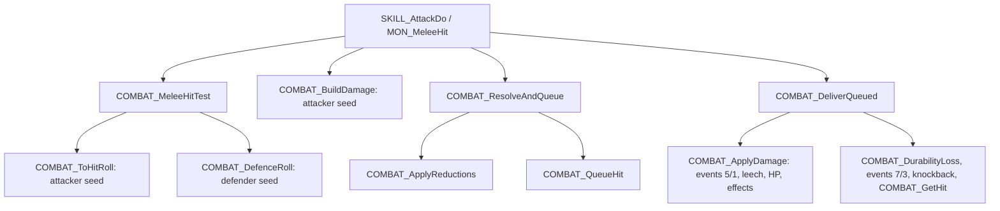
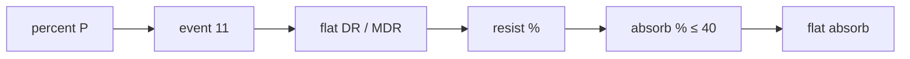

# 0001 — Combat formulas: to-hit, damage, defences and on-hit effects

> **Subsystem:** combat/formulas
> **Question:** when one unit attacks another, how does the server decide hit, block or avoid, build the damage of each
> type, reduce it on the defender, apply it and run the on-hit effects, and which seeds does each step draw on?
> **Date:** 2026-10-16   **Plan:** 0037 (Phases 1, 1b and 2)   **Status:** open (Phase 2 accepted with fixes 2026-10-16; resume lane landed 2026-10-16, review pending)

The claims of §§ 1–14 are from a static reading of the pinned `Game.exe` (Ghidra decompile plus objdump disassembly
of every function cited) and stay `[I]` there; § 15 raises those that run:2026-10-16-combat reproduced to `[C]`. Unit types:
0 player, 1 monster, 3 missile. "Seed" means the unit seed at `struct:Unit+0x20`; every draw named below is one
step of that seed, either through an RNG function or inlined (`low · 0x6AC690C5 + high`, then `low % n` unsigned,
[rng/0001](../rng/0001-rng-core.md)). Integer division is signed and truncates toward zero unless stated;
`MulDiv(a, b, c)` is `fn:sub_00483360_MulDiv@0x00483360` ([monsters/0004 § 4](../monsters/0004-stats.md#4-monlvlstats-and-muldiv)).

## Answer (summary)

- [I] **The server combat module is `.\UNIT\SUnitDmg.cpp`** (debug paths at `0x0057C5C8`, `0x0057C985`), code
  `0x0057A830`–`0x0057EFFF`, plus the stat-event handlers at `0x005BFC60`–`0x005C0130`. A melee attack runs in one
  call at the attack's hit frame: hit test → damage build → reductions → queue → delivery (apply). The player's normal
  attack is `fn:SKILL_AttackDo@0x0056F070` (Skills `srvdofunc` 1); a monster's plain attack is
  `fn:MON_MeleeHit@0x005A5490` followed by `fn:COMBAT_DeliverQueued@0x0057D4F0`. (fn:COMBAT_MeleeHitTest@0x0057EC10,
  fn:COMBAT_ResolveAndQueue@0x0057DBF0, fn:COMBAT_ApplyDamage@0x0057C6C0)
- [I] **Chance to hit** = `100·AR / (AR + DEF)` (100 when both are 0), then `× 2·alvl / (alvl + dlvl)`, clamped to
  5..95, one draw `low % 100` on the **attacker's** seed, hit when the draw is below it. AR for a player is
  `(dex − 7)·5 + stat 19 + ToHitFactor`, raised by `MulDiv(AR, pct, 100)` with `pct` = item to-hit % (stat 119) +
  mastery + the skill's to-hit (or stat 325 for the normal attack); the levels are plain stat 12. So **`ToHitFactor`
  is an attack-rating term only**; no level bonus exists in this formula. A running player (mode 3) is hit without a
  roll. (fn:COMBAT_ToHitRoll@0x0057D9B0, fn:sub_00622560_PlayerBaseToHit@0x00622560, 0x0057DB01–0x0057DB30)
- [I] **Defence draws are on the defender's seed**, in this order: shield block (`toblock + BlockFactor`, the dexterity
  form only in an **expansion** game, capped at 75, divided by 3 when a player runs), then either evade (walking or
  running defender) or weapon block, then dodge (melee) or avoid (missile). (fn:COMBAT_DefenceRoll@0x0057DFB0,
  fn:COMBAT_AvoidRoll@0x0057DD60, fn:sub_00622720_UnitBlockChance@0x00622720)
- [I] **Damage build** (attacker seed): physical `lo + RangeB(hi − lo)` in 1/256 units with enhanced damage, the
  weapon's `StrBonus`/`DexBonus` shares and min/max percents, then critical/deadly strike (×2), each element's range,
  monster life/mana/stamina drain ranges, poison, an **unconditional** `RangeB(seed, 1)` on the burning field, the
  monster physical-to-element conversion and the monster `Crit` (×2). SrcDam scales every field by `/128`.
  (fn:COMBAT_BuildDamage@0x0057B7D0, fn:COMBAT_RollPhysical@0x0057B420, fn:COMBAT_RollElemStat@0x0057A8E0)
- [I] **Reductions** are a 12-row table (`data:g_DamageResistTable@0x00732980`): per field, subtract flat damage
  reduction (physical) or magic damage reduction (fire, lightning, cold, magic), then resistance %, then absorb %
  (capped at 40) and flat absorb. Player and hireling resistances get `ResistPenalty` in an expansion game and −20/−50
  in classic Nightmare/Hell, then the cap `75 + max-resist` (≤ 95; physical 50); monster resistances have no cap, and
  ≥ 100 means immune; pierce applies unless the monster is immune. (fn:COMBAT_ApplyReductions@0x0057C1E0,
  fn:COMBAT_ResistFor@0x0057BE00, fn:COMBAT_ReduceRow@0x0057BF80, fn:COMBAT_Absorb@0x0057BF10)
- [I] **On-hit effects** run as stat events of the attacker during delivery: crushing blow (`life / k`, k = 10 player
  or hireling, 4 monster, 8 boss or superunique, raised by the player-count life percent, doubled for missiles,
  reduced by physical resist), open wounds (a 200-frame state with `hpregen = −dmg`), freeze; each draws once on the
  attacker's seed. Leech uses `LifeStealDivisor`/`ManaStealDivisor` for player attackers and the monster's `Drain`.
  (fn:STATEVENT_CrushingBlow@0x005BFFC0, fn:STATEVENT_OpenWounds@0x005BFE60, fn:COMBAT_Leech@0x0057C420)
- [I] **The life change** is one write: `HP − total`, set to 0 when below 256 (one life), where `total` =
  physical + fire + lightning + magic + cold + poison after reductions (+ the drain field for a monster attacker); the kill
  flag `0x2` hands off to `COMBAT_GetHit`, which calls `sub_0057CCB0_UnitKilled` for a monster.
  (fn:COMBAT_GetHit@0x0057CEE0, fn:sub_0057CCB0_UnitKilled@0x0057CCB0, fn:COMBAT_ApplyDamage@0x0057C6C0, 0x0057C852–0x0057C874)
- [I] Four DifficultyLevels columns have combat readers: `ResistPenalty` (+0x00), `MonsterFreezeDivisor` (+0x14),
  `MonsterColdDivisor` (+0x18), `LifeStealDivisor`/`ManaStealDivisor` (+0x28/+0x2C); and **`HireableBossDamagePercent`
  (+0x38) is read** (a hireling hitting a boss), contrary to the [DifficultyLevels](../../tables/DifficultyLevels.md)
  "no reader" statement, through the record pointer kept in the reduction context. (fn:COMBAT_DamagePercent@0x0057C060,
  0x0057C0FE)

## Leads used

Phase 1b, fetched 2026-10-16 after §§ 1–12 were written (ADR-0007; each page read in the session, none shows code).
Agreement adds nothing to a tag. Details in § 13; the five `contradicted` verdicts (four behaviours) are required Phase 2 cases with
backlog entries (2026-10-16 "combat contradictions").

- [L] src:arreat-summit-character-basics: chance to hit `100·AR/(AR+DR)·2·alvl/(alvl+dlvl)`. **held with refinement**
  Detail: the percent is truncated first, then `·alvl·2/(alvl+dlvl)` in one signed divide; AR gets its percent by
  `MulDiv`; DEF includes stats 32/33 (§ 3).
- [L] src:arreat-summit-character-basics: melee chance to hit never below 5 % or above 95 %. **held**
  Detail: the clamp 5..95 in `COMBAT_ToHitRoll`, the same for missiles.
- [L] src:arreat-summit-character-basics: class bonus to the attacker's level (20/15/5/−10/−15). **contradicted**
  Detail: the constants are `ToHitFactor`, added to AR; the level term has no class bonus (§ 3.4). Phase 2 case;
  backlog "ToHitFactor" carries this reading.
- [L] src:arreat-summit-character-basics: `Total Blocking = (Blocking·(Dex − 15)) / (Clvl·2)`. **held with refinement**
  Detail: only in an expansion game; classic uses `toblock + BlockFactor`; level < 2 counts as 1 (§ 4).
- [L] src:arreat-summit-character-basics: blocking capped at 75 %. **held**
- [L] src:arreat-summit-character-basics: running reduces blocking to a third, with a cap of 25 %. **held with refinement**
  Detail: `÷ 3` for a player in mode 3 or 6 (not walking), after the 75 cap, so ≤ 25; a running player is also hit
  without a to-hit roll (not covered by the page).
- [L] src:arreat-summit-character-basics: Defense Rating = Dex / 4 without equipment. **held**
  Detail: `UNIT_GetDefense` adds `dex/4` to stat 31.
- [L] src:arreat-summit-difficulty: resistances −40 Nightmare, −100 Hell for players and hirelings. **held**
  Detail: `ResistPenalty` in an expansion game; classic uses −20/−50 constants (**not covered** by the LoD page).
- [L] src:arreat-summit-difficulty: life and mana stealing cut to 1/2 (Nightmare) and 1/3 (Hell). **held with refinement**
  Detail: `LifeStealDivisor`/`ManaStealDivisor` 1/2/3 divide the `<< 6` steal percent of player attackers only.
- [L] src:arreat-summit-difficulty: freezing and chilling cut to 1/2 and 1/4. **held with refinement**
  Detail: the divisors 1/2/4 apply to monster defenders only (freeze only when `coldeffect` < 0).
- [L] src:arreat-summit-difficulty: AI curses cut; Static Field floor 33 %/50 %. **not covered**
  Detail: readers named only (§ 12b (c)).
- [L] src:arreat-summit-resistances: default maximum 75 %, items raise it to at most 95 %. **held**
- [L] src:arreat-summit-resistances: minimum resistance −100 %. **held**
- [L] src:arreat-summit-resistances: magic resistance base 0 in every difficulty. **held**
  Detail: rows 0 and 4 (stats 36, 37) skip the penalty.
- [L] src:arreat-summit-resistances: cold resistance shortens chill; Half Freeze Duration halves it; Cannot Be Frozen
  removes it. **held**
- [L] src:arreat-summit-resistances: order Energy Shield, Bone/Cyclone Armor, DR/MDR, resistances, % absorb, direct
  absorb. **held with refinement**
  Detail: the PvP/hireling percent comes first; event 11 (`absorbdamage`) precedes DR/MDR, its handlers not read.
- [L] src:arreat-summit-amazon-passive: Dodge melee while standing, Avoid missiles while standing, Evade any attack
  while moving. **held**
- [L] src:arreat-summit-amazon-passive: Critical Strike doubles damage. **held with refinement**
  Detail: physical only; mastery crit, stat 337, then deadly strike, one doubling at most.
- [L] src:arreat-summit-monster-pages: immunity means 100 % resistance. **held with refinement**
  Detail: ≥ 100 is capped to 100 in `COMBAT_ReduceRow`; pierce does not apply to it.
- [L] src:purediablo-absorb: % absorb capped at 40 per element. **held**
- [L] src:purediablo-absorb: healing comes from absolute absorb only. **contradicted**
  Detail: both the % and the flat absorbed amounts go to `absorbHeal` (`+0x48`), healed by `UNIT_AddLifeCapped`.
- [L] src:purediablo-absorb: physical damage is not absorbed; integer reduction first, then % (capped at 50). **held**
- [L] src:purediablo-mechanics: open wounds per frame `(9·clvl + 31)/256` … `(45·clvl − 1319)/256`. **held**
  Detail: `band(L) + 40` equals each band; the per-frame tick of stat 74 is not read.
- [L] src:purediablo-mechanics: open wounds lasts 200 frames, reset on reapplication. **held**
- [L] src:purediablo-mechanics: open wounds modifier 0.25 on a player (melee), 0.5 on a boss, 1 otherwise. **held with refinement**
  Detail: `/4` on players and `/2` more for a missile; `/2` for champions and uniques (type flags `0x0C`), not for act
  bosses (MonStats `boss`). Phase 2 case on an act boss.
- [L] src:purediablo-mechanics: crushing blow 1/4 normal monster, 1/10 player or hireling. **held**
- [L] src:purediablo-mechanics: crushing blow 1/8 on a boss or champion. **contradicted**
  Detail: 1/8 for MonStats `boss` and superuniques (`0x02`); champions and uniques take 1/4.
- [L] src:purediablo-mechanics: crushing blow does not scale with the player count. **contradicted**
  Detail: `k += MulDiv(k, PlayerHpPct(n), 100)` for monsters.
- [L] src:purediablo-mechanics: crushing blow affected by physical resistance only when positive. **held**
- [L] src:fextralife-d2r-crushing-blow: ranged hits halve crushing blow (1/8, 1/20, 1/16). **held**
  Detail: `k ·= 2` on event 6.
- [L] src:fextralife-d2r-crushing-blow: 1/8 for champions and uniques. **contradicted**
  Detail: as above (D2R page; 1.14d gives 1/4).
- [L] src:fextralife-d2r-crushing-blow: crushing blow scales with the player-count life bonus. **held with refinement**
  Detail: the bonus is `+50 %` per extra player on the divisor, so four players give 1/10 of 2.5× life, not 1/16.
- [L] src:fextralife-d2r-crushing-blow: no Hell cap on crushing blow. **held**
  Detail: no difficulty branch.

## Functions

| Address | Name | Role | Tag |
|---|---|---|---|
| `0x0056CA40` | `SKILL_AttackStart` | Skills `srvstfunc` 1 (Attack): no draw | I |
| `0x0056F070` | `SKILL_AttackDo` | Skills `srvdofunc` 1: player normal attack at the hit frame | I |
| `0x005A5490` | `MON_MeleeHit` | monster plain melee: hit test, `ResolveAndQueue` at SrcDam 128 | I |
| `0x005A5470` | `sub_005A5470_MonHitTest` | hit test only | I |
| `0x005A7670` | `sub_005A7670_MonAttackFrame` | monster attack frame without a skill: `MON_MeleeHit` then delivery | I |
| `0x005D9C80` | `sub_005D9C80_MonSkillAttackDo` | a monster skill do-function: `MonAttackStats`, `MON_MeleeHit`, delivery | I |
| `0x0057EC10` | `COMBAT_MeleeHitTest` | range, to-hit, defence roll → result word | I |
| `0x0057D9B0` | `COMBAT_ToHitRoll` | chance to hit and its draw | I |
| `0x0057D8A0` | `COMBAT_ToHitTargetMods` | ignore/fractional target defence, demon/undead to-hit | I |
| `0x006223F0` | `UNIT_GetDefense` | defence: `armorclass + dex/4`, percents, override | I |
| `0x0057D810` | `sub_0057D810_PreventHealHook` | on hit: stat 117 applies a state to a monster | I |
| `0x0057DFB0` | `COMBAT_DefenceRoll` | shield block, then `COMBAT_AvoidRoll` | I |
| `0x0057DD60` | `COMBAT_AvoidRoll` | evade, weapon block, dodge, avoid | I |
| `0x0057DCA0` | `sub_0057DCA0_WeaponBlockChance` | stat 348 by the held weapons' item type | I |
| `0x00622720` | `sub_00622720_UnitBlockChance` | block chance (existing name) | I |
| `0x00622D00` | `sub_00622D00_UnitIsMoving` | walk/run test of a unit | I |
| `0x00622C40` | `sub_00622C40_InMeleeRange` | melee range test | I |
| `0x0057B7D0` | `COMBAT_BuildDamage` | damage builder | I |
| `0x0057B420` | `COMBAT_RollPhysical` | physical roll | I |
| `0x0057A880` | `COMBAT_RollRange` | `lo..hi` roll with percents | I |
| `0x0057A8E0` | `COMBAT_RollElemStat` | one element's min/max stats rolled | I |
| `0x0057B660` | `sub_0057B660_UndeadDmgBonus` | +50 % (blunt) and stat 122 against undead | I |
| `0x0057B6A0` | `sub_0057B6A0_DmgVsMonType` | stat 180 by MonType | I |
| `0x005A5560` | `sub_005A5560_MonCritDouble` | MonStats `Crit` doubling | I |
| `0x0057DBF0` | `COMBAT_ResolveAndQueue` | build if needed, reductions, kill pre-test, queue | I |
| `0x0057C1E0` | `COMBAT_ApplyReductions` | the reduction pass | I |
| `0x0057BF80` | `COMBAT_ReduceRow` | one table row | I |
| `0x0057BE00` | `COMBAT_ResistFor` | effective resistance | I |
| `0x0057BF10` | `COMBAT_Absorb` | absorb percent and flat | I |
| `0x0057C060` | `COMBAT_DamagePercent` | PvP 17 %, hireling cases | I |
| `0x0057C140` | `COMBAT_LengthImmunities` | cannot-be-frozen, half freeze, shrine states | I |
| `0x00732980` | `g_DamageResistTable` | 12 × `ResistRow` | I |
| `0x0057CA80` | `COMBAT_QueueHit` | copy the packet onto the attacker's hit queue | I |
| `0x0057D690` | `sub_0057D690_QueuedHitFind` | find a queued hit | I |
| `0x0057C9F0` | `sub_0057C9F0_QueuedHitRemove` | remove it | I |
| `0x0057D4F0` | `COMBAT_DeliverQueued` | deliver: apply, events 7/3, durability, knockback, get-hit | I |
| `0x0057C6C0` | `COMBAT_ApplyDamage` | events 5/1 or 6/2, leech, HP, drains, stun, cold, freeze, poison, burn | I |
| `0x0057C420` | `COMBAT_Leech` | life and mana steal | I |
| `0x0057A980` | `UNIT_AddLifeCapped` | add life up to max | I |
| `0x0057AA00` | `UNIT_AddManaCapped` | add mana up to max | I |
| `0x0057AA60` | `sub_0057AA60_ManaDrain` | defender mana loss | I |
| `0x0057AAA0` | `sub_0057AAA0_StaminaDrain` | defender stamina loss | I |
| `0x0057AAE0` | `COMBAT_ApplyStun` | stun state 21 | I |
| `0x0057AF30` | `sub_0057AF30_MonColdEffect` | MonStats `coldeffect` of the difficulty | I |
| `0x0057AF80` | `COMBAT_ApplyCold` | cold state 11, shatter roll | I |
| `0x0057B230` | `COMBAT_ApplyFreeze` | freeze state 1 or the cold fallback | I |
| `0x0057AC50` | `COMBAT_ApplyPoison` | poison state 2 | I |
| `0x0057ADD0` | `COMBAT_ApplyBurn` | burning state 115 | I |
| `0x0057CEE0` | `COMBAT_GetHit` | hit class, knockback, get-hit, death hand-off (named only) | I |
| `0x0057CB00` | `sub_0057CB00_GetHitRoll` | get-hit decision, up to two `RangePow2` on the defender | I |
| `0x0057CE30` | `sub_0057CE30_HitClassPick` | hit class from a global counter (no RNG) | I |
| `0x0057D3D0` | `COMBAT_DurabilityLoss` | weapon and armour durability picks | I |
| `0x00559E30` | `ITEMS_DurabilityLossRoll` | 4 % / 10 % durability draw on the owner's seed | I |
| `0x005C0C30` | `UNIT_DispatchEvent` | run a unit's stat events of one id | I |
| `0x005C0AD0` | `UNIT_AddEvent` | add a stat event | I |
| `0x0056E740` | `sub_0056E740_AddStatEvent` | add by ItemStatCost `itemeventfunc` | I |
| `0x007325B0` | `g_StatEventFuncs` | the `itemeventfunc` handler table (1..31) | I |
| `0x005BFFC0` | `STATEVENT_CrushingBlow` | `itemeventfunc` 16 | I |
| `0x005BFE60` | `STATEVENT_OpenWounds` | `itemeventfunc` 15 | I |
| `0x005BFDA0` | `sub_005BFDA0_OpenWoundsBand` | level-banded open-wounds damage | I |
| `0x005BFC60` | `STATEVENT_Freeze` | `itemeventfunc` 14 | I |
| `0x0056E970` | `STATE_ApplyTimed` | put a timed state with one stat | I |
| `0x005ADF10` | `MISSILE_HitUnit` | missile collision with a unit (named only) | I |
| `0x005A89A0` | `MISSILE_BuildDamage` | missile packet from the missile's stats | I |
| `0x005AD730` | `MISSILE_ApplyDamage` | missile: defence roll, `COMBAT_ApplyDamage` with reductions | I |
| `0x0063E9F0` | `MONSTATS_IsBoss` | MonStats `+0x0C` bit 6 | I |
| `0x0063E940` | `MONSTATS_IsDemon` | `+0x0D` bit 5 | I |
| `0x0063E990` | `MONSTATS_IsUndead` | `+0x0D` bit 3 or 4 | I |
| `0x0063EDC0` | `MONSTATS_IsPrimeEvil` | `+0x0C` bit 7 | I |
| `0x00639DF0` | `UNIT_HasState` | state test | I |
| `0x00645830` | `SKILLS_GetMasteryBonus` | mastery to-hit (0), damage (1), crit (2) for a weapon | I |
| `0x00535BC0` | `sub_00535BC0_UnitGetWeapon` | the weapon used | I |
| `0x00554200` | `sub_00554200_UnitsHostile` | hostility test | I |
| `0x00554010` | `sub_00554010_UnitGetGame` | `Unit+0x80` | I |
| `0x00583740` | `sub_00583740_AttackRatingCalc` | an AR computed outside the attack path (§ 3.4) | I |
| `0x004E9040` | `sub_004E9040_ClientAttackRating` | client display of AR (client copy) | I |
| `0x005A2620` | `sub_005A2620_MonDeathDamage` | reads `MonsterCEDamagePercent` | I |
| `0x005C9800` | `sub_005C9800_SorSkillStaticMin` | reads `StaticFieldMin` (expansion) | I |

## Walkthrough

### 1. The packet and the call shape

`re/types/combat.h` holds the 0x70-byte `DamagePacket`, the reduction context `ReduceCtx` and `ResistRow`.

- [I] The packet's fields by offset: `+0x08` physical, `+0x10` fire, `+0x14`/`+0x18` burning damage and length,
  `+0x1C` lightning, `+0x20` magic, `+0x24` cold, `+0x28`/`+0x2C` poison and length, `+0x30` cold length, `+0x34`
  freeze length, `+0x38`/`+0x3C`/`+0x40` life, mana and stamina steal, `+0x44` stun length, `+0x48` absorbed life,
  `+0x4C` total, `+0x54` damage frame rate, `+0x65`/`+0x68` conversion type and percent. The debug names of the
  resistance table name eleven of them ("Dam", "Fire", "Ligt", "Cold", "Magc", "CLen", "FLen", "PLen", "Pois",
  "Life", "Mana", "Stam"). (data:g_DamageResistTable@0x00732980, struct:DamagePacket+0x08, struct:DamagePacket+0x65)
- [I] The result word `+0x04`: `0x1` hit, `0x2` killed, `0x4` get-hit, `0x8` knockback, `0x10` blocked, `0x80`
  dodged, `0x100` avoided, `0x200` evaded (missiles), `0x2000` doubled (critical or deadly strike), `0x8000` weapon
  block. (fn:COMBAT_MeleeHitTest@0x0057EC10, fn:MISSILE_ApplyDamage@0x005AD730, struct:DamagePacket+0x04)
- [I] Calling convention of the core: `ECX` = game, `EDX` = attacker, first stack argument = defender
  (`COMBAT_MeleeHitTest`, `COMBAT_ResolveAndQueue`, `COMBAT_ApplyReductions`, `COMBAT_ApplyDamage`). In
  `COMBAT_ToHitRoll` `ECX` is the attacker and `EDX` the defender. (0x0057EC16–0x0057EC28, 0x0057D9BB–0x0057D9C2)



### 2. The attack events

- [I] **Player normal attack** (`SKILL_AttackDo`, Skills row 0 `srvdofunc` 1, table `0x007322B0 + 4·1`): with a
  missile weapon it creates a missile instead (`0x0056ECB0`). Otherwise it takes the target, zeroes a packet, sets
  `result = COMBAT_MeleeHitTest(target, AR% = stat 325, 0)`, sets `flags |= 0x2`, calls `COMBAT_BuildDamage(target,
  packet, 0, SrcDam 128)` **whatever the result**, then `COMBAT_ResolveAndQueue(target, packet, 128)` and
  `COMBAT_DeliverQueued(target, 0)`. So a player's damage draws happen on a miss too. (fn:SKILL_AttackDo@0x0056F070,
  0x0056F0E0–0x0056F1B0)
- [I] **Skill melee hits** (`0x005C7690` and the other do-functions that call `COMBAT_MeleeHitTest`) pass
  `SKILLS_GetToHit` as the AR percent and their own SrcDam to `COMBAT_ResolveAndQueue`; the skill's damage packet is
  phase (3)'s input. (fn:SKILLS_GetToHit@0x006449F0, 0x005C76B0)
- [I] **Monster melee** (`MON_MeleeHit`): target, zeroed packet, `result = COMBAT_MeleeHitTest(target, 0, 0)`,
  `COMBAT_ResolveAndQueue(target, packet, 128)`; the builder runs **only when** the result has `0x1` and none of
  `0x8380`. `sub_005A7670_MonAttackFrame` (no skill) and `sub_005D9C80_MonSkillAttackDo` then call
  `COMBAT_DeliverQueued`; the skill do-function calls `sub_005A4F50_MonAttackStats` first, the plain frame does not (it
  ran at the mode change, `sub_005A7C20_MonSetMode`). (fn:MON_MeleeHit@0x005A5490, fn:sub_005A7670_MonAttackFrame@0x005A7670,
  fn:sub_005D9C80_MonSkillAttackDo@0x005D9C80, fn:sub_005A4F50_MonAttackStats@0x005A4F50, 0x0057DC1D–0x0057DC37)
- [I] **Missiles**: `MISSILE_HitUnit` calls `COMBAT_ToHitRoll(missile stat 19, missile = 1)` when the Missiles record
  byte `+0x18B` is set, builds the packet from the missile unit's own stats (`MISSILE_BuildDamage`: physical
  `RangeB(max − min) + min` on the **missile's** seed, the elements through the same mastery rolls), then
  `MISSILE_ApplyDamage`: knockback roll `RNG_Range(missile seed, 100) < Missiles +0xAE`, `COMBAT_DefenceRoll(defender,
  missile = 1, block only if physical ≠ 0)`, `+0x54 = stat 327`, `COMBAT_ApplyDamage(defender, reductions = 1)`,
  `COMBAT_GetHit`. The missile path is phase (3); here it is named and its packet is an input.
  (fn:MISSILE_HitUnit@0x005ADF10, fn:MISSILE_BuildDamage@0x005A89A0, fn:MISSILE_ApplyDamage@0x005AD730)
- [I] Mercenaries (hirelings) are monsters on the monster path; they differ in the branches that test
  `sub_0063EE90_HirelingType` (§§ 5, 7, 8, 9): crushing blow divisor 10, the 25 % hireling-against-hireling and the
  boss percent, leech with the player formula but without the divisors, and no monster drain rolls. So a mercenary
  case is needed in Phase 2. (fn:sub_0063EE90_HirelingType@0x0063EE90)

### 3. To-hit (`COMBAT_ToHitRoll`)

```c
// fn:COMBAT_ToHitRoll@0x0057D9B0 (attacker ECX, defender EDX; args arPct, isMissile)
dlvl = stat(def, 12); alvl = stat(att, 12);
DEF  = UNIT_GetDefense(def) + stat(def, isMissile ? 32 : 33);      // armorclass_vs_missile / vs_hth
if (att.type == PLAYER) {
    AR = PlayerBaseToHit(att);                                      // (dex-7)*5 + stat19 + CharStats.ToHitFactor
    COMBAT_ToHitTargetMods(att, def, &AR, &DEF);
    pct = (!isMissile && (w = UnitGetWeapon(att))) ? SKILLS_GetMasteryBonus(att, w, 0, 0) : 0;
    pct += UnitGetStat(att, 119) + arPct;                           // item_tohit_percent + caller's bonus
    if (def.type == MONSTER && MonStats(def).MonType > 0)
        for each (type, v) in stat 179 list of att: if MonType bit set: pct += v;   // attack_vs_montype
} else {
    AR  = stat(att, 19) + arPct + 5*stat(att, 2);                   // monster: tohit + bonus + 5*dex
    pct = UnitGetStat(att, 119);
}
AR += MulDiv(AR, pct, 100);
if (DEF < 0) { AR -= DEF; DEF = 0; }
if (AR  < 0) { DEF -= AR; AR = 0; }
if (DEF < 0) DEF = 0;
c = (AR + DEF) ? 100*AR / (AR + DEF) : 100;
c = c * alvl * 2 / (alvl + dlvl);
c = c <= 5 ? 5 : (c >= 95 ? 95 : c);
r = step(att.seed) % 100;                                           // draw: attacker seed
if (r < c) { sub_0057D810_PreventHealHook(); return 1; }  return 0;
```

- [I] As above, every division signed and 32-bit (`idiv`). `c` is the percent `100·AR/(AR+DEF)` truncated, then the
  level factor applied in one multiply and one divide: `(c·alvl·2) / (alvl + dlvl)`. (0x0057DB01–0x0057DB30)
- [I] The clamp: `c ≤ 5` → 5, `c ≥ 95` → 95. (0x0057DB22–0x0057DB30)
- [I] The draw is the inlined LCG on the attacker's seed (`ebx+0x20`), `low % 100` by the `0x51EB851F` multiply, hit
  when `r < c`. (0x0057DB35–0x0057DB79)
- [I] **Defence** (`UNIT_GetDefense`, any unit): `d = stat 31 + dex/4` (signed `/4`); `p = stat 171 + stat 16`
  (+ the Holy Shield bonus when state 101 is on: the skill's calc at Skills `+0x138` through `SKILLS_EvalCalc`);
  `d += d·p / 100`; then `+ MulDiv(d, stat 182, 100)` when stat 182 ≠ 0. (fn:UNIT_GetDefense@0x006223F0,
  tbl:ItemStatCost.txt:Stat)
- [I] **Target modifiers** (players only, `COMBAT_ToHitTargetMods`): stat 115 sets `DEF = 0` against a monster that
  is not boss, unique, superunique (type flags `0x0A`) or hireling; stat 116 is halved (signed) against a player, a
  boss, a superunique or a hireling, clamped to 0..100, and `DEF −= MulDiv(DEF, p, 100)`; stat 123 adds to AR
  against a demon, stat 124 against undead. (fn:COMBAT_ToHitTargetMods@0x0057D8A0, 0x0057D8BA, 0x0057D914)

#### 3.4 Where `ToHitFactor` enters

- [I] `ToHitFactor` (`CharStats+0x3C`) enters only through `PlayerBaseToHit`, i.e. into AR before the percent; the
  level term uses stat 12 of both units with no class constant. (fn:sub_00622560_PlayerBaseToHit@0x00622560,
  struct:CharStatsRec+0x3C, 0x0057DA20, 0x0057DA06)
- [I] `sub_00583740_AttackRatingCalc` computes `base + base·(skill ToHit + (lvl−1)·LevToHit + mastery + stat 119)/100`
  and then adds `ToHitFactor` a second time. Its only caller is `0x00583840` (a stat-by-id percent helper, case stat
  19), which is not on any attack path read here. So the double add does not reach the to-hit roll.
  (fn:sub_00583740_AttackRatingCalc@0x00583740, 0x00583890)
- [I] The client's character screen (`sub_004E9040_ClientAttackRating`) computes `base + base·(stat 119 + skill
  to-hit [+ stat 325])/100` with plain `/100` (not `MulDiv`). It is a client copy and presentation (ADR-0014 § Time);
  it agrees with the server's AR term. (fn:sub_004E9040_ClientAttackRating@0x004E9040)

### 4. Block, evade, weapon block, dodge, avoid

```c
// fn:COMBAT_MeleeHitTest@0x0057EC10 (game, attacker, defender, arPct, rangeExtra)
if (!hostile || types not player/monster) return 0;
auto = (def.type == PLAYER && def.mode == 3 /*run*/);
if (!InMeleeRange(att, def, (att.type==MONSTER)*2 + 1 - (rangeExtra ? weaponRange(att)+rangeExtra : 0))) return 0;
res = auto ? 1 : COMBAT_ToHitRoll(att, def, arPct, 0);
if (res & 1) {
    d = COMBAT_DefenceRoll(def, /*missile*/0, /*useBlock*/1);     // ECX = game
    if (d & 2) res |= 0x100;  if (d & 4) res |= 0x80;  if (d & 0x10) res |= 0x8000;  if (d & 1) res |= 0x10;
    if (d) res &= ~1;
}
if (res & 0x10) res &= ~1;
if ((res & 1) && !HasState(def, 54 /*uninterruptable*/)) res |= 4;
```

- [I] **Shield block** (`COMBAT_DefenceRoll`, `useBlock` ≠ 0): `b = UnitBlockChance(def, game.expansion)`. For a
  player: 0 without a shield in the hands; `b = stat 20 + CharStats BlockFactor`; in an **expansion** game `b =
  ((dex − 15)·b) / (2·max(lvl, 1))` (lvl < 2 counts as 1); capped at 75. For a monster: `b = stat 20` when MonStats
  `NoShldBlock` (`+0x0F` bit 2) is set or it holds a shield, else 0; capped at 75. Then a player that is moving
  (mode 2, 3 or 6 by `0x00621190`) and not in mode 2 (walk) gets `b /= 3`. If `b > 0`, one inlined draw on the
  **defender's** seed, blocked when `r < b`. (fn:COMBAT_DefenceRoll@0x0057DFB0, fn:sub_00622720_UnitBlockChance@0x00622720,
  0x0057DFD5, 0x0057E011–0x0057E01F, tbl:CharStats.txt:BlockFactor, tbl:MonStats.txt:NoShldBlock)
- [I] **When not blocked** (`COMBAT_AvoidRoll`, `missile` = the caller's flag): a player in mode 3 or 2, or a monster
  in mode 15 or 2, rolls **only evade**: stat 340 > 0 → one draw on the defender's seed, result 8 when `r < evade`.
  Otherwise: weapon block (stat 348 for the held weapon's item type, `sub_0057DCA0_WeaponBlockChance`) when > 0 and
  the unit's current skill check `0x0064F380` gives 13: `RNG_Range(def seed, 100) < wb` → 0x10; then dodge (stat
  338, melee) or avoid (stat 339, missile): `RNG_Range(def seed, 100) <` it → 4 or 2. Each draw only when its chance
  is > 0. (fn:COMBAT_AvoidRoll@0x0057DD60, fn:sub_0057DCA0_WeaponBlockChance@0x0057DCA0)
- [I] A player running (mode 3) is never rolled for to-hit (auto hit) but still blocks (at a third) or evades.
  (0x0057EC71–0x0057EC77)

### 5. The damage build (`COMBAT_BuildDamage`)

Called as `(game ECX, attacker EDX; defender, packet, critFlag, srcdam)`; `srcdam` 0 means 128.

1. [I] Links the weapon's stat lists to the attacker (`0x00535D10`), `flags |= 0x20`. For a player or a hireling
   attacker against a monster: stat 120 lowers the monster's stat 31 (not below 0) permanently; stat 121 adds to
   `edPct` against a demon; `sub_0057B660_UndeadDmgBonus` adds 50 for a blunt weapon (item type 57) plus stat 122
   against undead; `sub_0057B6A0_DmgVsMonType` adds stat 180 entries whose MonType bit matches. (0x0057B82A–0x0057B87D)
2. [I] **Physical** unless `flags & 1`: `phys = COMBAT_RollPhysical(att, useStats = 1, weapon 0, …, edPct, phys,
   srcdam)` (0x0057B88B–0x0057B8AD):
   - min/max = stats 21/22 (or 23/24 when `0x0063D340` reports a two-handed hold); without a weapon at least 1/2.
     Both `<< 8`, plus stat 111 `<< 8`; min < 1 → 256; max ≤ min → min + 256.
   - `ed = edPct + stat 25`, clamped to ≥ −90 after adding, with a weapon, `StrBonus·str/100 + DexBonus·dex/100`
     (each signed `/100`, item `0x00629860`/`0x006298A0`) and `SKILLS_GetMasteryBonus(att, weapon, 0, 1)`; without a
     weapon, `+ str` (stat 0).
   - `lo = min + MulDiv(min, ed + stat 18, 100)`; `hi = max + MulDiv(max, ed + stat 17, 100)`; `v = phys + lo`, and
     if `hi > lo`, `v += RangeB(att seed, hi − lo)` (so `v ≤ phys + hi − 1`); `v = max(v, 0)`; if `srcdam ≠ 128`,
     `v = MulDiv(v, srcdam, 128)`. (fn:COMBAT_RollPhysical@0x0057B420, 0x0057B4BB–0x0057B628, tbl:Weapons.txt:StrBonus)
3. [I] **Critical / deadly strike**, only when the physical roll ran, short-circuit in this order, each draw
   `RNG_RangeOffset(att seed, 0, 100) < chance` only when its chance is > 0: the weapon mastery's crit
   (`SKILLS_GetMasteryBonus(…, 2)`, only when `critFlag` is 0 and a weapon is held), stat 337
   (`passive_critical_strike`), stat 141 (`item_deadlystrike`). Success: `result |= 0x2000`, `phys *= 2`.
   (0x0057B8A9–0x0057B92F, fn:RNG_RangeOffset@0x00472280)
4. [I] **Elements**, in this order: fire (stats 48/49, mastery stat 329), lightning (50/51, 330), cold (54/55, 331),
   magic (52/53, 357): `COMBAT_RollElemStat` returns the field unchanged (≥ 0) when `max·256 < 8`; otherwise
   `lo = (min<<8) + MulDiv(min<<8, m, 100)`, `hi = (max<<8) + MulDiv(max<<8, m, 100)`, `v = field + lo
   [+ RangeB(att seed, hi − lo) if hi > lo]`, `max(v, 0)`; then `v·srcdam/128` (signed shift) when `srcdam ≠ 128`.
   (fn:COMBAT_RollElemStat@0x0057A8E0, fn:COMBAT_RollRange@0x0057A880, 0x0057B932–0x0057BA4C)
5. [I] **Steal fields**: a monster attacker that is not a hireling rolls life (60/61), mana (62/63) and stamina
   (64/65) drain unless `flags & 4/8/0x10`, each `field += roll·srcdam/128`. Every other attacker adds stat 60 and
   stat 62 (percents) as they are, and sets `flags` 0x100/0x200/0x400 from stats 103/104/106. (0x0057BA55–0x0057BB5A)
6. [I] **Poison**: stats 57/58 (no shift) with mastery 332 when stat 58 > 0, `COMBAT_RollRange`, then `·srcdam/128`;
   if non-zero, length `+= stat 101` when > 0, else `+= stat 59` and `/= stat 326` when > 1. **Cold length** `+=
   stat 56·srcdam/128` when cold > 0. **Stun** `+= stat 66·srcdam/128` when 0. (0x0057BB60–0x0057BC2C)
7. [I] **Burning**: `burn += max(0, burn·srcdam + 316 + RangeB(att seed, 1)) / 128`, **unconditionally**; the
   `RangeB(…, 1)` steps the attacker's seed once and returns 0 on every build. Then `burnLen += stat 315·srcdam/128`
   when `burnLen ≠ 0`. So a plain attack ends with `burn = 2`, `burnLen = 0` (no burn applied, § 9). The constant 316
   is the `burningmin` stat id, which suggests a slip in the source; the code is as stated. (0x0057BC2F–0x0057BC8A)
8. [I] For a player or hireling attacker, unless `result & 0x20`: stat event 3 (`attackedinmelee`) of the defender
   runs here with the packet. (0x0057BC8D–0x0057BCAD, fn:UNIT_DispatchEvent@0x005C0C30)
9. [I] **Conversion** (`convType` ≠ 0): `m = MulDiv(phys, convPct, 100)`, `phys = max(phys − m, 0)`; type 10 draws
   `RNG_Range(att seed, 5) + 1`; 1 fire, 2 lightning, 3 magic `+= m`; 4 cold `+= m` and cold length ≥ 50; 5 poison
   `+= m/8` and length ≥ 50; 11 fire and burn length ≥ 50; 12 cold and freeze length ≥ 50. No writer of `convType`
   was found on the attack paths read (open question). (0x0057BCB2–0x0057BD71)
10. [I] **Monster `Crit`** (`sub_005A5560_MonCritDouble`, monster attacker with MonStats `Crit` ≠ 0): one inlined draw
    on the attacker's seed, `(u8)(low % 100) < Crit` doubles physical, fire, lightning, magic, cold and poison, and puts
    overlay 54 on the defender. (fn:sub_005A5560_MonCritDouble@0x005A5560, tbl:MonStats.txt:Crit)

### 6. Resolve, queue, deliver

- [I] `COMBAT_ResolveAndQueue(defender, packet, srcdam)`: when `result & 1` and none of `0x8380`: the builder (unless
  `flags & 2`), `COMBAT_ApplyReductions`, then the kill pre-test: `total = phys + fire + light + magic + cold + poison
  (+ lifeSteal when the attacker is a monster)`, `result |= 2` when `(total & ~0xFF) > (HP & ~0xFF)`. Always:
  `COMBAT_QueueHit` copies the packet onto the **attacker's** list `Unit+0xAC` with both units' type and id.
  (fn:COMBAT_ResolveAndQueue@0x0057DBF0, fn:COMBAT_QueueHit@0x0057CA80, struct:Unit+0xAC)
- [I] `COMBAT_DeliverQueued(defender, 0)`: finds the queued entry, checks melee range again; on a hit (and the
  attacker not dead) sets `flags = 0x20` and calls `COMBAT_ApplyDamage(defender, reductions = 0)`, puts overlay
  `+0x6C`, picks a hit class (`sub_0057CE30_HitClassPick`, a global counter, no draw), runs `COMBAT_DurabilityLoss`;
  then always events 7 (`domeleeattack`, attacker) and 3 (`attackedinmelee`, defender); on a hit the knockback
  `0x005D10C0`; then `COMBAT_GetHit` and removes the entry. (fn:COMBAT_DeliverQueued@0x0057D4F0, 0x0057D5B2–0x0057D662)

### 7. Reductions (`COMBAT_ApplyReductions`)

```c
// fn:COMBAT_ApplyReductions@0x0057C1E0 (game, attacker, defender, packet)
ctx = { game, DifficultyRec(game.diff), att, def, attIsMon = att monster && !hireling,
        defIsMon = def monster && !hireling, pkt, reduce = {0, DR, MDR} };
DR  = stat(def,34) << 8;  if (DR  > 0 && pkt.frameRate > 0) DR  = MulDiv(DR,  pkt.frameRate, 1024);
MDR = stat(def,35) << 8;  if (MDR > 0 && pkt.frameRate > 0) MDR = MulDiv(MDR, pkt.frameRate, 1024);
P = COMBAT_DamagePercent(&ctx);
if (P != 100) for row in table: if (row.scaled && pkt[row.off] > 0) pkt[row.off] = MulDiv(pkt[row.off], P, 100);
UNIT_DispatchEvent(game, 11 /*absorbdamage*/, def, att, pkt);
COMBAT_LengthImmunities(&ctx);
bypass = def monster ? ((undead && flags&0x100) || (demon && flags&0x200) || (!undead && !demon && flags&0x400))
                     : (flags & 0x400) != 0;
for row in table (12): { if (row.monsterOnly && !ctx.attIsMon) break; COMBAT_ReduceRow(&ctx, row, bypass); }
pkt.total = phys + fire + light + magic + cold + poison + (ctx.attIsMon ? lifeSteal : 0);
```

| Row | Field | Resist | Max | Pierce | Absorb % / flat | Reduce | Scaled by P |
|---|---|---|---|---|---|---|---|
| 0 Dam | `+0x08` | 36 | — | — | — | DR | yes |
| 1 Fire | `+0x10` | 39 | 40 | 333 | 142 / 143 | MDR | yes |
| 2 Ligt | `+0x1C` | 41 | 42 | 334 | 144 / 145 | MDR | yes |
| 3 Cold | `+0x24` | 43 | 44 | 335 | 148 / 149 | MDR | yes |
| 4 Magc | `+0x20` | 37 | 38 | — | 146 / 147 | MDR | yes |
| 5 CLen | `+0x30` | 43 | 44 | 335 | — | — | no |
| 6 FLen | `+0x34` | 43 | 44 | 335 | — | — | no |
| 7 PLen | `+0x2C` | 110 | — | 336 | — | — | no |
| 8 Pois | `+0x28` | 45 | 46 | 336 | — | — | yes |
| 9–11 Life, Mana, Stam | `+0x38`, `+0x3C`, `+0x40` | — | — | — | — | — | yes (monster attackers only) |

- [I] The table above is `g_DamageResistTable`, 12 rows of 11 dwords (row `+0x1C` = monster-only, `+0x20` = scaled).
  (data:g_DamageResistTable@0x00732980, struct:ResistRow+0x1C)
- [I] **`COMBAT_ReduceRow`**: `v = field`; `v ≤ 0` → field = 0. `r = COMBAT_ResistFor`. Without bypass `d = v −
  reduce[slot]`; with bypass `d = v` and a positive `r` becomes 0. If `d > 0` and `r ≠ 0`: `r = min(r, 100)`, `d =
  MulDiv(d, 100 − r, 100)`. Without bypass `d = COMBAT_Absorb(d)`. `field = d` (it can be negative when DR exceeds
  it; the next field reads `> 0` only at the next pass). (fn:COMBAT_ReduceRow@0x0057BF80, 0x0057BFB4–0x0057C04D)
- [I] **`COMBAT_ResistFor`**: `r = def.stat(res)` (0 for none); pierce `r −= att.stat(pierce)` when a pierce stat
  exists and (`r < 100` or the defender is not a monster); when the **defender is not a monster** and the row is not
  physical (36) or magic (37): classic game (`game+0x70 = 0`): `−20` in Nightmare, `−50` in Hell; expansion:
  `+ DifficultyLevels.ResistPenalty`. Then `r < −99` → −100; `r ≥ 1` and defender not a monster → `min(r, cap)`
  with `cap = 75 + def.stat(max)` capped at 95, or 50 for row 0 (no max stat), 75 for the other rows without one; and
  `r = 0` for row 0 when the attacker has state 47 (sanctuary) and the defender is undead. Monster resistances are not
  capped. (fn:COMBAT_ResistFor@0x0057BE00, struct:ReduceCtx+0x04, tbl:DifficultyLevels.txt:ResistPenalty)
- [I] **`COMBAT_Absorb`**: `p = min(def.stat(absorbPct), 40)`; if `p > 0`, `a = MulDiv(d, p, 100)`, `absorbHeal += a`,
  `d −= a`; then `f = def.stat(absorbFlat) << 8`, if `f > 0`, `a = min(f, d)`, `absorbHeal += a`, `d −= a`.
  (fn:COMBAT_Absorb@0x0057BF10, 0x0057BF2A–0x0057BF6F)
- [I] **`COMBAT_DamagePercent`** (P): same unit or none → 100. Defender a player: attacker a player, a hireling, or a
  unit with `Unit+0xC4` bit 31 → **17**, else 100. Defender not a player: both hirelings → **25**; attacker a hireling
  and defender a boss → **`HireableBossDamagePercent`** (`DifficultyRec+0x38`); attacker a prime evil and defender
  with bit 31 → 200 for a hireling defender, else 400; else 100. (fn:COMBAT_DamagePercent@0x0057C060,
  0x0057C0B6, 0x0057C0D4, 0x0057C0FE, 0x0057C129–0x0057C132, tbl:DifficultyLevels.txt:HireableBossDamagePercent)
- [I] **`COMBAT_LengthImmunities`**: cold or freeze length > 0: defender stat 153 → both 0, else stat 118 → both
  halved; poison length → 0 under state 133; burn length → 0 under state 131. (fn:COMBAT_LengthImmunities@0x0057C140)
- [I] The reduction order per element is therefore: P (the PvP/hireling percent), event 11, flat DR or MDR,
  resistance %, absorb %, flat absorb. No minimum-damage floor exists in this path. (fn:COMBAT_ApplyReductions@0x0057C1E0)



### 8. Delivery (`COMBAT_ApplyDamage`)

In order, `(game, attacker; defender, doReductions, packet)`:

1. [I] Not hostile and not `flags & 0x1000` → clear result 1 and 2, return. Defender in town and the attacker not a
   monster with the town-capable MonStats bit → clear 2, return. A monster defender that is not `killable` → return.
   Dead → return. `0x00621D50` records the attacker. (0x0057C6D5–0x0057C78E)
2. [I] `doReductions` → `COMBAT_ApplyReductions` (missiles); the melee queue already did it. (0x0057C793–0x0057C7A0)
3. [I] Events, when `result & 1` and not `result & 0x20`: melee (`doReductions` = 0) → event 5 `domeleedamage` on the
   attacker, then event 1 `damagedinmelee` on the defender; missile → event 6 `domissiledamage` on the attacker unless
   `flags & 0x80`, then event 2 `damagedbymissile` on the defender (only when `flags & 0x20`). Each event runs the
   unit's handlers newest first (`UNIT_AddEvent` pushes at the head). (0x0057C7A5–0x0057C7F3, fn:UNIT_AddEvent@0x005C0AD0)
4. [I] `phys = min(phys, HP)`; `COMBAT_Leech` (§ 9); for a monster attacker with a hit, `0x005A4390`; `absorbHeal` to
   the defender (`UNIT_AddLifeCapped`, not when dead or under state 92); **HP −= total** only when `total > 0`
   (`test edi, edi` / `jle` at 0x0057C855–0x0057C857, named at the Phase 3 review), 0 when the result is below 256;
   mana `−= manaSteal` and stamina `−= stamSteal` on the defender (each 0 when below 256); stun; cold; freeze; poison;
   burn. (0x0057C7F8–0x0057C8D8)
5. [I] HP ≤ 0 → `result |= 2`; else clear 2 and, for a monster defender hit with `total ≠ 0`, reschedule its
   regeneration when stat 74 ≠ 0 and call `0x005D6410`. Killed and not `result & 0x20` → event 10 `killed` on the
   defender, event 9 `kill` on the attacker. (0x0057C8DD–0x0057C970)

### 9. Leech, stun, cold, freeze, poison, burn

- [I] **Leech** (`COMBAT_Leech`): returns when both steal fields are 0. `D = 100` for a non-monster defender, else
  MonStats `Drain` of the difficulty (`+0xA0 + d`); `D = 0` → no leech. Both fields `<< 6`. Player attacker: life
  `/= LifeStealDivisor`, mana `/= ManaStealDivisor` (`DifficultyRec+0x28/+0x2C`, signed, when ≠ 0). Then (players
  and hirelings): with `phys > 0`, mana gain `= MulDiv(phys, mana, 100)` [`MulDiv(·, D, 100)` when `D ≠ 100`] `/ 64`
  (signed) to the attacker capped at max mana; life gain likewise capped at max life; overlay 151 (life) or 152
  (mana); when both are non-zero, **`RNG_Range(attacker seed, 2)`** picks the overlay (0 → 151). Monster attacker (not
  a hireling, and `0x00645270` reports an owner type): the fields go back `>> 6`, `min(life, phys) + min(mana,
  def mana) + min(stam, def stamina)`, `MulDiv(·, D, 100)` when `D ≠ 100`, healed to the monster up to its max life,
  overlay 151. (fn:COMBAT_Leech@0x0057C420, 0x0057C47D–0x0057C4CE, 0x0057C560–0x0057C568,
  tbl:DifficultyLevels.txt:LifeStealDivisor, tbl:MonStats.txt:Drain)
- [I] The defender's mana and stamina loss in § 8 read the **same** packet fields after `COMBAT_Leech` scaled them
  (`<< 6` and divided, for players), so for a player attacker the defender loses `manaSteal·64/divisor` 1/256 mana.
  (0x0057C879–0x0057C889)
- [I] **Stun** (`COMBAT_ApplyStun`, length > 0): monster defender with type flag `0x08` (unique): one inlined draw on the
  **attacker's** seed, and the stun goes on only when `r ≥ 90` (`r < 90` returns). Then a boss returns, MonStats `+0x32` = 0 returns, a hireling's length is capped at 13 (from 12
  up); others are capped at 250; state 21 until `frame + length`. (fn:COMBAT_ApplyStun@0x0057AAE0, 0x0057AB17–0x0057AB44)
- [I] **Cold** (`COMBAT_ApplyCold`, length > 0): `ce = MonStats coldeffect[d]` (s8) for a monster (0 → no effect,
  return), −50 otherwise; a monster with `ce < 0` divides the length by `MonsterColdDivisor`; length ≥ 1; state 11
  until `frame + length` with stats 67, 68, 69 = `ce` (a longer chill extends, a shorter one does not shorten); then
  **one draw on the defender's seed**: `r < 20` and a monster without MonStats2 flag (`0x004638A0`) → state 107
  (shatter) on, else off. (fn:COMBAT_ApplyCold@0x0057AF80, 0x0057B00D the divisor read, 0x0057B0FA–0x0057B124 the draw
  and the 20 test, tbl:MonStats.txt:coldeffect,
  tbl:DifficultyLevels.txt:MonsterColdDivisor)
- [I] **Freeze** (`COMBAT_ApplyFreeze`): a player, a boss, a unique (`0x08`) or a hireling gets **cold** instead (with
  the same length); a monster under state 54 nothing; others need `coldeffect < 0`, length `/= MonsterFreezeDivisor`,
  state 1 until `frame + length`, mode change and a timer at `frame + 1 + length`. (fn:COMBAT_ApplyFreeze@0x0057B230,
  0x0057B2F1, tbl:DifficultyLevels.txt:MonsterFreezeDivisor)
- [I] **Poison** (`COMBAT_ApplyPoison`, damage and length > 0): state 2 with stat 74 (`hpregen`) `= −damage` until
  `frame + length`; an existing poison is replaced (length restarts) only when the new damage ≥ the old. Burn
  (`COMBAT_ApplyBurn`) is the same with state 115 and `burn`/`burnLen`. The per-frame tick of stat 74 is the
  regeneration code, not read here. (fn:COMBAT_ApplyPoison@0x0057AC50, fn:COMBAT_ApplyBurn@0x0057ADD0)

### 10. Stat events: crushing blow, open wounds, freeze

The handler table `g_StatEventFuncs` (`0x007325B0`) is indexed by ItemStatCost `itemeventfunc`; stats 134, 135, 136
register funcs 14, 15, 16 on events `domeleedamage` (5) and `domissiledamage` (6). The handler gets `(attacker,
defender, packet, stat id << 16 | layer)` and the event id in `EDX`. (data:g_StatEventFuncs@0x007325B0,
fn:sub_0056E740_AddStatEvent@0x0056E740, tbl:ItemStatCost.txt:itemeventfunc1)

- [I] **Crushing blow** (`STATEVENT_CrushingBlow`): `c = stat 136`; one inlined draw on the attacker's seed, success
  when `r < c`. `k = 10` (player defender), 10 (hireling), 4 (other monster), 8 (boss or superunique, flag `0x02`);
  for a monster that is not a hireling `k += MulDiv(k, PlayerHpPct(max(n, 1)), 100)` with `n` = stat 100; missile
  event `k *= 2`; `cb = HP / k`; `cb −= MulDiv(cb, min(stat 36, 100), 100)` when stat 36 > 0; `HP = max(HP − cb, 0)`,
  `result |= 2` when 0; overlay 147 when `cb > 0`. No difficulty or game-type branch. (fn:STATEVENT_CrushingBlow@0x005BFFC0,
  0x005C0031–0x005C00F6, fn:sub_005738F0_PlayerHpPct@0x005738F0)
- [I] **Open wounds** (`STATEVENT_OpenWounds`): `c = stat 135`, one inlined draw on the attacker's seed, `r < c`.
  `L = max(stat 12 of attacker, 1)`; `dmg = band(L) + 40` with `band` = `(L−1)·9` for `L ≤ 15`, `14·9 + (L−15)·18`
  for 16..30, `14·9 + 15·18 + (L−30)·27` for 31..45, `… + (L−45)·36` for 46..60, `… + (L−60)·45` above
  (`sub_005BFDA0_OpenWoundsBand`, table 9/18/27/36/45, `L < 2` → 0); player defender `/4`, and `/2` more for a
  missile; monster with type flags `0x0C` (champion or unique) `/2`. Then `STATE_ApplyTimed`: state 62 for 200 frames
  with stat 74 = `−dmg`. (fn:STATEVENT_OpenWounds@0x005BFE60, fn:sub_005BFDA0_OpenWoundsBand@0x005BFDA0,
  fn:STATE_ApplyTimed@0x0056E970, 0x005BFEEC–0x005BFF9B)
- [I] **Freeze** (`STATEVENT_Freeze`, stat 134): `c = ((x − 1)·4 − dlvl + 10 + alvl [−6 missile])·5 [/3 missile]`,
  `x = max(x − 1, 0)` first; clamped 0..100; one inlined draw on the attacker's seed; on success `len = (c − r)·2 + 25`
  clamped 25..250 into a fresh packet's freeze length and `COMBAT_ApplyDamage(defender, reductions = 1)`.
  (fn:STATEVENT_Freeze@0x005BFC60)

### 11. Draws per event kind, and chaining

| Event kind (entry) | Draws in order | Seed |
|---|---|---|
| to-hit (`COMBAT_ToHitRoll`) | 1 (none when a running player is hit) | attacker |
| defence (`COMBAT_DefenceRoll`) | block if `b > 0`; then evade, or weapon block then dodge/avoid, each if > 0 | defender |
| build (`COMBAT_BuildDamage`) | phys `RangeB` if `hi > lo`; mastery crit, stat 337, stat 141 (each if > 0, until one hits); fire, light, cold, magic `RangeB` (if max ≥ 1 and `hi > lo`); monster life/mana/stamina drain (same rule); poison; **`RangeB(1)` always**; type 10 `Range(5)`; monster `Crit` (if ≠ 0) | attacker |
| apply (`COMBAT_ApplyDamage`) | handlers of events 5/1 (crushing blow, open wounds, freeze: 1 each if chance > 0; other handlers not read); leech overlay `Range(2)` if both fields; stun 1 (unique defender); cold 1 (if cold length > 0 and not immune) | attacker; cold on defender |
| delivery extras (`COMBAT_DeliverQueued`) | attacker weapon durability 1; defender armour pick `RangeB(7 slots)`, `RangeB(weight)`, durability 1; get-hit up to 2 `RangePow2` | attacker; defender |
| `MonAttackStats` | `El` percents < 100 and type 10 | monster |

- [I] Draw sites under the attack roots, by `tools/ghidra.sh rngcallgraph - 0x0056F070 0x005A7670 0x005D9C80`
  (static call graph, indirect calls not followed): `MonAttackStats`, `COMBAT_ToHitRoll`, `COMBAT_DefenceRoll`,
  `COMBAT_AvoidRoll`, `COMBAT_BuildDamage`, `COMBAT_RollPhysical`, `COMBAT_RollRange`, `RNG_RangeOffset`,
  `sub_005A5560_MonCritDouble`, `COMBAT_Leech`, `COMBAT_ApplyStun`, `COMBAT_ApplyCold`, `COMBAT_DurabilityLoss`,
  `ITEMS_DurabilityLossRoll`, `sub_0057CB00_GetHitRoll`, the mode-change check `0x0057EEC0` (state 42) and the
  monster death and drop paths. The event handlers are reached by indirect calls and were read one by one (§ 10).
  (fn:ITEMS_DurabilityLossRoll@0x00559E30, fn:COMBAT_DurabilityLoss@0x0057D3D0, fn:sub_0057CB00_GetHitRoll@0x0057CB00)
- [I] **Chaining (ADR-0014).** The attacker's seed is drawn by the to-hit, build and apply of one attack in one call,
  so those three are one event on that seed for Phase 2 ("attack event", entry seed at `SKILL_AttackDo`/`MON_MeleeHit`,
  exit after `COMBAT_DeliverQueued`). A **player's** consecutive normal attacks can chain on the player's seed when
  nothing else draws on it between them: the player's own defence rolls when hit (block, evade, dodge, avoid, armour
  durability, get-hit) are the known interleavings, so the logger must record defence events on the player's seed and
  the checker chains across them. A **monster's** seed is drawn by its AI between attacks (out of scope), so monster
  attack events resynchronise. Defence events on a monster defender resynchronise for the same reason; on the logged
  player they chain with the player's attacks. (fn:SKILL_AttackDo@0x0056F070, fn:COMBAT_DeliverQueued@0x0057D4F0)

### 12. Branches: difficulty, game type, players, hirelings, player against player

- [I] Classic against expansion: block's dexterity form (expansion only, § 4); the resistance penalty (classic
  −20/−50 constants, expansion `ResistPenalty`, § 7); `MonAttackStats`' classic ×10/12 damage and ×10/15 to-hit and the
  expansion player-count bonus ([monsters/0004 § 9](../monsters/0004-stats.md#9-to-hit-and-damage-at-attack-time-sub_005a4f50_monattackstats));
  `StaticFieldMin` read only in an expansion game (`sub_005C9800_SorSkillStaticMin`). (fn:sub_005C9800_SorSkillStaticMin@0x005C9800)
- [I] Difficulty: `ResistPenalty`, the cold, freeze and steal divisors, MonStats `Drain` and `coldeffect` per
  difficulty, MonStats damage/to-hit through MonLvl. No difficulty branch in to-hit, block, crushing blow or open wounds.
  (fn:COMBAT_ToHitRoll@0x0057D9B0, fn:COMBAT_DefenceRoll@0x0057DFB0, fn:STATEVENT_OpenWounds@0x005BFE60)
- [I] Players (`/players`): crushing blow's divisor (§ 10) and `MonAttackStats`' damage bonus; nothing else on these
  paths. (fn:STATEVENT_CrushingBlow@0x005BFFC0, fn:sub_005A4F20_PlayerDmgBonus@0x005A4F20)
- [I] Player against player: P = 17 % on every scaled field (§ 7); stat events and leech run as for monsters with `D =
  100`. ADR-0008 is proposed, so this branch stays named only.
  (fn:COMBAT_DamagePercent@0x0057C060)
- [I] The noRatio question (monsters/0004 *Open questions*): `MonAttackStats` reads the elemental min/max at
  `MonLvlStatsOut+0x2C/+0x30`, which `MonLvlStats` writes only for ratio classes; for a `noRatio` class it writes the raw
  `El<e>MinD/MaxD` to `+0x24/+0x28` instead, so a `noRatio` monster's `El` attack sets min = max = 0 and only the
  duration (`+0x34`). (0x00653BC2–0x00653C2D, 0x005A5160, struct:MonLvlStatsOut+0x2C)
- [I] Other DifficultyLevels readers found on the way (not combat formulas): `MonsterCEDamagePercent` (+0x3C) in
  `sub_005A2620_MonDeathDamage` (a monster's death explosion, from its MonLvl life); `AiCurseDivisor` (+0x1C) in
  `0x004E6E30`, `0x004EDEA0`, `0x005C37A0`, `0x005C39C0`. (fn:sub_005A2620_MonDeathDamage@0x005A2620, 0x005A2709)

### 12b. Answers to the archivist's Phase 0 questions (backlog 2026-10-16 (a)–(e))

- [I] **(a) The mode `MonAttackStats` sees.** `sub_005A7C20_MonSetMode` passes the **new mode number** in `EDX` for every
  mode except 3 (get-hit) (0x005A7D34). `MonAttackStats` maps 5 → the `A2` columns, 7 and 8 → `S1`, everything else
  (14 `sequence` included) → `A1`; so a sequence monster entering mode 14 gets its `A1` triple, and its `S1` triple is
  read only when a skill do-function calls `MonAttackStats` with 7 or 8. The do-functions that pass an explicit mode
  are `0x005CAE40` (8; Skills `srvstfunc` 42, Fire Hit), `0x005CF900` (4, 5 or 8; `srvdofunc` 67, Charge and
  SerpentCharge), `0x005DB2D0` (8; `srvdofunc` 7, Jab), `0x005CE9F0` (5) and `sub_005D9C80_MonSkillAttackDo` (4); no
  `seq_*` skill was traced to one. `El<e>` applies only when `El<e>Mode` equals the mode passed, so the 10 `sandraider*`
  `El1Mode` `S1` (8) and the 17 `succubus*` `A2` (5) apply only through such a do-function, never through a plain mode
  change to a mode they lack. Which mode a sequence's frames run under is a Phase 2 case.
  (fn:sub_005A7C20_MonSetMode@0x005A7C20, fn:sub_005A4F50_MonAttackStats@0x005A4F50, 0x005CAF01, 0x005CFCB5–0x005CFCC3,
  0x005DB351, 0x005CEBB6, tbl:MonStats.txt:El1Mode)
- [I] **(b) `noRatio` offsets:** § 12 (min and max read at `+0x2C`/`+0x30`, written at `+0x24`/`+0x28` for `noRatio`;
  so 0). (struct:MonLvlStatsOut+0x2C)
- [I] **(c) DifficultyLevels readers:** `ResistPenalty` in `COMBAT_ResistFor` (expansion only); `MonsterFreezeDivisor`
  in `COMBAT_ApplyFreeze`; `MonsterColdDivisor` in `COMBAT_ApplyCold`; `AiCurseDivisor` in `0x004E6E30`, `0x004EDEA0`,
  `0x005C37A0`, `0x005C39C0` (curses, not read); `LifeStealDivisor`/`ManaStealDivisor` in `COMBAT_Leech` (player
  attackers); `HireableBossDamagePercent` in `COMBAT_DamagePercent`; `MonsterCEDamagePercent` in
  `sub_005A2620_MonDeathDamage`; `StaticFieldMin` in `sub_005C9800_SorSkillStaticMin` (expansion). The Hell
  discriminator (25 against 20) is therefore a Phase 2 case: a mercenary hitting a boss in Hell, whose scaled fields
  are `× 25 / 100`. (fn:COMBAT_ResistFor@0x0057BE00, fn:COMBAT_DamagePercent@0x0057C060, fn:COMBAT_Leech@0x0057C420,
  tbl:DifficultyLevels.txt:MonsterCEDamagePercent)
- [I] **(d) ElemTypes at a hit.** Two switches read the row number. `MonAttackStats` (monster `El` at attack time):
  1 fire, 2 lightning, 3 magic set the min/max stats; 4 cold also stat 56 = duration; 5 poison min and max `× 10`,
  stat 59 = duration `× 2`; 6, 7, 8 (life, mana, stamina drain) set stats 60/61, 62/63, 64/65; 9 `stun` sets only stat
  66 = duration; 10 `rand` draws `RNG_Range(seed, 5) + 1` and uses duration 25 when it is 0; 11 `burn` sets 316/317 and
  315; **12 `frze` falls to the default and sets nothing**. The builder's conversion switch (`convType`, § 5 step 9)
  takes 1–5, 10, 11 and 12 (12 = cold plus freeze length ≥ 50). On-hit States rows: 1 freeze, 2 poison, 11 cold, 21
  stunned, 62 open wounds, 107 shatter, 115 burning; 54 uninterruptable blocks get-hit and freeze; 47 sanctuary zeroes
  physical resist against undead; 92 death delay blocks the absorb heal; 101 holy shield adds defence; 131 and 133
  zero the burn and poison lengths. (0x005A5300–0x005A53D0, fn:COMBAT_BuildDamage@0x0057B7D0, tbl:States.txt:state)
- [I] **(e) ItemStatCost stats the formulas read** (by id; the reader in brackets): 0, 2, 12 (to-hit, build, open
  wounds); 16, 31, 171, 182 (defence); 17, 18, 21–25, 111 (physical roll); 19, 115, 116, 119, 123, 124, 179, 325 (to-hit);
  20 (block); 32, 33 (defence vs missile/melee); 34, 35 (DR, MDR); 36–46, 110, 333–336 (resistances, maxima, pierce);
  48–59, 101, 326, 329–332, 357 (elements, lengths, masteries); 60–66, 103, 104, 106 (steal, stun, bypass); 74
  (poison/open wounds bleed); 100 (crushing blow); 118, 153 (freeze immunity); 120, 121, 122, 180 (build bonuses);
  134, 135, 136, 141, 337 (on-hit chances); 142–149 (absorb); 315 (burn length); 327 (missile DR scaling); 338, 339,
  340, 348 (dodge, avoid, evade, weapon block). (tbl:ItemStatCost.txt:Stat)

### 13. Community cross-check (Phase 1b)

Seven sources were fetched on 2026-10-16 (registered in `docs/sources.md`): four Arreat Summit pages (Lord of
Destruction), two PureDiablo articles (1.10-era) and one D2R wiki page. The per-claim verdicts are in *Leads used*:
30 compared claims, 15 held, 9 held with refinement, 5 contradicted (four distinct behaviours: crushing blow on
champions and uniques is contradicted by two sources), 1 not covered (two claims), plus the classic penalty and the
running auto-hit as gaps noted inside other verdicts. Pages tried and not read: diablowiki.net (HTTP 403), diablo-archive.fandom.com (HTTP 402); search snippets
are not leads (ADR-0007). The `wiki.projectdiablo2.com` page was fetched but describes a mod and is not used.

- [I] Gaps the community describes and the finding had not read: none beyond the event-11 handlers (Energy Shield,
  Bone/Cyclone Armor) and the curse divisors, both outside this plan's code. (fn:COMBAT_ApplyReductions@0x0057C1E0)
- [I] Required Phase 2 cases from the contradictions, all on stock data: a player attack with `ToHitFactor` logged
  (Sorceress against Barbarian AR); a percent-absorb item (cold or fire) with the absorbed amount and the healing logged;
  crushing blow on a champion, a unique, a superunique and an act boss; crushing blow in a `/players 8` game.
  (fn:COMBAT_ToHitRoll@0x0057D9B0, fn:COMBAT_Absorb@0x0057BF10, fn:STATEVENT_CrushingBlow@0x005BFFC0)

### 14. Phase 2 static leftovers (Phase 1 review ruling 3)

Read on 2026-10-16 before the Phase 2 logs (objdump of the pinned image, Ghidra decompile of a per-worktree project).

- [I] **The progressive-charge hooks around the player's builder.** `COMBAT_PrgHooksBeforeBuild` (`0x005D3AC0`, called
  at `0x0056F163` before `COMBAT_BuildDamage`) and `COMBAT_PrgHooksAfterBuild` (`0x005D3BA0`, at `0x0056F182` after it)
  walk the state ids of the list at `DataTables +0x16C` (count `+0x170`); for each state the attacker has
  (`UNIT_HasState`) whose state stat list holds stat 350 (`modifierlist_skill`) naming a valid skill, they read that
  skill's `prgdam` byte (Skills `+0x44`) and call one hook only when the packet's result has bit `0x1`: `prgdam` 1 →
  `sub_005D3680_PrgDamEd` (before the build: the skill calc at Skills `+0x138` times the charge stat added to packet
  `+0x0C`), 2 → `sub_005D3790_PrgDamSteal` (packet `+0x38`/`+0x3C`), 3 → `sub_005D3880_PrgDamFreeze` (packet `+0x34`),
  4 → `sub_005D3970_PrgDamRelease`. None of the six functions calls an RNG function or inlines the LCG; their callees
  `0x0056E0C0`, `0x0056C8E0` and `0x00646CA0` (skill calc) were not read. (fn:COMBAT_PrgHooksBeforeBuild@0x005D3AC0,
  fn:COMBAT_PrgHooksAfterBuild@0x005D3BA0, fn:sub_005D3680_PrgDamEd@0x005D3680, tbl:Skills.txt:prgdam,
  tbl:ItemStatCost.txt:Stat)
- [I] **The finisher before delivery.** `COMBAT_PrgFinisher` (`0x005D5220`, called at `0x0056F1CE` on the queued hit
  found by `sub_0057D690_QueuedHitFind`) walks the same state list; for a state whose skill has a charge stat (Skills
  `aurastat1`, `+0x54`) above 0 it calls `RNG_Step` on the **attacker's** seed (`0x005D537B`), then the skill's
  progressive server functions (`srvprgfunc1..3`, `+0x30`, through the do-function table `0x007322B0`), `0x00571AA0`,
  and frees the state (`0x006277E0`, `0x00626CD0`). So an attack with a charged state draws at least once more on the
  attacker's seed. Phase 2 logs the four hooks and the `RNG_Step` site (`PRG` lines) and drops any event that has one.
  (fn:COMBAT_PrgFinisher@0x005D5220, fn:RNG_Step@0x0045C370, 0x005D537B, tbl:Skills.txt:aurastat1)
- [I] **"State 38" is a state flag.** The test at `0x0056F19A` is `UNIT_HasStateFlag(attacker, 38)` (`0x0063A7B0` →
  `sub_0063A130_UnitHasStateInMask` over the 40 flag bit-sets): flag bit 38 is States `meleeonly`, set on `wolf` (139)
  and `bear` (140), not state row 38 (`thunderstorm`). With it, `sub_0056C2D0_AttackDeliverMeleeOnly` sets attacker
  `+0xC4 |= 0x40` and calls `COMBAT_DeliverQueued` directly, skipping the finisher; it draws nothing of its own.
  (fn:UNIT_HasStateFlag@0x0063A7B0, fn:sub_0056C2D0_AttackDeliverMeleeOnly@0x0056C2D0, tbl:States.txt:meleeonly)
- [I] **The stat-74 tick.** `COMBAT_ApplyDamage` reschedules unit event type 3 at `frame + 1` (`0x0057C92F`); its
  handler `sub_00580810_RegenEvent` requeues itself at `frame + 1` and, unless the unit is dead, runs
  `sub_00580610_LifeRegenTick`: `hp = stat 6 + stat 74`; above stat 7 it is set to stat 7 and the `healthpot` (100)
  state list is freed; below 256 it is set to 256; then stat 6 is written; then stamina (`0x00580500`) and mana
  (`0x005806F0`). So the tick never takes life below 256 (one point): open wounds and poison bleed through it but do not
  kill. The state's end (its stat list freed at the end frame) was not read; Phase 2 measures it from the ticks.
  (fn:sub_00580810_RegenEvent@0x00580810, fn:sub_00580610_LifeRegenTick@0x00580610, 0x0058065B–0x0058066E)
- [I] **The debug stubs.** Every to-hit and defence draw is reported to an empty `__fastcall` stub before its test:
  `DEBUG_ToHitRollStub` (`0x005347B0`, `c` and `r`, from `0x0057DB72`), `DEBUG_DefenceRollStub` (`0x005347C0`, from the
  six draw sites of `COMBAT_DefenceRoll` and `COMBAT_AvoidRoll`, with the chance, the roll and a label pointer:
  `0x006E1738` block, `0x006E1730` weapon block, `0x006E1728` dodge, `0x006E1720` avoid, `0x006E1718` evade),
  `DEBUG_ReduceRowStub` (`0x005347D0`, each reduction row) and `DEBUG_AbsorbStub` (`0x005347E0`). Phase 2 breaks on
  the first two. (fn:DEBUG_ToHitRollStub@0x005347B0, fn:DEBUG_DefenceRollStub@0x005347C0, 0x0057E062)
- [I] **The monster `Crit` flag.** On a `Crit` doubling, `sub_005A5560_MonCritDouble` sets packet `+0x60 |= 0x10` when
  its high nibble is clear (`sub_00554650_PacketHitClassSet`), and puts overlay 54 on the defender only when the
  flag was already taken. (fn:sub_005A5560_MonCritDouble@0x005A5560, fn:sub_00554650_PacketHitClassSet@0x00554650)

- [I] **The monster tick.** A monster's regeneration is its own unit event, `sub_005A6920_MonRegenEvent` (`ECX` game,
  `EDX` unit; `0x00580610` is the player's): `s = stat 74` (full list), minus the base list's stat 74 when the unit
  has a state with flag 32 (`life`: `poison`, `preventheal`, `openwounds`; `0x0063A750` over `DataTables +0x14C`);
  with state 52 and `s ≥ 0` nothing; requeue at `frame + 1`; `s = 0` ends the event; `hp = stat 6 + s`, capped at
  stat 7 (the event removed), below 1 set to 0, written; at 0 the unit dies with the poisoner or the wounder as
  killer (`sub_0057CCB0_UnitKilled`). So bleed and poison kill monsters. (fn:sub_005A6920_MonRegenEvent@0x005A6920,
  0x005A6935–0x005A6A2B, tbl:States.txt:life)

### 15. Phase 2: per-event reproduction (run:2026-10-16-combat)

`tools/combat.py check` reproduces 15 358 logged events of 19 sessions with 0 mismatches, every logged seed asserted
(per-kind counts, chains and cases in [experiments](experiments.md#run2026-10-16-combat)). Value oracles throughout:
the stats of both units at the event's entry and their life, mana and stamina at each snapshot (ADR-0014), plus the
oracles named per claim. Boundary oracles: the stat-event handlers other than 15 and 16, `COMBAT_DurabilityLoss`, the
knockback, `COMBAT_GetHit`, `0x005A4390` (a monster's on-hit skill), a skill do-function's draws before the build and
any delivery on a later frame than the hit test (entry seeds asserted, exits taken).

- [C] **To-hit** (§ 3): `PlayerBaseToHit` = `(dex − 7)·5 + stat 19 + ToHitFactor` and `UNIT_GetDefense + stat 33`
  for 1 974 player attacks (Sorceress −15, Barbarian +20), the monster AR `stat 19 + 5·dex` and pct = stat 119, then
  `AR + MulDiv(AR, pct, 100)`, the swaps, `100·AR/(AR+DEF)`, `·2·alvl/(alvl+dlvl)`, the clamp 5..95 and one draw on the
  attacker's seed, `hit = r < c`, in 7 669 logged rolls (`THR`) of 7 822 melee events. `ToHitFactor` is an attack-rating term: the contradiction of
  src:arreat-summit-character-basics holds as read. Oracle: the player's percent (`THV`, mastery included).
  (fn:COMBAT_ToHitRoll@0x0057D9B0, fn:sub_00622560_PlayerBaseToHit@0x00622560, run:2026-10-16-combat)
- [C] **Shield block** (§ 4): the player's chance `((dex − 15)·(stat 20 + BlockFactor)) / (2·max(lvl, 1))` capped at 75
  in an expansion game (2 523 events) and `stat 20 + BlockFactor` in classic (395), the monster's `stat 20`, one draw
  on the defender's seed (the `/3` for a moving player is in the last bullet). Oracles: `UnitBlockChance`'s shield test and
  `UnitIsMoving`. Evade, weapon block, dodge and avoid stay `[I]` (no event). (fn:COMBAT_DefenceRoll@0x0057DFB0,
  fn:sub_00622720_UnitBlockChance@0x00622720, run:2026-10-16-combat)
- [C] **The damage build** (§ 5): the physical roll (min/max, `+ stat 111`, enhanced damage with the weapon's
  `StrBonus`/`DexBonus` shares, the ≥ −90 clamp, `MulDiv` by `ed + stat 17/18`, `RangeB(hi − lo)`), deadly strike
  ×2 (250), the four element rolls, the monster drain rolls, poison and its length, cold length, the **unconditional
  `RangeB(seed, 1)`** in all 3 732 builds, and the monster `Crit` doubling (89, with packet `+0x60 |= 0x10`); the player's
  build runs on a miss (386). Oracles: the two-hand test, the mastery damage and crit (`RPT`, `RPM`, `BDC`), the edPct
  of step 1. Conversion stays `[I]`. (fn:COMBAT_BuildDamage@0x0057B7D0, fn:COMBAT_RollPhysical@0x0057B420,
  fn:SKILL_AttackDo@0x0056F070, run:2026-10-16-combat)
- [C] **Reductions** (§ 7): `g_DamageResistTable` row by row with flat DR and MDR (frame-rate scaled), resistance,
  absorb % (cap 40), the player penalty (`ResistPenalty` in expansion, −20/−50 in classic Nightmare/Hell: 138/208),
  the cap `min(75 + max, 95)`, one path over the table rows for every element (fire 381 events at the cap; cold 15,
  lightning 17 and poison 2 are under the plan's floor of about 30 and named in the run record), monster immunity
  ≥ 100 (fire 268, cold 158, lightning 72, poison 73), the bypass flags, `COMBAT_LengthImmunities` (stat 153), and
  P = `HireableBossDamagePercent` 50 (Normal, 2 events) and 35 (Nightmare, 78), one table read indexed by difficulty.
  Hell's 25 and the prime-evil 200 are raised by the resume addendum (bullet *Resume lane* below); the negative
  absorbed amount, magic at the cap or immune, pierce, flat absorb, PvP 17 % and 25 % stay `[I]` (last bullet).
  (fn:COMBAT_ApplyReductions@0x0057C1E0, fn:COMBAT_ResistFor@0x0057BE00, fn:COMBAT_Absorb@0x0057BF10,
  fn:COMBAT_DamagePercent@0x0057C060, run:2026-10-16-combat)
- [C] **Delivery** (§ 8): the kill pre-test, the life change `HP − total` (0 below 256), the absorbed life healed only
  when positive (`UNIT_AddLifeCapped`; 32 percent-absorb heals on the player: the contradiction of src:purediablo-absorb
  holds as read), the leech of players and the mercenary with the steal divisors and one `RNG_Range(attacker, 2)` when
  both fields are set (1 500), the cold draw on the defender's seed. The monster drain branch and the stun draw are
  raised by the resume addendum (bullet *Resume lane* below). (fn:COMBAT_ApplyDamage@0x0057C6C0, fn:COMBAT_Leech@0x0057C420, fn:COMBAT_ApplyCold@0x0057AF80,
  run:2026-10-16-combat)
- [C] **Crushing blow** (§ 10): one draw on the attacker's seed; `k` = 4 for normal monsters (247) and **uniques** (63:
  the 1/8 of src:fextralife-d2r-crushing-blow does not apply to them), raised by `PlayerHpPct` at /players 2, 3 and 8
  (5, 40, 124 events: the player count does scale it, against src:purediablo-mechanics), `cb −= MulDiv(cb, min(stat 36,
  100), 100)`. `k` = 8 for an act boss and superuniques and the champion branch stay `[I]` (last bullet; the resume
  addendum brought them to 28 and 22). (fn:STATEVENT_CrushingBlow@0x005BFFC0,
  run:2026-10-16-combat)
- [C] **Open wounds** (§ 10): one draw on the attacker's seed, `band(L) + 40`, `/2` on champions and uniques,
  state 62 for 200 frames with stat 74 = `−dmg` (246), the bleed ending at application frame + 200 (11 windows). On an
  act boss it is raised by the resume addendum (bullet *Resume lane* below); on a player it stays `[I]` (no event). (fn:STATEVENT_OpenWounds@0x005BFE60, run:2026-10-16-combat)
- [C] **The monster tick** (§ 14): `hp += stat 74 − base 74` under a life-flag state, cap at stat 7, one tick per
  frame, 6 181 ticks. The player's tick `0x00580610` stays `[I]`. (fn:sub_005A6920_MonRegenEvent@0x005A6920,
  run:2026-10-16-combat)
- [C] **`MonAttackStats` draws** (§ 12b (a)): one `Range(100)` per El group whose mode matches and whose percent is
  1..99, `Range(5)` for type 10, nothing else on the seed (5 060 calls, 167 with an El applied); chained to the attack
  it opens 2 795 times. Its output stats stay `[I]`. (fn:sub_005A4F50_MonAttackStats@0x005A4F50, run:2026-10-16-combat)
- [C] **Chaining** (§ 11): on the player's seed, consecutive attack, monster-attack and missile events chain (1 796,
  4 235, 1 505, 519 as first event), so no hidden draw lies between them on the paths taken; monster attacks
  resynchronise between attacks, as read. (run:2026-10-16-combat)
- [C] **Resume lane** (addendum 2026-10-16 to run:2026-10-16-combat: 18 more sessions, 37 786 events over the 37
  logs of the run list, 0 mismatches; Phase 2 review ruling (c)). Each branch below now passes the rare-branch floor of
  about 30 with 0 mismatches, its value oracles as in the bullets above:
  P = `HireableBossDamagePercent` **25 in Hell**, the same one table read indexed by difficulty (33 mercenary hits on
  Andariel, all with `RDP` P = 25, so the column read at row `+0x38` is `HireableBossDamagePercent` and not
  `MonsterCEDamagePercent`, which is 20 in Hell), with 50 (Normal, 2) and 35 (Nightmare, 78) of the first run; the prime-evil percent 200
  (Andariel against the mercenary, 154); **open wounds on an act boss** (51 applications on Andariel, state 62 for 200
  frames, stat 74 = `−dmg`, no `/2` for a boss; 12 duration windows logged across their end in the run); the monster
  drain branch (fields `>> 6`, capped by the defender's damage, mana and stamina; 80: Nightmare 7, Hell 73); the stun
  draw on a unique (34); the resistance cap reached for poison (692). (fn:COMBAT_DamagePercent@0x0057C060,
  fn:STATEVENT_OpenWounds@0x005BFE60, fn:COMBAT_Leech@0x0057C420, fn:COMBAT_ApplyStun@0x0057AAE0,
  fn:COMBAT_ResistFor@0x0057BE00, tbl:DifficultyLevels.txt:HireableBossDamagePercent, run:2026-10-16-combat)
- [I] **Reproduced, but below the plan's rare-branch floor** (about 30 events; plan 0037 Phase 2, architect review
  2026-10-16, counts after the resume addendum). Each passed with 0 mismatches and stays `[I]` until a later run reaches
  the floor: crushing blow `k` = 8 on an act boss (28) and superuniques (22), and champions (0 labelled); the negative
  absorbed amount that heals nothing (4); the resistance cap reached for cold and lightning (27, 17; the cap formula
  itself is `[C]` above); the block `/3` for a moving player not walking and the running player's hit without a roll
  (the same 26 events in the first run; moved here at the Phase 3 review, ruling (a)); a total ≤ 0 leaving life
  unchanged (25 in the first run). Not reached at all: open wounds on a player, evade, weapon block, dodge, avoid,
  magic at the cap or immune, conversion, freeze, pierce, flat absorb, PvP 17 % and 25 %, the player's tick.
  (fn:COMBAT_Absorb@0x0057BF10, fn:STATEVENT_CrushingBlow@0x005BFFC0, run:2026-10-16-combat)

## Boundary recommendation for Phase 2

- **Event entry points** (breakpoints): `SKILL_AttackDo` entry and return (player attack event), `MON_MeleeHit` entry
  and `COMBAT_DeliverQueued` return (monster attack event), `COMBAT_ToHitRoll` return (chance and draw: log `c` from
  `edi` at `0x0057DB35` and `r` from `esi` at `0x0057DB61`), `COMBAT_DefenceRoll` return, `COMBAT_BuildDamage` entry
  and return (packet before and after), `COMBAT_ApplyReductions` entry and return, `COMBAT_ApplyDamage` entry and
  return, each stat-event handler entry and return (`0x005BFFC0`, `0x005BFE60`, `0x005BFC60`), `COMBAT_Leech`,
  `COMBAT_ApplyCold`/`Freeze`/`Poison`/`Stun` (the frame `Game+0xA8` and the lengths), and `STATE_ApplyTimed` for open
  wounds. Seeds: attacker and defender `Unit+0x20` at every entry and exit.
- **Value oracles** (logged, ADR-0014): stats 0, 2, 12, 16–25, 31–46, 48–66, 74, 100–106, 110–111, 115–124, 134–136,
  141–149, 153, 171, 179–182, 315, 325–327, 329–340, 348, 357 of the attacker and defender as each function reads them;
  `CharStats` `ToHitFactor`/`BlockFactor` and the MonStats/DifficultyLevels cells named above come from the tables.
- **Inputs**: skill damage packets (any `srvdofunc` other than 1) and missile packets (`MISSILE_BuildDamage`) are taken
  as logged packets at `COMBAT_ResolveAndQueue`/`COMBAT_ApplyDamage` entry.
- **Out of scope draws**: monster AI, the event handlers other than 14/15/16 (skill-on-hit and the like), knockback and
  get-hit draws (hit recovery is phase (5)): logged as boundary oracles with their seeds.

## Data touched

- `tbl:CharStats.txt:ToHitFactor` (`+0x3C`), `tbl:CharStats.txt:BlockFactor` (`+0x49`).
- `tbl:MonStats.txt:Drain` (`+0xA0 + d`), `tbl:MonStats.txt:coldeffect` (`+0x168 + d`), `tbl:MonStats.txt:Crit`
  (`+0xA6`), `tbl:MonStats.txt:NoShldBlock` (`+0x0F` bit 2), `tbl:MonStats.txt:killable` (`+0x0D` bit 7), the flags
  `boss`, `primeevil`, `demon`, `lUndead`, `hUndead` (`+0x0C` bits 6, 7; `+0x0D` bits 5, 3, 4), `MonType` (`+0x1C`),
  `Velocity` (`+0x32`, read by stun).
- `tbl:DifficultyLevels.txt:ResistPenalty` (+0x00), `MonsterFreezeDivisor` (+0x14), `MonsterColdDivisor` (+0x18),
  `LifeStealDivisor` (+0x28), `ManaStealDivisor` (+0x2C), `HireableBossDamagePercent` (+0x38),
  `MonsterCEDamagePercent` (+0x3C), `StaticFieldMin` (+0x40); `AiCurseDivisor` (+0x1C) by non-combat readers.
- `tbl:ItemStatCost.txt:itemeventfunc1` (stats 134–136 → handlers 14–16).
- `tbl:Weapons.txt:StrBonus`, `DexBonus` (through `0x00629860`/`0x006298A0`).
- `tbl:Skills.txt:srvdofunc` (row 0 → 1), `tbl:Skills.txt:ToHit`, `LevToHit` (in `sub_00583740_AttackRatingCalc` at
  `+0x198`/`+0x19C`).
- `struct:Unit+0x20` seed, `struct:Unit+0x80` game, `struct:Unit+0x90` events, `struct:Unit+0xAC` hit queue,
  `struct:Game+0xA8` frame, `struct:Game+0x70` expansion; `struct:DamagePacket+0x04`, `struct:ReduceCtx+0x30`.

## Dead ends

- Searching for the crushing-blow and open-wounds stat ids as immediates in stat reads found nothing: both are read
  through the stat-event handler's `param >> 16`, so the handlers were found through ItemStatCost `itemeventfunc` and
  the table at `0x007325B0`.
- `0x0064A850` (stat 337 and 141 against draws on a unit seed) looked like the deadly-strike roll; it is reached from
  missile creation (`0x0059FA30` → `0x0064B860`), not from the melee path. Missile damage is phase (3).
- `0x00583740` adds `ToHitFactor` twice, but it is not on any attack path (§ 3.4).

## Open questions

- [L] The writer of the packet's conversion fields (`+0x65`/`+0x68`): no store to them was found in the attack paths
  read; a skill or an aura probably sets them (phase 3). Phase 2 logs them at the builder's entry.
- [L] `0x00645270` (the owner/type lookup that picks the monster leech branch) and `0x0064F380` (the skill check that
  gates weapon block, value 13) were not read in full.
- [L] The player's per-frame tick of stat 74 (`sub_00580610_LifeRegenTick`, § 14) under poison or open wounds, and its
  interaction with `DamageRegen`: read, not exercised (no window on the player in run:2026-10-16-combat). The monster
  tick is answered (§ 14, `[C]` in § 15).
- [L] Event handlers other than 14, 15 and 16 (skill on hit, knockback 7, howl 8, slow 19, …) draw on seeds that this
  finding does not model; Phase 2 treats them as boundary oracles.
- [L] An item's prevent-heal stat (117, *Fleshripper*) applies a timed state 52 (`preventheal`, `STATE_ApplyTimed`
  logged with stat 31, value 0, length 120 000) on a melee hit between the to-hit roll and the defence roll; the
  checker does not model it (133 mismatches in a resume-lane session with that weapon, set aside and not part of the
  run). Its seed draws, if any, and why it precedes the block roll are unread.
- [L] Whether `0x00621190` returns the player's mode (the "moving" test in block) or a separate state.
