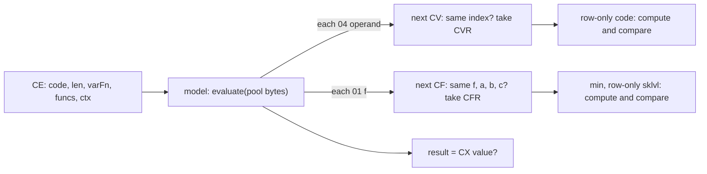

# 0005 — Calc formulas: the compiler, the bytecode and the evaluator

> **Subsystem:** data/calc
> **Question:** What bytecode does the `.txt` compiler write into `itemscode.bin`, `misscode.bin`, `skillscode.bin` and `skilldesccode.bin`, which columns point into it, and how does the evaluator compute a value from it?
> **Date:** 2026-10-15 (Phase 1), 2026-10-16 (Phase 2, § 10)   **Plan:** [0035](../../plans/done/0035-data-calc.md) Phases 1–2   **Status:** answered (the encoding and the compiler `[C]` by recompiling every stock formula cell; the evaluator `[C]` for the 14 stock opcodes, the skills contexts, `min`, `sklvl` and the row-only and formula-valued variables reached, by run:2026-10-16-calc; the unit-reading variables and functions, the missile and item variable readers and the unreached paths `[I]`)

Static reading of the pinned `Game.exe`, then `tools/calc.py compile`, a model of the compiler below, run over the
merged excel directory: it recompiles the 1 791 non-blank formula cells of `missiles.txt`, `skills.txt`,
`skilldesc.txt`, `weapons.txt`, `armor.txt` and `misc.txt`, and every record offset, every cell's bytes and all four
pools come out byte-identical (§ 8). The compiler runs only under `-txt` ([data/0001](0001-excel-loader.md) §2), so
the shipped `.bin` files are the compiler's output and the data check covers it. No lead was used: everything here
is derived from the code. Names are ours.

## Answer (summary)

- [C] **Where the bytes go.** A formula column is an excel descriptor entry of type `0x19` whose callback is one of
  four cell compilers: `fn:sub_00611BD0_SkillsCalcCell@0x00611BD0` (skills → `skillscode`),
  `fn:sub_00611C70_SkillDescCalcCell@0x00611C70` (skilldesc → `skilldesccode`), `fn:sub_006619A0_MissCalcCell@0x006619A0`
  (missiles → `misscode`) and `fn:sub_00631530_ItemCalcCell@0x00631530` (weapons/armor/misc → `itemscode`). Each
  compiles the cell into a 1 024-byte buffer with `fn:CALC_Compile@0x006C1AE0` and, when it returns > 0, appends the
  bytes to the pool with `fn:sub_006118B0_CalcPoolAppend@0x006118B0` (no sharing: two equal cells are stored twice)
  and stores the pool offset as an s32; a blank cell, a missing column or a failed compile stores −1. The 90 formula
  columns are listed in § 1; the data check rebuilds each pool by appending in record order. (struct:DataTables+0x40)
- [C] **The bytecode is postfix, one opcode byte each** (`[C]` for the opcodes in the stock pools, `[I]` for the
  code-only ones below): `00` end; `01 f` call function `f`; `04 i`/`05 i16`/`06 i32`
  push variable `i`; `07 s8`/`08 s16`/`09 s32` push a constant; `0A <`, `0B >`, `0C <=`, `0D >=`, `0E ==`, `0F !=`,
  `10 +`, `11 −`, `12 ×`, `13 ÷`, `14 ^`, `15` negate, `16` `?:`; and `02`, an unclosed `(` that the compiler flushes
  as a byte. The narrowest operand width that holds the value is used. Opcodes in the stock pools: `00 01 02 04 07 08
  0A 0B 10 11 12 13 15 16`; `05 06 09 0C 0D 0E 0F 14` are read from the code only and stay `[I]` (no stock cell
  emits them). (fn:CALC_EmitConst@0x006C19C0,
  fn:CALC_EmitVar@0x006C1A50, fn:CALC_PushOperator@0x006C18A0)
- [C] **The compiler is an operator-precedence (shunting-yard) parser**: `,` only flushes, so
  `sklvl('Holy Fire'.ln56.edmx)` needs no commas; a formula with no variable and no function call is folded to one
  constant by running the evaluator at compile time (`-100` → `07 9C 00`). (fn:CALC_Compile@0x006C1AE0,
  fn:CALC_NextToken@0x006C11C0)
- [I] **Quirks a reimplementation must copy that no stock cell exercises** (code reading only): `?:` has the
  highest precedence (`data:g_CalcPrecedence@0x006FC874`) and `:` flushes nothing, so `a < b ? c : d` compiles as
  `a b c d ?: <`, any operator inside an unparenthesised then-branch fails the compile (`lvl ? 1+lvl : 3` → −1), and
  an unparenthesised else-branch takes the whole ternary as its left operand (`lvl ? 2 : 3+lvl` is `(lvl?2:3)+lvl`);
  `-` is unary only when the previous token was not an operand, and `,`, `?`, `:` and `(` do not reset that flag
  (so `min(-1,lvl)` fails to compile); an unknown identifier compiles to the constant 0. The loop compares the
  stacked operator's precedence with the *incoming opcode* rather than the incoming operator's precedence; with
  this table the two give the same pops for every operator, so it is not observable. (0x006C18DE)
- [C] **Names are resolved at compile time** by three callbacks per context (function name, function arity,
  identifier). Skills/skilldesc know `min max rand skill miss stat sklvl`, missiles `min max rand skill miss`, items
  `min max rand stat`. Inside `skill(`/`sklvl(`/`miss(`/`stat(` a quoted name becomes the row index (constant) and a
  `.code` the code's index (constant); elsewhere an identifier is a variable from `skillcalc` (skills) or `misscalc`
  (missiles); item formulas have no variables (every bare identifier is variable 0). (§ 3) (0x006119F0, 0x00661880, 0x006314A0)
- [C] **The evaluator** `fn:CALC_Eval@0x006C0BC0`, for the 14 opcodes of the stock pools (run:2026-10-16-calc,
  44 529 evaluations, 0 mismatches, § 10): an int32 stack; binary operators pop the right operand first; `÷` is
  `idiv` (truncation toward zero: 25 inexact negative quotients); comparisons give 0/1; `?:` pops else, then,
  condition; a variable is read and a function called at its opcode, in code order; the value is the top of the stack
  at opcode `00` or `02`. (§ 5, § 10)
- [I] Not reached in the run (code reading, § 5): the 64-slot limit (a push onto a full stack is dropped), an
  empty-stack pop giving 0, the zero divisor giving 0, the 32-bit wrap of `+ − ×`, `^` (exponent ≤ 0 is 1, else
  repeated multiplication), the code-only opcodes, the end at `03`/> `0x16`, and the 0 returned when the code runs
  past its length or reads a variable with no reader. (fn:CALC_Push@0x006C0B80, fn:CALC_Pop@0x006C0BA0, 0x006C0EC6)
- [C] for the skills contexts (run:2026-10-16-calc: the row-only variables reproduce at the context's skill and
  level 38 076 times), [I] for the missile and item contexts. **Run-time entry points and contexts.**
  `fn:SKILLS_EvalCalc@0x00646CA0` (skillscode) and
  `fn:SKILLS_EvalDescCalc@0x00646D00` (skilldesccode) evaluate with the context (unit, skill, level);
  `fn:MISS_EvalCalc@0x0064B7C0` (misscode) with (missile unit, owner, missile, level), defaulting the missile and
  level from the missile unit; `fn:ITEMS_EvalCalc@0x00627C20` (itemscode) with (unit, second argument). Each passes
  its function table (`data:g_SkillsCalcFuncs@0x00745774`, 7 entries; `data:g_MissCalcFuncs@0x00745828`, 4;
  `data:g_ItemCalcFuncs@0x0074463C`, 4) and its variable reader. (§ 6)
- [C] `min` (979 calls) and `sklvl` (the 50 calls whose two variables read only the row) reproduce
  (run:2026-10-16-calc); `min`, `max` and `rand` of all three tables reproduce bit for bit under emulation, 5 000 cases
  each (run:2026-10-16-calc-emu, § 11); the rest of this bullet is [I]. **Functions.** `min`/`max` are signed; `rand(a,b)` is `a` when `a ≥ b`, else `a + RNG_RangeB(seed, b−a+1)` on
  the context unit's seed (`Unit+0x20`) for skills and items, but **on a stack address** for missiles (§ 6.3);
  `skill(s,v)` evaluates variable `v` of skill `s` at the unit's current level of `s` (bonuses included);
  `sklvl(s,v,w)` evaluates `w` of skill `s` at the level given by `v` of the current skill; `miss(m,v)` reads missile
  variable `v` of missile `m`; `stat(id,k)` reads the unit's stat `id` (k = 1 base, 2 through
  `sub_00625500_UnitGetStat`, else the accumulated value; stat 19 `tohit` is a computed attack rating). (§ 6) (0x00643700, 0x00646C00, 0x00643770, 0x00646C60)
- [C] for the `skillcalc` codes reached in run:2026-10-16-calc that read only the row (`ln12 ln34 ln56 ln78 dm12 dm34
  dm56 par1`–`par8 lvl toht mps usmc`) and the formula-valued ones reached (`clc1 clc4 len`, `toht` with a formula):
  computed values equal the logged ones; [I] for the others. **Variables.** The 73 `skillcalc` codes and the 43 `misscalc` codes map to the cases of `fn:SKILLS_CalcVar@0x00646460`
  and `fn:MISS_CalcVar@0x0064B340`; § 7 gives each one as "reads X from Y". Two copy-me quirks: `dm78` skips the
  level ≤ 0 test of the other `dm` codes, and the `descmissile` index is `(code − 43) / 3` for codes two apart, so
  `m2eo`/`m2ey` read the first description missile (the same as `m1eo`/`m1ey`) and `me3o`/`me3y` the second, not the
  third. (0x0064651F, 0x006468BE)

## Leads used

None. The plan registers no lead and none was fetched; every claim is derived from the code and checked against the
stock files.

## Functions

| Address | Name | Role | Tag |
|---|---|---|---|
| `0x006C1AE0` | `CALC_Compile` | `(text, out, max, fnLookup, fnArity, ident)` → byte length, 0 on failure | C |
| `0x006C11C0` | `CALC_NextToken` | tokenizer; calls the identifier and function-name callbacks | C |
| `0x006C1820` | `CALC_OpArity` | operand count per opcode (table `0x006C1880`; op 1 asks the context) | C |
| `0x006C18A0` | `CALC_PushOperator` | flush by precedence, push; op 0 writes the `00` | C |
| `0x006C19C0` | `CALC_EmitConst` | `07`/`08`/`09` + value | C |
| `0x006C1A50` | `CALC_EmitVar` | `04`/`05`/`06` + index | C |
| `0x006FC874` | `g_CalcPrecedence` | 23 precedence bytes, by opcode | C |
| `0x006C0BC0` | `CALC_Eval` | `(code, len, varFn, funcs, nFuncs, ctx)` → int32 | C |
| `0x006C0B80` | `CALC_Push` | push (EAX = stack, EDX = value), dropped when 64 are on | I |
| `0x006C0BA0` | `CALC_Pop` | pop (ECX = stack), 0 when empty | I |
| `0x006118B0` | `sub_006118B0_CalcPoolAppend` | append to a pool (buffer, size, capacity; grows by 0x400) and return the old size | C |
| `0x00611BD0` | `sub_00611BD0_SkillsCalcCell` | skills cell callback → `skillscode` | C |
| `0x00611C70` | `sub_00611C70_SkillDescCalcCell` | skilldesc cell callback → `skilldesccode` | C |
| `0x006619A0` | `sub_006619A0_MissCalcCell` | missiles cell callback → `misscode` | C |
| `0x00611930` | `sub_00611930_SkillsCalcFnLookup` | skills/skilldesc function names | C |
| `0x006119E0` | `sub_006119E0_SkillsCalcFnArity` | 3 for `sklvl`, else 2 | C |
| `0x006119F0` | `sub_006119F0_SkillsCalcIdent` | skills/skilldesc identifier callback | C |
| `0x00661800` | `sub_00661800_MissCalcFnLookup` | missile function names | C |
| `0x00661880` | `sub_00661880_MissCalcIdent` | missile identifier callback | C |
| `0x00631430` | `sub_00631430_ItemCalcFnLookup` | item function names | C |
| `0x00631490` | `sub_00631490_ItemCalcFnArity` | always 2 | C |
| `0x006314A0` | `sub_006314A0_ItemCalcIdent` | item identifier callback | C |
| `0x00611760` | `sub_00611760_CalcNameToCode` | first 4 characters, space-padded, as a code | I |
| `0x006617B0` | `sub_006617B0_CalcNameToCode2` | the same, missiles' copy | I |
| `0x00646CA0` | `SKILLS_EvalCalc` | `(unit, offset, skill, lvl)` over skillscode | C |
| `0x00646D00` | `SKILLS_EvalDescCalc` | the same over skilldesccode | C |
| `0x0064B7C0` | `MISS_EvalCalc` | `(missile, owner, offset, missileId, lvl)` over misscode; 13 stock cells emulated, § 11 (run:2026-10-16-calc-emu) | C |
| `0x00627C20` | `ITEMS_EvalCalc` | `(unit, item, offset)` over itemscode (§ 6) | I |
| `0x005BF240` | `sub_005BF240_ItemUse` | `.\SKILLS\SkillItem.cpp`: a used item's `pSpell` (`+0x94`) entry of `g_ItemUseFns` (§ 6) | I |
| `0x00741790` | `g_ItemUseFns` | `{test, use}` × 31 (count `0x0074178C`), by `pSpell` | I |
| `0x005BEDA0` | `sub_005BEDA0_ItemUseTimedState` | `pSpell` 9 (and from `pSpell` 6): the potion's state for `len` frames and its `stat1..3` = `calc1..3` (§ 6) | I |
| `0x00646BE0` | `sub_00646BE0_SkillsCalcVar` | variable reader → `SKILLS_CalcVar(unit, code, skill, lvl)` | C |
| `0x0064B6E0` | `sub_0064B6E0_MissCalcVar` | variable reader → `MISS_CalcVar` (§ 11) | C |
| `0x00627B40` | `sub_00627B40_ItemCalcVar` | variable reader: always 0 | I |
| `0x00646460` | `SKILLS_CalcVar` | the 73 `skillcalc` codes (§ 7.1) | I |
| `0x0064B340` | `MISS_CalcVar` | the 43 `misscalc` codes (§ 7.2); codes 0–18 and 28–42 emulated, § 11 | C |
| `0x00745774` | `g_SkillsCalcFuncs` | `{fn, argc}` × 7 | C |
| `0x007457AC` | `g_nSkillsCalcFuncs` | 7 | C |
| `0x00745828` | `g_MissCalcFuncs` | `{fn, argc}` × 4 | I |
| `0x00745848` | `g_nMissCalcFuncs` | 4 | I |
| `0x0074463C` | `g_ItemCalcFuncs` | `{fn, argc}` × 4 | I |
| `0x0074465C` | `g_nItemCalcFuncs` | 4 | I |
| `0x006436E0` | `sub_006436E0_SkillsCalcMin` | `min` | C |
| `0x006436F0` | `sub_006436F0_SkillsCalcMax` | `max` (§ 11) | C |
| `0x00643700` | `sub_00643700_SkillsCalcRand` | `rand` on the unit seed (§ 11) | C |
| `0x00646C00` | `sub_00646C00_SkillsCalcSkill` | `skill` | I |
| `0x00643740` | `sub_00643740_SkillsCalcMiss` | `miss` | I |
| `0x00643770` | `sub_00643770_SkillsCalcStat` | `stat` | I |
| `0x00646C60` | `sub_00646C60_SkillsCalcSklvl` | `sklvl` | C |
| `0x0064B700` | `sub_0064B700_MissCalcMin` | `min` (§ 11) | C |
| `0x0064B710` | `sub_0064B710_MissCalcMax` | `max` (§ 11) | C |
| `0x0064B720` | `sub_0064B720_MissCalcRand` | `rand` on a stack address (§ 11) | C |
| `0x0064B760` | `sub_0064B760_MissCalcSkill` | `skill` (owner's level) | I |
| `0x00627B50` | `sub_00627B50_ItemCalcMin` | `min` (§ 11) | C |
| `0x00627B60` | `sub_00627B60_ItemCalcMax` | `max` (§ 11) | C |
| `0x00627B70` | `sub_00627B70_ItemCalcRand` | `rand` on the unit seed (§ 11) | C |
| `0x00627BB0` | `sub_00627BB0_ItemCalcStat` | `stat` (same body as the skills one) | I |
| `0x00643810` | `SKILLS_FindUnitSkill` | (EAX = unit, ESI = skill id) → the unit's skill entry | I |
| `0x006442A0` | `SKILLS_GetSkillLevel` | `(unit, skill entry, withBonus)` → level, clamped to `[0, max]` | I |
| `0x00645B20` | `SKILLS_DimReturns` | `a + (lvl·110/(lvl+6))·(b−a)/100`, capped at `b` (the cap: emulated, § 11) | C |
| `0x00644B70` | `SKILLS_LevelBands` | per-level increments in 5 bands (2–8, 9–16, 17–22, 23–28, 29+) | I |
| `0x006449F0` | `SKILLS_GetToHit` | `toht` | I |
| `0x00644D50` | `SKILLS_GetElemMin` | skill elemental min (256ths, synergy, optional mastery) | I |
| `0x00644E40` | `SKILLS_GetElemMax` | skill elemental max | I |
| `0x00644F20` | `SKILLS_GetElemLen` | skill elemental duration | I |
| `0x00644C90` | `sub_00644C90_ElemMasteryBonus` | the elemental mastery percentage (stats 329–332) | I |
| `0x00647E00` | `SKILLS_GetMasteryCalc` | `math`/`madm`/`macr`: a passive calc chosen by passive stat | I |
| `0x0064AF20` | `MISS_GetDamMin` | missile physical min (256ths, synergy) | I |
| `0x0064AFF0` | `MISS_GetDamMax` | missile physical max | I |
| `0x0064B100` | `MISS_GetElemMin` | missile elemental min | I |
| `0x0064B1D0` | `MISS_GetElemMax` | missile elemental max | I |
| `0x0064B2A0` | `MISS_GetElemLen` | missile elemental duration | I |
| `0x004A89D0` | `sub_004A89D0_SkillDescRec` | (ECX = skill) → its skilldesc record | I |
| `0x0046ACE0` | `sub_0046ACE0_MissileRec` | (ECX = missile) → its record | I |
| `0x00622560` | `sub_00622560_PlayerBaseToHit` | attack rating of a player: stat 19 + (dex − 7)·5 + CharStats `+0x3C` | I |

## Walkthrough

### 1. Formula columns and pools

The four table loaders build their descriptors on the stack as 20-byte entries `{column, type, len, offset, link}`
([data/0004](0004-cell-converters.md)); the formula entries are type `0x19` with one of the four cell callbacks as
the link. Read from the descriptor code (skills and skilldesc `0x00613F80`, missiles `0x00661B20`, items
`ITEMS_LoadItemTables` `0x006315D0`):

| Table | Pool (`DataTables` buffer, size, capacity) | Columns (record offset) |
|---|---|---|
| missiles (420-byte records) | `misscode` `+0x60/+0x64/+0x68` | `SrvCalc1` `+0x80`, `CltCalc1` `+0x84`, `SHitCalc1` `+0x88`, `CHitCalc1` `+0x8C`, `DmgCalc1` `+0x90`, `DmgSymPerCalc` `+0xE0`, `EDmgSymPerCalc` `+0x118` |
| skills (`0x23C`) | `skillscode` `+0x40/+0x44/+0x48` | the 36 columns of [Skills.md](../../tables/Skills.md) § Calc columns, at the offsets listed there |
| skilldesc (288) | `skilldesccode` `+0x4C/+0x50/+0x54` | `ddam calc1/2` `+0x18/+0x1C`; `p1dmmin p2dmmin p3dmmin` `+0x24/+0x28/+0x2C`, `p1dmmax p2dmmax p3dmmax` `+0x30/+0x34/+0x38`; `desccalca1..6` `+0x98..`, `desccalcb1..6` `+0xDC..`; `dsc2calca1..4` `+0xB0..`, `dsc2calcb1..4` `+0xF4..`; `dsc3calca1..7` `+0xC0..`, `dsc3calcb1..7` `+0x104..` |
| weapons, armor, misc (424) | `itemscode` `+0x98/+0x9C/+0xA0` | `len` `+0xB0`, `calc1..3` `+0xA4..+0xAC`, `spelldesccalc` `+0xB8` |

- [C] Every one of these offsets holds −1 where the cell is blank and otherwise the offset of the cell's bytes; the
  pools are the cells' bytes appended in record order and nothing else (`misscode` 196 bytes, `skillscode` 5 891,
  `skilldesccode` 4 252, `itemscode` 158). The 4 788 + 12 852 + 9 282 + 3 295 checked fields include the absent
  columns of weapons/armor (−1). (§ 8) (fn:sub_006118B0_CalcPoolAppend@0x006118B0)
- [I] The cell callback (`0x00611BD0`, the other three are copies): ECX = cell text or NULL, EDX = field offset, one
  stack argument = the record. NULL text, or `CALC_Compile` ≤ 0 → store −1; else
  `CalcPoolAppend(&capacity, buffer, length)` with ECX = `&buffer`, EDX = `&size`, which grows the buffer by 0x400
  until `size + length` fits (fails past `0x7FFFFFFE`), copies, adds `length` to `size` and returns the old size.
  (0x00611C27, 0x00611C32, 0x006118B0)
- [I] The runtime readers check `offset < size` (unsigned), so −1 evaluates to 0 without a call (`0x00646CA0`,
  `0x0064B818`, `0x00627C20`).

### 2. Tokens (`CALC_NextToken`)

Called with (state, text, &kind, &value), ECX = function-name callback, EDX = identifier callback; returns the new
text position, or NULL to end the token stream. `kind` is the compiler's token code.

- [C] Skip spaces (`isspace`) **and `"` characters** (so `"min(24,ln12)"`, a cell quoted by the spreadsheet, reads as
  `min(24,ln12)`). (0x006C11C0)
- [C] A digit starts a decimal number (`value = value·10 + digit`, int32, no sign, no overflow check) → kind `0x10`. (0x006C1235)
- [C] `'name'` takes the character after the quote unconditionally, then everything to the next `'` (or the end),
  at most 255 characters; it calls the identifier callback (below). `≥ 0` → kind `0x11` (variable) when the
  callback's flag is 0, `0x10` (constant) when it is 1; `< 0` → constant 0. (0x006C12A1)
- [C] A letter starts a name of letters and digits (`isalnum`; `_` ends it). Spaces after it are skipped. If the
  next character is `(` and the function-name callback knows the name → kind `0x12`, value = function index, and
  the `(` is consumed. Otherwise the identifier callback decides as for a quoted name. (0x006C1387, 0x006C1467)
- [C] `.name` (the character after `.` unconditionally, then letters/digits) calls the identifier callback and always
  gives a **constant** (kind `0x10`) when it returns `≥ 0`; `< 0` ends the stream. (0x006C1692)
- [C] Operators: `(`=0 `)`=1 `,`=2 `+`=3 `-`=4 `*`=5 `/`=6 `?`=7 `:`=8 `^`=9 `<=`=10 `<`=11 `>`=12 `>=`=13 `==`=14
  `!=`=15. A lone `!` or `=`, NUL, and any other character end the stream (whatever follows is ignored).
  (0x006C14C2 jump table)
- [I] The identifier callback is `__fastcall(name, &flag)` with two stack arguments: the operator on top of the
  compiler's stack and its argument. With an empty stack it reads the byte before the stack (the token-kind byte,
  zeroed before each call), so "top" is 0. Only "top is a function call (1) with function index *k*" matters. (0x006C1302)

### 3. The compile-time callbacks (per context)

- [C] **Function names** (case-insensitive `_strnicmp(name, f, 0x20)`): skills `min`=0 `max`=1 `rand`=2 `skill`=3
  `miss`=4 `stat`=5 `sklvl`=6 (`0x00611930`); missiles `min max rand skill miss` = 0–4 (`0x00661800`); items
  `min max rand stat` = 0–3 (`0x00631430`). Arity: skills 3 for `sklvl`, else 2 (`0x006119E0`); items always 2
  (`0x00631490`); missiles pass no arity callback, and the compiler then uses 2 (`0x006C1857`).
- [C] **Identifiers, skills and skilldesc** (`0x006119F0`), by the enclosing function:
  - `skill(` and `sklvl(`: `EXCEL_FindName` in the skills name link (`DataTables+0xB9C`, column `skill`,
    case-insensitive, first row) → that index, flag 1; else the code of the name (its first four characters,
    space-padded, `0x00611760`) looked up with `EXCEL_FindCode` in the `skillcalc` code list (`+0x3C`), flag 0.
  - `miss(`: the missiles name link (`+0xB68`, `Missile`) → flag 1; else the `misscalc` code list (`+0x5C`), flag 0.
  - `stat(`: the itemstatcost name link (`+0xBD0`, `Stat`) → flag 1; else `base` → 1, `mod` → 2, anything else
    (`accr` is compared, the result unused) → 0, flag 0.
  - elsewhere: the `skillcalc` code, flag 0.
- [C] **Identifiers, missiles** (`0x00661880`): `skill(`: the 2-byte skills code list (`+0x70`, loaded only under
  `-txt`, [data/0001](0001-excel-loader.md) §3) by name → flag 1, else the `skillcalc` code; `miss(`: missiles by
  name, else the `misscalc` code; elsewhere the `misscalc` code.
- [C] **Identifiers, items** (`0x006314A0`): `stat(`: the itemstatcost name → flag 1, else `base` → 1, `mod` → 2,
  else 0 (flag 0); elsewhere 0 with flag 0, so a bare word in an item formula is variable 0.
- [C] Through § 2 this gives: `skill('Fire Bolt'.blvl)` → constant 36 (the row), constant 41 (`blvl` in
  `skillcalc`), call 3; `lvl` → variable 16; an unknown word → constant 0. Data: every quoted name in the stock
  formulas resolves (e.g. lower-case `'summon fenris'` finds `Summon Fenris`), and `sklvl('Holy Fire'.ln56.edmx)`
  compiles to three constants and `01 06`. (0x006119F0)

### 4. The compiler (`CALC_Compile`)

State block (on the stack at `ebp−0x14C`): operator bytes `+0x000` (64), their arguments `+0x040` (64 dwords),
operator count `+0x140`, value depth `+0x144`. Two flags: *operand* (the last token was a number, variable or
function name) and *hasVar* (a variable or a function occurred).

```c
// fn:CALC_Compile@0x006C1AE0 (restated; out/max = the caller's 1 024-byte buffer)
for each token:
  '('      : push op 2                                  // paren marker
  ')'      : while top != 2: emit top (op 1: emit 01 and its index, then stop); pop
             pop the 2 or 1 on top, else fail           // operand flag unchanged
  ','      : PushOperator(3)                            // flush only, flag unchanged
  '+' '*' '/' '^' '<' '>' '<=' '>=' '==' '!=' :
             PushOperator(the operator's opcode, list below); operand = 0
  '-'      : PushOperator(operand ? 0x11 : 0x15); operand = 0
  '?'      : PushOperator(0x16)                         // flag unchanged
  ':'      : PushOperator(0x17)                         // flush only, flag unchanged
  number   : EmitConst(value); operand = 1
  variable : EmitVar(index); operand = 1; hasVar = 1
  function : push op 1 with arg = index; operand = 1; hasVar = 1
end: PushOperator(0)                                    // flush everything, write 00
if !hasVar: v = CALC_Eval(out, len, NULL, NULL, 0, NULL); rewrite out as EmitConst(v), 00
return length (0 = failure, the cell gets -1)

PushOperator(op):                                        // fn:CALC_PushOperator@0x006C18A0
  while stack not empty and top != 1 and op != 1 and top < 0x17 and prec[top] >= op:
     n = arity(top); if depth < n: fail; emit top; pop; depth += 1 - n
  if op in (3, 0x17): return
  if op == 0: if nothing emitted: fail; emit 00; return
  push op
```

- [C] for the operators in stock cells (`<` `>` `+` `-` `*` `/` unary `-` `?`), [I] for `<=` `>=` `==` `!=` `^`
  (code only). Operator → opcode: `<` `0A`, `>` `0B`, `<=` `0C`, `>=` `0D`, `==` `0E`, `!=` `0F`, `+` `10`, binary `-` `11`,
  `*` `12`, `/` `13`, `^` `14`, unary `-` `15`, `?` `16`. (0x006C1D22–0x006C1E2D)
- [C] `g_CalcPrecedence` (by opcode `00`–`16`): `17 01 02 03 09 09 09 09 09 09 0F 0F 0F 0F 0F 0F 11 11 13 13 14 15 16`.
  The loop pops while `prec[top] ≥ incoming opcode`. Effect: `+ −` pop `+ − × ÷ ^ neg ?:`; `× ÷` pop `× ÷ ^ neg ?:`;
  `^` pops `^ neg ?:` (so `^` is left-associative); comparisons pop everything but `(` and calls; `?` pops only `?:`;
  `:` pops nothing that `?` left. A comparison stacked before a `?` is therefore emitted after it: unparenthesised
  `lvl < 4 ? 1 : 2` compiles to `04 10 07 04 07 01 07 02 16 0A 00`. Every stock ternary has its condition in
  parentheses (15 cells), and those reproduce; the unparenthesised cases are code reading only (`[I]`, summary). With
  this table, comparing with the incoming operator's precedence instead gives the same output for every stock cell
  and every operator (checked by swapping the test in `calc.py`). (data:g_CalcPrecedence@0x006FC874)
- [I] Operand counts (`CALC_OpArity`, table `0x006C1880`; the counts of the stock opcodes are `[C]` through § 8, the
  failure path is code only): `0A`–`14` take 2, `15` 1, `16` 3, `01` asks the arity
  callback (2 without one), everything else 0. The compiler tracks the value depth and **fails** when an operator
  would pop more than is there: `min(-1,lvl)` fails (the `-` after `min(` is binary because the function name set the
  operand flag), as does `a ? -1 : 2`. A reimplementation that accepts them stores bytes where the game stores −1.
- [C] An unclosed `(` stays on the stack and the end flush emits it as byte `02` (prec 2 ≥ 0, arity 0). Stock case:
  skills row 51 (`Fire Wall`) `EDmgSymPerCalc` = `(skill('Warmth'.blvl)*par8+skill('Inferno'.blvl)*par7` (no `)`),
  whose stored bytes end `… 12 10 02 00`. An unclosed function call (op 1) is never popped by the flush and is lost. (fn:CALC_PushOperator@0x006C18A0)
- [C] (`07`/`08`/`04`; `09`/`05`/`06` [I], no stock cell needs them) Constants and variables take the narrowest form: value in −128..127 → `07`/`04` + 1 byte (the variable index is
  read back unsigned, § 5), −32768..32767 → `08`/`05` + 2, else `09`/`06` + 4. Folding: `-100` (3 cells) and `-37`
  (1 cell) are stored as `07 9C 00` and `07 DB 00`, not `07 64 15 00`. (0x006C19C0, 0x006C1A50)
- [C] A cell of one space (skilldesc row 95, `revive`, `desccalcb2`) gives an empty token stream; the end flush finds
  nothing emitted and the compile fails: −1, not a pool entry. (0x006C1992)
- [I] Limits: 64 operators (more fails), the output buffer of 1 024 bytes (each emit checks the room left), names cut
  at 255 characters. (0x006C1B77, 0x006C1942)

### 5. The evaluator (`CALC_Eval`)

```c
// fn:CALC_Eval@0x006C0BC0 (restated). stack: int32[64], pop of an empty stack = 0, push onto 64 = dropped
p = code
while p - code < len:
  op = *p++
  case 04/05/06: if !varFn: return 0; push(varFn(u8 | s16 | s32 operand, ctx))   // ECX = index, EDX = ctx
  case 07/08/09: push(s8 | s16 | s32 operand)
  case 01: f = *p++
           if f >= nFuncs: push(0); break               // the arguments stay on the stack
           argc = funcs[f].argc
           3: c = pop(); b = pop(); a = pop()   2: b = pop(); a = pop(); c = 0
           1: a = pop(); b = c = 0              0: a = b = c = 0       other: push(0); break
           push(funcs[f].fn(a, b, c, ctx))      // __fastcall(ECX = a, EDX = b), stack: c, ctx
  case 0A..0F: r = pop(); l = pop(); push(l OP r)        // signed compare, 0 or 1
  case 10/11/12: r = pop(); l = pop(); push(l + r | l - r | l * r)   // wraps
  case 13: r = pop(); l = pop(); push(r == 0 ? 0 : l / r)          // idiv
  case 14: e = pop(); b = pop(); push(e <= 0 ? 1 : b^e)             // e-1 multiplications
  case 15: push(-pop())
  case 16: else_ = pop(); then_ = pop(); cond = pop(); push(cond ? then_ : else_)
  default (00, 02, 03, > 16): return stack empty ? 0 : pop()
  // an operand that would start at or past len: return 0
return 0
```

- [I] Read from the jump table at `0x006C1164` and each case (`0x006C0D06` call, `0x006C0C0E` variables,
  `0x006C0CA9` constants, `0x006C0E9C` division with the zero test at `0x006C0EC6`, `0x006C0F57` power, `0x006C0F02`
  ternary, `0x006C1148` end).
- [C] For `07`, `15` and `00`: the compile-time fold uses this function, and the four folded stock cells
  (`-100`, `-37`) are stored as the values this model gives. (fn:CALC_Compile@0x006C1AE0, 0x006C1EB8)
- [I] The ternary's condition pop is guarded separately: with fewer than three values the else-value wins. (0x006C0F2C)
- [I] **No guard for `INT32_MIN ÷ −1`.** After the zero test (`test esi, esi; je` at 0x006C0EC6, which pushes 0) the
  division is `cdq; idiv esi` (0x006C0ECE–0x006C0ECF), and `CALC_Eval` sets up no exception frame (its prologue is
  `push ebp; mov ebp, esp; sub esp, 0x104`), so that quotient raises the x86 divide error and the game faults. No stock
  cell can reach it (the stock divisors are constants). (fn:CALC_Eval@0x006C0BC0, architect r2 read in the backlog,
  2026-10-16)

### 6. Run-time entry points, contexts and functions

- [C] (run:2026-10-16-calc) `SKILLS_EvalCalc(unit, offset, skill, lvl)` and `SKILLS_EvalDescCalc` build `ctx = {unit,
  skill, lvl}` and call `CALC_Eval(pool + offset, size − offset, sub_00646BE0, g_SkillsCalcFuncs, 7, &ctx)`.
  `SKILLS_GetMasteryCalc` evaluates through `SKILLS_EvalCalc`; `SKILLS_GetToHit` (`ToHitCalc`, 0x00644A79),
  `SKILLS_GetElemMin`/`Max`/`Len` (`EDmgSymPerCalc`, `ELenSymPerCalc`, applied as `x + MulDiv(x, result, 100)` when
  the result is non-zero) and `SKILLS_CalcVar` (the formula-valued codes of § 7.1, 0x00646A07) build the same
  context in their own frame and call `CALC_Eval` directly (the run's return addresses, § 10). (0x00646CF4,
  0x00646D54)
- [C] `MISS_EvalCalc(missile, owner, offset, missileId, lvl)`: a non-NULL `missile` must be unit type 3, else 0;
  `missileId < 0` → the missile unit's class (`Unit+0x04`); `lvl < 0` → the `s16` at `+0x0C` of the unit's data
  (`Unit+0x14`), 0 without data; `ctx = {missile +0x00, owner +0x04, missileId +0x08, lvl +0x0C}` (four locals at
  `ebp−0x10`), which the variable reader `sub_0064B6E0_MissCalcVar` hands to `MISS_CalcVar` in that order and
  `sub_0064B760_MissCalcSkill` reads at `+0x04`. Emulated on the 13 stock cells that need no unit, with a NULL missile
  and with a missile unit whose class and level the context must take (run:2026-10-16-calc-emu, § 11; the
  `missile` type test and the pool-end guard included; the "0 without data" branch not cased). Callers: `MISS_GetDamMin`/`Max`
  (`DmgSymPerCalc`), `MISS_GetElemMin`/`Max` (`EDmgSymPerCalc`). (0x0064B7C0–0x0064B850)
- [I] `ITEMS_EvalCalc(unit, item, offset)`: `ctx = {unit, item}`; the variable reader returns 0, and `rand`/`stat`
  read `ctx.unit`, so the second word is never read by a stock formula. Callers (backlog 2026-10-16, static): the
  item-use functions of `g_ItemUseFns` (`0x00741790`, `{test, use}` pairs indexed by the used item's `pSpell`, record
  `+0x94`, count 31 at `0x0074178C`), called from `sub_005BF240_ItemUse` (`.\SKILLS\SkillItem.cpp`) as
  `use(ECX game, EDX the user, stack: the item, …)`; each passes **the user** as `unit` and **the used item** as the
  second argument: `0x005BE3F0` (`pSpell` 3, healing and mana potions: `len` 0x005BE430, `calc1..3` 0x005BE4D9),
  `0x005BE7B0` (`pSpell` 4, no stock row), `0x005BEAC0` (`pSpell` 5, rejuvenation), `sub_005BEDA0_ItemUseTimedState`
  (`pSpell` 9, stamina and `hrb`; `len` 0x005BEDFF, `calc1..3` 0x005BEF11; also called by `0x005BEF90`, `pSpell` 6,
  antidote and thawing). `0x005BEDA0`: the record's `state` (`+0x98`) must be a valid state and `len` ≥ 1; the state
  is set (or extended) for `len` frames on a stat list of the user, a timer event 12 at its end, and each of
  `stat1..3` (`+0x9E`) gets `calc1..3` (`+0xA4`) when non-zero (after stat 28, when stat 10 < stat 11, stat 10 is set to stat 11 + 256).
  Client side: `0x00486370` (called from `0x0048DD90`) passes `(unit, arg, calc1)` three times, not read further. The
  property code does not evaluate formulas ([items/properties](../../specs/items/properties.md)). (0x00627C7A,
  0x005BF2D3–0x005BF388, fn:sub_005BF240_ItemUse@0x005BF240, data:g_ItemUseFns@0x00741790,
  fn:sub_005BEDA0_ItemUseTimedState@0x005BEDA0, tbl:Misc.txt:calc1)

#### 6.1 Skills and skilldesc functions (`g_SkillsCalcFuncs`, all argc 2 except `sklvl` 3)

- [C] `min(a,b)`: `a < b ? a : b`; `max(a,b)`: `a > b ? a : b` (signed). (0x006436E0, 0x006436F0, run:2026-10-16-calc-emu)
- [C] `rand(a,b)`: NULL ctx → 0; `a ≥ b` (signed) → `a`; else `a + RNG_RangeB(&unit->seed (Unit+0x20), b − a + 1)` (one
  draw on the unit seed; `b − a + 1` and the sum wrap at 32 bits, and a range that wraps to ≤ 0 gives `a` with no
  draw, `RNG_RangeB`'s `n < 1` rule). (fn:RNG_RangeB@0x0045C3E0, 0x00643700, run:2026-10-16-calc-emu)
- [I] `skill(s,v)`: level = 0; if `ctx.unit` has skill `s` (`SKILLS_FindUnitSkill`) → `SKILLS_GetSkillLevel(unit, entry,
  1)` (base level plus bonus levels, clamped to `[0, sub_00611830_ExpMaxLevel(0)]`); result `SKILLS_CalcVar(unit, v, s, level)`. (0x00646C00)
- [I] `miss(m,v)`: `MISS_CalcVar(NULL, ctx.unit, v, m, ctx.lvl)`. (0x00643740)
- [I] `stat(id,k)`: NULL ctx/unit, `id < 0` or `id ≥ nItemStatCost` → 0; `id = 19` → `sub_00622560_PlayerBaseToHit(unit)`
  (fatal error for a non-player); `k = 1` → `STATS_GetUnitBaseStat(unit, id, 0)`; `k = 2` →
  `sub_00625500_UnitGetStat(unit, id, 0)`; else `STATS_GetUnitStat(unit, id, 0)`. (fn:STATS_GetUnitBaseStat@0x006253B0,
  fn:sub_00625500_UnitGetStat@0x00625500, fn:STATS_GetUnitStat@0x00625480)
- [I] `sklvl(s,v,w)`: `L = SKILLS_CalcVar(unit, v, ctx.skill, ctx.lvl)`, result `SKILLS_CalcVar(unit, w, s, L)`. (0x00646C60)

#### 6.2 Item functions (`g_ItemCalcFuncs`)

- [C] `min`, `max` and `rand` (on `ctx.unit`'s seed) as above. (0x00627B50–0x00627B70, run:2026-10-16-calc-emu)
- [I] `stat` as above (the body is a copy of the skills one). (0x00627BB0)

#### 6.3 Missile functions (`g_MissCalcFuncs`)

- [C] `min`, `max` as above. (0x0064B700, 0x0064B710, run:2026-10-16-calc-emu)
- [I] `skill(s,v)` as above but on `ctx.owner` (`0x006439F0` → `SKILLS_FindUnitSkill`).
- [C] `rand(a,b)` is the skills one with the seed at `ctx + 0x20` (`lea ecx, [eax+0x20]`; run:2026-10-16-calc-emu).
  [I] That address is not a unit's seed: with `ctx` at `ebp−0x10` in `MISS_EvalCalc`, that
  is the address of its own third and fourth stack arguments (the offset and the missile id), so the draw is a
  function of those two values and advances no game seed. No stock missile formula calls `rand`. (0x0064B742)

### 7. Variables

#### 7.1 `skillcalc` codes (`SKILLS_CalcVar(unit, code, skill, lvl)`, `skill` out of range → 0)

`lvl` is the level argument, `rec` the skills record (`DataTables+0xB98`), `ParN` = `rec+0x148+4(N−1)`.

| Codes (index) | Value | Tag |
|---|---|---|
| `ln12 ln34 ln56 ln78` (0 2 4 6) | `lvl < 1 ? 0 : ParA + (lvl−1)·ParB` (pairs 1/2, 3/4, 5/6, 7/8) | C (run, § 10) |
| `dm12 dm34 dm56` (1 3 5) | `lvl < 1 ? 0 : SKILLS_DimReturns(lvl, ParA, ParB)` | C (run, § 10) |
| `dm78` (7) | `SKILLS_DimReturns(lvl, Par7, Par8)` with no level test | I |
| `par1`–`par8` (8–15) | `ParN` | C (run, § 10) |
| `lvl` (16) | `lvl` | C (run, § 10) |
| `edmn edmx edln` (17–19) | `SKILLS_GetElemMin(…,0) >> 8`, `SKILLS_GetElemMax(…,0) >> 8`, `SKILLS_GetElemLen(…,0)` | I |
| `toht` (20) | `SKILLS_GetToHit`: `lvl < 1` → 0; `ToHitCalc` (`+0x1A0`) = −1 → `ToHit + (lvl−1)·LevToHit` (`+0x198`, `+0x19C`); else the formula | C (run, § 10) |
| `mana` (21), `usmc` (42), `mps` (22) | `m = (lvlmana·(lvl−1) + mana) << manashift` (`s16 +0x18C`, `s16 +0x18A`, byte `+0x188`); `mana` = `m >> 8`, `usmc` = `m`, `mps` = `((lvlmana·(lvl−1)+mana)·25/2 << manashift) >> 8`; 0 when `lvl < 1` | C for `mps` `usmc` (run, § 10); I for `mana` |
| `math madm macr` (23–25) | `SKILLS_GetMasteryCalc(unit, skill, lvl, 0/1/2)`: the first `passivestat1..5` (`+0x98`) equal to stat 342/343/344 or 345/346/347 (melee or throw mastery to-hit/damage/crit); its `passivecalc` evaluated at (skill, lvl); 0 when none | I |
| `m1en m2en m3en` (26 29 32) | description missile k (skilldesc `descmissile`, `s16` at `+0x3C+2k`): `MISS_GetElemMin(NULL, unit, m, lvl) >> 8` | I |
| `m1ex m2ex m3ex` (27 30 33) | `MISS_GetElemMax(…) >> 8` | I |
| `m1el m2el m3el` (28 31 34) | `MISS_GetElemLen(…)` | I |
| `m1rn m2rn m3rn` (35–37) | missile `LevRange·lvl + Range` (`s16 +0x98`, `+0x96`) | I |
| `edns edxs` (38 39) | `SKILLS_GetElemMin/Max(…,0)` (256ths) | I |
| `ulvl` (40) | `STATS_GetUnitStat(unit, 12 level, 0)`; NULL unit → 0 | I |
| `blvl` (41) | `SKILLS_GetSkillLevel(unit, entry, 0)`: base points only; 0 if the unit lacks the skill | I |
| `m1eo m2eo me3o` (43 45 47) | `MISS_GetElemMin(…)` (256ths) of description missile `(code−43)/3` = 0, 0, 1 | I |
| `m1ey m2ey me3y` (44 46 48) | `MISS_GetElemMax(…)` of description missile `(code−44)/3` = 0, 0, 1 | I |
| `enma exma` (49 50), `edma` (51) | as `edmn edmx` with the mastery flag (`>> 8`); `SKILLS_GetElemLen(…,1)` | I |
| `enms exms` (52 53) | as `edns edxs` with the mastery flag | I |
| `len rng` (54 59) | the skill's `auralencalc` (`+0x60`) / `aurarangecalc` (`+0x64`) evaluated at (unit, skill, lvl) | C for `len` (run, § 10); I for `rng` |
| `clc1`–`clc4` (55–58) | `calc1..4` (`+0x138..+0x144`) evaluated the same way | C for `clc1` `clc4` (run, § 10); I for `clc2` `clc3` |
| `ast1`–`ast6` (60–65), `pst1`–`pst5` (66–70) | `aurastatcalc1..6` (`+0x68..`), `passivecalc1..5` (`+0xA4..`) | I |
| `pets` (71), `skpt` (72) | `petmax` (`+0xC0`), `skpoints` (`+0x170`) | I |

- [I] Elemental values (`SKILLS_GetElemMin`, `0x00644D50`): `lvl < 1` → 0; `x = (EMin + LevelBands(lvl, EMinLev1..5))
  << HitShift` (`+0x1E0`, `+0x1E8`, byte `+0x1A4`); if `EDmgSymPerCalc` (`+0x210`) is set and (`x > 256` or
  `EMinLev1 ≠ 0`), `x += MulDiv(x, formula, 100)`; with the mastery flag and a unit, `x +=
  sub_00644C90_ElemMasteryBonus` (ECX = the skill's `EType` byte `+0x1DC`, EAX = unit, ESI = `x`): EType 1 → stat 329,
  2 → 330, 4 or 12 → 331, 5 → 332, each `MulDiv(x, STATS_GetUnitStat(unit, stat, 0), 100)` when the stat is non-zero,
  else 0. (0x00644E25, 0x00644CAA)
  `Max` is the same with `EMax`/`EMaxLev` (`+0x1E4`, `+0x1FC`) and no `x > 256` test; `Len` = `ELen + ELevLen` bands
  (1–8, 9–16, 17+) + the `ELenSymPerCalc` percentage, no shift. `LevelBands(lvl, b)`: `lvl < 2` → 0; ≤ 8 →
  `(lvl−1)·b0`; ≤ 16 → `(lvl−8)·b1 + 7·b0`; ≤ 22 → `(lvl−16)·b2 + 8·b1 + 7·b0`; ≤ 28 → `(lvl−22)·b3 + 6·b2 + 8·b1 +
  7·b0`; else `(lvl−28)·b4 + 6·(b3+b2) + 8·b1 + 7·b0`. (0x00644B70, sub_00483360_MulDiv)
- [C] for `r` at levels 1–20 (run:2026-10-16-calc, 2 438 computed values, all with `r ≤ b`, § 10) and for the cap,
  reached 373 times under emulation through `MISS_CalcVar`'s `sd`/`cd`/`shd`/`chd`/`dd` codes, which call this
  function (run:2026-10-16-calc-emu, § 11); every step wraps at 32 bits and the cap is a signed compare. `SKILLS_DimReturns(lvl, a, b)` (`0x00645B20`): `q = lvl·110 / (lvl+6)`;
  `r = q·(b−a) / 100 + a`; `min(r, b)`; both divisions truncate toward zero (`idiv`, and the `0x51EB851F` multiply with the sign fix).

#### 7.2 `misscalc` codes (`MISS_CalcVar(missile, owner, code, missileId, lvl)`)

A non-NULL `missile` that is not type 3 → 0; `missileId` out of range (signed, `< 0` or `≥ DataTables+0xB6C`) → 0;
`code` is read as a byte, and a code above 42 → 0. `rec` = missiles record (`+0xB64`, `0x1A4` bytes); the field
offsets match `missiles.txt` by a column check (0 mismatches over 684 rows). The `C` rows below and these guards
reproduce bit for bit under emulation (run:2026-10-16-calc-emu, § 11): 5 000 cases on random records, every code
0–18 and 28–42, levels −5…119 and wide values (32-bit wrap), the `sd`/`chd`/`dd12` cap reached in 373 cases.

| Codes (index) | Value | Tag |
|---|---|---|
| `par1`–`par5` (0–4) | `Param1..5` (`+0x38..+0x48`) | C |
| `cpa1`–`cpa5` (5–9) | `CltParam1..5` (`+0x58..+0x68`) | C |
| `hpa1`–`hpa3` (10–12) | `sHitPar1..3` (`+0x4C..+0x54`) | C |
| `chp1`–`chp3` (13–15) | `cHitPar1..3` (`+0x6C..+0x74`) | C |
| `dpa1 dpa2` (16 17) | `dParam1/2` (`+0x78`, `+0x7C`) | C |
| `lvl` (18) | `lvl` | C |
| `edmn edmx` (19 20), `edns edxs` (22 23) | `MISS_GetElemMin/Max` `>> 8`, and in 256ths | I |
| `edln` (21) | `MISS_GetElemLen`: `ELen` + `ELevLen1..3` bands (`+0x11C..+0x128`) | I |
| `damn damx` (24 25), `dmns dmxs` (26 27) | `MISS_GetDamMin/Max` `>> 8`, and in 256ths | I |
| `rang` (28) | `LevRange·lvl + Range` (`s16` `+0x98`, `+0x96`) | C |
| `sl12 sl34 cl12 cl34 shl1 chl1 dl12` (29 31 33 35 37 39 41) | `A + (lvl−1)·B` (no level test, unlike the skills codes) over (Param1, Param2), (Param3, Param4), (CltParam1, 2), (CltParam3, 4), (sHitPar1, 2), (cHitPar1, 2), (dParam1, 2) | C |
| `sd12 sd34 cd12 cd34 shd1 chd1 dd12` (30 … 42) | `SKILLS_DimReturns(lvl, A, B)` over the same pairs | C |

- [I] `MISS_GetElemMin` (`0x0064B100`): defaults as in `MISS_EvalCalc`; `x = EMin (+0xE8) + LevelBands(lvl, MinELev1..5
  +0xF0)`; `EDmgSymPerCalc` (`+0x118`) ≠ −1 → `x += MulDiv(x, formula, 100)` when non-zero; result `x << HitShift`
  (byte `+0x196`). Max: `Emax` `+0xEC`, `MaxELev` `+0x104`. `MISS_GetDamMin/Max`: `MinDamage`/`MaxDamage`
  (`+0xB0`/`+0xB4`) with the `MinLevDam`/`MaxLevDam` bands (`+0xB8`/`+0xCC`) and `DmgSymPerCalc` (`+0xE0`). Note the
  synergy percentage is applied **before** the shift here and after it for skills.

### 8. Reproduction

`python3 -I tools/calc.py compile workspace/merged/data/global/excel`:

```
misscode       missiles  cells=4788 mismatches=0 rebuilt=196 stock=196 pool identical
skillscode     skills    cells=12852 mismatches=0 rebuilt=5891 stock=5891 pool identical
skilldesccode  skilldesc cells=9282 mismatches=0 rebuilt=4252 stock=4252 pool identical
itemscode      items     cells=3295 mismatches=0 rebuilt=158 stock=158 pool identical
opcodes seen: 00 01 02 04 07 08 0A 0B 10 11 12 13 15 16
SURVEY calc cells=30217 blank=28426 compiled=1790 failed=1 mismatches=0 pool_bytes=10497 pool_mismatch=0 opcodes=14
```

- [C] 30 217 formula fields (every row × every formula column), 1 790 compiled cells, 1 failed compile (the
  one-space cell), 0 mismatches in the stored offset or the bytes, and all four pools rebuilt byte for byte. This is
  the corroboration for every `[C]` above (evidence rule 2, data behaviour). Function calls in the stock formulas:
  `skill` 456, `min` 63, `sklvl` 6, `miss` 2, `stat` 2, `max` 1, `rand` 1. (fn:CALC_Compile@0x006C1AE0)
- `calc.py eval` evaluates with this model; `--skill`/`--missile` with `--lvl` computes the variables that read only
  the record and the level (§ 7.1 rows `ln`, `dm`, `par`, `lvl`, `toht` without formula, `mana`/`mps`/`usmc`, the
  formula-valued codes; § 7.2 the parameter, `rang` and `sl`/`sd` rows); everything that reads a unit is an input.

### 9. Compile order within a row (backlog 2026-10-15, static)

- [I] **Formula cells compile in `.txt` column order.** The second pass of `EXCEL_ParseTxt` walks one row with the
  column index as its loop counter (`[ebp-0x37C]`, 0 to the file's column count) and the text pointer advanced cell by
  cell; each cell goes through the descriptor entry its header mapped to (`[ebp + 2·col − 0x374]`, 0x7FFF = skipped),
  and a type `0x17`/`0x18`/`0x19` entry calls its callback at that moment. So a formula's pool bytes are appended
  when its column is reached, not when its descriptor entry would be. (fn:EXCEL_ParseTxt@0x006BD780
  0x006BDB50–0x006BDF77)
- [I] **Then the descriptor entries the `.txt` lacks, in descriptor order.** `EXCEL_MapColumns` returns the header
  columns' entries first and then appends, in descriptor order, every entry no header matched; after the last cell of
  each row `EXCEL_ParseTxt` walks those appended entries through the default jump table at `0x006BE128`, where the
  three callback types (`0x17`–`0x19`, table slots `0x16`–`0x18`) go to `0x006BDFFC`: the callback with ECX = 0
  ([data/0004](0004-cell-converters.md) § 1, absent `calc` columns → −1). (fn:EXCEL_MapColumns@0x006BCE20
  0x006BCFA0–0x006BCFDC, 0x006BDFA0–0x006BE031)
- [I] For stock `skills.txt` the header order is `skpoints` (column 152), `delay` (166), `perdelay` (181), against the
  descriptor's `perdelay`, `skpoints`, `delay`; so in an edited row with all three filled, `perdelay`'s bytes follow
  `delay`'s in `skillscode`. No stock row fills `perdelay` with either, which is why both orders rebuild the stock
  pools. `tools/calc.py compile` now walks each row in this order (present columns by header position, then the absent
  ones in descriptor order) and still rebuilds the four pools byte for byte (§ 8 output unchanged).
  (tbl:Skills.txt:perdelay, tbl:Skills.txt:skpoints, tbl:Skills.txt:delay)

### 10. The evaluator at run time (Phase 2, run:2026-10-16-calc)

Fourteen sessions on the harness (one character per class, the skill tree's descriptions hovered skill by skill,
then the hotkey skills cast in Cold Plains and three potions drunk) logged every `CALC_Eval` call with its variable
reads and function calls (`tools/gdb/calc.py`); `python3 -I tools/calc.py check <excel-dir> <logs>` replays each
evaluation on the stock pool bytes with the model of § 5 (record and procedure in
[experiments § run:2026-10-16-calc](experiments.md#run2026-10-16-calc)).



- [C] **The model reproduces every logged evaluation**: 44 529 evaluations over 1 188 distinct cells (`skillscode`
  14 658 / 347 cells, `skilldesccode` 28 771 / 821, `misscode` 1 044 / 12, `itemscode` 56 / 8), 0 mismatches. For
  each one the logged bytes are the stock bytes at the pool offset, the length is the pool size minus the offset, the
  variable reader and function table are the pool's context's (`0x00646BE0`/`0x00745774`/7, `0x0064B6E0`/`0x00745828`/4,
  `0x00627B40`/`0x0074463C`/4), the model makes the logged reads and calls in the logged order with the same indices
  and arguments, and its value is the logged result. (fn:CALC_Eval@0x006C0BC0, run:2026-10-16-calc)
- [C] **Every opcode of the stock pools ran**: `00` 44 429 evaluations, `01` 12 169, `02` 100 (Fire Wall's unclosed
  `(`, § 4), `04` 34 173, `07` 20 498, `08` 5 958, `0A` 361 (150 false, 211 true), `0B` 25 (true only), `10` 7 797,
  `11` 1 558, `12` 12 156, `13` 2 114 (725 exact, 1 392 truncated positive, 25 truncated negative: `idiv`, not a
  floor), `15` 282, `16` 386 (150 else, 236 then). Not in the stock pools, so not reachable by stock data: `05 06 09
  0C 0D 0E 0F 14`. (run:2026-10-16-calc, fn:CALC_Eval@0x006C0BC0)
- [C] **Variables** (41 021 reads): 38 076 row-only reads of § 7.1 computed from the skills record at the context's
  (skill, level) equal the logged values (`ln12 ln34 ln56 ln78 dm12 dm34 dm56 par1`–`par8 lvl toht mps usmc`;
  `SKILLS_DimReturns` included); 682 formula-valued reads (`clc1 clc4 len`, `toht` with `ToHitCalc`) are each exactly
  one nested evaluation of the field's offset in the same (unit, skill, level) context, returning the read's value.
  The `SKILLS_DimReturns` cap (`min(r, b)`) was never reached in this run (every `dm` read had `r ≤ b`, levels 1–20);
  the emulation of § 11 reached it. (fn:SKILLS_CalcVar@0x00646460, fn:SKILLS_DimReturns@0x00645B20, run:2026-10-16-calc)
- [C] **Functions** (21 032 calls): `min` 979 computed from its arguments; `sklvl` 50 of 150 computed (both its
  variables row-only: `L = var(v, ctx.skill, ctx.lvl)`, result `var(w, s, L)`). The function pointer logged for each
  index is the table's entry. (fn:sub_006436E0_SkillsCalcMin@0x006436E0, fn:sub_00646C60_SkillsCalcSklvl@0x00646C60,
  run:2026-10-16-calc)
- **Boundary (ADR-0004), value oracles:** the reads of unit state are logged and taken as given: `skill` (18 593 in
  the skills context, 1 224 in the missiles context), `miss` (80), `stat` (6), `sklvl` with a unit-reading variable
  (100), and the variables `edmn edmx edln edns edxs enma exma enms exms m1en m1ex m2en m2ex m3en m3ex m1eo m1ey ulvl
  math madm macr` (2 263 reads). No seed passes through the evaluator (it draws only through `rand`, never called in
  the run), so there is no entry seed to assert. The `[C]` above covers the evaluator and the computed reads, not
  these callees. (run:2026-10-16-calc)
- [I] **Not reached** (stay code reading): `max` and `rand` (one stock cell each, monster skills rows 326 and 282);
  `MISS_CalcVar` and the missile context's layout (no missile-context evaluation read a variable) — these four are
  `[C]` since by the static emulation of § 11 (run:2026-10-16-calc-emu), except `MISS_CalcVar`'s codes 19–27; the 30 `skillcalc` codes `dm78 mana m1el m2el m3el m1rn m2rn m3rn blvl m2eo m2ey me3o me3y edma clc2 clc3 rng ast1`–`ast6 pst1`–`pst5 pets skpt` as variables (`blvl` is reached only as the constant in `skill(…'.blvl)`); the zero divisor, the 32-bit wrap, `0B` false, `^`, the empty-stack pop and the full stack.
  (fn:MISS_CalcVar@0x0064B340, fn:SKILLS_CalcVar@0x00646460, run:2026-10-16-calc)
- [I] **Callers** (call sites, from the run's return addresses): `SKILLS_EvalDescCalc` returning to 0x004EDEF1 and
  0x004EDF0D (the skill tree's description); `SKILLS_EvalCalc` from 76 sites (among them 0x00647EC5 in `SKILLS_GetMasteryCalc`);
  `CALC_Eval` directly from `SKILLS_CalcVar` (0x00646A07), `SKILLS_GetElemMin`/`Max`/`Len` (0x00644E02, 0x00644EE1,
  0x00645007) and `SKILLS_GetToHit` (0x00644A79); `MISS_EvalCalc` from `MISS_GetElemMin`/`Max` with a NULL missile
  (a description) or a missile unit; `ITEMS_EvalCalc` from 0x005BEDFF and 0x005BEF11 in `0x005BEDA0` when a stamina,
  antidote or thawing potion is drunk (its `len`, `calc1`, `calc2`), not when its description is shown.

### 11. Static emulation of the functions and the missile context (run:2026-10-16-calc-emu)

The parts § 10 could not reach on the harness (backlog 2026-10-16) were run on the binary's own code under Ghidra's
p-code emulator, as the RNG primitives were (run:2026-10-11-rng-emu), and compared with a model, bit for bit.
`re/ghidra_scripts/EmuCalcFunc.java` calls a function-table entry the way `CALC_Eval` does (`ECX = a`, `EDX = b`,
stack `c, ctx`, callee pops 8); `re/ghidra_scripts/EmuCall.java` calls any function with given registers, stack
arguments and memory (here `g_pDataTables` at `0x00744304` patched to a scratch table image). Models and cases:
`tools/calc_funcs.py` (`cases`/`check`, `misscases`/`misscheck`, `evalcases`/`evalcheck`; the record has the commands).
The run is evidence under [ADR-0015](../../adrs/0015-emulated-reproduction.md) (emulated reproduction with a declared
memory image). Its read set (condition 2): beyond the arguments, the stack, the scratch context and units and the
scratch DataTables, the emulated code reads three globals. `g_pDataTables` (`0x00744304`) is set by the memory spec.
`g_MissCalcFuncs` (`0x00745828`) and `g_nMissCalcFuncs` (`0x00745848`, 4) are image data: each has exactly one
reference in the image, a read inside `MISS_EvalCalc` (`push 0x745828` at `0x0064B840`, and `0x0064B829`), and no
writer. `CALC_Eval`, `sub_0064B6E0_MissCalcVar`, `MISS_CalcVar` (codes 0–18, 28–42) and `SKILLS_DimReturns` read no
absolute address besides these (architect's r2 read of the pinned `game.exe`, 2026-10-16, review of `lane/rbl`). The
offsets the cases fill carry their own evidence (condition 3): the missiles record's fields by the column check of
§ 7.2 (684 rows), the missile context by `MISS_EvalCalc`'s code (§ 6); the unit fields the scratch units fill are
`re/types/game.h`'s (struct:Unit+0x00 type, struct:Unit+0x04 class, struct:Unit+0x14 data, struct:Unit+0x20 seed);
the `s16` at `+0x0C` of a missile's data is an offset claim of § 6 only (what the game stores there, the missile's
level, is not shown by the emulation). (data:g_pDataTables@0x00744304,
data:g_MissCalcFuncs@0x00745828, fn:MISS_EvalCalc@0x0064B7C0)

- [C] **`min`, `max`, `rand` of the skills, items and missiles tables** (`0x006436E0`/`F0`, `0x00643700`;
  `0x00627B50`/`60`/`70`; `0x0064B700`/`10`/`20`): 5 000 cases each (edge values `0`, `±1`, `INT32_MIN/MAX`, a
  range that wraps to `n ≤ 0`, a NULL context; then random), 45 000 calls, 0 mismatches; each `rand` stepped its seed
  in 2 913 cases, the skills and items ones the seed at `ctx.unit + 0x20`, the missiles one the 8 bytes at
  `ctx + 0x20`, and none touched the other copy. `max(a, b)` of row 326 (`BearSmite`) and `rand(a, b)` of row 282
  (`Imp Inferno`) are therefore these functions, called by the evaluator whose `01` case is `[C]` (§ 10).
  (fn:sub_006436F0_SkillsCalcMax@0x006436F0, fn:sub_00643700_SkillsCalcRand@0x00643700,
  fn:sub_0064B720_MissCalcRand@0x0064B720, fn:sub_00627B70_ItemCalcRand@0x00627B70, fn:RNG_RangeB@0x0045C3E0,
  run:2026-10-16-calc-emu)
- [C] **`MISS_CalcVar`** (§ 7.2): 5 000 calls on four random 0x1A4-byte records, codes 0–18 and 28–42 (and the code
  byte with garbage above it, codes 43 and 255, missile ids −1, 4, `0x7FFFFFFF`, a type-1 unit), levels −5…119 plus
  wide ones, 0 mismatches, `ret 0x14` each time; the diminishing-returns codes went through `SKILLS_DimReturns` and
  hit its cap 373 times. Codes 19–27 call the elemental and physical damage getters (formulas of their own) and were
  not cased. (fn:MISS_CalcVar@0x0064B340, fn:SKILLS_DimReturns@0x00645B20, run:2026-10-16-calc-emu)
- [C] **`MISS_EvalCalc` and the missile context**, on the stock data: the scratch DataTables holds the stock
  `misscode` pool (`+0x60`, size `+0x64`) and the 684 stock `missiles` records (`+0xB64`, count `+0xB6C`), so
  `CALC_Eval`, the variable reader `sub_0064B6E0_MissCalcVar`, `MISS_CalcVar` and `SKILLS_DimReturns` all ran. The 13
  distinct stock cells that need no unit (rows 12, 27, 38, 40, 85, 205, 245, 246, 648: `dl12`, `lvl*2` of rows
  245/246, constants) at 9 levels each: once with a NULL missile (`missileId`, `lvl` as given) and once with a missile
  unit (type 3, class = the row, level in its data `+0x0C`) and `missileId = lvl = −1`, so both had to come from the
  unit through the context; plus a type-1 unit and an offset at the pool's end (both 0). 236 calls, 0 mismatches
  against `tools/calc.py`'s evaluator. The 12 other stock missile cells call `skill(…)` (a unit read) and were not
  cased. (fn:MISS_EvalCalc@0x0064B7C0, fn:sub_0064B6E0_MissCalcVar@0x0064B6E0, fn:CALC_Eval@0x006C0BC0,
  run:2026-10-16-calc-emu)
- What this does **not** cover: a monster actually casting `BearSmite` or `Imp Inferno` (which unit's seed `rand`
  draws on in that cast, and when, is game simulation); the items context's second argument in a live evaluation
  (§ 6, inferred only).

## Plan 0038 batch S1b (2026-10-16)

Static batch S1b of [plan 0038](../../plans/0038-inferred-claims-sweep.md), rows 1, 2, 6, 7, 18 and 19 of
[inventory data-calc](../../plans/0038-inventory/data-calc.md). No session was played. The check is
`python3 -I tools/sweep_s1b.py calc` over the 14 logs of run:2026-10-16-calc (sha256 equal to `calc-manifest.txt`):
the `CE` lines per pool, their function table and count, context words and the caller one frame up (`ra2`), and, in the
image, the tables and the instructions before each logged return address (objdump). Where a statement above is tagged
inferred and this section raises it, the tag and the second source given here are the current ones.

- **Row 1** (spec L46, missile formulas through `MISS_EvalCalc` from `MISS_GetElemMin`/`Max`) **raised.** [C] All 1 044
  `misscode` evaluations have `ra2` 0x0064B1A4 (522) or 0x0064B274 (522); each is the address after a `call 0x0064B7C0`
  that lies in the body of `MISS_GetElemMin` and `MISS_GetElemMax` respectively. (fn:MISS_EvalCalc@0x0064B7C0,
  fn:MISS_GetElemMin@0x0064B100, fn:MISS_GetElemMax@0x0064B1D0)
- **Row 2** (spec L47, potion cells through `ITEMS_EvalCalc` from 0x005BEDA0) **raised.** [C] All 56 `itemscode`
  evaluations have `ra2` 0x005BEE04 (21, `len`) or 0x005BEF16 (35, `calc1`/`calc2`), each after a `call 0x00627C20`
  in the body of 0x005BEDA0; in the image `g_ItemUseFns[9].use` is 0x005BEDA0 and `[6].use` (0x005BEF90) calls it.
  (fn:ITEMS_EvalCalc@0x00627C20, fn:sub_005BEDA0_ItemUseTimedState@0x005BEDA0, data:g_ItemUseFns@0x00741790)
- **Row 6** (spec L100, the missile function table, 4 entries) **raised.** [C] Every `misscode` evaluation passes the
  table 0x00745828 with count 4; in the image the count dword at 0x00745848 is 4 and the four `{fn, argc}` entries are
  (0x0064B700, 2), (0x0064B710, 2), (0x0064B720, 2), (0x0064B760, 2), all in `.text`.
  (data:g_MissCalcFuncs@0x00745828, data:g_nMissCalcFuncs@0x00745848)
- **Row 7** (spec L101, the item function table, 4 entries) **raised.** [C] Every `itemscode` evaluation passes
  0x0074463C with count 4; the count dword at 0x0074465C is 4 and the entries are (0x00627B50, 2), (0x00627B60, 2),
  (0x00627B70, 2), (0x00627BB0, 2). (data:g_ItemCalcFuncs@0x0074463C, data:g_nItemCalcFuncs@0x0074465C)
- **Row 18** (spec L369, `EvalItem`: the offset test; the context `{unit, arg2}`) **raised in part.** [C] the
  context's first word is the unit that drinks: in all 56 evaluations it is the player of that log (unit type 0, the
  same pointer as the session's skill evaluations), and the second word is another pointer (21 distinct over the
  potions drunk). **Remainder:** the offset test, which no stock evaluation fails (S1e's c-emu data-calc row 9), and
  that the second word is the used item: no item pointer is logged and no stock formula reads it (d-none).
  (fn:ITEMS_EvalCalc@0x00627C20)
- **Row 19** (spec L382, hover evaluates nothing; drinking runs `ITEMS_EvalCalc` from 0x005BEDA0 on `len`, `calc1`,
  `calc2`) **raised in part.** [C] the drinking half, as row 2: `len` from 0x005BEE04, `calc1`/`calc2` from 0x005BEF16.
  **Remainder `[I]`:** "hover evaluates nothing". The logs carry no mark of when the pointer rested on a potion, and the
  client caller 0x00486370 is not read. Proposed class (b): a hover marker line in `calc.gdb` (H3b family).

## Data touched

- Formula columns of [Skills.md](../../tables/Skills.md) (tbl:Skills.txt:calc1 and the other 35 listed there),
  [Misc.md](../../tables/Misc.md) (tbl:Misc.txt:calc1, `calc2`, `calc3`, `len`, `spelldesccalc`); `missiles.txt` and
  `skilldesc.txt` (no table docs yet) as § 1; the code lists `skillcalc.txt`, `misscalc.txt` (no table docs yet).
- Name links: struct:DataTables+0xB9C (skills), +0xB68 (missiles), +0xBD0 (itemstatcost), +0x70 (2-byte skills
  list); code links +0x3C (`skillcalc`), +0x5C (`misscalc`); pools struct:DataTables+0x40, +0x4C, +0x60, +0x98 (with
  size and capacity after each). `data:g_DataTables@0x0096BC30`.
- Skills record fields read by `SKILLS_CalcVar`: `Param1..8` `+0x148`, `ToHit` `+0x198`, `LevToHit` `+0x19C`,
  `ToHitCalc` `+0x1A0`, `manashift` `+0x188` (read as a byte), `mana` `+0x18A`, `lvlmana` `+0x18C`, `HitShift`
  `+0x1A4`, `EMin`/`EMax` `+0x1E0`/`+0x1E4`, the level bands, `EDmgSymPerCalc` `+0x210`, `ELen` `+0x214`,
  `ELevLen1..3` `+0x218`, `ELenSymPerCalc` `+0x224`, `skilldesc` `+0x194`, and the formula offsets of § 1.

## Dead ends

- Ghidra's decompile of the compiler helpers drops their register arguments (`CALC_PushOperator` takes the output
  pointer in EAX and the state in ESI; the emit helpers take the buffer start in ECX, the value in EDX, the room in
  ESI and the state in EDI). The disassembly is the reference; the restatement in § 4 follows it.
- The order of the formula cells inside one record (descriptor order or `.txt` column order) cannot be told from
  the data: no stock record has two formula cells whose orders differ, so both rebuild the pools. Settled from the
  code in § 9 (`.txt` column order); `calc.py` follows it since 2026-10-15.

## Open questions

- ~~[L] Within a row, are cells compiled in `.txt` column order or descriptor order?~~ `.txt` column order, then the
  absent columns in descriptor order (§ 9, static read of the cell loop). A `-txt` run on an edited `skills.txt`
  would corroborate it; not needed by stock data.
- ~~[L] The evaluator semantics (§ 5, § 6, § 7) are code reading only.~~ Run in Phase 2 (§ 10): `[C]` for what the
  run reached; the unreached paths listed there stay `[I]`. (run:2026-10-16-calc)
- ~~[L] Who calls `ITEMS_EvalCalc` and with which second argument: the run saw only `0x005BEDA0` (drinking a stamina,
  antidote or thawing potion; § 10), not a description; the function and its argument are not read.~~ Read (§ 6,
  static, `[I]`): the item-use functions of `g_ItemUseFns` by `pSpell`, the user as `unit` and the used item as the
  second argument; `0x005BEDA0` is `pSpell` 9's (and 6's) timed state.
  `SKILLS_EvalDescCalc` is called from 0x004EDEF1 and 0x004EDF0D (the skill tree's description, § 10).
- ~~[L] The missile variable reader (`MISS_CalcVar`, § 7.2) and the missile `ctx` layout: no evaluation in the run read
  a missile variable (the stock missile cells reached call only `skill`); the cells that do (`lvl*2`, missiles rows
  245/246) belong to missiles no session fired.~~ `[C]` by emulation (§ 11, run:2026-10-16-calc-emu), codes 19–27
  excepted.
