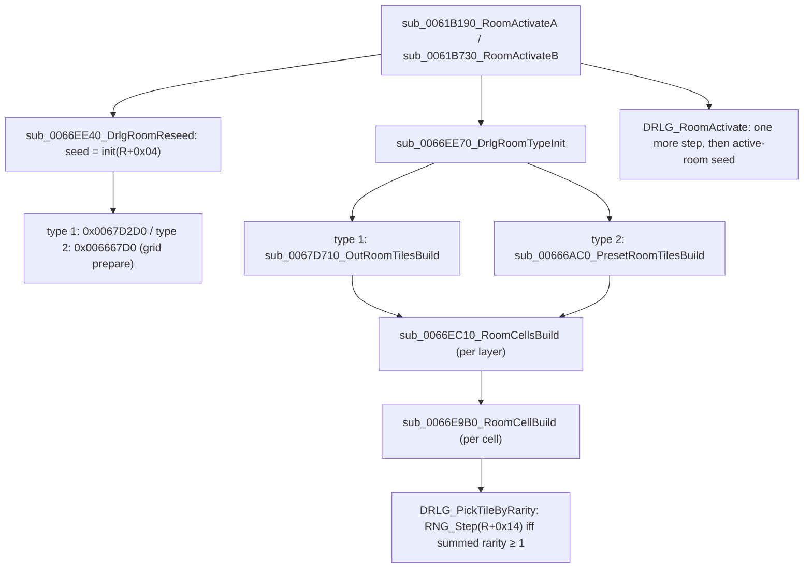

# 0001 — DS1 and DT1 readers

> **Subsystem:** drlg/files (feeds drlg/preset and drlg/collision)
> **Question:** Which DS1 and DT1 fields does the game's reader code consume, at which offset, under which version test?
> **Date:** 2026-10-11   **Plan:** 0005 (backlog answers for Phases 1–2)   **Status:** open

Answers the two archivist → reverser backlog entries "DS1 fields that only the reader code can settle"
and "DT1 fields that only code can settle". Answered: DS1 (a), (b), (c) except bits 14–15 and 30, and
(d) except the meaning of `flags`, group `unk` and path `action`; DT1 (a) (all bits read; byte rows
reversed, ECX = row, EDX = column), (b) (room mask: preset and outdoor rooms; maze rooms open), (c) and (d). Open: DS1 (e)
substitution, and the items listed under *Open questions*.

## Answer (summary)

- [I] One function parses a DS1 in place: `DS1_Parse` loads the whole file (`FILE_LoadWhole`, tag
  `.\DRLG\Preset.cpp`) and keeps pointers into the buffer. It has **no version check**: any version is
  accepted, and each optional part is gated by its own version test (table in the walkthrough).
  (fn:DS1_Parse@0x00665950, fn:FILE_LoadWhole@0x00517079)
- [I] DS1 header: `act` is read when `version ≥ 8` (else 0), clamped to at most 4, and used **only** to
  choose the per-act preset-unit mapping tables; it is not stored. `tag_type` is read when `version ≥ 10`
  (else 0) and stored. (fn:DS1_Parse@0x00665950)
- [I] The DS1's own DT1 file list (`version ≥ 3`) is **skipped** with a `strlen` loop, never stored or
  opened. A DRLG room's tiles come from `LvlTypes` `File 1..32` of its level's type, filtered by a 32-bit
  mask at DRLG room `+0x50` (list at room `+0x68`, level at room `+0x58`, type at level `+0x1C0`), plus three fixed files (`Act1\Outdoors\Blank.dt1`,
  `Act1\Barracks\InvisWal.dt1`, `Act1\Barracks\Warp.dt1`). (fn:DS1_Parse@0x00665950,
  fn:DRLG_LevelDt1ListBuild@0x0066F240)
- [C] `unk_skip` is two dwords skipped when `9 ≤ version ≤ 13` (`version − 9 < 5`, unsigned). Code
  anchor plus data behaviour: the archivist's parser, using the same gate, ends all 2273 clean files
  exactly. (fn:DS1_Parse@0x00665950, fmt:ds1#header)
- [I] The v12–13 trailing dword is **never read**. Paths are read only when `version ≥ 14`, and the
  parser stops after the group list for v12–13, so the trailer is dead bytes to the game.
  (fn:DS1_Parse@0x00665950)
- [I] Object list: `type` 1 is a monster, mapped through the act's `MonPreset` list (v ≥ 5; earlier
  type-1 entries are dropped); `type` 2 is an object, mapped through a 5×150 per-act id table for
  `id < 150` (v ≥ 6); `flags` (v ≥ 6) is OR-ed into the preset unit's `+0x1C`. Path `action` is read
  when `version ≥ 15`, else every point gets action 1. (fn:DS1_Parse@0x00665950,
  data:g_Ds1ObjectIds@0x00748AD8, fn:MONPRESET_GetActList@0x00659B40)
- [I] The DT1 reader accepts only `version_major == 7`. A file with any other major (the six 4.1 files)
  is a fatal error if it is ever opened. `version_minor` is reused as a runtime state word.
  (fn:DT1_Relocate@0x0060A390)
- [I] DT1 tiles are indexed by the key (`orientation` `+0x14`, `main_index` `+0x18`, `sub_index` `+0x1C`)
  in a 128-bucket hash; tiles sharing a key go on one list, and the lookup returns up to N of them.
  Which one is chosen (`rarity`) is decided by the lookup's callers, not read here. (fn:sub_0060CFA0_TileIndexAdd@0x0060CFA0,
  fn:TILE_FindByKey@0x0060D040)
- [I] Second pass: tiles sharing a key are chosen by a rarity-weighted draw on the DRLG room seed `+0x14`
  (§ Third pass); DS1 cell bits are copied into runtime tile flags (not one-to-one: bits 26/28 set
  multi-bit masks, bits 18–19 are a value field, flag `0x4` has four sources), and hidden
  (bit 31) cells are built like any other except in orientations 8–11; the collision builder ORs every
  bit of the 25 sub-tile bytes, row-reversed. (fn:DRLG_PickTileByRarity@0x0066D820,
  fn:sub_0066DB20_RoomTileSetFlags@0x0066DB20, fn:COLL_StampTile@0x0064C4C0)

## Leads used

- Field names are ours (no lead), except three that the editor's user manual supports, used only to
  name them: the per-layer Hidden bit (cell bit 31), src:siramy-ds1edit manual § Advanced tile editing and
  § "Weird" Tiles; object `type` 1 = Monster/NPC, manual § Path Editing; the 25 sub-tile bytes as 5×5
  sub-tiles, manual § SPACE and Tutorial 1. No behavioural claim is compared here (the version thresholds
  below come from the code).

## Functions

| Address | Name | Role | Tag |
|---|---|---|---|
| `0x00665950` | `DS1_Parse` | parse one DS1 buffer into the 0x5C-byte DS1 record | I |
| `0x00665F40` | `DS1_LoadCached` | name-keyed, ref-counted cache in front of `DS1_Parse` (critical section) | I |
| `0x0066BF30` | `sub_0066BF30_PresetUnitCreate` | allocate one preset unit (`.\DRLG\DrlgRoom.cpp`) | I |
| `0x0066D7F0` | `sub_0066D7F0_Ds1OldOrientMap` | remap one orientation cell of a v < 7 file through a table | I |
| `0x00659B40` | `MONPRESET_GetActList` | `MonPreset` records and count for an act 0..4 | I |
| `0x00655710` | `SUPERUNIQUES_GetCount` | returns the SuperUniques record count | I |
| `0x0061E4A0` | `sub_0061E4A0_TilePathPrefix` | `/`→`\`, then `"%s\%s"` prefix on a tile path in place | I |
| `0x0061E520` | `DRLG_LoadLvlTypes` | load `lvltypes` (0x788-byte records, `File 1..32` at 0x3C stride) | I |
| `0x0061EAA0` | `LVLTYPES_GetRecord` | `g_pLvlTypes + i·0x788` | I |
| `0x0061EAE0` | `sub_0061EAE0_LvlTypesIsAct` | `(type, act)`: the type's `Act` (`+0x780`, byte) equals `act` | I |
| `0x0061FAE0` | `sub_0061FAE0_LvlTypesDt1Preload` | start-up DT1 preload per type, stops at `"0"`, `Expansion` gate | I |
| `0x0044DB60` | `sub_0044DB60_ActDt1Preload` | per-act DT1 preload of the types with `Act = act + 1` | I |
| `0x00408F20` | `sub_00408F20_HasExpansionMpq` | `d2exp.mpq` found (cached) | I |
| `0x0061EBB0` | `DRLG_LoadLvlPrest` | load `lvlprest` (0x1B0-byte records); optionally preload every DS1 | I |
| `0x00667890` | `sub_00667890_PresetRoomLoadDs1` | open the chosen DS1 of a preset room | I |
| `0x00667970` | `sub_00667970_PresetMapScan` | open the chosen DS1 of a preset level and scan its wall cells | I |
| `0x0066F240` | `DRLG_LevelDt1ListBuild` | build a level's DT1 list from `LvlTypes` + mask + 3 fixed files | I |
| `0x00641F60` | `sub_00641F60_TownDt1Add` | add one town DT1 by act 0/1/2 | I |
| `0x00604A40` | `DT1_ListAdd` | load a DT1 into the first free slot of a 32-slot list; fatal when full | I |
| `0x00600790` | `DT1_LoadCached` | name-keyed DT1 cache; read file, relocate, index | I |
| `0x0060A390` | `DT1_Relocate` | check version, fix up pointers in place | I |
| `0x0060A440` | `sub_0060A440_Dt1IndexTiles` | allocate the tile index and add every tile to it | I |
| `0x0060CDB0` | `sub_0060CDB0_TileIndexAlloc` | 0x200-byte bucket array (128 lists) | I |
| `0x0060CFA0` | `sub_0060CFA0_TileIndexAdd` | add one tile under its (orientation, main, sub) key | I |
| `0x0060D040` | `TILE_FindByKey` | copy up to N tiles of one key into a caller buffer | I |
| `0x0060CD70` | `TILE_KeyHash` | bucket `(u8)(2·sub − orientation + main) & 0x7F` (fn:TILE_KeyHash@0x0060CD70) | I |
| `0x00604AE0` | `TILE_FindInList` | `TILE_FindByKey` over every file of a 32-slot DT1 list (fn:TILE_FindInList@0x00604AE0) | I |
| `0x00604B90`, `0x00604BC0`, `0x00604C20`, `0x00604C50`, `0x00604CE0` | `TILE_GetMainIndex`, `TILE_GetFlags16`, `TILE_GetRarity`, `TILE_GetSubIndex`, `TILE_GetSubtileFlags` | tile `+0x18`, u16 `+0x06`, `+0x20`, `+0x1C`, address of `+0x28` (fn:TILE_GetMainIndex@0x00604B90, fn:TILE_GetSubIndex@0x00604C50) | I |
| `0x0066D820` | `DRLG_PickTileByRarity` | rarity-weighted tile choice for a cell | I |
| `0x0066EC10` | `sub_0066EC10_RoomCellsBuild` | walk a cell grid, one `RoomCellBuild` per cell (fn:sub_0066EC10_RoomCellsBuild@0x0066EC10) | I |
| `0x0066E9B0` | `sub_0066E9B0_RoomCellBuild` | per-cell wall/floor/shadow decision | I |
| `0x0066DC50` | `sub_0066DC50_RoomTileAdd` | append a 0x30-byte room tile entry | I |
| `0x0066DB20` | `sub_0066DB20_RoomTileSetFlags` | cell bits → entry flags `+0x14` | I |
| `0x0066D440` | `sub_0066D440_AnimTilesBuild` | animated-tile frame lists (`.\DRLG\DrlgAnim.cpp`) | I |
| `0x0067C570` | `sub_0067C570_GridCellGet` | `grid[row_off[y] + x]` (fn:sub_0067C570_GridCellGet@0x0067C570) | I |
| `0x0064C860` | `sub_0064C860_TileCollisionUpdate` | clear old tile bits, stamp new tile | I |
| `0x0064C4C0`, `0x0064C580` | `COLL_StampTile`, `COLL_ClearTile` | OR / AND-NOT the 25 sub-tile bytes into the u16 map | I |

| Address | Global | Role | Tag |
|---|---|---|---|
| `0x0096C9F0` | data:g_pLvlTypes@0x0096C9F0 | `lvltypes` records | I |
| `0x0096C9FC` | data:g_nLvlTypes@0x0096C9FC | `lvltypes` count | I |
| `0x0096C894` | data:g_pLvlPrest@0x0096C894 | `lvlprest` records | I |
| `0x0096C898` | data:g_nLvlPrest@0x0096C898 | `lvlprest` count (`g_DataTables+0xC68`) | I |
| `0x0096D60C` | data:g_Ds1Cache@0x0096D60C | head of the DS1 cache list | I |
| `0x0096D610` | data:g_Ds1CacheLock@0x0096D610 | critical section for it | I |
| `0x008ADBB4` | data:g_Dt1Cache@0x008ADBB4 | head of the DT1 cache list | I |
| `0x006EEF20` | data:g_Ds1OldOrientMap@0x006EEF20 | u32 table, old orientation → current, for v < 7 | I |
| `0x00748AD4` | data:g_Ds1ItemCodes@0x00748AD4 | one item-code pointer (`"HDM"`) for DS1 `type 4` id 0 | I |
| `0x00748AD8` | data:g_Ds1ObjectIds@0x00748AD8 | s32[5][150]: per-act DS1 object id → object row | I |
| `0x0096C6DC` | data:g_MonPresetLists@0x0096C6DC | `MonPreset` record pointer per act (5) | I |
| `0x0096C6F0` | data:g_MonPresetCounts@0x0096C6F0 | `MonPreset` record count per act (5) | I |
| `0x0096C704` | data:g_pSuperUniques@0x0096C704 | SuperUniques records (0x34 bytes) | I |
| `0x0096C70C` | data:g_nSuperUniques@0x0096C70C | SuperUniques count | I |

## Walkthrough

### Where DS1 files are opened

- [I] `DRLG_LoadLvlPrest` loads `lvlprest` (0x1B0-byte records) and, for each record, rewrites the six
  `File1..6` cells (`+0x44`, stride 0x3C) in place through `sub_0061E4A0_TilePathPrefix`: `/` becomes
  `\` and the cell gets a `"%s\%s"` prefix. When its EDX argument is non-zero it also preloads every
  cell longer than one character through `DS1_LoadCached`, skipping records whose `Expansion` (`+0x20`)
  is set unless an expansion test passes (`0x00408F20`). (fn:DRLG_LoadLvlPrest@0x0061EBB0,
  fn:sub_0061E4A0_TilePathPrefix@0x0061E4A0, tbl:LvlPrest.txt:File1, tbl:LvlPrest.txt:Expansion)
- [I] At level build, the preset code opens `record + 0x44 + i·0x3C`, where `record` is the LvlPrest
  record and `i` the chosen file index, both held in the preset-room data. So the DS1 path is exactly
  the LvlPrest cell; how `i` is drawn is not read yet. (fn:sub_00667890_PresetRoomLoadDs1@0x00667890,
  fn:sub_00667970_PresetMapScan@0x00667970)
- [I] `DS1_LoadCached` walks a singly linked list (`+0x10C` next) comparing names; a hit increments the
  ref count (`+0x104`) and returns the stored record (`+0x108`). A miss allocates a 0x110-byte cache node
  and a 0x5C-byte zeroed DS1 record, then calls `DS1_Parse`. (fn:DS1_LoadCached@0x00665F40,
  data:g_Ds1Cache@0x0096D60C, data:g_Ds1CacheLock@0x0096D610)

### `DS1_Parse`, in stream order

The DS1 record (dword index → meaning): `[0]` tag_type, `[1]` file buffer, `[3]` size_x, `[4]` size_y,
`[5]` wall-layer count, `[6]` floor-layer count, `[7..10]` orient layers, `[11..14]` wall layers,
`[15..16]` floor layers, `[17]` shadow, `[18]` substitution layer, `[19]` group count, `[20]` groups,
`[21]` preset-unit list. Layer pointers point into the file buffer: cells are not copied.

| step | field | gate in the code | what the code does | tag |
|---|---|---|---|---|
| 1 | `version`, `size_x`, `size_y` | always | stored (`[3]`, `[4]`); version kept in a local | I |
| 2 | `act` | `v > 7` | read, `if act > 4: act = 4`; local only. Default 0 | I |
| 3 | `tag_type` | `v > 9` | stored in `[0]`. Default 0 | I |
| 4 | `file_count` + strings | `v > 2` | skipped string by string (`strlen + 1`) | I |
| 5 | `unk_skip` | `(unsigned)(v − 9) < 5` | 8 bytes skipped | C |
| 6a | layers, v < 4 | `v < 4` | wall `[11]`, floor `[15]`, orient `[7]`, subst `[18]`, shadow `[17]`, in that stream order; wall count 1, floor count left 0 | I |
| 6b | `wall_layers` | `v ≥ 4` | stored `[5]`, **not clamped** | I |
| 6c | `floor_layers` | `v ≥ 16` | stored `[6]`; else 1 | C |
| 6d | per wall layer | `v ≥ 4` | wall `[11+i]`, then orient `[7+i]` | C |
| 6e | floors, shadow | `v ≥ 4` | floor `[15+i]` per floor layer, then shadow `[17]` | C |
| 7 | orientation remap | `v < 7` | every orient cell replaced by `g_Ds1OldOrientMap[cell]`, in the buffer | I |
| 8 | substitution layer | `(unsigned)(tag_type − 1) < 2` | `[18]` = next layer | C |
| 9 | objects | `v > 1` | count, then per object `type, id, x, y` and `flags` when `v > 5` | I |
| 10 | groups | `v > 11` and `tag_type ∈ {1,2}` | `v > 17`: skip one dword; count `[19]`; per group `x, y, w, h` and `unk` when `v > 12` | C (gates), I (use) |
| 11 | NPC paths | `v > 13` | count; per path `points, x, y`; per point `x, y` and `action` when `v > 14`, else action 1 | I |

- [C] Steps 5, 6c–6e, 8 and the group gates of step 10 agree with the archivist's byte-accounting result
  (every clean file ends exactly, fmt:ds1#layers). That is a code anchor plus data behaviour.
  (fn:DS1_Parse@0x00665950)
- [I] Nothing follows step 11. A v12–13 file has no paths (`v > 13` fails), so its last dword is not
  read. The thresholds the archivist could not pin (act 4..8, tag_type 9..12, file_count 1..3,
  flags 3..8, path action) are, in 1.14d's reader: act ≥ 8, tag_type ≥ 10, file list ≥ 3, `wall_layers`
  ≥ 4, object `flags` ≥ 6, groups ≥ 12, group `unk` ≥ 13, paths ≥ 14, point `action` ≥ 15.
  (fn:DS1_Parse@0x00665950)
- [I] Version 3 reads the five layers in the order wall, floor, orient, subst, shadow, and stores a
  substitution layer even though `tag_type` is 0 for it. (fn:DS1_Parse@0x00665950)

### Object entries → preset units

```c
// fn:DS1_Parse@0x00665950, object loop (trimmed, renamed)
for (n = count; n; n--, p += (v > 5) ? 5 : 4) {
  type = p[0]; id = p[1]; mode = 0;
  if (type == 1) {                                   // monster
    mode = 1;
    if (v > 4) {
      list = MONPRESET_GetActList(act, &cnt);
      if (list && id < cnt) {
        kind = list[id].b1; id = list[id].w2;        // 4-byte records: u8 @+1, u16 @+2
        if      (kind == 0) id += nMonStats + SUPERUNIQUES_GetCount();
        else if (kind == 2) id += nMonStats;
        else if (kind != 1) id = -1;
      }
      // act-specific rewrites into objects: see Open questions
    }
  } else if (type == 2) {                            // object
    if (v < 6) { if (id == 0x23D) id = -1; }
    else if (id < 150) id = g_Ds1ObjectIds[act][id];
    else id -= 150;
  } else if (type == 4) {                            // item, by code; mode 3
    ...
  }
  flags = (v > 5) ? p[4] : 0;
  if (id >= 0 && (type != 1 || v > 4)) {
    u = PresetUnitCreate(type, id, mode, p[2] /*x*/, p[3] /*y*/);
    u->next = ds1[21]; ds1[21] = u;  u->flags |= flags;   // +0x1C
  }
}
```

- [I] Monster ids: `kind 1` is a `MonStats` row, `kind 2` a SuperUniques row (encoded above
  `nMonStats`), `kind 0` a third range above both (`nMonStats + nSuperUniques + index`). `nMonStats` is
  `g_DataTables+0xA80` (= `g_nMonStats`). An `id` at or past the act's `MonPreset` count passes through
  raw. (fn:MONPRESET_GetActList@0x00659B40, fn:SUPERUNIQUES_GetCount@0x00655710,
  data:g_nMonStats@0x0096C6B0, data:g_MonPresetLists@0x0096C6DC, data:g_MonPresetCounts@0x0096C6F0)
- [I] Objects: `id < 150` is translated per act through `g_Ds1ObjectIds[act·150 + id]`; `id ≥ 150`
  becomes `id − 150`, a direct object row. Files below v6 keep the raw id and drop 0x23D (573).
  (data:g_Ds1ObjectIds@0x00748AD8)
- [I] The preset unit (0x20 bytes): `+0x00` mode (0 object, 1 monster, 3 item), `+0x04` id, `+0x08` x,
  `+0x0C` next, `+0x10` path, `+0x14` type, `+0x18` y, `+0x1C` flags. Units are prepended, so the list is
  in reverse file order. (fn:sub_0066BF30_PresetUnitCreate@0x0066BF30)
- [I] Path ownership: a path with `points ≠ 0` is attached (at unit `+0x10`) to the **first unit in the
  list** whose `x` and `y` equal the path's, of any type. Since the list is reversed, that is the last
  matching unit in the file. A path with no matching unit is skipped. Each point is 12 bytes:
  `+0` action, `+4` x, `+8` y. (fn:DS1_Parse@0x00665950)
- [I] Groups are 0x18-byte records: `+0x00` x, `+0x04` y, `+0x08` w, `+0x0C` h, `+0x14` unk (v ≥ 13);
  `+0x10` is not written by the parser. (fn:DS1_Parse@0x00665950)

### Where a level's DT1 files come from

```c
// fn:DRLG_LevelDt1ListBuild@0x0066F240 (trimmed, renamed); `level` here is the DRLG ROOM (§ Third pass)
file = LVLTYPES_GetRecord(level[+0x58][+0x1C0]);    // room → its level (+0x58) → type (+0x1C0); File 1 at +0x00, 0x3C apart
for (mask = level[+0x50], i = 0; mask && i < 32; i++, mask >>= 1, file += 0x3C)
  if (mask & 1) DT1_ListAdd(level + 0x68, file);
DT1_ListAdd(level + 0x68, "DATA\GLOBAL\Tiles\Act1\Outdoors\Blank.dt1");
DT1_ListAdd(level + 0x68, "DATA\GLOBAL\Tiles\Act1\Barracks\InvisWal.dt1");
DT1_ListAdd(level + 0x68, "DATA\GLOBAL\Tiles\Act1\Barracks\Warp.dt1");
level[+0x28] |= 0x1000000;
```

- [I] Bit *i* of DRLG room `+0x50` selects `LvlTypes` `File i+1` of the level type at `level+0x1C0`,
  where `level = room+0x58` (correction: an earlier reading called this object the level). `LvlTypes` paths were prefixed at load like
  the LvlPrest cells. The three fixed files are always added, which accounts for the `blank.dt1` floor
  tile (key 0, 30, 0) that no DS1 lists. (fn:DRLG_LevelDt1ListBuild@0x0066F240,
  fn:DRLG_LoadLvlTypes@0x0061E520, fn:LVLTYPES_GetRecord@0x0061EAA0)
- [I] **Where the type comes from** (2026-10-12, settles the two readings above: the pseudocode's `level` is
  the room, and the type is `+0x1C0` of the **level** at room `+0x58`, `mov eax,[esi+0x58]; mov ecx,[eax+0x1C0]`
  at 0x0066F257). Level `+0x1C0` is written once, by `DRLG_LevelCreate` from the `leveldefs` record of the
  level id, `+0x34` (`LevelType`) (0x00642B23–0x00642B2D); a scan of `.text` for stores to `+0x1C0` finds no
  other DRLG writer. (fn:DRLG_LevelCreate@0x00642AE0, tbl:Levels.txt:LevelType)
- [I] **Path prefix and `"0"` cells.** `DRLG_LoadLvlTypes` passes every `File i` cell of every record, with the base
  `"DATA\GLOBAL\TILES"`, to `sub_0061E4A0_TilePathPrefix`, which turns `/` into `\` and prefixes `"%s\%s"`
  only when the cell is longer than one character (`cmp eax,1; jle` at 0x0061E4E1). So `"0"` (and an empty
  cell) stays as it is. `DRLG_LevelDt1ListBuild` does not test the name: a mask bit on a `"0"` slot adds the
  string `"0"` to the room's DT1 list, and what loading that name does is not read here (no run hit one).
  (fn:sub_0061E4A0_TilePathPrefix@0x0061E4A0, fn:DRLG_LevelDt1ListBuild@0x0066F240)
- [I] **`Expansion` (`+0x784`) gates the start-up DT1 preload.** `sub_0061FAE0_LvlTypesDt1Preload` (called from
  `DATATBLS_LoadAll` at 0x00619414) allocates 0x1000 bytes per type at `0x0096CA1C` and walks `File 1..32` of each
  type, **stopping at the first `"0"` cell**; each file is added (`DT1_ListAdd`) when `sub_00408F20_HasExpansionMpq`
  (true when `d2exp.mpq` is found, cached at `0x0074F0DC`) is true, or when the type's `Expansion` is 0
  (0x0061FB70–0x0061FBBA). So without the expansion archive the types marked `Expansion` preload nothing; the
  per-room list (`DRLG_LevelDt1ListBuild`) has no such test. (fn:sub_0061FAE0_LvlTypesDt1Preload@0x0061FAE0,
  fn:sub_00408F20_HasExpansionMpq@0x00408F20, tbl:LvlTypes.txt:Expansion)
- [I] **`Act` (`+0x780`)** is read only by `sub_0061EAE0_LvlTypesIsAct(type, act)` (`Act == act`, byte compare), whose
  only caller `sub_0044DB60_ActDt1Preload(act)` loops over types 0–35 and, for those of `Act = act + 1`, hands each
  `File 1..32` cell that is not `"0"` or empty to `0x00600790`, then the fixed `warp.dt1`. Not on the level-build path.
  (fn:sub_0061EAE0_LvlTypesIsAct@0x0061EAE0, fn:sub_0044DB60_ActDt1Preload@0x0044DB60, tbl:LvlTypes.txt:Act)
- [I] `DT1_ListAdd` fills the first empty slot of a 32-pointer list and is fatal when all 32 are full.
  (fn:DT1_ListAdd@0x00604A40)
- [I] A second path adds one town DT1 by the act byte at `+0x480`: 0 → `Act1\Town\Floor.dt1`,
  1 → `Act2\Town\Ground.dt1`, 2 → `ACT3\Kurast\sets.dt1`. (fn:sub_00641F60_TownDt1Add@0x00641F60)

### DT1 load

- [I] `DT1_LoadCached` reads the file into a zeroed buffer, calls `DT1_Relocate`, then
  `sub_0060A440_Dt1IndexTiles`, and caches the result in a 0x110-byte node (`+0x104` file, `+0x108`
  index, `+0x10C` next). (fn:DT1_LoadCached@0x00600790, data:g_Dt1Cache@0x008ADBB4)
- [I] `DT1_Relocate`: requires dword `+0x00 == 7`, else fatal. If bit 1 of `+0x04` (the minor, 6) is
  set, it adds the buffer base to `tile_ptr` (`+0x110`), copies the file name into `+0x08` (the 260-byte
  header area the archivist found zero), and for each tile stores a pointer to that name at tile `+0x58`.
  It is fatal if tile `+0x54` or `+0x5C` is non-zero. Then it clears bit 1 and sets bit 2 of `+0x04`, so
  the minor marks "relocated". (fn:DT1_Relocate@0x0060A390)
- [I] So `unk_008` is the runtime name buffer, and `unk_54` dword 1 (`+0x58`) is the runtime name
  pointer. The pointer-like values the archivist found there are stale editor memory, overwritten on
  load. Dwords 0 and 2 must be zero. (fn:DT1_Relocate@0x0060A390)
- [I] Indexing: each tile is added under the key (`+0x14` orientation, `+0x18` main, `+0x1C` sub). Key
  nodes are 0x14 bytes (`+0` main, `+4` sub, `+8` orientation, `+0xC` tile list, `+0x10` next); the
  bucket is `(u8)(2·sub − orientation + main) & 0x7F` (fn:TILE_KeyHash@0x0060CD70, `add cl,cl; sub cl,[arg]; add cl,dl; and 0x7F`). `TILE_FindByKey(n, orient, main,
  sub)` copies up to *n* tile pointers of that key, in list order (newest first).
  (fn:sub_0060CFA0_TileIndexAdd@0x0060CFA0, fn:TILE_FindByKey@0x0060D040,
  fn:sub_0060CDB0_TileIndexAlloc@0x0060CDB0)

### Room tile build, tile choice and collision (second pass)

Read after the first commit. These answer DT1 (a) and (c) and most of DS1 (c).

#### Tile choice by `rarity`

```c
// fn:DRLG_PickTileByRarity@0x0066D820 (trimmed, renamed); lvl = the DRLG room (DT1 list at +0x68)
n = TILE_FindInList(lvl+0x68, orient, (cell>>20)&0x3F, (cell>>8)&0xFF, buf, 40);   // cell==0 → key (orient,0,0)
if (n == 0) { if (TILE_FindInList(lvl+0x68, 10, 0, 0, buf, 40)) return buf[0]; fatal(); }
total = sum(buf[i]->rarity for i < n);       // tile +0x20, s32; a NULL buf[i] is fatal
r = 0;
if (total > 0) r = Range(lvl+0x14, total);   // inlined Step on room+0x14/+0x18 = Range(seed, sum)
i = 0; c = r + 1;
if (total != 0)
  while (n > 1 /*unsigned*/ && c > 0 /*signed*/) { c -= rarity(buf[i]); i++; }
return buf[i ? i-1 : 0];
```

- [I] Candidates are gathered across the level's DT1 list in slot order, at most 40, and within one file
  newest-indexed first. The draw happens whenever the summed rarity is > 0 (signed test), **even when only one tile
  matches**; with a sum of 0 there is no draw and the first candidate wins. A key with no tile falls back
  to key (10, 0, 0), and is fatal if that is missing too. (fn:DRLG_PickTileByRarity@0x0066D820,
  fn:TILE_FindInList@0x00604AE0, fn:TILE_GetRarity@0x00604C20)
- [I] The main index is bits 20–25 and the sub index bits 8–15 (`& 0xFF`, not `& 0x3F`) of the cell.
  (fn:DRLG_PickTileByRarity@0x0066D820)
- [I] Tile `+0x06` is read as one u16: bit 8 (`animated` byte bit 0) marks an animated tile, whose
  frames are the tiles of the same key ordered by `rarity` used as a frame number; tile `+0x06` bit 0
  and bit 2 (the `sound` byte) set runtime tile flags 0x4 and 0x800. (fn:TILE_GetFlags16@0x00604BC0,
  fn:sub_0066D440_AnimTilesBuild@0x0066D440, fn:sub_0066DB20_RoomTileSetFlags@0x0066DB20)

#### Per-cell decision

`sub_0066EC10_RoomCellsBuild` walks the grid and calls `sub_0066E9B0_RoomCellBuild` with the cell
dword and its orientation.

- [I] Orientation 10 or 11 with main index ≥ 8 is skipped outright. Floor key (0, 30, 0/1), the
  `blank.dt1` floor, is forced hidden (bit 31 set). (fn:sub_0066E9B0_RoomCellBuild@0x0066E9B0)
- [I] Bit 31 diverts only orientations 8–11: 8/9 go to a separate handler (except in level ids 111,
  112 and 117), 10/11 to the special-tile path. **Any other hidden cell is built like an unhidden
  one**: no DRLG code drops it. (fn:sub_0066E9B0_RoomCellBuild@0x0066E9B0)
- [I] Low-byte bits select the work. **Bit 2 (`0x04`) set** (`0x0066EACB`): an else-if chain through
  `0x0066E940` — floor if bit 1 (on the blank floor (0, 30, 0/1) it first clears bit 7, `0x0066EA89`),
  else wall if bit 0, else shadow if bit 27 **and** bit 31 clear; then return. Only this was read on that
  path. (fn:sub_0066E9B0_RoomCellBuild@0x0066E9B0)
- [I] **Bit 2 clear** (normal path), per cell in this order (fn:sub_0066E9B0_RoomCellBuild@0x0066E9B0):
  1. floor: if bit 1, pick with the cell; else, if arg4 ≠ 0 and `0x0066B980` passes, a **filler floor**
     picked at `0x0066EB4A` with cell `0x1E00000` (`0x1E00100` when level id = 74), bit 7 cleared and
     bit 31 set;
  2. wall, if bit 0: pick and add with the cell's orientation; an orientation-3 wall makes a second
     pick for orientation 4 (see below);
  3. for orientation 10/11, `0x0066E260` unless level id = 133;
  4. shadow, if bit 27 (`0x08000000`): pick for orientation 13.
  (fn:sub_0066E9B0_RoomCellBuild@0x0066E9B0)
- [I] Each added tile copies cell bits into its runtime flags (entry `+0x14`), in fn:sub_0066DB20_RoomTileSetFlags@0x0066DB20:

| cell bit | entry flag |
|---|---|
| bit 7 (`0x80`, low byte) | `0x1` |
| bit 2 (`0x04`) | `0x2000` |
| bit 3 (`0x08`) | `0x4` |
| bit 16 (`0x10000`) | `0x80` |
| bit 17 (`0x20000`) | `0x40` |
| bits 18–19, value v | `(v+1)·0x4000` (not for orientation 13) |
| bit 26 (`0x04000000`) | `0x20C` |
| bit 28 (`0x10000000`) | `0x102` |
| bit 29 (`0x20000000`) | `0x800` |
| bit 31 | `0x8` set, else `0x8` cleared |

  Orientation 14 adds `0x4`, orientations 8–11 add `0x2`. An orientation-3 wall also adds an
  orientation-4 tile at the same cell with the same flags, through a **second**
  `DRLG_PickTileByRarity(orient 4, same cell)` at `0x0066DD02`: one more draw. (fn:sub_0066DB20_RoomTileSetFlags@0x0066DB20,
  fn:sub_0066DC50_RoomTileAdd@0x0066DC50)
- [I] So for the river/inviswal filler (key 1, 5, 0): a `0x81` cell with bit 31 clear and one with bit 31
  set both get a wall entry; they differ only in entry flag `0x8`, and both carry `0x1` from bit 7. Which
  entry flag the renderer tests is outside DRLG and not read. (fn:sub_0066DB20_RoomTileSetFlags@0x0066DB20)

#### Sub-tile flags into the collision map

```c
// fn:COLL_StampTile@0x0064C4C0 (trimmed); fn:COLL_ClearTile@0x0064C580 is the same with &= ~b
b = TILE_GetSubtileFlags(tile);                 // tile + 0x28, 25 bytes
for (row = 0; row < 5; row++)                   // rows of the u16 collision map (stride map+0x08)
  for (col = 0; col < 5; col++)
    map[(r0+row)*w + c0+col] |= b[(4 - row)*5 + col];   // r0 = ECX, c0 = EDX; clipped at < 0 only
```

- [I] All 8 bits of each byte are OR-ed into a 16-bit collision word; nothing masks bits 3, 6 or 7, so
  the 1.14d builder reads every bit that ships. The bytes are rows of five, and byte row 0 is the
  **last** of the five map rows, byte row 4 the first. ECX is the map **row** and EDX the **column**: the
  caller at `0x0064C7FC` passes ecx = y − map[+4] and edx = x − map[+0] (architect review, disassembly).
  Clipping is only at `< 0`; there is **no upper-bound clip**.
  (fn:COLL_StampTile@0x0064C4C0, fn:TILE_GetSubtileFlags@0x00604CE0,
  fn:sub_0064C860_TileCollisionUpdate@0x0064C860)
- [I] A tile change clears the old tile's bits first and then stamps the new one.
  (fn:sub_0064C860_TileCollisionUpdate@0x0064C860, fn:COLL_ClearTile@0x0064C580)

### Third pass: the seed behind the tile draw, and the DT1 mask

#### Which seed `DRLG_PickTileByRarity` steps

- [I] The object that holds the DT1 list at `+0x68` is the **DRLG room** (0xEC bytes, `DRLG_RoomCreate`):
  every function on the path reads `+0x58` as its level (level type `+0x1C0`, level id `+0x1D0`, act
  `+0x1B4`), the same room → level link rng/0002 uses. So the draw steps the **DRLG room seed at `+0x14`**.
  (fn:DRLG_PickTileByRarity@0x0066D820, fn:DRLG_LevelDt1ListBuild@0x0066F240, fn:DRLG_RoomCreate@0x0066B3E0)
- [I] These are (some of) the *k* room-seed draws that rng/0002 counts between the re-seed and the
  activation draw. The call chain on activation (fn:sub_0066EE70_DrlgRoomTypeInit@0x0066EE70):



  - [I] `sub_0066EE70_DrlgRoomTypeInit` → `sub_0067D710_OutRoomTilesBuild` (type 1) or
    `sub_00666AC0_PresetRoomTilesBuild` (type 2). The type-1 builder calls `RoomCellsBuild` twice (the
    room's cell grid, then a second pass with no source grid); the type-2 builder calls it once per floor
    layer (DS1 record `[6]`), then once per wall layer (`[5]`), once more, and once for an extra grid when the preset's first dword is 1
    or 0x6C. (fn:sub_0067D710_OutRoomTilesBuild@0x0067D710, fn:sub_00666AC0_PresetRoomTilesBuild@0x00666AC0)
  - [I] `RoomCellsBuild` walks rows (outer, `y`) then columns (inner, `x`), one `RoomCellBuild` each.
    Inside one cell the draws come in this order: floor pick (bit 1), wall pick (bit 0, plus a second
    pick for the orientation-4 partner of an orientation-3 wall), shadow pick (bit 27). The bit-2 path
    and the special 8–11 paths also pick through `0x0066E740`/`0x0066E620`/`0x0066E260`.
    (fn:sub_0066EC10_RoomCellsBuild@0x0066EC10, fn:sub_0066E9B0_RoomCellBuild@0x0066E9B0,
    fn:sub_0066DC50_RoomTileAdd@0x0066DC50)
  - [I] Whether the grid-prepare step (`0x0067D2D0`, `0x006667D0`) also draws was not checked; the
    animated-tile pass (`sub_0066D290`, called from the type-2 builder) makes no draw.
- [I] A draw happens only when the candidates' summed `rarity` is ≥ 1, so *k* depends on the DT1 data as
  well as the cells. Counting *k* exactly needs the DT1 list of the room and these paths modelled;
  a runtime check against the logged k (run:2026-10-11-seed-tree-p1) would make it `[C]`.

#### Where room `+0x50` (the DT1 mask) is written

The mask lives in the **DRLG room**, not the level: `DRLG_LevelDt1ListBuild` runs on a room.

| writer | room kind | mask value | tag |
|---|---|---|---|
| `0x00667F85` in `sub_00667ED0_PresetRoomsCreate` | preset (type 2) | the LvlPrest record's `Dt1Mask` (`+0x1AC`, read at `0x00667F49` from the preset data `+0x08`) | I |
| `0x0066669F` in `sub_00666680_PresetRoomCreate` | preset (type 2), called from `sub_00667ED0` at `0x006680A9` | its 2nd stack argument, which that caller loads from the same `Dt1Mask` local | I |
| `0x0067D58B` in `sub_0067D540_OutRoomCreate` | outdoor (type 1), called from `sub_006750F0_OutdoorRoomsCreate` | hard-coded by level type `+0x1C0`: 2 → `0x44103`; 16, 22, 27, 28 → `0x1`; 21 → `0x4`; 30, 31 → `0x11`; other → 0 | I |

- [I] So preset rooms take `LvlPrest.Dt1Mask` (tbl:LvlPrest.txt:Dt1Mask); outdoor filler rooms use the
  fixed table above, and an outdoor level type outside it loads only Blank/InvisWal/Warp for its filler
  rooms. (fn:sub_00667ED0_PresetRoomsCreate@0x00667ED0, fn:sub_00666680_PresetRoomCreate@0x00666680,
  fn:sub_0067D540_OutRoomCreate@0x0067D540, fn:sub_006750F0_OutdoorRoomsCreate@0x006750F0)
- [I] Other `[reg+0x50]` stores in `0x00640000–0x00690000` (`0x00648CE9`, `0x00649DB8`, `0x00649E4A`,
  `0x0064BE91`, `0x00665DF1`, `0x00667AE6`) were not tied to a DRLG room; `0x00667AE6` stores an
  allocation into the preset-map record, not a mask. The maze generator's rooms were not traced (fn:sub_00667970_PresetMapScan@0x00667970).

## Data touched

- tbl:LvlPrest.txt:File1 (`+0x44`, 6 × 0x3C), tbl:LvlPrest.txt:Expansion (`+0x20`), record size 0x1B0.
- [LvlTypes](../../tables/LvlTypes.md): tbl:LvlTypes.txt:File 1 … `File 32` at `+0x00`, stride 0x3C; tbl:LvlTypes.txt:Act (`+0x780`),
  tbl:LvlTypes.txt:Expansion (`+0x784`); record size 0x788.
- fmt:ds1#header, fmt:ds1#layers, fmt:ds1#objects-v--2, fmt:dt1#header-276-bytes, fmt:dt1#tile-record-96-bytes.

## Dead ends

- `.\SRC\FindTiles.cpp` names only the index allocator, free and add helpers; the tile *choice*
  (rarity) is not in that module.
- `FUN_0061F500` also references `DATA\GLOBAL\TILES` and calls `DS1_LoadCached`; not read (likely a
  second LvlPrest-driven loader).

## Open questions

- DS1 cell bits (backlog (c)): **mostly answered** in § Room tile build. Open: bits 14–15 and 30 are not tested by the code read, and what the renderer does with each entry flag.
- Draw decision for wall cells: DRLG does not drop hidden cells outside orientations 8–11 (§ Per-cell decision). Open: the renderer's test on entry flag `0x8`/`0x1`.
- Substitution cells and groups (backlog (e)) and the group `unk`: consumers not read. **Preset side answered** in
  [drlg/0004](0004-preset-units.md): a type-2 room never reads them; the `LvlSub` side stays with `drlg/outdoor`.
- Object `flags` at unit `+0x1C` and path `action`: consumers not read. **`flags` answered** in
  [drlg/0004](0004-preset-units.md) (bit 0: the server does not spawn the unit); `action` stays open there.
- Act-specific monster → object rewrites in `DS1_Parse`: act index 2 turns two monster ids (from
  `0x004E6C50`) into objects 0x17E and 0x194; act index 4 turns monster 0x202 into object 0x1CD and
  0x219..0x21B into `0x3F5 − id`. `0x004E6C50` not read. **Answered** in [drlg/0004](0004-preset-units.md):
  `0x004E6C50` is a MonStats range check; the act-index-2 ids are 297 → 382 and 366 → 404.
- `type 4` (item) entries: the code table data:g_Ds1ItemCodes@0x00748AD4 holds one pointer, to `"HDM"`
  (id 0), so only id 0 is valid; it ends where g_Ds1ObjectIds starts (architect review reading). For
  v ≤ 4 the branch keeps the raw id with mode 3. No shipped DS1 has `type 4`.
- The `+0x50` mask (a DRLG **room** field) is answered in § Third pass for preset and outdoor rooms. Open: maze rooms, and how the preset file index `i` is drawn (`Files`, RNG).
- DT1 (a) and (c): answered in § Room tile build (row/column settled). Open: what each collision bit means (the movement and line-of-sight tests that read the map).
- Tile-draw count *k*: does the grid-prepare step (`0x0067D2D0`, `0x006667D0`) draw, and does a model of § Third pass reproduce the logged k per room (run:2026-10-11-seed-tree-p1)?
- Draw order against seeds.md step 6: the tile draws run inside `sub_0066EE70_DrlgRoomTypeInit`, after
  the re-seed from `+0x04`; whether any draw also happens in the grid-prepare step between the two is
  the next item.
- Grid prepare (`0x0067D2D0`, `0x006667D0`), partly checked: the type-2 prepare and its direct callees
  have no LCG step except possibly the unchecked `0x0066B980`/`0x00643560`; the type-1 prepare reaches
  `0x0066FF50` and `0x00670170` (through `0x006707A0`), which contain the 0x6AC690C5 constant; whose seed
  they step is not read. `0x00667620` (5 LCG hits) is called from `sub_00667890_PresetRoomLoadDs1` with
  room `+0x14`; the phase it runs in is not read.
- Other draw sites not modelled: `0x0066E940` (bit-2 path), `0x0066D9E0` (orientation 8/9),
  `0x0066E1C0`/`0x0066E360` and `0x0066E260` (orientation 10/11), and `DRLG_PickTileByRarity` calls at
  `0x0066E073`, `0x0066E31B`, `0x0066E3FB`, `0x0066E6B2`, `0x0066E8F7`; the `0x0066B980` filler-floor test.
- How the preset file index (one of `File1..6`) is drawn, and the act-specific monster → object
  rewrites through `0x004E6C50` (above).
