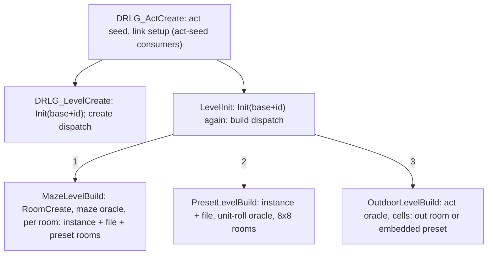

# 0003 — Generator dispatch, room-creation order and the preset file choice

> **Subsystem:** drlg/overview (feeds rng/seeds steps 4–5, drlg/preset, drlg/maze, drlg/outdoor)
> **Question:** For each `DrlgType`, how does a level become DRLG rooms: what does the generator draw from the level seed before, between and after its `DRLG_RoomCreate` calls, in what order are the rooms created, and how is a preset room's DS1 file picked?
> **Date:** 2026-10-12   **Plan:** 0008 (Phase 3)   **Status:** open (dispatch `[C]` by run:2026-10-12-drlg-gen for all three generators, including the owner-played Catacombs entry)

A level is built in two steps. `DRLG_LevelCreate` makes the level record and seeds it. Rooms come
later, from `sub_006424A0_LevelInit`, which **re-seeds** the level and dispatches on `DrlgType` to
the generator's build function. This finding maps both dispatches, the draws each makes on the
level seed, the order of room creation and the preset file index, and names the sub-generators
(maze layout, outdoor act layouts, preset unit rolls) as boundary oracles.

## Answer (summary)

- [C] **Two dispatches on `DrlgType`, and the level seed is initialised twice.** `DRLG_LevelCreate`
  sets `seed = Init(act.levelSeedBase + id)` and calls 1 → `sub_00673B10_MazeLevelCreate` (looks up the
  `lvlmaze` row, sets the position, no draw), 2 → `sub_00667430_PresetLevelCreate` (one draw, below),
  3 → `sub_00675320_OutdoorLevelCreate` (allocates, no draw). Later, `sub_006424A0_LevelInit`
  **re-initialises** the same seed `Init(base + id)` and calls 1 → `sub_00673B30_MazeLevelBuild`,
  2 → `sub_00668100_PresetLevelBuild`, 3 → `sub_00675360_OutdoorLevelBuild`. Every level-seed draw that
  creates rooms comes after this re-seed. So the create-time draw of a preset level is discarded, and the
  room sequence doesn't depend on what ran between creation and init. 149 level creations and 32 level
  builds in the run match (Init values, and seed after every modelled draw).
  (fn:DRLG_LevelCreate@0x00642AE0, fn:sub_006424A0_LevelInit@0x006424A0, run:2026-10-12-drlg-gen)
- [C] **Level-seed draws per generator, in order** (each `DRLG_RoomCreate` is one level draw, rng/seeds
  step 5). There is nothing else on the level seed: the checker asserts the seed at every event and at
  the end of the build (fn:DRLG_RoomCreate@0x0066B3E0, run:2026-10-12-drlg-gen).
  - preset level: `sub_00666ED0_PresetInstanceCreate` (one `Range(Files)` iff `Files ≥ 1`), then
    `sub_00667ED0_PresetRoomsCreate`: the oracle `DRLG_PresetUnitDropRolls` (drlg/preset), then
    one `DRLG_RoomCreate` per 8×8 block of the preset, rows outer, columns inner;
  - outdoor level: the act's outdoor generator (oracle, drlg/outdoor), then `sub_006750F0_OutdoorRoomsCreate`
    over the level's 8×8-cell grid, rows outer. A plain cell makes one `sub_0067D540_OutRoomCreate` (one
    draw). A preset cell makes `PresetInstanceCreate` (one draw iff `Files ≥ 1`), then its index is
    overwritten from the cell, then `PresetRoomsCreate` as above;
  - maze level: one `DRLG_RoomCreate` (the first maze room), the maze generator (oracle, drlg/maze, with
    its own room creations), then for each room of the level's room list, newest first,
    `sub_00673A60_MazeLevelRooms`: `PresetInstanceCreate`, `sub_006738C0_MazePresetFile` (a first-use
    `RangeB` per preset def), and `PresetRoomsCreate` (one room if the maze room is at most 12×12, else the
    8×8 split). After that the maze room is freed.
  (fn:sub_00668100_PresetLevelBuild@0x00668100, fn:sub_00675360_OutdoorLevelBuild@0x00675360,
  fn:sub_00673B30_MazeLevelBuild@0x00673B30, fn:sub_00667ED0_PresetRoomsCreate@0x00667ED0,
  fn:sub_006750F0_OutdoorRoomsCreate@0x006750F0, run:2026-10-12-drlg-gen)
- [C] **Preset file index.** `sub_00666ED0_PresetInstanceCreate` draws `idx = Range(level seed, Files)`
  (`LvlPrest` `+0x40`; `Files ≤ 0` → 0 with no draw; a power of two masks, otherwise unsigned `%`). Then
  the builder may replace it. A preset level uses the level's index, which is the create-time
  `RangeB(seed, Files)` or −1 when `Files = 0`, unless the act's link builder has overwritten it. An
  outdoor cell uses bits 16–19 of the grid cell. A maze room uses the maze cell's index if it is not −1,
  otherwise a per-def rotation (below). The DS1 is `File(idx+1)`. All 960 preset instances of the run
  load exactly the file the model predicts. (fn:sub_00666ED0_PresetInstanceCreate@0x00666ED0,
  fn:sub_00666EC0_PresetSetFile@0x00666EC0, fn:sub_006738C0_MazePresetFile@0x006738C0,
  tbl:LvlPrest.txt:Files, tbl:LvlPrest.txt:File1, run:2026-10-12-drlg-gen)
- [C] **`Files` is the range operand, not the count of named files.** Every `PresetInstanceCreate` of the run
  passed `LvlPrest` `+0x40` and drew `Range(Files)`. An index ≥ `Files` appeared only on an override path:
  the towns (record 1, `Files` 0, indices 0 and 3; record 301, `Files` 0, index 1, both from the link value)
  and outdoor cells (records 4–7, `Files` 3, index 3; records 26–28, `Files` 0, indices 0–3). Those are 9 of
  the 81 records where `Files` and the named count disagree. (run:2026-10-12-drlg-gen, tbl:LvlPrest.txt:Files)
- [I] For the other 72 disagreeing records the code allows only these three overrides: the link value
  (levels 1 and 40, and level 27's act-seed bit), the outdoor cell's bits 16–19, or a maze cell's forced
  index. Which one a record takes depends on the generator that places it (`drlg/outdoor`, `drlg/maze`).
  (fn:sub_006772C0_LevelLinkBuild@0x006772C0, fn:sub_006750F0_OutdoorRoomsCreate@0x006750F0,
  fn:sub_006738C0_MazePresetFile@0x006738C0)
- [C] **Maze file rotation.** For a maze room whose cell index is −1 and whose preset `Def` lies strictly
  between a level-type base and base + 16 (table `MAZE_DEF_BASE` in `tools/drlg.py`, read from the
  `switch` at `0x00673909`), the first use of a `Def` in each LevelInit build of the level draws
  `c = RangeB(level seed, Files)`; a rebuilt level repeats the same draws and indices.
  Every use, the first included, sets `c = (c + 1) % Files` (signed `idiv`) and takes `c` as the index.
  (fn:sub_006738C0_MazePresetFile@0x006738C0, run:2026-10-12-drlg-gen: 16 first uses and 18 rotations in the
  scripted entries, 42 first uses and 73 rotations in the owner's Catacombs entry)
- [I] The counters are a linked list at level `+0x1CC` (0x10-byte nodes `{Def, Files, c, next}`, prepended by
  `sub_006738C0_MazePresetFile` at `0x006739DA`). `sub_00642010_LevelUnload` frees the list and zeroes `+0x1CC`
  (`0x00642159`–`0x0064217F`), along with the level's rooms (`sub_0066C100_RoomFree`), so every build starts
  without counters. (fn:sub_00642010_LevelUnload@0x00642010, fn:sub_006738C0_MazePresetFile@0x006738C0)
- [C] **Re-initialising a level rebuilds the identical room sequence.** When the player leaves a level and comes
  back, the game unloads it and runs `LevelInit` again on the same level object. The re-seed `Init(base + id)`
  then gives the same draws, files and rooms. In the owner's Catacombs entry, levels 35 and 36 were built three
  times each and level 34 twice, and every rebuild matched the model. (fn:sub_006424A0_LevelInit@0x006424A0,
  run:2026-10-12-drlg-gen)
- [I] **No `Expansion` gate on the pick.** `sub_0061F0E0_LvlPrestByLevel` returns the first `LvlPrest`
  record whose `LevelId` is the level's id, `sub_0061F0B0_LvlPrestByDef` indexes by `Def`, and neither tests
  `Expansion` (`+0x20`). That column gates only the start-up DS1 preload (drlg/0001).
  (fn:sub_0061F0E0_LvlPrestByLevel@0x0061F0E0, fn:sub_0061F0B0_LvlPrestByDef@0x0061F0B0, tbl:LvlPrest.txt:Expansion)
- [C] **Outdoor room creation also rolls `LvlSub` picks on the new room's seed.**
  `sub_006706A0_LvlSubRoll` (drlg/0002) draws `step(room.seed).lo % 100 < Prob[SubTheme]` once per
  `SubType` record, right after the room's own creation draws. 466 rolls reproduced (mask and room seed).
  (fn:sub_006706A0_LvlSubRoll@0x006706A0, run:2026-10-12-drlg-gen)
- [I] **Act-seed consumers sit before any level build.** `DRLG_ActCreate` runs the per-act link setup
  (`sub_00678AD0_ActLinkInit` → one of five act functions → `sub_006772C0_LevelLinkBuild` and the
  `LinkPick` callbacks, rng/seeds step 3d), which creates the linked levels and writes the preset index of
  level 1 and level 40 (the town orientation) and of level 27 (an act-seed draw while it builds level 6). Then
  it LevelInits the act's town. (fn:DRLG_ActCreate@0x00642DA0, fn:sub_00678AD0_ActLinkInit@0x00678AD0,
  fn:sub_006772C0_LevelLinkBuild@0x006772C0)

## Leads used

None. No community source covers these functions; the names are ours.

## Functions

| Address | Name | Role | Tag |
|---|---|---|---|
| `0x00642AE0` | `DRLG_LevelCreate` | level record, `Init(base + id)`, create-time dispatch | C |
| `0x006424A0` | `sub_006424A0_LevelInit` | re-seed `Init(base + id)`, build dispatch, two post passes (no draw) | C |
| `0x00667430` | `sub_00667430_PresetLevelCreate` | `RangeB(level seed, Files)` iff `Files ≠ 0`, else −1, into level data `+0x04` | C |
| `0x00673B10` | `sub_00673B10_MazeLevelCreate` | `lvlmaze` row by level id into level `+0x14`, position (no draw) | I |
| `0x00675320` | `sub_00675320_OutdoorLevelCreate` | allocates the 0x268-byte outdoor record (no draw) | I |
| `0x00668100` | `sub_00668100_PresetLevelBuild` | preset level: instance, index, rooms; town callback; linked levels | C |
| `0x00675360` | `sub_00675360_OutdoorLevelBuild` | outdoor level: 8-cell grid, act generator (oracle), `OutdoorRoomsCreate` | C |
| `0x00673B30` | `sub_00673B30_MazeLevelBuild` | maze level: first room, generator (oracle), preset conversion | C |
| `0x00673A60` | `sub_00673A60_MazeLevelRooms` | one maze room → preset instance, file, preset room(s); frees the maze room | C |
| `0x006738C0` | `sub_006738C0_MazePresetFile` | maze preset index: cell value or per-def rotation | C |
| `0x00666ED0` | `sub_00666ED0_PresetInstanceCreate` | 0x58-byte preset instance: def, `Range(Files)` index, rect, size | C |
| `0x00666EC0` | `sub_00666EC0_PresetSetFile` | instance `+0x04` = EDX | I |
| `0x00667ED0` | `sub_00667ED0_PresetRoomsCreate` | map scan, then one room or the 8×8 split | C |
| `0x00666680` | `sub_00666680_PresetRoomCreate` | one 8×8 (or smaller) preset room | C |
| `0x006750F0` | `sub_006750F0_OutdoorRoomsCreate` | cells rows-then-columns: out room, embedded preset, or nothing | C |
| `0x0066B970` | `sub_0066B970_LevelRoomLink` | prepend room to level `+0x10` (next `+0x24`), count `+0x08` | C |
| `0x0066C100` | `sub_0066C100_RoomFree` | frees a DRLG room | I |
| `0x0061F0E0` | `sub_0061F0E0_LvlPrestByLevel` | first `LvlPrest` record with `LevelId` = id | I |
| `0x0061F0B0` | `sub_0061F0B0_LvlPrestByDef` | `LvlPrest` record by `Def` (bounds-checked) | I |
| `0x0061F490` | `sub_0061F490_LvlMazeByLevel` | `lvlmaze` row with `Level` = id, fatal if none | I |
| `0x006807F0` | `sub_006807F0_OutdoorAct1` | Act I outdoor layout (oracle, drlg/outdoor) | I |
| `0x0067F980` | `sub_0067F980_OutdoorAct2` | Act II outdoor layout (oracle) | I |
| `0x0067F450` | `sub_0067F450_OutdoorAct3` | Act III outdoor layout (oracle) | I |
| `0x0067E890` | `sub_0067E890_OutdoorAct4` | Act IV outdoor layout (oracle) | I |
| `0x0067E600` | `sub_0067E600_OutdoorAct5` | Act V outdoor layout (oracle) | I |
| `0x00677750` | `sub_00677750_ActLinkAct1` | Act I link setup (act-seed consumer) | I |
| `0x00677790` | `sub_00677790_ActLinkAct2` | Act II link setup | I |
| `0x006789B0` | `sub_006789B0_ActLinkAct3` | Act III link setup | I |
| `0x00678A20` | `sub_00678A20_ActLinkAct4` | Act IV link setup | I |
| `0x00678A70` | `sub_00678A70_ActLinkAct5` | Act V link setup | I |

## Walkthrough

### Level creation and the re-seed

```c
// fn:DRLG_LevelCreate@0x00642AE0 (trimmed). ECX = act, EDX = level id
L = alloc(0x230); L.act = act; L.id = id; L.ltype = leveldefs[id].LevelType; L.drlg = leveldefs[id].DrlgType
Init(&L.seed /*+0x1C4*/, act.levelSeedBase /*+0x470*/ + id)
switch (L.drlg) { 1: MazeLevelCreate(L); 2: PresetLevelCreate(L); 3: OutdoorLevelCreate(L) }
L.next = act.levels; act.levels = L

// fn:sub_006424A0_LevelInit@0x006424A0. arg = level
Init(&L.seed, act.levelSeedBase + L.id)                    // again: the same start value
switch (L.drlg) { 1: MazeLevelBuild(L); 2: PresetLevelBuild(L); 3: OutdoorLevelBuild(L) }
0x00642390(L); 0x006423D0(L)                               // room flags and a position list, no draw
```

- [C] Both seeds are `Init(base + id)` (`u32` add): 149 creations and 32 builds, server and client
  copies. (fn:DRLG_LevelCreate@0x00642AE0, fn:sub_006424A0_LevelInit@0x006424A0, run:2026-10-12-drlg-gen)
- [I] Callers of `LevelInit`: `DRLG_ActCreate` (the act's town, after the link setup),
  `sub_00642C30_RoomFromCoords`, `sub_00668100_PresetLevelBuild` (the linked levels of a preset level, when the
  act's `+0x454` callback is set), `0x0066B030`, `0x0066B2B0` and `0x0066C220`. A level is built at most
  once; the build is lazy. (fn:DRLG_ActCreate@0x00642DA0, fn:sub_00642C30_RoomFromCoords@0x00642C30)

### Preset levels (`DrlgType` 2)

```c
// fn:sub_00667430_PresetLevelCreate@0x00667430
P = LvlPrestByLevel(L.id)                                  // fatal if none
L.data = {0, 0};  L.data.idx = P.Files ? RangeB(&L.seed, P.Files) : -1
LevelSetPosition(L)

// fn:sub_00668100_PresetLevelBuild@0x00668100
ps = PresetInstanceCreate(L, def = LvlPrestByLevel(L.id).Def, rect = L.rect /*+0x1C*/, &L.seed)
if (L.data.idx == -1) L.data.idx = ps.idx; else ps.idx = L.data.idx
PresetRoomsCreate(L, ps, flags 0, single 0)
if (L.id in {40, 103, 109}) act[+0x488](...)                // town callback, no level draw in the run
else if (act[+0x454] && ps.rec.AutoMap /*+0x30*/) { LevelInit each linked level not yet built; activate this level's rooms }

// fn:sub_00666ED0_PresetInstanceCreate@0x00666ED0. ECX = level, EDX = Def, args rect, seed
ps = alloc(0x58); ps.def = Def; ps.rec = LvlPrestByDef(Def)
n = ps.rec.Files; ps.idx = (n < 1) ? 0 : step(seed), (n & (n-1)) == 0 ? lo & (n-1) : lo % n
ps.x, ps.y = rect.x, rect.y; ps.w, ps.h = (rec.SizeX && rec.SizeY) ? (SizeX, SizeY) : (rect.w, rect.h)
ps[+0x3C] = 1; prepend ps to L[+0x1B0]
```

- [C] At build time the level's index wins unless it is −1. Because the create-time `RangeB` and the
  build-time `Range` start from the same seed, they agree for every level whose index nothing
  overwrote. In the run, levels 1 (6 builds) and 40 (2 builds) had an index changed between creation and
  build, which is the link setup's write. (fn:sub_00668100_PresetLevelBuild@0x00668100,
  fn:sub_006772C0_LevelLinkBuild@0x006772C0, run:2026-10-12-drlg-gen)
- [C] `PresetRoomsCreate` with `single = 0` walks the preset rect in 8-cell steps, rows outer, and makes one
  room of `min(8, rest)` × `min(8, rest)` per block through `sub_00666680_PresetRoomCreate`, so the Act I
  town (56 × 40) makes 35 rooms, Den of Evil's 24 × 24 presets 9 each. Every split in the run is in that
  order. (fn:sub_00667ED0_PresetRoomsCreate@0x00667ED0, fn:sub_00666680_PresetRoomCreate@0x00666680)
- [I] Before the rooms, `DRLG_PresetMapScan` returns at once when `Scan` (`+0x34`) and `Pops`
  (`+0x38`) are both 0. Otherwise it loads the DS1 (`File(idx+1)`, `DS1_LoadCached` into `ps[+0x0C]`) and
  calls `DRLG_PresetUnitDropRolls` **on the level seed**. That is the second caller of drlg/0002's
  pre-window rolls: at build time they step the level seed, not a room seed. They are logged as an oracle
  (52 calls, 2 of which drew, both in Act II). Once the DS1 is loaded here, the activation-time load
  (`DRLG_PresetRoomLoadDs1`) skips its own rolls. (fn:DRLG_PresetMapScan@0x00667970,
  fn:DRLG_PresetUnitDropRolls@0x00667620, fn:DRLG_PresetRoomLoadDs1@0x00667890)

### Outdoor levels (`DrlgType` 3)

```c
// fn:sub_00675360_OutdoorLevelBuild@0x00675360. O = L.data (0x268 bytes)
O.cw = L.w / 8; O.ch = L.h / 8 (signed, toward zero); 4 cell grids of cw × ch
0x0067D050(...); 0x00675080(...)                           // ┐ oracle window (drlg/outdoor):
switch (L.id == 134 ? 1 : act index) { 0: OutdoorAct1  1: OutdoorAct2  2: OutdoorAct3  3: OutdoorAct4  4: OutdoorAct5 }  // ┘ OD0 .. OD1
OutdoorRoomsCreate(L)

// fn:sub_006750F0_OutdoorRoomsCreate@0x006750F0
mask = {2: 0x44103, 16/22/27/28: 0x1, 21: 0x4, 30/31: 0x11}[L.ltype] or 0          // the DT1 mask, drlg/0002
for cy in 0 .. O.ch-1: for cx in 0 .. O.cw-1:                                      // rows outer
  c = cell(cx, cy)
  if (c & 0x200):  if (def = grid2(cx, cy)):                                       // preset anchor cell
      ps = PresetInstanceCreate(L, def, {x, y, 0, 0}, &L.seed)                     // Range(Files) iff Files ≥ 1
      PresetSetFile(ps, (c >> 16) & 0xF)                                           // the draw is overwritten
      PresetRoomsCreate(L, ps, flags = grid0(cx, cy), single 0)
  else if (!(c & 0x100)):  OutRoomCreate(L, x, y, 8, 8, grid0, c, grid3, mask)    // one level draw (+ LvlSubRoll)
  // c & 0x100 without 0x200: covered by a preset, nothing
```

- [C] The seed into the act generator is the re-seeded level seed. The generator's draws are an oracle
  (OD0 → OD1: 16 builds, Act I levels 2 and 3, Act II 41, Act IV 104). From `OutdoorRoomsCreate` on, every
  level draw is modelled, and the out rooms are created rows-then-columns. (fn:sub_00675360_OutdoorLevelBuild@0x00675360,
  fn:sub_006750F0_OutdoorRoomsCreate@0x006750F0, run:2026-10-12-drlg-gen)
- [C] Embedded presets: 914 `PresetInstanceCreate` calls from outdoor cells, 830 with a draw (`Files ≥ 1`) and
  84 without. Every one is followed by `PresetSetFile` with the cell's bits 16–19, and the instance loads
  that file. The cell value is the outdoor generator's output, so it is an input here. (fn:sub_00666EC0_PresetSetFile@0x00666EC0)
- [I] The outdoor build switches on the act index, except level 134 (`0x86`), which takes the Act II
  layout. (fn:sub_00675360_OutdoorLevelBuild@0x00675360)
- [I] **Cell position** (static, 2026-10-12, backlog spec-writer → reverser (c)). `OutdoorRoomsCreate` keeps
  `x = L.rect.x + 8·cx` and `y = L.rect.y + 8·cy` (`L+0x1C`/`L+0x20` loaded at the row and column starts, `+8` per
  step at 0x0067522A and 0x0067523F), with `cx` the inner (column) and `cy` the outer (row) index. Both callees get
  that position: `OutRoomCreate(L, x /*EDX*/, y, 8, 8, grid0(cx,cy), c, grid3(cx,cy), mask)` (0x006751FA–0x00675222),
  and an embedded preset gets the rect `{x, y, 0, 0}` (`[ebp−0x2C]..[ebp−0x20]`, 0x006751A8–0x006751C9) passed to
  `PresetInstanceCreate`. The grids are read through `0x0067C570(grid, cx, cy)` at `O+0x2C` (cell value `c`),
  `O+0x18` (grid0: the OutRoom argument and the preset's `flags`), `O+0x04` (grid2: the preset `def`) and `O+0x40`
  (grid3). Size and position of an embedded preset's rooms then come from the preset (`drlg/preset`).
  (fn:sub_006750F0_OutdoorRoomsCreate@0x006750F0)
- [I] **`LvlSubRoll` with no SubType or SubTheme** (backlog spec-writer → reverser (b)). `sub_006706A0_LvlSubRoll`
  (`ECX` room, `EDX` `SubType`, stack `SubTheme`) returns 0 at once, **with no draw**, when either is −1
  (0x006706A9, 0x006706B8). Otherwise it takes the `LvlSub` record that the per-type index at `0x0096CA18` names (`0x0061FA90`:
  `g_pLvlSub + idx[type]·0x15C`, fatal for a negative type or a missing table) and walks
  consecutive records while `Type` matches (stride 0x15C), one draw each: `step(room +0x14)`, `lo % 100`
  (`mul 0x51EB851F; shr 5`, unsigned), compared signed with `Prob[SubTheme]` (`+0x11C + 4·theme`, `jge` skip);
  a hit sets bit *i* (the record's index within its type group) of the returned mask and ORs its `Dt1Mask`
  (`+0x48`) into room `+0x50`. If the first record's `Type` does not match, the result is 0 with no draw. The
  theme index is not bounds-checked. (fn:sub_006706A0_LvlSubRoll@0x006706A0)

### Maze levels (`DrlgType` 1)

```c
// fn:sub_00673B30_MazeLevelBuild@0x00673B30
R0 = DRLG_RoomCreate(L, 2); R0.size = lvlmaze.SizeX/Y; centred in L.rect; LevelRoomLink(L, R0)
// ┐ oracle window (drlg/maze), MZ0 .. MZ1: per level type a chain of maze functions (0x00670F60,
// │ 0x00671210, 0x006714D0, …, 0x00672550 …), level-specific branches (61, 92, 114, 116, 119;
// │ level 114 draws RNG_Range(&L.seed, 2)), then 0x00642590 / 0x00673120 (level 28) / 0x00673320 (level 107), then 0x006735F0
// ┘ These create and remove maze rooms and draw on the level seed.
for M in L.rooms (list order: newest first; M.next saved before the call): MazeLevelRooms(L, M)

// fn:sub_00673A60_MazeLevelRooms@0x00673A60. M = a maze room (type 2, M[+0x20] = {Def, idx, ...})
ps = PresetInstanceCreate(L, M.def, M.rect, &L.seed)        // Range(Files) iff Files ≥ 1
MazePresetFile(ps, forced = M.idx, L)
PresetRoomsCreate(L, ps, flags 0, single = (M.w <= 12 && M.h <= 12))
for each unit node of M with [+0x0C] == 1: 0x0066B5E0(...)  // no draw
RoomFree(M)                                                  // the level keeps only the preset rooms

// fn:sub_006738C0_MazePresetFile@0x006738C0. EAX = forced, EDI = level, arg ps
if (forced != -1) { ps.idx = forced; return }
base = {3: 0x34, 4: 0x6C, 7: 0xA7, 8: 0xCD, 10: 0x101, 13: 0x12D, 17: 0x19D, 18: 0x1E1, 22: 0x2F1, 24: 0x298,
        25: 0x2C0, 28: 0x344, 33: 0x3EA, 34: 0x422, 35: 0x41C}[L.ltype]   // other types: keep ps.idx
if (base < def < base + 16):
  r = L.rotations[def] or (L.rotations[def] = {n: Files, c: RangeB(&L.seed, Files)})   // first use per build: one draw
  r.c = (r.c + 1) % r.n;  ps.idx = r.c                                    // signed idiv
```

- [C] Den of Evil (level 8, 2 builds) and Act II's Sewers Level 1 (level 47, 2 builds): the seed into the
  maze window is the seed after the first room's draw. After the window, `MazeLevelRooms` visits the room list
  as `MZ1` dumps it, in that order. It makes 3 preset instances per Den build and 14 per Sewers build (34 in all), every index as
  modelled (4 forced, 12 kept from the instance draw, 18 rotated with 16 first-use draws), and the level ends
  with the preset rooms only (the maze rooms are freed). (fn:sub_00673A60_MazeLevelRooms@0x00673A60,
  fn:sub_006738C0_MazePresetFile@0x006738C0, fn:sub_0066C100_RoomFree@0x0066C100, run:2026-10-12-drlg-gen)
- [I] The maze generator's room count, positions and order are its own (Sewers 1: 16 rooms created
  inside the window, 14 left in the list at a different place). The order of the preset conversion is
  therefore stated relative to the list the oracle leaves. (fn:sub_00673B30_MazeLevelBuild@0x00673B30)

### The rooms each `DRLG_RoomCreate` makes

- [C] Every room the run logs carries `+0x04 = step(Init(level.lo)).lo` for the level seed after its
  draw. That is rng/seeds step 5, now checked for the 1858 room creations outside the oracle windows, across all three generators.
  (fn:DRLG_RoomCreate@0x0066B3E0, fn:sub_0066B970_LevelRoomLink@0x0066B970)

### Completeness of the RNG picture

```bash
tools/ghidra.sh rngcallgraph re/rngclass/drlg-gen.txt 0x006424A0 0x00642AE0
# → summary: functions=889 rng=56 unclassified=0 indirect=78
```

- [I] Under the two dispatch roots, 56 functions draw. 7 are modelled level-seed or room-seed draws
  (LevelInit, LevelCreate, PresetLevelCreate, PresetInstanceCreate, RoomCreate, MazePresetFile, LvlSubRoll).
  One is the preset-unit oracle. 24 are inside the maze window and 17 inside the outdoor window. 7 are the
  room activation path of drlg/0002, reached through `PresetLevelBuild`. The 78 indirect calls include the
  act callbacks `+0x454`/`+0x488`. The run covers them: the level seed after every build equals the model,
  so nothing unmodelled steps it outside the oracle windows. (fn:sub_006424A0_LevelInit@0x006424A0)

### Act-seed consumers (entry points only)

- [I] `DRLG_ActCreate`: act seed init and draws (rng/seeds 3a–3c), then `0x00641F60` (the town DT1, drlg/0001),
  `0x0061B7E0`, and `sub_00678AD0_ActLinkInit`. That function switches on the act index to
  `sub_00677750_ActLinkAct1` … `sub_00678A70_ActLinkAct5`, which run `sub_006772C0_LevelLinkBuild` with the
  `LinkPick` callbacks on a copy of the act seed. Then, if the town id is non-zero, `DRLG_ActCreate` gets or creates the town level and calls
  `LevelInit` on it. `LevelLinkBuild` creates each linked level (`sub_00642BB0_LevelEnsure`), writes its
  position, and for preset levels 1 and 40 writes the link value into the level's file index. While it
  handles level 6, it writes level 27's index from one draw on the act seed (rng/seeds step note 3). Their
  internals belong to `drlg/warps` and rng/seeds. (fn:DRLG_ActCreate@0x00642DA0,
  fn:sub_00678AD0_ActLinkInit@0x00678AD0, fn:sub_006772C0_LevelLinkBuild@0x006772C0,
  fn:sub_00677750_ActLinkAct1@0x00677750, fn:sub_00677790_ActLinkAct2@0x00677790,
  fn:sub_006789B0_ActLinkAct3@0x006789B0, fn:sub_00678A20_ActLinkAct4@0x00678A20,
  fn:sub_00678A70_ActLinkAct5@0x00678A70)



## Data touched

- tbl:LvlPrest.txt:Files (`+0x40`, range operand), tbl:LvlPrest.txt:File1 (`+0x44 + 0x3C·idx`),
  tbl:LvlPrest.txt:LevelId (`+0x04`, `LvlPrestByLevel`), tbl:LvlPrest.txt:Def (`+0x00`),
  tbl:LvlPrest.txt:SizeX / tbl:LvlPrest.txt:SizeY (`+0x28`/`+0x2C`, instance size when both non-zero),
  tbl:LvlPrest.txt:Scan / tbl:LvlPrest.txt:Pops (`+0x34`/`+0x38`, map-scan gate), tbl:LvlPrest.txt:Dt1Mask.
- tbl:Levels.txt:DrlgType (leveldefs `+0x30`), tbl:Levels.txt:LevelType (`+0x34`), act `+0x470` (level seed base).
- tbl:LvlMaze.txt:Level (`sub_0061F490_LvlMazeByLevel`), `SizeX`/`SizeY` at `+0x10`/`+0x14` of the row (first maze room size).
- tbl:LvlSub.txt:Prob0 (`sub_006706A0_LvlSubRoll`).

## Dead ends

- The preset level's create-time draw looked like the file pick. It is, but the build re-seeds and draws
  again on the same start value, and the create-time result only matters when the link setup has not
  replaced it.
- Counting the maze level's rooms by `MZ1` list length: the generator also creates rooms it later
  removes, so the room count check uses the rooms `PresetRoomsCreate` made.

## Open questions

- ~~**Waypoint maze run (Done-when).**~~ Done 2026-10-12 by the owner (run:2026-10-12-drlg-gen, owner-run
  addendum): Catacombs Levels 2–4, 0 mismatches.
- The maze generator (window `MZ0`–`MZ1`), the outdoor act generators (`OD0`–`OD1`, with `0x0067D050`
  and `0x00675080`) and `DRLG_PresetUnitDropRolls` stay oracles. Owners: `drlg/maze`, `drlg/outdoor`, `drlg/preset`.
- ~~Which code fills the outdoor cell's bits 16–19 (preset file) and the maze cell's forced index:
  `drlg/outdoor`, `drlg/maze`.~~ Read 2026-10-14: the maze index in [drlg/0006](0006-maze.md), the outdoor bits in
  [drlg/0008 § 5](0008-outdoor.md#5-placement) (`OutPresetPlace` and the seam opening).
- ~~`0x00642390` and `0x006423D0` (after every build) set room flags and a list of positions. They make no
  draw; their meaning goes to `drlg/warps`.~~ Read 2026-10-14 ([drlg/0007](0007-warps.md)): `0x00642390` restores a saved
  room bit, and `0x006423D0` builds the warp point list. The maze window itself is read in [drlg/0006](0006-maze.md).
- Level 27's index from the level-6 act-seed draw was not exercised by a build of level 27 in the run.
