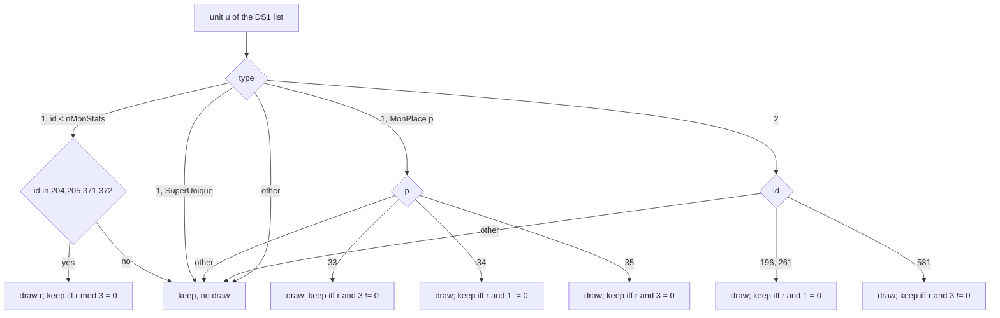

# 0004 — Preset units: the DS1 unit list, the keep/drop rolls and the LvlPrest columns

> **Subsystem:** drlg/preset
> **Question:** Which preset units does a DS1 put into a room (after the act rewrites and the keep/drop rolls), and what does each `LvlPrest` column still `[L]` do?
> **Date:** 2026-10-13   **Plan:** 0016   **Status:** answered (Phase 1; Phase 2 corroborates)

## Answer (summary)

- [I] **Keep/drop rolls.** `sub_00667620_PresetUnitDropRolls` copies the DS1's unit list into the preset instance
  (`+0x38`). It walks the list from its head, which is reverse file order. Ten ids draw once each, on the seed its
  caller passes (fn:sub_00667620_PresetUnitDropRolls@0x00667620):
  - MonStats 204/205 (`act2vendor1/2`) and 371/372 (`lightningspire`, `firetower`): kept when `r % 3 == 0`.
  - MonPlace 33 (`place_group25`): kept when `r & 3 ≠ 0`.
  - MonPlace 34 (`place_group50`): kept when `r & 1 ≠ 0`.
  - MonPlace 35 (`place_group75`): kept when `r & 3 == 0`.
  - Objects 196 and 261 (floor traps): kept when `r & 1 == 0`.
  - Object 581 (above the objects table): kept when `r & 3 ≠ 0`.

  `r` is the low dword after one `RNG_Next` step. Every other unit is kept with no draw. A kept unit is a copy whose
  `x`/`y` (and path points) are offset by the instance origin ×5. (fn:sub_00667620_PresetUnitDropRolls@0x00667620,
  fn:sub_00667510_PresetUnitCopy@0x00667510)
- [I] **Two callers, one roll per instance.** `sub_00667970_PresetMapScan` rolls on the **level seed** (`level +0x1C4`) at room creation,
  but only for records with `Scan` or `Pops` non-zero. Otherwise `sub_00667890_PresetRoomLoadDs1` rolls on the
  **room seed** (`room +0x14`) of the first room of the instance that loads its DS1. Both load the DS1 into instance
  `+0x0C`, and `PresetRoomLoadDs1` rolls only while that slot is empty, so each instance rolls once. The "third
  caller `0x0061B210+0x133`" is `0x0061B343` inside `sub_0061B320_RoomPrepareFiles`, not a separate caller.
  (fn:sub_00667970_PresetMapScan@0x00667970, fn:sub_00667890_PresetRoomLoadDs1@0x00667890, 0x0061B343)
- [I] **Act rewrites in `DS1_Parse`.** These apply after the MonPreset mapping and turn the unit into an object
  (type 2, mode 0) (fn:DS1_Parse@0x00665950, 0x00665CB2):
  - act index 2: MonStats 297 (`natalya`) becomes object 382, and 366 (`compellingorb`) becomes object 404;
  - act index 4: 514 (`nihlathak`) becomes object 461, and 537..539 (`ancientstatue1..3`) become `1013 − id`.

  `0x004E6C50` is only a MonStats range check (`id` if `0 ≤ id < nMonStats`, else −1).
  (fn:DS1_Parse@0x00665950, 0x00665CB2, fn:MONSTATS_ValidId@0x004E6C50)
- [I] **Into the room.** `sub_00666710_PresetUnitsToRoom` moves each instance unit whose subtile position lies in the
  room's rectangle (×5) to the room list (`room +0x5C`), re-expressed relative to the room origin. Two kinds of
  instance unit are added outside the DS1, both by `PresetRoomLoadDs1` once per instance
  (fn:sub_00666710_PresetUnitsToRoom@0x00666710, fn:sub_00667890_PresetRoomLoadDs1@0x00667890):
  - the Blood Moor centre monster: MonStats 266 `navi` at the instance centre, for `Def` 4–7 in level 2 with file
    index 3;
  - client-only river objects 40/41/42/65, which carry `flags` bit 0. (fn:sub_006664A0_PresetCentreMonster@0x006664A0,
    fn:sub_006663C0_PresetClientObjects@0x006663C0)
- [I] **Server handover.** `sub_005559A0_RoomPresetUnits` skips every unit with `flags` (`+0x1C`) bit 0. For the rest,
  `sub_005557D0_PresetUnitDispatch` routes by type and id (fn:sub_005559A0_RoomPresetUnits@0x005559A0):
  - type 1 goes to `sub_0054E600_PresetMonSpawn` (monsters/spawn);
  - type 2 with id > 573 goes to `0x0054F490`;
  - type 2 with id 573 is nothing;
  - every other unit goes to `sub_00555230_SUnitCreate`.

  So DS1 `flags = 1` (the `worldstoneeffect` unit) and the client river objects never spawn on the server.
  (fn:sub_005557D0_PresetUnitDispatch@0x005557D0, fn:sub_005559A0_RoomPresetUnits@0x005559A0)
- [I] **LvlPrest columns** (fn:sub_00666AC0_PresetRoomTilesBuild@0x00666AC0, fn:sub_00667970_PresetMapScan@0x00667970;
  readers in § LvlPrest columns):
  - `Populate` = 0 sets room flag `0x800000`, which means no population level.
  - `Logicals` selects the room's spawn boxes: 0 gives one box covering the room, 1 gives boxes built from the DS1.
  - `Outdoors` ORs `0x80000` into the room flags.
  - `Animate` adds animated-tile frame lists, and `+0x024` is their period (0 means 80).
  - `KillEdge` and `FillBlanks` are as in drlg/0002.
  - `AutoMap` gates the act callbacks, which are null on the server and the automap on the client.
  - `Scan` and `Pops` gate the map scan. `Pops` is the capacity of the roof-pop tables, which only the client
    uses.
  - `PopPad` has no reader.

  None of these columns draws. (§ LvlPrest columns)
- [I] **Type-2 rooms never read DS1 substitution data.** No code reads a preset instance's DS1 substitution layer or
  groups (`+0x48`/`+0x4C`/`+0x50`). The only group reader, `sub_006704E0_LvlSubLoadDs1`, reads the DS1 a `LvlSub`
  record names. The 429 groups in `LvlPrest` DS1s are dead data. (fn:sub_006704E0_LvlSubLoadDs1@0x006704E0)
- [I] **Level 27's preset index** is written while `sub_006772C0_LevelLinkBuild` handles level 6, from level 6's link
  value `v` and a draw `r` on the act seed (0x006774F9):
  - `v = 1`: index `2 − (r & 1)`;
  - `v = 3`: index `(~r) & 1`;
  - any other `v`: no draw and no write. (0x006774F9)
- [C] The draw count of the map-scan caller reproduces the exit seed of all 91 logged calls (run:2026-10-12-drlg-gen
  plus the owner-played catacombs log, scratch model, support only). Two calls draw (`act2/town/lutw.ds1`,
  `act2vendor1/2`, two draws each). Keep/drop outcomes were not logged. (fn:sub_00667620_PresetUnitDropRolls@0x00667620,
  run:2026-10-12-drlg-gen)

## Leads used

None. No community source was read in this phase. The Phase 1b cross-check is still to do.

## Functions

| Address | Name | Role | Tag |
|---|---|---|---|
| `0x00667620` | `sub_00667620_PresetUnitDropRolls` | copy the DS1 units into the instance list with the keep/drop draws | I |
| `0x00667510` | `sub_00667510_PresetUnitCopy` | allocate a unit copy offset by the instance origin (path copied too) | I |
| `0x006660B0` | `sub_006660B0_PresetPathCopy` | copy a path (count, 12-byte points) | I |
| `0x00643560` | `sub_00643560_TileToSubtile` | `x *= 5; y *= 5` | I |
| `0x00667890` | `sub_00667890_PresetRoomLoadDs1` | load the DS1 and roll on the room seed (once per instance), centre monster, client objects | I |
| `0x00667970` | `sub_00667970_PresetMapScan` | `Scan`/`Pops` gate; load the DS1 and roll on the level seed; scan the wall cells | I |
| `0x00666E00` | `sub_00666E00_PresetPopsFinish` | pop rectangles to absolute tiles, pop index `style/4 − 1` | I |
| `0x00666710` | `sub_00666710_PresetUnitsToRoom` | move the units in the room rectangle to `room +0x5C` | I |
| `0x006664A0` | `sub_006664A0_PresetCentreMonster` | add MonStats 266 at the instance centre | I |
| `0x006663C0` | `sub_006663C0_PresetClientObjects` | client river objects (flag bit 0) | I |
| `0x006661A0`, `0x00666220` | `sub_006661A0_PresetClientUnitsA`, `sub_00666220_PresetClientUnitsB` | object 65 every 8 tiles down a column / objects 40, 41, 41, 41, 42 in a row, per DS1 row | I |
| `0x0066BF30` | `sub_0066BF30_PresetUnitCreate` | allocate one unit, prepend to `ECX+0x5C` when `ECX` is set | I |
| `0x004E6C50` | `MONSTATS_ValidId` | `id` if `0 ≤ id < nMonStats`, else −1 | I |
| `0x005557D0` | `sub_005557D0_PresetUnitDispatch` | server: route one preset unit by type and id | I |
| `0x0066D110` | `sub_0066D110_SpawnBoxesFromDs1` | spawn boxes from the DS1 layers (`Logicals` = 1) | I |
| `0x0066D290` | `sub_0066D290_AnimTilesCount` | count the animated-tile entries of a grid (`Animate`) | I |
| `0x0066D700` | `sub_0066D700_AnimTilesBuildAll` | `AnimTilesBuild` for floors, walls and roofs with the `+0x024` period | I |
| `0x006671E0` | `sub_006671E0_PresetPopsUpdate` | client roof pops (tick-count timers) | I |
| `0x00459150`, `0x004591A0` | `sub_00459150_ClientActRoomCb`, `sub_004591A0_ClientTownCb` | client act callbacks `+0x454` / `+0x488` | I |

## Walkthrough

### Where the unit list comes from

`DS1_Parse` builds the DS1's unit list (drlg/0001 § Object entries), prepending each unit, so the head is the last
entry in the file. The act rewrites sit between the MonPreset mapping and `PresetUnitCreate`:

```c
// fn:DS1_Parse@0x00665950, 0x00665CB2 (disassembly, renamed); act = header act clamped to ≤ 4; id after MonPreset
if (act == 2 && id < nMonStats) {
  if      (id == MONSTATS_ValidId(297)) { id = 382; type = 2; mode = 0; }   // natalya       -> object 382
  else if (id == MONSTATS_ValidId(366)) { id = 404; type = 2; mode = 0; }   // compellingorb -> object 404
} else if (act == 4 && 0 <= id && id < nMonStats) {
  if      (id == 514)              { id = 461;        type = 2; mode = 0; } // nihlathak
  else if (536 < id && id <= 539)  { id = 1013 - id;  type = 2; mode = 0; } // ancientstatue1..3 -> 476..474
}
```

- [I] The comparison uses the id **after** the MonPreset mapping, and only MonStats-range ids can match.
  (0x00665CB2–0x00665D3E, fn:MONSTATS_ValidId@0x004E6C50)

### The keep/drop rolls

```c
// fn:sub_00667620_PresetUnitDropRolls@0x00667620 (disassembly-checked; stack arg = seed, EDX = instance)
ox = inst.x * 5;  oy = inst.y * 5;                       // +0x10, +0x14 (tiles) -> subtiles
for (u = inst.ds1.units; u; u = u.next) {                // +0x0C -> +0x54; reverse file order
  if (u.type == 1) {
    if (u.id < nMonStats) {
      if (u.id in {204, 205, 371, 372}) { r = RNG_Next(seed); if (r % 3 != 0) continue; }
    } else if (u.id - nMonStats >= nSuperUniques) {      // MonPlace range
      p = u.id - nMonStats - nSuperUniques;
      if (p == 33) { r = RNG_Next(seed); if ((r & 3) == 0) continue; }
      if (p == 34) { r = RNG_Next(seed); if ((r & 1) == 0) continue; }
      if (p == 35) { r = RNG_Next(seed); if ((r & 3) != 0) continue; }
    }                                                    // SuperUniques: no draw
  } else if (u.type == 2) {
    if (u.id == 196 || u.id == 261) { r = RNG_Next(seed); if ((r & 1) != 0) continue; }
    if (u.id == 581)                { r = RNG_Next(seed); if ((r & 3) == 0) continue; }
  }
  c = PresetUnitCopy(u, ox, oy);  c.next = inst.units;  inst.units = c;   // +0x38, prepend
}
```

- [I] `RNG_Next` here is the inlined step `seed = lo·0x6AC690C5 + hi` (64-bit), and `r` is the new low dword. `% 3` is
  unsigned (`mul 0xAAAAAAAB`, `shr 1`). (0x00667721–0x00667748)
- [I] The copy keeps `mode`, `id`, `type`, `flags` and the path, adding `ox`/`oy` to `x`/`y` and to every path point.
  Since it prepends, the instance list is back in file order for kept units. (fn:sub_00667510_PresetUnitCopy@0x00667510,
  fn:sub_006660B0_PresetPathCopy@0x006660B0)
- [I] The names come from the tables: MonStats `hcIdx` 204/205 `act2vendor1/2`, 371 `lightningspire`, 372 `firetower`;
  MonPlace rows 33–35 `place_group25/50/75`; Objects `Id` 196/261 "floortrap". `objects.txt` has no row 581 (rows
  0..572), so object 581 is one of the ids above 573 that the server routes to `0x0054F490`.
  (tbl:MonStats.txt:hcIdx, tbl:MonPlace.txt:code; `objects.txt` `Id`, which has no table doc yet)
- [I] The `place_group*` thresholds run against what the names suggest: `place_group25` is kept with probability
  3/4 and `place_group75` with 1/4. This is the code, not a misreading: `0x0066777D` `sub ecx,0x21` →
  `0x00667687` (`test al,3` / `je` drop). Phase 2 must see both outcomes.



### Which seed, and when

```c
// fn:sub_00667ED0_PresetRoomsCreate@0x00667ED0 -> fn:sub_00667970_PresetMapScan@0x00667970 (at room creation)
if (rec.Scan == 0 && rec.Pops == 0) return;                       // +0x34, +0x38
DS1_LoadCached(rec.File[inst.idx], &inst.ds1);                     // ECX = inst + 0x0C (0x00667A1C)
PresetUnitDropRolls(&level.seed /* +0x1C4 */, inst);              // 0x00667A35

// fn:sub_00667890_PresetRoomLoadDs1@0x00667890 (room activation, before the room re-seed; drlg/0002)
if (inst.ds1 == 0) { DS1_LoadCached(rec.File[inst.idx], &inst.ds1); PresetUnitDropRolls(&room.seed /* +0x14 */, inst); }
if (inst.pending /* +0x3C */ == 1) {
  inst.pending = 0;
  if (Def in 4..7) { if (level.id == 2 && inst.idx == 3) PresetCentreMonster(inst); }
  else if ((Def in {1, 3, 26, 27, 28, 300}) && (room.flags & 0x40000)) PresetClientObjects(inst);
}
room.flags |= 0x2000000;
```

- [I] So, per instance, the rolls run exactly once (0x006678E2, 0x00667A35):
  - on the level seed while the rooms are created, when `Scan || Pops`;
  - otherwise on the room seed of whichever room of the instance loads first. That draw happens before the room's
    re-seed, so it changes nothing in that room's later draws, but its outcome fixes the unit list of **every** room
    of the instance.
  (0x006678D2, 0x006678E2, 0x00667A1F, 0x00667A35)
- [I] `PresetRoomLoadDs1` is called from `sub_0061B730_RoomActivateB` (`0x0061B752`) and `sub_0061B320_RoomPrepareFiles`
  (`0x0061B343`). `PresetUnitDropRolls` has exactly two call sites, `0x006678E2` and `0x00667A35` (xrefs).
- [I] Centre monster: `x = (inst.x + inst.w / 2)·5`, `y = (inst.y + inst.h / 2)·5` (signed `/ 2`; sizes are
  positive), id 266 when `nMonStats > 266`, else −1. It goes to the instance list after the rolls, with no draw.
  (fn:sub_006664A0_PresetCentreMonster@0x006664A0)
- [I] Client objects: the room flag `0x40000` gates them. Each placement adds object 65 every 8 tiles (40 subtiles)
  down a column, and objects 40, 41, 41, 41, 42 one tile apart in a row for each DS1 row. `Def` 27 makes one
  placement at the instance edge. The other `Def`s make one at every floor-layer-0 cell of style 2, main index 24.
  Every one of these units gets `flags |= 1`. No draw. They are client presentation (ambient river objects), and
  the server skips them.
  (fn:sub_006663C0_PresetClientObjects@0x006663C0, fn:sub_006661A0_PresetClientUnitsA@0x006661A0,
  fn:sub_00666220_PresetClientUnitsB@0x00666220)

### From the instance to the room, and on to the spawners

```c
// fn:sub_00666710_PresetUnitsToRoom@0x00666710 (called from the type-2 grid prepare, 0x0066697D)
for (u in inst.units) if (RectContains(room.rect × 5, u.x, u.y)) {
  u.x -= room.x * 5;  u.y -= room.y * 5;
  unlink u from inst.units;  u.next = room.units;  room.units = u;      // room +0x5C
}
```

- [I] The room-level record a spawner receives is the 0x20-byte preset unit (`re/types/preset.h`): type, id, mode,
  `x`/`y` in subtiles relative to the room, `flags`, and the path. For monsters the id carries the MonPreset range
  (drlg/0001; struct:PresetUnit+0x04):
  - MonStats: the class;
  - SuperUniques: `nMonStats + row`;
  - MonPlace: `nMonStats + nSuperUniques + row`. (struct:PresetUnit+0x04)
- [I] Server boundary: `sub_005559A0_RoomPresetUnits` (monsters/0002 § 7) walks `room +0x5C`. It skips a unit with
  `+0x1C` bit 0 and spawns each other unit through `sub_00555910_PresetUnitSpawn` → `sub_005557D0_PresetUnitDispatch` (fn:sub_005557D0_PresetUnitDispatch@0x005557D0):
  ```c
  if (type == 1)       PresetMonSpawn(id, …);           // monsters/spawn, monsters/special
  else if (type == 2 && id > 573)  sub_0054F490(id, …); // objects row
  else if (type == 2 && id == 573) ;                    // nothing
  else                 SUnitCreate(…);                  // objects row (type 4 too)
  ```
  (fn:sub_005557D0_PresetUnitDispatch@0x005557D0, fn:sub_005559A0_RoomPresetUnits@0x005559A0)
- [I] `flags` bit 0 therefore means "the server does not spawn this unit". The DS1 sets it on one referenced unit
  (`wstone01.ds1` `worldstoneeffect`), and `PresetClientObjects` sets it on every unit it adds.
  (struct:PresetUnit+0x1C)

### LvlPrest columns

| Column | Reader | Effect | Tag |
|---|---|---|---|
| `Populate` (`+0x08`) | `sub_00666680_PresetRoomCreate`, `sub_00667ED0_PresetRoomsCreate` (single-room branch) | 0 sets room `+0x28` bit `0x800000`, for which `sub_0061A1F0_RoomPopLevelId` returns 0: no random population (monsters/0002) | I |
| `Logicals` (`+0x0C`) | `sub_00666AC0_PresetRoomTilesBuild` | 0: `sub_0066CCB0_SpawnBoxesSingle` (one box = the room); 1: `sub_0066D110_SpawnBoxesFromDs1` (boxes from the DS1 layers, level region counter `+0x1DC`) | I |
| `Outdoors` (`+0x10`) | `sub_00667ED0_PresetRoomsCreate` | ORs `0x80000` into the flags the scan grid writes into each room's `+0x28`. No reader of that room bit found | I |
| `Animate` (`+0x14`) | `sub_00666AC0_PresetRoomTilesBuild` | counts animated tiles (DT1 flag `0x100`) per grid, sets room bit `0x8000000`, builds frame lists (`sub_0066D700_AnimTilesBuildAll`) | I |
| `+0x024` | `0x00666D80` | the frame period passed to `AnimTilesBuild`; 0 means 80. Only with `Animate`. No `.txt` column; 0 in every record | I |
| `KillEdge` (`+0x18`), `FillBlanks` (`+0x1C`) | `sub_00666AC0_PresetRoomTilesBuild` | as drlg/0002 § Room tile build | I |
| `AutoMap` (`+0x30`) | `sub_00668100_PresetLevelBuild` | gates the act callbacks (below). No server effect | I |
| `Scan` (`+0x34`) | `sub_00667970_PresetMapScan` | with `Pops`, gates the scan and the level-seed rolls; marks wall cells of orientation 10/11 (style < 8, main 0 or 4 or bit 31) in the level grid, collects style 30–33 cells into level `+0x2C` (warp markers; drlg/warps), marks cells of objects with record `+0x167` bit `0x40` | I |
| `Pops` (`+0x38`) | `sub_00667970_PresetMapScan` | capacity of the pop tables (`+0x44/+0x48/+0x4C/+0x50`, one entry per distinct style 8–29 of orientation 10/11); the client hides roofs from them (`sub_006671E0_PresetPopsUpdate`) | I |
| `PopPad` (`+0x3C`) | none found | see Dead ends for the search | I |

```c
// fn:sub_00668100_PresetLevelBuild@0x00668100, after PresetRoomsCreate
if (level.id in {40, 103, 109}) { if (act[+0x488] && rec.AutoMap) act[+0x488](level.id, inst.idx, cx, cy); }
else if (act[+0x454] && rec.AutoMap) { LevelEnsure+LevelInit each linked level; for each room: RoomActivateB, act[+0x454](room) }
```

- [I] On the server both callbacks are null. `DUNGEON_ActCreate` is called from `0x0053ACA0` with 0 in both callback
  arguments (`0x00619505`–`0x00619524` → `DRLG_ActCreate` `0x00642E45`/`0x00642E59`). The other writer of a
  `+0x488` (`0x00538783`) is reached from `D2S_ReadHeader` on a different struct. So `AutoMap` has no server
  effect, and its linked-level `LevelInit`s run only in the client's own act. (fn:DRLG_ActCreate@0x00642DA0,
  fn:D2S_ReadHeader@0x0056A090)
- [I] On the client (`0x0044E13D`), `+0x454` is `0x00459150` (per room, into the current automap layer
  `0x007A5164`) and `+0x488` is `0x004591A0`. The latter writes a fixed grid of entries for levels 40/103/109
  (5×4, 2×2, 3×2), with level 40 indexed by the file index. Both draw nothing. The automap meaning is `[I]` from
  the column name and the layer global, not read further (presentation, ADR-0002).
- [I] None of these readers draws: `0x0066CCB0`, `0x0066D110`, `0x0066D290`, `0x0066D700`, `AnimTilesBuild` and
  `0x006671E0` have no LCG constant (findscalar `0x6AC690C5`), and drlg/0003's level-seed check covers the build.

### Shared DS1 buffers (`0x84`)

- [I] `PresetRoomsCreate(flags, single)` has three callers (fn:sub_00667ED0_PresetRoomsCreate@0x00667ED0):
  - `PresetLevelBuild` (`0x0066814D`): `(0, 0)`, split into 8×8 rooms;
  - the maze builder (`0x00673AAF`): `single = (w ≤ 12 && h ≤ 12)` on the maze room's size;
  - the outdoor builder (`0x006751EB`): `(flags, 0)`, split.

  Every file named by two records is used by records of the same kind and size (archivist survey: `tri_town4`
  preset/preset 43×48, `mag*` maze 10×10 single, `lake1` outdoor 8×8). So no shipped DS1 is cut two ways, and each
  cell's `0x84` border state is the same in every view. (0x0066814D, 0x00673AAF, 0x006751EB)

### Level 27's index

```c
// fn:sub_006772C0_LevelLinkBuild@0x006772C0, per linked level L (act seed copy in ESI)
if (L.id == 6) {
  ps27 = LevelEnsure(act, 27)->presetData;                // +0x14
  if      (link[k] == 1) { r = RNG_Next(actSeed); ps27.idx = 2 - (r & 1); }
  else if (link[k] == 3) { r = RNG_Next(actSeed); ps27.idx = (~r) & 1; }
}                                                          // write at 0x006774F9
```

- [I] Level 6 is Act 1 Wilderness 5 and level 27 is Courtyard 1 (tbl:Levels.txt:Name). `link[k]` is the link value the
  `LinkPick` callbacks chose for level 6. (fn:sub_006772C0_LevelLinkBuild@0x006772C0, 0x006774F9)

## Data touched

- tbl:LvlPrest.txt:Populate (`+0x08`), tbl:LvlPrest.txt:Logicals (`+0x0C`), tbl:LvlPrest.txt:Outdoors (`+0x10`),
  tbl:LvlPrest.txt:Animate (`+0x14`), tbl:LvlPrest.txt:KillEdge (`+0x18`), tbl:LvlPrest.txt:FillBlanks (`+0x1C`),
  tbl:LvlPrest.txt:AutoMap (`+0x30`), tbl:LvlPrest.txt:Scan (`+0x34`), tbl:LvlPrest.txt:Pops (`+0x38`),
  tbl:LvlPrest.txt:Files (`+0x40`), tbl:LvlPrest.txt:SizeX (`+0x28`); the unnamed `+0x024`.
- tbl:MonStats.txt:hcIdx, tbl:MonPlace.txt:code, `objects.txt` `Id` (names only; no table doc yet).
- struct:PresetInstance+0x0C, struct:PresetInstance+0x38, struct:PresetInstance+0x3C, struct:PresetUnit+0x04,
  struct:PresetUnit+0x1C, struct:PresetUnit+0x10.

## Dead ends

- `0x004E6C50` was listed as "the act-3 rewrite ids". It is the MonStats range check. The ids are immediates at
  `0x00665CC8`/`0x00665CDD`.
- The "third caller" `0x0061B210+0x133` is `0x0061B343`, inside `sub_0061B320_RoomPrepareFiles`.
- `PopPad`: no reader found by any of these four searches:
  - the decompiles of all twelve callers of `sub_0061F0B0_LvlPrestByDef`/`sub_0061F0E0_LvlPrestByLevel`;
  - every `[x+8] → [y+8] → [+0x24|+0x38|+0x3C]` load chain in the disassembly (one hit, `0x00666D80`, `+0x24`);
  - every `room+0x20 → +8 → +8 → field` chain;
  - every use of `g_pLvlPrest` (the loader and the two lookups only).

  A reader through a spilled pointer cannot be ruled out.
- `+0x488` written at `0x00538783` looked like the server's town callback. That is a setter called from `D2S_ReadHeader`
  (`0x0056A1CF`) on another struct.

## Open questions

- Path `action` values: the path is copied with the unit and handed to the spawners, but no reader of the points was
  read. Monster AI is out of scope (ADR-0002). An object-owned path (`nihlathak` as object 461) goes to
  `SUnitCreate`, whose use of it is not read. Owner `monsters/spawn`/`objects`.
- Who reads room flag `0x80000` (`Outdoors`)? A search for `test [reg+0x28], 0x80000` found nothing. A getter may
  hide it.
- `0x0054F490` (objects above 573, including 581) and the objects record `+0x167` bit `0x40` that the scan marks
  (`FUN_0066AD80` uses the same test to find a room position) belong to the `objects` row.
- `Def` 108 / level 17: `0x00666990` records up to six orientation-10, main 23–27 cells (+2 subtiles) in the preset room
  data `+0xF0`. Its consumer is not read.
- Seed per caller and outcome are inferred, not yet observed. Phase 2 logs the kept list after both callers and the room list after
  `PresetUnitsToRoom`.

## Phase 2 logging points

- Room-seed rolls: `0x006678E2` (`[esp]` = seed pointer, `EDX` = instance) and the return `0x006678E7`: seed in and
  out, then instance `+0x38` (kind, id, x, y, mode, flags, path length).
- Level-seed rolls: `0x00667A35` / `0x00667A3A` (the existing PUR/PURX), plus the same `+0x38` dump.
- Centre monster: `0x0066792B`. Client objects: after `0x00667890` returns at `0x0061B757` / `0x0061B348`, the
  instance list again.
- Room list: after `PresetUnitsToRoom` at `0x00666982`: room `+0x5C`.
- Server handover: `sub_005559A0_RoomPresetUnits` entry (`0x005559A0`, `EDX` = room): the list it walks.
- Level 27: `0x006774F9` (`EAX` = index, `ECX` = preset data) and the act seed before and after.
