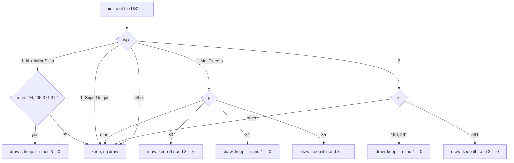

# 0004 — Preset units: the DS1 unit list, the keep/drop rolls and the LvlPrest columns

> **Subsystem:** drlg/preset
> **Question:** Which preset units does a DS1 put into a room (after the act rewrites and the keep/drop rolls), and what does each `LvlPrest` column still `[L]` do?
> **Date:** 2026-10-13   **Plan:** 0016, 0020   **Status:** answered (Phase 1); corroborated (Phase 2, run:2026-10-13-drlg-preset; plan 0020 Phase 4, run:2026-10-15-acts-3-5)

## Answer (summary)

Phase 2 reproduced the whole pipeline bit-exactly with no boundary oracle: 2210 preset room unit lists over all five
acts and towns, Normal, Nightmare and Hell, 123 606 checks, 0 mismatches (run:2026-10-13-drlg-preset). Branches the
run did not reach stay `[I]` and are named in each bullet. Plan 0020 Phase 4 (run:2026-10-15-acts-3-5, a `quests: all`
save, Acts I–V by waypoint) reached the branches that run left: every drawing id with both outcomes, the act rewrites
366 and 537..539, a client row skip, and preset rooms of maze levels in Acts III and V (1184 room lists, 155 215 checks,
0 mismatches).

- [C] **Keep/drop rolls.** `DRLG_PresetUnitDropRolls` copies the DS1's unit list into the preset instance
  (`+0x38`). It walks the list from its head, which is reverse file order. Ten ids draw once each, on the seed its
  caller passes; `r` is the low dword after one `RNG_Next` step. The run saw both outcomes for MonStats 204/205, MonPlace
  34 and object 581, and the kept outcome for MonPlace 35: 44 drawing calls among 962 checked calls
  (fn:DRLG_PresetUnitDropRolls@0x00667620, run:2026-10-13-drlg-preset):
  - MonStats 204/205 (`act2vendor1/2`) and 371/372 (`lightningspire`, `firetower`): kept when `r % 3 == 0` (unsigned).
  - MonPlace 33 (`place_group25`): kept when `r & 3 ≠ 0`.
  - MonPlace 34 (`place_group50`): kept when `r & 1 ≠ 0`.
  - MonPlace 35 (`place_group75`): kept when `r & 3 == 0`.
  - Objects 196 and 261 (floor traps): kept when `r & 1 == 0`.
  - Object 581 (above the objects table): kept when `r & 3 ≠ 0`.

  Every other unit is kept with no draw. A kept unit is a copy whose `x`/`y` and path points are offset by the
  instance origin ×5, prepended, so the kept list is back in file order. (fn:DRLG_PresetUnitCopy@0x00667510,
  run:2026-10-13-drlg-preset)
- [C] The four tests run:2026-10-13-drlg-preset did not reach were reached with both outcomes in
  run:2026-10-15-acts-3-5 (outcomes counted once per copy that rolls; every instance list matched):
  - MonStats 371/372 (`mod 3 = 0`): `0x00667721`, the switch at `0x0066771A` through the byte table `0x006677DC`,
    whose index 0 is taken only by ids 204, 205, 371 and 372. 371 kept 2 / dropped 6 (Arcane Sanctuary), 372 kept 6 /
    dropped 6 (Far Oasis, Lost City);
  - MonPlace 33 (`& 3 ≠ 0`): `0x00667687`, the test it shares with object 581. Kept 2 / dropped 2 (`Cott4A.ds1`, on the
    level seed);
  - MonPlace 35 (`& 3 = 0`): `0x00667794`. Dropped 26, kept 12 (Durance Level 2, Jail Level 1);
  - objects 196/261 (`& 1 = 0`): `0x006676D0`. 196 kept 20 / dropped 28 (Arcane Sanctuary), 261 kept 2 / dropped 6
    (Halls of the Dead Level 2).

  MonPlace 34's test (`& 1 ≠ 0`, `0x006677B8`, `jmp 0x0066769B`) was reached with both outcomes in both runs.
  (fn:DRLG_PresetUnitDropRolls@0x00667620, run:2026-10-15-acts-3-5)
- [C] **Two callers, one roll per instance.** `DRLG_PresetMapScan` rolls on the **level seed** (`level
  +0x1C4`) at room creation, for records with `Scan` or `Pops` non-zero (391 calls). Otherwise
  `DRLG_PresetRoomLoadDs1` rolls on the **room seed** (`room +0x14`) of the first room of the instance that
  loads its DS1 (571 calls). That seed is still the one `DRLG_RoomCreate` set, `step(Init(level lo))`
  (`0x0066B44A`–`0x0066B477`), because the roll comes before the room's re-seed. Both load the DS1 into instance
  `+0x0C`, and `PresetRoomLoadDs1` rolls only while that slot is empty. (fn:DRLG_PresetMapScan@0x00667970,
  fn:DRLG_PresetRoomLoadDs1@0x00667890, fn:DRLG_RoomCreate@0x0066B3E0, run:2026-10-13-drlg-preset)
- [C] **Act rewrites in `DS1_Parse`.** These apply after the MonPreset mapping and turn the unit into an object
  (type 2, mode 0). The run reproduced lists containing act index 2's MonStats 297 (`natalya`) → object 382 and act
  index 4's 514 (`nihlathak`) → object 461. (fn:DS1_Parse@0x00665950, 0x00665CB2, run:2026-10-13-drlg-preset)
- [C] The other rewrites: act index 2, 366 `compellingorb` → object 404 (`TravN.ds1`, Travincal); act index 4,
  537..539 `ancientstatue1..3` → `1013 − id`, so 476, 475, 474 (`MtnTop.ds1`, Arreat Summit). Both were in rolled
  instance lists that matched. `0x004E6C50` is only a MonStats range check (`id` if `0 ≤ id < nMonStats`, else −1).
  (fn:DS1_Parse@0x00665950, fn:MONSTATS_ValidId@0x004E6C50, run:2026-10-15-acts-3-5)
- [C] **Into the room.** `DRLG_PresetUnitsToRoom` moves each instance unit whose subtile position lies in the
  room's rectangle ×5 (half-open) to the room list (`room +0x5C`), prepended and re-expressed relative to the room
  origin. Path points keep their instance coordinates. (fn:DRLG_PresetUnitsToRoom@0x00666710,
  run:2026-10-13-drlg-preset)
- [C] `PresetRoomLoadDs1` adds the client-only river objects 40/41/42/65 once per instance (`Def` 1, 26, 27 seen, on
  rooms with flag `0x40000`), every one with `flags` bit 0. (fn:DRLG_PresetClientObjects@0x006663C0,
  run:2026-10-13-drlg-preset)
- [I] It also adds the Blood Moor centre monster: MonStats 266 `navi` at the instance centre, for `Def` 4–7 in level 2
  with file index 3. Not reached in the run. (fn:sub_006664A0_PresetCentreMonster@0x006664A0)
- [C] **Server handover.** `sub_005559A0_RoomPresetUnits` walks the room list twice: first every unit that is not a monster, then the monsters (373 of 373 walks with spawns). In 689
  walks the modelled room list was the tail of the walked list. At the head were units that other code prepends
  after `PresetUnitsToRoom`: objects 14–16, 23–25, 27, 64, 449 and type-5 units, one of them from
  `sub_0066D9E0_Orient89Unit` (caller `0x0066DAEE`). Those are inputs here (owners `objects`, `drlg/warps`).
  (fn:sub_005559A0_RoomPresetUnits@0x005559A0, fn:sub_0066BF30_PresetUnitCreate@0x0066BF30,
  run:2026-10-13-drlg-preset)
- [C] **A re-prepared room keeps its list.** When `PresetUnitsToRoom` runs again for a room (108 rooms, both copies),
  the room list already holds that room's previous list. In 34 of them other code had prepended 1 or 3 units in
  between, as at the server walk. `PresetUnitsToRoom` prepends the newly moved units (none, since the instance list
  lost them on the first pass). In 19 units, all monsters, the path pointer had become null in between. The checker
  asserts the previous modelled list as the tail. (fn:DRLG_PresetUnitsToRoom@0x00666710,
  run:2026-10-13-drlg-preset)
- [I] The walk skips every unit with `flags` (`+0x1C`) bit 0, so the client river objects and DS1 `flags = 1`
  (`worldstoneeffect`) never spawn on the server. No flagged unit reached a server walk in the run: the river objects
  exist only on the client copy. (fn:sub_005559A0_RoomPresetUnits@0x005559A0)
- [I] `sub_005557D0_PresetUnitDispatch` routes by type and id: type 1 to `sub_0054E600_PresetMonSpawn`, type 2 with
  id > 573 to `0x0054F490`, type 2 with id 573 to nothing, every other unit to `sub_00555230_SUnitCreate`. In levels
  133–136 the walk has extra filters (not reached): level 136 makes only the first pass, so no preset monster spawns,
  and skips objects 26, 268 and 269; levels 133 and 135 skip object 397; level 134 skips object 402 and the one object
  at which a per-game counter (`game +0x1DE4`) reaches `game +0x7C % 3 + 3`. (fn:sub_005557D0_PresetUnitDispatch@0x005557D0, fn:sub_005559A0_RoomPresetUnits@0x005559A0)
- **LvlPrest columns** (§ LvlPrest columns):
  - [C] `Populate` 0 sets room flag `0x800000`, for which `sub_0061A1F0_RoomPopLevelId` returns 0: no random population
    (241 calls on `Populate` 0 rooms, all 0). Preset units still spawn: 48 preset monsters created in `Populate` 0
    rooms (Harrogath, the Pandemonium Fortress). (fn:sub_0061A1F0_RoomPopLevelId@0x0061A1F0,
    run:2026-10-13-drlg-preset)
  - [C] `DRLG_RoomNoPopNearTown` also sets `0x800000` on `Populate` 1 rooms: a room outside a town whose
    neighbour room is in a town level (`sub_006426A0_LevelIsTown`: levels 1, 40, 75, 103, 109). Two counts in the
    run, both from the two logs with `FLG` lines (`preset-play-act4`, `preset-play-act5`; fn:DRLG_RoomNoPopNearTown@0x0066BD50,
    run:2026-10-13-drlg-preset):
    - **22 flag sets** at `0x0066BD92`, on 22 distinct preset rooms (10 + 12);
    - **16 `RoomPopLevelId` returns of 0** on those rooms: 8 of the 22 were populated, with two calls each, all 0.
      The other 14 had no `RoomPopLevelId` call in the logs.

    (fn:DRLG_RoomNoPopNearTown@0x0066BD50, fn:sub_006426A0_LevelIsTown@0x006426A0, run:2026-10-13-drlg-preset)
  - [I] `sub_0066E360_HiddenWarpTilesAdd` sets `0x800000` at `0x0066E37E` on a room with hidden warp tiles. The run
    logged no flag set there, so this rests on the disassembly. (fn:sub_0066E360_HiddenWarpTilesAdd@0x0066E360)
  - [C] `Logicals` selects the room's logic-region builder: 0 calls `sub_0066CCB0_LogicBoxSingle` (logic flags bit
    0), 1 calls `sub_0066D110_LogicRegionsFromDs1` (flags bit 1). Both copies build them (the flag bit checked on 1540
    preset rooms). The client reads a wall entry's box pointer (`+0x10`) and that box's region id every frame in
    `sub_004DD060_WallCutawayTest` (`0x004DD075`, `0x004DD085`, watch reads). The run checks only the builder
    selection and these reads. (fn:sub_00666AC0_PresetRoomTilesBuild@0x00666AC0, fn:sub_004DD060_WallCutawayTest@0x004DD060,
    run:2026-10-13-drlg-preset)
  - [I] What the builders produce: 0 gives one region covering the room, 1 floods the DS1 cells into regions (ids from
    level counter `+0x1DC`, merged across neighbour rooms of one level), one box per run of equal cells, and each
    wall tile entry's `+0x10` pointing to its region box. No region, box or wall pointer was reproduced. Owner:
    `drlg/collision` (research map, 2026-10-13). (fn:sub_0066D110_LogicRegionsFromDs1@0x0066D110,
    fn:sub_0066CCB0_LogicBoxSingle@0x0066CCB0, fn:sub_0066CA50_LogicBoxesFromGrid@0x0066CA50,
    fn:sub_0066C9C0_LogicWallBoxes@0x0066C9C0)
  - [I] `sub_004DD060_WallCutawayTest` returns true for a wall whose region id differs from the global
    `0x007C8A0C` and whose box starts past `0x007C8A08`/`0x007C8A10`. Without logic regions it falls back to a test on
    the wall's orientation near that point. Read as the player's region and tile, this is the wall cut-away the
    sources call wall transparency. The three globals are not traced. (fn:sub_004DD060_WallCutawayTest@0x004DD060)
  - [I] The same boxes are the server's spawn areas (monsters/0002 § 5: `sub_0054EC90_RoomPopulate` reads box `+0x10`,
    `+0x20`, `+0x28`). The run did not catch that read (Open questions). (fn:sub_0054EC90_RoomPopulate@0x0054EC90)
  - [I] `Outdoors` ORs `0x80000` into the room flags. `Animate` adds animated-tile frame lists, and `+0x024` is their
    period (0 means 80). `KillEdge` and `FillBlanks` are as in drlg/0002. `AutoMap` gates the act callbacks, which are
    null on the server and drive the automap on the client. `Scan` and `Pops` gate the map scan.
    (fn:sub_00666AC0_PresetRoomTilesBuild@0x00666AC0, fn:DRLG_PresetMapScan@0x00667970)
  - [C] `Pops` is the capacity of the roof-pop tables. **`PopPad` is read** by the client's
    `DRLG_PresetPopsUpdate` (`0x00667255`, `0x00667261`, the only reader the watchpoint saw): the trigger
    rectangle of pop *k* is `(x·5, y·5, w·5 + PopPad, h·5 + PopPad)` in subtiles, half-open, so a negative `PopPad`
    pulls in the far x and y edges. The model of that test reproduces 6443 logged player positions, 70 of them
    decided by `PopPad`. (fn:DRLG_PresetPopsUpdate@0x006671E0, fn:sub_0066B980_RectContains@0x0066B980,
    run:2026-10-13-drlg-preset)

  None of these columns draws. (§ LvlPrest columns)
- [I] **Type-2 rooms never read DS1 substitution data.** No code reads a preset instance's DS1 substitution layer or
  groups (`+0x48`/`+0x4C`/`+0x50`). The only group reader, `sub_006704E0_LvlSubLoadDs1`, reads the DS1 a `LvlSub`
  record names. The 429 groups in `LvlPrest` DS1s are dead data. (fn:sub_006704E0_LvlSubLoadDs1@0x006704E0)
- [C] **Level 27's preset index** is written while `sub_006772C0_LevelLinkBuild` handles level 6, from level 6's link
  value `v` and one draw `r` on the act seed: `v = 3` gives index `(~r) & 1` (6 draws, and level 27 was built with that
  index twice). The run confirms the formula and the single step on the act seed as logged just before the draw.
  (0x006774F9, fn:sub_006772C0_LevelLinkBuild@0x006772C0, run:2026-10-13-drlg-preset)
- [I] Where this draw falls in the act seed's sequence: the act seed before it was taken from the log, not
  predicted. The earlier draws are `LevelLinkBuild`'s (`drlg/warps`), so its position is that row's to establish.
  (fn:sub_006772C0_LevelLinkBuild@0x006772C0)
- [C] `v = 1` gives `2 − (r & 1)`: reached in run:2026-10-15-acts-3-5 (map seeds 22 and 25, 4 draws), index and act
  seed after as predicted. Both seeds had `r & 1 = 1` (index 1), so the index-2 outcome is `[I]`. (0x006774F9,
  run:2026-10-15-acts-3-5)
- [I] Any other `v` draws nothing and writes nothing. (0x006774F9)

## Leads used

Blind first: every claim above was written from the code in Phase 1, before any community source was fetched. The
sources below were fetched and read on 2026-10-13 (plan 0016 Phase 1b) and are registered in
[sources.md](../../sources.md). Agreement promotes nothing. Two pages found in the search were registered
`rejected` and not used (`src:pk-maze-ds1-mechanisms`, `src:nefarius-metalstorm-log`). The three `contradicted`
verdicts were required Phase 2 cases. run:2026-10-13-drlg-preset settled them: `Populate` stays contradicted (the
sources are wrong for 1.14d), and `Logicals` and `PopPad` become `held with refinement` (the finding was wrong).

**Keep/drop rolls and act rewrites**

- [L] src:siramy-ds1-any-units, src:siramy-ds1edit, src:pk-hardcoded-ds1: no statement that any preset unit appears
  only by chance; `place_group25/50/75`, `act2vendor1/2`, `lightningspire`/`firetower` and the floor traps are not
  named. **not covered**
  Detail: the ten drawing ids and their keep probabilities (3/4, 1/2, 1/4 for `place_group25/50/75`, the inverse
  of the names) rest on the code alone (`0x0066777D` → `0x00667687`). No source to contradict them was found.
  `src:pk-hardcoded-ds1` reports clearings that "sometimes … will not appear", but those are `File` variants of
  outdoor presets, not units.
- [L] src:siramy-ds1-any-units: DS1 type-1 ids map through per-act MonPreset ranges ("Act 1 = entries 0 to 59 …
  Act 5 = entries 240 to 299"). It says nothing of a unit turned into an object in act index 2 or 4. **not covered**
  Detail: the rewrites (297 → 382, 366 → 404; 514 → 461, 537..539 → `1013 − id`) rest on the code alone
  (0x00665CB2).

**LvlPrest columns** (`src:pk-lvlprest-guide` describes 1.10–1.14; `src:d2dfg-blizzard` states no version)

- [L] src:pk-lvlprest-guide: `Populate` "If set to 0 monsters will not be able to spawn on the map. NOTE: Causes
  Unhandled Exception if you add other monster objects when column is set to 0." src:d2dfg-blizzard: "If equals 0,
  then units will never spawn in the Level Preset." **contradicted**
  Detail: the finding has `Populate` 0 suppressing only random population (room bit `0x800000` →
  `RoomPopLevelId` 0). Preset units go to `RoomPresetUnits`, which skips only `flags` bit 0. The shipped data
  carries preset monsters under `Populate` 0: `townWest.ds1` (`Def` 863, Harrogath) has type-1 units, as do the
  act-3 treasure rooms (`Def` 703/704, e.g. `DungRm1A.ds1`). **Settled** by run:2026-10-13-drlg-preset: in Harrogath
  and the Pandemonium Fortress (`Populate` 0) `RoomPopLevelId` is 0 on all 241 calls, and 48 preset monsters are
  created. A reimplementation must not drop preset units under `Populate` 0. The run also shows the column is not
  the only switch: rooms next to a town lose population too (Answer).
- [L] src:pk-lvlprest-guide: `Logicals` "Set it to 1 to allow wall transparency." src:d2dfg-blizzard: "If equals 0,
  then walls will always appear solid." **held with refinement** (was `contradicted` in Phase 1b)
  Detail: run:2026-10-13-drlg-preset watched the boxes. With `Logicals` 1 every wall tile entry points to its region
  box, and the client reads both every frame in `sub_004DD060_WallCutawayTest`, which cuts away walls of another
  region. With `Logicals` 0 there is one region and no per-wall box, so the client falls back to a geometric test.
  The same boxes are also the server's spawn areas (monsters/0002). The function is renamed
  `sub_0066D110_LogicRegionsFromDs1` (was `…SpawnBoxesFromDs1`).
- [L] src:pk-lvlprest-guide: `Outdoors` "Set to 1 for outdoor maps and 0 for indoors." src:d2dfg-blizzard: "…
  classified as an outdoor area, which can mean that lighting will function differently." **held with refinement**
  Detail: 1.14d ORs `0x80000` into the room flags (`sub_00667ED0_PresetRoomsCreate`), and no reader of that bit
  was found. The lighting effect is a lead only (Open questions).
- [L] src:pk-lvlprest-guide: `Animate` "1 makes the animated tile to play their animation. 0 disables animations.
  NOTE: Animated tiles, in levels with Animate = 0, will display a random yet static frame." src:d2dfg-blizzard:
  same, without the note. **held with refinement**
  Detail: 1 builds the frame lists (`sub_0066D700_AnimTilesBuildAll`) and sets room bit `0x8000000`. The "random
  static frame" under 0 is not in the finding. If it draws, the draw is on the client tile path, which is not read.
  The shipped data has `Animate` 1 only on the 33 lava records.
- [L] src:pk-lvlprest-guide, src:d2dfg-blizzard: no column at `+0x024`. **not covered**
  Detail: the animation period (0 means 80) at `0x00666D80` rests on the code alone. The value is 0 in every
  record.
- [L] src:pk-lvlprest-guide: `KillEdge` "Removes the tiles bordering the east and south edge of the ds1 in game."
  src:d2dfg-blizzard: "remove tiles that border the size of the Level Preset". **held**
  Detail: drlg/0002 § Room tile build applies it only where the room's right/bottom edge is the preset's
  right/bottom edge. That matches "east and south" in Phrozen Keep's wording. The Blizzard guide's wording does
  not name the sides.
- [L] src:pk-lvlprest-guide: `FillBlanks` "Setting to 1 makes all empty spaces unwalkable." src:d2dfg-blizzard:
  "all blank tiles … filled with unwalkable tiles". **held with refinement**
  Detail: drlg/0002 uses it as the filler flag for floor layer 0 only.
- [L] src:pk-lvlprest-guide: `AutoMap` "setting it to 1 will reveal the full automap. NOTE: Only works for preset
  maps". src:d2dfg-blizzard: "automatically completely revealed on the Automap". **held with refinement**
  Detail: it gates the act callbacks `+0x454`/`+0x488`, which are null on the server and drive the client
  automap. The data has it on the five towns only.
- [L] src:pk-lvlprest-guide: `Scan` "Setting it to 1 allows warps to be selected." src:d2dfg-blizzard: "allow the
  usage of warping with waypoints (This requires that the Level Preset has a waypoint object)". **held with
  refinement**
  Detail: `Scan` (or `Pops`) gates `PresetMapScan`. The scan collects style 30–33 cells (warp markers) into level
  `+0x2C`, marks the cells of objects with record `+0x167` bit `0x40`, and moves the keep/drop rolls onto the
  level seed. The rolls are not in either source. The waypoint reading is plausible only through the object
  bit, which is not read (`objects` row).
- [L] src:pk-lvlprest-guide: `Pops` "the special tiles with the Style (main-index) of 8 - 29. … You can only have
  one set of each style of pop." src:d2dfg-blizzard: "how many Pop tiles are defined in the Level Preset file".
  **held with refinement**
  Detail: 1.14d uses `Pops` as the capacity of the pop tables, one entry per distinct style 8–29 of orientation
  10/11. "One set per style" matches the one-entry-per-style table. The roof hiding is client-only
  (`DRLG_PresetPopsUpdate`).
- [L] src:pk-lvlprest-guide: `PopPad` "determines the line of the 'trigger pad'. It determines the number of
  sub-tile units south & west the trigger line is offset." src:d2dfg-blizzard: "the size of the Pop tile area, by
  using an offset value". **held with refinement** (was `contradicted` in Phase 1b)
  Detail: Phase 1 missed the reader. `DRLG_PresetPopsUpdate` adds `PopPad` to the trigger rectangle's width
  and height in subtiles (`0x00667255`, `0x00667261`). A watchpoint on Harrogath's `+0x3C` saw only that reader, and
  the model reproduces every logged player position (run:2026-10-13-drlg-preset). In the sources' terms the
  "trigger line" is the rectangle's far x and y edges, moved by `PopPad` subtiles; only those two edges move.

**Path `action`**

- [L] src:siramy-ds1edit § Path Editing: "the (hardcoded) 'Action' (animation and / or sound) that the NPC will do
  at a particular place". It also says "only Type 1 (Monster / NPC) objects can use paths in the game", and
  (§ F10) the NPC "will only use the points … (and randomly), and they'll never go back to their original
  starting position". **not covered**
  Detail: the finding reads no consumer of the path points (monster AI, ADR-0002), so it has no claim to compare.
  The lead goes under Open questions. The type-1 statement is a gap: two shipped paths have object owners, one of
  them `nihlathak` after the act-index-4 rewrite.

## Functions

| Address | Name | Role | Tag |
|---|---|---|---|
| `0x00667620` | `DRLG_PresetUnitDropRolls` | copy the DS1 units into the instance list with the keep/drop draws | C |
| `0x00667510` | `DRLG_PresetUnitCopy` | allocate a unit copy offset by the instance origin (path copied too) | C |
| `0x006660B0` | `sub_006660B0_PresetPathCopy` | copy a path (count, 12-byte points) | I |
| `0x00643560` | `sub_00643560_TileToSubtile` | `x *= 5; y *= 5` | I |
| `0x00667890` | `DRLG_PresetRoomLoadDs1` | load the DS1 and roll on the room seed (once per instance), centre monster, client objects | C |
| `0x00667970` | `DRLG_PresetMapScan` | `Scan`/`Pops` gate; load the DS1 and roll on the level seed; scan the wall cells | C |
| `0x00666E00` | `sub_00666E00_PresetPopsFinish` | pop rectangles to absolute tiles, pop index `style/4 − 1` | I |
| `0x00666710` | `DRLG_PresetUnitsToRoom` | move the units in the room rectangle to `room +0x5C` | C |
| `0x006664A0` | `sub_006664A0_PresetCentreMonster` | add MonStats 266 at the instance centre | I |
| `0x006663C0` | `DRLG_PresetClientObjects` | client river objects (flag bit 0) | C |
| `0x006661A0`, `0x00666220` | `DRLG_PresetClientUnitsA`, `DRLG_PresetClientUnitsB` | object 65 every 8 tiles down a column / objects 40, 41, 41, 41, 42 in a row, per DS1 row | C |
| `0x0066BF30` | `sub_0066BF30_PresetUnitCreate` | allocate one unit, prepend to `ECX+0x5C` when `ECX` is set | I |
| `0x004E6C50` | `MONSTATS_ValidId` | `id` if `0 ≤ id < nMonStats`, else −1 | I |
| `0x005557D0` | `sub_005557D0_PresetUnitDispatch` | server: route one preset unit by type and id | I |
| `0x0066D110` | `sub_0066D110_LogicRegionsFromDs1` | logic regions from the DS1 layers (`Logicals` = 1); was `sub_0066D110_SpawnBoxesFromDs1`. Selection and flag bit `[C]`; its regions were not reproduced | I |
| `0x0066CA50` | `sub_0066CA50_LogicBoxesFromGrid` | one box per run of equal region cells, prepended to the logic record `+0x30` | I |
| `0x0066C9C0` | `sub_0066C9C0_LogicWallBoxes` | each wall entry `+0x10` = its region box (0 with one region) | I |
| `0x004DD060` | `sub_004DD060_WallCutawayTest` | client, per wall: region id against the player's (`0x007C8A0C`); else an orientation test | I |
| `0x0066BD50` | `DRLG_RoomNoPopNearTown` | room outside a town with a neighbour room in a town: `+0x28 \|= 0x800000` | C |
| `0x006426A0` | `sub_006426A0_LevelIsTown` | level id 1, 40, 75, 103 or 109 | I |
| `0x0066D290` | `sub_0066D290_AnimTilesCount` | count the animated-tile entries of a grid (`Animate`) | I |
| `0x0066D700` | `sub_0066D700_AnimTilesBuildAll` | `AnimTilesBuild` for floors, walls and roofs with the `+0x024` period | I |
| `0x006671E0` | `DRLG_PresetPopsUpdate` | client roof pops: trigger rectangles with `PopPad`, tick-count timers | C |
| `0x00667060` | `sub_00667060_PresetPopSet` | client: show or hide one pop's tiles (`ECX` pop rectangle, main index, flag) | I |
| `0x00459150`, `0x004591A0` | `sub_00459150_ClientActRoomCb`, `sub_004591A0_ClientTownCb` | client act callbacks `+0x454` / `+0x488` | I |

## Walkthrough

### Where the unit list comes from

`DS1_Parse` builds the DS1's unit list (drlg/0001 § Object entries), prepending each unit, so the head is the last
entry in the file. The act rewrites sit between the MonPreset mapping and `PresetUnitCreate`:

```c
// fn:DS1_Parse@0x00665950, 0x00665CB2 (disassembly, renamed); act = header act clamped to ≤ 4; id after MonPreset
if (act == 2 && id < nMonStats) {
  if      (id == MONSTATS_ValidId(297)) { id = 382; type = 2; mode = 0; }   // natalya       -> object 382
  else if (id == MONSTATS_ValidId(366)) { id = 404; type = 2; mode = 0; }   // compellingorb -> object 404
} else if (act == 4 && 0 <= id && id < nMonStats) {
  if      (id == 514)              { id = 461;        type = 2; mode = 0; } // nihlathak
  else if (536 < id && id <= 539)  { id = 1013 - id;  type = 2; mode = 0; } // ancientstatue1..3 -> 476..474
}
```

- [I] The comparison uses the id **after** the MonPreset mapping, and only MonStats-range ids can match.
  (0x00665CB2–0x00665D3E, fn:MONSTATS_ValidId@0x004E6C50)

### The keep/drop rolls

```c
// fn:DRLG_PresetUnitDropRolls@0x00667620 (disassembly-checked; stack arg = seed, EDX = instance)
ox = inst.x * 5;  oy = inst.y * 5;                       // +0x10, +0x14 (tiles) -> subtiles
for (u = inst.ds1.units; u; u = u.next) {                // +0x0C -> +0x54; reverse file order
  if (u.type == 1) {
    if (u.id < nMonStats) {
      if (u.id in {204, 205, 371, 372}) { r = RNG_Next(seed); if (r % 3 != 0) continue; }
    } else if (u.id - nMonStats >= nSuperUniques) {      // MonPlace range
      p = u.id - nMonStats - nSuperUniques;
      if (p == 33) { r = RNG_Next(seed); if ((r & 3) == 0) continue; }
      if (p == 34) { r = RNG_Next(seed); if ((r & 1) == 0) continue; }
      if (p == 35) { r = RNG_Next(seed); if ((r & 3) != 0) continue; }
    }                                                    // SuperUniques: no draw
  } else if (u.type == 2) {
    if (u.id == 196 || u.id == 261) { r = RNG_Next(seed); if ((r & 1) != 0) continue; }
    if (u.id == 581)                { r = RNG_Next(seed); if ((r & 3) == 0) continue; }
  }
  c = PresetUnitCopy(u, ox, oy);  c.next = inst.units;  inst.units = c;   // +0x38, prepend
}
```

- [C] `RNG_Next` here is the inlined step `seed = lo·0x6AC690C5 + hi` (64-bit), and `r` is the new low dword. `% 3` is
  unsigned (`mul 0xAAAAAAAB`, `shr 1`). (0x00667721–0x00667748, run:2026-10-13-drlg-preset)
- [C] The copy keeps `mode`, `id`, `type`, `flags` and the path, adding `ox`/`oy` to `x`/`y` and to every path point.
  Since it prepends, the instance list is back in file order for kept units. (fn:DRLG_PresetUnitCopy@0x00667510,
  fn:sub_006660B0_PresetPathCopy@0x006660B0, run:2026-10-13-drlg-preset)
- [I] The names come from the tables: MonStats `hcIdx` 204/205 `act2vendor1/2`, 371 `lightningspire`, 372 `firetower`;
  MonPlace rows 33–35 `place_group25/50/75`; Objects `Id` 196/261 "floortrap". `objects.txt` has no row 581 (rows
  0..572), so object 581 is one of the ids above 573 that the server routes to `0x0054F490`.
  (tbl:MonStats.txt:hcIdx, tbl:MonPlace.txt:code; `objects.txt` `Id`, which has no table doc yet)
- [I] The `place_group*` thresholds run against what the names suggest: `place_group25` is kept with probability
  3/4 and `place_group75` with 1/4. This is the code, not a misreading: `0x0066777D` `sub ecx,0x21` →
  `0x00667687` (`test al,3` / `je` drop). The run saw `place_group50` (MonPlace 34) kept 6 and dropped 4 times and
  `place_group75` kept twice, each matching its test; `place_group25` was not reached. (run:2026-10-13-drlg-preset)



### Which seed, and when

```c
// fn:sub_00667ED0_PresetRoomsCreate@0x00667ED0 -> fn:DRLG_PresetMapScan@0x00667970 (at room creation)
if (rec.Scan == 0 && rec.Pops == 0) return;                       // +0x34, +0x38
DS1_LoadCached(rec.File[inst.idx], &inst.ds1);                     // ECX = inst + 0x0C (0x00667A1C)
PresetUnitDropRolls(&level.seed /* +0x1C4 */, inst);              // 0x00667A35

// fn:DRLG_PresetRoomLoadDs1@0x00667890 (room activation, before the room re-seed; drlg/0002)
if (inst.ds1 == 0) { DS1_LoadCached(rec.File[inst.idx], &inst.ds1); PresetUnitDropRolls(&room.seed /* +0x14 */, inst); }
if (inst.pending /* +0x3C */ == 1) {
  inst.pending = 0;
  if (Def in 4..7) { if (level.id == 2 && inst.idx == 3) PresetCentreMonster(inst); }
  else if ((Def in {1, 3, 26, 27, 28, 300}) && (room.flags & 0x40000)) PresetClientObjects(inst);
}
room.flags |= 0x2000000;
```

- [C] So, per instance, the rolls run exactly once (0x006678E2, 0x00667A35, run:2026-10-13-drlg-preset):
  - on the level seed while the rooms are created, when `Scan || Pops`;
  - otherwise on the room seed of whichever room of the instance loads first. That draw happens before the room's
    re-seed, so it changes nothing in that room's later draws, but its outcome fixes the unit list of **every** room
    of the instance. The room seed it draws on is `step(Init(level lo))` from `DRLG_RoomCreate`.
  (0x006678D2, 0x006678E2, 0x00667A1F, 0x00667A35, 0x0066B44A)
- [I] `PresetRoomLoadDs1` is called from `sub_0061B730_RoomActivateB` (`0x0061B752`) and `sub_0061B320_RoomPrepareFiles`
  (`0x0061B343`). `PresetUnitDropRolls` has exactly two call sites, `0x006678E2` and `0x00667A35` (xrefs).
- [I] Centre monster: `x = (inst.x + inst.w / 2)·5`, `y = (inst.y + inst.h / 2)·5` (signed `/ 2`; sizes are
  positive), id 266 when `nMonStats > 266`, else −1. It goes to the instance list after the rolls, with no draw.
  (fn:sub_006664A0_PresetCentreMonster@0x006664A0)
- [C] Client objects: the room flag `0x40000` gates them. Each placement adds object 65 every 8 tiles (40 subtiles)
  down a column, and objects 40, 41, 41, 41, 42 one tile apart in a row for each DS1 row. `Def` 27 makes one
  placement at the instance edge. The other `Def`s make one at every floor-layer-0 cell of style 2, main index 24.
  Every one of these units gets `flags |= 1`. No draw. They are client presentation (ambient river objects), and
  the server skips them. The rows step one DS1 row at a time, three more after a style-4 floor cell of main index 0,
  4, 8, 16, 29 or 39 (switch table `0x0066638C`).
  (fn:DRLG_PresetClientObjects@0x006663C0, fn:DRLG_PresetClientUnitsA@0x006661A0,
  fn:DRLG_PresetClientUnitsB@0x00666220, run:2026-10-13-drlg-preset)
- [C] **The row skip itself.** A breakpoint on the skip (`0x00666368`, `add dword [ebp-0xC], 3`) logged 5 skips in
  run:2026-10-15-acts-3-5, each equal to the modelled one: Act I town, `Def` 1 file index 1 (`TownE1.ds1`), DS1 row 15,
  floor main 16. In the DS1 data only `TownE1.ds1` and the three `Bridge*.ds1` of `Def` 28 hold such a cell in a
  placed column. (fn:DRLG_PresetClientUnitsB@0x00666220, run:2026-10-15-acts-3-5)

### From the instance to the room, and on to the spawners

- [C] The rectangle test is half-open (`sub_0066B980_RectContains`), and path points are not moved to room
  coordinates. (fn:sub_0066B980_RectContains@0x0066B980, run:2026-10-13-drlg-preset)

```c
// fn:DRLG_PresetUnitsToRoom@0x00666710 (called from the type-2 grid prepare, 0x0066697D)
for (u in inst.units) if (RectContains(room.rect × 5, u.x, u.y)) {
  u.x -= room.x * 5;  u.y -= room.y * 5;
  unlink u from inst.units;  u.next = room.units;  room.units = u;      // room +0x5C
}
```

- [I] The room-level record a spawner receives is the 0x20-byte preset unit (`re/types/preset.h`): type, id, mode,
  `x`/`y` in subtiles relative to the room, `flags`, and the path. For monsters the id carries the MonPreset range
  (drlg/0001; struct:PresetUnit+0x04):
  - MonStats: the class;
  - SuperUniques: `nMonStats + row`;
  - MonPlace: `nMonStats + nSuperUniques + row`. (struct:PresetUnit+0x04)
- [I] Server boundary: `sub_005559A0_RoomPresetUnits` (monsters/0002 § 7) walks `room +0x5C` in two passes,
  non-monsters then monsters (the second pass is skipped in level 136). It skips a unit with
  `+0x1C` bit 0 and spawns each other unit through `sub_00555910_PresetUnitSpawn` → `sub_005557D0_PresetUnitDispatch` (fn:sub_005557D0_PresetUnitDispatch@0x005557D0):
  ```c
  if (type == 1)       PresetMonSpawn(id, …);           // monsters/spawn, monsters/special
  else if (type == 2 && id > 573)  sub_0054F490(id, …); // objects row
  else if (type == 2 && id == 573) ;                    // nothing
  else                 SUnitCreate(…);                  // objects row (type 4 too)
  ```
  (fn:sub_005557D0_PresetUnitDispatch@0x005557D0, fn:sub_005559A0_RoomPresetUnits@0x005559A0)
- [I] `flags` bit 0 therefore means "the server does not spawn this unit". The DS1 sets it on one referenced unit
  (`wstone01.ds1` `worldstoneeffect`), and `PresetClientObjects` sets it on every unit it adds.
  (struct:PresetUnit+0x1C)

### LvlPrest columns

| Column | Reader | Effect | Tag |
|---|---|---|---|
| `Populate` (`+0x08`) | `sub_00666680_PresetRoomCreate`, `sub_00667ED0_PresetRoomsCreate` (single-room branch) | 0 sets room `+0x28` bit `0x800000` (`0x006666EC`, `0x00667FC7`), for which `sub_0061A1F0_RoomPopLevelId` returns 0: no random population (monsters/0002). Preset units still spawn. Two other writers set the bit (Answer) | C |
| `Logicals` (`+0x0C`) | `sub_00666AC0_PresetRoomTilesBuild` | selects the builder: 0 `sub_0066CCB0_LogicBoxSingle` (flags bit 0), 1 `sub_0066D110_LogicRegionsFromDs1` (flags bit 1); client wall cut-away reads seen in the run. The builders' output (tag I) is: 0 one region = the room; 1 regions flooded from the DS1 cells, ids from level counter `+0x1DC`, merged across neighbour rooms of one level, wall entries `+0x10` → box (not reproduced; `drlg/collision`). The server population read is monsters/0002's, inferred | C (selection), I (output) |
| `Outdoors` (`+0x10`) | `sub_00667ED0_PresetRoomsCreate` | ORs `0x80000` into the flags the scan grid writes into each room's `+0x28`. No reader of that room bit found | I |
| `Animate` (`+0x14`) | `sub_00666AC0_PresetRoomTilesBuild` | counts animated tiles (DT1 flag `0x100`) per grid, sets room bit `0x8000000`, builds frame lists (`sub_0066D700_AnimTilesBuildAll`) | I |
| `+0x024` | `0x00666D80` | the frame period passed to `AnimTilesBuild`; 0 means 80. Only with `Animate`. No `.txt` column; 0 in every record | I |
| `KillEdge` (`+0x18`), `FillBlanks` (`+0x1C`) | `sub_00666AC0_PresetRoomTilesBuild` | as drlg/0002 § Room tile build | I |
| `AutoMap` (`+0x30`) | `sub_00668100_PresetLevelBuild` | gates the act callbacks (below). No server effect | I |
| `Scan` (`+0x34`) | `DRLG_PresetMapScan` | with `Pops`, gates the scan and the level-seed rolls; marks wall cells of orientation 10/11 (style < 8, main 0 or 4 or bit 31) in the level grid, collects style 30–33 cells into level `+0x2C` (warp markers; drlg/warps), marks cells of objects with record `+0x167` bit `0x40` | I |
| `Pops` (`+0x38`) | `DRLG_PresetMapScan` | capacity of the pop tables (`+0x44/+0x48/+0x4C/+0x50`, one entry per distinct style 8–29 of orientation 10/11); the client hides roofs from them (`DRLG_PresetPopsUpdate`) | C |
| `PopPad` (`+0x3C`) | `DRLG_PresetPopsUpdate` (`0x00667255`, `0x00667261`), client | added to the trigger rectangle's width and height in subtiles: `(x·5, y·5, w·5 + PopPad, h·5 + PopPad)`, half-open | C |

```c
// fn:sub_00668100_PresetLevelBuild@0x00668100, after PresetRoomsCreate
if (level.id in {40, 103, 109}) { if (act[+0x488] && rec.AutoMap) act[+0x488](level.id, inst.idx, cx, cy); }
else if (act[+0x454] && rec.AutoMap) { LevelEnsure+LevelInit each linked level; for each room: RoomActivateB, act[+0x454](room) }
```

- [I] On the server both callbacks are null. `DUNGEON_ActCreate` is called from `0x0053ACA0` with 0 in both callback
  arguments (`0x00619505`–`0x00619524` → `DRLG_ActCreate` `0x00642E45`/`0x00642E59`). The other writer of a
  `+0x488` (`0x00538783`) is reached from `D2S_ReadHeader` on a different struct. So `AutoMap` has no server
  effect, and its linked-level `LevelInit`s run only in the client's own act. (fn:DRLG_ActCreate@0x00642DA0,
  fn:D2S_ReadHeader@0x0056A090)
- [I] On the client (`0x0044E13D`), `+0x454` is `0x00459150` (per room, into the current automap layer
  `0x007A5164`) and `+0x488` is `0x004591A0`. The latter writes a fixed grid of entries for levels 40/103/109
  (5×4, 2×2, 3×2), with level 40 indexed by the file index. Both draw nothing. The automap meaning is `[I]` from
  the column name and the layer global, not read further (presentation, ADR-0002).
```c
// fn:DRLG_PresetPopsUpdate@0x006671E0 (client, per frame; ESI = the player's room, EDI/arg = player x/y subtiles)
found = 0;
if (room.type == 2) for (k = 0; k < inst.nPops; k++) {                 // inst = room +0x20 -> +8
  r = inst.popRect[k];  pad = inst.pRecord.PopPad;                      // +0x50 (tiles), record +0x3C
  if (RectContains({r.x*5, r.y*5, r.w*5 + pad, r.h*5 + pad}, x, y)) { found = inst.popIndex[k]; break; }
}
// then every pop of the neighbour preset rooms: hidden when its (instance, index) is not found, shown when it is
```

- [C] The trigger test above reproduces the pop index at all 6443 logged player positions; at 70 of them a `PopPad`
  of 0 would give another index. (0x00667224–0x00667292, run:2026-10-13-drlg-preset)
- [I] None of these readers draws: `0x0066CCB0`, `0x0066D110`, `0x0066D290`, `0x0066D700`, `AnimTilesBuild` and
  `0x006671E0` have no LCG constant (findscalar `0x6AC690C5`), and drlg/0003's level-seed check covers the build.

### Shared DS1 buffers (`0x84`)

- [I] `PresetRoomsCreate(flags, single)` has three callers (fn:sub_00667ED0_PresetRoomsCreate@0x00667ED0):
  - `PresetLevelBuild` (`0x0066814D`): `(0, 0)`, split into 8×8 rooms;
  - the maze builder (`0x00673AAF`): `single = (w ≤ 12 && h ≤ 12)` on the maze room's size;
  - the outdoor builder (`0x006751EB`): `(flags, 0)`, split.

  Every file named by two records is used by records of the same kind and size (archivist survey: `tri_town4`
  preset/preset 43×48, `mag*` maze 10×10 single, `lake1` outdoor 8×8). So no shipped DS1 is cut two ways, and each
  cell's `0x84` border state is the same in every view. (0x0066814D, 0x00673AAF, 0x006751EB)

### Level 27's index

```c
// fn:sub_006772C0_LevelLinkBuild@0x006772C0, per linked level L (act seed copy in ESI)
if (L.id == 6) {
  ps27 = LevelEnsure(act, 27)->presetData;                // +0x14
  if      (link[k] == 1) { r = RNG_Next(actSeed); ps27.idx = 2 - (r & 1); }
  else if (link[k] == 3) { r = RNG_Next(actSeed); ps27.idx = (~r) & 1; }
}                                                          // write at 0x006774F9
```

- [I] Level 6 is Act 1 Wilderness 5 and level 27 is Courtyard 1 (tbl:Levels.txt:Name). `link[k]` is the link value the
  `LinkPick` callbacks chose for level 6. (fn:sub_006772C0_LevelLinkBuild@0x006772C0, 0x006774F9)

## Plan 0038 batch S4a (2026-10-16)

Static batch S4a of [plan 0038](../../plans/0038-inferred-claims-sweep.md) (Phase 1), rows of
[inventory drlg-preset](../../plans/0038-inventory/drlg-preset.md). No new session. Checks: `python3 -I
tools/sweep_s4a.py <check>`, which re-runs `tools/drlg.py gen` and `roomk` (unchanged) with counters added, over:
- the 27 logs of run:2026-10-13-drlg-preset and the 6 of run:2026-10-15-acts-3-5: 139 032 and 155 215 gen checks;
- for the link builder, the run:2026-10-12-drlg-gen and run:2026-10-15-drlg-maze lists (206 937) and the 11
  run:2026-10-15-drlg-outdoor logs (572 211).

Where a statement above is tagged inferred and this section raises it, the tag and the second source given here
are the current ones; the wording above is unchanged.

All give 0 mismatches. The addendum is the 2026-10-16 entry under run:2026-10-13-drlg-preset in
[experiments](experiments.md#run2026-10-13-drlg-preset).

- [C] **Row 1 (`PresetRoomLoadDs1`'s callers; `PresetUnitDropRolls` has exactly two call sites).** Two tools agree:
  Ghidra's xrefs and radare2's `axt`, after `aaa`, both give `0x006678E2` and `0x00667A35` for `0x00667620`, and
  `0x0061B752` and `0x0061B343` for `0x00667890`. Neither address is stored anywhere in the image as a pointer
  (`/x 20766600`, `/x 90786600`: no hit). In the logs, every roll is modelled at one of the two sites (PRR at
  `0x006678E2`, PUR at `0x00667A35`), and the room and level seeds after every build match. (fn:DRLG_PresetUnitDropRolls@0x00667620,
  fn:DRLG_PresetRoomLoadDs1@0x00667890, fn:sub_0061B730_RoomActivateB@0x0061B730, fn:sub_0061B320_RoomPrepareFiles@0x0061B320,
  run:2026-10-13-drlg-preset)
- [C] **Row 5 (two of three statements: the path attach, and `MapId` by type and version).** The DS1 files behind the
  3394 reproduced room lists (492 files) take these branches (fn:DS1_Parse@0x00665950, run:2026-10-13-drlg-preset):
  - type 1 through the act's MonPreset list: kind 1, a MonStats class (262); kind 2, a SuperUnique (16); kind 0, a
    MonPlace (379);
  - type 2, version ≥ 6, id < 150, through `g_Ds1ObjectIds` (2362).

  105 paths are attached. Over all 2043 DS1 files that `lvlprest.bin` names, the same branches are the only ones taken:
  117 paths attached, none dropped. The instance and room lists that use them are reproduced unit for unit.
  `sweep_s4a.py punits` (`S4A_PUNITS_SURVEY=1` for the table-wide count). (fn:DS1_Parse@0x00665950,
  fn:MONPRESET_GetActList@0x00659B40, data:g_Ds1ObjectIds@0x00748AD8, run:2026-10-13-drlg-preset, run:2026-10-15-acts-3-5)
- [C] **Row 7 (a unit's mode: 1 for a monster, 0 for an object).** All 48 916 type-1 units of the logged instance lists
  (PSL, PRRX, PLDX) have mode 1, and all 128 951 type-2 units mode 0. `sweep_s4a.py punits`. (struct:PresetUnit+0x04,
  run:2026-10-13-drlg-preset)
- [C] **Rows 9, 16, 40 (room flag `0x2000000` set by every `PresetRoomLoadDs1` call; `0x80000` for `Outdoors`).** None of
  the 141 130 type-2 rooms has `0x2000000` at creation (RL). It is set after every one of the 5568 `PresetRoomLoadDs1`
  calls (PLDX). At creation, `0x80000` is set in exactly the 119 183 rooms whose `LvlPrest.Outdoors` is 1. `sweep_s4a.py
  pflags`. (fn:DRLG_PresetRoomLoadDs1@0x00667890, fn:sub_00667ED0_PresetRoomsCreate@0x00667ED0, tbl:LvlPrest.txt:Outdoors,
  run:2026-10-13-drlg-preset)
- [C] **Row 10 (the two copies agree only when the same room loads first).** Server and client instances were paired by
  level, Def and preset rect, the copy taken from room flag `0x40000`. In 888 pairs the same room loaded first in both,
  and the room-seed roll's seed and kept list are equal. In 4 pairs different rooms loaded first, and the roll seeds
  differ. None of those 4 instances held a unit whose roll draws, so their lists still agree. `sweep_s4a.py pcopies`.
  (0x006678E2, run:2026-10-13-drlg-preset)
- [C] **Row 18 (the dispatch).** Each logged spawn (PSP) has the type and id handed in and the unit made
  (fn:sub_005557D0_PresetUnitDispatch@0x005557D0, run:2026-10-13-drlg-preset):
  - type 1: a monster (348) or no unit (165);
  - type 2 below 573: `SUnitCreate` with class = id (1591);
  - type 2 above 573: an object of another class (16, the pseudo-objects through `0x0054F490`);
  - type 5: `SUnitCreate` with type and class kept (21).

  No unit with id 573 was met. `sweep_s4a.py dispatch`. (fn:sub_005557D0_PresetUnitDispatch@0x005557D0,
  fn:sub_00555910_PresetUnitSpawn@0x00555910, run:2026-10-13-drlg-preset, run:2026-10-15-acts-3-5)
- [C] **Row 20 (the 0x20-byte `PresetUnit` record).** Each logged list is read from the records' `+0x04`… `+0x1C` fields.
  Every list is reproduced, 3394 room lists and the instance lists, so every field the model predicts sits at its
  offset. (struct:PresetUnit+0x04, struct:PresetUnit+0x10, struct:PresetUnit+0x1C, run:2026-10-13-drlg-preset)
- [C] **Rows 23, 24, 25, 38 (level 27's index from level 6's link value).** The link builder model now predicts the act
  seed before the level-27 draw from the map seed: all 394 `LevelLinkBuild` calls are checked (LNK0 seed in, LNK1 seed out,
  rects), and the 40 index writes (LK27). Level 6 took link value 3 in 17 builds and 1 in 4. In 6 builds it took 0: no
  draw and no write, because the act seed out matches a model that does neither. `levels.txt` names 6 "Act 1 -
  Wilderness 5" and 27 "Act 1 - Courtyard 1". `sweep_s4a.py l27`. (fn:sub_006772C0_LevelLinkBuild@0x006772C0, 0x006774F9,
  tbl:Levels.txt:Name, run:2026-10-15-drlg-maze, run:2026-10-15-drlg-outdoor)
- [C] **Row 26 (no LvlPrest column reader draws).** k is checked at RACT on all 5098 type-2 rooms the roomk model built
  in the roomk-family logs: 1475 floods (`LogicRegionsFromDs1`), single-box rooms (`LogicBoxSingle`), and 187 `Animate`
  rooms (`AnimTilesBuildAll`). The level seed is checked after every preset build. Any draw by a reader would move one
  of them. `sweep_s4a.py roomk`, `logic`. (fn:sub_0066CCB0_LogicBoxSingle@0x0066CCB0, fn:sub_0066D110_LogicRegionsFromDs1@0x0066D110,
  fn:sub_0066D700_AnimTilesBuildAll@0x0066D700, run:2026-10-11-drlg-roomk, run:2026-10-12-drlg-gen)
- [C] **Row 28 (`Animate` and room bit `0x8000000`).** Each type-2 room released after its tile build (RTFREE: room
  `+0x28` with tiles) carries `0x8000000` exactly when its preset's `Animate` is 1: 104 rooms with, 3540 without. The
  frame lists are drlg/0002's `[C]` (`AnimTilesBuild`). `sweep_s4a.py pflags`. (fn:sub_00666AC0_PresetRoomTilesBuild@0x00666AC0,
  fn:sub_0066D700_AnimTilesBuildAll@0x0066D700, tbl:LvlPrest.txt:Animate, run:2026-10-11-drlg-roomk)
- [C] **Row 30 (`KillEdge` and `FillBlanks` feed the tile build).** In the roomk-family logs, 3736 type-2 rooms were built
  with `KillEdge` 1 and 4911 with `FillBlanks` 1, with 0 mismatches. With `KillEdge` ignored the same logs give 26 517
  mismatches, and with `FillBlanks` ignored 4168. `sweep_s4a.py kill`. (fn:sub_00666AC0_PresetRoomTilesBuild@0x00666AC0,
  tbl:LvlPrest.txt:KillEdge, tbl:LvlPrest.txt:FillBlanks, run:2026-10-11-drlg-roomk)

Reclassified:
- **Row 5, the skip statement (`u.id = −1`, or type 1 in a DS1 below version 5) → d-none.** It has no case anywhere in
  the 2043 DS1 files `lvlprest.bin` names. No type-1 entry sits in a DS1 below version 5, and no type-2 entry is below
  version 6, at id ≥ 150 or `0x23D`, or maps to −1.

## Plan 0038 batch S4b (2026-10-16)

Static batch S4b of [plan 0038](../../plans/0038-inferred-claims-sweep.md) (Phase 1), rows of [inventory drlg-preset](../../plans/0038-inventory/drlg-preset.md). No session was played. The second tool next to Ghidra is GNU objdump 2.47, walked by `tools/sweep_s4b.py` (recursive descent; see its docstring). The checks are rerunnable with `python3 -I tools/sweep_s4b.py <check>`. Where a statement above is tagged inferred and this section raises it, the tag and the second source given here are the current ones, and the wording above is unchanged.

- **Row 3** (spec L87) **raised.** [C] `LevelIsTown` is a byte table (0x006426C8, ids 1–109) selecting one of two
  jump targets. Decoded over every input, it returns 1 exactly for 1, 40, 75, 103 and 109 (`sweep_s4b.py data`), and its
  callers `DRLG_RoomNoPopNearTown` and `OBJ_PopulateGate` are `[C]` on the logged runs. (fn:sub_006426A0_LevelIsTown@0x006426A0,
  fn:DRLG_RoomNoPopNearTown@0x0066BD50, fn:OBJ_PopulateGate@0x00552560)
- **Row 6, first statement** (spec L146) **raised.** [C] Both rewrite branches first test `id < nMonStats`
  (0x00665CC0, 0x00665CFC), and SuperUnique and MonPlace ids are mapped to `nMonStats + k` (0x00665C8E, 0x00665CA9),
  so they cannot match. The logged instance lists keep such units unchanged and are reproduced. This is a consistency
  check: the claim is itself the invariance. (fn:DS1_Parse@0x00665950, run:2026-10-15-acts-3-5)
- **Row 6, second statement** (`MONSTATS_ValidId` is a range check) **reclassified (c-emu)**, proposed for S1f: a
  pure 8-instruction function (0x004E6C50–0x004E6C67) whose map is best shown under the emulator.
- **Row 8** (spec L155) **raised in part.** [C] Path points are 12 bytes `(action, x, y)`: the 4736 points logged as
  12-byte records (actions 1–5) are in the instance lists the preset runs reproduce. (fn:sub_006660B0_PresetPathCopy@0x006660B0,
  run:2026-10-13-drlg-preset) **Remainder, d-none:** "action 1 below version 15", since no shipped DS1 below version 15
  has a path point (2272 files parsed; the 17 with points are all version 15 or later).
- **Row 11** (spec L292) **raised.** [C] The seven names are the table cells: MonStats `Id` of rows 204, 205, 371 and 372,
  and MonPlace `code` of rows 33–35 (`sweep_s4b.py data`). (tbl:MonStats.txt:hcIdx, tbl:MonPlace.txt:code)
- **Rows 21 and 37** (spec L439, L526) **raised in part.** [C] `0x0054F490` and the instantiation are objects/0001 § 8's
  (`OBJ_PresetPseudoDispatch`, `[C]`). The `+0x167` bit `0x40` is Objects `SubClass` bit 6, the waypoint flag. The scan
  turns it into room bit `0x30000`, which drlg/0007 D1 predicts in 21728 rooms. (fn:OBJ_PresetPseudoDispatch@0x0054F490,
  fn:DRLG_PresetMapScan@0x00667970, run:2026-10-15-drlg-maze) **Remainder:** the owner named for the bit-0x40 mark is
  drlg/warps, not objects. Phase 3 rewords it.
- **Row 27** (spec L478) **shortfall, contradicted.** A reader of the `0x80000` room bit exists.
  `sub_0066BA70_RoomIsOutdoors` returns 1 for an out room (type 1) and `flags & 0x80000` for a preset room (type 2)
  (0x0066BA80–0x0066BA83). It is reached through `sub_0061AA40_DungeonRoomIsOutdoors`, called at 0x00460EEA (client) and
  0x005DD9A1 (server). [I] `Outdoors` therefore marks a preset room as outdoors for that test. (fn:sub_0066BA70_RoomIsOutdoors@0x0066BA70,
  fn:sub_0061AA40_DungeonRoomIsOutdoors@0x0061AA40)
- **Row 29** (spec L480) **raised in part.** [C] `+0x024` is 0 in all 1091 `lvlprest` records (`sweep_s4b.py data`).
  **Remainder `[I]`:** the period meaning (0 means 80, read at 0x00666D80 only).
- **Row 33** (spec L505) **raised in part.** [C] The flood is drlg/0005 § G's (`LogicRegionsFromDs1`, `[C]`), and the
  spawn read is monsters/0002's (`LogicRegionIdAt` predicted, run:2026-10-14-collision). (fn:sub_0066D110_LogicRegionsFromDs1@0x0066D110)
  **Remainder `[I]`:** the client cut-away (presentation).
- **Row 34** (spec L509) **raised in part.** [C] All three scan outputs are confirmed by their reader: the slot bits, the
  `+0x2C` points and the waypoint bits (drlg/0007 D1, 21728 rooms). (fn:DRLG_PresetMapScan@0x00667970, run:2026-10-15-drlg-maze)
  **Remainder:** as rows 21 and 37, the object marks belong to drlg/warps.
- **Row 36** (spec L519) **shortfall.** Bounding the reads of a DS1 struct's `+0x48`/`+0x4C`/`+0x50` needs a data-flow
  trace from `DS1_LoadCached`'s five callers, which neither tool gives. (fn:sub_006704E0_LvlSubLoadDs1@0x006704E0)
- **Row 39** (spec L531) **raised.** [C] The style 30–33 cells become level `+0x2C` points in drlg/0007 D1, a block
  tagged `[C]` on run:2026-10-15-drlg-maze. (fn:DRLG_PresetMapScan@0x00667970, run:2026-10-15-drlg-maze)
- **Row 41** (spec L630) **raised.** [C] The shared files are cut the same way in every view. `tri_town4` is a preset
  level both times (43 × 48, the 8 × 8 split), `lake1` is an 8 × 8 outdoor preset (one room), and the Maggot Lair files
  are 10 × 10 maze rooms in levels 62–64, whose LvlMaze size is 10 × 10, so the single-room test always takes them whole
  (`sweep_s4b.py data`). (0x0066814D, 0x00673AAF, 0x006751EB, tbl:LvlMaze.txt:SizeX)

## Plan 0038 batch H5c (run:2026-10-16-sweep-roomk)

Batch H5c, record [experiments.md § run:2026-10-16-sweep-roomk](experiments.md#run2026-10-16-sweep-roomk); `tools/drlg.py roomk`, 0 mismatches.

- [C] **`AutoMap` gates the act callbacks**, which are null on the server: see
  [drlg/0003 § Plan 0038 batch H5c](0003-generator-dispatch.md#plan-0038-batch-h5c-run2026-10-16-sweep-roomk).
  (fn:sub_00668100_PresetLevelBuild@0x00668100, run:2026-10-16-sweep-roomk)
- [C] **`HiddenWarpTilesAdd` sets `0x800000`.** Its calls (HWF, `0x0066E37E`) match the model's hidden-warp cells room by
  room (25 rooms), and each of those rooms has `0x800000` at the TINIT exit; in 17 the bit was not set before the
  build. (fn:sub_0066E360_HiddenWarpTilesAdd@0x0066E360, run:2026-10-16-sweep-roomk)

## Plan 0039 batch P1a (2026-10-16)

Rows B4, Q10 and Q11 of [plan 0039](../../plans/0039-backlog-sweep-4.md). Q13 (a cell that is a border of one view and
interior to another) is already answered in § Shared DS1 buffers (`0x84`).

### B4: the `Def`s each generator reaches, by caller

- [C] **Three callers create a preset instance.** `sub_00666ED0_PresetInstanceCreate` is called only from
  `sub_00668100_PresetLevelBuild` (0x00668129), `sub_00673A60_MazeLevelRooms` (0x00673A7E) and
  `sub_006750F0_OutdoorRoomsCreate` (0x006751C9) (xrefs; no other call or pointer). Every `PIC` line of the 180 kept logs
  that carry it (89 357 lines) returns to one of the three. (fn:sub_00666ED0_PresetInstanceCreate@0x00666ED0,
  fn:sub_00668100_PresetLevelBuild@0x00668100, fn:sub_00673A60_MazeLevelRooms@0x00673A60,
  fn:sub_006750F0_OutdoorRoomsCreate@0x006750F0)
- [C] **The logged `Def`s, by caller**, against the archivist's data-only kind (LvlPrest § Survey by generator kind)
  (fn:sub_00666ED0_PresetInstanceCreate@0x00666ED0, run:2026-10-16-sweep-roomk):

  | data kind (records) | `PresetLevelBuild` | `MazeLevelRooms` | `OutdoorRoomsCreate` | both | never logged |
  |---|---:|---:|---:|---:|---:|
  | preset level (35) | 18 | — | — | — | 17 |
  | maze room (603) | — | 513 | — | — | 90 |
  | outdoor cell (357) | — | — | 295 | — | 62 |
  | maze or outdoor (93) | — | 30 | 60 | 1 | 2 |
  | no file (3) | — | — | — | — | 3 |

  917 distinct `Def`s were logged. No record of one data kind was logged from the other kinds' caller, so the data-only
  kinds hold wherever a run reached them. Of the 93 records the survey left "maze or outdoor": 769–782, 784–794 and
  852–856 are maze rooms; 605–658 and 857–862 are outdoor cells; 836 is placed by both (it is `MAZE_DEF_BASE` of level
  type 28 itself, one below its rotation range, and also an outdoor anchor); 783 and 795 were never logged.
  (run:2026-10-15-drlg-maze, run:2026-10-15-drlg-outdoor, run:2026-10-16-sweep-roomk, fn:sub_00666ED0_PresetInstanceCreate@0x00666ED0,
  fn:sub_0061F0E0_LvlPrestByLevel@0x0061F0E0)
- [I] Where each caller's `Def` comes from: `PresetLevelBuild` the first record whose `LevelId` is the level
  (`sub_0061F0E0_LvlPrestByLevel`, a linear search, 0x00668112); `MazeLevelRooms` each maze room's `+0x00` (drlg/0006); `OutdoorRoomsCreate` the outdoor cell's preset (drlg/0008). The
  never-logged records are left as they are: a full static list needs the maze specials' and the outdoor tables' `Def`
  constants, which drlg/0006 and drlg/0008 hold per generator.

### Q10: who reads the room flag `0x80000` (`Outdoors`)

- [I] Answered at plan 0038 S4b (§ Plan 0038 batch S4b): `sub_0066BA70_RoomIsOutdoors` reads it, through
  `sub_0061AA40_DungeonRoomIsOutdoors`. Its two callers (fn:sub_0061AA40_DungeonRoomIsOutdoors@0x0061AA40):
  - client, `sub_00460E70_ClientRoomChange` (0x00460EEA): when the player's room changes (global `0x007A5260`), it passes
    the result to `sub_00473C90_ClientSetOutdoors`, which only stores it in `0x007A8A10`; no instruction reads that global
    by its address, so its use is not found (presentation; the `Outdoors` lighting lead stays `[L]`);
  - server, `0x005DD7F0` (0x005DD9A1), a walk in the skill code: an outdoors room ends it with `[ebp−0xC]` = 0. Not read
    further (skills are out of scope).

  (fn:sub_0066BA70_RoomIsOutdoors@0x0066BA70, fn:sub_0061AA40_DungeonRoomIsOutdoors@0x0061AA40,
  fn:sub_00460E70_ClientRoomChange@0x00460E70, fn:sub_00473C90_ClientSetOutdoors@0x00473C90)

### Q11: level 17's preset room data `+0xF0` has no live reader

- [I] **Correction of the trigger.** `sub_00666990_L17WallPointsRecord` is called from `PresetRoomTilesBuild` only when the
  room's level is 17 (`cmp [level+0x1D0], 0x11`, 0x00666DE6), not by `Def`. It scans the room's wall layer 0 (preset
  data `+0x10`) for cells whose **main index** is 10 and sub-index 23–27 (`shr 0x14 & 0x3F` = 10 at 0x006669F3; the earlier
  "orientation-10" reading is wrong) and records up to six points `(x·5 + 2, y·5 + 2)` in subtiles at `+0xF0`, the count
  at `+0xF4`. It makes no draw. (fn:sub_00666990_L17WallPointsRecord@0x00666990, fn:sub_00666AC0_PresetRoomTilesBuild@0x00666AC0)
- [I] **Nothing consumes the points.** The only reader of `+0xF0`/`+0xF4` besides the free (`0x006665D2`) is the getter
  `sub_00666A80_PresetRoomL17Points` (type-2 rooms only), whose only caller is the Dungeon wrapper
  `sub_0061AD10_DungeonRoomL17Points` (0x0061AD20). That wrapper has no call, no jump and no 32-bit pointer to it anywhere
  in the file, so the list is built and freed but never read. The extra grid that `Def` 1 and 108 build (room-tiles
  step 7b) is a separate, zero-filled grid. (fn:sub_00666A80_PresetRoomL17Points@0x00666A80,
  fn:sub_0061AD10_DungeonRoomL17Points@0x0061AD10)

## Plan 0038 batch H5e (run:2026-10-16-sweep-mazes)

Batch H5e, record [experiments.md § run:2026-10-16-sweep-mazes](experiments.md#run2026-10-16-sweep-mazes); `python3 -I tools/sweep_h5e.py logs` (`tools/drlg.py gen` with counters; 153 567 checks, 0 mismatches over the six logs).

- [C] **The centre monster** (step 4a). Blood Moor instances of `Def` 4–7 with file index 3 get MonStats 266 at the
  instance centre, mode 1, prepended after the rolls: 4 instance lists after `PresetRoomLoadDs1` (map seed 45, `Def`
  7, both copies; map seed 9, `Def` 5, both copies) equal the model's, and the room seeds around them are unchanged
  (no draw). (fn:sub_006664A0_PresetCentreMonster@0x006664A0, run:2026-10-16-sweep-mazes)
- [C] **Client river objects of `Def` 3, 28 and 300**: `Def` 3 (Town Transition S, map seed 9) 1 list, `Def` 28 (the
  bridge, Blood Moor and Black Marsh) 4, `Def` 300 (Tristram, through the Cairn Stones portal) 1, each equal to the
  model's list on the client copy. (fn:DRLG_PresetClientObjects@0x006663C0, fn:DRLG_PresetRoomLoadDs1@0x00667890,
  run:2026-10-16-sweep-mazes)
- Checker fix: `tools/drlg.py gen` forgets a room's modelled unit list when a new DRLG room is linked at the same
  address (RL). In s1 an Act IV town room's address was reused by a Cold Plains out room, and the old list made one
  false `RoomPresetUnits` mismatch. The pre-fix gen also gives three in s2 (rooms `0x02E1C700`, `0x02DD5300`,
  `0x02DD7600`, each linked first in level 103 or 2 and later in another level), so four in all (H5e review).
- `re/symbols.csv`: `sub_006664A0_PresetCentreMonster` I → C.


## Plan 0038 batch H5a (run:2026-10-17-sweep-links)

Batch H5a, record [experiments.md § run:2026-10-17-sweep-links](experiments.md#run2026-10-17-sweep-links).

- [I] **The `v = 1` index-2 outcome is unreachable on stock data**, so it stays `[I]` for good (proposed d-none). The
  draw `r` is the first act-seed step after table `0x006F0840`'s seed copy was made, and Black Marsh's first choice is
  `r & 3` from the same first step of the copy; side 1 is only ever kept from a first choice of 1, at every
  difficulty, so `r & 1` = 1 and the index is 1. Reasoning and the scan in
  [drlg/0007 § Plan 0038 batch H5a](0007-warps.md#plan-0038-batch-h5a-run2026-10-17-sweep-links); the run logged two more
  side-1 builds (map seeds 90, 5), both index 1 with the act seed after as predicted. (0x006774F9,
  fn:sub_006772C0_LevelLinkBuild@0x006772C0, run:2026-10-17-sweep-links)
- [C] Level 27 keeps its create-time index when `v` is 0 (no draw, no write): 0 and 2 in the run (map seeds 2, 58),
  each built into the Barracks placement as modelled (drlg/0006 § Plan 0038 batch H5a). (0x006774F9,
  fn:sub_00673120_MazeBarracksPlace@0x00673120, run:2026-10-17-sweep-links)

## Plan 0039 batch P1c (2026-10-17)

Follow-up of the plan 0038 Phase 3 round-3 review ([backlog](../../backlog.md), 2026-10-17 architect → reverser): can a
stock unit reach `PresetUnitDispatch` with type 2 and id 573? Static: a data survey with `tools/ds1.py`'s parser and
its `DS1_Parse` unit model (scratch script, not kept), objdump and `tools/xrefscan.py`. No game run.

- [C] **Where a 573 can come from.** A DS1 type-2 id below 150 is mapped through `g_Ds1ObjectIds[act][id]` (drlg/0001).
  The pinned table holds 573 in exactly three cells, act index 3 (Act IV) ids 5, 6 and 7. No other cell is 573 and
  none is −1. A raw id of 150 or more becomes `id − 150`, so 573 would need a raw 723. A version < 6 file maps a raw
  573 to −1. The act rewrites produce only 382, 404, 461 and 474–476. (data:g_Ds1ObjectIds@0x00748AD8,
  fn:DS1_Parse@0x00665950)
- [C] **No shipped DS1 holds one.** 2 274 of the 2 276 DS1 files under `data/global/tiles` parse, including all 2 043
  that `lvlprest.bin` `File1..6` names. Their 15 109 type-2 units all go through the table (no version < 6 type-2 unit,
  no raw id ≥ 150) or a rewrite (6). None ends at 573: the largest ids are 580, 581 and 582. The Act IV type-2 units
  use raw ids 0–2 and 8–65, never 5–7. The two files that do not parse are `act1/outdoors/trees.ds1` (an `LvlSub`
  file, act index 0) and `expansion/siege/xtransition.ds1` (unreferenced). Their act tables hold no 573, so only a raw
  723 could give one. (data:g_Ds1ObjectIds@0x00748AD8, tbl:LvlPrest.txt:File1)
- [I] **The other code that adds type-2 units adds none with 573.** `sub_0066BF30_PresetUnitCreate` has 12 call sites
  (fn:sub_0066BF30_PresetUnitCreate@0x0066BF30):
  - `DS1_Parse` (data, above);
  - `DRLG_PresetClientUnitsA`, under `PresetClientObjects` (constants 40, 41, 42, 65, every unit flagged);
  - `PresetCentreMonster` (type 1);
  - `sub_0066E1C0_WarpUnitAdd` at 0x0066E23C (type 5);
  - `sub_0066FA10_LvlSubPresetUnits` at 0x0066FAAF, which copies the units of a parsed substitution DS1 (covered by the survey);
  - `Orient89Unit` at 0x0066DAE9, whose `{id, type, dx, dy, …}` rows at `0x006EF194` are reached only as rows 0–33
    (the level ranges at `0x006EEFC8`). Their type-2 ids are 13–16, 23–25, 27, 47, 60, 62–64, 91, 92, 229, 230 and
    290–295, plus 449.

  The one other type-2 caller, `0x00666170` (type 2, id from `EDX`), has no `call`, `jmp` or pointer to it
  (`tools/xrefscan.py`). (fn:sub_0066BF30_PresetUnitCreate@0x0066BF30, fn:sub_0066D9E0_Orient89Unit@0x0066D9E0,
  fn:DRLG_PresetClientUnitsA@0x006661A0, fn:sub_0066E1C0_WarpUnitAdd@0x0066E1C0,
  fn:sub_0066FA10_LvlSubPresetUnits@0x0066FA10, data:g_Orient89Units@0x006EF194)
- **Verdict: d-none.** No stock unit reaches the dispatch with type 2 and id 573. The spec line (drlg/preset § 6) can
  say "no stock case" (inventory drlg-preset row 18; the move into [inventory § 2.6](../../plans/0038-inventory/README.md#26-moves-made-by-the-batch-reviews)
  is the review's).

## Data touched

- tbl:LvlPrest.txt:Populate (`+0x08`), tbl:LvlPrest.txt:Logicals (`+0x0C`), tbl:LvlPrest.txt:Outdoors (`+0x10`),
  tbl:LvlPrest.txt:Animate (`+0x14`), tbl:LvlPrest.txt:KillEdge (`+0x18`), tbl:LvlPrest.txt:FillBlanks (`+0x1C`),
  tbl:LvlPrest.txt:AutoMap (`+0x30`), tbl:LvlPrest.txt:Scan (`+0x34`), tbl:LvlPrest.txt:Pops (`+0x38`),
  tbl:LvlPrest.txt:Files (`+0x40`), tbl:LvlPrest.txt:SizeX (`+0x28`); the unnamed `+0x024`.
- tbl:MonStats.txt:hcIdx, tbl:MonPlace.txt:code, `objects.txt` `Id` (names only; no table doc yet).
- struct:PresetInstance+0x0C, struct:PresetInstance+0x38, struct:PresetInstance+0x3C, struct:PresetUnit+0x04,
  struct:PresetUnit+0x1C, struct:PresetUnit+0x10.

## Dead ends

- `0x004E6C50` was listed as "the act-3 rewrite ids". It is the MonStats range check. The ids are immediates at
  `0x00665CC8`/`0x00665CDD`.
- The "third caller" `0x0061B210+0x133` is `0x0061B343`, inside `sub_0061B320_RoomPrepareFiles`.
- `PopPad`: no reader found by any of these four searches:
  - the decompiles of all twelve callers of `sub_0061F0B0_LvlPrestByDef`/`sub_0061F0E0_LvlPrestByLevel`;
  - every `[x+8] → [y+8] → [+0x24|+0x38|+0x3C]` load chain in the disassembly (one hit, `0x00666D80`, `+0x24`);
  - every `room+0x20 → +8 → +8 → field` chain;
  - every use of `g_pLvlPrest` (the loader and the two lookups only).

  The reader exists (`DRLG_PresetPopsUpdate`, Phase 2). Its chain starts from the instance kept in a local
  (`[ebp-8]`, then `ESI` → `+8` record → `+0x3C`), a shape none of the four searches covered.
- `+0x488` written at `0x00538783` looked like the server's town callback. That is a setter called from `D2S_ReadHeader`
  (`0x0056A1CF`) on another struct.

## Open questions

- Path `action` values: the path is copied with the unit and handed to the spawners, but no reader of the points was
  read. Monster AI is out of scope (ADR-0002). An object-owned path (`nihlathak` as object 461) goes to
  `SUnitCreate`, whose use of it is not read. Owner `monsters/spawn`/`objects`.
- Who reads room flag `0x80000` (`Outdoors`)? A search for `test [reg+0x28], 0x80000` found nothing. A getter may
  hide it.
- [L] Path `action` is a hardcoded animation and/or sound played at the point, and an NPC walks the points in random
  order without returning to its start (src:siramy-ds1edit § Path Editing, § F10). Not read. Owner
  `monsters/spawn`/`objects`.
- [L] `Outdoors` changes lighting (src:d2dfg-blizzard), and `Animate` 0 shows a random static frame
  (src:pk-lvlprest-guide). Both are client-side and not read.
- Does the server's population read the logic boxes as monsters/0002 says? The run placed its box watches when the
  player entered a box, after the room had been populated, so the read at `0x0054ED03` was never in a watch window.
  A watch placed at `LGB` time on a populated `Logicals` 1 room would show it.
- `sub_004DD060_WallCutawayTest`'s globals `0x007C8A08`/`0x007C8A0C`/`0x007C8A10`: who writes them? `0x0066CEA4`
  (`sub_0066CE30_LogicRegionIdAtTile`) runs on the client about every frame (10 530 reads), a likely source of the
  player's region id. Presentation (ADR-0002), owner of a future client spec.
- `0x0066E37E` (`sub_0066E360_HiddenWarpTilesAdd`) sets `0x800000` on a room with hidden warp tiles. Not attributed
  in the run; 29 `Populate` 1 rooms with pop level 0 come from logs without the FLG tag. Owner `drlg/warps`.
- Who detaches a preset monster's path between two prepares of a room (19 units, client and server copies)? Not
  attributed. Owner `monsters/spawn`.
- Units other code prepends to a room list after `PresetUnitsToRoom` (objects 14–16, 23–25, 27, 64, 449, type-5
  units): only `sub_0066D9E0_Orient89Unit` (`0x0066DAEE`) was attributed. A re-activated room gets such a unit again,
  so the server list can hold duplicates. Owners `objects`, `drlg/warps`.
- `0x0054F490` (objects above 573, including 581) and the objects record `+0x167` bit `0x40` that the scan marks
  (`FUN_0066AD80` uses the same test to find a room position) belong to the `objects` row.
- `Def` 108 / level 17: `0x00666990` records up to six orientation-10, main 23–27 cells (+2 subtiles) in the preset room
  data `+0xF0`. Its consumer is not read.
- Not reached in run:2026-10-13-drlg-preset nor in run:2026-10-15-acts-3-5 (they stay `[I]`): the Blood Moor centre
  monster, the walk filters of levels 133–136, and the index-2 outcome of the `v = 1` level-27 branch. The other cases
  of the first list (the draws of MonStats 371/372, MonPlace 33 and objects 196/261, MonPlace 35 dropped, the act
  rewrites 366 and 537..539, the `v = 1` branch, a maze preset room in Acts III and V, a client row skip) were
  reproduced in run:2026-10-15-acts-3-5.

## Phase 2 logging points

Done (run:2026-10-13-drlg-preset): tags PSL, PRR/PRRX, PLD/PLDX, PTR0/PTR1, RPU, PSP, RPL, L27/L27X, LIP, FLG, PUC in
`tools/gdb/drlg-preset.py`, and the watch and pop tags in `tools/gdb/drlg-preset-wp.py`. The checker is
`python3 -I tools/drlg.py gen` (`--preset-oracle` restores the plan 0008 oracle).
