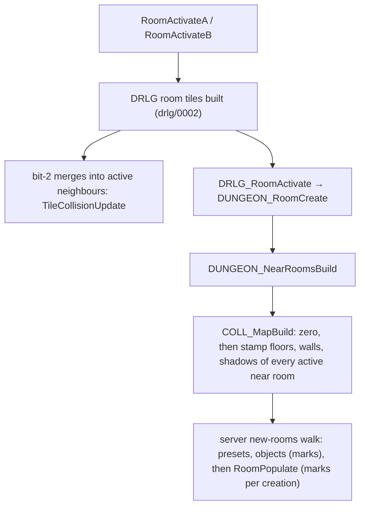

# 0005 — The room collision grid, unit marks, logic regions and the spawn position predicates

> **Subsystem:** drlg/collision
> **Question:** What does an active room's u16 collision grid hold when the population pass reads it (tile stamps, unit marks), and how do `CollisionTest`, `LogicRegionIdAt`, `SpawnClassCellTest` and `NearWarpTest` decide?
> **Date:** 2026-10-14 (§ 14: 2026-10-15, plan 0027 Phase 2)   **Plan:** 0017, 0027   **Status:** reproduced (Phase 2, run:2026-10-14-collision, boundary B: the pass-entry grid snapshot is an oracle); Phase 1 static reading, Phase 1b cross-check (two contradictions corrected, both reproduced in Phase 2)

## Answer (summary)

Phases 1 and 1b are a static reading of the pinned binary (decompile plus disassembly for the register arguments). Phase 2
(run:2026-10-14-collision, § 13) reproduced the grid at activation cell for cell and every position predicate of the
population pass, so the claims it exercised are `[C]`. What it did not reach stays `[I]` and is listed in § 13.

- [C] **The grid** is a `CollMap` built once per active room by `COLL_MapBuild`, called from `DUNGEON_RoomCreate` at the end
  of `DRLG_RoomActivate`. Its rectangle is exactly the room's subtile rectangle (no border cells). Its cells start at 0. Then
  every floor, wall and shadow tile entry of the room **and of every active room in its near list** is stamped, provided
  the entry's top-left subtile lies inside this room. The stamp ORs the tile's 25 DT1 sub-tile bytes, rows reversed, plus three
  bits that come from the tile entry's flags (`0x10`, `0x01`, `0x04`). No tile is skipped for its orientation or its hidden flag.
  1439 activation dumps, 0 cells differ; the entry flag `0x80` → `0x04` was never seen. (fn:COLL_MapBuild@0x0064C900, fn:COLL_StampTileList@0x0064C790, fn:COLL_StampTile@0x0064C4C0, fn:DUNGEON_RoomCreate@0x00619890, struct:CollMap+0x20, run:2026-10-14-collision)
- [C] **What a room's grid contains depends on activation order.** A room's border tiles (column `w` and row `h` of its
  (w+1)×(h+1) cell grids) lie inside the right or bottom neighbour. They reach that neighbour's grid only if the neighbour
  is activated *after* this room. A grid is never re-stamped when a neighbour activates later. The one later tile write is
  the bit-2 merge into an already active neighbour: it clears the old tile and stamps the new one (`TileCollisionUpdate`;
  that write stays `[I]`, the run's 4 calls had the tile in no active room). 702 rooms activated after their right or bottom
  neighbour; their 5970 border tiles reached no grid, and the dumps agree. (run:2026-10-14-collision, fn:DUNGEON_NearRoomsBuild@0x00619800, fn:sub_0064C860_TileCollisionUpdate@0x0064C860, fn:sub_0066E740_Bit2TileMerge@0x0066E740)
- [C] **Unit marks.** Players (`0x80`) and monsters (`0x100`) mark through a footprint *pattern* chosen from their size:
  size 0 marks nothing; size 1 or 2 marks a plus of five cells plus `0x1000` on the centre; size 3 marks the 3×3 square plus
  `0x1000` on the plus. A non-interactive NPC uses `0x2000` instead of `0x1000` (`[I]`, not reached). A wraith is created with
  the plus only (pattern 5), but **the post-create pattern refresh gives it pattern 1** (plus and `0x1000` centre) before the
  next placement (§ 5, corrected at Phase 2). Players `[I]` (seen only in the R3 residue). Ground items mark one cell `0x200`.
  Objects mark a `SizeX`×`SizeY` rectangle when `HasCollision` is set for their mode, with `0x400`, `0x800`, `0x4`, `0x2` or `0x8000`
  from the object table. A dead monster re-marks as a plus of `0x8000` only when its MonStats2 `deadCol` is 0 (with `deadCol` 1 it keeps its live
  mark); a dead player marks a 3×3 square of `0x8000`. Missiles mark nothing at creation, but a missile whose Missiles `Collision` is set
  takes mark mask `0x40` right after (corrected at Phase 1b, see *Leads used*). Every mark is made **at creation**
  (`SUnitCreate` with flag 1). So the preset units and the objects of `RoomObjectsPopulate` are in the grid before the
  population pass, and each monster the pass creates marks before the next placement test. Monsters, corpses (`deadCol` 0 and 1)
  and missiles are reproduced. The object marks are reproduced too since plan 0027 Phase 2 (§ 14): 1847 marks with masks
  `0x400`, `0x404`, `0x806` and `0x8000` (a portal), every one predicted from the Objects columns and compared. The item mark
  (`0x200`) stays `[I]`: its 71 marks are applied from the log.
  (run:2026-10-14-collision, fn:sub_00649CA0_PathPatternRefresh@0x00649CA0, fn:UNIT_CollMark@0x00649400, fn:PATH_DynamicCreate@0x00649D00, fn:PATH_PatternFromSize@0x00648580, fn:COLL_PatternMark@0x0064EA90, fn:UNIT_GetCollMask@0x006209D0, fn:sub_00554850_SUnitPathCreate@0x00554850)
- [C] **`CollisionTest(room, x, y, size, mask)`** looks the cell up in the room at (x, y), searching the hint room and its
  near list. Size 0 and 1 test one cell, size 2 the plus of five cells, size 3 the 3×3 square, and any other size
  returns `0xFFFF`. The result is the OR of `cell & mask` over the footprint. A footprint cell that lies outside every
  room reachable from the hint contributes `0x27` **unmasked**. A plus whose centre has no room returns the mask itself.
  Sizes 2 and 3 reproduced (1764 calls); sizes 0 and 1 as placement tests and the `0xFFFF` value stay `[I]`.
  (run:2026-10-14-collision, fn:sub_0064D9B0_CollisionTest@0x0064D9B0, fn:COLL_CellTest@0x0064D450, fn:COLL_PlusTest@0x0064D100, fn:COLL_Square3Test@0x0064D4A0, fn:COLL_RectTest@0x0064CEB0)
- [C] **The spawn masks by bit** (`0x3C01` and `0x3F11` reproduced; `0x01C0` and `0` stay `[I]`). `0x3C01` (default, `spawnCol` 0 and 4+): tile bit 0, objects `0x400`, doors `0x800`, and the
  unit centre bits `0x1000` and `0x2000`. It does **not** include the monster bit `0x100`. `0x01C0` (`spawnCol` 1): units only (`0x40`,
  players, monsters). `0x3F11` (`spawnCol` 2): tile bits 0 and 4, monsters, items, objects, doors, centre bits. `0` (`spawnCol` 3): always free
  inside a room. Table in § 6. (run:2026-10-14-collision, fn:sub_005B2A00_MonSpawnTry@0x005B2A00, fn:PATH_MonTestMask@0x00648480)
- [C] **Logic regions.** `Logicals` 0 gives one box, the room rectangle, with region id **1**. It also resets the level counter
  `+0x1DC` to 1. `Logicals` 1 runs a recursive 4-way flood over the room's (w+1)×(h+1) tiles. Floor cells take the current id.
  Wall-layer-0 cells are barriers whose orientation decides, through a 5-row table, which directions the flood
  continues. The cells are then cut into rectangular boxes and merged with the regions of same-level neighbour rooms. `LogicRegionIdAt` returns the id of the box under the tile, −1 when there is no box, and
  0 when no room holds the point. 378 floods (id grid, box list, level counter) and 2665 `LogicRegionIdAt` calls reproduced;
  the barrier grid is an input and the neighbour merge is only counted. (run:2026-10-14-collision, fn:sub_0066CCB0_LogicBoxSingle@0x0066CCB0, fn:LOGIC_FloodFill@0x0066C3D0, fn:sub_0066CA50_LogicBoxesFromGrid@0x0066CA50, fn:sub_0061B130_LogicRegionIdAt@0x0061B130)
- [C] **`SpawnClassCellTest`** passes every class except five `BaseId`s, which run a size-2 test at an offset cell:
  206 (0, +3) and 228 (0, +2) and 528 (+2, +4) with `0x3C01`, 334 (−2, −2) with `0x1C0`, and 298 at (0, 0) with `0x3C01` unless its last argument is non-zero (the pass passes 1). **`NearWarpTest`** compares the squared
  subtile distance with `Levels.WarpDist` against the **level's** warp points (DRLG room centres, built at level init from
  room flags that `drlg/warps` sets) and against the level's waypoint point. The waypoint lookup can initialise the level,
  activate the waypoint room and, in `Position` levels, step the level seed. `BaseId`s 206 and 298 and the pass-through are
  reproduced (1782 calls); 228, 334 and 528 stay `[I]`. `NearWarpTest` reproduced on 1645 calls, with the room activation
  (17, any level) and the level-seed step (Tristram, 20 calls) observed. (run:2026-10-14-collision, fn:sub_005FD350_SpawnClassCellTest@0x005FD350, fn:sub_0054DB50_NearWarpTest@0x0054DB50, fn:sub_006423D0_LevelWarpPointsBuild@0x006423D0, fn:sub_0066AC40_LevelPointPick@0x0066AC40)
- [C] **Boundary B (§ 12), ruled and run:** the grid snapshot at pass entry is the oracle, R3 measured it (§ 13).
  The original recommendation: log a grid snapshot at pass entry (the room and its near rooms) and model
  only the in-pass marks and the four predicates. Separately, check the tile half end to end at activation (the cell-for-cell dumps
  that Phase 2 already requires). Take the warp points as logged inputs. (run:2026-10-14-collision, fn:COLL_MapBuild@0x0064C900, fn:sub_0054EC90_RoomPopulate@0x0054EC90)

## Leads used

No community lead was used to locate or read this code. It was found from the anchors already in
[drlg/0001](0001-ds1-dt1-readers.md#sub-tile-flags-into-the-collision-map) and
[monsters/0002 § 6](../monsters/0002-room-population.md#6-placement-monspawntry), and from the `.\COLLISN\Collisn.cpp`
allocation string. The bit meanings are from code (no lead). They are named here by their writers and readers, blind,
before Phase 1b read any community document. Data used: the DT1 survey
([fmt:dt1 § Sub-tile flags survey](../../formats/dt1.md#sub-tile-flags-survey-plan-0017-phase-0)), the MonStats2 survey
([MonStats2 § Footprint and collision columns](../../tables/MonStats2.md#footprint-and-collision-columns-plan-0017-phase-0)),
and an `excel_bin.py probe` of `objects` (§ 6).

### Phase 1b community cross-check (2026-10-14)

Blind first: every claim above was written from the code in Phase 1, before any community source was fetched. The sources
below were fetched and read on 2026-10-14 and are registered in [sources.md](../../sources.md). Agreement promotes nothing.
Searches made: "DT1 format sub-tile flags walk line of sight jump player walk block bits Diablo II", "Phrozen Keep DT1 file
format subtile flags", "d2mods knowledge base dt1 format subtile flags 0x01 block walk 0x02 light of sight 0x04 jump",
"Paul Siramy dt1 format sub-tile flags walkable line of sight", "Diablo II monstats2 SizeX SizeY collision footprint spawnCol
objects.txt BlocksVis BlockMissile HasCollision", and three more for the MonStats2 and Objects knowledge-base guides (not
located; the PK article ids 361–380 were scanned by title). Rejected and not used: `src:siramy-dt1-doc` (the only
community document that numbers the DT1 sub-tile bits; it ships C decoder routines), `src:pk-pathfinding-thread`
(reverse-engineered in-memory structs and code) and `src:opendiablo2-dt1` (a reimplementation's source, not opened). So
**no admissible source numbers the DT1 sub-tile bits beyond bit 0**. Two claims were `contradicted`; both were re-read with
r2 and corrected in place (§ 5 table, § 6 rows 6 and 15), and both are required Phase 2 cases (plan 0017 log).

**DT1 sub-tile bits** (the grid bits 0–7 that the stamp ORs in, § 1 and § 6)

- [L] src:pk-walkable-thread: "00 means walkable, 01 means unwalkable for floor tiles." src:siramy-ds1edit: the walkable
  info layer shows "walkable & jump infos" from the DT1. **held with refinement**
  Detail: bit 0 is the walk-block bit of every spawn and move mask that names terrain (`0x3C01`, `0x3401`, `0x1C09`, `0x3F11`);
  it comes from wall and shadow tiles as well as floors, and a whole tile can gain it from the entry flag `0x40` (§ 1).
  `spawnCol` 1 (`0x01C0`) and the flying mask `0x1804` ignore it.
- [L] src:siramy-ds1edit: "If you set the Unwalkable bit to 1, then the entire Tile becomes unwalkable … without having to
  play with DT1 walkable infos." **held with refinement**
  Detail: the code has two whole-tile adders from DS1/maze cell bits: cell bit 17 → entry `0x40` → grid `0x01` (walk), and
  cell bit 16 → entry `0x80` → grid `0x04` (§ 1). The source does not say which cell bit the editor's "Unwalkable" bit is;
  the Phase 2 activation dumps show it.
- [L] src:pk-walkable-thread: "other flags … blocking light radius, blocking missiles" (no bit numbers).
  src:pk-dt1-advanced, src:pk-subtile-flags-thread, src:d2dfg-blizzard: no bit-level statement. Bit 1 (the line test's
  bit; also written by `BlocksVis` doors), bit 2 (flying and wraith movement; also written by `BlockMissile` objects), bit 3
  (player movement), bit 4 (`0x3F11`, `tombsteps.dt1` only), bit 5 (no reader in the listed masks), bits 6 and 7 (never set
  in any DT1). **not covered**
  Detail: the object columns (below) are consistent with bit 1 = line of sight and bit 2 = missiles, but that is our
  reading of two code paths, not a source statement. The meanings stay as § 6 names them by readers.

**Unit footprints and marks**

- [L] src:d2dfg-blizzard, monstats2 `SizeX & SizeY`: "the tile grid size of the monster which is use for handling placement
  when the monster spawns or uses movement skills." **held with refinement**
  Detail: the size is a footprint class, not a square side: 0 marks nothing, 1 and 2 use the plus (one cell for the size-1
  test), 3 the 3×3 square, with `0x1000` centre bits (§§ 4–5); `SizeY` is never read for monsters.
- [L] src:d2dfg-blizzard, objects `SizeX & SizeY`: "the amount of sub tiles that the object occupies". **held with refinement**
  Detail: the rectangle starts at `x − w/2`, `y − h/2` (unsigned halving), and 1×1 is a single cell (`COLL_RectOrWH`).
- [L] src:d2dfg-blizzard, objects `HasCollision0..7`: collision per object mode. **held**
- [L] src:d2dfg-blizzard, objects `IsDoor`, `BlocksVis` ("relies on the IsDoor field being enabled", blocks line of sight),
  `BlockMissile` ("missiles can collide with this object"). **held with refinement**
  Detail: `BlocksVis` is read only on the door branch (`0x806`), as the guide says. `BlockMissile` adds `0x4` on both
  branches (door `0x804`, other `0x404`). A door with neither marks `0x400`, not the door bit `0x800` (0x006209D0).
- [L] src:d2dfg-blizzard, monstats2 `spawnCol`: 0 "Normal", 1 "Water - … units cannot normally walk, but can fly over",
  2 "Preset - … walls, no pathable areas, objects, doors, items, and other monsters", 3 "Force - Override any collision".
  **held with refinement**
  Detail: 1 is `0x01C0`, which ignores every terrain bit and tests only bits 6–8 (missiles, players, monsters); 2 is
  `0x3F11`, which names exactly the listed blockers (bit 4 being the "no pathable areas" bit by this reading); 3 is mask 0.
  The default 0 (`0x3C01`) does not test the monster bit `0x100` (the § 6 surprise), which the guide does not address.
- [L] src:d2dfg-blizzard, monstats `opendoors`: a monster that cannot open doors "will treat doors as another type of
  collision". **held** (the `opendoors` move mask `0x3401` drops `0x800`.)
- [L] src:d2dfg-blizzard, monstats `flying`: "can affect its collision with the area level and how it is spawned".
  **held with refinement**
  Detail: `flying` selects the move mask `0x1804` (§ 5). The spawn mask in `MonSpawnTry` is chosen by `spawnCol` only in
  the code read; no `flying` test was seen there. Gap to check in Phase 2: a flying class with `spawnCol` 0 placed on a
  bit-0 cell would show a `flying` spawn branch.
- [L] src:d2dfg-blizzard, monstats2 `deadCol`: "If equals 1, then the monster's corpse will have collision with other units.
  If equals 0, then the monster's corpse will not have collision." **contradicted** (finding wrong; corrected)
  Detail: Phase 1 had every dead monster re-marked as a plus of `0x8000`. Re-read: the monster mode handler 0x004AFF60
  tests MonStats2 `+0x06` bit 3 (`deadCol`) at 0x004B05DB and 0x004B09FB and calls `UnitCorpseColl(unit, 0)` only when it is
  0, so a `deadCol` 1 corpse keeps its live `0x100` mark (the guide's "collision"). The same re-read found that
  `UnitCorpseColl` with argument ≠ 0, or for a non-monster, ORs a 3×3 square of `0x8000` (0x00649FD8), and players take
  that branch (0x0057F364). § 5 and § 6 are corrected; the tag stays `[I]`. Required Phase 2 case: a `deadCol` 1 class
  killed in a logged room, with its corpse cells dumped. Backlog: reverser → architect, 2026-10-14.
  Phase 2: reproduced on 12 `deadCol` 1 deaths (`gargoyletrap`, `trappedsoul1`, `trappedsoul2`) and 396 `deadCol` 0 deaths, run:2026-10-14-collision.
  (fn:sub_00649F70_UnitCorpseColl@0x00649F70, tbl:MonStats2.txt:deadCol)
- [L] src:d2dfg-blizzard, missiles `Collision`: "the missile will have a missile type path placement collision mask when it is
  initialized or moved"; the `StillMissileKludge` and `Firewall` functions "set the collision mask to Missile".
  **contradicted** (finding wrong; corrected)
  Detail: Phase 1 had "missiles mark nothing" and no writer of bit 6. Re-read: right after `PATH_DynamicCreate`, the
  missile creator tests the Missiles record byte `+0x184` (`Collision`; `excel_bin.py probe … missiles Collision` matches only
  `+0x184`) and calls `PATH_SetMarkMask(path, 0x40)` when it is set (0x004CD10A–0x004CD11D; same test at
  0x0059FD54–0x0059FD64). 33 of 684 Missiles rows have `Collision` 1 (fire walls, poison clouds, `hydra`, ground fires).
  Bit 6 is therefore the missile bit, read by `spawnCol` 1 (`0x01C0`). § 5 and § 6 are corrected; the tag stays `[I]`.
  Required Phase 2 case: a placement test in a room holding a `Collision` 1 missile, or the bit listed as unreached.
  Backlog: reverser → architect, 2026-10-14.
  Phase 2: the `0x40` mark reproduced (5702 `firewall` missiles, run:2026-10-14-collision); a placement test that reads bit 6 was
  not reached. (fn:PATH_SetMarkMask@0x00648C30, fn:PATH_DynamicCreate@0x00649D00)
- [L] src:d2dfg-blizzard, monstats2 `objCol`: barricade doors and `evilhut` place an invisible object with collision.
  **not covered** by this finding: monsters/0002 § 6 reads the `evilhut` branch (not reached; `objCol` is set on no pool
  class), and its object mark is an object mark of § 5.

## Functions

| Address | Name | Role | Tag |
|---|---|---|---|
| `0x0064C900` | `COLL_MapBuild` | allocate the room's `CollMap` (`.\COLLISN\Collisn.cpp` 0x185) and stamp the tiles of the room and its active near rooms | I |
| `0x0064CA10` | `COLL_MapFree` | free it (from `DUNGEON_RoomFree`) | I |
| `0x0064C790` | `COLL_StampTileList` | per tile entry: origin in this map → stamp (or overwrite), then OR the flag-derived bits over the 5×5 block | I |
| `0x0064C4C0` | `COLL_StampTile` | OR the 25 sub-tile bytes, rows reversed (drlg/0001) | I |
| `0x0064C580` | `COLL_ClearTile` | AND-NOT the 25 bytes | I |
| `0x0064C640` | `COLL_SetTile` | overwrite with the 25 bytes; the build passes 0 and never takes this path | I |
| `0x0064C700` | `COLL_OrTileBlock` | OR one value over a 5×5 block | I |
| `0x0064C860` | `sub_0064C860_TileCollisionUpdate` | in an active room: clear an entry's current tile, stamp a new one if given | I |
| `0x00619890` | `DUNGEON_RoomCreate` | active-room creation; calls `DUNGEON_NearRoomsBuild` then `COLL_MapBuild` | C (rng/0002) |
| `0x00619800` | `DUNGEON_NearRoomsBuild` | near list = the DRLG near list filtered to rooms with an active room; refreshes each active neighbour's list | I |
| `0x00619790` | `DUNGEON_GetNearRooms` | `+0x00` list, `+0x24` count | I |
| `0x00619660` / `0x006196A0` / `0x006196E0` | `DUNGEON_GetFloorTiles` / `DUNGEON_GetWallTiles` / `DUNGEON_GetShadowTiles` | entry array and count from the tile-list view at active room `+0x08` | I |
| `0x0061A010` / `0x0061A040` | `DUNGEON_GetCollMap` / `DUNGEON_SetCollMap` | active room `+0x20` | I |
| `0x0061A840` | `DUNGEON_RoomFree` | flags and releases the room's units, then `COLL_MapFree` | I |
| `0x00619DF0` | `sub_00619DF0_RectContainsPt` | half-open point-in-rectangle on `{x, y, w, h}` | I |
| `0x00463740` | `sub_00463740_RoomAtSubtile` | the hint room if it holds the point, else the first room of its near list that does, else 0 | I |
| `0x0064D9B0` | `sub_0064D9B0_CollisionTest` | test by size 0..3 (scheme A) | I |
| `0x0064D450` / `0x0064CA50` | `COLL_CellTest` / `COLL_CellTestNb` | one cell, `cell & mask` or `0x27`; register forms (EAX = y, EDI = x) | I |
| `0x0064CB30` | `COLL_CellTestAt` | the same, stack form (room, x, y, mask) | I |
| `0x0064D100` | `COLL_PlusTest` | plus of five cells, neighbours across a room edge via `COLL_CellTestNb` | I |
| `0x0064D4A0` | `COLL_Square3Test` | `COLL_RectTest` on (x−1, y−1)..(x+1, y+1) | I |
| `0x0064CEB0` | `COLL_RectTest` | inclusive rectangle, split at the room's right and bottom edges, recursive | I |
| `0x0064CDF0` | `COLL_RectSplit` | split a rectangle into ≤ 3 pieces at the map's right/bottom edges | I |
| `0x0064CC30` / `0x0064CCE0` / `0x0064CD70` | `COLL_RectTestInMap` / `COLL_RectClearInMap` / `COLL_RectOrInMap` | one piece inside one map | I |
| `0x0064CF50` / `0x0064CFF0` / `0x0064D060` | `COLL_RectTestBool` / `COLL_RectClear` / `COLL_RectOr` | rectangle forms across rooms | I |
| `0x0064D870` / `0x0064D910` | `COLL_PatternTest` / `COLL_PatternTestBool` | test by pattern 0..5 (scheme B), value or boolean | I |
| `0x0064D4E0` / `0x0064D7C0` | `COLL_PlusTestBool` / `COLL_Square3TestBool` | boolean forms | I |
| `0x0064D800` | `COLL_WHTest` | w ≤ 1 and h ≤ 1 (signed): `COLL_CellTestNb`; else `COLL_RectTest` on the centred w×h rectangle (§ 14) | C |
| `0x0064DDB0` / `0x0064DB70` / `0x0064CAF0` / `0x0064CAA0` / `0x0064CB90` / `0x0064CBE0` | `COLL_CellOr` / `COLL_CellClear` / `COLL_CellOrA` / `COLL_CellClearA` / `COLL_CellOrAt` / `COLL_CellClearAt` | one-cell OR / AND-NOT | I |
| `0x0064DC80` / `0x0064DA40` | `COLL_PlusOr` / `COLL_PlusClear` | plus of five cells, each cell looked up on its own | I |
| `0x0064DDF0` / `0x0064DBC0` | `COLL_Square3Or` / `COLL_Square3Clear` | 3×3 square | I |
| `0x0064DE30` / `0x0064DC00` | `COLL_RectOrWH` / `COLL_RectClearWH` | w×h rectangle centred as `x − w/2 .. x − w/2 + w − 1`; 1×1 is one cell | I |
| `0x0064EA00` / `0x0064EBA0` | `COLL_SizeMark` / `COLL_SizeUnmark` | mark by size 1..3 (scheme A) | I |
| `0x0064EA90` / `0x0064EC10` | `COLL_PatternMark` / `COLL_PatternUnmark` | mark by pattern 0..5 with the `0x1000`/`0x2000` extras (scheme B) | I |
| `0x0064ED20` / `0x0064EDA0` | `COLL_SizeMove` / `COLL_PatternMove` | unmark, test, re-mark (movement; named only) | I |
| `0x0064DEA0` / `0x0064E840` | `COLL_FindFreeNear` / `COLL_FindFreeSpiral` | nearest free position searches (named only) | I |
| `0x0064E260` | `COLL_LineTest` | line walk with a mask (line of sight and missiles; named only) | I |
| `0x00649D00` | `PATH_DynamicCreate` | dynamic path (players, monsters, missiles): size, pattern, masks; marks when created in a room | I |
| `0x00648580` | `PATH_PatternFromSize` | `g_CollPatternBySize`, NPC upgrade | I |
| `0x00648480` | `PATH_MonTestMask` | monster move mask: `flying` `0x1804`, `opendoors` `0x3401`, else `0x3C01` | I |
| `0x00648C30` | `PATH_SetMarkMask` | unmark, set path `+0x4C`, re-mark | I |
| `0x00649400` / `0x00649560` | `UNIT_CollMark` / `UNIT_CollUnmark` | mark / unmark a unit by type | I |
| `0x00649F70` / `0x00649FF0` | `sub_00649F70_UnitCorpseColl` / `sub_00649FF0_UnitReviveColl` | death (`0x8000`, pattern 5) and revival (`0x100`, pattern by size) | I |
| `0x00620510` / `0x006205A0` | `UNIT_GetSizeX` / `UNIT_GetSizeY` | per unit type: player 2, monster MonStats2 `+0x08`/`+0x09`, object Objects `+0xD0`/`+0xD4`, missile `+0x18A`, item 1 | I |
| `0x006209D0` | `UNIT_GetCollMask` | per unit type mask (object table, item `0x200`, type 5 `1`, else path `+0x4C`); the object branch reproduced (§ 14) | C |
| `0x00620A70` / `0x00623830` | `UNIT_CollMarkRect` / `UNIT_CollUnmarkRect` | static units (objects, items, type 5): `COLL_RectOrWH` / `COLL_RectClearWH`; the mark reproduced for objects (§ 14) | C / I |
| `0x00649CA0` | `sub_00649CA0_PathPatternRefresh` | unmark, pattern = `PATH_PatternFromSize(path +0x44)`, re-mark (no wraith case) | C |
| `0x00554340` / `0x005543B0` | `sub_00554340_MonAlignPatternRefresh` / `sub_005543B0_MonAlignSet` | the post-create alignment setter and its pattern refresh call | I |
| `0x00554850` | `sub_00554850_SUnitPathCreate` | server: per type, create the path and mark | I |
| `0x0063E860` / `0x00457490` / `0x00463860` | `sub_0063E860_MonIsNpc` / `MONSTATS_FlagTest` / `sub_00463860_MonBaseId` | MonStats flag reads | I |
| `0x0066CCB0` | `sub_0066CCB0_LogicBoxSingle` | `Logicals` 0: one box, id 1 | I |
| `0x0066D110` | `sub_0066D110_LogicRegionsFromDs1` | `Logicals` 1: barrier grid, flood, boxes, wall boxes, neighbour merge | I |
| `0x0066C870` | `LOGIC_BarrierGridBuild` | barrier cells from wall-layer-0 entries (own and neighbours' merge nodes) | I |
| `0x0066C7F0` | `sub_0066C7F0_LogicWallGridFlag` | ORs 8 into the DS1 wall grid for wall entries with flag 4 and no layer bits | I |
| `0x0066C580` / `0x0066C3D0` | `LOGIC_FloodAll` / `LOGIC_FloodFill` | id allocation per unvisited cell; recursive fill | I |
| `0x0066CA50` | `sub_0066CA50_LogicBoxesFromGrid` | greedy rectangles of equal ids → boxes | I |
| `0x0066C9C0` | `sub_0066C9C0_LogicWallBoxes` | wall entry `+0x10` → its box | I |
| `0x0066D040` / `0x0066CF60` / `0x0066C770` | `LOGIC_NeighbourMerge` / `LOGIC_EdgeMerge` / `LOGIC_RegionRelabel` | merge regions across the edges of same-level neighbours | I |
| `0x0066CE30` / `0x0061B130` | `sub_0066CE30_LogicRegionIdAtTile` / `sub_0061B130_LogicRegionIdAt` | region id at a point | I |
| `0x005FD350` | `sub_005FD350_SpawnClassCellTest` | five `BaseId`s test an offset cell | I |
| `0x0054DB50` | `sub_0054DB50_NearWarpTest` | warp-point and waypoint distance test | I |
| `0x0061AC10` / `0x006423D0` | `sub_0061AC10_RoomLevelWarpPoints` / `sub_006423D0_LevelWarpPointsBuild` | the level's warp point list `+0x1E0`/`+0x204`/`+0x228` | I |
| `0x00619E50` / `0x0066B2B0` / `0x0066AC40` / `0x0066AD80` | `sub_00619E50_ActLevelPointFind` / `sub_0066B2B0_LevelPointFind` / `sub_0066AC40_LevelPointPick` / `sub_0066AD80_LevelWaypointRoom` | level point of a type (11 = waypoint), shared with `WaypointTravel` | I |
| `0x005B2700` | `sub_005B2700_SpawnPosOnTile` | `spawnCol` 1 placement: floor tile centres, `0x100` and `0x1C09` tests | I |
| `0x006EB3DC` | `g_CollPatternBySize` | size 0..3 → pattern 0, 1, 1, 2 | I |
| `0x006E2D50` | `g_SpawnTileOffsets` | (0, −3), (3, 0), (0, 3), (−3, 0) | I |
| `0x006EEE14` / `0x006EEE3C` / `0x006EEEA0` | `g_LogicFloodDirs` / `g_LogicFloodRules` / `g_LogicFloodOrientRow` | flood direction offsets, barrier rules, orientation → rule row | I |

## Walkthrough

### 1. The grid and its owner

```c
// fn:COLL_MapBuild@0x0064C900 (from the disassembly, renamed). EDX = active room R.
RoomRectGet(R, rect8);                         // R+0x4C: x0, y0, w, h (subtiles), then the tile rectangle
m = Alloc(2 * (w*h + 2*h + 0x12));             // .\COLLISN\Collisn.cpp line 0x185: 0x24 header, w*h cells, 2*h slack cells
copy rect8 -> m[0..7];  R+0x20 = m;  m+0x20 = m+0x24;  memset(m+0x24, 0, 2*w*h)
for n in NearRooms(R):                         // R+0x00, count R+0x24 (self included)
  t = n+0x20  /* n's CollMap: only its tile origin +0x10/+0x14 is read */
  StampTileList(m, t, floors(n), 0);  StampTileList(m, t, walls(n), 0);  StampTileList(m, t, shadows(n), 0)

// fn:COLL_StampTileList@0x0064C790
for e in entries:                               // 0x30 bytes each
  sx = (e.x + t.tx) * 5;  sy = (e.y + t.ty) * 5 // tile -> subtile
  if !RectContainsPt(m, sx, sy): continue       // half-open {x0, y0, w, h}
  StampTile(m, row = sy - m.y0, col = sx - m.x0, e.tile)    // OR, rows reversed (drlg/0001)
  v = (e.flags & 0x02 ? 0x10 : 0) | (e.flags & 0x40 ? 0x01 : 0) | (e.flags & 0x80 ? 0x04 : 0)
  if v: OrTileBlock(m, row, col, v)             // the same 5x5 block
```

- [C] `COLL_MapBuild` is called once, from `DUNGEON_RoomCreate` (`0x00619946`). That is the last step of `DRLG_RoomActivate`, after the
  DRLG room's tiles are built. The room then exists until `DUNGEON_RoomFree`, which frees the map. No other caller
  allocates a map. (run:2026-10-14-collision, fn:DUNGEON_RoomCreate@0x00619890, fn:DRLG_RoomActivate@0x006422A0, fn:DUNGEON_RoomFree@0x0061A840, fn:COLL_MapFree@0x0064CA10)
- [C] The rectangle is the active room's subtile rectangle `{x0, y0, w, h}` = the DRLG room's tile rectangle ×5 (`DRLG_RoomActivate`
  passes `TileToSubtile` of `+0x34..+0x40`). Cell (x, y) is `cells[(y − y0)·w + (x − x0)]`. There are no border cells, and the
  `2·h` cells of slack after the grid are never addressed by the code read. (run:2026-10-14-collision, fn:COLL_MapBuild@0x0064C900, struct:CollMap+0x20, struct:DungeonRoom+0x4C)
- [C] The **near list** is the DRLG room's near list (DRLG `+0x08`, count `+0x2C`) filtered to entries whose active room (DRLG `+0x30`)
  exists, in near-list order. `DUNGEON_RoomCreate` sets the DRLG room's `+0x30` before the list is built, so the room is in its
  own list (the refresh loop skips the entry equal to the room). Each already-active neighbour's list is rebuilt to include the new
  room. Its **grid is not touched**. (run:2026-10-14-collision, fn:DUNGEON_NearRoomsBuild@0x00619800, struct:DungeonRoom+0x00, struct:DungeonRoom+0x24)
- [C] Tile entry → grid position: the entry's `+0x08`/`+0x0C` are tiles relative to its own DRLG room. The origin is read from the
  **owning** room's `CollMap` (`+0x10`/`+0x14`, the tile rectangle copied from the room). Only entries whose top-left subtile falls
  inside the building room are stamped. Rooms are tile-aligned, so such a tile lies wholly inside the room, and the stamp's missing
  upper clip never matters. (run:2026-10-14-collision, fn:COLL_StampTileList@0x0064C790, fn:sub_00619DF0_RectContainsPt@0x00619DF0, struct:RoomTileEntry+0x08)
- [C] **Which tiles.** All three entry arrays: floors (DRLG RoomTile `+0x1C`), walls (`+0x14`, which holds every non-floor, non-shadow
  orientation, roofs 15 included) and shadows (`+0x24`, orientation 13), up to the used counts. Nothing is skipped by orientation or
  by the hidden flag `0x08`. Orientation enters only through the entry flag `0x02`. `RoomTileSetFlags` sets it for orientations 8–11
  and for cell bit 28, and the stamp turns it into grid bit `0x10` over the whole tile. Cell bit 17 gives `0x40` → grid `0x01`, and
  cell bit 16 gives `0x80` → grid `0x04`. The OR order does not change the result. (run:2026-10-14-collision, fn:COLL_StampTileList@0x0064C790, fn:sub_0066DB20_RoomTileSetFlags@0x0066DB20, fn:DUNGEON_GetWallTiles@0x006196A0, fn:DUNGEON_GetFloorTiles@0x00619660, fn:DUNGEON_GetShadowTiles@0x006196E0, struct:RoomTileEntry+0x14)
- [C] **Border cells and activation order** (run:2026-10-14-collision, fn:sub_0066EC10_RoomCellsBuild@0x0066EC10). A DRLG room's cell grids are (w+1)×(h+1) and `RoomCellsBuild` builds column `w` and
  row `h` unless `KillEdge` applies (drlg/0002). Those tiles have their origin in the right or bottom neighbour. So:
  - room R's grid receives R's own tiles at columns/rows 0..w−1 / 0..h−1, plus the border tiles of every left or top
    neighbour that is **already active** when R activates;
  - a neighbour that activates later never adds its border tiles to R's grid, and R's own border tiles reach the later
    neighbour's grid when that neighbour builds (R is then in its near list).

  A model of the grid must know which near rooms were active at R's activation. The cells on R's first column and row can
  hold one tile from R and one from the neighbour (the same DS1/maze cell built by both rooms), OR-ed.
  (fn:COLL_MapBuild@0x0064C900, fn:DUNGEON_NearRoomsBuild@0x00619800, fn:sub_0066EC10_RoomCellsBuild@0x0066EC10)



### 2. Later tile writes

- [I] `TileCollisionUpdate(activeRoom, entry, newTile)` (fn:sub_0064C860_TileCollisionUpdate@0x0064C860) finds the room holding the entry's subtile (hint search), clears the entry's
  **current** tile (`+0x18`) with `COLL_ClearTile`, and stamps `newTile` if it is non-zero. Its only callers are in
  `Bit2TileMerge` (the merge into a neighbour's existing entry during a new room's tile build, drlg/0002). Each call passes the
  neighbour's active room (`+0x30`), so a neighbour that is not active is skipped. The three calls are:
  - `0x0066E822`: an orientation-3 entry merged into another orientation. Its orientation-4 partner (`+0x20`) gets the hidden flag
    `0x08` and its bits are cleared, with no re-stamp.
  - `0x0066E8B6`: an entry turned into orientation 3. It gets `0xC008` and its bits are cleared, with no re-stamp. The new orientation-3
    tile is added to the *building* room instead.
  - `0x0066E916`: a re-picked tile. The old bits are cleared and the new tile is stamped.

  The clear is a plain AND-NOT, so it also removes the same bits that a different tile stamped into those cells (for example
  the floor's bit 0 under a wall). (fn:sub_0064C860_TileCollisionUpdate@0x0064C860, fn:sub_0066E740_Bit2TileMerge@0x0066E740, fn:COLL_ClearTile@0x0064C580)
- [I] So hidden tiles enter the grid at a room's build like any other tile. The only exception is a hidden flag set by a bit-2 merge
  after the neighbour was active: that clears the bits. An entry that was already hidden when a *later* room stamps it is stamped
  in full. (fn:COLL_StampTileList@0x0064C790, fn:sub_0066E740_Bit2TileMerge@0x0066E740)

### 3. Cell access and the out-of-room values

- [C] Every primitive locates its cell with `RoomAtSubtile(hint, x, y)`. That function returns the hint if its subtile rectangle holds the
  point. Otherwise it returns the first room of the hint's near list that does, or 0. A cell in an active room that is not in the hint's near list
  is therefore "outside". Then it reads `DUNGEON_GetCollMap` and requires `cells` non-null. (run:2026-10-14-collision, fn:sub_00463740_RoomAtSubtile@0x00463740, fn:DUNGEON_GetCollMap@0x0061A010)
- [C] Values when no cell is found: the one-cell tests return `0x27` (bits 0, 1, 2, 5), **not masked**. `COLL_RectTest` returns `0x27`
  for a piece whose top-left has no room, also unmasked. `COLL_PlusTest` returns **the mask** when its centre has no room or map,
  and also for a degenerate map one cell wide or high (jump-table default). Writes to such cells are dropped.
  (run:2026-10-14-collision, fn:COLL_CellTest@0x0064D450, fn:COLL_CellTestNb@0x0064CA50, fn:COLL_RectTest@0x0064CEB0, fn:COLL_PlusTest@0x0064D100)

### 4. `CollisionTest` and the footprints

```text
CollisionTest(room, x, y, size, mask) -> u16:                     [C] (run:2026-10-14-collision, fn:sub_0064D9B0_CollisionTest@0x0064D9B0)
  size 0, 1: CellTest(room, x, y, mask)
  size 2:    PlusTest(room, x, y, mask)
  size 3:    RectTest(room, {x-1, y-1, x+1, y+1}, mask)
  other:     0xFFFF

CellTest(h, x, y, mask):  r = RoomAtSubtile(h, x, y); no r or no cells -> 0x27; else cell(r, x, y) & mask
PlusTest(h, x, y, mask):  r = RoomAtSubtile(h, x, y); no r or no cells -> mask
  edge = (x == r.x0) | (y == r.y0) << 1 | (x == r.x0+r.w-1) << 2 | (y == r.y0+r.h-1) << 3
  result = (OR of cell(r, c) over the five cells inside r) & mask
         | OR of CellTest(r, c, mask) over the cells that the edge bits put outside r      ; 0x27 each if no room
  edge in {5, 7, 10, 11, 13, 14, 15}: mask
RectTest(h, R, mask):     r = RoomAtSubtile(h, R.left, R.top); none -> 0x27
  pieces = RectSplit(R at r's right edge x0+w and bottom edge y0+h)    ; ≤ 3 pieces, see below
  result = OR over cells of piece 0 of (cell & mask) | OR of RectTest(r, piece k, mask) for k ≥ 1
```

- [C] `COLL_RectSplit`: piece 0 is R clipped to r's right and bottom edges. When `R.right ≥ x0 + w`, piece 1 is
  `{x0 + w, R.top, R.right, R.bottom}` (full height). When `R.bottom ≥ y0 + h`, the next piece is `{R.left, y0 + h, clipped right, R.bottom}`.
  An inverted rectangle gives 0 pieces and the test returns `0x27`. (run:2026-10-14-collision, fn:COLL_RectSplit@0x0064CDF0, fn:COLL_RectTest@0x0064CEB0)
- [I] All values are u16. A non-zero result rejects the cell in `MonSpawnTry` (monsters/0002 § 6). Sizes 2 and 3 are the pool's footprints
  (MonStats2 `SizeX` 2: 238 pool classes, 3: 123). Size 0 (`baaltaunt`) tests one cell and marks nothing (§ 5).
  (fn:sub_005B2A00_MonSpawnTry@0x005B2A00, tbl:MonStats2.txt:SizeX)
- [I] The movement readers use a second numbering, the **pattern** (path `+0x48`): `COLL_PatternTest` tests pattern 0 as one cell, 1, 3 and 5 as the plus,
  2 and 4 as the 3×3 square, and returns `0xFFFF` for anything else. `COLL_PatternTestBool` is the boolean form (1 for an unknown pattern).
  (fn:COLL_PatternTest@0x0064D870, fn:COLL_PatternTestBool@0x0064D910)

### 5. Unit marks

```text
UNIT_CollMark(u):                                                  [C] monsters (run:2026-10-14-collision), [I] the other types (fn:UNIT_CollMark@0x00649400)
  type 0 player, 1 monster: PatternMark(room(u), x, y, path.pattern +0x48, UNIT_GetCollMask(u) = path.markMask +0x4C)
  type 2 object:            RectOrWH(room(u), x, y, SizeX(u), SizeY(u), UNIT_GetCollMask(u))
  type 3, 4, 5:             SizeMark(room(u), x, y, UNIT_GetSizeX(u), UNIT_GetCollMask(u))

PatternMark(r, x, y, p, m):                                        [C] patterns 1, 2, 5 (run:2026-10-14-collision), [I] 3, 4 (fn:COLL_PatternMark@0x0064EA90)
  0: nothing
  1: PlusOr(m);    if m: CellOr(x, y, 0x1000)
  2: Square3Or(m); if m: PlusOr(0x1000)
  3: PlusOr(m);    if m: CellOr(x, y, 0x2000)
  4: Square3Or(m); if m: PlusOr(0x2000)
  5: PlusOr(m)
SizeMark(r, x, y, s, m): 1: CellOr(m);  2: PlusOr(m);  3: Square3Or(m);  else nothing   [I] (fn:COLL_SizeMark@0x0064EA00)
RectOrWH(r, x, y, w, h, m): w = h = 1: CellOr(m); else RectOr({x - w/2, y - h/2, x - w/2 + w - 1, y - h/2 + h - 1}, m)  ; w/2 unsigned shift   [I] (fn:COLL_RectOrWH@0x0064DE30)
```

- [C] Every OR and AND-NOT looks up each cell's room separately (`PlusOr` makes five lookups). A footprint therefore spans room edges, and its
  cells outside every reachable room are dropped. Unmarking uses the same footprint with AND-NOT. No bit is reference-counted:
  unmarking one unit clears a `0x1000` that an overlapping unit also set. (run:2026-10-14-collision, fn:COLL_PlusOr@0x0064DC80, fn:COLL_PatternUnmark@0x0064EC10, fn:UNIT_CollUnmark@0x00649560)
- [C] **Pattern from size** (`PATH_PatternFromSize`, at path creation and on revival): `g_CollPatternBySize` = {0: 0, 1: 1, 2: 1, 3: 2}, any
  size > 3 (unsigned) gives 1. For a monster with MonStats `npc` and not `interact`, 1 → 3 and 2 → 4. (run:2026-10-14-collision, fn:PATH_PatternFromSize@0x00648580, data:g_CollPatternBySize@0x006EB3DC, fn:sub_0063E860_MonIsNpc@0x0063E860, fn:MONSTATS_FlagTest@0x00457490, tbl:MonStats.txt:npc, tbl:MonStats.txt:interact)
- [I] **Sizes** (`UNIT_GetSizeX`): player 2, monster MonStats2 `SizeX` (`+0x08`, signed byte), object Objects `SizeX` (`+0xD0`), missile Missiles `+0x18A`, item 1,
  type 5 0. `UNIT_GetSizeY` reads MonStats2 `+0x09` and Objects `+0xD4`. Only objects use Y. (fn:UNIT_GetSizeX@0x00620510, fn:UNIT_GetSizeY@0x006205A0, tbl:MonStats2.txt:SizeX)
- [I] **Masks** (fn:PATH_DynamicCreate@0x00649D00, fn:UNIT_GetCollMask@0x006209D0):

| Unit | Footprint | Mark mask | Move test mask | Tag |
|---|---|---|---|---|
| player | pattern 1 (size 2) | `0x80` | `0x1C09` | I |
| monster | pattern by `SizeX` (wraith `BaseId` 38: pattern 5 at creation, pattern by `SizeX` after the post-create refresh) | `0x100` | `flying` `0x1804`; `opendoors` `0x3401`; else `0x3C01`; wraith `0x804` | C (marks; the move masks I) |
| dead monster, MonStats2 `deadCol` 0 (corpse call with argument 0) | pattern 5 (plus) | `0x8000` | — | C |
| dead monster, `deadCol` 1 | unchanged: the corpse call is skipped and the live mark stays (0x004B05DB, 0x004B09FB) | `0x100` (unchanged) | — | C |
| dead player (mode 0 or 17), or any corpse call with argument ≠ 0 | 3×3 square, `RectOrWH(room, x, y, 3, 3, …)` (0x00649FD8) | `0x8000` | — | I |
| missile | size `+0x18A` | 0 at creation; `0x40` set at once by `PATH_SetMarkMask` when Missiles `Collision` (`+0x184`) ≠ 0 (0x004CD10A–0x004CD11D, 0x0059FD54–0x0059FD64) | 0 | C (`firewall`, size 1) |
| item on the ground (mode 3) | one cell | `0x200` | — | I |
| object, `IsDoor` 0 | `SizeX`×`SizeY` | `SubClass` bit 2 (the two `Portal` rows): `0x8000`; else `0x400`, `\| 0x4` if `BlockMissile` | — | C (§ 14) |
| object, `IsDoor` 1 | `SizeX`×`SizeY` | `BlocksVis`: `0x806`; else `BlockMissile`: `0x804`; else `0x400` | — | C for `0x806`, I for the other two (§ 14) |
| type 5 | size 0 (nothing written) | `0x01` | — | I |

  (run:2026-10-14-collision for the rows tagged C: 410 creations, 396 `deadCol` 0 and 12 `deadCol` 1 deaths, 5702 missile marks;
  fn:PATH_DynamicCreate@0x00649D00, fn:PATH_MonTestMask@0x00648480, fn:UNIT_GetCollMask@0x006209D0, fn:sub_00649F70_UnitCorpseColl@0x00649F70, fn:sub_00463860_MonBaseId@0x00463860, tbl:MonStats.txt:flying, tbl:MonStats.txt:opendoors)
- [C] **The marks of one creation in the pass** (seen on all 410 creations of the run): inside `SUnitCreate`, `UNIT_CollMark` runs
  **twice** with the same pattern and `0x100` (both calls return to `0x006494D5`; the callers were not read). Then, before `0x005B2EE4`,
  the post-create alignment setter `sub_005543B0_MonAlignSet` calls `sub_00554340_MonAlignPatternRefresh`, which calls
  `sub_00649CA0_PathPatternRefresh`: `UNIT_CollUnmark(unit, 1)`, pattern `+0x48` = `PATH_PatternFromSize(unit, path +0x44)`,
  `UNIT_CollMark`. `PATH_PatternFromSize` has no wraith case, so a wraith's pattern 5 becomes pattern 1 (4 of 4 `wraith2`
  creations); for every other class the pattern is unchanged. (run:2026-10-14-collision, fn:sub_00649CA0_PathPatternRefresh@0x00649CA0, fn:sub_00554340_MonAlignPatternRefresh@0x00554340, fn:sub_005543B0_MonAlignSet@0x005543B0, fn:PATH_PatternFromSize@0x00648580)
- [I] The object columns are read at Objects record `+0x120 + mode` (`HasCollision0..7`), `+0x13A` (`IsDoor`), `+0x13B` (`BlocksVis`),
  `+0x167` (`SubClass`), `+0x1B6` (`BlockMissile`), `+0xD0`/`+0xD4` (`SizeX`/`SizeY`). Each column name is the only `.txt` column that
  `python3 -I tools/excel_bin.py probe workspace/merged/data/global/excel objects` matches at that offset over all 573 records. There is no
  Objects table doc (backlog). The two `SubClass` & 4 rows are ids 59 and 60, `Portal`. (fn:UNIT_GetCollMask@0x006209D0, fn:sub_00554850_SUnitPathCreate@0x00554850)
- [C] **When a mark is added** (run:2026-10-14-collision, fn:sub_00554850_SUnitPathCreate@0x00554850). `SUnitCreate` with flag bit 0 calls `sub_00554850_SUnitPathCreate`:
  - players, monsters and missiles: `PATH_DynamicCreate(…, room)` marks at once when the room is non-null;
  - objects: `UNIT_CollMarkRect` when `HasCollision[mode]`;
  - items: only in mode 3.

  `MonSpawnTry` passes create flags 1 or 3, the object populators pass 1 (`0x0054F131`, `0x00550526`, `0x005520DD`, `0x005522F0`), and
  so does the preset dispatch (`0x00555843`). So **objects placed by the preset units and by `RoomObjectsPopulate` mark the grid before
  the population pass**, and every monster the pass creates (leader, members, minions) marks before the next `MonSpawnTry` test.
  A monster created dead (`0x0063EA40`) is re-marked as a corpse at the end of `SUnitCreate`. (fn:sub_00555230_SUnitCreate@0x00555230, fn:sub_00554850_SUnitPathCreate@0x00554850, fn:sub_005557D0_PresetUnitDispatch@0x005557D0, fn:sub_00552610_RoomObjectsPopulate@0x00552610)
- [I] **Moved and removed.** A move unmarks the old footprint, tests the new one, and marks the new one, or marks the old one again if the move
  is refused (`COLL_SizeMove`, `COLL_PatternMove`, from the path code `0x0064FF90`, which also maps a `0x3401` test mask to `0x3C01`).
  Teleports use `0x00650910`/`0x00650AA0`/`0x00650CA0`. A mask change (`PATH_SetMarkMask`) unmarks and re-marks. Death goes through
  `sub_00649F70_UnitCorpseColl`: with argument 0 and a monster it unmarks, sets pattern 5 and mask `0x8000` and re-marks; otherwise it unmarks and
  ORs a 3×3 square of `0x8000` (players pass 1 from `PlrModes.cpp`, 0x0057F364). The monster mode handler 0x004AFF60 calls it with 0 only when the
  MonStats2 record (`+0x0A90` table, 308-byte records) has `deadCol` (`+0x06` bit 3, through the bit table 0x006CE268) **clear** (0x004B05DB, 0x004B09FB);
  with `deadCol` set the corpse keeps its `0x100` mark (Phase 1b correction). Revival through `sub_00649FF0_UnitReviveColl` (`0x100`, pattern by size, birds 157/158,
  parrot 319 and wraiths get pattern 5). Room release goes through `DUNGEON_RoomFree`. None of these runs inside the population pass in the code read.
  (fn:COLL_PatternMove@0x0064EDA0, fn:COLL_SizeMove@0x0064ED20, fn:PATH_SetMarkMask@0x00648C30, fn:sub_00649FF0_UnitReviveColl@0x00649FF0)

### 6. The u16 word, bit by bit

Writers and readers found in the code read. "Readers" lists the masks named in this finding: the five spawn masks
(`0x3C01` `spawnCol` 0 and 4+, `0x01C0` 1, `0x3F11` 2, `0` 3), the `0x27` out-of-room value, and the move masks of § 5.

| Bit | Mask | Writers | Readers | Tag |
|---:|---|---|---|---|
| 0 | `0x0001` | DT1 sub-tile bit 0; entry flag `0x40` (cell bit 17) over the tile | `0x3C01`, `0x3401`, `0x1C09`, `0x3F11`; in `0x27` | I |
| 1 | `0x0002` | DT1 bit 1; doors with `BlocksVis` | none of the listed masks; `0x27`; line test (named) | I |
| 2 | `0x0004` | DT1 bit 2; entry flag `0x80` (cell bit 16); objects with `BlockMissile` | flying `0x1804`, wraith `0x804`; `0x27` | I |
| 3 | `0x0008` | none found | player `0x1C09` | I |
| 4 | `0x0010` | DT1 bit 4 (`tombsteps.dt1`); entry flag `0x02` (orientations 8–11, cell bit 28) over the tile | `0x3F11` | I |
| 5 | `0x0020` | DT1 bit 5 | none of the listed masks; `0x27` | I |
| 6 | `0x0040` | missiles with Missiles `Collision` set (0x004CD116, 0x0059FD5D; corrected at Phase 1b; the write reproduced in run:2026-10-14-collision, no reader reached) | `0x01C0` | I |
| 7 | `0x0080` | players | `0x01C0` | I |
| 8 | `0x0100` | live monsters | `0x01C0`, `0x3F11`, `SpawnPosOnTile`'s cell test | I |
| 9 | `0x0200` | ground items | `0x3F11` | I |
| 10 | `0x0400` | objects (not portals) | `0x3C01`, `0x3401`, `0x1C09`, `0x3F11` | I |
| 11 | `0x0800` | doors with `BlocksVis` or `BlockMissile` | `0x3C01`, `0x1C09`, `0x1804`, `0x804`, `0x3F11`; not `0x3401` (`opendoors`) | I |
| 12 | `0x1000` | players and monsters, patterns 1 and 2 | `0x3C01`, `0x3401`, `0x1C09`, `0x1804`, `0x3F11` | C (306 rejections, run:2026-10-14-collision) |
| 13 | `0x2000` | non-interactive NPCs, patterns 3 and 4 | `0x3C01`, `0x3401`, `0x3F11` | I |
| 14 | `0x4000` | none found | none | I |
| 15 | `0x8000` | corpses (monsters with `deadCol` 0: plus; players: 3×3), portals | none of the listed masks | I |

(fn:COLL_StampTileList@0x0064C790, fn:UNIT_GetCollMask@0x006209D0, fn:PATH_DynamicCreate@0x00649D00, fn:PATH_MonTestMask@0x00648480, fn:COLL_PatternMark@0x0064EA90, fn:sub_005B2A00_MonSpawnTry@0x005B2A00)

- [C] For the spawn test this means the following. Tiles block through bit 0 only, or bits 0 and 4 with `0x3F11`. Earlier monsters block a default-mask spawn
  **only through their `0x1000` cells**, which are the centre of a size-2 member and the plus of a size-3 member, not through their `0x100` footprint. A
  wraith (pattern 5) and a size-0 monster block nothing. The plan's worked-example cell (15558, 5615) = 4096 = `0x1000` is
  the centre mark of a size-2 member. **Correction (Phase 2):** a wraith blocks like any size-1/2 monster once the pass has
  created it, because the post-create refresh (§ 5) replaces its pattern 5 by pattern 1; only a size-0 monster blocks nothing.
  67 accepted placements had a footprint cell whose value was exactly `0x100` (R2). (run:2026-10-14-collision, fn:COLL_PatternMark@0x0064EA90, fn:sub_0064D9B0_CollisionTest@0x0064D9B0)
- [I] The meanings of bits 1, 3, 5, 6 and 14 beyond these readers (Phase 1b found no usable source for them, see *Leads used*) are left and to the movement and line-of-sight readers, which are
  not read here. (fn:COLL_LineTest@0x0064E260)

### 7. Logic regions

`sub_00666AC0_PresetRoomTilesBuild` calls `LogicRegionsFromDs1(room, orientGrid = PR+0x60, floorGrid = PR+0xB0, wallGrid = PR+0x10)`
when `Logicals` is non-zero, and `LogicBoxSingle(room)` otherwise. Type-1 rooms always call `LogicBoxSingle` (drlg/0002).
(fn:sub_00666AC0_PresetRoomTilesBuild@0x00666AC0, tbl:LvlPrest.txt:Logicals)

- [I] **`LogicBoxSingle`:** record flags bit 0. It **sets level `+0x1DC` to 1**, then makes one box with region id = level `+0x1DC` (so always 1),
  kind 0, and both rectangles = the room's tile rectangle `{x, y, x + w, y + h}`. A later flood room on the same level therefore restarts
  its ids from the reset counter. (fn:sub_0066CCB0_LogicBoxSingle@0x0066CCB0, struct:LogicBox+0x28, struct:LogicRecord+0x00)

```text
LogicRegionsFromDs1(R, orient, floor, wall):                       [C] (run:2026-10-14-collision, fn:sub_0066D110_LogicRegionsFromDs1@0x0066D110)
  rec.flags |= 2;  LogicWallGridFlag(R, wall)                     ; wall entries with flag 4 and no layer bits: wall cell |= 8
  idGrid = alloc (R.w+1) x (R.h+1) at rec+0x08
  if level.+0x1DC == 0: level.+0x1DC = 1
  base = level.+0x1DC;  next = base
  barrier = BarrierGridBuild(R)                                    ; (w+1) x (h+1), 1 where a wall-layer-0 entry stands
  for y in 0..R.h, x in 0..R.w:                                    ; FloodAll, rows outer
    if idGrid[x,y] & 0x10000000: continue
    next += 1;  cur = (next & 0x0FFFFFFF) | 0x10000000
    if (floor[x,y] & 0x1E0FF00) == 0x1E00000 or floor[x,y] < 0: cur |= 0x20000000   ; kind 1: not populated
    FloodFill(x, y, -1)
  rec.nBoxes = next - base + 1;  level.+0x1DC += rec.nBoxes;  rec.+0x30 = zeroed array of nBoxes boxes
  BoxesFromGrid(R, rec);  LogicWallBoxes(R);  NeighbourMerge(R)

FloodFill(x, y, d):                                               ; d = direction of arrival, -1 at a seed
  loop:
    if (R.x + x, R.y + y) not in R's tile rectangle, inclusive: return
    if idGrid[x,y] & 0x10000000: return
    if barrier[x,y] == 0:
      idGrid[x,y] |= cur;  for k in 0..3: FloodFill(x + DX[k], y + DY[k], k);  return     ; (1,0) (0,1) (-1,0) (0,-1)
    o = orient grid present ? orient[x,y] : 0
    b = RULES[5 * ROW[o] + d]                                      ; d = -1..3
    if b & 1: idGrid[x,y] |= cur
    if b & 2 and d != 2: FloodFill(x+1, y, 0)
    if b & 4 and d != 3: FloodFill(x, y+1, 1)
    if b & 8 and d != 0: FloodFill(x-1, y, 2)
    if b & 0x10 and d != 1: FloodFill(x, y-1, 3)
    if not b & 0x20: return
    x += 1; y += 1; d = -1                                         ; diagonal step, same loop
```

- [I] `ROW` (`g_LogicFloodOrientRow`, indexed by orientation): 0 → −1, 1 → 0, 2 → 1, 3 → 2, 4 → 2, 5 → 0, 6 → 1, 7 → 3, 8 → 0, 9 → 1,
  10 → 0, 11 → 1, 12 → 4, 13 → −1, 14 → 4, 15 and above → 0 (the following dwords are 0). `RULES` is indexed from `0x006EEE3C`
  with d = −1..3, so each row reads five dwords starting one before its base:
  - row 0: `0x17, 0, 5, 0x15, 0x11`;
  - row 1: `0xF, 3, 0, 9, 7`;
  - row 2: `0x27, 0, 0, 5, 3`;
  - rows 3 and 4: `0x1F` ×5;
  - row −1 reads the direction table before it: `0xFFFFFFFF, 0, 0, 0xFFFFFFFF, 0`. Every bit is set for d = −1 and d = 2.

  The cells inside the rectangle are (w+1)×(h+1), the border row and column included. (fn:LOGIC_FloodFill@0x0066C3D0, data:g_LogicFloodRules@0x006EEE3C, data:g_LogicFloodOrientRow@0x006EEEA0, data:g_LogicFloodDirs@0x006EEE14)
- [I] **Barriers** (`LOGIC_BarrierGridBuild`): the room's own wall entries with layer bits `0x4000` (wall layer 0), orientation ≠ 15 and no flag `0x800`,
  then the same test on the entries of the neighbours' bit-2 merge nodes (kind 0) that fall in this room's tile rectangle (inclusive). Each sets barrier = 1.
  (fn:LOGIC_BarrierGridBuild@0x0066C870)
- [C] **Boxes** (`LogicBoxesFromGrid`): scan the id grid rows outer. At each cell with no box yet, extend right while the id is equal and
  unboxed, then down while the whole run matches. Write the box into every covered cell of the box grid (`rec+0x1C`, op SET) and prepend
  the box to `rec+0x30`. Box fields: id `+0x28` = cell & `0x0FFFFFFF`; kind `+0x20` = cell bit 29; `rect0` = the absolute tile
  rectangle (end-exclusive); `rect` (`+0x10`) = `rect0` clipped to `x + w`, `y + h`, or all zero when it starts at or past the room's
  right or bottom edge. The zeroed array allocated before stays at the list's tail as one box with id 0. (run:2026-10-14-collision, fn:sub_0066CA50_LogicBoxesFromGrid@0x0066CA50, struct:LogicRecord+0x1C, struct:LogicBox+0x10)
- [I] **Neighbour merge** (`LOGIC_NeighbourMerge`). For each near DRLG room with a logic record and within one tile (`0x0066B860`),
  `LOGIC_EdgeMerge` runs twice per tile along the x span and the y span of the room. Where a tile lies in both rooms and both boxes have non-zero ids, the same
  level id (`+0x1D0`), different ids and equal kinds, `LOGIC_RegionRelabel` renames every box with the other id. It also renames in same-level
  neighbours, recursively. The exact edge coordinates of the two calls were not traced (Open questions). (fn:LOGIC_NeighbourMerge@0x0066D040, fn:LOGIC_EdgeMerge@0x0066CF60, fn:LOGIC_RegionRelabel@0x0066C770)
- [C] **`LogicRegionIdAt(room, x, y)`** = `RoomAtSubtile(room, x, y)`. If there is none, it returns 0 (the null room in EAX). Otherwise it calls `LogicRegionIdAtTile` on
  that active room's DRLG room (`+0x10`). With single-box flags that is the first box. Otherwise it looks up box grid (`x/5 − R.x`, `y/5 − R.y`), where
  `/` is signed division truncated toward zero (`0x66666667` multiply-shift). It returns the box's id, or −1 for no box.
  (run:2026-10-14-collision, fn:sub_0061B130_LogicRegionIdAt@0x0061B130, fn:sub_0066CE30_LogicRegionIdAtTile@0x0066CE30)

### 8. `SpawnClassCellTest(class, room, x, y, flag)`

- [C] `b = MonStats[class].BaseId` (`+0x02`, s16, fn:sub_005FD350_SpawnClassCellTest@0x005FD350), or −1 for an invalid class. Then:

| `BaseId` | Class | Cell tested | Mask | Tag |
|---:|---|---|---|---|
| 206 | `crownest1` | (x, y+3) | `0x3C01` | I |
| 228 | `sarcophagus` | (x, y+2) | `0x3C01` | I |
| 298 | `vilemother1` | pass when `flag` ≠ 0 (the pass calls with 1); else (x, y) | `0x3C01` | I |
| 334 | `suckernest1` | (x−2, y−2) | `0x01C0` | I |
| 528 | `evilhut` | (x+2, y+4) | `0x3C01` | I |
| other | — | pass | — | I |

  The offset cell's room is `RoomAtSubtile(room, cell)`; with no room the test fails (0). Otherwise it is `CollisionTest(that room, cell, size 2, mask) == 0`.
  (run:2026-10-14-collision, fn:sub_005FD350_SpawnClassCellTest@0x005FD350, fn:sub_0064D9B0_CollisionTest@0x0064D9B0)

### 9. `NearWarpTest(game, room, x, y)` and the warp points

- [C] `NearWarpTest` (run:2026-10-14-collision, fn:sub_0054DB50_NearWarpTest@0x0054DB50) returns 0 for a null room or a room on level 0. `WarpDist` = Levels `+0x0C`. It returns 1 when the squared subtile distance
  `(x − px)² + (y − py)²` is `< WarpDist` for any of:
  1. the **level's** warp points `level+0x1E0` (x[9]), `+0x204` (y[9]), count `+0x228`, reached through the active room's DRLG room `+0x58`.
     So this is per level, not per room as monsters/0002 § 6 says.
  2. the level's type-11 (waypoint) point from `sub_00619E50_ActLevelPointFind(act, level, 11)`, when both its tile coordinates are > 0, ×5.

  (fn:sub_0054DB50_NearWarpTest@0x0054DB50, fn:sub_0061AC10_RoomLevelWarpPoints@0x0061AC10, tbl:Levels.txt:WarpDist)
- [I] **Warp points** are built by `sub_006423D0_LevelWarpPointsBuild`, three calls from `LevelInit`. It walks the level's DRLG rooms. Each room
  whose flags `+0x28` have bits `0x30000` set, or one of the bits `0x10..0x800` with a valid `LevelWarpId`, adds its centre tile `(x + w/2, y + h/2)` ×5.
  **Corrected 2026-10-14 (plan 0022 Phase 1, [drlg/0007](0007-warps.md)):** the `0x30000` state does not carry to the next room. It is set and consumed in the
  same iteration (`0x006423F0`–`0x00642487`). The flags come from the DS1 scan: `0x10 << m` for a warp cell of slot `m`, and `0x30000` for a waypoint
  object. Owner `drlg/warps`. (fn:sub_006423D0_LevelWarpPointsBuild@0x006423D0, fn:sub_006424A0_LevelInit@0x006424A0, fn:sub_0066AF30_LevelWarpId@0x0066AF30)
- [C] **The waypoint point** (run:2026-10-14-collision, fn:sub_0066B2B0_LevelPointFind@0x0066B2B0, also used by `WaypointTravel`) has side effects inside the population pass:
  - it ensures the level and runs `LevelInit` if the level is not initialised;
  - with Levels `Position` ≠ 0 it picks among the level's points (`+0x2C` x, `+0x30` y, `+0x34` type, 12-byte entries, count `+0x1D8`) of
    type 11 or the same group. With n ≥ 1 matches it **steps the level seed `+0x1C4` once** (mask for a power of two, else `%`) and takes match
    `r + 1`. With 0 matches it returns entry 0;
  - with `Position` 0 it looks for the waypoint object in the preset units of the level's rooms (Objects `SubClass` bit 6), with fallbacks;
  - in both branches it calls `RoomActivateB` on the room that holds the point, which builds that room's tiles on its own seed if it is not active.

  [C] Phase 2 (R1) asserted the level seed `+0x1C4` and the level's active rooms around all 1646 calls: the waypoint lookup ran in
  1102; in 17 of them (levels 4, 44, 76, 106, all `Position` 0) it activated the room holding the type-11 point inside the call
  (re-seed, tile build, `COLL_MapBuild`) with the level seed unchanged; in Tristram (38, `Position` 1) each of its 20 lookups
  stepped the level seed exactly once. Nothing else changed. A room activated this way joins the near list of its active
  neighbours mid-pass (once in the run). (run:2026-10-14-collision, fn:sub_0066B2B0_LevelPointFind@0x0066B2B0, fn:sub_0061B730_RoomActivateB@0x0061B730)

  Plan 0014 asserted the room and game seeds unchanged across every call, but not the level seed or other rooms. Of the 18 `Position` levels,
  most are towns. (fn:sub_0066B2B0_LevelPointFind@0x0066B2B0, fn:sub_0066AC40_LevelPointPick@0x0066AC40, fn:sub_0066AD80_LevelWaypointRoom@0x0066AD80, fn:sub_0061B730_RoomActivateB@0x0061B730, fn:sub_00584F60_WaypointTravel@0x00584F60, tbl:Levels.txt:Position)

### 10. `SpawnPosOnTile` (`spawnCol` 1, the frog demons)

- [C] `n` = floor entry count, `i = RangeB(room seed, n)`, 0 → 1. Starting at `i`, it walks the floor entries cyclically and stops before reaching `i − 1` again, so entry `i − 1`
  is never tested. It skips entries without a tile or whose DT1 flags16 lack bit 1. The candidate is the tile centre `((e.x + tx)·5 + 3, (e.y + ty)·5 + 3)`.
  The candidate is rejected if `CellTestAt(…, 0x100)` ≠ 0. Otherwise it is accepted at the first of the offsets (0, −3), (3, 0), (0, 3), (−3, 0) whose
  `CollisionTest(size 2, 0x1C09)` is 0, and the returned position is the **centre**, not the offset cell. There is one room draw.
  (run:2026-10-14-collision, fn:sub_005B2700_SpawnPosOnTile@0x005B2700, data:g_SpawnTileOffsets@0x006E2D50, fn:COLL_CellTestAt@0x0064CB30)

### 11. Readers only named

- [I] Movement: `COLL_SizeMove`, `COLL_PatternMove`, `COLL_PatternTestBool` (the path code `0x0064FF90`, `0x00650910`, `0x00650AA0`,
  `0x00650CA0`). Free-spot searches: `COLL_FindFreeNear` (with its wrappers `0x0064E780`..`0x0064E810`) and `COLL_FindFreeSpiral`, which
  `SpecialMonPlace` uses. Line walk: `COLL_LineTest`. The client builds its own maps with the same code (`DUNGEON_RoomCreate` is shared).
  None is specified here. (fn:COLL_FindFreeNear@0x0064DEA0, fn:COLL_FindFreeSpiral@0x0064E840, fn:sub_005A09E0_SpecialMonPlace@0x005A09E0, fn:COLL_LineTest@0x0064E260)

### 12. Boundary decision for Phase 2 (recommendation; the architect rules)

**Recommended: B.** Log a grid snapshot at pass entry and model only what happens inside the pass. Separately, model the tile half of the grid at activation and check it cell for cell. [I] (fn:COLL_MapBuild@0x0064C900, fn:sub_0054EC90_RoomPopulate@0x0054EC90)

What the model covers:
1. **The tile grid at activation, end to end.** Model `COLL_MapBuild` from the DT1 tiles of the room and of the near rooms active at that moment, with
   the bit-2 updates. Compare it with a dump at `COLL_MapBuild`'s return. This is the Phase 2 bullet of ≥ 50 rooms over ≥ 4 LvlTypes.
2. **In-pass marks.** Each creation marks `PatternMark(pattern by SizeX and the NPC flags, 0x100)` at the logged position before the next test.
3. **The four predicates.** They run on the snapshot plus the in-pass marks.

What is logged as input:
- the grid snapshot at pass entry (`0x0054EC90`): the room's map and the maps of its near rooms;
- the warp points and the type-11 point (owner `drlg/warps`). Since plan 0022 Phase 2 the warp points are predicted
  ([drlg/0007 § 5](0007-warps.md#5-phase-2-reproduction-run2026-10-15-drlg-maze), run:2026-10-15-drlg-maze): 1392 of the
  1646 calls of run:2026-10-14-collision use the predicted list; the outdoor-room points of levels 4 and 44 stay logged.

Reasons:
- Before the pass, the grid also holds marks of units that are runtime state, not DRLG output: players (and their `0x1000` centre), monsters
  that walked in from neighbour rooms, ground items, corpses, and objects. Object footprints and masks come from an Objects table that has
  no doc and from an `objects` placement that is not read (row not started). Their positions would have to be logged anyway.
- The tile half needs the activation history: which near rooms were active (§ 1) and the bit-2 merges (§ 2). That is visible at
  activation, so it is checked there rather than folded into every placement.
- Everything that changes the grid inside the pass is in scope: creation marks of the pass's own monsters. Modelling them covers the case
  the plan names, a later member rejected on an earlier member's `0x1000`.
- The snapshot difference (pass entry minus the activation model) can be reported against the logged preset and object positions as a
  non-gating consistency check.

Logging points for Phase 2:
- `COLL_MapBuild` entry and its `ret` `0x0064CA05`: the room id, the near list with each room's activation sequence, then the map cells;
- `TileCollisionUpdate` `0x0064C860`: the room, the entry and the new tile;
- pass entry `0x0054EC90`: the maps of the room and its near rooms;
- `UNIT_CollMark` `0x00649400` and `COLL_PatternMark` `0x0064EA90` inside the pass window: the arguments;
- the existing predicate result points of `tools/gdb/mon-spawn.gdb`.

Required cases:
- a size-3 class next to a size-2 one;
- a wraith group (pattern 5);
- a crow nest (`0x3F11`, (x, y+3));
- a frog-demon level for `SpawnPosOnTile`;
- a `Logicals` 1 room;
- a room whose left or top neighbour activated after it.

### 13. Phase 2 reproduction (run:2026-10-14-collision)

[C] `tools/collision.py` models the activation stamp, the in-pass marks, `CollisionTest`, `RoomAtSubtile`, `LogicRegionIdAt`, the
`Logicals` 1 flood and boxes, `SpawnClassCellTest`, `NearWarpTest` and `SpawnPosOnTile`, and `tools/monspawn.py` uses it in place of
the plan 0014 value oracles. Over seven sessions (seed 2026, Normal; levels 4, 29, 38, 44, 76, 77, 78, 105, 106) every check holds:
75 756 population checks and 20 537 collision checks, 0 mismatches. (run:2026-10-14-collision, fn:COLL_MapBuild@0x0064C900, fn:sub_0054EC90_RoomPopulate@0x0054EC90)

| What | Count | Tag |
|---|---|---|
| activation dumps compared cell for cell (DT1 bytes from the files, 5600 tile records all matching) | 1439 dumps, 2 343 400 cells; outdoor (type 1) 141, preset or maze (type 2) 1298; 12 LvlTypes; `Logicals` 1 rooms 413 | C |
| `Logicals` 1 floods (id grid, `nBoxes`, level counter, box list) | 378 | C |
| predicted `CollisionTest` / `LogicRegionIdAt` / `SpawnClassCellTest` / `NearWarpTest` / `SpawnPosOnTile` | 1764 / 2665 / 1782 / 1645 / 195 | C |
| in-pass creation marks (two `UNIT_CollMark`, the post-create refresh) | 410 creations | C |
| `deadCol` 0 corpses (plus of `0x8000`) / `deadCol` 1 corpses (`0x100` kept) | 396 / 12 | C |
| Missiles `Collision` mark `0x40` (`SizeMark` by size) | 5702 | C |

(run:2026-10-14-collision)

[C] **R3, the size of the boundary.** Over 360 pass rooms the snapshot differs from the activation model in 1685 cells; the marks
logged in the presets / objects window (RW1 to the pass) explain 1620 of them. 345 rooms then match exactly; the 65 cells left in 15
rooms are unit bits only (`0x80` and `0x1080`: a player's plus and centre; `0x100` and `0x1100`: monsters that walked in before the
window). No tile bit differs. (run:2026-10-14-collision)

[C] **Plan 0023 (run:2026-10-15-objects).** The draws of the presets / objects window are now predicted
([objects/0001](../objects/0001-object-population.md) § 12), and every object position test of that window (`COLL_WHTest`
at the seven call sites of the object code: 5767 calls, masks `0x3F11` and `0xC01`, boxes `size + 2`, `+ 6`, `+ 7`) is
compared for its arguments; its result is still a logged value, and the object marks are still the logged CM lines. Neither
the test's result nor the marks was predicted from the grid in that run. (run:2026-10-15-objects, fn:COLL_WHTest@0x0064D800)

[I] **Not reached, so still as read:** the `0x80` entry flag (grid `0x04`); `TileCollisionUpdate`'s clear and re-stamp (4 calls, each
with the tile's top-left in no active room); `CollisionTest` sizes 0 and 1 as placement tests and the `0xFFFF` value; the masks
`0x01C0` and `0`, so no placement test read bit 6 (C2's reader); `SpawnClassCellTest` `BaseId`s 228, 334 and 528; patterns 3 and 4
(NPCs); a `flying` spawn branch; rejections on bits 4, 8, 9, 11 and 13; the object masks and the item mark (the run applied the
logged object marks); `LOGIC_BarrierGridBuild` and the neighbour merge (inputs and counts only); the Arcane Sanctuary (74) and Canyon
of the Magi (46) waypoints did not respond with the test save, so `Position` 1 coverage is Tristram only. (fn:COLL_MapBuild@0x0064C900, fn:sub_005FD350_SpawnClassCellTest@0x005FD350)

[C] **Oracles that remain** (ADR-0004, named as the ruling requires): the grid snapshot at pass entry (the room and the rooms within
two hops), the logic-box grids of those rooms (DRLG state), the warp points and the type-11 point (`drlg/warps`), the tile choice and
the entry flags of each entry at activation (`drlg/room-tiles`), the barrier grid of the flood, and the seed of another room at its
first request (2 calls). (run:2026-10-14-collision)

### 14. Plan 0027 Phase 2: the objects window on the grid model (2026-10-15)

The plan 0023 run took two things from the log in the objects window: the result of every `COLL_WHTest`, and the
object marks (CM lines). Both are now predicted, on the same logs (the 2026-10-15 addendum to run:2026-10-15-objects).

```text
grid model at a COLL_WHTest of the objects window:
  every active room's map = the activation stamp (§ 1; the CB tile entries, the DT1 bytes), with the TCUs (§ 2)
  near lists: the room's list at its CB; DUNGEON_NearRoomsBuild adds each new room to the list of its active neighbours
  marks so far, in log order: the objects' (predicted, below), the monsters' (preset units and the population pass: the
  logged CM lines, which tools/monspawn.py checks), the gold drop's items (logged CM lines; item creation is an oracle)
COLL_WHTest(room, x, y, w, h, mask):                                    [C] (fn:COLL_WHTest@0x0064D800, run:2026-10-15-objects)
  if w ≤ 1 and h ≤ 1 (signed): COLL_CellTestNb(room, x, y, mask)       ; RoomAtSubtile, then cell & mask; 0x27 unmasked without a room or a map
  else: COLL_RectTest(room, {x − (w >> 1), y − (h >> 1), x − (w >> 1) + w − 1, y − (h >> 1) + h − 1}, mask)   ; § 4
object mark, at creation (SUnitCreate flag bit 0 → sub_00554850_SUnitPathCreate, after OBJ_ServerInit):   [C] (fn:UNIT_CollMarkRect@0x00620A70, fn:UNIT_GetCollMask@0x006209D0, run:2026-10-15-objects)
  if Objects.HasCollision[mode] (+0x120 + mode; the mode after the InitFn and PreOperate) and SizeX ≠ 0 and SizeY ≠ 0:
    COLL_RectOrWH(room, x, y, SizeX, SizeY, UNIT_GetCollMask(u))        ; § 5 table
OBJINIT_Portal (InitFn 12, 0x0054FE70): a portal in mode 0 is set to mode 1 and marked at once (UNIT_CollMarkRect at
  0x0054FEA4), then marked again by SUnitPathCreate (HasCollision1); the OR makes the second mark a no-op.   [C]
```

- [C] **All object position tests are predicted.** `tools/objects.py check` on the 29 logs of run:2026-10-15-objects: 5859
  `COLL_WHTest` calls, the 5767 of the placers (boxes `size + 2`, `+ 6`, `+ 7`, masks `0x3F11`, `0xC01`) and the 92 1×1
  gold-pile tests (`0x3F11`, the cell path), 4816 blocked and 1043 free, 0 mismatches. `tools/collision.py check` on the same
  logs runs that checker through `tools/monspawn.py`: 279 524 population and 28 177 collision checks, 0 mismatches.
  (run:2026-10-15-objects, fn:COLL_WHTest@0x0064D800, fn:COLL_RectTest@0x0064CEB0, fn:COLL_CellTestNb@0x0064CA50)
- [C] **All object marks are predicted.** 1835 marks inside a window are compared with their CM line (mask `0x400` 1813,
  `0x404` 13, `0x806` 7, `0x8000` 2), plus 12 objects that preset monsters create under themselves (class 571 under the
  catapults), compared inside the monster's seed oracle. 742 creations had `HasCollision` 0 for their mode and no CM line
  was logged, as predicted. 433 creations happened outside a logged window (the revisit restore); their marks are
  applied without a line to compare. (run:2026-10-15-objects, fn:sub_00554850_SUnitPathCreate@0x00554850)
- [I] Not reached: a door with `BlockMissile` and no `BlocksVis` (`0x804`), a door with neither (`0x400`), an object
  whose `SizeX` or `SizeY` is 0 with `HasCollision` set, and a rectangle test that leaves every room reachable from the
  hint (`0x27`). Units that move between their room's activation and its window (players, wandering monsters) are not
  modelled, because their moves are not logged. None of the 5859 tests needed one: R3's residue (§ 13) sits in cells
  no object box covered. (fn:UNIT_GetCollMask@0x006209D0, fn:COLL_RectTest@0x0064CEB0, run:2026-10-15-objects)
- Inputs that stay logged (ADR-0004): the tile choice and the entry flags at activation (drlg/room-tiles; the flags are
  reproduced from the cells in [drlg/0002](0002-room-build-draws.md) § Entry flags), the monster marks (checked by the
  population model) and the item marks of the gold drop.

## Plan 0038 batch S4a (2026-10-16)

Static batch S4a of [plan 0038](../../plans/0038-inferred-claims-sweep.md) (Phase 1), rows of
[inventory drlg-collision](../../plans/0038-inventory/drlg-collision.md). No new session: every check below re-reads
the kept logs of run:2026-10-14-collision (7 logs) and run:2026-10-15-objects (29 logs, whose `tools/gdb/objects.gdb`
carries the collision tags), with `python3 -I tools/sweep_s4a.py <check>`. The commands and the counts are the
2026-10-16 addendum to run:2026-10-14-collision in [experiments](experiments.md#run2026-10-14-collision). Each check imports the
existing models and only adds counters; `tools/collision.py check` still gives 75 812 population and 20 537 collision
checks on the collision logs and 279 524 and 28 177 on the objects logs, 0 mismatches.

Where a statement above is tagged inferred and this section raises it, the tag and the second source given here
are the current ones; the wording above is unchanged.

Raised (the inventory row, then the claim):

- [C] **Rows 6 and 42 (the flood tables).** `g_LogicFloodDirs` is the dword pairs (1, 0), (0, 1), (−1, 0), (0, −1), and
  `tools/collision.py` reads `g_LogicFloodOrientRow` and `g_LogicFloodRules` from the pinned `game.exe`. Its flood
  reproduces all 1475 floods of the two runs (LG0 → LG1: id grid, box count, level counter). The floods read all 30
  `(row, d)` rule entries (rows −1…4, d = −1…3) and met barrier tiles of 16 orientations (0–3, 5–12, 14, 16–18). Flipping
  any one of bits 0–5 of an entry breaks a flood for 28 of the 30 entries, and moving any of the 16 orientations to another
  row breaks one too. So the reproduction depends on those values. Not exercised: the rule entries (3, −1) and (4, −1),
  whose five dwords are all `0x1F`, and the rows of orientations 4, 13 and 15, which no barrier tile had. Those values
  rest on the read. `sweep_s4a.py flood`. (data:g_LogicFloodDirs@0x006EEE14, data:g_LogicFloodOrientRow@0x006EEEA0,
  data:g_LogicFloodRules@0x006EEE3C, fn:LOGIC_FloodFill@0x0066C3D0, run:2026-10-14-collision, run:2026-10-15-objects)
- [C] **Row 7 (the OR stamp).** Each of the 5434 activation dumps whose tiles all have TL records was rebuilt twice from
  its entries: once with OR, as the checker does, and once with each stamp overwriting its 25 cells (the `COLL_SetTile`
  form). The logged cells equal the OR build in all 5434. The overwrite build would differ in 3789 dumps (641 892 cells),
  so the logs can tell the two forms apart. `sweep_s4a.py orpath`. (fn:COLL_MapBuild@0x0064C900, fn:COLL_StampTile@0x0064C4C0,
  run:2026-10-14-collision, run:2026-10-15-objects)
- [C] **Rows 12, 13, 15, 16 (tile writers of bits 1, 2, 4, 5).** In the activation dumps, which equal the model cell for
  cell, these cells come from the DT1 sub-tile bytes: 195 834 cells hold bit 1, 1 446 257 bit 2, 775 275 bit 4 and
  10 139 bit 5, across 5434 dumps. No dump holds a unit bit (`0x40`…`0x8000`). The DT1 sub-tile bit 4 occurs only in
  `tombsteps.dt1` (8 TL records), and entry flag `0x02` puts `0x10` over the tile. The entry flag `0x80` → `0x04` half of
  row 13 is not covered here: it stays with room-tiles (inventory note). `sweep_s4a.py bits`. (fn:COLL_StampTileList@0x0064C790,
  fn:COLL_StampTile@0x0064C4C0, run:2026-10-14-collision, run:2026-10-15-objects)
- [C] **Rows 12, 13, 20 (object writers of bits 1, 2, 11).** The objects window's marks are predicted from the Objects
  columns and compared with their CM lines (§ 14). Over the 29 objects logs these are 12 door marks `0x806` (`BlocksVis`:
  bits 1, 2, 11) and 21 `0x404` marks (`BlockMissile`, `IsDoor` 0: bit 2). A door with `BlockMissile` and no `BlocksVis`
  (`0x804`) was not met, so that half of row 20 stays `[I]`. `sweep_s4a.py bits`. (fn:UNIT_GetCollMask@0x006209D0,
  fn:UNIT_CollMarkRect@0x00620A70, run:2026-10-15-objects)
- [C] **Row 17 (bit 6).** 5850 `PATH_SetMarkMask` mask changes to `0x40` were checked. Each sets bit 6 on the
  `SizeMark` footprint of a missile whose Missiles `Collision` (`+0x184`) is non-zero: classes 69 (5702), 413 (112) and
  423 (36). `sweep_s4a.py bits`. (fn:PATH_SetMarkMask@0x00648C30, run:2026-10-14-collision, run:2026-10-15-objects)
- [C] **Rows 18, 33 (players: pattern 1, mark `0x80`).** In the pass-entry snapshots (SN), every connected group of
  cells holding `0x80` is either a plus of five cells with `0x1000` on its centre, which is pattern 1 with mark `0x80`
  (1162 groups), or a plus cut by the snapshot room's edge (580). No other shape occurs. `sweep_s4a.py bits`.
  (fn:PATH_DynamicCreate@0x00649D00, fn:COLL_PatternMark@0x0064EA90, run:2026-10-14-collision, run:2026-10-15-objects)
- [C] **Rows 29, 31 (`SizeMark`), for missiles.** The 0x40 mask change re-marks a missile through `SizeMark(size)`. Size 1
  marks one cell, and size 2 (class 423, 36 marks) marks the plus. 34 of those 36 cells differ from what a 2 × 2
  `RectOrWH` would mark. Sizes 3 and above were not met, nor were types 4 and 5 through `UNIT_CollMark`: those halves
  stay `[I]`. Observation for the review: the 85 ground-item marks in the windows are `RectOrWH(1, 1, 0x200)` returning
  to `0x00620ACF`, inside `UNIT_CollMarkRect`. So an item is marked at creation through `UNIT_CollMarkRect`, with
  `UNIT_GetSizeX` and `UNIT_GetSizeY` both 1, and not through `UNIT_CollMark`'s type-4 branch. The `SizeMark` reading of
  type 4 is therefore not that path (backlog). `sweep_s4a.py bits`. (fn:COLL_SizeMark@0x0064EA00, fn:UNIT_CollMarkRect@0x00620A70,
  run:2026-10-14-collision, run:2026-10-15-objects)
- [C] **Row 32 (sizes by unit type)**, for every type except the player (fn:UNIT_GetSizeX@0x00620510,
  run:2026-10-14-collision):
  - monsters: pattern by MonStats2 `SizeX`, 0, 1 or 2 in 9213 compared creation marks;
  - objects: `SizeX` × `SizeY` rectangles, compared in the objects windows;
  - missiles: the logged path size equals Missiles `+0x18A` in all 5850 mask changes;
  - ground items: 1 × 1 (above);
  - type 5: nothing (row 38).

  The player's size 2 cannot be told from size 1, because both give pattern 1 (rows 18, 33), so that half stays `[I]`.
  `sweep_s4a.py bits`. (fn:UNIT_GetSizeX@0x00620510, fn:UNIT_GetSizeY@0x006205A0, run:2026-10-14-collision,
  run:2026-10-15-objects)
- [C] **Row 38 (type 5 writes nothing).** The 29 type-5 preset units dispatched inside a logged objects window (OPU0 …
  OPUX) made no mark call of any kind (no CM line between their OPU0 and OPUX). `sweep_s4a.py dispatch`.
  (fn:UNIT_GetCollMask@0x006209D0, fn:sub_005557D0_PresetUnitDispatch@0x005557D0, run:2026-10-15-objects)
- [C] **Rows 41, 42, 49 (`LogicBoxSingle` resets the counter; a later flood restarts from 1).** For each level object
  (level id, act copy from the room's AROOM flags) the logic builds are followed in tile-build order: a type-1 room or a
  `Logicals`-0 preset counts as `LogicBoxSingle`, a `Logicals`-1 preset logs LG0/LG1. The predicted LG0 base is 1 after a
  single box or at the level's first build, else the previous flood's counter. It matches all 1475 LG0 lines, 76 of them
  right after a single box, and 74 single-box builds came after a flood, so the reset is visible. In the pass snapshots,
  all 9333 single-box records have first box id 1. `sweep_s4a.py logic`. (fn:sub_0066CCB0_LogicBoxSingle@0x0066CCB0,
  fn:sub_0066D110_LogicRegionsFromDs1@0x0066D110, struct:LogicRecord+0x30, run:2026-10-14-collision, run:2026-10-15-objects)
- [C] **Row 43 (barrier grid).** `LOGIC_BarrierGridBuild` sets a tile when an entry stands there with layer bits
  `(flags & 0x1C000) = 0x4000`, orientation ≠ 15 and no `0x800`. The entries are the room's own wall array, plus the
  kind-0 node entries of each near room that lie in this room's tile rectangle, inclusive. A wall's `0x800` can come from
  its tile's flags16 bit 2. This rule, applied to the room-tiles model's entries at each `Logicals`-1 build, reproduces all
  1475 LG0 barrier grids. The model's entries are compared with every activation dump, and each entry takes its tile from
  the dump that lists it. 611 grids get barrier tiles only from a near room's bit-2 node (1578 tiles), and 641 walls are
  excluded only by their tile's flags16 bit 2. This answers the first open question. `sweep_s4a.py barrier`.
  (fn:LOGIC_BarrierGridBuild@0x0066C870, fn:sub_0066B9D0_RectContainsIncl@0x0066B9D0, run:2026-10-14-collision,
  run:2026-10-15-objects)
- [C] **Row 44 (neighbour merge).** Read from the disassembly (fn:LOGIC_NeighbourMerge@0x0066D040, run:2026-10-14-collision):
  - `LOGIC_NeighbourMerge(R)` (`ESI` = R) takes each near room N (R's `+0x08` list, in order, skipping R) that has a
    logic record and passes `RectGapTest(R, N, 1) = 0` (both gaps < 1).
  - It calls `LOGIC_EdgeMerge` at (x, R.y) and (x, R.y + R.h) for x = R.x … R.x + R.w, then at (R.x, y) and
    (R.x + R.w, y) for y = R.y … R.y + R.h. `ECX` is x, `EAX` is y, and the stack holds R and N.
  - `EdgeMerge` returns unless N's tile rectangle holds the point, inclusive. It takes N's box and R's box at the point
    (a single-box record's first box, else the box grid), and returns when either id is 0, the levels' ids (`+0x58` →
    `+0x1D0`) differ, the ids are equal, or the kinds differ.
  - Otherwise it calls `LOGIC_RegionRelabel(R, old = R's id, new = N's id)`. That renames R's boxes with the old id (a
    single-box record is skipped). If any box was renamed, it recurses into every same-level room of R's near list.
  - `sub_0066F1A0_RoomTilesRelease` frees the logic record (`sub_0066C6E0_LogicRecordFree`, `+0x64` ← 0) before
    `RoomTileFree`. A released room is therefore no merge partner until its next tile build.

  Modelled this way, the merge reproduces the box ids after every one of the 1475 floods (LG2), 1349 of which relabel
  the room. It also reproduces every flood room's box grid in all 4478 snapshot records (SN), including the renames later
  rooms made. Without the release (the control), 200 comparisons fail. This answers the second open question. `sweep_s4a.py logic`;
  unit tests `tools/test_sweep_s4a.py`.
  (fn:LOGIC_NeighbourMerge@0x0066D040, fn:LOGIC_EdgeMerge@0x0066CF60, fn:LOGIC_RegionRelabel@0x0066C770,
  fn:sub_0066B860_RectGapTest@0x0066B860, fn:sub_0066C6E0_LogicRecordFree@0x0066C6E0, fn:sub_0066F1A0_RoomTilesRelease@0x0066F1A0,
  run:2026-10-14-collision, run:2026-10-15-objects)
- [C] **Row 47 (flags16 is the tile record's `+0x06`).** In memory, the u16 at `+0x06` of every logged tile record
  (24 035 TL records, 7111 distinct tiles of 150 DT1 files) equals the file's `sound` (`+0x06`) and `animated` (`+0x07`)
  bytes. `SpawnPosOnTile`'s bit-1 test on that word is reproduced (§ 13). `sweep_s4a.py tl`. (fn:TILE_GetFlags16@0x00604BC0,
  fmt:dt1#tile-headers, run:2026-10-14-collision, run:2026-10-15-objects)

Not raised: none of this finding's S4a rows. The halves that stay inferred: entry flag `0x80` (row 13), the door `0x804`
(row 20), item and type-5 `SizeMark` and sizes ≥ 3 (rows 29, 31), the player size (row 32), the two all-`0x1F` rule
entries and orientations 4, 13, 15 (row 6).

## Plan 0038 batch S4b (2026-10-16)

Static batch S4b of [plan 0038](../../plans/0038-inferred-claims-sweep.md) (Phase 1), rows of [inventory drlg-collision](../../plans/0038-inventory/drlg-collision.md). No session was played. The second tool next to Ghidra is GNU objdump 2.47, walked by `tools/sweep_s4b.py` (recursive descent; see its docstring). The checks are rerunnable with `python3 -I tools/sweep_s4b.py <check>`. Where a statement above is tagged inferred and this section raises it, the tag and the second source given here are the current ones, and the wording above is unchanged.

- **Row 2** (spec L42) **shortfall.** `DUNGEON_RoomCreate` has one caller in both tools, `DRLG_RoomActivate`
  (0x00642369). Every one of the 5434 `CB` grid builds in the collision and objects logs is on a server act (levels
  traced through `RL` and `LC0`), so no log shows a client build, and the chain from client code to the activation was
  not traced. Stays `[I]`. (fn:DUNGEON_RoomCreate@0x00619890, fn:DRLG_RoomActivate@0x006422A0)
- **Row 4** (spec L86) **reclassified d-none.** Only player, monster and missile paths reach `PATH_PatternFromSize` on the
  server (`SUnitPathCreate` switch at 0x005548B7: types 0, 1 and 3 call `PATH_DynamicCreate`; objects, items and type 5
  mark rectangles). Players are size 2, MonStats2 `SizeX` is 0–3 in all 609 rows and Missiles `+0x18A` 0–3 in all
  684 (`sweep_s4b.py data`), so the "any other size → 1" branch has no stock input on the server. The three client callers
  of `PATH_DynamicCreate` are out of scope. (fn:PATH_PatternFromSize@0x00648580, fn:sub_00554850_SUnitPathCreate@0x00554850)
- **Row 10** (spec L219) **raised in part.** [C] `Bit2TileMerge` is the only caller, at the three sites 0x0066E822,
  0x0066E8B6 and 0x0066E916: Ghidra's xrefs and the raw rel32 scan list the same three (`sweep_s4b.py callers`).
  (fn:sub_0064C860_TileCollisionUpdate@0x0064C860, fn:sub_0066E740_Bit2TileMerge@0x0066E740) **Remainder `[I]`:** what
  each site does and the active-neighbour condition (one reading only).
- **Row 26** (spec L371) **raised in part.** [C] Every pool class has a 2 or 3 footprint, apart from `baaltaunt`
  (size 0). Over the 365 MonStats classes that the `mon`, `nmon` and `umon` columns of Levels name, MonStats2 `SizeX`
  is 2 for 240, 3 for 124 and 0 for `baaltaunt` (`sweep_s4b.py data`). (tbl:MonStats2.txt:SizeX, fn:sub_005B2A00_MonSpawnTry@0x005B2A00)
  **Remainder:** the counts 238 and 123 do not reproduce under this definition, so Phase 3 restates them or names
  their definition; "tests one cell and marks nothing" stays `[I]`.
- **Row 39** (spec L467) **reclassified a-run, H5b.** Twelve Objects records have `SizeX` or `SizeY` 0 with a
  `HasCollision` byte set (0, 40, 131, 189, 254, 321, 399, 523, 564–567), so the route's d-none fallback fails. None was
  created as an object in run:2026-10-15-objects. A session that creates one (the seals' class 131, the fissure 399,
  the Act V objects 564–567) on `objects.gdb` reaches the branch. (fn:sub_00554850_SUnitPathCreate@0x00554850, tbl:Objects.txt:SizeX)

## Plan 0039 batch P1a (2026-10-16)

Rows Q6 and Q7 of [plan 0039](../../plans/done/0039-backlog-sweep-4.md). Q5 (the neighbour bit-2 nodes `LOGIC_BarrierGridBuild`
reads, and the `LOGIC_EdgeMerge` points) is stale: § Plan 0038 batch S4a answered it, and the open question below is
struck there.

### Q6: no writer sets grid bits 3 (`0x0008`) or 14 (`0x4000`)

- [I] **Tiles cannot set them.** `COLL_StampTile` ORs the DT1 sub-tile byte unmasked (0x0064C553–0x0064C558), so bit 14
  (outside a byte) can never come from a tile, and bit 3 comes only from a sub-tile byte with bit 3, which no stock DT1
  has (0 of 411 400 sub-tiles, [dt1.md § Sub-tile flags survey](../../formats/dt1.md#sub-tile-flags-survey-plan-0017-phase-0),
  `[C]` by data). `StampTileList`'s entry-flag OR adds only `0x10`, `0x01` and `0x04`. (fn:COLL_StampTile@0x0064C4C0,
  fn:COLL_StampTileList@0x0064C790)
- [I] **No unit mask holds them.** Every call of the 16 grid writers (`COLL_SetTile`, `OrTileBlock`, `CellOrA`, `CellOrAt`,
  `RectOrInMap`, `RectOr`, `PlusOr`, `CellOr`, `Square3Or`, `RectOrWH`, `SizeMark`, `PatternMark`, `SizeMove`,
  `PatternMove`, `PATH_SetMarkMask`, `UNIT_CollMarkRect`), 103 call sites in all, was scanned back to the previous call for
  an immediate mask: none has bit 3 or 14. `UNIT_GetCollMask` returns `0x1` (type 5), `0x200` (items), for objects `0x806`, `0x400`, `0x804`,
  `0x404` or `0x8000`, and for players, monsters and missiles the path's current mask (`0x00648C10`). Masks that reach a writer from memory (a path's mark mask `+0x4C`) are set by these same calls.
  So bit 3's one reader, the player move mask `0x1C09`, never meets it on stock data, and bit 14 has no reader in the
  masks of § 6. (fn:UNIT_GetCollMask@0x006209D0, fn:PATH_SetMarkMask@0x00648C30, fn:COLL_PatternMark@0x0064EA90)

### Q7: monsters created dead, the two marks in `SUnitCreate`, and the post-create refresh

- [I] **A monster created dead honours `deadCol`.** At the end of `SUnitCreate`, for a monster (type 1) for which
  `sub_0063EA40_MonIsDeathMode` holds (mode 0 death or 12 dead), the corpse marking runs only when
  `sub_004638A0_MonStats2FlagTest(class, 0x13)` is 0 (0x00555481). That function reads the class's MonStats2 record
  (MonStats `+0x18`, records of 0x134 bytes) flag dword `+0x04`, bit 19, which is byte `+0x06` bit 3, `deadCol`: the same
  bit as the two `UnitCorpseColl` callers (0x004B05DB, 0x004B09FB). With `deadCol` clear it unmarks
  (`UNIT_CollUnmark(unit, 1)`), sets pattern 5 (`sub_00649190_UnitSetCollPattern`) and sets mask `0x8000`
  (`PATH_SetMarkMask`, which re-marks), the plus that `UnitCorpseColl(unit, 0)` gives; with `deadCol` set the live mark
  stays. A player created in mode 0 or 17 gets the same pattern-5 `0x8000` plus here, not the 3×3 square of
  `UnitCorpseColl`'s player branch. (0x00555462–0x005554D8, fn:sub_00555230_SUnitCreate@0x00555230,
  fn:sub_004638A0_MonStats2FlagTest@0x004638A0, fn:sub_0063EA40_MonIsDeathMode@0x0063EA40,
  fn:sub_00649190_UnitSetCollPattern@0x00649190, tbl:MonStats2.txt:deadCol)
- [I] **The two `UNIT_CollMark` calls of one creation** are, in order: `PATH_DynamicCreate` (0x00649E9A, when its room
  argument is non-null), reached through `sub_00554850_SUnitPathCreate`'s monster case (0x005548F1); then
  `sub_005A7C20_MonSetMode` (0x005A7CB1, when `0x005541B0` returns 0), reached through `sub_005735A0_MonInitMode`
  (0x005735FE), which the same case calls next (0x00554906). Both mark with the path's pattern and mask, so the second is
  a no-op on an OR grid; this is why the run saw two identical marks per creation. (fn:PATH_DynamicCreate@0x00649D00,
  fn:sub_00554850_SUnitPathCreate@0x00554850, fn:sub_005A7C20_MonSetMode@0x005A7C20, fn:sub_005735A0_MonInitMode@0x005735A0,
  fn:UNIT_CollMark@0x00649400)
- [I] **The post-create refresh runs on every server monster creation.** Of the 53 `SUnitCreate` calls, two pass type 1
  (`ECX` = 1): `sub_005B2A00_MonSpawnTry` (0x005B2E3D) and `MERC_Create` (0x0057762E). The others pass 0, 2, 3 or 4, or a
  computed type that is 2 or more (`OBJPOP_Clusters`, `OBJPOP_Barrels`, `OBJ_FliesAdd`, the Duriel and Act V quest
  objects); `PresetUnitDispatch` sends type 1 to its own branch (0x005557FC), not to its `SUnitCreate` call.
  `MonSpawnTry` calls `sub_005543B0_MonAlignSet` on each of its three alignment branches (0x005B2EAB, 0x005B2EB4,
  0x005B2EBD), and `MERC_Create` calls `MERC_Init` (0x0057765A), which calls it (0x005732B3). Every spawner of
  `monsters/spawn` goes through `MonSpawnTry`. So the wraith pattern fix-up of § 5 applies to every server-created
  monster. (fn:sub_005B2A00_MonSpawnTry@0x005B2A00, fn:MERC_Create@0x005774F0, fn:MERC_Init@0x00573270,
  fn:sub_005543B0_MonAlignSet@0x005543B0, fn:sub_005557D0_PresetUnitDispatch@0x005557D0)

## Data touched

- tbl:MonStats2.txt:SizeX (`+0x08`, s8; `+0x09` as Y), tbl:MonStats2.txt:spawnCol (`+0x0A`, through monsters/0002).
- tbl:MonStats.txt:npc, tbl:MonStats.txt:interact (`+0x0D` bits 0 and 1), tbl:MonStats.txt:flying (`+0x0D` bit 6),
  tbl:MonStats.txt:opendoors (`+0x0C` bit 3), `BaseId` `+0x02`.
- Objects (no table doc): `SizeX` `+0xD0`, `SizeY` `+0xD4`, `HasCollision0..7` `+0x120`, `IsDoor` `+0x13A`, `BlocksVis` `+0x13B`,
  `SubClass` `+0x167`, `BlockMissile` `+0x1B6` (probe matches above).
- Missiles (no table doc): `+0x18A` as the footprint size.
- tbl:Levels.txt:WarpDist (`+0x0C`), tbl:Levels.txt:Position (leveldefs `+0x90`), tbl:LvlPrest.txt:Logicals.
- fmt:dt1#sub-tile-flags-survey-plan-0017-phase-0: the 25 sub-tile bytes (tile `+0x28`).
- struct:CollMap+0x00, struct:CollMap+0x10, struct:CollMap+0x20, struct:DungeonRoom+0x08, struct:DungeonRoom+0x10, struct:DungeonRoom+0x20,
  struct:RoomTileEntry+0x14, struct:RoomTileEntry+0x18, struct:DynPathColl+0x48, struct:DynPathColl+0x4C, struct:DynPathColl+0x50,
  struct:LogicRecord+0x08, struct:LogicRecord+0x1C, struct:LogicBox+0x20, struct:LogicBox+0x28.

## Dead ends

- The decompiler hides most register arguments in this module (EAX/EDI/EBX coordinate passing). `COLL_CellTest`,
  `COLL_PlusTest`, `COLL_PlusOr`, `COLL_PatternMark` and `COLL_StampTileList` were read from the disassembly. The decompiled
  argument lists are misleading.
- The `0x27` constant looked like a "wall" value in the grid. It is only a return value for a missing cell. Nothing writes it.
- `COLL_SetTile` (overwrite instead of OR) looked like the activation stamp, but `COLL_MapBuild` always passes 0 and takes the OR path.

## Open questions

- ~~Which bit-2 nodes `LOGIC_BarrierGridBuild` reads from neighbours, and the exact edge coordinates of the two `LOGIC_EdgeMerge` calls per
  tile (register arguments not traced). Phase 2 took the barrier grid as an input and only counted the merges (347 of 378 floods
  relabelled boxes), so both are still open.~~ Answered in § Plan 0038 batch S4a: the near rooms' kind-0 node entries, and
  the points (x, R.y), (x, R.y + R.h), (R.x, y), (R.x + R.w, y); both reproduced on every logged flood.
- ~~The cell bits 16, 17 and 28 that become entry flags `0x80`, `0x40` and `0x02`: Phase 2 saw `0x40` (grid `0x01`, 21 176 tiles) and
  `0x02` (grid `0x10`, 4962) over whole tiles, never `0x80`. Which DS1/maze cells carry them stays with drlg/0002.~~ Answered in
  [drlg/0002](0002-room-build-draws.md) § Entry flags (plan 0027 Phase 2): the full formula per entry kind, reproduced on every
  logged entry; `0x80` (cell bit 16) occurs on 467 entries of those logs (floors and walls).
- No writer of bits 3 and 14 was found in the code read (bit 6: missiles, found at Phase 1b). No cell of the run's snapshots needed one.
- Phase 1b: whether a monster created dead (`0x0063EA40`, re-marked at the end of `SUnitCreate`) also honours `deadCol`; five of the seven
  `UnitCorpseColl` callers are unread. Also whether any spawn path tests `flying` (not reached in Phase 2).
- Which callers make the two `UNIT_CollMark` calls inside `SUnitCreate` (both return to `0x006494D5`), and whether the post-create
  pattern refresh runs on every path that creates a monster (it ran on all 410 pass creations).
- The `Position` 1 levels other than Tristram (Arcane 74, Canyon 46, Durance 3 102, …) were not reached; Tristram showed the
  level-seed step. A `drlg/warps` follow-up should own the point lists.
- ~~The `0x30000` and `0x10..0x800` DRLG room flags behind the warp points are set by the warp builder, which is not read (`drlg/warps`).~~
  Read and reproduced in [drlg/0007](0007-warps.md) (§ 1, § 5): `DRLG_PresetMapScan` sets them from the DS1 and the seams.
