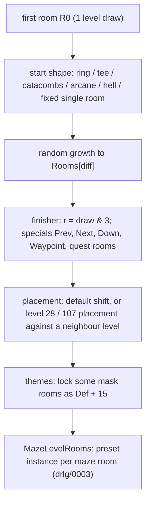

# 0006 — The maze generator: room growth, `Def`s, forced indices and special rooms

> **Subsystem:** drlg/maze
> **Question:** How does a `DrlgType` 1 level go from its first room to the list of maze rooms that `MazeLevelRooms` converts, each with a preset `Def` and a forced file index, and in what order does it draw?
> **Date:** 2026-10-14 (Phase 2: 2026-10-15)   **Plan:** 0022 (Phase 1, 1b, 2)   **Status:** reproduced (run:2026-10-15-drlg-maze; § 10)

Phase 1 reads the maze window of [drlg/0003](0003-generator-dispatch.md) (`MZ0`–`MZ1`, the oracle of
[drlg/overview](../../specs/drlg/README.md) step 9) end to end. The window is decompile plus disassembly for the
register arguments. As a reading check, `tools/maze_replay.py` replays the 12 maze windows that
run:2026-10-12-drlg-gen logged: Den of Evil ×2, Act II Sewers 1 ×2, Catacombs Level 1 ×2, Level 2 ×3 and Level 3 ×3.
It compares the seed after the window, the room list order, each room's `Def` and forced index, and the room
rectangles, with 0 mismatches. That replay makes the paths it exercises `[C]` (level types 3, 10 and 13, normal
difficulty). The links and warps the generator feeds are in [drlg/0007](0007-warps.md).

**Phase 2** (§ 10): `tools/drlg.py gen` models the window for every level type and replaces the `MZ0`–`MZ1` oracle.
run:2026-10-15-drlg-maze checks 230 windows of 41 maze levels (all 20 level types, all five acts, three difficulties)
draw by draw; classic windows come from run:2026-10-15-drlg-outdoor, with 0 mismatches. Every claim below is `[C]` for the paths that run reached; the
paths it did not reach are listed in § 10 and keep `[I]`.

## Answer (summary)

- [C] **The generator is a room graph on a tile grid.** Each maze room is a `DRLG_RoomCreate(level, 2)` room (one
  level-seed draw), sized `LvlMaze` `SizeX × SizeY` (`+0x10`/`+0x14`). It is placed edge to edge against a parent room
  in one of four directions (0 W, 1 N, 2 E, 3 S). It is rejected if it overlaps any room already in the level. On
  success it is linked both ways (`RoomAdj`, room `+0x00`) and prepended to the level's room list. A rejected room
  is freed, and its draw is still spent. No test against the level rectangle is made during growth. Afterwards
  `sub_00642590_MazeLevelPlace` translates all rooms so their bounding box starts at the level origin, and stops the
  game with a fatal error if the box is larger than the level. (fn:sub_00670880_MazeRoomPlace@0x00670880,
  fn:sub_0066B900_LevelRectFree@0x0066B900, fn:sub_0066B5E0_RoomAdjLink@0x0066B5E0,
  fn:sub_00642590_MazeLevelPlace@0x00642590, run:2026-10-12-drlg-gen)
- [C] **Room count.** Random growth (`sub_00671210_MazeGrow`) runs until the level holds
  `LvlMaze.Rooms[difficulty]` rooms. The row is `+0x04 + 4·act[+0x450]`, so `Rooms`, `Rooms(N)` and `Rooms(H)` are the
  counts for normal, nightmare and hell. The row is the one whose `Level` matches the level id (first match), not a
  row index. The count is ×3 for the Act II tomb at act `+0x094` (the true Tal Rasha tomb) and ×2 for the tomb at act
  `+0x484` (`[I]`: no tomb 66–72 was built). Each step draws `Range(level seed, roomCount)` to pick an existing room (list order, newest first). It
  then steps **that room's own seed** and takes `lo & 3` as the direction. A locked room gives no growth, but both
  draws are spent. No expansion or classic flag enters the maze code. (fn:sub_00671210_MazeGrow@0x00671210,
  fn:sub_006711A0_MazeRoomPickRandom@0x006711A0, fn:sub_0061F490_LvlMazeByLevel@0x0061F490, tbl:LvlMaze.txt:Rooms,
  run:2026-10-12-drlg-gen, run:2026-10-15-drlg-maze; nightmare and hell: 99 windows)
- [C] **`Merge` is a per-mille chance of extra links.** After each placement, every other unlocked room that shares an
  edge with the new room (not just a corner) and is not yet linked to it steps **its own** room seed. If
  `lo % 1000 < Merge`, it is linked to the new room and its `Def` is recomputed. So `Merge` 1000 (Harem, Basement,
  Arcane) links every adjacent pair, and `Merge` 0 never draws a link. (fn:sub_00670C70_MazeRoomMerge@0x00670C70,
  tbl:LvlMaze.txt:Merge, run:2026-10-12-drlg-gen)
- [C] **`Def` from exits.** A room's `Def` is recomputed from its links whenever they change:
  `mask = W 1 | E 2 | S 4 | N 8`, then `Def = base(levelType) + mask` for the 15 based types. The exception is the
  types 14, 15, 23, 32 and 35, which use a mask → `Def` table instead. `sub_006709B0_MazeRoomDefFromExits` also clears
  the room's lock and sets its forced index to −1, except on two Basement levels, below. A room is **locked** (data `+0x0C`
  bit 1) when a special, a theme or a fixed start gives it its `Def`. A locked room is never grown from, merged or
  re-themed. (fn:sub_006709B0_MazeRoomDefFromExits@0x006709B0, struct:MazeRoomData+0x0C, run:2026-10-12-drlg-gen)
- [C] **Special rooms replace dead ends.** Each level type's finisher draws `r = lo & 3` from the level seed. Then, per
  special (Prev, Next, Down, Waypoint, quest room…), `sub_006724E0_MazeSpecialPlace` takes the table entry `r`. The first
  unlocked room in list order whose `Def` is that entry's dead end (`base + one exit bit`) becomes the special and is locked.
  If there is none, a new room is attached in the entry's direction to the first unlocked room that can take it.
  Then `r = (r + 1) & 3`, so consecutive specials use different exit directions. The tables are at
  `0x006EF8A8`–`0x006F05D8` (§ 6). (fn:sub_006724E0_MazeSpecialPlace@0x006724E0,
  fn:sub_00670EB0_MazeSpecialAttach@0x00670EB0, run:2026-10-12-drlg-gen)
- [C] **Themes.** For the types 3, 4, 7, 8, 10, 13, 17, 22, 24 and 25 (not 18, 19, 28, 33, 34, 35), and not on level 8, `sub_006735F0_MazeThemes`
  draws one start index and 15 swaps of a 15-entry permutation (31 draws, each `lo % 15`). It then locks up to
  `max(2, roomCount/5 + 1)` unlocked rooms whose `Def` is `base + perm[k]`, giving them `Def + 15` (the `… Theme …` records).
  It makes at most `2·roomCount` attempts. (fn:sub_006735F0_MazeThemes@0x006735F0, run:2026-10-12-drlg-gen)
- [C] **Forced file index.** Only a few paths force `M.idx` (data `+0x04`): Sewers 1's two fixed rooms (§ 5),
  Arcane's arms, the Hell rooms, Basement 1 and 3 (§ 4) and the Barracks entry (§ 7). Every other room keeps −1,
  and `MazePresetFile` then rotates or keeps the instance draw ([drlg/0003](0003-generator-dispatch.md)).
  (fn:sub_006738C0_MazePresetFile@0x006738C0, run:2026-10-12-drlg-gen)
- [C] **Per type**, the window is one fixed chain: an optional start shape, then growth, then the finisher's specials, then
  placement and themes (§ 5 table). The level-specific branches (28, 61, 92, 107, 114, 116, 119) are fixed starts or
  fixed post-placement. Levels 28 and 107 are placed against a neighbour level instead of the level rectangle.
  (fn:sub_00673B30_MazeLevelBuild@0x00673B30, run:2026-10-15-drlg-maze)

## Leads used

Blind first: every claim above was written from the code before any community text was read (Phase 1b, below).

No lead was used to locate code. The Phase 1b cross-check is in § Phase 1b verdicts.

## Functions

| Address | Name | Role | Tag |
|---|---|---|---|
| `0x00673B30` | `sub_00673B30_MazeLevelBuild` | first room; per-type chain (§ 5); level 28/107 or default placement; themes; conversion | C |
| `0x00670880` | `sub_00670880_MazeRoomPlace` | `EAX` dir 0..7, `ESI` parent, arg room: position, overlap tests | C |
| `0x0066B900` | `sub_0066B900_LevelRectFree` | no room of the level (but two excluded) within `thresh` of a rect | C |
| `0x0066B800` | `sub_0066B800_RectGap` | per-axis gap of two rects; 0 when both gaps `< thresh` | C |
| `0x0066B860` | `sub_0066B860_RectGapTest` | `RectGap` without the outputs | C |
| `0x0066B560` | `sub_0066B560_RoomAdjAdd` | prepend a type-1 `RoomAdj` node unless the room is already listed | C |
| `0x0066B5E0` | `sub_0066B5E0_RoomAdjLink` | `AdjAdd(A, B, d)`, `AdjAdd(B, A, (d − 2) & 3)` | C |
| `0x0066B610` | `sub_0066B610_RoomAdjRemove` | unlink one type-1 node (used by `RoomFree`) | C |
| `0x00642240` | `sub_00642240_RectAdjDir` | the side of A that B touches: 0 W, 2 E, 1 N, 3 S, else −1 | C |
| `0x006709B0` | `sub_006709B0_MazeRoomDefFromExits` | `EBX` room: exit mask → `Def`; unlock, idx −1 | C |
| `0x00670810` | `sub_00670810_MazeIsSingleRoom` | `LvlMaze.Rooms[diff] == 1` (type 33 only) | C |
| `0x00670C70` | `sub_00670C70_MazeRoomMerge` | `Merge` links to edge-sharing rooms, on their seeds | C |
| `0x00670D70` | `sub_00670D70_MazeRoomAdd` | create, place, link, optional merge (no caller in the window) | I |
| `0x00670DE0` | `sub_00670DE0_MazeRoomAddFixed` | create, place, link, parent `Def`, lock the new room with a given `Def`/idx | C |
| `0x00670EB0` | `sub_00670EB0_MazeSpecialAttach` | special fallback: first unlocked room that can take a new room in dir | C |
| `0x00670F60` | `sub_00670F60_MazeRing` | closed ring of side n around the first room | C |
| `0x006711A0` | `sub_006711A0_MazeRoomPickRandom` | `Range(level seed, count)`, k-th room of the list | C |
| `0x00671210` | `sub_00671210_MazeGrow` | random growth to `Rooms[diff]` (×3/×2 tombs) | C |
| `0x00671320` | `sub_00671320_MazeFillAround` | 8 locked filler rooms around every room but one | C |
| `0x00671430` | `sub_00671430_MazeHellStart` | type 35: two fixed rooms on the first room's seed, then fillers | C |
| `0x006714D0` | `sub_006714D0_MazeCatacombsStart` | type 10 start: 4 or 2 rooms round the first, which is locked to the stairs | C |
| `0x006718C0` | `sub_006718C0_MazeTeeStart` | types 17/34 start: 3 rooms round the first, which becomes a T-shaped Prev | C |
| `0x006719F0` | `sub_006719F0_MazeArcane` | type 19: four 15-room arms, forced idx per arm | C |
| `0x00672340` | `sub_00672340_MazeProbe` | can a room grow in dir: a real create/place, then freed | C |
| `0x006723E0` | `sub_006723E0_MazeFindNorth` | lowest `y` room that can grow north | C |
| `0x00672420` | `sub_00672420_MazeFindWest` | lowest `x` room that can grow west | I |
| `0x00672460` | `sub_00672460_MazeFindEast` | highest `x` room that can grow east | C |
| `0x006724A0` | `sub_006724A0_MazeFindSouth` | highest `y` room that can grow south | C |
| `0x006724E0` | `sub_006724E0_MazeSpecialPlace` | one special from a `MazeSpecial` entry, rotation +1 | C |
| `0x00672550` | `sub_00672550_MazeSpecialsCave` | type 3 finisher | C |
| `0x00672610` | `sub_00672610_MazeSpecialsCrypt` | type 4 finisher | C |
| `0x006726D0` | `sub_006726D0_MazeSpecialsJail` | type 8 finisher | C |
| `0x006727A0` | `sub_006727A0_MazeSpecialsCatacombs` | type 10 finisher | C |
| `0x00672810` | `sub_00672810_MazeSpecialsSewerA2` | type 13 finisher (level 47's dock path) | C |
| `0x00672BE0` | `sub_00672BE0_MazeSpecialsTomb` | type 17 finisher | C |
| `0x00672DC0` | `sub_00672DC0_MazeSpecialsLair` | type 18 finisher | C |
| `0x00672E50` | `sub_00672E50_MazeSpecialsArcane` | type 19 finisher | C |
| `0x00672EA0` | `sub_00672EA0_MazeSpecialsDungeon` | type 24 finisher | C |
| `0x00672F00` | `sub_00672F00_MazeSpecialsSewerA3` | type 25 finisher | C |
| `0x00672F60` | `sub_00672F60_MazeSpecialsDurance` | type 22 finisher | C |
| `0x00673000` | `sub_00673000_MazeSpecialsTemple` | type 32 finisher | C |
| `0x006730B0` | `sub_006730B0_MazeSpecialsBaal` | type 34 finisher | C |
| `0x00673530` | `sub_00673530_MazeSpecialsIce` | type 33 finisher | C |
| `0x00673120` | `sub_00673120_MazeBarracksPlace` | level 28: entry against level 27, specials, own placement | C |
| `0x00673320` | `sub_00673320_MazeRiverOfFlame` | level 107: bridge to level 108, forge, fillers, own placement | C |
| `0x00642590` | `sub_00642590_MazeLevelPlace` | translate the rooms to the level origin; fatal if too large | C |
| `0x00642520` | `sub_00642520_LevelRoomsBounds` | bounding box of the level's rooms | C |
| `0x006735F0` | `sub_006735F0_MazeThemes` | the theme pass | C |
| `0x0061F490` | `sub_0061F490_LvlMazeByLevel` | first `lvlmaze` row whose `Level` is the id; fatal if none | C |

## Walkthrough

Notation: `L` the level, `L.seed` its seed `+0x1C4`, `R.seed` a room's seed `+0x14`, `step(s)` one LCG step that
returns the new low word. Every `DRLG_RoomCreate` is one `step(L.seed)` (rng/seeds step 5).

### 1. The build window

```c
// fn:sub_00673B30_MazeLevelBuild@0x00673B30 (trimmed, ECX = L)
R0 = DRLG_RoomCreate(L, 2); R0.w, R0.h = maze.SizeX, maze.SizeY       // centred in L.rect
LevelRoomLink(L, R0)
switch (L.ltype) { ... }                                              // § 5: start shape, growth, finisher
if (L.id == 28) MazeBarracksPlace(L) else if (L.id == 107) MazeRiverOfFlame(L) else MazeLevelPlace(L)
MazeThemes(L)                                                         // § 4
for M in L.rooms (newest first): MazeLevelRooms(L, M)                 // drlg/0003
```



### 2. Placing a room

```c
// fn:sub_00670880_MazeRoomPlace@0x00670880. EAX = dir, ESI = parent P, arg = new room R (size already set)
switch (dir) { 0: R.xy = (P.x - P.w, P.y);  1: (P.x, P.y - P.h);  2: (P.x + P.w, P.y);  3: (P.x, P.y + P.h);
               4: (P.x - P.w, P.y - P.h); 5: (P.x + P.w, P.y - P.h); 6: (P.x + P.w, P.y + P.h); 7: (P.x - P.w, P.y + P.h) }
for node in P.adj: if (gapx(R, node.room) < 0 && gapy(R, node.room) < 0) return 0     // RectGapTest(thresh 0)
return LevelRectFree(L, R, P, thresh 0)       // every room of L except R and P: fail on the same overlap test

gapx(A, B) = A.x < B.x ? B.x - A.w - A.x : A.x - B.w - B.x                            // same for y
```

- [C] The parent's own `w`/`h` set the offset. All maze rooms of a level have the `LvlMaze` size, except the fixed
  `Def`s of levels 28 and 107, whose rooms still take that size when created. An overlap needs both gaps negative,
  so rooms that only touch are allowed. (fn:sub_00670880_MazeRoomPlace@0x00670880, fn:sub_0066B800_RectGap@0x0066B800,
  run:2026-10-12-drlg-gen)
- [I] Directions 4–7 (diagonals) are used only by `MazeFillAround`. (fn:sub_00671320_MazeFillAround@0x00671320)

The basic step that every shape uses (`grow(P, d)`), in this order:

```c
R = DRLG_RoomCreate(L, 2)                     // level draw
R.w, R.h = maze.SizeX, maze.SizeY
if (!MazeRoomPlace(R, P, d)) { RoomFree(R); fail }
RoomAdjLink(P, R, d)                          // P → R dir d, R → P dir (d - 2) & 3
MazeRoomMerge(R)                              // § 3, before R joins the list
LevelRoomLink(L, R)                           // prepend
DefFromExits(P); DefFromExits(R)
```

- [C] This order is what the 12 replayed windows show. A merge seen from R skips rooms already linked to R, so its parent
  is never re-drawn. (fn:sub_00670F60_MazeRing@0x00670F60, fn:sub_00671210_MazeGrow@0x00671210, run:2026-10-12-drlg-gen)
- [C] **A failed placement crashes the straight-line shapes.** In `MazeRing`, `MazeCatacombsStart`'s chains and
  Arcane's arms, the next room's parent is the room just made. A failed placement there leaves a null parent. No stock
  level fails in those shapes, because they start from a lone room. (fn:sub_00670F60_MazeRing@0x00670F60)

### 3. Growth, merge and probes

```c
// fn:sub_00671210_MazeGrow@0x00671210. arg = L
target = maze.Rooms[act.diff /*+0x450*/]
if (L.id == act[+0x094]) target *= 3;  if (L.id == act[+0x484]) target *= 2
while (L.count /*+0x08*/ < target):
  P = k-th room of L.rooms, k = Range(L.seed, L.count)     // pow2: lo & (n-1); else lo % n (unsigned); n < 1: 0, no draw
  d = step(P.seed) & 3                                     // the picked room's seed
  if (!P.locked) grow(P, d)

// fn:sub_00670C70_MazeRoomMerge@0x00670C70. arg = new room R (not yet in L.rooms)
if (R.locked) return
for P in L.rooms (newest first): if (P != R && !P.locked):
  if (RectGap(R, P, thresh 1) == 0 /*gx < 1 && gy < 1*/ && gx != gy /*an edge, not a corner*/ && P not in R.adj):
    if (step(P.seed) % 1000 < maze.Merge /*signed compare*/):
      d = RectAdjDir(P, R); if (d != -1) { RoomAdjLink(P, R, d); DefFromExits(P) }
```

- [C] Growth draws are `Range` on the level seed and then one step of the picked room's seed. Merge draws are one step of
  each candidate's seed. The maze rooms are freed after the conversion, so these room-seed steps leave no trace outside
  the window. Only the level seed matters to later steps. (fn:sub_00671210_MazeGrow@0x00671210,
  fn:sub_00670C70_MazeRoomMerge@0x00670C70, run:2026-10-12-drlg-gen)
- [C] `sub_00672340_MazeProbe(R, d)` answers "can R grow in d". It returns 0 with no draw when R is locked or already
  has a link in d. Otherwise it **creates a real room** (one level draw), places it, links it, recomputes the probe's
  own `Def`, and frees it again. `RoomFree` unlinks it from R and from the level. The four finders (`FindNorth` lowest `y`,
  `FindWest` lowest `x`, `FindEast` highest `x`, `FindSouth` highest `y`) walk the list and probe a room only when it
  beats the current best strictly, so the number of probe draws depends on list order.
  (fn:sub_00672340_MazeProbe@0x00672340, fn:sub_006723E0_MazeFindNorth@0x006723E0,
  fn:sub_00672460_MazeFindEast@0x00672460, fn:sub_0066C100_RoomFree@0x0066C100, run:2026-10-12-drlg-gen)

### 4. `Def`s, locks and themes

```c
// fn:sub_006709B0_MazeRoomDefFromExits@0x006709B0. EBX = room R, arg unlock = 1 at every call site
mask = OR over R.adj of {0: 1, 1: 8, 2: 2, 3: 4}[dir]       // diagonal links add nothing
idx = -1
switch (L.ltype):
  3: 0x34   4: 0x6C   7: 0xA7   8: 0xCD   10: 0x101  13: 0x12D  17: 0x19D  18: 0x1E1  19: 0x1FD
  22: 0x2F1 24: 0x298 25: 0x2C0 28: 0x344 34: 0x422  → def = base + mask
  33: def = (Rooms[diff] == 1) ? mask : 0x3EA + mask
  14: def = tbl[0x006EF758 + 12·mask]   15: tbl[0x006EF75C + 12·mask]   23: tbl[0x006EF760 + 12·mask]
  32: def = tbl[0x006EF6D8 + 8·mask]    35: tbl[0x006EF6DC + 8·mask]
  15 extra: level 52 and def 0x169 → idx 2; level 54 and def 0x169 or 0x167 → idx 3
  23 extra: level 84 and def 0x296 → def 0x298; level 85 and def 0x295 → def 0x297
  other types: fatal
if (def != 0): R.def = def; R.idx = idx; R.locked = !unlock
```

- [C] For types 3, 10 and 13 the `Def`s of every replayed room match `base + mask`. The base table is the same one
  `MazePresetFile` uses for its rotation range, with base 0x1FD (Arcane) added here and 0x3EA/0x41C used only there
  (drlg/0003). (fn:sub_006709B0_MazeRoomDefFromExits@0x006709B0, run:2026-10-12-drlg-gen)
- [C] **Quadrant types.** The tables give only the four corner masks (fn:sub_006709B0_MazeRoomDefFromExits@0x006709B0):
  - 14 Harem: SW 356, SE 355, NW 357, NE 354;
  - 15 Basement: SW 360, SE 359, NW 361, NE 358;
  - 23 Spider: SW 659, SE 660, NW 661, NE 662;
  - 32 Temple: SW 1045, SE 1044, NW 1043, NE 1042.

  Every other mask gives 0, which leaves the `Def` unchanged. These types build a 2×2 ring (four rooms, each with
  exactly two exits), so every room gets a corner. Type 35 (Act V Lava) maps N 1053, S 1054, E 1055, W 1056, EW 1057
  and NS 1058, and 0 for the rest. (data at 0x006EF6D8–0x006EF7D8)
- [C] Two forced indices come from `DefFromExits` itself (run:2026-10-15-drlg-maze: 52, 54, 84, 85): Basement 1 (52) takes `File3` of `Basement NW` (361), and
  Basement 3 (54) takes `File4` of `Basement NW`/`Basement SE`. The two Spider substitutions put the `Spider Chest NE`
  (664) and `Spider Chest NW` (663) rooms on Spider Cavern (84) and Arachnid Lair (85). (fn:sub_006709B0_MazeRoomDefFromExits@0x006709B0)

```c
// fn:sub_006735F0_MazeThemes@0x006735F0. ECX = L
base = {3: 0x34, 4: 0x6C, 7: 0xA7, 8: 0xCD, 10: 0x101, 13: 0x12D, 17: 0x19D, 22: 0x2F1, 24: 0x298, 25: 0x2C0}[L.ltype]
if (no base || L.id == 8) return
s = step(L.seed) % 15                                     // unsigned
want = max(2, L.count / 5 + 1); tries = 2 * L.count
perm = [0, 1, ..., 14]
repeat 15: a = step(L.seed) % 15; b = step(L.seed) % 15; swap(perm[a], perm[b])
while (want && tries):
  v = base + perm[s]
  R = first room in L.rooms with !R.locked && R.def == v
  if (R) { R.locked = 1; R.def = v + 15; R.idx = -1; want-- }
  tries--; s = (s + 1) % 15
```

- [C] 31 level draws for every type in that switch (level 8 excepted), then the walk. `perm[k] = 0` names `base` itself, which no maze room
  carries, and mask 15 (`NSEW`) is never themed. The `+15` records are the `… Theme …` records of each block, for
  example 53 `Cave W` → 68 `Cave Theme W`. Dead ends are themed only if no special took them first. The finisher runs before
  the theme pass. (fn:sub_006735F0_MazeThemes@0x006735F0, tbl:LvlPrest.txt:Def, run:2026-10-12-drlg-gen)

### 5. The per-type chains

`ring(n)` = `MazeRing`: from R0, n−1 rooms north, n−1 west, n−1 south, n−2 east, each from the last. Then the last
room and R0 are linked (dir 2) and both `Def`s recomputed. `ring(2)` is a 2×2 square of four rooms.
`tee` = `MazeTeeStart`: `r = step(L.seed) & 3`, then three rooms from R0 in directions r, r+1, r+2. R0 is then locked as
the three-exit `Prev` record of `tbl[(r+3)&3]` at `0x006EF888` (type 17) or `0x006EF88C` (type 34), stride 8:
Tomb 447/444/446/445, Baal 1075/1077/1076/1074.

| Type | Levels | Start | Growth | Finisher (specials in order; `r` = finisher draw) | Tag |
|---|---|---|---|---|---|
| 3 caves | 8–12 | — | yes | `r`; Prev; level 8: Den of Evil, else Down; 9: + Coldcrow; 10: + Next | C (8, 9) / I (10–12) |
| 4 crypts | 18–24, 133 | — | yes | `r`; Prev; 18: Bonebreak; 19 or 133: Chest; 21–24: Next | C (18, 19) / I |
| 7 Barracks | 28 | ring(2) | yes | level 28 placement (§ 7) | C |
| 8 Jail | 29–31 | ring(2) | yes | `r`; Prev; 29: Waypoint; 30: Pitspawn; 31: Cath, else Next | C (29, 30) / I (31) |
| 10 Catacombs | 34–36 | `MazeCatacombsStart` | yes | `r`; Next; 35: Waypoint | C |
| 13 Sewers A2 | 47–49, 65 | ring(2) | yes | `a`, `r` (two draws); 47: dock path; 48: Prev, Waypoint, Next; 49: Prev, Radament; 65: Prev, Chest | C (47–49, 65) |
| 14 Harem, 15 Basement, 23 Spider | 51–54, 84–85 | ring(2) | no | none | C |
| 17 Tomb | 55–61, 66–72 | tee, or 61: one room locked 480 `Tomb Tainted Sun X` | yes (not 61) | rotation from the Prev room's `Def`; see below | C (57, 58, 61) / I |
| 18 Lair | 62–64 | ring(2) | yes | `r`; 64: Tight Spot S (fixed entry), then the rotation is set to 3, Treasure W (fixed entry, advances it to 0), Prev; else Next, Prev | C (62) / I (63, 64) |
| 19 Arcane | 74 | `MazeArcane` | no | `r`; Summoner | C |
| 22 Durance | 100–101 | ring(2) | yes | `r`; Prev; 101: Waypoint, Next; 100: Next | C |
| 24 Dungeon | 86–89 | ring(2) | yes | `r`; Prev, Next | C (86, 88) / I |
| 25 Sewers A3 | 92 | ring(5), corners locked as 735–738 | yes | `r`; Drain, Chest | C |
| 28 Act IV lava | 107 | — | yes | level 107 placement (§ 7) | C |
| 32 Temple | 122–123 | ring(2) | no | `r = lo % 3`; Down (not 124); 123: Waypoint | C |
| 33 Ice | 113, 115, 118 | ring(2) | yes | `r`; Prev, Next, Down; 115: Theme; 113, 115, 118: Waypoint | C |
| 33 Ice | 114 / 116 / 119 | one room locked: 114 `Range(L.seed, 2)` → 1039 or 1038; 116 → 1040; 119 → 1041 | no | none | C |
| 34 Baal | 128–130 | tee | yes | `r`; Next; 129: Waypoint | C (129) / I |
| 35 Act V lava | 125–127, 135 | `MazeHellStart` | no | none | C (125) / I |

(fn:sub_00673B30_MazeLevelBuild@0x00673B30 and the finishers in § Functions; the tags cite run:2026-10-15-drlg-maze)

- [C] **Tomb finisher** (fn:sub_00672BE0_MazeSpecialsTomb@0x00672BE0; levels 57, 58, 61 reproduced; the Tal Rasha and Kaa
  branches of the tombs 66–72 stay `[I]`). It takes the first room whose `Def` is ≥ 429 (the tee's Prev record) and sets the rotation from
  it: 444 → 3, 445 → 1, 446 → 0, 447 → 2. It fails with a fatal error for any other `Def`. Then, in this order:
  - 55–58: Next; 57: Waypoint;
  - 59 or 61: Chest;
  - 66–72 except the true tomb: Chest; 59: Leatherarm;
  - 60: Cube; 59 or 61: Treasure;
  - the true tomb (act `+0x094`): Tal Rasha;
  - the tomb at act `+0x484`: Kaa.

  Level 61 never reaches the finisher, because its single-room start breaks out of the switch.
  (fn:sub_00672BE0_MazeSpecialsTomb@0x00672BE0)
- [C] **Catacombs start.** Level 34 makes four rooms from R0 in directions 1, 2, 3, 0, and locks R0 as 290 `Catacombs Prev
  NSEW`. Levels 35 and 36 draw `b = step(L.seed) & 1`. If `b = 0`, they make rooms north and south, and R0 becomes 289
  `Prev NS`; else west and east, and R0 becomes 288 `Prev EW`. (fn:sub_006714D0_MazeCatacombsStart@0x006714D0,
  run:2026-10-12-drlg-gen)
- [C] **Sewers 1 (47) dock path.** `a = (step & 1)·2 | 1` (1 or 3) comes first, then `r = step & 3`. Then (fn:sub_00672810_MazeSpecialsSewerA2@0x00672810):
  1. `P = FindNorth`; grow north twice from P; attach 333 `Sewer Prev E` (idx 0) to the west of the last room, which
     recomputes the parent's `Def`;
  2. `P = FindEast`; grow east twice; attach 336 `Sewer Prev NS` (the dock, idx 0) in direction `a`;
  3. one plain room in direction `a` from the dock, without a merge, with its own `Def` recomputed;
  4. the Next special.

  (fn:sub_00672810_MazeSpecialsSewerA2@0x00672810, fn:sub_00670DE0_MazeRoomAddFixed@0x00670DE0, run:2026-10-12-drlg-gen)
- [C] **Arcane (74).** (fn:sub_006719F0_MazeArcane@0x006719F0, run:2026-10-15-drlg-maze: 8 windows)
  - Draw `r = step(L.seed) & 3`.
  - For each arm `a = 0..3` (`d = a`), 15 rooms grow from R0, with `merge` on (`Merge` 1000). The chain and directions
    are: s0 `d`, s1 `d`, s2 `a+3`, s3–s6 `d`, s7 `a+1`. From s7 come two rooms: a dead end in `d` and s9 in `a+1`. Then
    s10 and s11 go in `a+2`. From s11 come a dead end in `a+3` and s13 in `a+2`, then s14 in `a+2` (all mod 4).
  - The 13 recorded rooms of arm `a` get forced index `(a + r) & 3`, and R0 gets 4. The two dead ends keep −1.
  - The finisher then draws again and places the Summoner.

  So `File1..4` of the Arcane records are the four arm styles and `File5` is the centre. (fn:sub_006719F0_MazeArcane@0x006719F0)
- [C] **Hell (type 35).** (fn:sub_00671430_MazeHellStart@0x00671430, run:2026-10-15-drlg-maze: level 125)
  1. `r = step(R0.seed) & 3`, the first room's seed, not the level seed.
  2. Two rooms are attached to R0 from the entry `r` (stride 0x18) at `0x006EF828`, as `{Def, dir, idx}` ×2:
     - r 0: 1054 north (idx 0), 1053 south (idx 1);
     - r 1: the same with idx 1, 0;
     - r 2: 1055 west (idx 1), 1056 east (idx 0);
     - r 3: the same with idx 0, 1.
  3. Each recomputes R0's `Def` (NS 1058 or EW 1057).
  4. `MazeFillAround(836, none)` tries 8 directions (0..7) around each of the three rooms. It locks every placed
     filler as 836 `Act 4 - Lava X`, and makes no `Def` update.

  (fn:sub_00671430_MazeHellStart@0x00671430, fn:sub_00671320_MazeFillAround@0x00671320)

### 6. The special tables

Provenance follow-up of 2026-10-15 (backlog spec-writer → reverser): the entry layout, the attach walk and every table
below were read from the code and the data at `0x006EF8A8`–`0x006F05D7`, not from the Phase 2 model. The model reads the same
addresses and agrees with every entry.

```c
// fn:sub_006724E0_MazeSpecialPlace@0x006724E0. arg L, EDX = entry, arg rot (u32 *, or null)
// entry = MazeSpecial {+0 matchDef, +4 def, +8 idx, +0xC dir}, 16 bytes
for (R = L.rooms /*+0x10, next +0x24*/; R; R = R.next)       // newest first
  if (!(R.data.flags & 2) && R.data.def == entry.matchDef)   // data = R+0x20; flags +0xC bit 1 = locked
    { R.data.flags |= 2; R.data.def = entry.def; R.data.idx = entry.idx; goto done }   // no draw
MazeSpecialAttach(L, entry.dir, entry.def, entry.idx)
done: if (rot) *rot = (*rot + 1) % 4                         // signed %, *rot is 0..3

// fn:sub_00670EB0_MazeSpecialAttach@0x00670EB0. EAX = L, args dir, def, idx
for (P = L.rooms; P; P = P.next):                             // newest first
  if (P.data.flags & 2) continue                              // locked rooms are skipped
  R = DRLG_RoomCreate(...)                                    // a level draw per candidate tried
  R.w, R.h = L.maze.SizeX, L.maze.SizeY                       // (R+0x58)->+0x14 -> +0x10/+0x14
  if (!MazeRoomPlace(R, P, dir)) { RoomFree(R); continue }
  RoomAdjLink(P, R, dir); LevelRoomLink(L, R); MazeRoomDefFromExits(P, unlock 1)   // only P's Def
  R.data.flags |= 2; R.data.def = def; R.data.idx = idx; return R
return 0                                                      // no room could take it: nothing placed
```

- [C] The match replaces an unlocked room whose `Def` is `matchDef` and makes no draw. Otherwise the attach walks the
  unlocked rooms newest first and spends one `RoomCreate` level draw per candidate. The first successful placement takes
  the special. The rotation advances after every special, placed or not, when the finisher passes a pointer. Level 107
  passes none at its forge (§ 7, `0x0067349F`). (fn:sub_006724E0_MazeSpecialPlace@0x006724E0,
  fn:sub_00670EB0_MazeSpecialAttach@0x00670EB0, run:2026-10-15-drlg-maze)
- [I] A candidate whose placement fails is freed and the walk goes on. The case where no room takes the special returns 0
  and places nothing. Neither was reached in the run. (fn:sub_00670EB0_MazeSpecialAttach@0x00670EB0)
- [C] **Call shape.** Each finisher draws `r` once (`step(L.seed) & 3`, Temple `% 3`), then calls `MazeSpecialPlace` per
  special with `EDX = table + 16·r` and `&r`, so `r` advances by one between specials (disassembly, for example
  `0x00672586`, `0x006725A9`). (fn:sub_00672550_MazeSpecialsCave@0x00672550, run:2026-10-15-drlg-maze)

**The layout rule.** The `dir` of an entry is the side of the parent the new room goes on. `MazeRoomPlace` dir 3 puts it
below the parent (`P.y + P.h`), and `RoomAdjLink` gives the new room the link `(dir − 2) & 3`. `DefFromExits` maps the
link sides W, N, E, S to the mask bits 1, 8, 2, 4 (§ 2, § 4).

- [C] 47 of the 50 four-entry tables have this form, with `m` the block's `DefFromExits` base and `b` the first record of
  the special's block (data behaviour: the rule gives every entry of the 47 tables; fn:sub_006724E0_MazeSpecialPlace@0x006724E0):

  | `r` | `matchDef` | dead end's only exit | `dir` (attach side) | `def` | `idx` |
  |---|---|---|---|---|---|
  | 0 | `m + 8` | N | 3 (below the parent) | `b + 3` | −1 |
  | 1 | `m + 2` | E | 0 (west of it) | `b + 1` | −1 |
  | 2 | `m + 4` | S | 1 (above it) | `b + 2` | −1 |
  | 3 | `m + 1` | W | 2 (east of it) | `b + 0` | −1 |

  So the attached room's single exit faces its parent and matches the dead end the entry would have replaced. A block
  reads W, E, S, N (`b + 0..3`).
- [C] The three exceptions use `def = b + 0, 2, 1, 3` for `r` = 0..3, with the same `matchDef`, `dir` and `idx`:
  Baal Next (`0x006F0368`, 1078–1081), Baal Waypoint (`0x006F03A8`, 1082–1085) and Ice Waypoint (`0x006F0598`, 1034–1037).
  (data 0x006F0368, 0x006F03A8, 0x006F0598)
- [C] The tables by block, as `address: special b..b+3` (`m` in brackets). Each address is the `add edx, imm32` of its
  finisher (data:g_MazeSpecialTables@0x006EF8A8, fn:sub_006724E0_MazeSpecialPlace@0x006724E0).
  - Cave [52] (`0x00672550`): `0x006EF8A8` Prev 83–86, `0x006EF8E8` Den of Evil 95–98, `0x006EF928` Down 91–94, `0x006EF968` Coldcrow 99–102, `0x006EF9A8` Next 87–90.
  - Crypt [108] (`0x00672610`): `0x006EF9E8` Prev 139–142, `0x006EFA28` Bonebreak 147–150, `0x006EFAA8` Chest 151–154, `0x006EFAE8` Next 143–146.
    `0x006EFA68` Portal 155–158 has no reference in the finisher.
  - Jail [205] (`0x006726D0`): `0x006EFB28` Prev 236–239, `0x006EFB68` Cath 244–247, `0x006EFBA8` Next 240–243, `0x006EFBE8` Waypoint 248–251, `0x006EFC28` Pitspawn 252–255.
  - Catacombs [257] (`0x006727A0`): `0x006EFC68` Next 291–294, `0x006EFCA8` Waypoint 295–298.
  - Sewer A2 [301] (`0x00672810`): `0x006EFCE8` Prev 332–335, `0x006EFD28` Next 337–340, `0x006EFD68` Waypoint 345–348, `0x006EFDA8` Radament 341–344, `0x006EFDE8` Chest 349–352.
  - Tomb [413] (`0x00672BE0`): `0x006EFE28` Next 448–451, `0x006EFE68` Waypoint 476–479, `0x006EFEA8` Chest 472–475,
    `0x006EFEE8` Leatherarm 464–467, `0x006EFF28` Cube 456–459, `0x006EFF68` Treasure 452–455, `0x006EFFA8` Tal Rasha 460–463, `0x006EFFE8` Kaa 468–471.
  - Lair [481] (`0x00672DC0`): `0x006F0028` Prev 497–500, `0x006F0068` Next 501–504, `0x006F00A8` Treasure 505–508 (read only through its entry 3, below).
  - Arcane [509] (`0x00672E50`): `0x006F00F8` Summoner 525–528.
  - Dungeon [664] (`0x00672EA0`): `0x006F0138` Prev 695–698, `0x006F0178` Next 699–702.
  - Sewer A3 [704] (`0x00672F00`): `0x006F01B8` Drain 739–742, `0x006F01F8` Chest 743–746.
  - Durance [753] (`0x00672F60`): `0x006F0238` Prev 784–787, `0x006F0278` Waypoint 792–795, `0x006F02B8` Next 788–791.
  - Baal [1058] (`0x006730B0`): `0x006F0368` Next 1078–1081, `0x006F03A8` Waypoint 1082–1085 (exceptions).
  - Barracks [167] (`0x00673120`): `0x006F03E8` Next 198–201, `0x006F0428` Forge 202–205.
  - Ice [1002] (`0x00673530`): `0x006F0498` Prev 1018–1021, `0x006F04D8` Next 1022–1025, `0x006F0518` Down 1026–1029, `0x006F0558` Theme 1030–1033, `0x006F0598` Waypoint 1034–1037 (exception).

  (data:g_MazeSpecialTables@0x006EF8A8, to 0x006F05D7; the finishers in § Functions)
- [C] **Temple** (`0x00673000`). It draws `r = step(L.seed) % 3` (unsigned). Then it places Down from `0x006F02F8 + 16r`
  unless the level is 124, and on level 123 Waypoint from `0x006F0328 + 16r`. The entries, as `matchDef → def, dir`
  (the corners are NE 1042, NW 1043, SE 1044, SW 1045, § 4):
  - Down `0x006F02F8`: 1042 → 1046 (1), 1043 → 1047 (0), 1045 → 1048 (3). The table has three entries.
  - Waypoint `0x006F0328`: 1042 → 1049 (1), 1043 → 1050 (0), 1045 → 1052 (3), 1044 → 1051 (2).

  `idx` is −1 everywhere. (data 0x006F02F8–0x006F0367, fn:sub_00673000_MazeSpecialsTemple@0x00673000, run:2026-10-15-drlg-maze: 122, 123)
- [I] Down reads `r` 0..2 only, so the word after its third entry (Waypoint's entry 0) is never read as Down's entry 3.
  Waypoint reads `r + 1` (1..3), so its entry 0 is never read either. The fatal test at `0x00673060` (rotation unchanged
  after Down on level 123) cannot fire, because Down always advances `r`. (fn:sub_00673000_MazeSpecialsTemple@0x00673000)
- [I] **Lair 64** (`0x00672DC0`, `0x00672DED`). After the draw `r`:
  1. Tight Spot: the single entry `0x006F00E8` = `{485 → 509, idx −1, dir 1}` (`mov edx, 0x006F00E8`), with `&r`;
  2. `r ← 3`, then Treasure: the fixed address `0x006F00D8` (`mov edx`), which is entry 3 of the Treasure table,
     `{482 → 505, −1, dir 2}`, a W dead end; `r` becomes 0;
  3. Prev from `0x006F0028 + 16r`, so entry 0 `{489 → 500, −1, dir 3}`.

  Other Lair levels place Next from `0x006F0068 + 16r`, then Prev from `0x006F0028 + 16r`. Level 64 was not reached; level
  62 reproduces the other branch (`[C]`, run:2026-10-15-drlg-maze). (fn:sub_00672DC0_MazeSpecialsLair@0x00672DC0)
- [C] **River of Flame forges** (`0x0067349F`): one special from `g_RiverForgeSpecials` `0x006F0474 + 16·(step & 1)`, with no rotation pointer.
  The entries are `{837 → 853 Forge W, −1, dir 2}` and `{838 → 854 Forge E, −1, dir 0}`, the W and E dead ends of base 836.
  (data:g_RiverForgeSpecials@0x006F0474, fn:sub_00673320_MazeRiverOfFlame@0x00673320, run:2026-10-15-drlg-maze)
- [C] **Barracks finders** (`0x0067313E`): `g_BarracksFinders` (`0x006F0468`) holds three function pointers, k 0 `MazeFindEast` (`0x00672460`),
  k 1 `MazeFindSouth` (`0x006724A0`), k 2 `MazeFindWest` (`0x00672420`). Only k 1 was reached (§ 7). (data:g_BarracksFinders@0x006F0468)
- [C] Every stock `idx` in these tables is −1. Forced indices come only from `MazeRoomAddFixed`, `DefFromExits` and the
  start shapes (§ 4, § 5). (data 0x006EF8A8–0x006F0493)

### 7. Levels 28 and 107: placed against a neighbour level

- [C] **Barracks (28)**, `MazeBarracksPlace`, runs instead of the default placement (fn:sub_00673120_MazeBarracksPlace@0x00673120):
  1. Ensure level 27 (Outer Cloister) and read its preset file index `k`, which the act link builder writes (drlg/0007).
  2. Call the finder `tbl[k]` at `0x006F0468`: East, South or West.
  3. Attach 167 `Barracks Court Connect` with forced idx `k`, and add a level-adjacency node to level 27
     (`LevelAdjAdd`, dir 2/3/0 for k 0/1/2).
  4. Draw `b = step(L.seed)`. If `b & 1`: Next, then Forge; else Forge, then Next. The rotation starts at `k`.
  5. Translate all rooms so the connect room lines up with level 27's edge.
  6. Set `L.rect` to the bounding box.

  The translation per index `k` (`P` the connect room before the shift, `sx`/`sy` the `LvlMaze` size, signed halves):
  k 0: `(L27.x − P.x − sx, L27.y + L27.h/2 − P.y)`; k 1: `(L27.x + L27.w/2 − P.x − 6, L27.y − P.y − sy)`;
  k 2: `(L27.x + L27.w − P.x, L27.y + L27.h/2 − P.y + 1)`. The connect room is placed by `MazeRoomAddFixed` (no merge).
  run:2026-10-15-drlg-maze reached index 1 only (8 windows); indices 0 and 2 (`FindEast`, `FindWest`) are `[I]`.

  (fn:sub_00673120_MazeBarracksPlace@0x00673120)
- [C] **River of Flame (107)**, `MazeRiverOfFlame`, runs only when the act index (act `+0x480`) is not 4 (fn:sub_00673320_MazeRiverOfFlame@0x00673320):
  1. Ensure level 108.
  2. On `FindSouth`, attach 852 `Lava Warp N`. On `FindNorth`, attach 855 `Bridge 1`.
  3. Grow two rooms north of it as locked 856 `Bridge 2`, without a merge.
  4. Add a level-adjacency node (dir 1) to 108.
  5. Draw `r = step & 1` and place one special from `0x006F0474 + 16r`: 837 → 853 `Forge W` or 838 → 854 `Forge E`. It does not rotate.
  6. `MazeFillAround(836)` around every room but the last bridge.
  7. Translate the rooms by `(L108.x + 2·B.w − B.x, L108.y + L108.h − B.y)`, `B` the last bridge room, and set `L.rect` to
     the bounding box. A failed bridge placement leaves a null parent.

  (fn:sub_00673320_MazeRiverOfFlame@0x00673320)

### 8. Answers to the Phase 0 questions (backlog archivist → reverser 2026-10-14)

- [I] **(a) Type 35.** The Act V lava levels take their `Def`s from the six-entry mask table (1053–1058), never
  `base + mask`. `MazePresetFile`'s range for type 35 (`0x41C < def < 0x42C`) does cover them: they rotate, `Files` 2.
  Records 1059–1067 are reachable only as type 34 (`Baal` base 0x422 + mask), never on a type-35 level.
  Hell rooms with a forced index (`MazeHellStart`) skip the rotation. (fn:sub_006709B0_MazeRoomDefFromExits@0x006709B0,
  fn:sub_00671430_MazeHellStart@0x00671430, fn:sub_006738C0_MazePresetFile@0x006738C0)
- [I] **(b) The base-less types.** Harem, Basement, Spider and Temple (14, 15, 23, 32) build a 2×2 ring. Each room's
  two exits pick a corner record from a per-type table. Arcane (19) is **not** base-less in the generator: its base is
  0x1FD (509), so 510–524 are `base + mask`. The 11 `Files` 0 records take their file from Arcane's forced arm index 0–3,
  or index 4 for the centre (§ 5). (fn:sub_006709B0_MazeRoomDefFromExits@0x006709B0, fn:sub_006719F0_MazeArcane@0x006719F0)
- [C] **(c) `base + mask` versus the records after it.** (fn:sub_006724E0_MazeSpecialPlace@0x006724E0)
  - `DefFromExits` writes `base + mask`.
  - The finisher's specials replace a dead end `base + bit` with a Prev/Next/Down/Waypoint/quest record (or attach one).
  - The theme pass turns `base + m` into `base + m + 15`.
  - No other code writes a maze `Def`, apart from the fixed starts and the level 28/107 paths.

  (fn:sub_006709B0_MazeRoomDefFromExits@0x006709B0, fn:sub_006724E0_MazeSpecialPlace@0x006724E0,
  fn:sub_006735F0_MazeThemes@0x006735F0, run:2026-10-12-drlg-gen)
- [I] **(e) The 11 non-maze LvlMaze rows** are never read. `LvlMazeByLevel` matches `Level` (first match, fatal if
  none), and its only caller is `MazeLevelCreate`, which runs for `DrlgType` 1. (fn:sub_0061F490_LvlMazeByLevel@0x0061F490,
  fn:sub_00673B10_MazeLevelCreate@0x00673B10)
- (d), the links, is answered in [drlg/0007](0007-warps.md).

### 9. Plan 0026 (c): who places records 769–795 and 836, 852–862

- [I] **769–795** (`Mephisto Theme/Prev/Next/Waypoint`) are maze records. 769–783 are the theme records of type 22
  (base 0x2F1 + mask + 15), and 784–795 are the Durance specials (§ 6). Type 22's maze levels are 100 and 101, and
  level 102 is a preset. No immediate between 0x301 and 0x31B occurs outside the maze code. (fn:sub_006735F0_MazeThemes@0x006735F0,
  fn:sub_00672F60_MazeSpecialsDurance@0x00672F60)
- [I] **836** (`Act 4 - Lava X`) is the maze filler of `MazeFillAround`: level 107 and the type-35 Act V levels
  (125–127, 135). 837–851 are type 28's `base + mask`. **852, 855, 856** are placed by `MazeRiverOfFlame`, and **853/854**
  by its forge special. **857–862** (`Diablo Entry/Arm/Heart`) are not referenced by any maze code. Their level 108 is an
  outdoor level of type 28, so they belong to the Act IV outdoor generator (`drlg/outdoor`, plan 0026).
  (fn:sub_00671320_MazeFillAround@0x00671320, fn:sub_00673320_MazeRiverOfFlame@0x00673320)

## Plan 0038 batch S4a (2026-10-16)

Static batch S4a of [plan 0038](../../plans/0038-inferred-claims-sweep.md) (Phase 1), rows of
[inventory drlg-maze](../../plans/0038-inventory/drlg-maze.md). No new session. `tools/drlg.py gen` was re-run, with
counters added by `python3 -I tools/sweep_s4a.py <check>` (no checker changed), over the logs of run:2026-10-12-drlg-gen
(6), run:2026-10-15-drlg-maze (15), run:2026-10-15-drlg-outdoor (11, the classic maze windows) and
run:2026-10-15-acts-3-5 (6): 393 maze windows (231 normal, 91 nightmare, 71 hell), 23 282 level-seed steps checked one
by one (MZD), 0 mismatches. The addendum is the 2026-10-16 entry under run:2026-10-15-drlg-maze in
[experiments](experiments.md#run2026-10-15-drlg-maze).

Where a statement above is tagged inferred and this section raises it, the tag and the second source given here
are the current ones; the wording above is unchanged.

- [C] **Row 1 (`MazeLevelCreate`: the LvlMaze row by level id, no draw).** In all 1378 maze-level creations logged by
  LC0/LC1, the level seed after the create dispatch (LC1) equals `Init(base + id)` (LC0). Every maze level has a
  `LvlMaze` row, and the window model reads that row by level id (first match) in all 393 windows.
  `sweep_s4a.py lc1`. (fn:sub_00673B10_MazeLevelCreate@0x00673B10, fn:sub_0061F490_LvlMazeByLevel@0x0061F490,
  run:2026-10-12-drlg-gen, run:2026-10-15-drlg-maze)
- [C] **Row 3 (R0's centred position cancels out).** The 230 windows of the run:2026-10-12-drlg-gen and
  run:2026-10-15-drlg-maze logs were replayed with the first room moved off the centre by (37, −53), (−1000, 999) and
  (4096, 4096). Every absolute room rect, every `Def` and index, and every level-seed step still match, with 0
  mismatches each time. Negative control: moving the second room by one tile gives 3019 mismatches. `sweep_s4a.py r0`.
  (fn:sub_00642590_MazeLevelPlace@0x00642590, fn:sub_00673120_MazeBarracksPlace@0x00673120,
  fn:sub_00673320_MazeRiverOfFlame@0x00673320, run:2026-10-15-drlg-maze)
- [C] **Rows 7 and 8 (`MazeSpecialAttach`: each candidate spends a level draw; a failed candidate is freed and the walk
  goes on).** Of the 337 attaches (another 390 specials replaced a matching room with no draw), 154 placed the special
  only after one or more candidates failed. That makes 313 failed candidates, each spending its `RoomCreate` draw, and
  each window's draws are checked one by one (MZD) where logged. The case where no room takes the special did not occur
  (0), so that half of row 8 stays `[I]`. `sweep_s4a.py maze`. (fn:sub_00670EB0_MazeSpecialAttach@0x00670EB0,
  fn:sub_006724E0_MazeSpecialPlace@0x006724E0, run:2026-10-15-drlg-maze)
- [C] **Row 16 (27↔28 and 107↔108 are joined without a warp).** In `levels.txt` all four pairs, 27→28, 28→27, 107→108
  and 108→107, have Warp −1 in the slot that names the other level. No act link list overrides them (the LNKS lists of
  32 logs). None of the 431 warp pairings (WPR) joins them. The 8 Barracks and 28 River of Flame windows place against
  the neighbour level through its rect and a level-adjacency node (MZA inputs, checked). `sweep_s4a.py lnks`.
  (fn:sub_0066B790_LevelAdjAdd@0x0066B790, fn:sub_00673120_MazeBarracksPlace@0x00673120, tbl:Levels.txt:Vis0,
  tbl:Levels.txt:Warp0, run:2026-10-15-drlg-maze)

Also met: § 6's "a candidate whose placement fails is freed and the walk goes on … neither was reached in the run" was
reached 154 times (above); the run had counted only the windows, not this branch.

## Data touched

- tbl:LvlMaze.txt:Level (`+0x00`, row key), tbl:LvlMaze.txt:Rooms (`+0x04 + 4·diff`, the room count per difficulty),
  tbl:LvlMaze.txt:SizeX / tbl:LvlMaze.txt:SizeY (`+0x10`/`+0x14`, every maze room's size),
  tbl:LvlMaze.txt:Merge (`+0x18`, per mille).
- tbl:LvlPrest.txt:Def (the `Def` blocks per type; § 4, § 6).
- struct:MazeRoomData+0x00 (`Def`), struct:MazeRoomData+0x04 (forced index), struct:MazeRoomData+0x0C (lock bit 1),
  struct:DrlgRoomMaze+0x14 (room seed, stepped by growth and merge), struct:RoomAdj+0x04 (direction).
- Level `+0x08` (room count), `+0x10` (room list), `+0x14` (`lvlmaze` row), `+0x1C`–`+0x28` (rect), `+0x1C0` (type),
  `+0x1C4` (seed), `+0x1D0` (id); act `+0x450` (difficulty), `+0x480` (act index), `+0x094`/`+0x484` (the two tombs).

## Phase 1b verdicts

Compared after the blind reading above (2026-10-14). Only one registered source describes these tables, and none
describes the generator. Searches and their results are recorded in `docs/sources.md` under `d2dfg-blizzard`.

- [L] src:d2dfg-blizzard: LvlMaze `Level` "refers to the 'Id' field from the Levels.txt file". **held**
  Detail: the row is found by matching `Level`, first match (`0x0061F490`).
- [L] src:d2dfg-blizzard: `Rooms`/`Rooms(N)`/`Rooms(H)` are "the total number of rooms that a Level Maze will generate"
  per difficulty. **held with refinement**
  Detail: in 1.14d this is the target of random growth only. Specials attached by the finisher, the Barracks and River
  of Flame extras and the Hell fillers come on top of it. The true and second Tal Rasha tombs use ×3 and ×2. The
  fixed-shape types (Harem, Basement, Spider, Temple, Arcane, Hell, the single-room Ice levels) never read it, except
  type 33's `MazeIsSingleRoom` test (§ 4, § 5).
- [L] src:d2dfg-blizzard: `SizeX & SizeY` are the size of "each room (ds1 map files)". **held**
  Detail: every maze room is created at that size (§ 2). A preset with its own `SizeX/SizeY` still converts at its own
  size (drlg/0003).
- [L] src:d2dfg-blizzard: `Merge` "affects the probability that a room gets an adjacent room linked next to it". **held
  with refinement**
  Detail: a per-mille test `lo % 1000 < Merge`, one draw per edge-sharing unlocked neighbour, on that neighbour's own
  seed (§ 3).
- [L] src:d2dfg-blizzard: room placement, special rooms, themes, the per-type chains and the draw order. **not covered**
  Detail: the guide describes columns only.

## Boundary for Phase 2

- [I] **Recommendation: model the window end to end** (fn:sub_00673B30_MazeLevelBuild@0x00673B30). The whole generator is a closed function of the level seed,
  `LvlMaze`, the static tables of § 6 and the act fields read above. The only outside inputs are:
  - the act's two tomb ids (`+0x094`, `+0x484`, rng/seeds);
  - level 27's preset index (the act link builder);
  - the rectangles of levels 27 and 108.

  Those are already logged or modelled, or in the case of the link builder modelled in drlg/0007. `tools/maze_replay.py` already
  reproduces types 3, 10 and 13. The rest is the per-type chains of § 5, so no part needs to stay a logged input.
  Arcane is the largest single piece; if it resists, it is the one candidate for a temporary oracle.
  Phase 2 modelled the whole window, Arcane included: no maze oracle remains (§ 10).

## Dead ends

- Reading `MazeRing`'s decompile alone suggests a bare loop of `RoomCreate`. The parent, the direction and the
  `DefFromExits` targets are all register arguments (`ESI`, `EAX`, `EBX`) that Ghidra drops, so every chain was
  read in the disassembly.
- The first guess for the growth direction was the level seed. It is the picked room's seed, and the replay fails
  on every window with the level seed.
- `MazeProbe` looked like a pure test. It creates and frees a real room, so each probe spends a level draw.

## 10. Phase 2 reproduction (run:2026-10-15-drlg-maze)

`tools/drlg.py gen` models the window (classes `Maze`, `MLevel`, `MRoom`) from the first room's create seed and the act
inputs, which come from the act model of [drlg/0007](0007-warps.md) (the two tombs, level 27's index and rect, level 108's
rect, the level rect). It checks, per window: every level-seed step in the window against the `MZD` watchpoint log, the
room list in list order with absolute rects, `Def`s and forced indices against `MZ1`, the seed after the window, and each
maze cell's forced index at `MazePresetFile` (`MFR`). The 12 windows of run:2026-10-12-drlg-gen now pass with their
absolute rects too.

- [C] **Coverage.** 230 windows, 41 maze levels: Act I 8, 9, 18, 19, 28–30, 34–36; Act II 47–49, 51–54, 57, 58, 61, 62,
  65, 74; Act III 84–86, 88, 92, 100, 101; Act IV 107; Act V 113–116, 118, 119, 122, 123, 125, 129. All 20 maze level
  types. 22 levels on all three difficulties (room counts `Rooms(N)`/`Rooms(H)` reproduced). 12388 level-seed draws checked one by
  one. (run:2026-10-15-drlg-maze) Classic: 46 windows of levels 9, 56, 65, 84, 86, 92, 100 and 107, all but 56 also built in
  expansion, reproduce with the same model (run:2026-10-15-drlg-outdoor; the maze run's s4 was an expansion save, see its
  correction note).
- [C] **Level-specific branches** 28, 61, 92, 107, 114, 116 and 119 are reproduced, and so are the finishers that Phase 1
  read only: Arcane (74), Tomb (57, 58, 61), Baal (129), Act V hell (125), Durance (100, 101) and level 107.
  (fn:sub_00673B30_MazeLevelBuild@0x00673B30, run:2026-10-15-drlg-maze)
- [C] **`DefFromExits` with no exit** writes `base` itself (mask 0) for the based types: the code adds the mask to the base
  unconditionally, and only a zero result (quadrant tables, type 33 single rooms) leaves the `Def`. The Phase 1 replay script
  treated mask 0 as no change; no logged window depends on it. (fn:sub_006709B0_MazeRoomDefFromExits@0x006709B0)
- [C] **Basement 3 (54).** Its NW and SE rooms take forced index 3 (`File4`: `CelNW3.ds1`, `CelSE3.ds1`). Those DS1s hold no
  warp-slot cell, so the level has no slot-2/3 bit and no point for them (drlg/0007 § 5). (fn:sub_006709B0_MazeRoomDefFromExits@0x006709B0,
  run:2026-10-15-drlg-maze)
- Not reached, so still `[I]`:
  - `MazeFindWest` and the Barracks indices 0 and 2 (level 27's index was 1 in every log);
  - the Tomb finisher's true-tomb and Kaa entries, and the ×3/×2 room counts of the tombs 66–72;
  - Lair 64's fixed entries, Crypt 21–24 and 133, Jail 31, the caves 10–12 and Dungeon 87/89;
  - `MazeSpecialAttach` when no room can take a special, and `MazeLevelPlace`'s fatal error.

## Open questions

- ~~Nightmare/hell room counts and every type other than 3, 10 and 13: Phase 2 logging.~~ Reproduced (§ 10). The tomb
  multipliers stay `[I]` (no tomb 66–72 built).
- `sub_00670D70_MazeRoomAdd` and `0x00670E70` (create with an optional merge) have no caller in the window. If some
  other code calls them, the plan should check.
- `MazeLevelPlace` fails with a fatal error when the rooms exceed the level rectangle. Whether a stock seed can reach
  that is unknown (Arcane's 61 rooms in `Levels` `SizeX/Y` is the tightest case).
