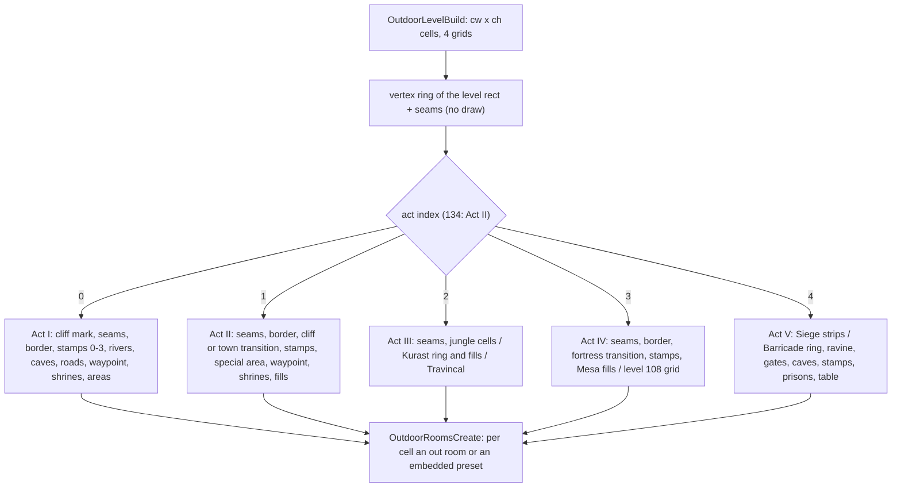

# 0008 — The outdoor generators: level outline, borders, placements, act layouts and the border stamps

> **Subsystem:** drlg/outdoor
> **Question:** How does a `DrlgType` 3 level become its grid of outdoor cells: which act generator runs, how it lays the border, seams, cliffs, rivers and paths, where it puts the preset areas, and what it draws from the level seed, in which order?
> **Date:** 2026-10-14   **Plan:** 0026 (Phase 1, 1b)   **Status:** open (static reading; all 370 logged windows replayed bit-exactly, see § 13)

Phase 1 reads the outdoor window of [drlg/0003](0003-generator-dispatch.md) (`OD0`–`OD1`, the oracle of
[drlg/overview](../../specs/drlg/README.md) step 9) end to end. That is everything `sub_00675360_OutdoorLevelBuild` runs
between allocating the four cell grids and `sub_006750F0_OutdoorRoomsCreate`. It also reads Act III's jungle link layout,
which plan 0022 left to this plan ([drlg/0007 § Boundary](0007-warps.md#boundary-for-phase-2)). The reading is decompile plus
disassembly for the register arguments. `tools/outdoor_replay.py` (Acts I, II, IV, V) and `tools/jungle_replay.py` (Act III)
are reading checks like `tools/maze_replay.py`: they replay the 370 logged windows and compare the seed after the window and
every preset (and out room) the window leaves. § 13 lists what they cover.
The paths it covers are confirmed; the rest are inferred.

## Answer (summary)

- [C] **Dispatch.** `sub_00675360_OutdoorLevelBuild` sets the grid to `cw = L.w / 8` × `ch = L.h / 8` cells (signed, toward
  zero) and allocates four grids of that size. It builds the level outline (a vertex ring, § 3, no draw) and switches on the
  act index, except that level 134 takes Act II. Act I runs levels 2–7, 17 and 39, Act II 41–46 and 134, Act III 76–83,
  Act IV 104–106 and 108, Act V 110–112 and 117. No generator branches on difficulty, expansion or player count. Act III's
  jungle sizes come from `Levels` `SizeX/Y[difficulty]`, which are equal in all three difficulties.
  (fn:sub_00675360_OutdoorLevelBuild@0x00675360, fn:sub_006807F0_OutdoorAct1@0x006807F0,
  fn:sub_0067F980_OutdoorAct2@0x0067F980, fn:sub_0067F450_OutdoorAct3@0x0067F450, fn:sub_0067E890_OutdoorAct4@0x0067E890,
  fn:sub_0067E600_OutdoorAct5@0x0067E600, run:2026-10-12-drlg-gen)
- [C] **The cell grid is the generator's output.** Cell bit `0x200` marks a preset footprint, and bits 16–19 hold its file
  index. The def grid holds the preset `Def` at the anchor cell only. `0x100` marks a covered cell (no room), and `0x1` a
  border. `0x400` is a seam opening, `0x800` a waypoint, `0x1000` a shrine and `0x80` a road. grid0 becomes the out room's
  `+0x28` flags: warp slot `0x10<<k`, shrine `0x1000<<r`, waypoint `0x10000`/`0x20000`. § 2 has the full table. The shrine
  and waypoint room bits stay `[I]`: the logs record room flags before they are applied.
  (fn:sub_006743C0_OutPresetPlace@0x006743C0, fn:sub_006750F0_OutdoorRoomsCreate@0x006750F0, run:2026-10-12-drlg-gen)
- [C] **Every preset goes through one placer**, `sub_006743C0_OutPresetPlace(L, x, y, def, file, borderFlag)`. With
  `file = −1` the file comes from a per-`Def` rotation on the level's counter list (`L+0x1CC`, the list `MazePresetFile` uses).
  The first use of a `Def` in a build draws `RangeB(level seed, Files)`, including when `Files` is 1. Every use, the first
  included, then sets `c = (c + 1) % Files` (signed). That first-use draw is the commonest level-seed draw of the window.
  (fn:sub_00674320_OutPresetFileRotate@0x00674320, run:2026-10-12-drlg-gen)
- [C] **Random placement** (`sub_00674730_OutPresetPlaceRandom`) shuffles the `N = (cw−2)(ch−2)` interior cells with N swaps
  of two `Range(N)` draws each (always 2N draws). It then places the `Def` at the first cell whose footprint fits (in the grid,
  and `cell & 0x1B81 == 0` everywhere), or places nothing. A failure is silent unless the caller tests it.
  `PlaceNear` (next to a road cell) and `PlaceFar` (farthest from a rectangle) are variants (§ 5).
  (fn:sub_00674730_OutPresetPlaceRandom@0x00674730, fn:sub_00674230_OutPresetFits@0x00674230, run:2026-10-12-drlg-gen)
- [C] **Border pass** (Acts I, II, IV). Along the ring, every edge cell gets the act's edge piece (`Wild Border` 4–15,
  `Desert Border` 364–375, `Mesa Border` 799–810) and every turn a corner piece. The mid cell of a seam with an outdoor
  neighbour becomes the opening. Act V lays its own ring (cliff and ravine pieces 881–906 and 957–982). Act III lays
  Kurast rings from its own tables. (fn:sub_00675850_OutBorderBuild@0x00675850, fn:sub_0067DCF0_BarricadeBorderRing@0x0067DCF0,
  run:2026-10-12-drlg-gen)
- [C] **Per act**, on the logged levels (§ 13; levels 39, 46, 80–83, 117 and 134 are `[I]`).
  - Act I: cliffs on the non-seam W/N edges, the river (26/27) with a bridge (28), caves, town transitions, roads (a
    deterministic path search plus draw-jittered vertices), the waypoint, shrines, and a per-level area list.
  - Act II: one of 8 cliff layouts (one draw), the special area (tomb, lair or sewer, fatal if it fails), the waypoint,
    shrines, and fill lists.
  - Act III: the jungle `Def` arrays from the act-seed layout, the Kurast rings, sewers, temples and fills, the bridge, and
    Travincal.
  - Act IV: the Fortress transition, Mesa and Pits fills, and Chaos Sanctum's fixed 5×5 grid.
  - Act V: the Siege strips (no draw), or the Barricade ring, ravine, gates, caves, border stamps, prisons and table fills.

  (fn:sub_006807F0_OutdoorAct1@0x006807F0, fn:sub_0067F980_OutdoorAct2@0x0067F980, fn:sub_0067F450_OutdoorAct3@0x0067F450,
  fn:sub_0067E890_OutdoorAct4@0x0067E890, fn:sub_0067E600_OutdoorAct5@0x0067E600, run:2026-10-12-drlg-gen)
- **Plan 0026 Phase 0 questions** (§ 12):
  - [C] **(a)** Barricade 1/2 take their size from the Act V link pick, 64×160 or 160×64 by one act-seed bit. Level 117's
    `Levels` size is overwritten the same way (`[I]`, never logged). (fn:sub_0067D830_LinkPick@0x0067D830,
    fn:sub_0067D980_LinkPick@0x0067D980, run:2026-10-12-drlg-gen)
  - [C] **(b)** The five `tag_type` 2 records are border stamps. `sub_006752A0_OutBorderSubApply` applies every record of a
    `Type` to the outdoor grid with the level seed. `BordType` sets how many matches a record stamps, and `GridSize` sets the
    outdoor cells per group cell. (fn:sub_0066F990_BorderSubRecord@0x0066F990, tbl:LvlSub.txt:BordType, run:2026-10-12-drlg-gen)
  - [C] **(c)** Records 857–862 and 836 are placed by Act IV's level 108 grid. `[I]` 852–856 are never placed by outdoor code.
    (fn:sub_0067E840_OutA4DiabloGrid@0x0067E840, run:2026-10-12-drlg-gen)
  - [C] **(d)** Indices past `Files` come from the border pass's seam opening (3, or 4 on level 17), from explicit indices
    (rivers, bridge, cliffs, town transitions, clearings), and from the clearing permutation; § 12 tags each route.
    (fn:sub_00675850_OutBorderBuild@0x00675850, run:2026-10-12-drlg-gen)
- [C] **Act III's jungle layout** (`sub_00677880_JungleLayout`) steps the act seed itself, not the link builder's copy. It
  places three 64×192 jungles north of the town, walks one path per jungle on a 32-tile cell grid, and turns the exit masks
  into the `Jungle` records 530–572 and the clearings 575–604. It makes 119 act-seed steps for map seed 12345, the count
  [rng/0002](../rng/0002-seed-tree.md) measured. (fn:sub_00677880_JungleLayout@0x00677880, run:2026-10-11-seed-tree,
  run:2026-10-12-drlg-gen)

## Leads used

Blind first: every claim above and below was written from the code before any community text was read (Phase 1b, § Phase
1b verdicts). No lead was used to locate code.

## Functions

Existing names are listed where this finding reads them further. Tags: `C` where § 13's replay covers the function on the
logged levels, else `I`; `L` where the arguments were not fully traced.

| Address | Name | Role | Tag |
|---|---|---|---|
| `0x00675360` | `sub_00675360_OutdoorLevelBuild` | grid size, 4 grids, ring, act switch (134 → Act II), `OutdoorRoomsCreate` | C |
| `0x006807F0` | `sub_006807F0_OutdoorAct1` | Act I driver (§ 8) | C |
| `0x0067F980` | `sub_0067F980_OutdoorAct2` | Act II driver (§ 9) | C |
| `0x0067F450` | `sub_0067F450_OutdoorAct3` | Act III driver: seam mark, jungle cells, Kurast level, Travincal (§ 10) | C |
| `0x0067E890` | `sub_0067E890_OutdoorAct4` | Act IV driver (§ 11) | C |
| `0x0067E600` | `sub_0067E600_OutdoorAct5` | Act V driver (§ 12) | C |
| `0x0066B6A0` | `sub_0066B6A0_LevelAdjLess` | adjacency-node order: side, then W ↑y, N ↓x, E ↓y, S ↑x | C |
| `0x0066B720` | `sub_0066B720_LevelAdjInsert` | sorted insert into a level's adjacency list | C |
| `0x0067D050` | `sub_0067D050_VertexRingBuild` | 4-corner ring of the level rect plus seam vertices, level-relative | C |
| `0x0067CE20` | `sub_0067CE20_VertexRingSeams` | insert seam vertices per adjacency node; seam flags | C |
| `0x0067CDD0` | `sub_0067CDD0_VertexAlloc` | zeroed 0x14-byte vertex, type from `DL` | C |
| `0x0067CE00` | `sub_0067CE00_VertexMarkSeam` | vertex flags `|= 1`, `|= 2` for a preset neighbour | C |
| `0x0067D1E0` | `sub_0067D1E0_VertexRingFree` | frees a ring | I |
| `0x0067D280` | `sub_0067D280_VertexDir` | `sign(next − v)` per axis | C |
| `0x00675080` | `sub_00675080_OutVertsToCells` | vertices `/ 8` (toward zero), merge equal neighbours | C |
| `0x00674040` | `sub_00674040_SeamWarpFlag` | warp-slot flag `0x10<<k` of the neighbour across a ring vertex | C |
| `0x00675770` | `sub_00675770_OutSeamMark` | seam segments → grid0 slot flag, cell bit 0 (and 1 for a typed vertex) | C |
| `0x00675850` | `sub_00675850_OutBorderBuild` | edge and corner pieces along the ring, seam openings, then `OutCornerFlood` | C |
| `0x00675670` | `sub_00675670_OutCornerFlood` | from each grid corner, `0x100` up to the border | C |
| `0x006755C0` | `sub_006755C0_BorderEdgeDef` | edge piece `Def` by direction and style | C |
| `0x00675600` | `sub_00675600_BorderCornerDef` | corner piece `Def` by turn and style | C |
| `0x006743C0` | `sub_006743C0_OutPresetPlace` | footprint cells `0x200`, `file<<16`, anchor `Def`; rotation for file −1 | C |
| `0x00674320` | `sub_00674320_OutPresetFileRotate` | per-`Def` counter on `L+0x1CC`; first use `RangeB(Files)` | C |
| `0x00674230` | `sub_00674230_OutPresetFits` | footprint (+pad on sides) in bounds and free (`0x1B81`) | C |
| `0x00674730` | `sub_00674730_OutPresetPlaceRandom` | shuffle interior cells (2N draws), first fit | C |
| `0x00674920` | `sub_00674920_OutPresetPlaceNear` | shuffle, the 8 neighbours of each road cell, else `PlaceRandom` | C |
| `0x006744F0` | `sub_006744F0_OutPresetPlaceFar` | 2 draws (scan offsets), the fitting cell farthest from a rect | C |
| `0x00674B70` | `sub_00674B70_OutWaypointPlace` | level 3 seam rule, else shuffle and first free cell | C |
| `0x00674E40` | `sub_00674E40_OutShrinesPlace` | 1 draw, shuffle, `count` shrines with rotating record | C |
| `0x00674120` | `sub_00674120_OutCellPresetDef` | the anchor `Def` of a cell, or 0 | C |
| `0x00674160` | `sub_00674160_OutCellClear` | def grid 0, cell 0 | C |
| `0x006741A0` | `sub_006741A0_OutCellCover` | def grid 0, cell `0x100` | C |
| `0x006741E0` | `sub_006741E0_OutCellNotOpening` | `!(cell & 0x400)` | C |
| `0x00674200` | `sub_00674200_OutCellFree` | `(cell & 0x1B81) == 0` | C |
| `0x006752A0` | `sub_006752A0_OutBorderSubApply` | `(L, Type, baseDef)`: context, then every LvlSub record of the `Type` | C |
| `0x00670750` | `sub_00670750_BorderSubApplyType` | load each record's DS1, apply it | C |
| `0x0066F990` | `sub_0066F990_BorderSubRecord` | the groups of one record; `BordType` | C |
| `0x0066F690` | `sub_0066F690_BorderSubGroup` | shuffle positions (2N draws), match, `Range(variants)`, stamp | C |
| `0x0066F3B0` | `sub_0066F3B0_BorderSubFits` | match a group's variant 0 against the def and cell grids | C |
| `0x0066F520` | `sub_0066F520_BorderSubStamp` | stamp a variant into the grids | C |
| `0x0066FA10` | `sub_0066FA10_LvlSubPresetUnits` | copy a group's preset units into a room (room-prepare stamp) | I |
| `0x00670630` | `sub_00670630_LvlSubUnloadDs1` | frees a record's DS1 and grids | I |
| `0x006754C0` | `sub_006754C0_OutdoorLevelFree` | frees grids and lists (keep mode, or everything) | I |
| `0x00675DE0` | `sub_00675DE0_RectBesideA` | rect beside a rect; no reference found | I |
| `0x00675EB0` | `sub_00675EB0_RectBesideB` | as above, other alignment; no reference found | I |
| `0x00675F80` | `sub_00675F80_RectBeside8` | 8-way variant; no reference found | I |
| `0x0067C480` | `sub_0067C480_GridValid` | grid and data non-null | C |
| `0x0067C4A0` | `sub_0067C4A0_GridInBounds` | `0 ≤ x < w && 0 ≤ y < h` | C |
| `0x0067C4D0` | `sub_0067C4D0_GridCellPtrA` | cell address (`EAX` grid) | I |
| `0x0067C4F0` | `sub_0067C4F0_GridCellOp` | `(grid, x, y, value, op)` through data:g_GridOps@0x00749BAC | C |
| `0x0067C520` | `sub_0067C520_GridCellOpPt` | the same with a point | I |
| `0x0067C550` | `sub_0067C550_GridCellPtr` | cell address (`ECX` grid) | C |
| `0x0067C6D0` | `sub_0067C6D0_GridEdgeOpBR` | op on the bottom row and the right column | I |
| `0x0067C760` | `sub_0067C760_GridSegmentOp` | op on the cells of an axis segment `v → v.next` | C |
| `0x0067C890` | `sub_0067C890_GridPointsOr` | `or` into the cell of every listed vertex | C |
| `0x0067C8E0` | `sub_0067C8E0_GridLineOp` | Bresenham line, n cells wide, clipped to a rect | L |
| `0x0067CD90` | `sub_0067CD90_GridFree` | frees a grid's row table | I |
| `0x00680070` | `sub_00680070_A1CliffMark` | Act I: cliff type on non-seam up/right vertex runs | C |
| `0x00680200` | `sub_00680200_A1RiverEastAndCave` | Act I: east river, cliff cave, corner cave | C |
| `0x006801A0` | `sub_006801A0_A1CliffCaveTry` | cave 25/24 on a cliff piece 16/17 | C |
| `0x006803D0` | `sub_006803D0_A1RiverMidTransCave` | Act I: middle river, town transitions, cave or Den entrance | C |
| `0x0067FC70` | `sub_0067FC70_A1RiverColumnClear` | no cliff bit in columns x, x+1 | C |
| `0x0067FE90` | `sub_0067FE90_A1RiverPlace` | river 26/27 down two columns, then the bridge | C |
| `0x0067FD20` | `sub_0067FD20_A1BridgePlace` | one `Range(ch−2)`, first fitting row, bridge 28 | C |
| `0x0067FB90` | `sub_0067FB90_A1BridgeFind` | first row with bridge `Def` 28 index 1 in a column | C |
| `0x0067FC20` | `sub_0067FC20_A1BridgeFindMid` | `BridgeFind` at `cw/2 − 1` | C |
| `0x006804E0` | `sub_006804E0_A1PlaceOneOrTwo` | 1 draw: two `PlaceNear` or one, optional Cottages 3 | C |
| `0x00680580` | `sub_00680580_A1Areas` | Act I per-level area list | C |
| `0x00681420` | `sub_00681420_A1Paths` | Act I roads: endpoints, hub, search, mark, jitter | C |
| `0x00680D70` | `sub_00680D70_A1PathEndpoints` | road endpoints (town, monastery, openings, caves, bridge) | C |
| `0x00681000` | `sub_00681000_A1PathHub` | per-endpoint hub: the bridge, or a free cell near the centroid | C |
| `0x00680CC0` | `sub_00680CC0_A1PathSnap` | snap a point to its cell edge by direction | C |
| `0x006817D0` | `sub_006817D0_A1PathSearch` | deterministic iterative-deepening path search | C |
| `0x00681630` | `sub_00681630_A1PathSearchStep` | depth-bounded expansion | C |
| `0x006815C0` | `sub_006815C0_A1PathCellOpen` | cell inside the grid, not a preset, not on the branch | C |
| `0x00681560` | `sub_00681560_A1PathBacktrack` | next branch or backtrack | C |
| `0x00681240` | `sub_00681240_A1PathJitter` | 1 + 2 per interior vertex draws; cells → points | C |
| `0x00678B80` | `sub_00678B80_DirOctantIndex` | `(dx, dy)` → index | C |
| `0x00678CF0` | `sub_00678CF0_DirFromDelta` | direction 0..7 from a delta | C |
| `0x00680C80` | `sub_00680C80_OutRoomRoadGrid` | room prepare: rasterise the roads, road tile codes | I |
| `0x00680A70` | `sub_00680A70_RoadRasterize` | `GridLineOp` per road segment | I |
| `0x00680B10` | `sub_00680B10_RoadCodes` | 3×3 neighbour mask → road tile code | I |
| `0x006809C0` | `sub_006809C0_Road3x3Load` | helper of `RoadCodes` | I |
| `0x0067F470` | `sub_0067F470_OutA2PlaceList` | `Range(n)` start, n `PlaceRandom` (or one per file) | C |
| `0x0067F560` | `sub_0067F560_OutA2TownTransition` | level 41: 362 or 363 by Lut Gholein's side | C |
| `0x0067F5C0` | `sub_0067F5C0_OutA2Cliff` | 1 draw `& 7`, one of 8 five-piece cliff layouts | C |
| `0x0067F630` | `sub_0067F630_OutA2BorderSubs` | border stamps of `Type` 2, 1, 3 from 364 | C |
| `0x0067F670` | `sub_0067F670_OutA2SpecialArea` | tomb / lair / sewer by level; fatal if it fails | C |
| `0x0067F6F0` | `sub_0067F6F0_OutA2FillsDesert1` | level 41 fills | C |
| `0x0067F740` | `sub_0067F740_OutA2FillsDesert2` | level 42 fills | C |
| `0x0067F7A0` | `sub_0067F7A0_OutA2OasisPair` | oasis pair list; no caller found | I |
| `0x0067F7D0` | `sub_0067F7D0_OutA2FillsDesert3` | level 43 fills | C |
| `0x0067F830` | `sub_0067F830_OutA2RuinsDesert4` | level 44 ruins | C |
| `0x0067F870` | `sub_0067F870_OutA2FillsDesert4` | level 44 fills | C |
| `0x0067F8D0` | `sub_0067F8D0_OutA2KingTombCliff` | level 46: fixed King Tomb cliff and warp 394 | I |
| `0x0067F920` | `sub_0067F920_OutA2FillsValley` | levels 46 and 134 fills | I |
| `0x00677880` | `sub_00677880_JungleLayout` | Act III link: jungles 76–78 on the act seed, their `Def` arrays | C |
| `0x006777D0` | `sub_006777D0_JungleRectRel` | a jungle's rect beside its parent, direction 0–4 | C |
| `0x00678910` | `sub_00678910_KurastStack` | rects of 79–83, stacked north of 78 (no draw) | C |
| `0x0061E470` | `sub_0061E470_LevelDefGet` | `leveldefs` row by id, 0 if out of range | C |
| `0x0067E910` | `sub_0067E910_OutJungleCells` | levels 76–78: jungle `Def`s, clearing files, Head and Tail | C |
| `0x0067F190` | `sub_0067F190_OutKurastLevel` | levels 79–82: ring, sewers, temples, waypoint, fills; 82 bridge | C |
| `0x0067EAD0` | `sub_0067EAD0_OutKurastRingSlums` | level 79 ring (605–614) | C |
| `0x0067EC30` | `sub_0067EC30_OutKurastRingBurbs` | level 80 ring (619–628) | I |
| `0x0067ED70` | `sub_0067ED70_OutKurastRingMetro` | level 81 ring (636–645) | I |
| `0x0067EED0` | `sub_0067EED0_OutFillRandom` | shuffle all cells, one `Def` draw per cell, place if it fits | C |
| `0x0067F3B0` | `sub_0067F3B0_OutTravincal` | level 83: six fixed blocks | I |
| `0x0067E660` | `sub_0067E660_OutA4FortressTransition` | 798 at (0,1) / (0,4) by the outdoor flags | C |
| `0x0067E6A0` | `sub_0067E6A0_OutA4MesaFills` | Mesa Warp, Mesa and Pits fills, Izual | C |
| `0x0067E840` | `sub_0067E840_OutA4DiabloGrid` | level 108: 5×5 fixed grid of 24×24 blocks | C |
| `0x0067E560` | `sub_0067E560_SiegeStrips` | level 110: 15 strips, index 0 | C |
| `0x0067DCE0` | `sub_0067DCE0_BarricadeBorderStyle` | `4 + (L.id == 117)`: dirt or snow | C |
| `0x0067DCF0` | `sub_0067DCF0_BarricadeBorderRing` | Act V ring: 2×2-cell edge and corner pieces, gate marks | C |
| `0x0067DEF0` | `sub_0067DEF0_BarricadeRavine` | east column and bottom row become ravine pieces | C |
| `0x0067DB50` | `sub_0067DB50_BarricadeGates` | first opening per edge → gate 907–910 | C |
| `0x0067DB00` | `sub_0067DB00_GateIfOpen` | single-cell gate test; no caller found | I |
| `0x0067DA70` | `sub_0067DA70_BarricadeCaveEntries` | cave entrances of 112 and 117, index 0 | C |
| `0x0067E4B0` | `sub_0067E4B0_BarricadeToSiege` | level 111: 880 and 896 | C |
| `0x0067E0E0` | `sub_0067E0E0_BarricadeLvlSub` | border stamps of `Type` 12 with Act V callbacks | C |
| `0x0067E000` | `sub_0067E000_BarricadeSubDefMap` | DS1 cell (main 48/49, sub) → `Def` | C |
| `0x0067E080` | `sub_0067E080_BarricadeSubMatch` | `Type` 12 match callback | C |
| `0x0067E240` | `sub_0067E240_BarricadePrisons` | level 111: three prisons over Barricade pieces | C |
| `0x0067E160` | `sub_0067E160_BarricadeTablePlace` | table of portals, waypoints, ruins, fills | C |

Data: `g_OutSideProbe` `0x006F05D8`, `g_OutNbrDy`/`g_OutNbrDx` `0x006F060C`/`0x006F0614`, `g_OutShrineFlag` `0x006F061C`,
`g_BorderDefs` `0x006F0620`, `g_BorderDefsA5` `0x006F06F0`, `g_BorderDirIdx` `0x006F0FD0`, `g_BorderCornerIdx` `0x006F1088`,
`g_A2SeamPairDefs` `0x006F112C` (all exercised by the replay, so `C` in `re/symbols.csv`). Act tables are cited where they are read.

## Walkthrough

Notation: `L` the level, `O = L+0x14` its 0x268-byte outdoor record, `cw`/`ch` = `O+0x5C`/`O+0x60`. `step()` is one LCG
step of the level seed `L+0x1C4`. `Range(n)` is `RNG_Range` semantics: `n < 1` gives 0 with no draw, a power of two masks
`lo & (n−1)`, otherwise unsigned `lo % n`. `RangeB` is the same. `x` is the column and is always passed in `EDX`, and `y`
is the row, on the stack. `Place(x, y, def, file)` is `OutPresetPlace` with `borderFlag` 0 unless stated.

### 1. The window

```c
// fn:sub_00675360_OutdoorLevelBuild@0x00675360 (ECX = L; pool = act+0x478)
O.+0x54, O.+0x58 = 0; cw = L.w / 8; ch = L.h / 8                      // signed, toward zero
GridAlloc(O+0x04); GridAlloc(O+0x18); GridAlloc(O+0x2C); GridAlloc(O+0x40)   // cw × ch, zeroed
VertexRingBuild(pool, &O+0x64, &L.rect, type 0, O+0x264)              // § 3
OutVertsToCells(&O+0x64)
switch (L.id == 134 ? 1 : DRLG_ActFromLevelId(L.id)) { 0..4: OutdoorActN(L) }
OutdoorRoomsCreate(L)                                                 // drlg/0003
```

- [C] The level seed into the act generator is the re-seeded one (drlg/0003), and nothing before the switch draws:
  Act III's and level 108's replays start from the `OD0` seed and end on the `OD1` seed (§ 13).
  (fn:sub_00675360_OutdoorLevelBuild@0x00675360, run:2026-10-12-drlg-gen)
- [I] Every generator writes the grids in place: the def grid `O+0x04`, grid0 `O+0x18`, the cell grid `O+0x2C`. grid3
  `O+0x40` is not touched by any generator; `OutdoorRoomsCreate` passes it on. (fn:sub_006750F0_OutdoorRoomsCreate@0x006750F0)



### 2. The outdoor record and the cell bits

| Offset | Content |
|---|---|
| `+0x00` | flags: inputs from the link builder (`0x4`–`0x400` Act I, § 8; `0x400000`/`0x800000` Act IV, § 11), `0x20`/`0x40` set by Act I |
| `+0x04` | def grid: the preset `Def` at its anchor cell, 0 elsewhere |
| `+0x18` | grid0: the out room's `+0x28` flags, the embedded preset's `flags` |
| `+0x2C` | cell grid |
| `+0x40` | grid3 (not written by the generators) |
| `+0x54` | a grid header used only for its size: `+0x5C` cw, `+0x60` ch |
| `+0x64` | the vertex ring (§ 3) |
| `+0x68..+0x7C` | six vertex lists: Act I's roads |
| `+0x80`, `+0xF8`, `+0x170`, `+0x1E8`, `+0x260` | Act I road endpoint arrays (0x14-byte entries) and their count |
| `+0x264` | the border-adjacency list (`LevelBorderAdj`, `LevelSeamsByTouch`) |

Cell grid bits:

| Bits | Meaning | Set by | Read by |
|---|---|---|---|
| `0x1` | border or seam cell | `OutSeamMark`, `OutBorderBuild`, `OutPresetPlace` with `borderFlag` for `Def` 4–15 and 364–375, Act V ring | `OutCornerFlood`, the occupied mask |
| `0x2` | typed (cliff) seam or border | `OutSeamMark`, `OutBorderBuild` | Act I river test |
| `0x80` | road | Act I roads (`GridPointsOr`) | `PlaceNear`, the occupied mask |
| `0x100` | covered: no room | `OutCellCover`, `OutCornerFlood` | `OutdoorRoomsCreate`, the occupied mask |
| `0x200` | preset footprint | `OutPresetPlace` | `OutdoorRoomsCreate`, the occupied mask |
| `0x400` | seam opening | `OutBorderBuild` (acts 0, 3, 4), Act V ring | `OutCellNotOpening`, Act V gates, `OutWaypointPlace` (level 3) |
| `0x800` | waypoint | `OutWaypointPlace` | the occupied mask |
| `0x1000` | shrine | `OutShrinesPlace` | the occupied mask |
| `0xF0000` | preset file index (bits 16–19) | `OutPresetPlace`, the seam opening | `OutdoorRoomsCreate` → `PresetSetFile` |

- [C] The occupied mask is `0x1B81` (bits 0, 7, 8, 9, 11, 12): a placement fits only on cells with none of them.
  (fn:sub_00674230_OutPresetFits@0x00674230, fn:sub_00674200_OutCellFree@0x00674200, run:2026-10-12-drlg-gen)
- [I] grid0 bits: `0x10<<k` warp slot *k* (`OutSeamMark`), `0x1000<<r` shrine record *r* (`OutShrinesPlace`),
  `0x10000`/`0x20000` waypoint record 0/1 (`OutWaypointPlace`). These are the room bits that drlg/0002's grid prepare
  turns into the `SubShrine` and `SubWaypoint` passes. (fn:sub_00675770_OutSeamMark@0x00675770,
  fn:sub_0067D2D0_OutRoomGridPrepare@0x0067D2D0)
- [I] **Warp slots 20–25.** No outdoor generator writes cell bits 20–25: the warp slot of an outdoor seam room is the grid0 flag
  `0x10<<k`, and a warp inside an embedded preset comes from its DS1 cells ([drlg/0007](0007-warps.md)).
  (fn:sub_00675770_OutSeamMark@0x00675770, fn:DRLG_PresetMapScan@0x00667970)

### 3. The level outline

```c
// fn:sub_00677680_LevelBorderAdj@0x00677680 → fn:sub_0066B790_LevelAdjAdd@0x0066B790 (per Vis slot with Warp −1)
node = { +0 nbr, +4 side = RectAdjDir(L.rect, nbr.rect) /*0 W, 1 N, 2 E, 3 S*/, +8 isPreset (nbr DrlgType 2),
         +0xC 0, +0x10 &nbr.rect, +0x14 next }
LevelAdjInsert(node, &O.+0x264)       // order: side ascending; W by y ascending, N by x descending, E by y descending, S by x ascending

// fn:sub_0067D050_VertexRingBuild@0x0067D050 (rect = L.rect, list = O+0x264)
rect.w--, rect.h--; each nbr.rect w--, h--                 // inclusive coordinates while building, restored after
ring = v0 (x, y+h) → v1 (x, y) → v2 (x+w, y) → v3 (x+w, y+h) → v0   // W side going up, then N, E, S
VertexRingSeams(ring, rect, list)
every vertex −= (L.x, L.y)
// then OutVertsToCells: v /= 8 (signed); a vertex equal to its successor is merged into it (flags or-ed)
```

```c
// fn:sub_0067CE20_VertexRingSeams@0x0067CE20, per adjacency node n in list order (r = n.rect):
side 0: start v0, edge y from v0.y to v1.y, c = −1, a = r.y + r.h, b = r.y
side 1: start v1, x from v1.x to v2.x,     c = +1, a = r.x,       b = r.x + r.w
side 2: start v2, y from v2.y to v3.y,     c = +1, a = r.y,       b = r.y + r.h
side 3: start v3, x from v3.x to v0.x,     c = −1, a = r.x + r.w, b = r.x
p = start
if (a·c ≤ s·c) { if (s·c > b·c) continue }          // the neighbour ends before the edge starts
else { if (a·c > e·c) continue; p = insert after p at a }
p.flags |= 1; if (n.isPreset) p.flags |= 2          // the segment from p is a seam
if (b·c < e·c) insert after p at b                  // the seam ends inside the edge
```

- [C] A vertex's flag bit 0 means the segment to the next vertex borders a walkable neighbour (a `Vis` slot with `Warp` −1).
  Bit 1 means that neighbour is a preset level (a town). `type` (byte `+8`) is 0 from this builder; Act I's cliff mark
  sets 1. (fn:sub_0067CE20_VertexRingSeams@0x0067CE20, fn:sub_00680070_A1CliffMark@0x00680070, run:2026-10-12-drlg-gen)

### 4. The common passes

```c
// fn:sub_00675770_OutSeamMark@0x00675770: for each ring vertex v with v.flags & 1
SegmentOp(grid0, v, SeamWarpFlag(L, v), or, withEnd)   // the slot flag of the neighbour, on every cell v..v.next
SegmentOp(cell,  v, v.type ? 3 : 1,      or, withEnd)
// SeamWarpFlag: side of v, a probe point 4 tiles outside the grid (g_OutSideProbe), the adjacency node of that side whose
// rect contains it, then 0x10 << (first k with Vis[k] == nbr.id) (node +0xC non-zero → 0; no writer of +0xC was found)
```

```c
// fn:sub_00675850_OutBorderBuild@0x00675850. act = DRLG_ActFromLevelId(L.id)
style(t) = { LevelType 2: t ? 0 : 1;  16: 2;  27: 3;  31: 4 + (L.id == 117);  else −1 }
for v in ring from the head, once each; n = v.next:
  d = dir(v → n); cv = v.type ? 3 : 1; e = edgeDef(d, style(v.type))
  if !(v.flags & 2): for each cell c from v + d to n inclusive: Place(c, e, −1); cell(c) |= cv
  if (v.flags & 1) && !(v.flags & 2):                                  // seam with an outdoor level
    m = min(v, n) + (len·|d|) / 2                                       // signed /2, the mid cell
    act 0 or 4: cell(m) = (cell(m) & ~0xF0000) | (L.id == 17 ? 0x40400 : 0x30400)
    act 3:      cell(m) = (cell(m) & ~0xF0000) | 0x30400
    act 1:      Place(m, pair[k].a, −1); Place(m + |d|, pair[k].b, −1)   // k = dx + 2dy + 2, g_A2SeamPairDefs
    act 2:      nothing
  t = v.type or n.type; if t: cv |= 2
  k = g_BorderCornerIdx[...turn of v → n → n.next, wider when a side is a preset seam...]
  if k ≠ −1 and (c = cornerDef(k, style(t))) ≠ 0: Place(n, c, −1); cell(n) |= cv
OutCornerFlood(L)                                                       // 0x100 from each corner up to a bit-0 cell
```

- [C] Its only level-seed draws are the rotation's first uses: one `RangeB(Files)` per distinct border `Def`, in first-use
  order along the ring from v0 (the bottom-left corner, going up the W side). Callers: Act I, Act II, and Act IV except
  level 108. Act V lays its own ring with `BorderEdgeDef`/`BorderCornerDef` (§ 12). (fn:sub_00675850_OutBorderBuild@0x00675850,
  run:2026-10-12-drlg-gen)
- [C] `g_BorderDefs` rows 1–12 hold the edge and corner pieces for the styles cliff, wild, desert and mesa (row 1 `0, 4, 364,
  799` … row 12 `0, 15, 375, 810`). Style 0 (cliff) has `Def` 0 on rows 1, 4, 8, 9, 11 and 12: the left and down edges
  have no cliff piece. `g_BorderDefsA5` row *r* holds `881+r, 957+r`; the snow column is `[I]` (117 never logged).
  (data:g_BorderDefs@0x006F0620, data:g_BorderDefsA5@0x006F06F0, run:2026-10-12-drlg-gen)
- [C] **The corner index.** `idx = (v.flags&2 ? e(dx) : e(2dx)) + 9·(n.flags&2 ? e(dx2)+dy2 : e(2dx2)+2dy2) + (v.flags&2 ? dy : 2dy)`
  with `e(z) = z ± 2` away from 0 and `e(0) = 0`, read from the 9×9 table `0x006F1088` (rows −4..4). A corner `Def` of 19
  becomes `19 + (n.type ≠ 1)` when `v.type` is 1, and 21 otherwise. (fn:sub_00675850_OutBorderBuild@0x00675850, run:2026-10-12-drlg-gen)

### 5. Placement

```c
// fn:sub_006743C0_OutPresetPlace@0x006743C0 (ECX L, EDX x, y, def, file, borderFlag)
w, h = LvlPrest[def].SizeX / 8, SizeY / 8                 // signed
if (file == −1) file = OutPresetFileRotate(def)            // before the cells are written
for yy in y..y+h−1: for xx in x..x+w−1:                    // rows outer
  cell = (cell & ~0xF0000) | file << 16 | 0x200
  if borderFlag && (4 ≤ def ≤ 15 || 364 ≤ def ≤ 375): cell |= 1
  defgrid = 0
defgrid(x, y) = def                                        // the anchor

// fn:sub_00674320_OutPresetFileRotate@0x00674320 (EAX def, EBX L): no Def-range test, every Def rotates
node = find(L.+0x1CC, def) or prepend { def, Files, c = RangeB(&L.seed, Files) }
node.c = (node.c + 1) % node.Files                         // signed idiv; Files 0 would divide by zero
```

```c
shuffle(N, W'): list[i] = (i % W', i / W') for i < N; N times: a = Range(N); b = Range(N); swap(list[a], list[b])

// fn:sub_00674730_OutPresetPlaceRandom@0x00674730 (ECX L, EDX def, file, pad, sides)
N = (cw−2)(ch−2); N == 0 → 0 (no draw); shuffle(N, cw−2)
first (x+1, y+1) with Fits(def, pad, sides) → Place(def, file), return 1; else 0

// fn:sub_00674920_OutPresetPlaceNear@0x00674920 (ECX L, EDX def, file)
N == 0 → 0; shuffle(N, cw−2)
for each (x+1, y+1) with cell & 0x80: for k in 0..7 (g_OutNbrDx/Dy: W, N, S, E, NW, SE, NE, SW):
  Fits(def, 0, 0xF) → Place(def, file), 1
return PlaceRandom(def, file, 0, 0xF)                      // a second shuffle

// fn:sub_006744F0_OutPresetPlaceFar@0x006744F0 (ECX L, EDX rect, def, file, pad, sides)
ox = Range(cw−2); oy = Range(ch−2)
for r in 0..ch−2: y = (r + oy) % (ch−2) + 1; for c in 0..cw−2: x = (c + ox) % (cw−2) + 1     // inclusive bounds
  if Fits: a = |8x + L.x + 4 − (rect.x + rect.w/2)|; b = |8y + L.y + 4 − (rect.y + rect.h/2)|
           d = (a > b ? b + 2a : a + 2b) / 2; keep the first strict maximum
found → Place(def, file), 1

// fn:sub_00674230_OutPresetFits@0x00674230: footprint (def 0: 1×1), grown by pad on the sides in `sides` (1 N, 2 E, 4 S, 8 W),
// every cell in bounds and (cell & 0x1B81) == 0
```

- [C] `PlaceRandom` draws `2N` even when nothing fits, then one rotation draw if a `Def` placed with file −1 is new. Act III's
  temples, waypoint and Kurast fills and level 108 run through these paths in the replay. (fn:sub_00674730_OutPresetPlaceRandom@0x00674730,
  run:2026-10-12-drlg-gen)
- [I] `PlaceFar` visits row `oy` and column `ox` twice (inclusive bounds), which only matters for ties, and the first strict
  maximum wins. (fn:sub_006744F0_OutPresetPlaceFar@0x006744F0)

### 6. Waypoint and shrines

```c
// fn:sub_00674B70_OutWaypointPlace@0x00674B70
if L.id == 3:                                              // Cold Plains: next to the Blood Moor opening, no draw
  f = 0x10 << (first k with Vis[k] == 2)
  first (x, y) rows outer with (grid0 & f) && (cell & 0x400): clamp into 1..cw−2 × 1..ch−2;
      grid0 |= 0x20000; cell |= 0x800; return              // waypoint record 1
N == 0 → return; shuffle(N, cw−2)
first free (x+1, y+1): grid0 |= 0x10000; cell |= 0x800     // waypoint record 0

// fn:sub_00674E40_OutShrinesPlace@0x00674E40 (EDX count, 5 at every call site)
r = step() & 3                                             // always, before the shuffle
N == 0 → return; shuffle(N, cw−2)
each free (x+1, y+1) while count: grid0 |= 0x1000 << r; cell |= 0x1000; r = (r+1) & 3; count--
```

- [I] Neither pass places a preset: they mark cells, and the out room created there runs the `SubWaypoint`/`SubShrine`
  `LvlSub` pass of drlg/0002 with the marked record. (fn:sub_00674B70_OutWaypointPlace@0x00674B70,
  fn:sub_00674E40_OutShrinesPlace@0x00674E40)

### 7. The border stamps (`LvlSub` `tag_type` 2)

```c
// fn:sub_006752A0_OutBorderSubApply@0x006752A0 (ECX L, EDX Type, baseDef). Context C:
C = { L, &O+0x54, &O+0x04, &O+0x2C, baseDef, wildcard −1, Type, OutCellNotOpening, OutPresetFits, extraFit 0, defMap 0,
      OutCellClear, OutCellCover, OutPresetPlace }
for rec = LVLSUB_GetRecordByType(Type); rec.Type == Type; rec++: LvlSubLoadDs1(rec); BorderSubRecord(rec, C)   // 0x00670750

// fn:sub_0066F990_BorderSubRecord@0x0066F990
if groups == 0 return; if C.wildcard == −1: C.wildcard = 62
s = rec.BordType == 0 ? RangeB(&L.seed, groups) : 0
for i in 0..groups−1: ok = BorderSubGroup(C, rec, G[(s + i) % groups]); if ok && rec.BordType == 0: return

// fn:sub_0066F690_BorderSubGroup@0x0066F690
GS = rec.GridSize; off = (Type == 1 && (O.flags & 0xC)) ? −1 : 1
nx = cw − g.w·GS + off; ny = ch − g.h·GS + 1; N = nx·ny; N == 0 → 0
skip22 = Type == 1 && 2 ≤ L.id ≤ 7 && nx < 6 && ny < 6
shuffle(N, nx)                                             // 2N draws
for (px, py) in list: if skip22 && (px, py) == (2, 2): continue
  if BorderSubFits(px, py, g, rec):
    v = Range(g.variants)                                  // g+0x14
    BorderSubStamp(px, py, C, g, rec, srcX = (g.w + 1)(v + 1))
    if rec.BordType ≤ 1: return 1                          // BordType 2: keep stamping
return 0
```

- [C] A group is a rewrite rule. Positions snap down to multiples of `GS`, and group cell `(gx, gy)` covers outdoor cell
  `(px + GS·gx, py + GS·gy)`. The match reads the group's variant 0: a wall cell with bit 0 names a border piece
  `baseDef + ((W >> 8) & 0xFF) − 1` (63 means any), which must be the cell's `Def` and must not be a seam opening; a floor
  cell with `F & 2` must be free. The stamp writes variant `v + 1`: wall pieces are placed with file 0 and `borderFlag` 1,
  floor cells with `F & 2` are cleared to open cells, and the others are covered (`0x100`). (fn:sub_0066F3B0_BorderSubFits@0x0066F3B0,
  fn:sub_0066F520_BorderSubStamp@0x0066F520, run:2026-10-12-drlg-gen)
- [C] Call sites, in order: Act I levels 2–7 `Type` 0, then the east river and caves, `Type` 1, 2, the middle river and caves,
  `Type` 3 (base 4); level 39 `Type` 0–3 (base 4); Act II `Type` 2, 1, 3 (base 364); Act IV 104–106 `Type` 1, 2, 3 (base 799);
  Act V `Type` 12 with its own context (§ 12). (fn:sub_006807F0_OutdoorAct1@0x006807F0, fn:sub_0067F630_OutA2BorderSubs@0x0067F630,
  fn:sub_0067E890_OutdoorAct4@0x0067E890, fn:sub_0067E0E0_BarricadeLvlSub@0x0067E0E0, run:2026-10-12-drlg-gen; level 39 is `[I]`)

### 8. Act I (levels 2–7, 17, 39)

```c
// fn:sub_006807F0_OutdoorAct1@0x006807F0 (ECX L)
if L.id ∉ {2, 3, 17}: A1CliffMark(L)                       // no draw; vertex type 1 on non-seam up/right runs; O.flags |= 0x20
OutSeamMark(L); OutBorderBuild(L)
if 2 ≤ id ≤ 7:
  OutBorderSubApply(L, 0, 4); A1RiverEastAndCave(L)
  OutBorderSubApply(L, 1, 4); OutBorderSubApply(L, 2, 4); A1RiverMidTransCave(L)
  OutBorderSubApply(L, 3, 4); A1Paths(L)
if id == 39: OutBorderSubApply(L, 0..3, 4)
if 3 ≤ id ≤ 6: OutWaypointPlace(L)
if 2 ≤ id ≤ 7: OutShrinesPlace(L, 5)
A1Areas(L)
```

- [C] **Inputs.** `O.flags` bits `0x4`, `0x8`, `0x10`, `0x80`, `0x100`, `0x200`, `0x400` are set at act creation by
  `sub_00677180_LinkOutdoorFlags` from table `0x006F1258`, matched against the link builder's sides (act-seed copy). They
  select the river columns (`0xC` east, `0x10` middle), the bridge (`0x14`), the corner cave, and level 2's town
  transitions. Blood Moor's grid is 7×12 or 12×7: its link pick sets 56×96 or 96×56, not `Levels`' 80×80.
  (fn:sub_00677180_LinkOutdoorFlags@0x00677180, fn:sub_00676650_LinkPick@0x00676650, run:2026-10-12-drlg-gen)

```c
// fn:sub_00680200_A1RiverEastAndCave@0x00680200 (not level 39)
if (O.flags & 0xC) && RiverColumnClear(cw−2): RiverPlace(cw−2)
if (O.flags & 0x20) && !(O.flags & 0x40):                  // a cave in a cliff piece
  r = step(); scan rows outer if !(r & 1), else columns outer (bounds cw/ch swapped, equal on square levels)
  first cell with def 16 → Place(25 Cave Left, −1), def 17 → Place(24 Cave Right, −1); O.flags |= 0x40; none → fatal
if (O.flags & 0x1C) && !(O.flags & 0x40):                  // a corner cave
  r = step() & 3; x = r & 1 ? 3 : cw − (O.flags & 0x10 ? 4 : 5); y = r >> 1 ? 3 : ch − 4
  Place(x, y, 51 + (L.id == 2), −1); O.flags |= 0x40       // no fit test; Den of Evil entrance on Blood Moor

// fn:sub_0067FE90_A1RiverPlace@0x0067FE90 (x): no draw except the bridge
for y in 0..ch−1, for (col, def, T) in ((x, 26, upper), (x+1, 27, lower)):
  p = defgrid(col, y); c = cell(col, y)
  idx = p == 0 ? (c & 0x100 ? 0 : 3) : (p == 7 && (c & 0xF0000) == 0x30000) ? 3 : T[p]   // table 0x006F2680 by border Def
  Place(col, y, def, idx)                                  // replaces the border piece in that cell
if (O.flags & 0x14): BridgePlace(x)
// fn:sub_0067FD20_A1BridgePlace@0x0067FD20: s = Range(ch−2); first y = (k + s) % (ch−2) + 1 with free cells beside it
// and file index 3 in both river cells: Place(x, y, 28, 1); Place(x+1, y, 28, 2 + ((O.flags & 4) ≠ 0))

// fn:sub_006803D0_A1RiverMidTransCave@0x006803D0 (not level 39)
if (O.flags & 0x10) && RiverColumnClear(cw/2 − 1): RiverPlace(cw/2 − 1)
O.flags 0x80: Place(0, 0, 3, 1); 0x100: Place(cw−7, 0, 3, 2); 0x200: Place(0, 1, 2, 1); 0x400: Place(0, ch−6, 2, 1)   // town transitions
if !(O.flags & 0x40):
  id == 2: ok = PlaceFar(rect of level 1, 52 DOE Entrance, −1, pad 1, sides 0xF)
  else:    ok = PlaceRandom(51 Cave Entrance, −1, pad 1, sides 0xF)
  !ok → fatal; O.flags |= 0x40
```

- [C] **Roads** (`A1Paths`). Endpoints: the town (level 1) and Monastery Gate (26) seams, the seam openings (`Def` 4–7 at
  index 3), the cliff caves (24, 25), the east bridge, and the caves (51, 52). Each endpoint's hub is the middle bridge, or
  the first free cell spiralling out of the endpoints' centroid. A deterministic iterative-deepening search (cost 2 straight,
  3 per turn, preset cells blocked) links endpoint and hub with no draw. A found path marks its cells `0x80`, then the jitter
  draws `r = step() & 3` and two bits per interior vertex (`1 + 2·(vertices − 2)` draws). The polylines go to `O+0x68`; the
  room prepare later draws road tiles from them (`OutRoomRoadGrid`, outside the level-seed window).
  (fn:sub_00681420_A1Paths@0x00681420, fn:sub_006817D0_A1PathSearch@0x006817D0, fn:sub_00681240_A1PathJitter@0x00681240,
  fn:sub_00680C80_OutRoomRoadGrid@0x00680C80, run:2026-10-12-drlg-gen; the road tiles themselves are `[I]`)
- [C] **Areas** (levels 2–7 and 17; 39 is `[I]`; fn:sub_00680580_A1Areas@0x00680580; the `Def` is in `EDX`; `Near` = `PlaceNear(d, −1)`, `Rand` = `PlaceRandom(d, −1, 0, 0xF)`,
  `OneOrTwo(d, s)` = `r = step(); r & 3 == 0 ? Near(d) ×2 : Near(d), then if s: step() & 1 → Near(49)`):

  | Level | Sequence |
  |---|---|
  | 2 Blood Moor | `Near(46)`, `OneOrTwo(47, 0)`, `Rand(29)`, `Rand(30)` |
  | 3 Cold Plains | `OneOrTwo(48, 1)`, `Rand(44)`, `Rand(29)`, `Rand(30)` |
  | 4 Stony Field | `Near(160)`, `Near(45)`, `Rand(162)`, `OneOrTwo(47, 1)`, `OneOrTwo(42, 0)`, `Rand(31)` |
  | 5 Dark Wood | `Rand(161)`, `Rand(41)`, `Rand(40)`, `OneOrTwo(48, 1)`, `OneOrTwo(43, 0)`, `Rand(29)`, `Rand(30)` |
  | 6 Black Marsh | `Rand(163)`, `Rand(38)`, `Rand(39)`, `OneOrTwo(47, 1)`, `OneOrTwo(42, 0)`, `Rand(29)`, `Rand(30)` |
  | 7 Tamoe Highland | `OneOrTwo(48, 1)`, `OneOrTwo(43, 0)`, `Rand(31)` |
  | 17 Graveyard | `Place(1, 1, 108, −1)`: no fit test, one rotation draw |
  | 39 Moo Moo Farm | `Rand(50)`, `Rand(46)`, `Rand(31)`, `Rand(38)`, `Rand(39)`, `Rand(29)`, `Rand(30)` |

  (fn:sub_00680580_A1Areas@0x00680580, fn:sub_006804E0_A1PlaceOneOrTwo@0x006804E0)

### 9. Act II (levels 41–46, 134)

```c
// fn:sub_0067F980_OutdoorAct2@0x0067F980: OutSeamMark; OutBorderBuild; then by level
41: TownTransition (362 at (cw−1, 0), or 363 at (0, ch−1) when Lut Gholein is on side 3); BorderSubs(2, 1, 3; 364);
    SpecialArea(388); Shrines(5); PlaceList({395, 411, 401, 402, 399, 398, 403}, 7, 0)
42, 43, 44: Cliff; BorderSubs; SpecialArea(42 → 388, 43 → 390, 44 → 412)
    42: Waypoint; Shrines(5); Fills2      43: PlaceList({396, 397}, 2, 0); Waypoint; Shrines(5); Fills3
    44: PlaceList({413, 408, 409, 410}, 4, 0); Waypoint; Shrines(5); Fills4
45: SpecialArea(389)                                        // nothing else
46: KingTombCliff (fixed indices) and Place(4, 4, 394, −1); BorderSubs; Shrines(5); FillsValley
134: Place(4, 4, 394, −1); BorderSubs; FillsValley; Shrines(5)     // fills before shrines here

// fn:sub_0067F470_OutA2PlaceList@0x0067F470 (EBX L; defs, n, perFile)
k = Range(n)                                                // drawn for n = 1 too
n times: perFile ? (for i in 0..Files−1: PlaceRandom(defs[k], i, 0, 0xF)) : PlaceRandom(defs[k], −1, 0, 0xF); k = (k+1) % n
// fn:sub_0067F5C0_OutA2Cliff@0x0067F5C0: k = step() & 7; 5 Place from layout k of table 0x006F2390 ({def, idx, x, y})
```

- [C] The fill lists (`FillsValley` `[I]`): `Fills2` `{395, 411, 400, 398}` then `{404–407}` per file; `Fills3` `{411, 399, 398, 403}` then `{395}`
  per file twice; `Fills4` `{395, 400, 398, 404, 405}` then `{411}` per file twice; `FillsValley` `{401, 402, 406, 407, 403}`
  then `{392, 393}` per file. (fn:sub_0067F740_OutA2FillsDesert2@0x0067F740, fn:sub_0067F7D0_OutA2FillsDesert3@0x0067F7D0,
  fn:sub_0067F870_OutA2FillsDesert4@0x0067F870, fn:sub_0067F920_OutA2FillsValley@0x0067F920, run:2026-10-12-drlg-gen)
- [C] Cliff layouts (k 1, 4 and the King Tomb cliff `[I]`): k 0–2 a horizontal cliff on row 4 (`376` ends at indices 1 and 2, the path piece 378 at position 1, 2
  or 3, walls 377); k 3–4 an L with the 16×16 corner 382 at (4, 4); k 5–7 a vertical cliff on column 4 (`379` ends, path
  381). The King Tomb cliff (`0x006F2610`) is nine fixed pieces 383–387 with indices 0–2.
  (fn:sub_0067F5C0_OutA2Cliff@0x0067F5C0, fn:sub_0067F8D0_OutA2KingTombCliff@0x0067F8D0, run:2026-10-12-drlg-gen)
- [I] No waypoint pass runs on 41, 45, 46 or 134, and 45 has no shrine pass. A failed `SpecialArea` is fatal; every other
  failed placement is silent. (fn:sub_0067F670_OutA2SpecialArea@0x0067F670)

### 10. Act III (levels 76–83) and the jungle layout

```c
// fn:sub_006789B0_ActLinkAct3@0x006789B0 (act creation)
T = level 75 at its Levels offset; L78 = JungleLayout(T); KurastStack(L78); LevelSeamsByTouch(75, 83); LevelBorderAdj(75..83)

// fn:sub_00677880_JungleLayout@0x00677880 (EAX town). A = the act seed itself (act +0x000)
W, H = Levels[76].SizeX/Y[diff]; nx = W/32; ny = H/32                  // 64×192: 2×6
rec[0] = {T.x, T.y − H}
while n < 3: k = Range(A, n); d = step(A) % 5; R = JungleRectRel(rec[k], d)   // d: N, W/E up h/3, W/E up 2h/3
             if R overlaps any rec: retry; else rec[n++] = R (the parent's child)
on a grid of 32-tile cells with a 1-cell margin, per jungle k (restartable):
  entry column s = k == 0 ? step(A) & 1 : (R.dir odd)
  walk the path from the bottom row up: each row, unless first or last, step(A) % 3 == 0 moves one column across
  cells beside the path become dead-end candidates; retry the jungle while fewer than 2; trim to 3 with Range(A, cnt)
exit masks (W 1, E 2, S 4, N 8): the path, the links to the parent and the children, the level seams
clearings: one step(A) per cell (r = lo & 3), pairing each candidate with a path cell or a neighbour level's candidate,
  two more steps on the unpaired branch; a candidate with no path beside it restarts the whole grid
masks → Defs: 529 + mask (530–544), side bits through table 0x006F13F0 (545–572), clearings through 0x006F13BC (575–584)
sort the three by y descending: level 76 is the southernmost; L.+0x1BC = Def array, L.+0x1B8 = clearing count

// fn:sub_00678910_KurastStack@0x00678910: 79..83 stacked north of 78, each centred on it (no draw)
```

```c
// fn:sub_0067F450_OutdoorAct3@0x0067F450: OutSeamMark; OutJungleCells; OutKurastLevel; OutTravincal (each tests the id)
// fn:sub_0067E910_OutJungleCells@0x0067E910 (76..78)
r = Range(L.seed, L.clr == 3 ? 6 : 2)                      // always the first draw
for j in rows: 76 last row → Place(0, 4j, 573 Head, defs[last] == 0); 78 row 0 → Place(0, 0, 574 Tail, defs[1] == 0)
  else for i: d = defs[e++]; if d > 574: d += {76: 0, 77: 10, 78: 20}[id]; idx = PERM[k + 3r]; k++  // 0x006F2240, 0x006F2328
              if d: Place(4i, 4j, d, idx or −1)
// fn:sub_0067F190_OutKurastLevel@0x0067F190 (79..82)
79: RingSlums; PlaceRandom(631, 0); Fill(618, 618, 4); Fill(616, 617, 0); Fill(615, 615, 0)
80: RingBurbs; Place(3, 3, 629, 0); Place(cw−4, 3, 629, 1); PlaceRandom(630, 0); PlaceRandom(630, 1); PlaceRandom(631, 0); Fill(635..), Fill(633, 634), Fill(632)
81: RingMetro; Place(3, ch−4, 646, 0); Place(cw−4, ch−4, 646, 1); PlaceRandom(647, 0); PlaceRandom(647, 1); PlaceRandom(631, 0); Fill(651..), Fill(649, 650), Fill(648)
82: Place(0, 0, 652, 0)
// fn:sub_0067EED0_OutFillRandom@0x0067EED0 (lo, hi, max): shuffle all cw·ch cells (2n draws); per cell d = lo + Range(hi−lo+1)
//   (drawn also when hi == lo); Fits → Place(d, −1), stop after max placements when max > 0
// fn:sub_0067F3B0_OutTravincal@0x0067F3B0 (83): Place 653 (0,0), 654 (2,0), 655 (6,0), 656 (0,4), 657 (2,4), 658 (6,4), all −1
```

- [C] Jungle 1 is directly north of the town, and the other two attach to random existing jungles; the southernmost becomes
  level 76. A jungle can be a dead end, which is why Great Marsh is sometimes optional (§ Phase 1b verdicts). The act seed
  advances by the layout's own steps, 119 for map seed 12345 (rng/0002). (fn:sub_00677880_JungleLayout@0x00677880,
  run:2026-10-11-seed-tree, run:2026-10-12-drlg-gen)
- [C] Each clearing of a jungle level gets a distinct file of its 3 (`Files` 1 records) through the permutation row `r`.
  76 takes the Webby clearings 575–584, 77 Boggy 585–594 and 78 Pygmy 595–604. (fn:sub_0067E910_OutJungleCells@0x0067E910,
  run:2026-10-12-drlg-gen)
- [C] The Kurast ring gates (80 and 81 `[I]`) depend on act `+0x474`, the Act III act-seed bit of rng/0002: 79's north gate is at `x = 1` or
  `cw − 2`; 80 and 81 swap their gate sides on it. `mid = (cw − 1) / 2` places the 16-wide south gate of 79 and north gate
  of 81. (fn:sub_0067EAD0_OutKurastRingSlums@0x0067EAD0, fn:sub_0067EC30_OutKurastRingBurbs@0x0067EC30,
  fn:sub_0067ED70_OutKurastRingMetro@0x0067ED70, run:2026-10-12-drlg-gen)

### 11. Act IV (levels 104–106, 108)

```c
// fn:sub_0067E890_OutdoorAct4@0x0067E890
OutSeamMark(L); if L.id == 108: DiabloGrid(L); return
OutBorderBuild(L)
FortressTransition: O.flags 0x400000 → Place(0, 1, 798, −1); 0x800000 → Place(0, 4, 798, −1)
OutBorderSubApply(L, 1..3, 799)                            // order 1, 2, 3
MesaFills: if id == 106: PlaceRandom(811)
  a = {104: 812, 105: 817, 106: 823}[id]; p = {104: 828, 105: 832, 106: 832}[id]
  PlaceRandom(a); a+1 ×2; a+2 ×2; a+3 ×2; if id == 105: PlaceRandom(822); a+4 ×4
  PlaceRandom(p); p+1 ×2; p+2 ×2; p+3 ×4                    // all file −1, pad 0, sides 0xF; failures ignored
// fn:sub_0067E840_OutA4DiabloGrid@0x0067E840: i in 0..24: Place((i % 5)·3, (i / 5)·3, T[i], −1), T = 0x006F22C0
```

- [C] Level 108's grid is 836 everywhere except 861 (N arm, block (2, 1)), 858 (W, (1, 2)), 862 (heart, (2, 2)), 859 (E,
  (3, 2)), 860 (S, (2, 3)) and 857 (entry, (2, 4)). The window makes exactly the 7 first-use draws in grid order (836, 861,
  858, 862, 859, 860, 857). (fn:sub_0067E840_OutA4DiabloGrid@0x0067E840, run:2026-10-12-drlg-gen)

### 12. Act V (levels 110–112, 117) and the Phase 0 answers

```c
// fn:sub_0067E600_OutdoorAct5@0x0067E600 (EBX L)
if L.id == 110: SiegeStrips(L); return                     // Place(28 − 2k, 0, 865 + k, 0), k = 0..14: no draw
OutSeamMark(L); BarricadeBorderRing(L); BarricadeRavine(L); BarricadeGates(L); BarricadeCaveEntries(L)
if L.id == 111: BarricadeToSiege(L)                        // Place(cw−2, ch−4, 880, −1); Place(cw−2, ch−6, 896, −1)
BarricadeLvlSub(L); BarricadePrisons(L) /*111 only*/; BarricadeTablePlace(L)
```

- [C] Level 110 makes no level-seed draw in its window: `To Town` 865 is at the east end (column 28), `To Barricade` 879 at
  column 0, all with index 0. (fn:sub_0067E560_SiegeStrips@0x0067E560, run:2026-10-12-drlg-gen)
- [C] **Ring** (dirt; snow `[I]`). Pieces are 16×16 (2×2 cells) on even cells: per ring segment, edge pieces 881–884 (+76 on snow) from the
  vertex to the next, then the corner 885–888 at the turn (the corner replaces the last edge piece; both count for the
  rotation). A seam segment marks `0x400` on two blocks 4 cells before its far end; level 111 also marks (cw−2, ch−4..ch−3).
  (fn:sub_0067DCF0_BarricadeBorderRing@0x0067DCF0, run:2026-10-12-drlg-gen)
- [C] **Ravine.** From the NE corner, following each piece's outgoing direction (table `0x006F1FD8`), every ring piece down
  the east column and along the bottom row becomes ravine piece 893 + k; then 906 at the NE end and 905 at the SW end.
  (fn:sub_0067DEF0_BarricadeRavine@0x0067DEF0, run:2026-10-12-drlg-gen)
- [C] **Gates, caves** (117 `[I]`). Each edge's first `0x400` cell gets one gate (909 top, 908 bottom, 910 left, 907 right; file −1).
  Caves (table `0x006F1F9C`, index 0, no draw): 112 gets 913/914 at its near short edge; 117 gets 983/984 at the far and
  985/986 at the near short edge. (fn:sub_0067DB50_BarricadeGates@0x0067DB50, fn:sub_0067DA70_BarricadeCaveEntries@0x0067DA70,
  run:2026-10-12-drlg-gen)
- [C] **Stamps.** `Type` 12 (`Barricade`, `BordType` 2, `GridSize` 2) through `0x00670750` with base 0, the match callback
  `0x0067E080` and the map `0x0067E000`: DS1 main index 48 names the border or ravine piece expected, 49 the Barricade piece
  915–930 (987–1002 snow) it becomes, sub 31 of main 48 is the wildcard −5. (fn:sub_0067E0E0_BarricadeLvlSub@0x0067E0E0,
  fn:sub_0067E000_BarricadeSubDefMap@0x0067E000, fn:sub_0067E080_BarricadeSubMatch@0x0067E080, run:2026-10-12-drlg-gen)
- [C] **Prisons (111)** (the fallback scan `[I]`). Up to 90 attempts while fewer than 3: `x = 2·Range(cw/2)`, `y = 2·Range(ch/2)`; a Barricade 1–8
  piece (915–922) becomes `Def + 16` (931–938, file −1). Then two more `Range` draws (always) start a full scan for the
  rest. Fewer than 3 is fatal. (fn:sub_0067E240_BarricadePrisons@0x0067E240, run:2026-10-12-drlg-gen)
- [C] **Table** (rows of 111 and 112; 117 `[I]`; `0x006F2100`, rows `{level, defTall, defWide, idx, -, count, required}` in table order, `count` × `PlaceRandom`):
  the Hell portal 955/956 (index 0 on 111 and 112, index 1 on 117), the waypoints 953 (112) and 954 (117), ruins 942–947
  (111), building and fillers 939–941 (112), snow lakes and treasure 948–951 (117). Only the last call of a `required` row
  is tested. (fn:sub_0067E160_BarricadeTablePlace@0x0067E160, run:2026-10-12-drlg-gen)

**The four Phase 0 questions** (backlog archivist → reverser 2026-10-14; architect ruling (3) in the plan 0026 log):

- [C] **(a) Barricade 1/2 size** (117 `[I]`). `sub_006772C0_LevelLinkBuild` sets each entry's size from `Levels` `SizeX/Y[difficulty]`
  (−1 for 111 and 112). The pick callback then overwrites it, and the builder writes the rect into the level. 111
  (`sub_0067D830_LinkPick`): one act-seed-copy step, `b = lo & 1`, size 64×160 (b 0) or 160×64 (b 1), at `x = P.x − w`,
  `y = P.y + P.h − h − 16` against 110. 112 (`sub_0067D980_LinkPick`): `b` drawn on the first call and flipped on a retry,
  same sizes, at 111's rect plus `0x006F1F7C[b + 2·b111]`. 117 (`sub_0067D8E0_LinkPick`): one draw, same sizes, at its
  `Levels` offset, so its `Levels` 128×80 is overwritten too. Every Barricade-type level is 8×20 or 20×8 cells. The
  replay derives every logged 111 and 112 rect from the link model. (fn:sub_0067D830_LinkPick@0x0067D830,
  fn:sub_0067D980_LinkPick@0x0067D980, fn:sub_0067D8E0_LinkPick@0x0067D8E0, run:2026-10-12-drlg-gen)
- [C] **(b) The five `tag_type` 2 records** are the border stamps of § 7. `sub_006752A0_OutBorderSubApply` (and Act V's
  `sub_0067E0E0_BarricadeLvlSub`) applies every record of a `Type` to the outdoor grids, on the level seed, with no mask and
  no `Prob`, `Trials`, `Max` or `Dt1Mask`. That is why those columns are 0 and no level names the five `Type`s.
  - `BordType` (`+0x44`, read at `0x0066F955` and `0x0066F9BC`): 0 makes one `RangeB(groups)` draw for the start group and
    stops after the first stamp; 1 tries every group and stamps each at most once; 2 stamps every group at every matching
    position. Stock: Cliffs 1, Middle 0, Corner 1, Border 2, Barricade 2.
  - `GridSize` (`+0x4C`, read at `0x0066F3C1`, `0x0066F54B`, `0x0066F6F0`): outdoor cells per group cell; positions snap to
    its multiples. Stock: 1, and 2 for Barricade.
  - The room-prepare `LvlSub` paths of drlg/0002 read neither column.

  (fn:sub_0066F990_BorderSubRecord@0x0066F990, fn:sub_0066F690_BorderSubGroup@0x0066F690, tbl:LvlSub.txt:BordType,
  tbl:LvlSub.txt:GridSize, run:2026-10-12-drlg-gen)
- [C] **(c) Records 857–862 and 836, from the outdoor side.** `sub_0067E840_OutA4DiabloGrid` places Diablo Entry 857, the
  four Arms 858–861 and the Heart 862 on level 108 only, and Lava X 836 on its other 18 blocks. So 836 is placed by both the
  maze (level 107, drlg/0006) and the outdoor generator. [I] 852–856 are never placed by outdoor code: no immediate
  0x354–0x358 occurs in `0x00673FE0`–`0x00681A00`, and they are in none of the Act IV tables.
  (fn:sub_0067E840_OutA4DiabloGrid@0x0067E840, run:2026-10-12-drlg-gen)
- [C] **(d) Files beyond `Files`.** `OutBorderBuild` writes the seam opening into the mid cell of every seam with an outdoor
  neighbour: index 3 (`Bord1–4o`, `Border1–4o`), or 4 on level 17 (`Bord1oe`). Every logged `PIO` index 3 is on `Def` 4–7
  (levels 2–4) or 799–802 (104–106), and index 4 only on `Def` 4 of level 17. The other routes are explicit indices,
  replayed where logged: rivers 26/27 (0–3), bridge 28 (1–3), the town transition 2 (1; `Def` 3 at 1 and 2 is not logged),
  Act II's cliff ends 376/379 (1 and 2), and the jungle clearings' permutation (files 1–3 of `Files` 1 records). Not logged,
  so `[I]`: `Def` 3, the King Tomb pieces 383/385 (0–2) and the Act V portal on 117 (1).
  (fn:sub_00675850_OutBorderBuild@0x00675850, fn:sub_0067FE90_A1RiverPlace@0x0067FE90, fn:sub_0067E910_OutJungleCells@0x0067E910,
  run:2026-10-12-drlg-gen)

### 13. Reading check: the logged windows

Two scripts replay the window from its logged `OD0` seed and compare it with what the logs show after `OD1`. Neither
reads a level rect, adjacency list or flag from the log; they model them.

- `tools/outdoor_replay.py` covers Acts I, II, IV and V. It models the act link builder on the act-seed copy
  ([drlg/0007](0007-warps.md)) for the level rects, links, adjacency lists and `O.flags`. It then runs the window: ring, seam
  mark, border pass, the border stamps (reading the LvlSub DS1s with `tools/ds1.py`), the placers, waypoint and shrines, and
  the act code. It compares the `OD1` seed, every preset anchor `OutdoorRoomsCreate` makes (`Def`, position, file index,
  grid0 flags), and every out room's rectangle, in creation order.
- `tools/jungle_replay.py` covers Act III. It models the jungle layout and the Kurast stack on the act seed from the map
  seed, then the window. It compares the `OD1` seed and every preset anchor (`Def`, position, file index).

```
python3 -I tools/outdoor_replay.py workspace/merged workspace/install/app/game.exe <63 logs>
windows 106, mismatches 0        (distinct builds; with -v all 294 windows, server and client copies)
per level: {2: 9, 3: 12, 4: 9, 5: 2, 6: 3, 7: 3, 17: 5, 41: 11, 42: 4, 43: 4, 44: 3, 45: 2, 104: 18, 105: 4, 106: 4,
            108: 3, 110: 4, 111: 3, 112: 3}
python3 -I tools/jungle_replay.py workspace/merged/data/global/excel workspace/install/app/game.exe <63 logs>
windows 76, mismatches 0         (levels 76 x9, 77 x7, 78 x7, 79 x4, distinct; 27 distinct builds over 9 map seeds)
```

- [C] The logs are every `workspace/logs/*.log` with an `OD0` line, from run:2026-10-12-drlg-gen, run:2026-10-13-drlg-preset,
  run:2026-10-13-mon-spawn, run:2026-10-14-mon-special and run:2026-10-14-collision: 370 windows in all, normal, nightmare and
  hell, expansion and classic games, 0 mismatches. The record is the 2026-10-14 addendum to run:2026-10-12-drlg-gen.
  (fn:sub_00675360_OutdoorLevelBuild@0x00675360, run:2026-10-12-drlg-gen)
- [C] Branches the replays reached include: link-check rejects 105; seams on all four sides; 292 seam openings and 82 Act II
  pairs; stamps of `Type` 0, 1, 2, 3 and 12 (40, 234, 458, 441, 40); 4436 rotation first uses; `PlaceRandom` 2264 placed and
  418 failed; `PlaceNear` 278 and 8 fallbacks; 54 waypoints (38 by the Blood Moor seam rule); 830 shrines; 16 cliff runs and
  cliff caves; 28 corner caves and rivers; 10 bridges; 358 roads with 2, 3 or 4 endpoints; Act II cliff layouts 0, 2, 3, 5,
  6, 7; the four Act V gates; jungle dead-end trims and every clearing branch. (fn:sub_00674730_OutPresetPlaceRandom@0x00674730,
  fn:sub_006817D0_A1PathSearch@0x006817D0, fn:sub_00677880_JungleLayout@0x00677880, run:2026-10-12-drlg-gen)
- [I] Not reached, so `[I]`: levels 39, 46, 80–83, 117 and 134 (with the King Tomb cliff and the snow pieces); Act II cliff
  layouts 1 and 4; a link-builder backtrack; a vertex merge in `OutVertsToCells`; the prisons' fallback scan; a waypoint that
  finds no cell; roads with 5 or 6 endpoints, a failed search or an exhausted pool; `BridgeFind` on a non-square Blood Moor;
  the jungle restart and path retry (the model reaches them only for map seeds whose logs hold no Act III window).
- [I] The out rooms' shrine and waypoint grid0 bits are not compared: the `RL` line logs room `+0x28` before
  `OutRoomCreate` applies grid0. The client copy of a level carries room bit `0x40000` on every out room (3007 rooms), as
  drlg/0002's client flag. (fn:sub_0067D540_OutRoomCreate@0x0067D540)
- [I] Details settled while modelling, all now matched: the road search's bound (`h0 + h0/2`, +5 per pass, below `bound0 + 35`,
  at most 899 pool nodes), the root trying 4 directions and other nodes 3 (order rows `0x006F2840`), Act I check A's Rogue side
  table `0x006F1158`, and `LevelAdjInsert` comparing the head only while it is alone. (fn:sub_00681630_A1PathSearchStep@0x00681630,
  fn:sub_00676DD0_LinkCheckAct1A@0x00676DD0, fn:sub_0066B720_LevelAdjInsert@0x0066B720)

### 14. The room split

- [C] Nothing here changes drlg/0003's `OutdoorRoomsCreate`: rows outer, a `0x200` cell with a non-zero def-grid entry
  makes the embedded preset (its index overwritten by bits 16–19, its `flags` from grid0), another `0x200` or a `0x100` cell
  makes nothing, and any other cell makes one 8×8 out room with grid0 as its `+0x28` flags. So covered cells come from
  `OutCornerFlood` and the stamps, footprint cells from `OutPresetPlace`, and every free cell becomes an out room.
  (fn:sub_006750F0_OutdoorRoomsCreate@0x006750F0, run:2026-10-12-drlg-gen)

## Phase 1b verdicts

Compared on 2026-10-14, after the blind reading above was written. Sources are in `docs/sources.md`
(`maxroll-d2r-map-reading`, `fandom-d2-act-areas`); the searches made are listed there. Both sources describe Diablo II:
Resurrected and give observations of play, not mechanics. No source covers the generator's draws, the border stamps or the
cell grid. One source category was excluded: a search result named a code repository (a modern DRLG reimplementation),
which ADR-0001 rules out, and it was not opened.

- [L] src:maxroll-d2r-map-reading: Spider Forest (and Great Marsh) use "a 2x6 Map tile grid". **held**
  Detail: each jungle is `Levels` 76's 64×192, a 2×6 grid of 32×32 `Jungle` records (§ 10).
- [L] src:maxroll-d2r-map-reading: in the jungles "a River connects all Map tiles"; Flayer Jungle's exit is "on Map tile
  grid 6". **held with refinement**
  Detail: the jungle layout walks one path per jungle from the bottom row to the top (§ 10). The exit masks follow that path,
  and level 78's `Tail` 574 sits on its top row. The path's graphics (a river) are DS1 content, not checked.
- [L] src:maxroll-d2r-map-reading: in Stony Field the Cairn Stones are "always located next to the path". **held**
  Detail: `Near(160)` is `PlaceNear`, which tries the 8 neighbours of road cells (`0x80`) first (§ 5, § 8).
- [L] src:maxroll-d2r-map-reading: in Dark Wood "a path directly connects the Entrance with the Exit". **held with refinement**
  Detail: Act I roads join every endpoint (seam openings, caves, the town) to a shared hub near their centroid, or to the
  middle bridge; with two endpoints that is one road from entrance to exit (§ 8).
- [L] src:maxroll-d2r-map-reading: Dry Hills and Far Oasis are split by "a rock face with a staircase". **held**
  Detail: one of 8 cliff layouts, each with one path piece (378 or 381), runs across the level (§ 9).
- [L] src:maxroll-d2r-map-reading: Blood Moor has "a rectangular border". **held with refinement**
  Detail: Blood Moor is 56×96 or 96×56 by its link pick, not square like the other Act I levels (§ 8).
- [L] src:maxroll-d2r-map-reading: the edges of entrances and exits (Cold Plains, Black Marsh, Tamoe Highland, Rocky Waste,
  Lost City). **not covered**
  Detail: they follow from the act link builder's sides ([drlg/0007](0007-warps.md)), not from the outdoor generators.
- [L] src:fandom-d2-act-areas: Bloody Foothills "have the same layout every time, and are a very linear area". **held**
  Detail: level 110 is 15 fixed strips with index 0 and no draw (§ 12).
- [L] src:fandom-d2-act-areas: Frigid Highlands holds "three groups of imprisoned" Barbarians. **held**
  Detail: `BarricadePrisons` places exactly 3 prisons, or stops the game (§ 12).
- [L] src:fandom-d2-act-areas: Frigid Highlands' waypoint is "right next to the area's entrance". **not covered**
  Detail: no outdoor code places a waypoint on level 111. The lead points at the `To Siege` preset (880) at the entrance;
  open question, backlog to the archivist.
- [L] src:fandom-d2-act-areas: Arreat Plateau has a waypoint and a portal to the Pit of Acheron. **held**
  Detail: the Act V table places the waypoint 953 and the Hell portal 955/956 on 112, both required (§ 12).
- [L] src:fandom-d2-act-areas: Spider Forest may connect to Great Marsh, Flayer Jungle or both; Great Marsh is sometimes the
  only route, sometimes a detour, sometimes a dead end. **held**
  Detail: jungles 2 and 3 each attach to a random existing jungle, so the three form a chain or a fork (§ 10).
- [L] src:fandom-d2-act-areas: Plains of Despair connects to the Outer Steppes "through a staircase". **not covered**
  Detail: the Mesa seam opening is index 3 of the border piece; what its DS1 shows is data.

## Boundary for Phase 2

- [I] Recommended: **model the whole outdoor window**, so the `OD0`–`OD1` oracle disappears; `tools/outdoor_replay.py` and
  `tools/jungle_replay.py` already do it for the logged levels (§ 13). Its inputs are all in reach (fn:sub_00675360_OutdoorLevelBuild@0x00675360):
  - the level rect, the adjacency list and the outdoor flags, from the act link builder (drlg/0007, Acts I, II, IV and V,
    on the act-seed copy) and the jungle layout (Act III, on the act seed, already reproduced);
  - the tables named in § Data touched, read from `Game.exe` as `tools/drlg.py` already does;
  - the LvlSub border DS1s (`Type` 0–3 and 12), whose groups `tools/ds1.py` parses.
- The parts to log in Phase 2 because no log reaches them yet: levels 80–83, 112 and 117 (both orientations), 5–7 and 39,
  45 and 46 and 134, the Act I cliff caves and bridge, the jungle restart, and the Act V prisons' fallback scan.
- Keep `OutRoomRoadGrid` (the road tiles) with the room prepare of drlg/0002: it draws on room seeds, outside this window.

## Data touched

- tbl:LvlPrest.txt:Files (the rotation's operand), tbl:LvlPrest.txt:SizeX / tbl:LvlPrest.txt:SizeY (footprints, `/ 8`).
- tbl:LvlSub.txt:Type, tbl:LvlSub.txt:File, tbl:LvlSub.txt:BordType (`+0x44`), tbl:LvlSub.txt:GridSize (`+0x4C`).
- tbl:Levels.txt:SizeX / tbl:Levels.txt:SizeY (the link sizes, level 76's for the jungles, 79–83 for the stack),
  tbl:Levels.txt:OffsetX / tbl:Levels.txt:OffsetY (75, 117), tbl:Levels.txt:Vis0 (seams, slot flags), tbl:Levels.txt:LevelType
  (border style).
- Level `+0x1C4` seed, `+0x1CC` counter list, `+0x1B8` clearing count, `+0x1BC` jungle `Def` array, `+0x1C` rect;
  act `+0x000` seed (jungle layout), `+0x474` (Kurast gates), `+0x450` difficulty, `+0x478` pool.
- Tables in `Game.exe`: `0x006F0620`, `0x006F06F0`, `0x006F0FD0`, `0x006F1088`, `0x006F112C`, `0x006F1258`, `0x006F13BC`,
  `0x006F13F0`, `0x006F1F7C`, `0x006F1F9C`, `0x006F1FD8`, `0x006F2038`, `0x006F2100`, `0x006F2240`, `0x006F22A4`,
  `0x006F22B0`, `0x006F22C0`, `0x006F2328`, `0x006F2390`, `0x006F2610`, `0x006F2680`.
- struct:OutdoorData+0x2C (cells), struct:OutdoorData+0x264 (adjacency), struct:OutdoorVertex+0x0C (seam flags).

## Dead ends

- The Ghidra decompile of `A1Areas` shows `PlaceNear(-1)` everywhere: the `Def` is in `EDX`, which the decompile drops.
  Every register-argument helper here needs the disassembly.
- The `0x30400` opening looked like a rotation index past `Files`. It is a direct cell write after the piece is placed.

## Open questions

- Levels 80–83, 112's and 117's paths, and every Act I, II and V branch outside § 13's coverage are `[I]`. Phase 2 logs them.
- Who writes adjacency node `+0xC` (no writer found, so `SeamWarpFlag` always returns the slot flag) and `0x0067C8E0`'s
  exact arguments.
- Act I quirks to test in Phase 2: the cliff-cave scan with swapped bounds (harmless on square levels), `BridgeFind`'s row
  bound `cw − 1` on a non-square Blood Moor with flag `0x10`, and 6-entry road arrays with no bound check.
- Where Frigid Highlands' waypoint comes from: level 111 has no waypoint row in `0x006F2100`. `[L]` Its `To Siege` DS1
  (`siege2barricade.ds1`, `Def` 880) lists `waypt.dt1` and an object of id 118 (archivist to confirm).
- `0x0067F7A0`, `0x0067DB00`, `0x00675DE0`, `0x00675EB0`, `0x00675F80` have no caller found.
