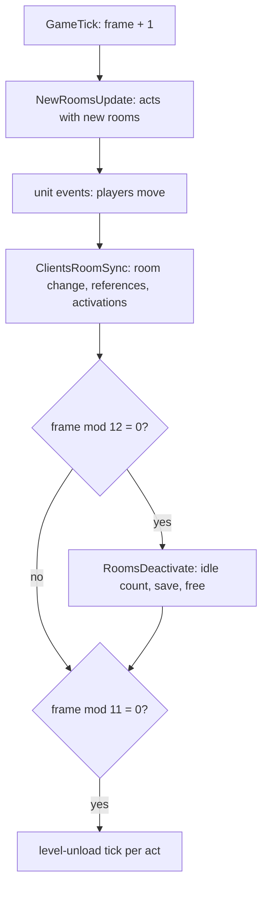
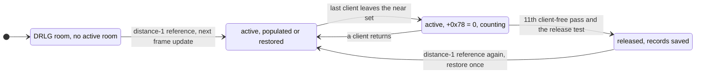

# 0009 — Room lifecycle: activation, release, the inactive-unit restore and the wanderers

> **Subsystem:** drlg/lifecycle
> **Question:** as players move, which rooms does the server activate and release, and when; what does it keep of the
> units of a released room; how does it re-create them when the room comes back, with which draws; and when does a
> room spawn a wandering monster?
> **Date:** 2026-10-17   **Plan:** 0040 (Phase 1 and 1b static; Phase 2 run:2026-10-17-lifecycle, § 11); 0038 H7a (§ 11.3)   **Status:** open (H7a accepted; open questions remain)

## Answer (summary)

- [C] **Activation is a reference count over the DRLG near lists** (§ 11, 634 982 callbacks). When a client's room changes, the server moves one
  reference from the old DRLG room to the new one and adds or removes one at near-list distance 1, 2 and 3 around it.
  A room's status is the lowest distance that holds a reference (4 = none). Gaining distance 1 activates the room
  (`RoomActivateA` → `DRLG_RoomActivate` → `DUNGEON_RoomCreate`); distance 2 sets status 2 (and activates if a
  distance-1 reference is already there); distance 3 loads the room's DT1 list and DS1. The new active rooms are
  populated, or their saved units restored, at the start of the next game frame. (fn:sub_00537B50_ClientRoomChange@0x00537B50,
  fn:sub_0061B6F0_DrlgRefMove@0x0061B6F0, fn:sub_0061B390_DrlgRefAddNear@0x0061B390, data:g_DrlgRefEnterFns@0x00744384,
  fn:sub_0052D870_GameTick@0x0052D870, run:2026-10-17-lifecycle)
- [C] **Release is a timer in game frames** (§ 11, 2 440 releases). Every 12th frame (`frame % 12 = 0`) `RoomsDeactivate` counts, per active
  room, the passes in a row in which no client has the room in its near set (room `+0x78` = 0); on the 11th such pass,
  if the DRLG room is not pinned by a portal (`0x400000`), is at status 2 or more, and (in a town or level 120) every
  room of the level is at status 2 or more, it saves the room's units and frees the room (level 120 was not reached:
  that half is `[I]`). A room is therefore
  released 120 to 131 frames after the last client's room change took it out of every near set, if a pass saw the
  client there (a visit between two passes does not reset the count, § 11).
  (fn:sub_0052D240_RoomsDeactivate@0x0052D240, fn:sub_0061A790_RoomIdleCount@0x0061A790,
  fn:sub_0061BA30_DrlgRoomReleaseTest@0x0061BA30, run:2026-10-17-lifecycle)
- [I] **What is kept** (`[C]` for the branches § 11 lists). Ground items: always, as their serialised bytes with a new expiry frame. Objects and type-5
  units: by the objects rule (objects § B4, here with its level flag named: `Levels.SaveMonsters`). Monsters: when the
  level has `SaveMonsters` or the unit came from a preset or an earlier restore, alive or dying; a dead one (mode 12)
  only when a **room-seed draw** gives `low mod 3 = 0`; never a dead special (monster flag `0x08`, which every logged
  champion carries) or minion, a dead unit with a `udead` state,
  a necromancer skeleton or mage corpse, or a player's summon; `MonStats2.restore` 0 never, 2 always. Missiles are
  freed. (fn:sub_005433F0_InactiveUnitSaveTest@0x005433F0, fn:sub_005431F0_InactiveMonsterSaveTest@0x005431F0,
  0x00543260, tbl:Levels.txt:SaveMonsters, tbl:MonStats2.txt:restore, tbl:States.txt:udead)
- [C] **Restore order and draws** (§ 11; items corrected there). A re-activated room (populated bit kept in DRLG `+0x60`) skips the population and
  runs only the inactive restore, once per activation (active-room flags bit 1): monsters first (each through
  `MonSpawnTry` with its saved unit id: 3 room draws at the centre, the game-seed draw of `SUnitCreate`, a full
  `MonsterInit`; champions and uniques through `SpecialMonPlace` with the saved mods (stat 12 as the flag-1 handlers, § 11);
  minions through `MinionRestore`), then the items (two game-seed draws each in `SUnitCreate`, type 4; the saved start
  seed written back, 0 for a simple item), then objects and type-5 units through `PresetUnitDispatch`. (fn:sub_00542B40_RoomInactiveUnitsRestore@0x00542B40,
  fn:sub_005424F0_InactiveMonstersRestore@0x005424F0, fn:sub_00541990_InactiveItemRestoreOne@0x00541990, run:2026-10-17-lifecycle)
- [C] **Stats of a re-created monster** (§ 11, 2 035 restores). Stat 13 and stat 7 come from the record (the first instance's values);
  stat 6 is the saved life if fewer than 7500 frames passed since the save, otherwise the saved maximum; stat 12 is
  not written, it is the new `MonsterInit`'s (and the re-applied mods'). (0x00542800–0x0054284A,
  fn:sub_00627260_UnitSetStat@0x00627260, run:2026-10-17-lifecycle)
- [C] **Room `+0x78`** is the number of clients whose current room's near list holds the room; **`0x0061A4D0`** reads
  active-room flags bit 1 ("inactive units restored"), set by every update that ran the restore.
  (fn:sub_0061A660_RoomClientAdd@0x0061A660, fn:sub_0061A4D0_RoomRestoredGet@0x0061A4D0, run:2026-10-17-lifecycle)
- [I] The wanderer tick goes on only when `+0x78` is 0, so wanderers appear only in active rooms that no client is
  near. No gate draw passed in the run, so the `+0x78` and `MonWndr` conditions were never what decided (§ 11).
  (fn:sub_0054F060_RoomWandererTick@0x0054F060, 0x0054F089)
- [I] **The preset questions** (the detach `[C]`, § 11). The server's preset spawn moves the DS1 path out of the room's preset unit into the new
  monster (`PresetUnitSpawn`, 0x0055596C), which is the detach drlg/preset saw; the inactive record carries it across a
  release. A re-activated room never re-dispatches its preset list: units come back only from the records.
  (fn:sub_00555910_PresetUnitSpawn@0x00555910, fn:sub_00666120_PtrMove@0x00666120)
- [I] **A record with flag `0x400`** (a monster in target list 8 or 9, such as a wanderer) is not re-created when its
  saved alignment is 1 or 2 (record bit `0x80` or `0x100`); with alignment 0 (neither bit) the restore reaches a
  fatal error (`0x691`). The numbers are the unit alignment that `MonSpawnTry` sets from MonStats `Align` (0 → 0,
  1 → 2, 2 → 1; [MonStats](../../tables/MonStats.md) `Align`), so the hostile pool classes are alignment 0 and the
  allies (MonStats `Align` 1) alignment 2; the names "hostile/ally/neutral" stay a reading. The wanderer class
  (`rogue2`) has MonStats `Align` 1. `WandererSpawn`'s creation path applies that rule, so a saved wanderer is
  alignment 2 and is dropped (§ 11.4 (b), plan 0049). (0x005425F7–0x0054260B, 0x005427B8–0x005427D4, 0x0054287F–0x0054288E,
  0x00542990, tbl:MonStats.txt:Align)

## Leads used

Phase 1b, 2026-10-17: searched for community notes on area reset, monster respawn when leaving an area, monster
healing after leaving, and wandering monsters; fetched and registered the three sources below. Every claim above was
written from the code before they were read. Little exists beyond anecdotes; nothing found on the wanderer roll.

- [L] src:d2dfg-blizzard: `Levels.SaveMonsters` 1 saves "the monsters in the area level, such as when all players leave
  the area level". **held with refinement**
  Detail: the save is per room, at the release (11 client-free passes of 12 frames), not per level; it also saves a
  monster of a level without the flag when the unit carries `0x2000000` (preset spawns and restored units), and
  `MonStats2.restore` and the dead-unit tests override it (fn:sub_005431F0_InactiveMonsterSaveTest@0x005431F0).
- [L] src:d2dfg-blizzard: `MonStats2.restore` 0 "do not save", 1 "rely on other checks", 2 "force save". **held**
  Detail: 2 is tested last and overrides every earlier test, the dead-unit ones included (0x005432EF onwards).
- [L] src:d2dfg-blizzard: `Objects.Restore` restores the object "in an inactive state when the area level
  repopulates"; `RestoreVirgins` 1: a used object is not restored. **held** (as in objects/0001; the restored object
  is re-created, not kept)
- [L] src:d2dfg-blizzard: `Levels.MonWndr` allows wandering monsters "(see wanderingmon.txt)". **held with refinement**
  Detail: the version difference (no `wanderingmon` table; a hard-coded act I list of one class) is monsters/0002's;
  this finding adds the gate's room condition (`+0x78` = 0, § 7).
- [L] src:pk-boss-heal-thread (1.10): with `SaveMonsters` 0 "monsters are still dead or injured if you leave the area".
  **contradicted** (for monsters without the preset flag; [backlog](../../backlog.md), 2026-10-17 entry from reverser)
  Detail: in 1.14d a level without `SaveMonsters` saves only `0x2000000` units (preset spawns, earlier restores) and
  `restore` 2 classes; any other live monster of a released room is freed without a record, and the room is not
  populated again, so it is gone, not injured. The observation fits a room that was never released (the player stayed
  within the near sets, or less than 120 frames away) or a preset monster. On stock data only the null level, the five towns and
  the Harem (levels 0, 1, 40, 50, 75, 103, 109) have `SaveMonsters` 0, and none is populated; but the test takes the level of
  the unit's **current** room (0x005431F9–0x0054322A), so a hostile pool monster that follows a player into a town
  room meets it on stock data when the town's rooms are released (corrected at the review; a required Phase 2 case).
- [L] src:pk-boss-heal-thread: Blood Raven back at full health after about 20 minutes away. **held with refinement**
  Detail: a restored monster keeps its saved life if fewer than 7500 frames passed
  between the save and the restore, else it gets the saved maximum (0x00542814–0x0054284A). Natural regeneration was
  not read.
- [L] src:pk-boss-heal-thread: a boss's regeneration pauses while the player is out of range. **not covered**
  Detail: regeneration is monster AI and stats work (ADR-0014 phase 4); a released monster is simply not there.
- [L] src:d2io-pmh-thread: Prevent Monster Heal "resets when you get too far away from the mob". **held with refinement**
  Detail: nothing resets by distance as such; a released and restored monster is a new unit with only stats 6, 7, 13,
  the mods, alignment and AI parameters copied (§ 5, § 6), so any state or stat from a hit is gone after a release.

## Functions

| Address | Name | Role | Tag |
|---|---|---|---|
| `0x0052D870` | `sub_0052D870_GameTick` | frame++, new-room updates, unit events, client room sync, every 12 frames `RoomsDeactivate`, every 11 frames the level-unload tick per act | I |
| `0x0052D440` | `sub_0052D440_ClientsRoomSync` | per client: `ClientRoomSync` | I |
| `0x005380D0` | `sub_005380D0_ClientRoomSync` | client room ← its player's room; on a change `ClientRoomChange` | I |
| `0x00537B50` | `sub_00537B50_ClientRoomChange` | DRLG reference move, level reference move, near-set difference → client add/remove per active room | C |
| `0x0053A8E0` / `0x0053A9B0` | `sub_0053A8E0_RoomClientEnter` / `sub_0053A9B0_RoomClientLeave` | add / remove the client in the room's client list (`+0x48`, `+0x78`) and tell the units | C |
| `0x0061A660` / `0x0061A700` | `sub_0061A660_RoomClientAdd` / `sub_0061A700_RoomClientRemove` | the client list, kept sorted | C |
| `0x0061B6F0` | `sub_0061B6F0_DrlgRefMove` | `RefAdd(new, 0)`; old: `refs[0]−1`, leave callback 0, `RefRemoveNear(old, 1)` | C |
| `0x0061B490` | `sub_0061B490_DrlgRefAdd` | `RefAddNear(d+1)` first, then `refs[d]+1` with the enter callback when it lowers the status | C |
| `0x0061B390` / `0x0061B5B0` | `sub_0061B390_DrlgRefAddNear` / `sub_0061B5B0_DrlgRefRemoveNear` | the same over the near list, recursing to distance 3 | C |
| `0x00744384` / `0x00744394` | `g_DrlgRefEnterFns` / `g_DrlgRefLeaveFns` | enter: status 0, activate (1), status 2, prepare files (3); leave: recompute status (0–2), recompute and client release (3) | C |
| `0x0061B2C0`, `0x0061B2D0`, `0x0061BB10` | `sub_0061B2C0_DrlgEnter0`, `sub_0061B2D0_DrlgEnter1Activate`, `sub_0061BB10_DrlgEnter2` | enter callbacks 0, 1, 2 (3 is `sub_0061B320_RoomPrepareFiles`) | C |
| `0x0061B4F0` / `0x0061B210` | `sub_0061B4F0_DrlgStatusRecompute` / `sub_0061B210_DrlgStatusSet` | status = lowest distance with a reference, else 4; status rings at DRLG act `+0xA0 + 0xEC·s` | C / I |
| `0x0061B560` | `sub_0061B560_DrlgLeave3Release` | leave callback 3: recompute; at status 4 on a client act, `RoomTilesRelease(room, 0)` | C |
| `0x0061B920` | `sub_0061B920_ClientBackgroundBuild` | client loop: every 5 client ticks build one status-2 room | I |
| `0x0052D240` | `sub_0052D240_RoomsDeactivate` | the release pass | C in part (level-120 half I) |
| `0x0061A790` | `sub_0061A790_RoomIdleCount` | room `+0x0C`: 0 if `+0x78` ≠ 0, else +1; returns it | C |
| `0x0061A3F0` / `0x0061BA30` | `sub_0061A3F0_RoomReleaseAllowed` / `sub_0061BA30_DrlgRoomReleaseTest` | DUNGEON act `+0x50` must be 0; pin, status and town tests | C |
| `0x0061BAC0` / `0x0061AED0` | `sub_0061BAC0_DrlgRoomPinFlag` / `sub_0061AED0_RoomPinSet` | DRLG `+0x28` `0x400000` set (arg 0) or cleared (arg ≠ 0); 31 call sites in portal, object, quest and missile code (§ 11.4 (c)) | C (`0x0061BAC0`), I |
| `0x0061A910` | `sub_0061A910_ActiveRoomFree` | unlink from the act list and the neighbours' near lists, `RoomReleaseWrap`, `DUNGEON_RoomFree` | C |
| `0x00642A00` | `sub_00642A00_ActIsClient` | DRLG act `+0x8C` bit 0 | I |
| `0x00643200` | `sub_00643200_ActLevelsUnloadTick` | per level with no references and built rooms: countdown 10, then `LevelUnload(keep)` | I |
| `0x005433F0` | `sub_005433F0_InactiveUnitSaveTest` | per unit of a released room: save or keep, then free | I |
| `0x005431F0` | `sub_005431F0_InactiveMonsterSaveTest` | the monster rule (one room draw for a dead monster) | C |
| `0x00542E10` | `sub_00542E10_InactiveRecordSave` | dispatch: monster → `InactiveMonsterSave`; else room record, item → `InactiveItemSave`, else a 0x34 record | C |
| `0x00542E30` | `sub_00542E30_InactiveUnitSave` | tail of `0x00542E10` (a second entry) | C |
| `0x005421A0` | `sub_005421A0_InactiveMonsterSave` | the 0x5C monster record | C |
| `0x00541B10` | `sub_00541B10_InactiveItemSave` | serialise, new expiry, free the item and its socketed children | C |
| `0x00541D20` | `sub_00541D20_InactiveRoomRecordFind` | find (or insert) the room record by x, y in the act list | I |
| `0x00541FE0` / `0x00541E20` | `sub_00541FE0_InactiveMonAiSave` / `sub_00541E20_InactiveMonAiRestore` | AI parameters and the preset path, out and back | I |
| `0x00558A10` | `sub_00558A10_ItemGroundExpiry` | frame + 15000, 30000 or 45000 by quality and kind; 0 = never | C |
| `0x00541990` | `sub_00541990_InactiveItemRestoreOne` | `ItemCreateFromSave`, expiry, socketed children | C |
| `0x005B30E0` | `sub_005B30E0_SpawnWithId` | `MonSpawnTry` wrapper with a given unit id | C |
| `0x005B1990` / `0x005B1A90` | `sub_005B1990_TargetListAdd` / `sub_005B1A90_TargetListRemove` | unit `+0xD0` target list (11 = none) | I |
| `0x00554A30` | `sub_00554A30_UnitRelocate` | move a kept unit back into a room | I |
| `0x005B5210` | `sub_005B5210_DiabloQuestFlag` | quest 23 data `+0x13` | I |
| `0x00642820` | `sub_00642820_LevelSaveMonsters` | leveldefs `+0x94` | I |
| `0x00666120` | `sub_00666120_PtrMove` | `*dst = *src; *src = 0` | C |

Tags raised at `lane/rbs4` (plan 0040 close follow-ups, item 1; review: three of the five **raised in part**), each on § 11's reproduction of
run:2026-10-17-lifecycle: `DrlgRefAdd` and `DrlgStatusRecompute` (the reference replay predicts every callback, ref and
status), `RoomsDeactivate` (every release predicted; its level-120 half unreached, `[I]`), and the two restores
`InactiveMonstersRestore` and `RoomInactiveUnitsRestore` (§ 11's monster and unit restore). The raise covers the
branches the run reached; the restore outcomes § 11 lists as not reached (a kept monster or unit, a `0x400` record,
the level-108 rule, a kept player corpse, a minion restored without its boss) stay `[I]` inside both restores, as
the level-120 half does inside `RoomsDeactivate`. `DrlgStatusSet` (the status
rings) stays `I`; so does `RoomWandererTick`, whose gate decision, roll and spawn the run never reached (§ 11: only
the gate's draw and the walk order). (run:2026-10-17-lifecycle, fn:sub_0061B490_DrlgRefAdd@0x0061B490,
fn:sub_0061B4F0_DrlgStatusRecompute@0x0061B4F0, fn:sub_0052D240_RoomsDeactivate@0x0052D240,
fn:sub_005424F0_InactiveMonstersRestore@0x005424F0, fn:sub_00542B40_RoomInactiveUnitsRestore@0x00542B40,
fn:sub_0054F060_RoomWandererTick@0x0054F060)

## Walkthrough

### 1. The frame

- [I] `GameTick` increments the game frame (`+0xA8`), then runs, in this order: two per-frame passes, `NewRoomsUpdate`,
  the unit events, `sub_0052D440_ClientsRoomSync`, two more passes, `0x00543E10` when `frame % 20 = 0`, `RoomsDeactivate`
  when `frame % 12 = 0`, the level-unload tick of each act when `frame % 11 = 0`, and `0x0052D310`. The remainders are
  signed `%` on the incremented frame. (fn:sub_0052D870_GameTick@0x0052D870, 0x0052D8EB, 0x0052D938)
  *2026-10-30 (plan 0055 P1.1, `lane/r55`):* the two per-frame passes are `sub_0052D7B0_ActsClockPass` (the act light
  clock, 0x0052D8DF) and `sub_0052D720_GameFpsStats` (0x0052D8E6); the two after the sync are
  `sub_0053B000_ActUnitsFrameReset` (0x0052D900) and `sub_0053A820_ActsRoomRemovalsClear` (0x0052D907)
  ([frame/0001 § 2](../frame/0001-tick-and-messages.md#2-gametick)).
- [I] So a room activated on frame N (units move in the unit events, the client sync runs after them) is populated or
  restored by `NewRoomsUpdate` at the start of frame N+1. Three other callers populate a room at once through
  `RoomUpdateOne`: a unit spawn at coordinates whose room was not active (`0x00553720`), the creation of a
  portal's other end at a level point (`0x0056CF40`) and a quest spawn in level 40 (`0x0059DFD0`). (fn:sub_0052D0F0_RoomUpdateOne@0x0052D0F0,
  0x0055379D, 0x0056CF7D, 0x0059E018)

### 2. Activation

**References.** Each DRLG room has four `u16` reference counts (`+0x0C + 2·d`, d = near-list distance 0..3) and a status
byte `+0x44`.

- [I] `ClientRoomChange(client, new)` (client `+0x1B4` = its active room) calls `DrlgRefMove(old.drlg, new.drlg)`:
  `DrlgRefAdd(new, 0)`, and for the old room `refs[0] − 1` (if non-zero), leave callback 0, then
  `DrlgRefRemoveNear(old, 1)`. `DrlgRefAdd(R, d)` first calls `DrlgRefAddNear(R, d+1)` (each room N of R's near list:
  recurse to `d+2` while `d+1 < 3`, then the enter test on N, then `N.refs[d+1] + 1`), then the enter test on R and
  `R.refs[d] + 1`. The enter test calls `g_DrlgRefEnterFns[d](R)` when `d ≤ status` and `refs[0..d]` are all 0. The
  remove walk mirrors it with `g_DrlgRefLeaveFns`. (fn:sub_00537B50_ClientRoomChange@0x00537B50,
  fn:sub_0061B6F0_DrlgRefMove@0x0061B6F0, fn:sub_0061B490_DrlgRefAdd@0x0061B490,
  fn:sub_0061B390_DrlgRefAddNear@0x0061B390, fn:sub_0061B5B0_DrlgRefRemoveNear@0x0061B5B0, struct:DrlgRoomLife+0x0C)
- [I] **The remove walk, instruction by instruction** (read at the Phase 3 review, objdump). `DrlgRefRemoveNear(R, d)`
  walks R's near list (`+0x08`, count `+0x2C`) in order and skips a null entry; for each room N it subtracts 1 from
  `N.refs[d]` (a `u16` add of `0xFFFF`, no zero test), calls `g_DrlgRefLeaveFns[d](N)` on every decrement, and **then**
  recurses with `d+1` while `d < 3` (0x0061B5C3–0x0061B5EE). The add walk recurses **before** its enter test
  (0x0061B3E1) and does not test for a null entry. `DrlgRefMove`'s old-room step tests `refs[0] ≠ 0` before its
  decrement, then calls leave 0 and tail-jumps to `DrlgRefRemoveNear(old, 1)` (0x0061B70C–0x0061B729). Leave callbacks 0–2 jump to `DrlgStatusRecompute` (0x0061B530, 0x0061B540,
  0x0061B550); leave 3 returns at once when the status is already 4, else recomputes and, if the status is now 4 on a
  client act (`ActIsClient`), tail-calls `RoomTilesRelease(R, EDX 0)` (0x0061B563–0x0061B58D). `DrlgStatusRecompute`
  returns early when the status is below 4 and `refs[status]` is non-zero, else sets the lowest d with a non-zero
  count, 4 if none (0x0061B4F0–0x0061B528). Enter 2 requires DRLG `+0x28` bit `0x1000000`, and bit `0x2000000` too
  when room `+0x48` (type) is 2, and a status above 2 (unsigned byte); it sets status 2 and tail-calls enter 1 when
  `refs[1] ≠ 0` (0x0061BB10–0x0061BB44). (fn:sub_0061B5B0_DrlgRefRemoveNear@0x0061B5B0,
  fn:sub_0061B560_DrlgLeave3Release@0x0061B560, fn:sub_0061B4F0_DrlgStatusRecompute@0x0061B4F0,
  fn:sub_0061BB10_DrlgEnter2@0x0061BB10)
- [I] The callbacks: enter 0 sets status 0; enter 1 activates the room through `RoomActivateA` if it has no active room
  and is not built (and resets the act's background countdown), then sets status 1 if higher; enter 2, if the DT1 list
  is built and (for a preset room) the DS1 loaded, sets status 2 and, when `refs[1] ≠ 0`, runs enter 1; enter 3 is
  `RoomPrepareFiles` (DT1 list, DS1, status 3). Each leave callback recomputes the status as the lowest d with
  `refs[d] ≠ 0`, else 4; leave 3 then releases the room's tiles on a client act. (data:g_DrlgRefEnterFns@0x00744384,
  data:g_DrlgRefLeaveFns@0x00744394, fn:sub_0061B2D0_DrlgEnter1Activate@0x0061B2D0, fn:sub_0061BB10_DrlgEnter2@0x0061BB10,
  fn:sub_0061B320_RoomPrepareFiles@0x0061B320, fn:sub_0061B4F0_DrlgStatusRecompute@0x0061B4F0,
  fn:sub_0061B560_DrlgLeave3Release@0x0061B560)
- [I] So, on the server, a client activates the rooms of its room's near list (the near list holds the room itself,
  drlg/0005; `ActiveRoomFree`'s scan of it skips the room's own entry), prepares the files of the rooms at
  distance 2 and 3, and the counts of several clients add up: the activation set is the union. (struct:DungeonRoomLife+0x00,
  fn:sub_0061A910_ActiveRoomFree@0x0061A910)
- [I] `RoomActivateA` adds nothing to the build of `DRLG_RoomActivate` but the neighbour step when `+0x2C` = 0, the
  re-seed and type init, and two act counters (`+0x98` byte, `+0x08`). `RoomActivateB` is the on-demand variant for
  callers that need a room at once (warp destination, waypoint room, level point, preset level build): it also builds
  the DT1 list and loads the DS1 when missing, does nothing when the room is built, and returns the active room. A room
  activated this way gets no reference, so its status stays 4 and it is released by the idle rule alone.
  (fn:sub_0061B190_RoomActivateA@0x0061B190, fn:sub_0061B730_RoomActivateB@0x0061B730)
- [I] `DUNGEON_RoomCreate` prepends the active room to the act list (`act +0x10`) and sets the act's new-rooms flag
  `+0x54` = 1; its flags `+0x34` are `DRLG_RoomActivate`'s argument: 4 on a client act, else the DRLG room's `+0x60`
  bit 0 (1 for a room populated before a release). (fn:DUNGEON_RoomCreate@0x00619890, fn:DRLG_RoomActivate@0x006422A0)
- [I] **The client list.** `ClientRoomChange` also takes `DUNGEON_GetNearRooms` of the old and the new active room:
  each room in the new set and not in the old gets the client (`RoomClientEnter` → `RoomClientAdd`: `+0x48[+0x78++]`,
  sorted by pointer); each in the old and not in the new loses it. Room `+0x78` is therefore the number of clients
  whose current room's near list holds the room. (fn:sub_0053A8E0_RoomClientEnter@0x0053A8E0,
  fn:sub_0053A9B0_RoomClientLeave@0x0053A9B0, fn:sub_0061A660_RoomClientAdd@0x0061A660,
  fn:sub_0061A700_RoomClientRemove@0x0061A700, fn:DUNGEON_GetNearRooms@0x00619790, struct:DungeonRoomLife+0x78)
- [I] **Client copy.** The client act runs the same reference code from its own loop (`0x0045CB0C`/`0x0045CB7C` call the
  wrappers `0x0061A070`/`0x0061A0C0`, which add or remove a distance-1 reference at a position), builds one status-2
  room every 5 client ticks (`ClientBackgroundBuild`, countdown act `+0x45C` = 5 on a client act, 7 otherwise), runs the
  level-unload tick every 13 client ticks, and releases a room's tiles as soon as its status reaches 4 (leave 3). The
  server act never calls `ClientBackgroundBuild`. (fn:sub_0061B920_ClientBackgroundBuild@0x0061B920,
  fn:sub_00642A00_ActIsClient@0x00642A00, 0x0044C7E6)

### 3. The new-rooms walk

- [I] `NewRoomsUpdate` walks, for each act whose `+0x54` is set, **every** active room of the act from the list head,
  then clears `+0x54`. Per room: the wanderer tick (§ 6); then, if flags bit 0 is clear: presets, inactive restore,
  objects, population, bit 0 set, bit 1 set; if bit 0 is set and bit 1 clear (`0x0061A4D0` returns `flags & 2`): the
  inactive restore and bit 1 set. A room re-activated after a release (bit 0 from DRLG `+0x60`) therefore restores
  once and is never populated again. (fn:sub_0052D160_NewRoomsUpdate@0x0052D160, fn:sub_0061A4D0_RoomRestoredGet@0x0061A4D0,
  fn:sub_0061A510_RoomRestoredSet@0x0061A510, fn:sub_00642390_LevelRoomStateRestore@0x00642390)
- [I] No code clears bit 1: the only callers of `0x0061A510` pass 1. Bit 1 lives in the active room, which a release
  frees, so "once per activation". (0x0052D20C, 0x0052D12C, 0x0052D14A)

### 4. Release

- [I] `RoomsDeactivate(game)` runs over the five act slots; per active room (list head first, the next pointer read
  before the room may be freed): `n = RoomIdleCount(room)` (`+0x0C` = 0 if `+0x78` ≠ 0, else `+0x0C + 1`); if `n > 10`
  and `RoomReleaseAllowed(act, room)`: walk the room's unit list `+0x74` from the head, reading each next pointer
  (`unit +0xE8`) before `InactiveUnitSaveTest(game, unit)`, then `ActiveRoomFree(act, room)`.
  (fn:sub_0052D240_RoomsDeactivate@0x0052D240, fn:sub_0061A790_RoomIdleCount@0x0061A790, struct:DungeonRoomLife+0x0C)
- [I] **Frames.** The count rises only on passes (`frame % 12 = 0`) with `+0x78` = 0 and drops to 0 on any pass with a
  client, so the release comes on the 11th client-free pass in a row: 120 frames after the first client-free pass,
  which falls 0 to 11 frames after the last client's room change that a pass saw (the client sync runs before
  `RoomsDeactivate` in the same frame; a visit that starts and ends between two passes leaves the count running,
  § 11). The test keeps passing once `n > 10`, so a room held back by the release test goes at the first
  later pass that allows it. A newly created room starts at 0 (the 0x80-byte room is zeroed). (fn:sub_0052D870_GameTick@0x0052D870,
  fn:DUNGEON_RoomCreate@0x00619890)
- [I] **The release test** (`DrlgRoomReleaseTest` on the DRLG room; `RoomReleaseAllowed` first requires the DUNGEON act's
  `+0x50` = 0, else a fatal error): the room's `0x400000` is clear; the act is a server act (fatal otherwise); status
  `+0x44` ≥ 2; and, if the level is a town or level 120, every room of the level has status ≥ 2.
  (fn:sub_0061A3F0_RoomReleaseAllowed@0x0061A3F0, fn:sub_0061BA30_DrlgRoomReleaseTest@0x0061BA30)
- [I] `0x400000` pins a room: `RoomPinSet(room, 0)` sets it and `RoomPinSet(room, 1)` clears it. Its 31 call sites are
  in object code: `PortalObjectCreate` sets it on the rooms of both ends (0x0056D29E, 0x0056D2AC), and two sites that
  free an object unit clear it (0x005354C5, 0x00584C12). Every site is listed in § 11.4 (c): 18 set, 13 clear (plan
  0049). (fn:sub_0061AED0_RoomPinSet@0x0061AED0,
  fn:sub_0061BAC0_DrlgRoomPinFlag@0x0061BAC0, fn:sub_0056D130_PortalObjectCreate@0x0056D130)
- [I] **What the free does.** `ActiveRoomFree` unlinks the room from the act list, removes it from each neighbour's near
  list (swap with the last entry), calls `RoomReleaseWrap(drlg, EDX = DUNGEON act +0x50, flags)`, then `DUNGEON_RoomFree`.
  The wrapper zeroes DRLG `+0x30`, stores the active flags' bit 0 in DRLG `+0x60` and, if the room is built, calls
  `RoomTilesRelease(drlg, EDX = (wrapper EDX = 0))`, that is 1 on this path. `DUNGEON_RoomFree` then marks every unit
  still in the list (`+0xC4 |= 0x800000`, and `+0xC8 |= 0x20` unless `+0xC4` bit 22) and unlinks it, frees the
  collision map, the tile lists and the room. (fn:sub_0061A910_ActiveRoomFree@0x0061A910,
  fn:sub_0066B4C0_RoomReleaseWrap@0x0066B4C0, fn:sub_0066F1A0_RoomTilesRelease@0x0066F1A0, fn:DUNGEON_RoomFree@0x0061A840)
- [I] **`0x200000` and `EDX ≠ 0`.** `RoomTilesRelease` sets `0x200000` iff its `EDX` is non-zero, and the only non-zero
  `EDX` comes through the wrapper, which passes the logical not of its own `EDX` (`test edx, edx` at 0x0066B4DE, `sete al` at 0x0066B4E0). The wrapper is
  called only from `ActiveRoomFree`, with `EDX` = the DUNGEON act's `+0x50` (0x0061A9D0), and only for a built room
  (DRLG `+0x28` bit `0x100000`, 0x0066B4C9). On a server release `+0x50` is 0 (`RoomReleaseAllowed` makes any other
  value fatal), so the tiles release gets `EDX` 1 and sets `0x200000`. No reader was found: the only `+0x28` access
  with the immediate `0x200000` is the write at 0x0066F232. This corrects the wording in
  [drlg/room-tiles § Release and re-activation](../../specs/drlg/room-tiles.md#release-and-re-activation) that the
  wrapper passes the act's `+0x50`: it passes its negation. (0x0066B4C0–0x0066B4E5, 0x0061A9D0, 0x0066F232, fn:sub_0061B560_DrlgLeave3Release@0x0061B560)
- [I] **The client release leaves `0x200000` clear** (corrected at the review). run:2026-10-16-sweep-roomk logged 1516
  built-room releases, 626 with `EDX` ≠ 0 and 890 nested client pairs ([drlg/0002 § Plan 0038 batch H5c](0002-room-build-draws.md#plan-0038-batch-h5c-run2026-10-16-sweep-roomk)).
  626 + 890 = 1516, and with the negation read here the nested (client) inner calls can only have `EDX` 0 if the client
  DUNGEON act's `+0x50` is non-zero. So `0x200000` reads "released by the server": set on every server release, clear
  on a client release (nested or not). That the 626 are exactly the server-act releases is not yet checked against the
  kept logs. (0x0066B4DC–0x0066B4E3, 0x0061A9D0, run:2026-10-16-sweep-roomk)
- [I] The level-unload tick (server: every 11 frames per act; client: every 13 ticks) unloads, after a countdown of 10
  ticks, a level with no level references (`+0x0C`) and built rooms (`+0x10`), when `LevelUnloadCheck` allows; else it
  re-arms the countdown. (fn:sub_00643200_ActLevelsUnloadTick@0x00643200, fn:sub_00643060_LevelUnloadCheck@0x00643060,
  fn:sub_00642010_LevelUnload@0x00642010, fn:sub_00642F70_LevelAddRef@0x00642F70)

### 5. The inactive records

**Save.** `InactiveUnitSaveTest(game, unit)` by unit type:

- [I] **Monster (type 1)** → `InactiveMonsterSaveTest`, in this order (`save` starts as `SaveMonsters(level)` or unit
  `+0xC4` bit `0x2000000`) (fn:sub_005431F0_InactiveMonsterSaveTest@0x005431F0):
  1. mode 12 (dead): **one room-seed draw** on the unit's active room; `save` only if `low mod 3 = 0` (unsigned);
  2. dead (`UnitIsDead`): no save if any state with the `udead` flag is on the unit, or its alignment is 2;
  3. unit `+0xD0` < 8 (in a low target list): alive → save, alignment set to 0, removed from the list; dead → no save;
  4. dead and class 363 or 364 (`necroskeleton`, `necromage`) → no save;
  5. dead and monster flags `0x18` (`0x08`, which `MonMarkSpecial` sets on every special the run logged, or `0x10`)
     → no save (corrected at the Phase 2 review from "unique or minion"; § 11);
  6. unit `+0xC4` bit 31 (owned): no save; if the owner is a player and the player's pet list holds the unit, the
     unit is **kept** (`+0xC8 |= 0x100`);
  7. `+0xC4` bit 9 → no save;
  8. `MonStats2.restore` (row through `MonStats.MonStatsEx`): 0 or a missing row → no save; 2 → save.

  Then a kept unit is saved if `save` and unlinked from the room without being freed; any other is saved if `save`
  and freed. (fn:sub_005431F0_InactiveMonsterSaveTest@0x005431F0, 0x00543260–0x00543287, fn:sub_00642820_LevelSaveMonsters@0x00642820,
  fn:sub_0063A130_UnitHasStateInMask@0x0063A130, fn:sub_005A0180_MonTypeFlag@0x005A0180, tbl:Levels.txt:SaveMonsters,
  tbl:MonStats2.txt:restore, tbl:MonStats.txt:MonStatsEx, tbl:States.txt:udead)
- [I] Data: `SaveMonsters` is 0 only for levels 0, 1, 40, 50, 75, 103 and 109 (the null level, the five towns and the Harem); `restore` is 1
  for 698 MonStats rows, 0 for 18 and 2 for 18 (the barricade tower, the minion spawners, the catapults, `act5pow`,
  the injured barbarians, `demonspawner`). (tbl:Levels.txt:SaveMonsters, tbl:MonStats2.txt:restore)
- [I] **Object (type 2)**: objects § B4 holds, with the level flag named: `save` starts as `SaveMonsters(level)` or the
  preset flag; Objects `Restore` = 0 or sparkle bit `0x02` → no; `RestoreVirgins` and mode ≠ 0 → no; the unit's
  type-1 timers are removed; classes 59 and 60 are always saved and kept. (fn:sub_005433F0_InactiveUnitSaveTest@0x005433F0,
  tbl:Objects.txt:Restore, tbl:Objects.txt:RestoreVirgins)
- [I] **Item (type 4)**: always saved. **Type 5**: always saved, then freed. **Player (type 0)**: with state 7
  (`playerbody`, a corpse) saved and kept; otherwise not saved (a player's own room is always in its near set, so a
  released room holds no live player). **Missile (type 3)** and anything else: freed. (fn:sub_005433F0_InactiveUnitSaveTest@0x005433F0)

**Records.** All records hang off one 0x18-byte room record per released room, found or inserted by room x and y in the
act's list at `game +0xD8 + 4·act` (ordered by x descending). Each save **prepends**; the unit walk is newest first, so
every list is oldest first, as objects § 13.5 has for objects.

- [I] **Monster record** (0x5C, `InactiveMonsterSave`; layout in `struct:InactiveMonRec+0x00`): before writing it
  removes the states of the list at DataTables `+0x174` and the unit's type-2 timers. It saves x, y, class, unit id,
  `+0xC4`, `+0xC8`, the save frame, the AI record's first dword, monster data `+0x58`, the name seed, the nine mod
  bytes, the superunique id, stat 13, `UnitGetMaxHp`, stat 6, the group leader (when the AI link type is 1), the AI
  parameters and the preset path (moved out of the monster's AI control `+0x38`). Flags `+0x18`: `0x2` champion,
  `0x800` superunique, `0x1` placed by `SpecialMonPlace`, `0x20` minion, `0x40` monster data `+0x5C` bit 1, alignment
  `0x200`/`0x80`/`0x100` (0/1/2), `0x400` when `+0xD0` ≠ 11 (`+0xD0` < 8 is fatal), `0x4` in mode 12 or 0.
  (fn:sub_005421A0_InactiveMonsterSave@0x005421A0, fn:sub_00541FE0_InactiveMonAiSave@0x00541FE0, 0x00542098,
  struct:InactiveMonRec+0x18)
- [I] **Unit record** (0x34) is objects § B4's record, used also for type 5 and the kept player corpse (`+0x20` = unit
  id). (fn:sub_00542E10_InactiveRecordSave@0x00542E10, fn:sub_00542E30_InactiveUnitSave@0x00542E30, struct:InactiveUnitRec+0x20)
- [I] **Item record**: `ITEMS_Serialize(item, buf, 0x400, 1, 1, 0)` (the socketed children are written with the parent
  and freed with it) and an expiry from `ItemGroundExpiry`: 0 (never) for a quest base (`ItemBaseIsQuest`), else the
  frame plus 30000 for quality 4 (magic), 45000 for qualities 5 to 9, and otherwise 45000 for base type 4 with stat 14
  (gold) above 10000, 30000 for a socket filler, 15000 else. (fn:sub_00541B10_InactiveItemSave@0x00541B10,
  fn:sub_00558A10_ItemGroundExpiry@0x00558A10, fn:ITEMS_Serialize@0x006313E0, fn:ITEMS_GetQuality@0x00627E70,
  fn:sub_00628CD0_ItemBaseIsQuest@0x00628CD0, fn:ITEMS_GetBaseType@0x0062B400, fn:ITEMS_IsSocketFiller@0x0062BEB0,
  struct:InactiveItemRec+0x04)
- [I] **What is lost**: the monster record holds none of the unit's states (the listed ones are removed first) or
  timers, no mode other than "dying or dead" (alive records come back in mode 1), no position but x and y, and the
  life only for 7500 frames; a unit with no record is gone. (fn:sub_005421A0_InactiveMonsterSave@0x005421A0,
  struct:InactiveMonRec+0x18)

### 6. Restore

`RoomInactiveUnitsRestore(game, room)`: monsters, then `InactiveRecordTake` (unlinks the room record), then items,
then the unit records (objects § 13.5, which this reading confirms).

- [I] **Monsters** (`InactiveMonstersRestore`, fn:sub_005424F0_InactiveMonstersRestore@0x005424F0), oldest first. Per record:
  - in level 108 while quest 23's data byte `+0x13` is set, a record that is neither dead (flag 4) nor class 243
    (`diablo`) is dropped;
  - kept units (`+0x14` bit `0x100`): found by id and relocated into the room; nothing is created;
  - flag `0x400` with alignment 1 or 2 (record bit `0x80` or `0x100`): dropped;
  - else the creation flags are `0x62` (`0x6A` with flag `0x40`), `| 0x80` for a `flying` class, the mode 1 (12 for a
    flag-4 record) and the saved unit id; the path is picked by flag `0x20` first, then flag `1` (a record with both
    goes to `MinionRestore`, 0x0054264A–0x0054266D):
    - flags 1 → `SpecialMonRestore(x, y, class, id, nameSeed, champion, superunique, suId, mods)`: `SpecialMonPlace(room,
      no box, x, y, id, avoid warps)` in **mode 1**, then the saved mods, `SpecialModsApply(…, minions 0)` (0x005A4558), whose handler calls
      carry flag 1 (0x005A214D, 0x005A21A6): the 0 pushed at 0x005A454E is the `minions` argument (tested at
      0x005A2123), not the handler flag, as the run's stat 12 shows (§ 11), the saved name seed,
      the aura when a mod is 30, and the superunique quest hooks;
    - flag `0x20` → `MinionRestore`: `SpawnWithId(x, y, class, mode 1, id, −1, 0x62)`, then radius 4, then a
      `SpawnPosPick` position, the saved mods and the flag-0 handlers of mods 1–4 and of each saved mod;
    - else `SpawnWithId(x, y, class, mode, id, −1, flags)`, then radius 5, then a `SpawnPosPick` position, then
      `COLL_FindFreeSpiral`.

  (fn:sub_005424F0_InactiveMonstersRestore@0x005424F0, fn:sub_005B5210_DiabloQuestFlag@0x005B5210,
  fn:sub_005A4440_SpecialMonRestore@0x005A4440, fn:sub_005A46E0_MinionRestore@0x005A46E0,
  fn:sub_005A09E0_SpecialMonPlace@0x005A09E0, fn:sub_005B30E0_SpawnWithId@0x005B30E0, tbl:MonStats.txt:flying)
- [I] Then, on a created unit: the group link (`MonSetOwner(leaderId, 1, …)`), **stat 13 = saved**, **stat 7 = saved
  maximum**, **stat 6 = saved life if `frame − saveFrame < 7500` (unsigned), else the saved maximum**; the AI state and
  parameters and the preset path back; for flag `0x400`: target list 8 (alignment 2) or 9 (alignment 1), any other
  alignment a fatal error `0x691` (the alignment is re-derived from the record bits at 0x005427B8–0x005427D4; since the
  drop above already removed alignments 1 and 2, only alignment 0 reaches this test, and it reaches the fatal error); each mod slot that differs from the saved byte gets `ModAppendApply(saved, 0)`;
  `MonAlignSet(saved alignment)`; `+0xC8 |= 0x200` when the record's saved `+0xC8` (record `+0x14`) has bit `0x200`,
  so that bit is carried over (0x005428F9–0x00542903, worded at the Phase 3 review); `+0xC4 |= (saved & 0x20000) | 0x3000000`. A failed creation
  frees the AI list. Last, `MonRegionUnitLeave(level, alignment, dead, flag 0x40, unit)` and the record (and any
  path still in it) is freed. (0x005427FB–0x00542916, fn:sub_00627260_UnitSetStat@0x00627260,
  fn:sub_00541E20_InactiveMonAiRestore@0x00541E20, fn:sub_005543B0_MonAlignSet@0x005543B0,
  fn:sub_005A4850_ModAppendApply@0x005A4850, fn:sub_00547ED0_MonRegionUnitLeave@0x00547ED0)
- [I] So a restored monster's unit id and class are the first instance's, its unit seed is a new game-seed draw
  (`SUnitCreate`), and `MonsterInit` runs in full; stat 12 is never written by the restore. The `0x2000000` it gets makes
  it saveable again in any level. (fn:sub_00555230_SUnitCreate@0x00555230, fn:sub_005B2A00_MonSpawnTry@0x005B2A00)
- [I] **A dead special saved without `0x08` or `0x10` would come back alive.** The restore's flag-1 path ignores
  record flag 4: `SpecialMonRestore` places the unit in mode 1, with the saved stat 6 within 7500 frames, else the
  saved maximum. Phase 1 read this as "a dead champion comes back alive"; the run (§ 11) shows every logged champion
  with monster flag `0x08`, which the `0x18` save test catches, so no dead champion reached the restore. (0x005432EF–0x00543303,
  0x00542693–0x005426C3)
- [I] **Items** (`InactiveItemsRestore`), oldest first: an item whose expiry is non-zero and passed (`frame >
  expiry`, signed) is dropped; else `ItemCreateFromSave` re-creates it and each socketed child, and the expiry becomes
  `max(saved, frame + 15000)` (0 stays 0). `ItemCreateFromSave` goes through `SUnitCreate`, which makes the item's
  game-seed draw, then the stream's saved seed replaces the unit seed (items/0008 § `useitem`). **Corrected by the
  run (§ 11):** two game-seed draws per item, and a simple (compact) item comes back with start seed 0. (fn:sub_00541AC0_InactiveItemsRestore@0x00541AC0, fn:sub_00541990_InactiveItemRestoreOne@0x00541990,
  fn:sub_00558CB0_ItemCreateFromSave@0x00558CB0, fn:sub_00552E90_ItemSeedInit@0x00552E90)
- [I] **Objects and type 5**: `PresetUnitDispatch(type, class, x, y, mode, +0xC4)` as objects § 13.5; kept units (the
  portals, a player corpse) are found by id and relocated, a kept player must be in mode 17 (fatal otherwise).
  (fn:sub_00542B40_RoomInactiveUnitsRestore@0x00542B40, fn:sub_005557D0_PresetUnitDispatch@0x005557D0,
  fn:sub_00554A30_UnitRelocate@0x00554A30)

### 7. The wanderer tick

- [I] Per room of every new-rooms walk: one room-seed step; if `low & 0x7FFF = 0`, room `+0x78` = 0 and Levels
  `MonWndr` ≠ 0: `WandererRoll` steps the room seed again and goes on if `low mod 100 < 3` and the level's region
  `+0x2C4` < 3; `WandererSpawn` takes the act (Levels `+0x03`), its start and count bytes at `0x00731B30 + 2·act`
  (act I: 0 and 1; the others 0 and 0), `RNG_Range(room seed, count)`, the class from the list at `0x00731B2C`
  (270), `SpawnPosPick(no box, class, 0)`, `SpawnAtPos(x, y, class, mode 1, new id, flags 0)`, then target list 8 and
  region `+0x2C4` + 1. (fn:sub_0054F060_RoomWandererTick@0x0054F060, fn:sub_0054EFF0_WandererRoll@0x0054EFF0,
  fn:sub_0054EF50_WandererSpawn@0x0054EF50, fn:RNG_Range@0x0045C390, tbl:Levels.txt:MonWndr)
- [I] So the gate needs a room that is active and not near any client: one kept alive by the idle timer, or activated
  by `RoomActivateB`. A room just activated by a client has `+0x78` ≥ 1 at its first update, because the client list is
  filled in the same `ClientRoomChange`. (fn:sub_00537B50_ClientRoomChange@0x00537B50, struct:DungeonRoomLife+0x78)
- [I] **Rate** (added at the review). The gate's draw passes with probability 1/32768 (`test eax, 0x7FFF` on the new
  low, 0x0054F089) and the roll with 3/100, so one spawn takes about 1.1 million room updates of an act I `MonWndr`
  level with `+0x78` = 0 and region `+0x2C4` < 3. (0x0054F089, 0x0054F024–0x0054F02B)

### 8. The preset questions of drlg/preset

- [I] **Who detaches a preset monster's path.** `PresetUnitSpawn` (server) moves the preset unit's path (`+0x10`) into
  the new monster's AI control `+0x38` with `PtrMove`, which zeroes the source (0x0055596C). That is the null drlg/0004
  saw at the second prepare. The release moves it into the monster record (0x00542098), the restore back into the new
  monster (0x00541EA2). The 19 units were logged in both act copies; this reading covers the server copy, the client
  copy's detach was not found. (fn:sub_00555910_PresetUnitSpawn@0x00555910, fn:sub_00666120_PtrMove@0x00666120)
- [I] **Twice?** No: the room's preset list is dispatched only by `RoomPresetUnits`, which runs only when active-room
  flags bit 0 is clear, and a re-activated room inherits bit 0 from DRLG `+0x60`. The added objects and type-5 units
  come back from the unit records. Whether the list itself grows on a rebuild is not read.
  (fn:sub_005559A0_RoomPresetUnits@0x005559A0, fn:sub_0052D160_NewRoomsUpdate@0x0052D160)

### 9. Seed consumers met

- [I] Release (`frame % 12 = 0`, acts 0..4, rooms list order, units list order): one room-seed draw per mode-12 monster
  of the room. Nothing else on the save path draws. (0x00543260)
- [I] New-rooms walk, per room in list order: the wanderer tick (room seed, 1 draw; +1 for the roll; +`RNG_Range` and
  `SpawnPosPick` and the spawn's draws when it spawns). Then the restore of a re-activated room: per monster record,
  `MonSpawnTry` (3 room draws at the centre, more on a fallback), `SUnitCreate`'s game-seed draw, `MonsterInit`'s
  unit-seed draws, and for specials the mod handlers; per item, two game-seed draws (§ 11; socketed children not
  logged); per
  unit record, objects § 13.5's draws (game seed, object-region seed). (fn:sub_0052D160_NewRoomsUpdate@0x0052D160,
  fn:sub_00542B40_RoomInactiveUnitsRestore@0x00542B40)

### 10. The boundary for Phase 2 (recommendation)

| Event | Entry and exit | Model | Oracle |
|---|---|---|---|
| reference move | `0x0061B6F0` entry (old, new); enter/leave calls through `0x00744384`/`0x00744394` | refs and status per room, activations | none |
| client list | `0x0061A660`/`0x0061A700` | `+0x78` per room | none |
| release pass | `0x0052D276` (count), `0x0052D284` (test), `0x0052D2A9` (save test per unit), `0x0052D2BB` (free) | idle count, test, the save rule, the mode-12 draw (room seed in/out at `0x00543260`) | `UnitIsDead`, state and owner tests logged as inputs |
| save | `0x005421A0`, `0x00542E10`, `0x00541B10` exits | record fields | `ITEMS_Serialize` bytes as logged data |
| restore | `0x00542B40` entry/exit; per monster `0x00542563`; creation calls `0x00542689`/`0x005426C3`/`0x005426E9`; stat writes `0x00542809`–`0x0054284A` | order, ids, stat 6/7/13 | `MonSpawnTry` (monsters/spawn model), `SpecialMonPlace`/mods (monsters/special model), `MonsterInit` (monsters/stats model); AI and path as boundary oracles |
| items | `0x00541AE8` per item | expiry rule, ids | `ItemCreateFromSave`: one game-seed draw, saved seed (corrected in § 11: two draws, 0 for a simple item) |
| wanderer | `0x0054F060`, `0x0054EFF0`, `0x0054EF50` | gate and roll | `SpawnPosPick`, `SpawnAtPos` (monsters/spawn) |

The frame counter (`game +0xA8`) is logged at every line; release times are checked in frames.

### 11. Phase 2: run:2026-10-17-lifecycle

Thirteen scripted sessions on slot 1 (acts I–V, Normal, Nightmare and Hell, the mazes 29 and 35, outdoor levels,
classic Normal and Nightmare), checked by `tools/rooms.py check`: **0 mismatches** over 2 215 807 checks
([experiments](experiments.md#run2026-10-17-lifecycle)). Each line below cites the run and gives its count.

**Raised to `C`** (each bullet below).

- [C] **References and activation (§ 2).** `DrlgRefMove` replayed on the snapshot before the move, with the near lists
  as `DrlgRefAddNear` builds them, predicts every server callback in kind and room, with the refs and status at
  its entry (634 982 callbacks in 913 moves), the refs and status of every snapshot room after the move (52 119), and
  the activations: `RoomActivateA` after an enter-1 call on a room with no active room and no `0x100000` (2 377).
  The status rule (lowest distance with a reference, else 4; the enter-2 condition on the DT1/DS1 bits and the tail
  call to enter 1) holds on all of them. (run:2026-10-17-lifecycle, fn:sub_0061B6F0_DrlgRefMove@0x0061B6F0,
  fn:sub_0061B390_DrlgRefAddNear@0x0061B390, fn:sub_0061B5B0_DrlgRefRemoveNear@0x0061B5B0, data:g_DrlgRefEnterFns@0x00744384,
  data:g_DrlgRefLeaveFns@0x00744394)
- [C] **Client lists (§ 2).** `ClientRoomChange` calls `RoomClientEnter` for the rooms of the new near list that are
  not in the old one, in list order, then `RoomClientLeave` for the reverse (5 418 calls, `+0x78` before each). The
  near lists are `DUNGEON_GetNearRooms`' after the reference move. With one client, room `+0x78` is 1 exactly when the
  room is in the near list of the client's current room (180 132 room-passes). (run:2026-10-17-lifecycle,
  fn:sub_00537B50_ClientRoomChange@0x00537B50, fn:sub_0061A660_RoomClientAdd@0x0061A660)
- [C] **Release (§ 4).** The release pass runs on `frame % 12 = 0` (15 614 passes). The idle count is 0 for a new
  room, is reset by a pass that sees `+0x78` ≠ 0, and is otherwise +1. A room is freed when the count exceeds 10 and
  `DrlgRoomReleaseTest` passes (19 328 tests; refused for a pin 4 592 times and for a town room 12 296 times). Every
  room each pass frees is predicted. 2 440 releases, 2 224 of them at the first eligible pass, between 120 and 131
  frames after the last client left (every value from 120 to 131 is seen); 82 later (a test refused the first
  eligible pass, or a visit fell between two passes), and 134 with no logged client leave before them. Act `+0x50` is
  0 on the server at every pass. The level-120 half of the release test was not reached and stays `[I]`. (run:2026-10-17-lifecycle, fn:sub_0052D240_RoomsDeactivate@0x0052D240, fn:sub_0061A790_RoomIdleCount@0x0061A790,
  fn:sub_0061BA30_DrlgRoomReleaseTest@0x0061BA30)
- [C] **`0x200000`.** Every server release calls `RoomTilesRelease` with `EDX` 1 and leaves `0x200000` set (2 440).
  Every client release has `EDX` 0 and leaves it clear (8 277). (run:2026-10-17-lifecycle, 0x0066F232,
  fn:sub_0066B4C0_RoomReleaseWrap@0x0066B4C0)
- [C] **The save rule (§ 5)** on the branches reached (run:2026-10-17-lifecycle):
  - 4 401 monsters: 3 086 saved, 413 saved dead, 902 freed dead;
  - `SaveMonsters`, `+0xC4` bit `0x2000000`;
  - the mode-12 room draw: seed out = step(seed in) and `low mod 3`, chained unit to unit (1 315);
  - the `udead` (1) and alignment-2 (12) tests on dead units;
  - the `0x18` flag test on dead units (106);
  - `restore` 1 and 2 (30);
  - 3 023 objects (objects § B4, `Restore` 0: 15, `RestoreVirgins` on a used object: 30);
  - items 1 347, type 5: 59, missiles freed: 9.

  A record line follows exactly the units the rule saves. (run:2026-10-17-lifecycle,
  fn:sub_005431F0_InactiveMonsterSaveTest@0x005431F0, fn:sub_005433F0_InactiveUnitSaveTest@0x005433F0, 0x00543260)
- [C] **The records (§ 5)** (run:2026-10-17-lifecycle).
  - **Monster records (3 499).** The record holds the unit's x, y, class, id, `+0xC4` and `+0xC8`, the save frame,
    stats 13 and 6, and `UnitGetMaxHp` (equal to stat 7 on all of them). It also holds the mod bytes and the flag bits
    `0x1`/`0x2`/`0x800`/`0x20` from the monster flags, the alignment bits, `0x400` and `0x4`.
  - **Unit records (3 037).**
  - **Item records (1 347).** The expiry is frame + 30000 for magic (66), + 45000 for qualities 5–9 (21), + 30000 for a
    socket filler (27), + 15000 for gold up to 10000 (437) and else (796). The quest-item 0 and the + 45000 for gold
    above 10000 were not reached and stay inferred (fn:sub_00558A10_ItemGroundExpiry@0x00558A10).

  (run:2026-10-17-lifecycle, fn:sub_005421A0_InactiveMonsterSave@0x005421A0, fn:sub_00558A10_ItemGroundExpiry@0x00558A10)
- [C] **The new-rooms walk (§ 3).** Per walked room, the wanderer tick comes first. Then a room with flags bit 0 clear
  is restored and populated (1 137), a room with bit 0 set and bit 1 clear is restored only (1 361), and any other
  room is left alone. A re-activated room's DRLG `+0x60` bit 0 is 1 exactly when the room was walked (or restored) before its
  release (1 414). (run:2026-10-17-lifecycle, fn:sub_0052D160_NewRoomsUpdate@0x0052D160)
- [C] **The wanderer gate's draw (§ 7).** One room-seed step per walked room, out = step(in) (11 064), and no roll
  after a draw whose `low & 0x7FFF` ≠ 0 (11 064; 3 211 of them in rooms with `+0x78` = 0 and `MonWndr` ≠ 0).
  (run:2026-10-17-lifecycle, 0x0054F089)
- [I] The rest of the gate stays a reading: no draw passed, so the run never saw `+0x78` or `MonWndr` decide.
  (0x0054F089–0x0054F096)
- [C] **The monster restore (§ 6)** (run:2026-10-17-lifecycle). 2 035 records: 1 836 exact, 144 minion and 55 special.
  - The created unit has the record's id and class, and its mode is 12 for a flag-4 record on the exact path, else 1.
  - The creation takes one game-seed draw (`SUnitCreate`), and the unit's `+0x28` is the low word after it.
  - An exact placement takes 3 room draws and lands at the record's x, y (1 808). The radius-5 fallback takes 7 room
    draws (31).
  - Stats 13 and 7 come from the record. Stat 6 is the saved life within 7500 frames (1 931) and the saved maximum
    after them (104).
  - Stat 12 is the monsters/stats model's level (1 836 exact; classic Nightmare as `Level + 25 d`).
  - `+0xC4` gets `0x3000000` and the record's `0x20000`.
  - `MonRegionUnitLeave` takes (record `+0x2C`, current level, alignment, dead, flag `0x40`) and lowers the current
    level's region `+0x2CC` for an alignment-0 unit without flag `0x40`, and `+0x2C8` too for monster flag `0x01`
    (2 035).
  - 255 restored monsters were damaged before the release.

  (run:2026-10-17-lifecycle, fn:sub_005424F0_InactiveMonstersRestore@0x005424F0, fn:sub_00547ED0_MonRegionUnitLeave@0x00547ED0,
  0x00542819)
- [C] **The item restore (§ 6)** (run:2026-10-17-lifecycle).
  - Items are restored in list order (876).
  - The expiry written back is `max(saved, frame + 15000)` (876).
  - The item comes back at its saved x, y (876).
  - Not reached, so still inferred: the drop of an item whose non-zero expiry has passed, and an expiry of 0 kept (no
    quest item was saved).
  - (run:2026-10-17-lifecycle, fn:sub_00541AC0_InactiveItemsRestore@0x00541AC0, fn:sub_00541990_InactiveItemRestoreOne@0x00541990)
- [C] **Unit records** come back through `PresetUnitDispatch` with their type, class and position (1 799; objects
  1 760, 603 of them operated before the release). The objects § B4 save rule and § 13.5 re-creation hold on these
  objects. (run:2026-10-17-lifecycle, fn:sub_00542B40_RoomInactiveUnitsRestore@0x00542B40)
- [C] **The preset path (§ 8):** `PresetUnitSpawn` moves the preset unit's `+0x10` into the monster's AI control
  `+0x38` and leaves 0 behind (49). (run:2026-10-17-lifecycle, 0x0055596C)

**Corrected or refined by the run.**

- [C] **An item restore takes two game-seed draws**, not one: `SUnitCreate`'s unit seed and `ItemSeedInit` (type 4;
  876 of 876). The start seed (`+0x28`) is the saved one for an item stored in full (289). For a **simple (compact)
  item** (record flags bit `0x200000`) it is **0** (587; gold, potions, keys). The unit seed is `Init(+0x28)` in both
  cases. This corrects § 6 and § 9 ("one game-seed draw", "the item keeps its seed"). (run:2026-10-17-lifecycle,
  fn:sub_00558CB0_ItemCreateFromSave@0x00558CB0)
- [C] **The 120–131 frame window needs a visit that spans a pass.** A client whose room stays in the near set only
  between two passes does not reset the count (5 cases, each released 36–110 frames after that visit). So
  "120–131 frames after the last client's room change" holds only for a visit that a pass saw. The idle model above
  covers both cases. (run:2026-10-17-lifecycle, fn:sub_0061A790_RoomIdleCount@0x0061A790)
- [C] **A room can be released unpopulated.** A room that `RoomActivateB` activates after the act's walk has passed it
  (its callers `0x0066ADB1` and `0x0066B3C5` during the population pass) is released before any walk reaches it if no
  new room arrives meanwhile (3 rooms). Its `+0x60` bit 0 stays clear, and it is populated at its next activation.
  (run:2026-10-17-lifecycle, fn:sub_0061B730_RoomActivateB@0x0061B730)
- [C] **Every logged champion carries monster flag `0x08`, and the `0x18` test frees a dead one.** `MonMarkSpecial`
  sets `0x08` (0x005A0375). 15 champions in 30 save tests had monster flags `0x0D` or `0x2D`; the 6 dead ones were
  freed by the test (§ 5 test 5, mask `0x18` = `0x08` or `0x10`, not "unique or minion"). (run:2026-10-17-lifecycle,
  fn:sub_005A0320_MonMarkSpecial@0x005A0320, 0x005432EF)
- [I] **So a dead champion is never saved on stock data**, and the § 6 surprise ("a dead champion comes back alive")
  needs a champion without `0x08`, which no server path makes (§ 11.1 (b), static).
  (fn:sub_005A0320_MonMarkSpecial@0x005A0320, fn:sub_005A09E0_SpecialMonPlace@0x005A09E0,
  fn:sub_005A48C0_ChampionMemberMark@0x005A48C0)
- [C] **Stat 12 of a restored special** (run:2026-10-17-lifecycle, 199 restores, all predicted).
  - A restored minion's stat 12 is the monsters/stats level plus the handlers of mods 1–4 and its saved mods (144):
    a first instance at the pool level comes back 3 higher (`leveladd`; 2 seen), later restores unchanged (142).
  - A restored special (`SpecialMonRestore`, 55) has the stat 12 the **flag-1** handlers give: a champion at + 2
    (`leveladd` + 3, `champion` − 1), a unique at + 3. The flag-0 result of § 6's first reading (corrected in § 11.1 (c)) fails on the 15 champion restores
    (one level high on each; the checker with the special path set to flag 0 gives 15 mismatches, at the Phase 2
    review).

  (fn:sub_005A46E0_MinionRestore@0x005A46E0, fn:sub_005A4440_SpecialMonRestore@0x005A4440)
- [I] **The handler flag of a minion restore stays the § 6 reading (flag 0).** Stat 12 does not separate it: the
  checker with the minion path set to flag 1 also gives 0 mismatches (at the review). The code passes 0 itself
  (§ 11.1 (c)). (fn:sub_005A46E0_MinionRestore@0x005A46E0)

**Not reached (these stay inferred; named shortfalls).**

- **The town-follow case** (required by the Phase 1 review; accepted as a shortfall at the Phase 2 review). Two
  sessions released the town's rooms (161 room releases of level 1). No hostile monster was in a town room at a
  release: the scripted walk out of the Rogue Encampment and back never brought one in. Every monster the save test
  met in a `SaveMonsters` 0 level (120 in level 1, 52 in level 103; `rooms.py check` prints this census since
  `lane/rbs3`, kept output `rooms-check-census-rbs3-2026-10-17.txt`) carried `+0xC4` bit `0x2000000` and was saved, so
  the other half of the rule, `SaveMonsters` 0 without that bit, was never met. The static reading of § 11.1 (a)
  rules out the ordinary chase into town but not every way in; the case stays open.
- The wanderer roll and spawn: 0 of 3 211 eligible gate draws passed, at an expected 1 in 32 768.
- An expired item record (at the restore, or in the sweep `0x00542AC0`, which runs every 1 500 frames, not 20: corrected
  in § 11.3 (4), where the restore half is reached).
- Monster save-rule branches: an owned monster or pet, `+0xD0` < 8, `+0xC4` bit 9, necromancer summons, `restore` 0.
- Restore outcomes: a kept monster or unit, a `0x400` record, the level-108 rule, a kept player corpse, a minion
  restored without its boss.
- Pins appeared only as inputs. Six set calls came from portal and object code (`0x0056D2A3`, `0x0056D2B1`,
  `0x00581476`, `0x00581484`), and no clear call was seen.

### 11.1 Static follow-ups of the Phase 2 review (`lane/rbs3`)

Scans by `tools/sweep_rbs3.py` (outputs `sweep-rbs3-*-2026-10-17.txt` under `workspace/logs/`, manifest
`sweep-rbs3-manifest.txt`). All of it is a code reading.

**(a) Town reachability.**

- [I] **MonStats `inTown` has two readers, both in combat.** The scan finds every byte read of `+0x0D` tested against bit 2
  (immediate or the mask table `0x006CE268`) and every `MONSTATS_FlagTest` call with index 10. It gives two reads,
  `COMBAT_ApplyDamage` (0x0057C72D) and `COMBAT_GetHit` (0x0057CF34), and no getter call (the one non-immediate index,
  0x0057C76D, is `1 + 0x0E` = 15). In `COMBAT_ApplyDamage`, when the stack-argument unit's room is a town room
  (`RoomIsTown`, 0x0057C709), bit 1 of the damage word `+0x04` is cleared (0x0057C732). The clear is skipped when the
  unit in `EDX` is a monster whose class has `inTown`. No movement, path, collision or AI code reads the flag.
  (fn:COMBAT_ApplyDamage@0x0057C6C0, fn:COMBAT_GetHit@0x0057CEE0, fn:MONSTATS_FlagTest@0x00457490,
  tbl:MonStats.txt:inTown)
- [I] **The path planner refuses a target in town for a hostile monster.** `sub_006483A0` returns 1 for a unit that
  is not a monster or is `MonIsNpc` (0x006483A8, 0x006483B6). Otherwise it returns `!RoomIsTown(target room)`
  (0x00648417). Its one caller, the planner `sub_00649970`, runs it on the room found at the path's target `+0x10`
  (0x00649AC5; no room means no path, 0x00649AD9). On 0 the planner clears the path and returns 0 (0x00649C7B) unless
  its third argument is non-zero (0x00649AEE). The planner has 68 direct calls in 59 functions (`pushes 0x00649970 3`):
  - 66 push 0;
  - 0x005FBFB7 pushes `EDI`, which is 0 there (the list loop at 0x005FBF71 exits on `EDI` = 0);
  - 0x004804C4 (client code, not followed) pushes unit `+0xC4` bit 21.

  So on the server a hostile pool monster cannot plan a path whose target lies in a town room.
  (fn:sub_00649970_PathPlan@0x00649970, fn:sub_006483A0_PathTargetNotTown@0x006483A0,
  fn:sub_0061AB00_RoomIsTown@0x0061AB00, fn:sub_0063E860_MonIsNpc@0x0063E860)
- [I] **Not every way in is ruled out** (0x006499AE, 0x00649AC5). Three routes stay open, so the Phase 1b verdict's 'freed without a record'
  half is not shown unreachable:
  - the test reads the target room only, never the rooms a planned path crosses;
  - a path with `+0x34` bit `0x40000` goes to `sub_00649760` (path types 4, 10 and 14) before the test (0x006499AE);
  - knockback, teleport and placement are not followed. `RoomIsTown` has 135 direct calls in 108 functions; only the
    path one is read.

  A recipe is a lead (open questions). (0x006499AE, fn:sub_00649760_PathPlanStraight@0x00649760)

**(b) Champions and `0x08`.**

- [I] **Every server write of the champion bit `0x04` comes after `MonMarkSpecial` on the same unit**, so every
  champion carries `0x08` (0x005A083E, 0x005A44A3, 0x005A4905; 0x005A0375). `writes 0x16 --mask 0xc` lists four server writes of `0x04` to monster data `+0x16`:
  - `SpecialModsRoll` (0x005A083E). It is reached from `SpecialMonSpawn` (0x005A4419), which returns at once when
    `SpecialMonPlace` (0x005A4400) gives no unit, and from `MonMakeSpecial` (0x005A4978), after its own
    `MonMarkSpecial` (0x005A496E).
  - `SpecialMonRestore` (0x005A44A3, set or cleared by its champion argument), after `SpecialMonPlace` (0x005A4460)
    returned a unit.
  - `ChampionMemberMark` (0x005A4905, flags `0x05`), after `MonMarkSpecial` (0x005A48F4). The call is skipped only when
    `0x04` is already set (0x005A48EB), that is, when one of these writes already ran.

  `SpecialMonPlace` calls `MonMarkSpecial` on every unit `0x005B30E0` returns (0x005A0B56, 0x005A0B61), and
  `MonMarkSpecial` ORs `0x08` into any monster with monster data (0x005A0369–0x005A0375).
  (fn:sub_005A0320_MonMarkSpecial@0x005A0320, fn:sub_005A0760_SpecialModsRoll@0x005A0760,
  fn:sub_005A4440_SpecialMonRestore@0x005A4440, fn:sub_005A48C0_ChampionMemberMark@0x005A48C0,
  fn:sub_005A4940_MonMakeSpecial@0x005A4940, fn:sub_005A43E0_SpecialMonSpawn@0x005A43E0)
- [I] **The other writes do not make a champion** (0x005A4967, 0x005A01C9, 0x00586DD2).
  - `MonMakeSpecial`'s `or [+0x16], cx` (0x005A4967) writes `CX` = the unit type, 1, because its guard
    `cmp ecx, ecx` (0x005A495F) is always equal.
  - The generic set/clear `sub_005A01B0` (0x005A01C9, 0x005A01D3) has no direct call and no absolute reference
    (`xrefscan.py`, 0 hits).
  - `sub_00586D80_A5Q1_TalkEnd` (0x00586DD2) writes a quest structure.
  - No server instruction clears `0x08`: the clears are `0xFEFF`, `0xFF7F` and `0xFFFB` and the uncalled setter.
  - Outside the server range the `0x004…` sites are client code, and the `0x006…` sites write other structures (a list
    node, the path, frame locals, `TC_ParseItemCell`, `PresetPopSet`). Not followed: a block copy of monster data.

  So the 0x18 save test frees every dead champion on stock data, and the § 6 surprise needs no champion path that
  exists. (fn:sub_005A01B0_MonTypeFlagSet@0x005A01B0, 0x005A4967)

**(c) The handler flag of the two restores.**

- [C] **`SpecialMonRestore` applies the flag-1 handlers through its `SpecialModsApply` call** (0x005A4558).
  `SpecialModsApply` always calls the special's own handlers with flag 1: mods 1–4 from `0x006E2168` = {1, 2, 3, 4} at
  0x005A214D, and the saved list at 0x005A21A6. It always calls the group callback with flag 0 (0x005A215A,
  0x005A21B3). Second source: the run's stat 12 of the 15 champion restores (§ 11) is the flag-1 result, and flag 0
  gives 15 mismatches, so the run separates the two readings. (Raised at the `lane/rbs3` review: the code reading and
  the run agree, and a wrong reading could not match all 15.) (run:2026-10-17-lifecycle,
  fn:sub_005A2120_SpecialModsApply@0x005A2120, data:g_UModAlwaysMods@0x006E2168)
- [I] **The 0 that `SpecialMonRestore` pushes is the `minions` argument.** `SpecialModsApply`'s third stack argument is
  tested at 0x005A2123, and `SpecialMonRestore` pushes 0 for it at 0x005A454E, so the restore applies the mods without
  minions. § 6 first read that 0 as the handler flag. The run does not separate "no minions" from another use of the
  argument. (fn:sub_005A4440_SpecialMonRestore@0x005A4440, 0x005A454E)
- [I] **`MinionRestore` calls the handlers itself with flag 0**: mods 1–4 at 0x005A4811 and its nine saved mod bytes at
  0x005A4830, after setting `0x10` (0x005A47DF). Flag 0 would show outside stat 12 on every minion restore (not looked for). `rndname`
  (mod 1) steps the unit seed (`+0x20`/`+0x24`) and writes the name seed only with flag 1 (0x005A0CE7; step
  0x005A0CED–0x005A0D05), so a minion restore takes no unit-seed step where flag 1 would take one. `resist` (8, 27,
  28) also acts only with flag 1 (0x005A138F). The kept lifecycle logs were not searched for a unit seed after the
  handlers. (fn:sub_005A46E0_MinionRestore@0x005A46E0, fn:sub_005A0CE0_UModRndName@0x005A0CE0,
  fn:sub_005A1370_UModResist@0x005A1370)

**(d) Tooling.** `rooms.py check` now prints two counts.
- The save-test census of every monster met in a `SaveMonsters` 0 level, by level, bit `0x2000000` and outcome:
  {(1, 1, saved): 120, (103, 1, saved): 52}.
- The `ItemGroundExpiry` branch of each item record: else 796, gold up to 10000 437, magic 66, socket filler 27,
  qualities 5–9 21.

  These are the counts above, now from the kept tool. (`rooms-check-census-rbs3-2026-10-17.txt`; 0 mismatches over
  2 215 807 checks, unchanged.)

### 11.2 The town-follow static remainder (`lane/rbs4`)

Scans by `tools/sweep_rbs4.py` and `tools/sweep_rbs3.py`, outputs `sweep-rbs4-*-2026-10-17.txt` under
`workspace/logs/`, manifest `sweep-rbs4-manifest.txt`. All of it is a code reading. The three routes § 11.1 (a) left
are taken in turn.

**(a) The `0x40000` branch (path types 4, 10, 14).**

- [I] **`0x40000` comes only from the path type.** `sub_00648CF0_PathSetType(path, type)` replaces bits 8–18 of
  `+0x34` with the dword `0x006EB690[type]` (0x00648D62–0x00648D6D). Of the 17 entries, only types 4, 10 and 14
  carry `0x40000` (each `0x60000`; `sweep-rbs4-pathflags`). The one other type a server call passes, `0x65` at
  0x005CBA59, reads 0 there (0x006EB824). (data:0x006EB690, fn:sub_00648CF0_PathSetType@0x00648CF0)
- [I] **The server calls that set 4, 10 or 14 act on missiles.** `pushes 0x00648CF0 2` lists all 51 calls
  (`sweep-rbs4-settype-pushes`). The server ones with 4, 10 or 14 are:
  - `PATH_DynamicCreate`'s unit-type-3 branch (type 4, 0x00649DA9–0x00649DBB);
  - four functions with no direct caller, stored as callbacks into a creation block: 0x005C9290, 0x005CD110,
    0x005D40F0 and 0x005AC040 (type 10). `xrefscan` finds them only as `mov [ebp-…], imm32` in `.text`
    (`sweep-rbs4-xref-pathcb`);
  - 0x005D0040, a skill function in the `.data` table at 0x007323D4. It sets 14 on the unit that
    `sub_0059FA30_MissileCreate` returns. That function reads a Missiles record (`sub_0046ACE0_MissileRec`, 0x0059FA6D)
    and creates the unit (`SUnitCreate`, 0x0059FC75).

  The other eight sites with these values are client code (`0x004…`).
- [I] **A monster's walk takes its type from its mode command, and that type is never 4, 10 or 14 except through
  9 unfollowed calls.** (0x005A7D2F)
  - `MonSetMode` passes the command's byte `+0x15` to `sub_005A63F0_MonMovePlan` (0x005A7D22–0x005A7D2F).
    `MonMovePlan` plans no path for 100 and maps 101 to 13 (0x005A6429–0x005A6443). It then calls
    `sub_005A6290_MonPathPlanType`, which sets that type and plans, and falls back to 15 after a failed plan of type 2,
    7, 9 or 13.
  - `sub_005A7E60_MonCmdInit` writes `+0x15` = 100 or 101 (0x005A7EB8–0x005A7EDB). The `stackfield` scans list every
    write to that byte of the command in the 46 functions calling `MonCmdInit` (49 calls) and the 50 calling
    `MonSetMode` (54 calls) (`sweep-rbs4-cmdinit-type`, `sweep-rbs4-setmode-type`). They find a zeroing before the init
    (0x005C555E), 100 at 0x005A8304, 0x005A85D8 and 0x005EED70, and the same 100-or-101 choice at 0x005A8392 and
    0x005A8442.
  - `MonMovePlan` takes an override type, when it is non-zero, from the dword `+0x18` of the structure at monster data
    `+0x2C` (0x005A63FB). Its setter is `sub_005A6260_AiPathOverrideSet`.
    - `regarg 0x005A6260 edx` lists its 9 calls (`sweep-rbs4-override-set`): 7, 13 and 0 once each, 1 five times, and
      one with `EDX` passed on (0x005DE1D5, inside `sub_005DE190_MonAiPathOverride`).
    - `MonAiPathOverride` maps 1 to 7 and passes its own `EDX` on. `regarg 0x005DE190 edx` lists its 103 calls
      (`sweep-rbs4-override-type`). 94 of them set an immediate: 0, 1, 2, 5, 7, 13 or 15.
    - **9 calls are not immediates and are not followed**: 0x005DF813, 0x005E12F8, 0x005ECBD7, 0x005F025C, 0x005F3817,
      0x005F390C, 0x005F5447, 0x005F549B and 0x005FADD3. Five of them read a byte at `+0x0D` or `+0x02` of a record.
      *2026-10-27 correction (plan 0052 P1.1, [ai/0001 § 8](../ai/0001-machinery.md#8-the-path-request)):* the five are `lea edx,[reg+0xd]` / `lea edx,[ecx+0x2]` on a zeroed register, the immediates 13 and 2; all nine resolve to 13, 2, 0, 6 or a drawn 5/6, none to 4, 10 or 14 (0x005E12F8, 0x005FADD3, 0x005DF813).
  - The four calls that set the type from a register restore a saved type or are client code: 0x00648DC0 (7, or the
    saved `+0x40`), 0x0054CB10 (15, then the saved type), 0x005DD510 (2, then the saved type), and 0x004AFFEE
    (client).

  So a monster's path reaches the straight branch only if one of the 9 unfollowed override calls passes 4, 10 or 14.
  (fn:sub_005A7C20_MonSetMode@0x005A7C20, fn:sub_005A7E60_MonCmdInit@0x005A7E60,
  fn:sub_005A63F0_MonMovePlan@0x005A63F0, fn:sub_005A6290_MonPathPlanType@0x005A6290,
  fn:sub_005DE190_MonAiPathOverride@0x005DE190, fn:sub_005A6260_AiPathOverrideSet@0x005A6260)
- [I] **What the straight types do.** (fn:sub_00649760_PathPlanStraight@0x00649760)
  - Type 4 (`sub_006492F0_PathPlanToUnit`) heads for the unit at `+0x58`, refusing a target 100 subtiles or more
    away on either axis.
  - Type 14 (`sub_0067A140_PathPlanSpiral`) lays 77 points on a growing spiral.
  - Type 10 (`sub_0067A240_PathPlanRandomWalk`) takes `+0x91 / 2` steps in directions drawn on the unit seed.

  None of the three reads the room of a point. (fn:sub_006492F0_PathPlanToUnit@0x006492F0, fn:sub_0067A140_PathPlanSpiral@0x0067A140,
  fn:sub_0067A240_PathPlanRandomWalk@0x0067A240)

**(b) Rooms a planned path crosses.**

- [I] **The walk changes a unit's room without a town test.** (fn:sub_0064FAD0_PathRoomUpdate@0x0064FAD0)
  - After a plan, `PathPlan` calls 0x00647FB0 (0x00649C07). It sets `+0x34` bit 0 when any planned point lies outside
    the current room (0x00647FB4–0x0064800B).
  - `sub_00554CA0_UnitMoveStep` calls `sub_00650840_PathStep(path, 0x400)`. `PathStep` moves to the next point with
    `sub_0064FB90_PathSetPoint`.
  - When the path has a unit and bit 0, `PathSetPoint` calls `sub_0064FAD0_PathRoomUpdate`. That function keeps the
    room if the point is inside it. Otherwise it takes `RoomAtSubtile` of the point (0x0064FB1B) and moves the unit's
    room links (0x0064FB54–0x0064FB7F).
  - `PathRoomUpdate` has one caller, `PathSetPoint`, and `PathSetPoint` has 7. None of the 9 functions in that tree
    calls `RoomIsTown` (`sweep-rbs4-roomupdate-tree`, against § 11.1 (a)'s list of the 108 calling functions).
  - The move masks have no town bit (drlg/0005 § bits).

  So the target test of § 11.1 (a) is the only town barrier on a planned walk. A path whose target room is outside
  town but whose points cross a town room takes the monster into that room.

  The condition a session must create: a town room on the route between the monster and a target that is not in town,
  within the planner's 100-subtile window, with free cells under the monster's move mask. This reading does not show
  whether a stock town's walls and exits allow such a route. (fn:sub_00650840_PathStep@0x00650840,
  fn:sub_0064FB90_PathSetPoint@0x0064FB90, fn:sub_0064FAD0_PathRoomUpdate@0x0064FAD0,
  fn:sub_00554CA0_UnitMoveStep@0x00554CA0)

**(c) Other position writers.**

- [I] **`UnitTeleport` places a unit in the room of the point, with no town test.** `sub_00554EA0_UnitTeleport` takes
  the room at the point when none is given (`RoomAtSubtile` at 0x00554F00, then with the unit's room as hint at
  0x00554F14). It searches a free cell with mask `0x1C09` and moves the unit
  through `0x00650BE0`. The scan finds 20 direct calls in 19 functions (`sweep-rbs4-teleport-tree`).
  - One call is read: the Teleport skill's do function, `sub_005CA360_SkillTeleportDo` (0x005CA3C9). It tests only
    the caster's level `Teleport` byte (Levels `+0x04`). A value of 2 adds a line test with mask `0x804`. The test
    reads the caster's level (0x005CA37C–0x005CA395), never the target point's, and the byte is 0 only on level 0
    (docs/tables/Levels.md). So a caster outside town whose skill target point lies in a town room is
    teleported into it.
  - The other 19 calls are not followed.

  (fn:sub_00554EA0_UnitTeleport@0x00554EA0, fn:sub_005CA360_SkillTeleportDo@0x005CA360, tbl:Levels.txt:Teleport)
- [I] **Knockback and the other mode changes plan a path.** `COMBAT_GetHit`'s three commands are built by
  `MonCmdInit` (0x0057D028, 0x0057D098, 0x0057D0D8), so they take type 13 or none, as in (a), and their target room
  is tested.
  - The other position setters, `0x00650C20`, `0x00650C60` and `0x00650CA0`, serve player placement, client code or
    have no caller. Their server callers (`sub_005352C0`, `PlayerChangeAct`, 0x00574CC0, 0x005A99E0) are not followed.
  - Pool placement is outside the towns, which are not populated (§ 5).

  (fn:COMBAT_GetHit@0x0057CEE0)

**Ruling asked of the architect.** The case is not shown unreachable. (b) and (c) each give a way in, so it is not
d-none. Two harness recipes, each a lead:
- **(b), the walk across town:** a player just outside the Rogue Encampment (in the Blood Moor), placed so that a
  chasing monster's direct route crosses a camp room.
- **(c), the teleport:** a hostile monster that casts Teleport chasing a player who stands just inside the camp. A
  unique with the MonUMod teleport mod, `sub_005A1600_UModTeleport`, is one. The AI's choice of the teleport target
  point is not read.

Both then need the player to leave until the town's rooms are released (§ 11's town-follow case). *Ruled at the review:* plan 0038
batch H7a; the open question below records it.
(fn:sub_005A1600_UModTeleport@0x005A1600)

### 11.3 Plan 0038 batch H7a: run:2026-10-17-h7a-lifecycle

Three scripted sessions on slot 2 (Hell, Frigid Highlands, the `rec400` kind of `tools/rooms_sessions.py`), checked by
`tools/rooms.py check`: **4 mismatches over 675 849 checks**, all of one kind, (5) below
([experiments](experiments.md#run2026-10-17-h7a-lifecycle)). Also an offline geometry scan of the kept logs for
recipe (b), and static reads for recipe (c), the expiry sweep and the mismatch. Outputs `sweep-h7a-*.txt`,
`townfollow-geom-h7a-2026-10-18.txt` and `rooms-h7a-check.txt` under `workspace/logs/`, manifest
`h7a-lifecycle-manifest.sha256`.

**(1) The town-follow case, recipe (b): the walk across a town room. A shortfall.**

- [I] **No kept layout gives a planned route through a town cell.** `tools/townfollow_geom.py scan` read the `CB`
  collision grids of the 568 kept logs that hold a town (output `townfollow-geom-h7a-2026-10-18.txt`). They give 106
  distinct layouts: Rogue Encampment 72 (43 with Blood Moor cells logged next to it), Lut Gholein 20 (12 with level 41),
  Kurast Docks 4 (3), the Pandemonium Fortress 3 (2) and Harrogath 7 (4). For every pair of outside cells next to a
  town opening within the 100-subtile window, the scan compares the shortest route with town cells allowed and the
  shortest without, under the ground move mask `0x3C01`, 4- and 8-connected. Over 93 944 pairs (4-connected) and
  94 124 (8-connected), **0 routes through the town are shorter, and 0 are of equal length**
  (`SUMMARY … "shorter": 0`; per town, `townfollow_geom.py summary`, output
  `townfollow-geom-h7a-summary-2026-10-18.txt`). Cells that no `CB` line covers count as blocked. (fn:PATH_MonTestMask@0x00648480)
- [I] **Why: each town's interior meets its neighbour level at one gate.** In every layout with its neighbour
  logged, the town's large free component touches the outside level through one run of opening cells, and on 21 camp
  layouts through one more run of 1 or 2 cells: 15 or 17 cells in the Rogue Encampment (9 on 8 layouts), 35 or 69 in Lut Gholein, 30 in
  Harrogath, 7 in the Kurast Docks and 4 in the Pandemonium Fortress. The camp's other openings (runs of 1, 48, 66 or 80 cells) lead
  into small free pockets of 1 to 80 cells cut off from the interior. So a route through the interior enters and leaves it
  at the gate (or at its one other small run), and the scan finds it never beats the route outside. (`townfollow_geom.py summary`, fn:PATH_MonTestMask@0x00648480)
- [I] **So recipe (b) is a recorded shortfall.** No session can be staged from these layouts, and none was run.
  This is a sample of the stock layouts the kept logs hold, not a bound over all map seeds. It also tests only
  shortest routes: a planner that takes a longer route than the shortest one is not covered. § 11.2 (b)'s reading (no
  town test on the walk) stands as `[I]`, and the town-follow case stays a named shortfall.
  (`tools/townfollow_geom.py`, fn:PATH_MonTestMask@0x00648480, fn:sub_0064FAD0_PathRoomUpdate@0x0064FAD0)

**(2) The town-follow case, recipe (c): the teleport. Withdrawn.** All of it is a code reading.

- [I] **The MonTeleport do function has no town test of its own.** Monsters teleport with skill 184 (`MonTeleport`,
  `srvdofunc` 98 → `sub_005CCC80_SkillMonTeleportDo`, the do-function table at 0x007322B0, `sweep-h7a-srvdo`). No
  MonStats row names skill 54 (`Teleport`) in `Skill1`–`Skill8`; seven name 184: `cantor1`–`cantor6` (AI
  `ZakarumPriest`) and `uberizual` (AI `UberIzual`) (`tools/sweep_h7a.py skills`). (fn:sub_005CCC80_SkillMonTeleportDo@0x005CCC80,
  tbl:Skills.txt:srvdofunc, tbl:MonStats.txt:Skill1)
- [I] **The unique mod's teleport refuses a town point.** `sub_005B11F0_UModTeleportTry` is the only reader of AI
  control flag `0x20` (`sub_005DD220_AiCtlFlagTest`, 6 calls, `sweep-h7a-aiflag-tests`; the flag is set by
  `sub_005DD250_AiCtlTeleportFlagSet`). It picks a point with `SpawnPosPick` (0x005B1318), takes the room at it
  (`RoomAtSubtile`, 0x005B132E) and gives up when `RoomIsTown` is true (0x005B133C–0x005B1343). Only then does it cast
  skill `0xB8` (184) through `sub_005DEAD0_MonAiUseSkill` (0x005B13B7). It has one caller,
  `sub_005B13E0_MonSpcWalkCheck` (`sweep-h7a-umodtele-tree`). (fn:sub_005B11F0_UModTeleportTry@0x005B11F0,
  fn:sub_005DD220_AiCtlFlagTest@0x005DD220, fn:sub_005DD250_AiCtlTeleportFlagSet@0x005DD250,
  fn:sub_0054DC40_SpawnPosPick@0x0054DC40, fn:sub_00463740_RoomAtSubtile@0x00463740, fn:sub_0061AB00_RoomIsTown@0x0061AB00)
- [I] **The Zakarum priests' teleport refuses a town point.** Their AI, `sub_005F72D0_AiZakarumPriest` (MonAI row 49,
  table entry 0x0073CD28, `sweep-h7a-aitable-priest`), checks its target point with
  `sub_005FD470_MonSkillTargetOk` (0x005F73BB). For skill `0xB8` that function takes the room at the point
  (0x005FD58C) and refuses a town room (0x005FD59C–0x005FD5A3) before its collision test with mask `0x3C01`
  (0x005FD5A9). (fn:sub_005F72D0_AiZakarumPriest@0x005F72D0, fn:sub_005FD470_MonSkillTargetOk@0x005FD470)
- [I] **Unfollowed.** The `UberIzual` AI (row 144, function 0x005F8C80, `sweep-h7a-aitable-izual`,
  `sweep-h7a-izual-calls`): three `MonAiUseSkill` calls with the skill in a register; `uberizual` lives only in the
  Uber levels, which hold no town. And of the 171 calls of `MonAiUseSkill` (`sweep-h7a-useskill-pushes`), 12 push
  an immediate skill (184 only at 0x005B13B7) and 159 a register: 4 in the priest AI, 3 in `UberIzual`, **152 in 78
  other functions, not followed**.

  So recipe (c) is withdrawn as the review's condition asked: neither AI that is read can pick a teleport point in a
  town room. The 152 register-skill calls are a remainder of the reading, not a route found.

**(3) The `0x400` drop: the alignment-2 half.**

- [C] **A record with flag `0x400` and alignment 2 is dropped at the restore, with no creation and no game-seed draw.**
  4 records, all class 522 (`act5barb1`), record flags `0x540` (`0x400`, alignment 2 = `0x100`, `0x40`), saved in mode
  2 with `+0xD0` = 8, and saved `+0xC8` without `0x100` (so not the kept-unit path). Each of their 4 restores (levels
  111 and 110, none in level 108) logs no creation, and the game seed after the drop equals the seed before it.
  Creating the unit would have made `SUnitCreate`'s game-seed draw (§ 11), so a wrong reading could not match by
  chance. The test is `0x005425F7`–`0x00542603` (flag `0x400`, then `0x100`). (run:2026-10-17-h7a-lifecycle,
  fn:sub_005424F0_InactiveMonstersRestore@0x005424F0, `tools/sweep_h7a.py rec400`)
- [I] The alignment-1 half (record bit `0x80`, the sign test at 0x00542609–0x0054260B) was not reached. No stock
  monster the sessions met was saved with `+0xD0` ≥ 8 and alignment 1. (0x00542609)

**(4) Item records that expired before the restore.**

- [C] **An item record whose non-zero expiry has passed is dropped at the restore** (`frame > expiry`, signed): 5
  records in 2 restores of h-barb3 at frame 19 158, with expiries 18 720 and 18 324 (four records). The checker drops
  them from the predicted list, and no `IR0` line follows for any of them. This raises the drop half of § 6's item
  restore, which § 11 left unreached. The expiry 0 kept is still not reached. (run:2026-10-17-h7a-lifecycle,
  fn:sub_00541AC0_InactiveItemsRestore@0x00541AC0)
- [I] **Correction: the expiry sweep runs every 1 500 frames, not every 20.** `GameTick` calls 0x0052D310 every
  frame (0x0052D96C). That function computes `frame % 1500` (signed `idiv` by `0x5DC`, 0x0052D310–0x0052D320) and,
  when it is 0, calls 0x00558B90 and the sweep 0x00542AC0 for acts 0 to 4 (0x0052D322–0x0052D33D). The sweep frees an
  act's item records whose expiry is non-zero and below the game frame (`+0xA8`, 0x00542AF0–0x00542AFF). This
  corrects § 11's "the 20-frame sweep `0x00542AC0`" and the spec's matching line. The run agrees: a 20-frame sweep
  would have freed the five records above long before frame 19 158, and the 1 500-frame one has no pass between
  their expiries and that frame (18 000 < 18 324, 19 500 > 19 158). One case only, so the period stays a reading.
  (fn:sub_0052D870_GameTick@0x0052D870, 0x0052D310, 0x00542AC0)

**(5) The 4 mismatches: record `+0xC4` bit `0x2000`.**

- [C] **The monster record copies `+0xC4` late, not at the save test.** In h-barb3, 4 of 1 689 monster records (all
  in level 111, classes 454 `minion1` and 462 `suicideminion1`) hold `+0xC4` with bit `0x2000` set that the unit's
  `US` line (the save test, 0x00543403) did not have; every other field matches. `InactiveMonsterSave` reads `+0xC4`
  at 0x00542498, after the state removal and the timer removal (0x005421E0–0x00542221) and the AI save. So something
  in between set the bit on these 4 units. (run:2026-10-17-h7a-lifecycle, fn:sub_005421A0_InactiveMonsterSave@0x005421A0)
- [I] The only immediate store of bit `0x2000` into unit `+0xC4` in the binary is 0x0064C07E–0x0064C097: the function
  0x0064C040 sets it and links the unit into a list of its room (`+0xE0` the next pointer), unless the room fails the
  test 0x0061AB60 or the bit is already set (78 calls; `sweep-h7a-c4bit2000`). Which call reached these 4 units is
  not followed. A state's removal callback (the stat list's `+0x38`, called at 0x00626BE7 from `UNIT_UnlinkStatList`)
  is a candidate. The restore does not copy the bit back: it ORs in only the record's `0x20000` and `0x3000000`
  (§ 6). So a reimplementation loses nothing by modelling the record's `+0xC4` as the unit's at the save test, apart
  from this bit. The checker keeps the exact comparison and reports the 4 mismatches. (0x0064C040, 0x00542498)

**(6) Other counts** (run:2026-10-17-h7a-lifecycle). These are the § 11 claims again on new sessions, with no new
branch: 772 releases, 1 063 monster records restored (exact 828, minion 179, special 52, dropped 4), 253 items
restored, 619 unit records restored, 3 470 wanderer gate draws. One gate draw passed (h-barb, level 111). Its room
had `+0x78` = 1 and `MonWndr` 0, so both tests refused it, and the case does not separate them. § 11's `[I]` on the
rest of the gate stands. The save-test census of `SaveMonsters` 0 levels met 12 monsters in level 103, all carrying
`0x2000000` and saved: the other half of that rule is still unmet.

### 11.4 The plan 0040 Phase 1 review follow-ups (plan 0049 Phase 1, `lane/p49r`, static)

Static, no session. Kept outputs under `workspace/logs/p49r/` (manifest `p49r-manifest.txt`): the pin call sites
(`sweep_rbs3.py callers 0x61aed0 0x61bac0` and one `window` per site), the constructor and the wanderer windows.

**(a) DUNGEON act `+0x50` is the constructor's "client act" argument.**

- [I] `DUNGEON_ActCreate` stores its third stack argument at act `+0x50` (`mov [esi+0x50], ecx`, 0x006194DA). When
  that argument is non-zero it builds the DRLG act in its client form (`DRLG_ActCreate(…, 0, 1, …)`, 0x006194E5–0x006194FE);
  otherwise it builds the server form and also stores act `+0x08` (0x00619505–0x00619524). It has two callers:
  - the server's `sub_0053AC70_ActCreate` passes 0 (`push 0x0` at 0x0053AC9C, the third push before the call at 0x0053ACA0);
  - the client's `sub_0044E100_ClientActLoad` passes 1 (`push 0x1` at 0x0044E139, before the call at 0x0044E13D).

  (fn:DUNGEON_ActCreate@0x006194A0, fn:sub_0053AC70_ActCreate@0x0053AC70, fn:sub_0044E100_ClientActLoad@0x0044E100,
  fn:DRLG_ActCreate@0x00642DA0)
- [C] So `+0x50` is 1 on a client act and 0 on a server act (*raised at the `lane/p49r` review, 2026-10-20*: the
  constructor's writer and both callers' constants, read again with objdump at the review, are one source; § 11's run
  values are the second: 0 on the server at all 30 985 checks, and `EDX` 0 (the negated `+0x50`) at every one of the
  8 277 client tiles releases). The name "client act" is settled. No other writer of `+0x50` was scanned (the offset is
  too common for an operand scan); that limit is covered for the run's window only, where neither side saw another
  value. (fn:DUNGEON_ActCreate@0x006194A0, run:2026-10-17-lifecycle)

**(b) A wanderer gets alignment 2 at its creation, so a saved wanderer is dropped at the restore.**

- [I] `sub_005B2F20_SpawnAtPos` only fills a spawn request on its stack and calls `sub_005B2A00_MonSpawnTry` with it
  (0x005B2F20–0x005B2F5E). `WandererSpawn` calls it with mode 1, radius −1 and flags 0
  (`SpawnAtPos(game, room, x, y, class, 1, −1, 0)`, 0x0054EFB3–0x0054EFC0).
- [I] Flags 0 has no bit 0 (probe only), so `MonSpawnTry` creates the unit and runs its `Align` switch on MonStats
  `+0x4C` unconditionally (0x005B2E94–0x005B2EC2):
  - `Align` 1 → `MonAlignSet(2)` and unit `+0xC4 |= 0x20000`;
  - `Align` 2 → `MonAlignSet(1)`;
  - otherwise `MonAlignSet(0)`.
- [I] The wanderer class list at `0x00731B2C` holds 270 `rogue2` (§ 7), and `rogue2` has `Align` 1. A wanderer is
  therefore created with alignment 2 and put in target list 8 (`TargetListAdd(…, 0, 8)`, 0x0054EFC9–0x0054EFD1).
- [I] When its room is released with the wanderer saved, the record carries flag `0x400` with alignment bit `0x100`.
  The restore drops it (§ 6, 0x005425F7–0x0054260B), and it never reaches the fatal `0x691`.
- No write that changes the wanderer's alignment between creation and the save test was followed. The answer holds
  for the alignment the creation sets.

  (fn:sub_005B2F20_SpawnAtPos@0x005B2F20, fn:sub_005B2A00_MonSpawnTry@0x005B2A00, fn:sub_005543B0_MonAlignSet@0x005543B0,
  fn:sub_0054EF50_WandererSpawn@0x0054EF50, tbl:MonStats.txt:Align)

**(c) The 31 calls of `RoomPinSet`.**

- [I] `sub_0061AED0_RoomPinSet(room, clear)` is `__stdcall`. It passes room `+0x10` (the DRLG room) and `clear` in
  `EDX` to `sub_0061BAC0_DrlgRoomPinFlag`, which has that one caller (0x0061AEE0): `clear` = 0 sets `0x400000`, any
  other value clears it.
- [I] `RoomPinSet` has 31 direct call sites in 24 functions. At most sites the room argument is
  `sub_00620BB0_UnitGetRoom(unit)`, called just before with its own push; the `clear` argument is the push before that
  one (read per site from the window; fn:sub_0061AED0_RoomPinSet@0x0061AED0).
- [I] 18 sites set the pin (`clear` = 0) and 13 clear it (`clear` = 1) (the table; fn:sub_0061BAC0_DrlgRoomPinFlag@0x0061BAC0).

  (fn:sub_0061AED0_RoomPinSet@0x0061AED0, fn:sub_0061BAC0_DrlgRoomPinFlag@0x0061BAC0, fn:sub_00620BB0_UnitGetRoom@0x00620BB0)

| function | sites | set (0) / clear (1) | what is pinned |
|---|---|---|---|
| `sub_00535430_PlayerPortalClose` | 0x005354C5, 0x005354FB | clear, clear | the two portal rooms, after each portal unit is freed (`UnitFree` 0x00555600) |
| `sub_0056D130_PortalObjectCreate` | 0x0056D29E, 0x0056D2AC | set, set | the rooms of both portal ends |
| `0x00581410` (in a table at `0x006E19DC`) | 0x00581471, 0x0058147F | set, set | two units' rooms |
| `OBJOP_Portal` | 0x00584C12, 0x00584C40 | clear, clear | the portal rooms, after the portal units are freed |
| `sub_00588040_A5Q2_MonsterDeath` | 0x00588081 | set | the room of a unit of class `0x1B2` |
| `sub_005888D0_A5Q2_CageFreed` | 0x00588ADF | set | the freed unit's room |
| `sub_0058ABC0_A5Q3_FrozenAnyaOperate` | 0x0058AD72 | set | the operated object's room |
| `sub_0058BF40_A5Q5_StatuesArm` | 0x0058BF75 | set | each found unit's room |
| `sub_0058D400_A5Q5_KeepDoorOperate` | 0x0058D4B7, 0x0058D4D6 | clear, set | the door's room, by branch |
| `sub_0058DF20_A5Q6_BaalDeath` | 0x0058E10B | set | a unit's room |
| `sub_00593480_A1Q4_GibbetOperate` | 0x0059357D | set | the gibbet's room |
| `sub_00593710_A1Q4_StoneOperate` | 0x00593A41 | set | a unit's room |
| `sub_005954F0_A1Q5_DeathSpawn` | 0x0059568F | set | the unit's room |
| `sub_0059D870_A2Q6_LairPortalTimer` | 0x0059D99A, 0x0059D9A5 | clear, clear | two rooms |
| `sub_0059DD80_A2Q6_StaffPlaced` | 0x0059DF15, 0x0059DF22 | set, set | two rooms (registers, no `UnitGetRoom`) |
| `sub_005A9930_PermPortalAtUnit` | 0x005A99CB | clear | the unit's room, after `PortalObjectCreate` has pinned both ends |
| `0x005ABEB0` (no direct reference) | 0x005ABEC6 | clear | a unit's room |
| `0x005ABEE0` (pointer at `0x0073C8CC`) | 0x005ABF20 | clear | a unit's room |
| `0x005AD930` (no direct reference) | 0x005AD95A | clear | a room, after `0x0058E920` |
| `0x005AD970` (pointer at `0x0073C924`) | 0x005AD9B3 | clear | a room, after `0x0058E920` |
| `0x005B0A40` (missile do-function 36, `g_MissileSrvDoFuncs`; Missiles row 625 `baalfx control`) | 0x005B0A87 | clear | a room, after `0x0058E920` |
| `sub_005B6AD0_SealObjectCreate` | 0x005B6B52 | set | the new seal's room |
| `0x005DFEE0` (called from `sub_005BB980_A3Q5_CompellingOrbOperate`) | 0x005DFFCB | set | a unit's room |
| `0x005EEAA0` (no direct reference) | 0x005EEAD1 | set | a unit's room, when it does not have state `0x92` |

Unnamed functions are given by address. Their callers, as far as Ghidra's xrefs and the image's pointer tables give
them, are in the first column; their purpose is not read. The quest sites set the pin when an event starts and clear
it when it ends. That is a reading of the call order, not a traced lifetime.

## Data touched

- tbl:Levels.txt:SaveMonsters (leveldefs `+0x94`), tbl:Levels.txt:MonWndr (`+0x2E`), Levels `+0x03` (act).
- tbl:MonStats2.txt:restore (`+0x130`, read as a byte), through tbl:MonStats.txt:MonStatsEx (`+0x18`);
  tbl:MonStats.txt:flying (`+0x0D` bit 6); MonStats `+0x02` (`BaseId`) in the AI save.
- tbl:Objects.txt:Restore (`+0x173`), tbl:Objects.txt:RestoreVirgins (`+0x174`), Objects `+0x109`, `+0x141`, `+0x167`,
  `+0x178`, `+0x180` (objects § B4/§ 13.5).
- tbl:States.txt:udead (flag bit set at DataTables `+0x150`).
- struct:DungeonRoomLife+0x0C, struct:DungeonRoomLife+0x34, struct:DungeonRoomLife+0x48, struct:DungeonRoomLife+0x78,
  struct:DrlgRoomLife+0x0C, struct:DrlgRoomLife+0x28, struct:DrlgRoomLife+0x44, struct:DrlgRoomLife+0x60,
  struct:InactiveRoomRec+0x00, struct:InactiveUnitRec+0x00, struct:InactiveMonRec+0x00, struct:InactiveItemRec+0x00.

## Dead ends

- `0x0061A510(room, 0)` would clear the restored bit; it has no such caller.
- The room-tiles spec's "the wrapper calls `RoomTilesRelease` with the act's `+0x50`": the wrapper negates it.

## Open questions

Each is a Phase 2 question (§ P2 questions in the plan log) unless it says otherwise.

- ~~Whether a wanderer (target list 8) is saved as alignment 2 (dropped at the restore) or 0 (the fatal `0x691`).~~
  Read in § 11.4 (b): alignment 2 at the creation, so it is dropped. A run will hardly see one: the gate passes 1 in
  32768 room updates and the roll 3 in 100 (§ 7).
- [L] The town-follow case (§ 11 shortfall, § 11.1 (a)): a hostile monster in a town room by a route the path
  planner's target test does not cover. Recipe leads, for a harness addendum: a monster whose chase target is outside
  the camp while its route crosses a town room (a player at the Rogue Encampment's edge, inside the Blood Moor), or a
  knockback or straight-path skill (path types 4, 10, 14) toward the camp. The other static routes, `RoomIsTown`'s 134
  unread calls and the `0x40000` path types, are still to read.
  *Ruling (`lane/rbs3` review, architect):* the case stays a named shortfall of plan 0040 Phase 2. No harness addendum
  and no owner-play candidate for now: the static remainder (the `0x40000` branch into `sub_00649760`, the knockback,
  teleport and placement writers of a monster's room) goes first, to the static sweep queue; a recipe is chosen only if
  that read finds a route in.
  *Static remainder read (`lane/rbs4`, § 11.2):* the `0x40000` branch is closed to monsters except through 9
  unfollowed override calls. The walk across a town room (§ 11.2 (b)) and a Teleport cast toward a town point
  (§ 11.2 (c)) are routes in, each with a named condition; the two recipes there are for the architect's ruling.
  *Ruled (architect, `lane/rbs4` review):* plan 0038 harness batch **H7a** (`lifecycle`, inventory § 5), recipe (b)
  after an offline geometry check, (c) only if a static read shows an AI teleport target in a town room; no owner play.
  *H7a (§ 11.3, accepted at the `lane/h7a` review):* recipe (c) withdrawn (both AI teleport target choices that are read refuse a town
  room); recipe (b) a recorded shortfall after the geometry scan of the kept layouts (§ 11.3 (1)). The case stays open.
  Unfollowed, out of plan 0038: the 152 register-skill `MonAiUseSkill` calls (§ 11.3 (2)), the 9 `MonAiPathOverride`
  calls (§ 11.2 (a)) and the 19 `UnitTeleport` calls (§ 11.2 (c)).
- [L] The `0x400` drop's alignment-1 half (record bit `0x80`, 0x00542609): no stock monster the H7a sessions met was
  saved with `+0xD0` ≥ 8 and alignment 1 (§ 11.3 (3)).
- [L] Which call sets unit `+0xC4` bit `0x2000` between the save test and the monster record's copy (§ 11.3 (5)):
  a state removal callback is the candidate; a logger breakpoint at 0x0064C08B during a release would name it.
- [L] Whether a kept lifecycle log shows the minion restore's unit seed after the handlers (§ 11.1 (c)). If it does,
  the flag-0 reading of `MinionRestore` can be checked from the logs without a run.
- [L] Which client-copy code detached the path of the client-copy units of drlg/0004's 19 (§ 8); code still to read.
- ~~DUNGEON act `+0x50` reads as "client act".~~ The act constructor is read in § 11.4 (a): the client's caller
  passes 1, the server's 0 (raised at the `lane/p49r` review; fn:DUNGEON_ActCreate@0x006194A0).
- [L] The meanings of monster data `+0x58` and `+0x5C` bit 1, record `+0x2C`, and the state list
  at DataTables `+0x174`; code still to read.
- `MonRegionUnitLeave` at the restore and the restored item's position: answered in § 11.
