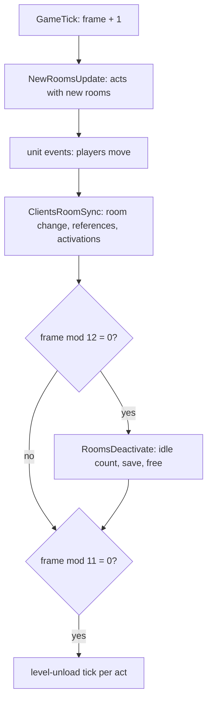
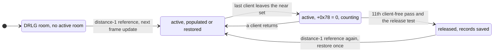

# 0009 — Room lifecycle: activation, release, the inactive-unit restore and the wanderers

> **Subsystem:** drlg/lifecycle
> **Question:** as players move, which rooms does the server activate and release, and when; what does it keep of the
> units of a released room; how does it re-create them when the room comes back, with which draws; and when does a
> room spawn a wandering monster?
> **Date:** 2026-10-17   **Plan:** 0040 (Phase 1 and 1b static; Phase 2 run:2026-10-17-lifecycle, § 11)   **Status:** open (Phase 2 under review)

## Answer (summary)

- [C] **Activation is a reference count over the DRLG near lists** (§ 11, 634 982 callbacks). When a client's room changes, the server moves one
  reference from the old DRLG room to the new one and adds or removes one at near-list distance 1, 2 and 3 around it.
  A room's status is the lowest distance that holds a reference (4 = none). Gaining distance 1 activates the room
  (`RoomActivateA` → `DRLG_RoomActivate` → `DUNGEON_RoomCreate`); distance 2 sets status 2 (and activates if a
  distance-1 reference is already there); distance 3 loads the room's DT1 list and DS1. The new active rooms are
  populated, or their saved units restored, at the start of the next game frame. (fn:sub_00537B50_ClientRoomChange@0x00537B50,
  fn:sub_0061B6F0_DrlgRefMove@0x0061B6F0, fn:sub_0061B390_DrlgRefAddNear@0x0061B390, data:g_DrlgRefEnterFns@0x00744384,
  fn:sub_0052D870_GameTick@0x0052D870, run:2026-10-17-lifecycle)
- [C] **Release is a timer in game frames** (§ 11, 2 440 releases). Every 12th frame (`frame % 12 = 0`) `RoomsDeactivate` counts, per active
  room, the passes in a row in which no client has the room in its near set (room `+0x78` = 0); on the 11th such pass,
  if the DRLG room is not pinned by a portal (`0x400000`), is at status 2 or more, and (in a town or level 120) every
  room of the level is at status 2 or more, it saves the room's units and frees the room. A room is therefore
  released 120 to 131 frames after the last client's room change took it out of every near set, if a pass saw the
  client there (a visit between two passes does not reset the count, § 11).
  (fn:sub_0052D240_RoomsDeactivate@0x0052D240, fn:sub_0061A790_RoomIdleCount@0x0061A790,
  fn:sub_0061BA30_DrlgRoomReleaseTest@0x0061BA30, run:2026-10-17-lifecycle)
- [I] **What is kept** (`[C]` for the branches § 11 lists). Ground items: always, as their serialised bytes with a new expiry frame. Objects and type-5
  units: by the objects rule (objects § B4, here with its level flag named: `Levels.SaveMonsters`). Monsters: when the
  level has `SaveMonsters` or the unit came from a preset or an earlier restore, alive or dying; a dead one (mode 12)
  only when a **room-seed draw** gives `low mod 3 = 0`; never a dead special (monster flag `0x08`, which every logged
  champion carries) or minion, a dead unit with a `udead` state,
  a necromancer skeleton or mage corpse, or a player's summon; `MonStats2.restore` 0 never, 2 always. Missiles are
  freed. (fn:sub_005433F0_InactiveUnitSaveTest@0x005433F0, fn:sub_005431F0_InactiveMonsterSaveTest@0x005431F0,
  0x00543260, tbl:Levels.txt:SaveMonsters, tbl:MonStats2.txt:restore, tbl:States.txt:udead)
- [C] **Restore order and draws** (§ 11; items corrected there). A re-activated room (populated bit kept in DRLG `+0x60`) skips the population and
  runs only the inactive restore, once per activation (active-room flags bit 1): monsters first (each through
  `MonSpawnTry` with its saved unit id: 3 room draws at the centre, the game-seed draw of `SUnitCreate`, a full
  `MonsterInit`; champions and uniques through `SpecialMonPlace` with the saved mods (stat 12 as the flag-1 handlers, § 11);
  minions through `MinionRestore`), then the items (two game-seed draws each in `SUnitCreate`, type 4; the saved start
  seed written back, 0 for a simple item), then objects and type-5 units through `PresetUnitDispatch`. (fn:sub_00542B40_RoomInactiveUnitsRestore@0x00542B40,
  fn:sub_005424F0_InactiveMonstersRestore@0x005424F0, fn:sub_00541990_InactiveItemRestoreOne@0x00541990, run:2026-10-17-lifecycle)
- [C] **Stats of a re-created monster** (§ 11, 2 035 restores). Stat 13 and stat 7 come from the record (the first instance's values);
  stat 6 is the saved life if fewer than 7500 frames passed since the save, otherwise the saved maximum; stat 12 is
  not written, it is the new `MonsterInit`'s (and the re-applied mods'). (0x00542800–0x0054284A,
  fn:sub_00627260_UnitSetStat@0x00627260, run:2026-10-17-lifecycle)
- [C] **Room `+0x78`** is the number of clients whose current room's near list holds the room; **`0x0061A4D0`** reads
  active-room flags bit 1 ("inactive units restored"), set by every update that ran the restore. The wanderer tick
  goes on only when `+0x78` is 0, so wanderers appear only in active rooms that no client is near.
  (fn:sub_0061A660_RoomClientAdd@0x0061A660, fn:sub_0061A4D0_RoomRestoredGet@0x0061A4D0,
  fn:sub_0054F060_RoomWandererTick@0x0054F060, run:2026-10-17-lifecycle; no wanderer appeared)
- [I] **The preset questions** (the detach `[C]`, § 11). The server's preset spawn moves the DS1 path out of the room's preset unit into the new
  monster (`PresetUnitSpawn`, 0x0055596C), which is the detach drlg/preset saw; the inactive record carries it across a
  release. A re-activated room never re-dispatches its preset list: units come back only from the records.
  (fn:sub_00555910_PresetUnitSpawn@0x00555910, fn:sub_00666120_PtrMove@0x00666120)
- [I] **A record with flag `0x400`** (a monster in target list 8 or 9, such as a wanderer) is not re-created when its
  saved alignment is 1 or 2 (record bit `0x80` or `0x100`); with alignment 0 (neither bit) the restore reaches a
  fatal error (`0x691`). The numbers are the unit alignment that `MonSpawnTry` sets from MonStats `Align` (0 → 0,
  1 → 2, 2 → 1; [MonStats](../../tables/MonStats.md) `Align`), so the hostile pool classes are alignment 0 and the
  allies (MonStats `Align` 1) alignment 2; the names "hostile/ally/neutral" stay a reading. The wanderer class
  (`rogue2`) has MonStats `Align` 1. Whether `WandererSpawn`'s creation path applies that rule, so that a saved
  wanderer is dropped, is not read. (0x005425F7–0x0054260B, 0x005427B8–0x005427D4, 0x0054287F–0x0054288E,
  0x00542990, tbl:MonStats.txt:Align)

## Leads used

Phase 1b, 2026-10-17: searched for community notes on area reset, monster respawn when leaving an area, monster
healing after leaving, and wandering monsters; fetched and registered the three sources below. Every claim above was
written from the code before they were read. Little exists beyond anecdotes; nothing found on the wanderer roll.

- [L] src:d2dfg-blizzard: `Levels.SaveMonsters` 1 saves "the monsters in the area level, such as when all players leave
  the area level". **held with refinement**
  Detail: the save is per room, at the release (11 client-free passes of 12 frames), not per level; it also saves a
  monster of a level without the flag when the unit carries `0x2000000` (preset spawns and restored units), and
  `MonStats2.restore` and the dead-unit tests override it (fn:sub_005431F0_InactiveMonsterSaveTest@0x005431F0).
- [L] src:d2dfg-blizzard: `MonStats2.restore` 0 "do not save", 1 "rely on other checks", 2 "force save". **held**
  Detail: 2 is tested last and overrides every earlier test, the dead-unit ones included (0x005432EF onwards).
- [L] src:d2dfg-blizzard: `Objects.Restore` restores the object "in an inactive state when the area level
  repopulates"; `RestoreVirgins` 1: a used object is not restored. **held** (as in objects/0001; the restored object
  is re-created, not kept)
- [L] src:d2dfg-blizzard: `Levels.MonWndr` allows wandering monsters "(see wanderingmon.txt)". **held with refinement**
  Detail: the version difference (no `wanderingmon` table; a hard-coded act I list of one class) is monsters/0002's;
  this finding adds the gate's room condition (`+0x78` = 0, § 7).
- [L] src:pk-boss-heal-thread (1.10): with `SaveMonsters` 0 "monsters are still dead or injured if you leave the area".
  **contradicted** (for monsters without the preset flag; [backlog](../../backlog.md), 2026-10-17 entry from reverser)
  Detail: in 1.14d a level without `SaveMonsters` saves only `0x2000000` units (preset spawns, earlier restores) and
  `restore` 2 classes; any other live monster of a released room is freed without a record, and the room is not
  populated again, so it is gone, not injured. The observation fits a room that was never released (the player stayed
  within the near sets, or less than 120 frames away) or a preset monster. On stock data only the towns and the Harem
  (levels 0, 1, 40, 50, 75, 103, 109) have `SaveMonsters` 0, and none is populated; but the test takes the level of
  the unit's **current** room (0x005431F9–0x0054322A), so a hostile pool monster that follows a player into a town
  room meets it on stock data when the town's rooms are released (corrected at the review; a required Phase 2 case).
- [L] src:pk-boss-heal-thread: Blood Raven back at full health after about 20 minutes away. **held with refinement**
  Detail: a restored monster keeps its saved life if fewer than 7500 frames passed
  between the save and the restore, else it gets the saved maximum (0x00542814–0x0054284A). Natural regeneration was
  not read.
- [L] src:pk-boss-heal-thread: a boss's regeneration pauses while the player is out of range. **not covered**
  Detail: regeneration is monster AI and stats work (ADR-0014 phase 4); a released monster is simply not there.
- [L] src:d2io-pmh-thread: Prevent Monster Heal "resets when you get too far away from the mob". **held with refinement**
  Detail: nothing resets by distance as such; a released and restored monster is a new unit with only stats 6, 7, 13,
  the mods, alignment and AI parameters copied (§ 5, § 6), so any state or stat from a hit is gone after a release.

## Functions

| Address | Name | Role | Tag |
|---|---|---|---|
| `0x0052D870` | `sub_0052D870_GameTick` | frame++, new-room updates, unit events, client room sync, every 12 frames `RoomsDeactivate`, every 11 frames the level-unload tick per act | I |
| `0x0052D440` | `sub_0052D440_ClientsRoomSync` | per client: `ClientRoomSync` | I |
| `0x005380D0` | `sub_005380D0_ClientRoomSync` | client room ← its player's room; on a change `ClientRoomChange` | I |
| `0x00537B50` | `sub_00537B50_ClientRoomChange` | DRLG reference move, level reference move, near-set difference → client add/remove per active room | I |
| `0x0053A8E0` / `0x0053A9B0` | `sub_0053A8E0_RoomClientEnter` / `sub_0053A9B0_RoomClientLeave` | add / remove the client in the room's client list (`+0x48`, `+0x78`) and tell the units | I |
| `0x0061A660` / `0x0061A700` | `sub_0061A660_RoomClientAdd` / `sub_0061A700_RoomClientRemove` | the client list, kept sorted | I |
| `0x0061B6F0` | `sub_0061B6F0_DrlgRefMove` | `RefAdd(new, 0)`; old: `refs[0]−1`, leave callback 0, `RefRemoveNear(old, 1)` | I |
| `0x0061B490` | `sub_0061B490_DrlgRefAdd` | `RefAddNear(d+1)` first, then `refs[d]+1` with the enter callback when it lowers the status | I |
| `0x0061B390` / `0x0061B5B0` | `sub_0061B390_DrlgRefAddNear` / `sub_0061B5B0_DrlgRefRemoveNear` | the same over the near list, recursing to distance 3 | I |
| `0x00744384` / `0x00744394` | `g_DrlgRefEnterFns` / `g_DrlgRefLeaveFns` | enter: status 0, activate (1), status 2, prepare files (3); leave: recompute status (0–2), recompute and client release (3) | I |
| `0x0061B2C0`, `0x0061B2D0`, `0x0061BB10` | `sub_0061B2C0_DrlgEnter0`, `sub_0061B2D0_DrlgEnter1Activate`, `sub_0061BB10_DrlgEnter2` | enter callbacks 0, 1, 2 (3 is `sub_0061B320_RoomPrepareFiles`) | I |
| `0x0061B4F0` / `0x0061B210` | `sub_0061B4F0_DrlgStatusRecompute` / `sub_0061B210_DrlgStatusSet` | status = lowest distance with a reference, else 4; status rings at DRLG act `+0xA0 + 0xEC·s` | I |
| `0x0061B560` | `sub_0061B560_DrlgLeave3Release` | leave callback 3: recompute; at status 4 on a client act, `RoomTilesRelease(room, 0)` | I |
| `0x0061B920` | `sub_0061B920_ClientBackgroundBuild` | client loop: every 5 client ticks build one status-2 room | I |
| `0x0052D240` | `sub_0052D240_RoomsDeactivate` | the release pass | I |
| `0x0061A790` | `sub_0061A790_RoomIdleCount` | room `+0x0C`: 0 if `+0x78` ≠ 0, else +1; returns it | I |
| `0x0061A3F0` / `0x0061BA30` | `sub_0061A3F0_RoomReleaseAllowed` / `sub_0061BA30_DrlgRoomReleaseTest` | DUNGEON act `+0x50` must be 0; pin, status and town tests | I |
| `0x0061BAC0` / `0x0061AED0` | `sub_0061BAC0_DrlgRoomPinFlag` / `sub_0061AED0_RoomPinSet` | DRLG `+0x28` `0x400000` set (arg 0) or cleared (arg ≠ 0); 31 call sites, portal and object code | I |
| `0x0061A910` | `sub_0061A910_ActiveRoomFree` | unlink from the act list and the neighbours' near lists, `RoomReleaseWrap`, `DUNGEON_RoomFree` | I |
| `0x00642A00` | `sub_00642A00_ActIsClient` | DRLG act `+0x8C` bit 0 | I |
| `0x00643200` | `sub_00643200_ActLevelsUnloadTick` | per level with no references and built rooms: countdown 10, then `LevelUnload(keep)` | I |
| `0x005433F0` | `sub_005433F0_InactiveUnitSaveTest` | per unit of a released room: save or keep, then free | I |
| `0x005431F0` | `sub_005431F0_InactiveMonsterSaveTest` | the monster rule (one room draw for a dead monster) | I |
| `0x00542E10` | `sub_00542E10_InactiveRecordSave` | dispatch: monster → `InactiveMonsterSave`; else room record, item → `InactiveItemSave`, else a 0x34 record | I |
| `0x00542E30` | `sub_00542E30_InactiveUnitSave` | tail of `0x00542E10` (a second entry) | C |
| `0x005421A0` | `sub_005421A0_InactiveMonsterSave` | the 0x5C monster record | I |
| `0x00541B10` | `sub_00541B10_InactiveItemSave` | serialise, new expiry, free the item and its socketed children | I |
| `0x00541D20` | `sub_00541D20_InactiveRoomRecordFind` | find (or insert) the room record by x, y in the act list | I |
| `0x00541FE0` / `0x00541E20` | `sub_00541FE0_InactiveMonAiSave` / `sub_00541E20_InactiveMonAiRestore` | AI parameters and the preset path, out and back | I |
| `0x00558A10` | `sub_00558A10_ItemGroundExpiry` | frame + 15000, 30000 or 45000 by quality and kind; 0 = never | I |
| `0x00541990` | `sub_00541990_InactiveItemRestoreOne` | `ItemCreateFromSave`, expiry, socketed children | I |
| `0x005B30E0` | `sub_005B30E0_SpawnWithId` | `MonSpawnTry` wrapper with a given unit id | I |
| `0x005B1990` / `0x005B1A90` | `sub_005B1990_TargetListAdd` / `sub_005B1A90_TargetListRemove` | unit `+0xD0` target list (11 = none) | I |
| `0x00554A30` | `sub_00554A30_UnitRelocate` | move a kept unit back into a room | I |
| `0x005B5210` | `sub_005B5210_DiabloQuestFlag` | quest 23 data `+0x13` | I |
| `0x00642820` | `sub_00642820_LevelSaveMonsters` | leveldefs `+0x94` | I |
| `0x00666120` | `sub_00666120_PtrMove` | `*dst = *src; *src = 0` | I |

## Walkthrough

### 1. The frame

- [I] `GameTick` increments the game frame (`+0xA8`), then runs, in this order: two per-frame passes, `NewRoomsUpdate`,
  the unit events, `sub_0052D440_ClientsRoomSync`, two more passes, `0x00543E10` when `frame % 20 = 0`, `RoomsDeactivate`
  when `frame % 12 = 0`, the level-unload tick of each act when `frame % 11 = 0`, and `0x0052D310`. The remainders are
  signed `%` on the incremented frame. (fn:sub_0052D870_GameTick@0x0052D870, 0x0052D8EB, 0x0052D938)
- [I] So a room activated on frame N (units move in the unit events, the client sync runs after them) is populated or
  restored by `NewRoomsUpdate` at the start of frame N+1. Three other callers populate a room at once through
  `RoomUpdateOne`: a unit spawn at coordinates whose room was not active (`0x00553720`), the creation of a
  portal's other end at a level point (`0x0056CF40`) and a quest spawn in level 40 (`0x0059DFD0`). (fn:sub_0052D0F0_RoomUpdateOne@0x0052D0F0,
  0x0055379D, 0x0056CF7D, 0x0059E018)

### 2. Activation

**References.** Each DRLG room has four `u16` reference counts (`+0x0C + 2·d`, d = near-list distance 0..3) and a status
byte `+0x44`.

- [I] `ClientRoomChange(client, new)` (client `+0x1B4` = its active room) calls `DrlgRefMove(old.drlg, new.drlg)`:
  `DrlgRefAdd(new, 0)`, and for the old room `refs[0] − 1` (if non-zero), leave callback 0, then
  `DrlgRefRemoveNear(old, 1)`. `DrlgRefAdd(R, d)` first calls `DrlgRefAddNear(R, d+1)` (each room N of R's near list:
  recurse to `d+2` while `d+1 < 3`, then the enter test on N, then `N.refs[d+1] + 1`), then the enter test on R and
  `R.refs[d] + 1`. The enter test calls `g_DrlgRefEnterFns[d](R)` when `d ≤ status` and `refs[0..d]` are all 0. The
  remove walk mirrors it with `g_DrlgRefLeaveFns`. (fn:sub_00537B50_ClientRoomChange@0x00537B50,
  fn:sub_0061B6F0_DrlgRefMove@0x0061B6F0, fn:sub_0061B490_DrlgRefAdd@0x0061B490,
  fn:sub_0061B390_DrlgRefAddNear@0x0061B390, fn:sub_0061B5B0_DrlgRefRemoveNear@0x0061B5B0, struct:DrlgRoomLife+0x0C)
- [I] The callbacks: enter 0 sets status 0; enter 1 activates the room through `RoomActivateA` if it has no active room
  and is not built (and resets the act's background countdown), then sets status 1 if higher; enter 2, if the DT1 list
  is built and (for a preset room) the DS1 loaded, sets status 2 and, when `refs[1] ≠ 0`, runs enter 1; enter 3 is
  `RoomPrepareFiles` (DT1 list, DS1, status 3). Each leave callback recomputes the status as the lowest d with
  `refs[d] ≠ 0`, else 4; leave 3 then releases the room's tiles on a client act. (data:g_DrlgRefEnterFns@0x00744384,
  data:g_DrlgRefLeaveFns@0x00744394, fn:sub_0061B2D0_DrlgEnter1Activate@0x0061B2D0, fn:sub_0061BB10_DrlgEnter2@0x0061BB10,
  fn:sub_0061B320_RoomPrepareFiles@0x0061B320, fn:sub_0061B4F0_DrlgStatusRecompute@0x0061B4F0,
  fn:sub_0061B560_DrlgLeave3Release@0x0061B560)
- [I] So, on the server, a client activates the rooms of its room's near list (the near list holds the room itself,
  drlg/0005; `ActiveRoomFree`'s scan of it skips the room's own entry), prepares the files of the rooms at
  distance 2 and 3, and the counts of several clients add up: the activation set is the union. (struct:DungeonRoomLife+0x00,
  fn:sub_0061A910_ActiveRoomFree@0x0061A910)
- [I] `RoomActivateA` adds nothing to the build of `DRLG_RoomActivate` but the neighbour step when `+0x2C` = 0, the
  re-seed and type init, and two act counters (`+0x98` byte, `+0x08`). `RoomActivateB` is the on-demand variant for
  callers that need a room at once (warp destination, waypoint room, level point, preset level build): it also builds
  the DT1 list and loads the DS1 when missing, does nothing when the room is built, and returns the active room. A room
  activated this way gets no reference, so its status stays 4 and it is released by the idle rule alone.
  (fn:sub_0061B190_RoomActivateA@0x0061B190, fn:sub_0061B730_RoomActivateB@0x0061B730)
- [I] `DUNGEON_RoomCreate` prepends the active room to the act list (`act +0x10`) and sets the act's new-rooms flag
  `+0x54` = 1; its flags `+0x34` are `DRLG_RoomActivate`'s argument: 4 on a client act, else the DRLG room's `+0x60`
  bit 0 (1 for a room populated before a release). (fn:DUNGEON_RoomCreate@0x00619890, fn:DRLG_RoomActivate@0x006422A0)
- [I] **The client list.** `ClientRoomChange` also takes `DUNGEON_GetNearRooms` of the old and the new active room:
  each room in the new set and not in the old gets the client (`RoomClientEnter` → `RoomClientAdd`: `+0x48[+0x78++]`,
  sorted by pointer); each in the old and not in the new loses it. Room `+0x78` is therefore the number of clients
  whose current room's near list holds the room. (fn:sub_0053A8E0_RoomClientEnter@0x0053A8E0,
  fn:sub_0053A9B0_RoomClientLeave@0x0053A9B0, fn:sub_0061A660_RoomClientAdd@0x0061A660,
  fn:sub_0061A700_RoomClientRemove@0x0061A700, fn:DUNGEON_GetNearRooms@0x00619790, struct:DungeonRoomLife+0x78)
- [I] **Client copy.** The client act runs the same reference code from its own loop (`0x0045CB0C`/`0x0045CB7C` call the
  wrappers `0x0061A070`/`0x0061A0C0`, which add or remove a distance-1 reference at a position), builds one status-2
  room every 5 client ticks (`ClientBackgroundBuild`, countdown act `+0x45C` = 5 on a client act, 7 otherwise), runs the
  level-unload tick every 13 client ticks, and releases a room's tiles as soon as its status reaches 4 (leave 3). The
  server act never calls `ClientBackgroundBuild`. (fn:sub_0061B920_ClientBackgroundBuild@0x0061B920,
  fn:sub_00642A00_ActIsClient@0x00642A00, 0x0044C7E6)

### 3. The new-rooms walk

- [I] `NewRoomsUpdate` walks, for each act whose `+0x54` is set, **every** active room of the act from the list head,
  then clears `+0x54`. Per room: the wanderer tick (§ 6); then, if flags bit 0 is clear: presets, inactive restore,
  objects, population, bit 0 set, bit 1 set; if bit 0 is set and bit 1 clear (`0x0061A4D0` returns `flags & 2`): the
  inactive restore and bit 1 set. A room re-activated after a release (bit 0 from DRLG `+0x60`) therefore restores
  once and is never populated again. (fn:sub_0052D160_NewRoomsUpdate@0x0052D160, fn:sub_0061A4D0_RoomRestoredGet@0x0061A4D0,
  fn:sub_0061A510_RoomRestoredSet@0x0061A510, fn:sub_00642390_LevelRoomStateRestore@0x00642390)
- [I] No code clears bit 1: the only callers of `0x0061A510` pass 1. Bit 1 lives in the active room, which a release
  frees, so "once per activation". (0x0052D20C, 0x0052D12C, 0x0052D14A)

### 4. Release

- [I] `RoomsDeactivate(game)` runs over the five act slots; per active room (list head first, the next pointer read
  before the room may be freed): `n = RoomIdleCount(room)` (`+0x0C` = 0 if `+0x78` ≠ 0, else `+0x0C + 1`); if `n > 10`
  and `RoomReleaseAllowed(act, room)`: walk the room's unit list `+0x74` from the head, reading each next pointer
  (`unit +0xE8`) before `InactiveUnitSaveTest(game, unit)`, then `ActiveRoomFree(act, room)`.
  (fn:sub_0052D240_RoomsDeactivate@0x0052D240, fn:sub_0061A790_RoomIdleCount@0x0061A790, struct:DungeonRoomLife+0x0C)
- [I] **Frames.** The count rises only on passes (`frame % 12 = 0`) with `+0x78` = 0 and drops to 0 on any pass with a
  client, so the release comes on the 11th client-free pass in a row: 120 frames after the first client-free pass,
  which falls 0 to 11 frames after the last client's room change (the client sync runs before `RoomsDeactivate` in
  the same frame). The test keeps passing once `n > 10`, so a room held back by the release test goes at the first
  later pass that allows it. A newly created room starts at 0 (the 0x80-byte room is zeroed). (fn:sub_0052D870_GameTick@0x0052D870,
  fn:DUNGEON_RoomCreate@0x00619890)
- [I] **The release test** (`DrlgRoomReleaseTest` on the DRLG room; `RoomReleaseAllowed` first requires the DUNGEON act's
  `+0x50` = 0, else a fatal error): the room's `0x400000` is clear; the act is a server act (fatal otherwise); status
  `+0x44` ≥ 2; and, if the level is a town or level 120, every room of the level has status ≥ 2.
  (fn:sub_0061A3F0_RoomReleaseAllowed@0x0061A3F0, fn:sub_0061BA30_DrlgRoomReleaseTest@0x0061BA30)
- [I] `0x400000` pins a room: `RoomPinSet(room, 0)` sets it and `RoomPinSet(room, 1)` clears it. Its 31 call sites are
  in object code: `PortalObjectCreate` sets it on the rooms of both ends (0x0056D29E, 0x0056D2AC), and two sites that
  free an object unit clear it (0x005354C5, 0x00584C12). Not every site was read. (fn:sub_0061AED0_RoomPinSet@0x0061AED0,
  fn:sub_0061BAC0_DrlgRoomPinFlag@0x0061BAC0, fn:sub_0056D130_PortalObjectCreate@0x0056D130)
- [I] **What the free does.** `ActiveRoomFree` unlinks the room from the act list, removes it from each neighbour's near
  list (swap with the last entry), calls `RoomReleaseWrap(drlg, EDX = DUNGEON act +0x50, flags)`, then `DUNGEON_RoomFree`.
  The wrapper zeroes DRLG `+0x30`, stores the active flags' bit 0 in DRLG `+0x60` and, if the room is built, calls
  `RoomTilesRelease(drlg, EDX = (wrapper EDX = 0))`, that is 1 on this path. `DUNGEON_RoomFree` then marks every unit
  still in the list (`+0xC4 |= 0x800000`, and `+0xC8 |= 0x20` unless `+0xC4` bit 22) and unlinks it, frees the
  collision map, the tile lists and the room. (fn:sub_0061A910_ActiveRoomFree@0x0061A910,
  fn:sub_0066B4C0_RoomReleaseWrap@0x0066B4C0, fn:sub_0066F1A0_RoomTilesRelease@0x0066F1A0, fn:DUNGEON_RoomFree@0x0061A840)
- [I] **`0x200000` and `EDX ≠ 0`.** `RoomTilesRelease` sets `0x200000` iff its `EDX` is non-zero, and the only non-zero
  `EDX` comes through the wrapper, which passes the logical not of its own `EDX` (`sete`, 0x0066B4DE). The wrapper is
  called only from `ActiveRoomFree`, with `EDX` = the DUNGEON act's `+0x50` (0x0061A9D0), and only for a built room
  (DRLG `+0x28` bit `0x100000`, 0x0066B4C9). On a server release `+0x50` is 0 (`RoomReleaseAllowed` makes any other
  value fatal), so the tiles release gets `EDX` 1 and sets `0x200000`. No reader was found: the only `+0x28` access
  with the immediate `0x200000` is the write at 0x0066F232. This corrects the wording in
  [drlg/room-tiles § Release and re-activation](../../specs/drlg/room-tiles.md#release-and-re-activation) that the
  wrapper passes the act's `+0x50`: it passes its negation. (0x0066B4C0–0x0066B4E5, 0x0061A9D0, 0x0066F232, fn:sub_0061B560_DrlgLeave3Release@0x0061B560)
- [I] **The client release leaves `0x200000` clear** (corrected at the review). run:2026-10-16-sweep-roomk logged 1516
  built-room releases, 626 with `EDX` ≠ 0 and 890 nested client pairs ([drlg/0002 § Plan 0038 batch H5c](0002-room-build-draws.md#plan-0038-batch-h5c-run2026-10-16-sweep-roomk)).
  626 + 890 = 1516, and with the negation read here the nested (client) inner calls can only have `EDX` 0 if the client
  DUNGEON act's `+0x50` is non-zero. So `0x200000` reads "released by the server": set on every server release, clear
  on a client release (nested or not). That the 626 are exactly the server-act releases is not yet checked against the
  kept logs. (0x0066B4DC–0x0066B4E3, 0x0061A9D0, run:2026-10-16-sweep-roomk)
- [I] The level-unload tick (server: every 11 frames per act; client: every 13 ticks) unloads, after a countdown of 10
  ticks, a level with no level references (`+0x0C`) and built rooms (`+0x10`), when `LevelUnloadCheck` allows; else it
  re-arms the countdown. (fn:sub_00643200_ActLevelsUnloadTick@0x00643200, fn:sub_00643060_LevelUnloadCheck@0x00643060,
  fn:sub_00642010_LevelUnload@0x00642010, fn:sub_00642F70_LevelAddRef@0x00642F70)

### 5. The inactive records

**Save.** `InactiveUnitSaveTest(game, unit)` by unit type:

- [I] **Monster (type 1)** → `InactiveMonsterSaveTest`, in this order (`save` starts as `SaveMonsters(level)` or unit
  `+0xC4` bit `0x2000000`) (fn:sub_005431F0_InactiveMonsterSaveTest@0x005431F0):
  1. mode 12 (dead): **one room-seed draw** on the unit's active room; `save` only if `low mod 3 = 0` (unsigned);
  2. dead (`UnitIsDead`): no save if any state with the `udead` flag is on the unit, or its alignment is 2;
  3. unit `+0xD0` < 8 (in a low target list): alive → save, alignment set to 0, removed from the list; dead → no save;
  4. dead and class 363 or 364 (`necroskeleton`, `necromage`) → no save;
  5. dead and monster flags `0x18` (unique or minion) → no save;
  6. unit `+0xC4` bit 31 (owned): no save; if the owner is a player and the player's pet list holds the unit, the
     unit is **kept** (`+0xC8 |= 0x100`);
  7. `+0xC4` bit 9 → no save;
  8. `MonStats2.restore` (row through `MonStats.MonStatsEx`): 0 or a missing row → no save; 2 → save.

  Then a kept unit is saved if `save` and unlinked from the room without being freed; any other is saved if `save`
  and freed. (fn:sub_005431F0_InactiveMonsterSaveTest@0x005431F0, 0x00543260–0x00543287, fn:sub_00642820_LevelSaveMonsters@0x00642820,
  fn:sub_0063A130_UnitHasStateInMask@0x0063A130, fn:sub_005A0180_MonTypeFlag@0x005A0180, tbl:Levels.txt:SaveMonsters,
  tbl:MonStats2.txt:restore, tbl:MonStats.txt:MonStatsEx, tbl:States.txt:udead)
- [I] Data: `SaveMonsters` is 0 only for levels 0, 1, 40, 50, 75, 103 and 109 (the towns and the Harem); `restore` is 1
  for 698 MonStats rows, 0 for 18 and 2 for 18 (the barricade tower, the minion spawners, the catapults, `act5pow`,
  the injured barbarians, `demonspawner`). (tbl:Levels.txt:SaveMonsters, tbl:MonStats2.txt:restore)
- [I] **Object (type 2)**: objects § B4 holds, with the level flag named: `save` starts as `SaveMonsters(level)` or the
  preset flag; Objects `Restore` = 0 or sparkle bit `0x02` → no; `RestoreVirgins` and mode ≠ 0 → no; the unit's
  type-1 timers are removed; classes 59 and 60 are always saved and kept. (fn:sub_005433F0_InactiveUnitSaveTest@0x005433F0,
  tbl:Objects.txt:Restore, tbl:Objects.txt:RestoreVirgins)
- [I] **Item (type 4)**: always saved. **Type 5**: always saved, then freed. **Player (type 0)**: with state 7
  (`playerbody`, a corpse) saved and kept; otherwise not saved (a player's own room is always in its near set, so a
  released room holds no live player). **Missile (type 3)** and anything else: freed. (fn:sub_005433F0_InactiveUnitSaveTest@0x005433F0)

**Records.** All records hang off one 0x18-byte room record per released room, found or inserted by room x and y in the
act's list at `game +0xD8 + 4·act` (ordered by x descending). Each save **prepends**; the unit walk is newest first, so
every list is oldest first, as objects § 13.5 has for objects.

- [I] **Monster record** (0x5C, `InactiveMonsterSave`; layout in `struct:InactiveMonRec+0x00`): before writing it
  removes the states of the list at DataTables `+0x174` and the unit's type-2 timers. It saves x, y, class, unit id,
  `+0xC4`, `+0xC8`, the save frame, the AI record's first dword, monster data `+0x58`, the name seed, the nine mod
  bytes, the superunique id, stat 13, `UnitGetMaxHp`, stat 6, the group leader (when the AI link type is 1), the AI
  parameters and the preset path (moved out of the monster's AI control `+0x38`). Flags `+0x18`: `0x2` champion,
  `0x800` superunique, `0x1` placed by `SpecialMonPlace`, `0x20` minion, `0x40` monster data `+0x5C` bit 1, alignment
  `0x200`/`0x80`/`0x100` (0/1/2), `0x400` when `+0xD0` ≠ 11 (`+0xD0` < 8 is fatal), `0x4` in mode 12 or 0.
  (fn:sub_005421A0_InactiveMonsterSave@0x005421A0, fn:sub_00541FE0_InactiveMonAiSave@0x00541FE0, 0x00542098,
  struct:InactiveMonRec+0x18)
- [I] **Unit record** (0x34) is objects § B4's record, used also for type 5 and the kept player corpse (`+0x20` = unit
  id). (fn:sub_00542E10_InactiveRecordSave@0x00542E10, fn:sub_00542E30_InactiveUnitSave@0x00542E30, struct:InactiveUnitRec+0x20)
- [I] **Item record**: `ITEMS_Serialize(item, buf, 0x400, 1, 1, 0)` (the socketed children are written with the parent
  and freed with it) and an expiry from `ItemGroundExpiry`: 0 (never) for a quest base (`ItemBaseIsQuest`), else the
  frame plus 30000 for quality 4 (magic), 45000 for qualities 5 to 9, and otherwise 45000 for base type 4 with stat 14
  (gold) above 10000, 30000 for a socket filler, 15000 else. (fn:sub_00541B10_InactiveItemSave@0x00541B10,
  fn:sub_00558A10_ItemGroundExpiry@0x00558A10, fn:ITEMS_Serialize@0x006313E0, fn:ITEMS_GetQuality@0x00627E70,
  fn:sub_00628CD0_ItemBaseIsQuest@0x00628CD0, fn:ITEMS_GetBaseType@0x0062B400, fn:ITEMS_IsSocketFiller@0x0062BEB0,
  struct:InactiveItemRec+0x04)
- [I] **What is lost**: the monster record holds none of the unit's states (the listed ones are removed first) or
  timers, no mode other than "dying or dead" (alive records come back in mode 1), no position but x and y, and the
  life only for 7500 frames; a unit with no record is gone. (fn:sub_005421A0_InactiveMonsterSave@0x005421A0,
  struct:InactiveMonRec+0x18)

### 6. Restore

`RoomInactiveUnitsRestore(game, room)`: monsters, then `InactiveRecordTake` (unlinks the room record), then items,
then the unit records (objects § 13.5, which this reading confirms).

- [I] **Monsters** (`InactiveMonstersRestore`, fn:sub_005424F0_InactiveMonstersRestore@0x005424F0), oldest first. Per record:
  - in level 108 while quest 23's data byte `+0x13` is set, a record that is neither dead (flag 4) nor class 243
    (`diablo`) is dropped;
  - kept units (`+0x14` bit `0x100`): found by id and relocated into the room; nothing is created;
  - flag `0x400` with alignment 1 or 2 (record bit `0x80` or `0x100`): dropped;
  - else the creation flags are `0x62` (`0x6A` with flag `0x40`), `| 0x80` for a `flying` class, the mode 1 (12 for a
    flag-4 record) and the saved unit id; the path is picked by flag `0x20` first, then flag `1` (a record with both
    goes to `MinionRestore`, 0x0054264A–0x0054266D):
    - flags 1 → `SpecialMonRestore(x, y, class, id, nameSeed, champion, superunique, suId, mods)`: `SpecialMonPlace(room,
      no box, x, y, id, avoid warps)` in **mode 1**, then the saved mods, `SpecialModsApply(flag 0)`, the saved name seed,
      the aura when a mod is 30, and the superunique quest hooks;
    - flag `0x20` → `MinionRestore`: `SpawnWithId(x, y, class, mode 1, id, −1, 0x62)`, then radius 4, then a
      `SpawnPosPick` position, the saved mods and the flag-0 handlers of mods 1–4 and of each saved mod;
    - else `SpawnWithId(x, y, class, mode, id, −1, flags)`, then radius 5, then a `SpawnPosPick` position, then
      `COLL_FindFreeSpiral`.

  (fn:sub_005424F0_InactiveMonstersRestore@0x005424F0, fn:sub_005B5210_DiabloQuestFlag@0x005B5210,
  fn:sub_005A4440_SpecialMonRestore@0x005A4440, fn:sub_005A46E0_MinionRestore@0x005A46E0,
  fn:sub_005A09E0_SpecialMonPlace@0x005A09E0, fn:sub_005B30E0_SpawnWithId@0x005B30E0, tbl:MonStats.txt:flying)
- [I] Then, on a created unit: the group link (`MonSetOwner(leaderId, 1, …)`), **stat 13 = saved**, **stat 7 = saved
  maximum**, **stat 6 = saved life if `frame − saveFrame < 7500` (unsigned), else the saved maximum**; the AI state and
  parameters and the preset path back; for flag `0x400`: target list 8 (alignment 2) or 9 (alignment 1), any other
  alignment a fatal error `0x691` (the alignment is re-derived from the record bits at 0x005427B8–0x005427D4; since the
  drop above already removed alignments 1 and 2, only alignment 0 reaches this test, and it reaches the fatal error); each mod slot that differs from the saved byte gets `ModAppendApply(saved, 0)`;
  `MonAlignSet(saved alignment)`; `+0xC8 |= 0x200` if saved; `+0xC4 |= (saved & 0x20000) | 0x3000000`. A failed creation
  frees the AI list. Last, `MonRegionUnitLeave(level, alignment, dead, flag 0x40, unit)` and the record (and any
  path still in it) is freed. (0x005427FB–0x00542916, fn:sub_00627260_UnitSetStat@0x00627260,
  fn:sub_00541E20_InactiveMonAiRestore@0x00541E20, fn:sub_005543B0_MonAlignSet@0x005543B0,
  fn:sub_005A4850_ModAppendApply@0x005A4850, fn:sub_00547ED0_MonRegionUnitLeave@0x00547ED0)
- [I] So a restored monster's unit id and class are the first instance's, its unit seed is a new game-seed draw
  (`SUnitCreate`), and `MonsterInit` runs in full; stat 12 is never written by the restore. The `0x2000000` it gets makes
  it saveable again in any level. (fn:sub_00555230_SUnitCreate@0x00555230, fn:sub_005B2A00_MonSpawnTry@0x005B2A00)
- [I] **A dead champion comes back alive.** The save keeps a dead champion (flag 0x04 is not in the `0x18` test) with
  flag 4, and the restore's flag-1 path ignores flag 4: `SpecialMonRestore` places it in mode 1. Its life is then the
  saved stat 6 within 7500 frames, else the saved maximum. Not reached: the run shows every champion with `0x08`, which
  the `0x18` test catches (§ 11). (0x005432EF–0x00543303,
  0x00542693–0x005426C3)
- [I] **Items** (`InactiveItemsRestore`), oldest first: an item whose expiry is non-zero and passed (`frame >
  expiry`, signed) is dropped; else `ItemCreateFromSave` re-creates it and each socketed child, and the expiry becomes
  `max(saved, frame + 15000)` (0 stays 0). `ItemCreateFromSave` goes through `SUnitCreate`, which makes the item's
  game-seed draw, then the stream's saved seed replaces the unit seed (items/0008 § `useitem`): the item keeps its
  seed. (fn:sub_00541AC0_InactiveItemsRestore@0x00541AC0, fn:sub_00541990_InactiveItemRestoreOne@0x00541990,
  fn:sub_00558CB0_ItemCreateFromSave@0x00558CB0, fn:sub_00552E90_ItemSeedInit@0x00552E90)
- [I] **Objects and type 5**: `PresetUnitDispatch(type, class, x, y, mode, +0xC4)` as objects § 13.5; kept units (the
  portals, a player corpse) are found by id and relocated, a kept player must be in mode 17 (fatal otherwise).
  (fn:sub_00542B40_RoomInactiveUnitsRestore@0x00542B40, fn:sub_005557D0_PresetUnitDispatch@0x005557D0,
  fn:sub_00554A30_UnitRelocate@0x00554A30)

### 7. The wanderer tick

- [I] Per room of every new-rooms walk: one room-seed step; if `low & 0x7FFF = 0`, room `+0x78` = 0 and Levels
  `MonWndr` ≠ 0: `WandererRoll` steps the room seed again and goes on if `low mod 100 < 3` and the level's region
  `+0x2C4` < 3; `WandererSpawn` takes the act (Levels `+0x03`), its start and count bytes at `0x00731B30 + 2·act`
  (act I: 0 and 1; the others 0 and 0), `RNG_Range(room seed, count)`, the class from the list at `0x00731B2C`
  (270), `SpawnPosPick(no box, class, 0)`, `SpawnAtPos(x, y, class, mode 1, new id, flags 0)`, then target list 8 and
  region `+0x2C4` + 1. (fn:sub_0054F060_RoomWandererTick@0x0054F060, fn:sub_0054EFF0_WandererRoll@0x0054EFF0,
  fn:sub_0054EF50_WandererSpawn@0x0054EF50, fn:RNG_Range@0x0045C390, tbl:Levels.txt:MonWndr)
- [I] So the gate needs a room that is active and not near any client: one kept alive by the idle timer, or activated
  by `RoomActivateB`. A room just activated by a client has `+0x78` ≥ 1 at its first update, because the client list is
  filled in the same `ClientRoomChange`. (fn:sub_00537B50_ClientRoomChange@0x00537B50, struct:DungeonRoomLife+0x78)
- [I] **Rate** (added at the review). The gate's draw passes with probability 1/32768 (`test eax, 0x7FFF` on the new
  low, 0x0054F089) and the roll with 3/100, so one spawn takes about 1.1 million room updates of an act I `MonWndr`
  level with `+0x78` = 0 and region `+0x2C4` < 3. (0x0054F089, 0x0054F024–0x0054F02B)

### 8. The preset questions of drlg/preset

- [I] **Who detaches a preset monster's path.** `PresetUnitSpawn` (server) moves the preset unit's path (`+0x10`) into
  the new monster's AI control `+0x38` with `PtrMove`, which zeroes the source (0x0055596C). That is the null drlg/0004
  saw at the second prepare. The release moves it into the monster record (0x00542098), the restore back into the new
  monster (0x00541EA2). The 19 units were logged in both act copies; this reading covers the server copy, the client
  copy's detach was not found. (fn:sub_00555910_PresetUnitSpawn@0x00555910, fn:sub_00666120_PtrMove@0x00666120)
- [I] **Twice?** No: the room's preset list is dispatched only by `RoomPresetUnits`, which runs only when active-room
  flags bit 0 is clear, and a re-activated room inherits bit 0 from DRLG `+0x60`. The added objects and type-5 units
  come back from the unit records. Whether the list itself grows on a rebuild is not read.
  (fn:sub_005559A0_RoomPresetUnits@0x005559A0, fn:sub_0052D160_NewRoomsUpdate@0x0052D160)

### 9. Seed consumers met

- [I] Release (`frame % 12 = 0`, acts 0..4, rooms list order, units list order): one room-seed draw per mode-12 monster
  of the room. Nothing else on the save path draws. (0x00543260)
- [I] New-rooms walk, per room in list order: the wanderer tick (room seed, 1 draw; +1 for the roll; +`RNG_Range` and
  `SpawnPosPick` and the spawn's draws when it spawns). Then the restore of a re-activated room: per monster record,
  `MonSpawnTry` (3 room draws at the centre, more on a fallback), `SUnitCreate`'s game-seed draw, `MonsterInit`'s
  unit-seed draws, and for specials the mod handlers; per item, one game-seed draw (and one per socketed child); per
  unit record, objects § 13.5's draws (game seed, object-region seed). (fn:sub_0052D160_NewRoomsUpdate@0x0052D160,
  fn:sub_00542B40_RoomInactiveUnitsRestore@0x00542B40)

### 10. The boundary for Phase 2 (recommendation)

| Event | Entry and exit | Model | Oracle |
|---|---|---|---|
| reference move | `0x0061B6F0` entry (old, new); enter/leave calls through `0x00744384`/`0x00744394` | refs and status per room, activations | none |
| client list | `0x0061A660`/`0x0061A700` | `+0x78` per room | none |
| release pass | `0x0052D276` (count), `0x0052D284` (test), `0x0052D2A9` (save test per unit), `0x0052D2BB` (free) | idle count, test, the save rule, the mode-12 draw (room seed in/out at `0x00543260`) | `UnitIsDead`, state and owner tests logged as inputs |
| save | `0x005421A0`, `0x00542E10`, `0x00541B10` exits | record fields | `ITEMS_Serialize` bytes as logged data |
| restore | `0x00542B40` entry/exit; per monster `0x00542563`; creation calls `0x00542689`/`0x005426C3`/`0x005426E9`; stat writes `0x00542809`–`0x0054284A` | order, ids, stat 6/7/13 | `MonSpawnTry` (monsters/spawn model), `SpecialMonPlace`/mods (monsters/special model), `MonsterInit` (monsters/stats model); AI and path as boundary oracles |
| items | `0x00541AE8` per item | expiry rule, ids | `ItemCreateFromSave`: one game-seed draw, saved seed |
| wanderer | `0x0054F060`, `0x0054EFF0`, `0x0054EF50` | gate and roll | `SpawnPosPick`, `SpawnAtPos` (monsters/spawn) |

The frame counter (`game +0xA8`) is logged at every line; release times are checked in frames.

### 11. Phase 2: run:2026-10-17-lifecycle

Thirteen scripted sessions on slot 1 (acts I–V, Normal, Nightmare and Hell, the mazes 29 and 35, outdoor levels,
classic Normal and Nightmare), checked by `tools/rooms.py check`: **0 mismatches** over 2 215 807 checks
([experiments](experiments.md#run2026-10-17-lifecycle)). Each line below cites the run and gives its count.

**Raised to `C`** (each bullet below).

- [C] **References and activation (§ 2).** `DrlgRefMove` replayed on the snapshot before the move, with the near lists
  as `DrlgRefAddNear` builds them, predicts every server callback in kind and room, with the refs and status at
  its entry (634 982 callbacks in 913 moves), the refs and status of every snapshot room after the move (52 119), and
  the activations: `RoomActivateA` after an enter-1 call on a room with no active room and no `0x100000` (2 377).
  The status rule (lowest distance with a reference, else 4; the enter-2 condition on the DT1/DS1 bits and the tail
  call to enter 1) holds on all of them. (run:2026-10-17-lifecycle, fn:sub_0061B6F0_DrlgRefMove@0x0061B6F0,
  fn:sub_0061B390_DrlgRefAddNear@0x0061B390, fn:sub_0061B5B0_DrlgRefRemoveNear@0x0061B5B0, data:g_DrlgRefEnterFns@0x00744384,
  data:g_DrlgRefLeaveFns@0x00744394)
- [C] **Client lists (§ 2).** `ClientRoomChange` calls `RoomClientEnter` for the rooms of the new near list that are
  not in the old one, in list order, then `RoomClientLeave` for the reverse (5 418 calls, `+0x78` before each). The
  near lists are `DUNGEON_GetNearRooms`' after the reference move. With one client, room `+0x78` is 1 exactly when the
  room is in the near list of the client's current room (180 132 room-passes). (run:2026-10-17-lifecycle,
  fn:sub_00537B50_ClientRoomChange@0x00537B50, fn:sub_0061A660_RoomClientAdd@0x0061A660)
- [C] **Release (§ 4).** The release pass runs on `frame % 12 = 0` (15 614 passes). The idle count is 0 for a new
  room, is reset by a pass that sees `+0x78` ≠ 0, and is otherwise +1. A room is freed when the count exceeds 10 and
  `DrlgRoomReleaseTest` passes (19 328 tests; refused for a pin 4 592 times and for a town room 12 296 times). Every
  room each pass frees is predicted. 2 440 releases, 2 224 of them at the first eligible pass, between 120 and 131
  frames after the last client left (every value from 120 to 131 is seen). Act `+0x50` is 0 on the server at every
  pass. (run:2026-10-17-lifecycle, fn:sub_0052D240_RoomsDeactivate@0x0052D240, fn:sub_0061A790_RoomIdleCount@0x0061A790,
  fn:sub_0061BA30_DrlgRoomReleaseTest@0x0061BA30)
- [C] **`0x200000`.** Every server release calls `RoomTilesRelease` with `EDX` 1 and leaves `0x200000` set (2 440).
  Every client release has `EDX` 0 and leaves it clear (8 277). (run:2026-10-17-lifecycle, 0x0066F232,
  fn:sub_0066B4C0_RoomReleaseWrap@0x0066B4C0)
- [C] **The save rule (§ 5)** on the branches reached (run:2026-10-17-lifecycle):
  - 4 401 monsters: 3 086 saved, 413 saved dead, 902 freed dead;
  - `SaveMonsters`, `+0xC4` bit `0x2000000`;
  - the mode-12 room draw: seed out = step(seed in) and `low mod 3`, chained unit to unit (1 315);
  - the `udead` (1) and alignment-2 (12) tests on dead units;
  - the `0x18` flag test on dead units (106);
  - `restore` 1 and 2 (30);
  - 3 023 objects (objects § B4, `Restore` 0: 15, `RestoreVirgins` on a used object: 30);
  - items 1 347, type 5: 59, missiles freed: 9.

  A record line follows exactly the units the rule saves. (run:2026-10-17-lifecycle,
  fn:sub_005431F0_InactiveMonsterSaveTest@0x005431F0, fn:sub_005433F0_InactiveUnitSaveTest@0x005433F0, 0x00543260)
- [C] **The records (§ 5)** (run:2026-10-17-lifecycle).
  - **Monster records (3 499).** The record holds the unit's x, y, class, id, `+0xC4` and `+0xC8`, the save frame,
    stats 13 and 6, and `UnitGetMaxHp` (equal to stat 7 on all of them). It also holds the mod bytes and the flag bits
    `0x1`/`0x2`/`0x800`/`0x20` from the monster flags, the alignment bits, `0x400` and `0x4`.
  - **Unit records (3 037).**
  - **Item records (1 347).** The expiry is 0 for a quest item, frame + 30000 for magic, + 45000 for qualities 5–9 and
    for gold above 10000, + 30000 for a socket filler, else + 15000.

  (run:2026-10-17-lifecycle, fn:sub_005421A0_InactiveMonsterSave@0x005421A0, fn:sub_00558A10_ItemGroundExpiry@0x00558A10)
- [C] **The new-rooms walk (§ 3).** Per walked room, the wanderer tick comes first. Then a room with flags bit 0 clear
  is restored and populated (1 137), a room with bit 0 set and bit 1 clear is restored only (1 361), and any other
  room is left alone. A re-activated room's DRLG `+0x60` bit 0 is 1 exactly when the room was walked (or restored) before its
  release (1 414). (run:2026-10-17-lifecycle, fn:sub_0052D160_NewRoomsUpdate@0x0052D160)
- [C] **The wanderer gate's draw (§ 7).** One room-seed step per walked room, out = step(in) (11 064), and no roll
  unless `low & 0x7FFF` = 0 with `+0x78` = 0 and `MonWndr` ≠ 0 (3 211 draws met the room conditions; none passed the
  draw). (run:2026-10-17-lifecycle, 0x0054F089)
- [C] **The monster restore (§ 6)** (run:2026-10-17-lifecycle). 2 035 records: 1 836 exact, 144 minion and 55 special.
  - The created unit has the record's id and class, and its mode is 12 for a flag-4 record on the exact path, else 1.
  - The creation takes one game-seed draw (`SUnitCreate`), and the unit's `+0x28` is the low word after it.
  - An exact placement takes 3 room draws and lands at the record's x, y (1 808). The radius-5 fallback takes 7 room
    draws (31).
  - Stats 13 and 7 come from the record. Stat 6 is the saved life within 7500 frames (1 931) and the saved maximum
    after them (104).
  - Stat 12 is the monsters/stats model's level (1 836 exact; classic Nightmare as `Level + 25 d`).
  - `+0xC4` gets `0x3000000` and the record's `0x20000`.
  - `MonRegionUnitLeave` takes (record `+0x2C`, current level, alignment, dead, flag `0x40`) and lowers the current
    level's region `+0x2CC` for an alignment-0 unit without flag `0x40`, and `+0x2C8` too for monster flag `0x01`
    (2 035).
  - 255 restored monsters were damaged before the release.

  (run:2026-10-17-lifecycle, fn:sub_005424F0_InactiveMonstersRestore@0x005424F0, fn:sub_00547ED0_MonRegionUnitLeave@0x00547ED0,
  0x00542819)
- [C] **The item restore (§ 6)** (run:2026-10-17-lifecycle).
  - Items are restored in list order, and an item whose non-zero expiry has passed is dropped (no item reached its
    expiry).
  - The expiry written back is `max(saved, frame + 15000)`, and 0 stays 0.
  - The item comes back at its saved x, y (876).
  - (run:2026-10-17-lifecycle, fn:sub_00541AC0_InactiveItemsRestore@0x00541AC0, fn:sub_00541990_InactiveItemRestoreOne@0x00541990)
- [C] **Unit records** come back through `PresetUnitDispatch` with their type, class and position (1 799; objects
  1 760, 603 of them operated before the release). The objects § B4 save rule and § 13.5 re-creation hold on these
  objects. (run:2026-10-17-lifecycle, fn:sub_00542B40_RoomInactiveUnitsRestore@0x00542B40)
- [C] **The preset path (§ 8):** `PresetUnitSpawn` moves the preset unit's `+0x10` into the monster's AI control
  `+0x38` and leaves 0 behind (49). (run:2026-10-17-lifecycle, 0x0055596C)

**Corrected or refined by the run.**

- [C] **An item restore takes two game-seed draws**, not one: `SUnitCreate`'s unit seed and `ItemSeedInit` (type 4;
  876 of 876). The start seed (`+0x28`) is the saved one for an item stored in full (289). For a **simple (compact)
  item** (record flags bit `0x200000`) it is **0** (587; gold, potions, keys). The unit seed is `Init(+0x28)` in both
  cases. This corrects § 6 and § 9 ("one game-seed draw", "the item keeps its seed"). (run:2026-10-17-lifecycle,
  fn:sub_00558CB0_ItemCreateFromSave@0x00558CB0)
- [C] **The 120–131 frame window needs a visit that spans a pass.** A client whose room stays in the near set only
  between two passes does not reset the count (5 cases, each released 36–110 frames after that visit). So
  "120–131 frames after the last client's room change" holds only for a visit that a pass saw. The idle model above
  covers both cases. (run:2026-10-17-lifecycle, fn:sub_0061A790_RoomIdleCount@0x0061A790)
- [C] **A room can be released unpopulated.** A room that `RoomActivateB` activates after the act's walk has passed it
  (its callers `0x0066ADB1` and `0x0066B3C5` during the population pass) is released before any walk reaches it if no
  new room arrives meanwhile (3 rooms). Its `+0x60` bit 0 stays clear, and it is populated at its next activation.
  (run:2026-10-17-lifecycle, fn:sub_0061B730_RoomActivateB@0x0061B730)
- [I] **A dead champion is never saved on stock data.** The § 5 test 5 mask `0x18` is "special (`0x08`) or minion",
  not "unique or minion": `MonMarkSpecial` (0x005A0375) sets `0x08`, and every logged champion carried it (15
  champions in 30 save tests, monster flags `0x0D` or `0x2D`; the 6 dead ones were freed by the test). The surprise of § 6 ("a dead champion comes back
  alive") needs a champion without `0x08`, which no run logged. It stays a code reading of the restore path. Champion
  creation paths that skip `MonMarkSpecial` were not searched. (run:2026-10-17-lifecycle, fn:sub_005A0320_MonMarkSpecial@0x005A0320,
  0x005432EF)
- [C] **Stat 12 of a restored special.** A minion gets the flag-0 handlers of mods 1–4 and its saved mods, so a first
  instance at the pool level comes back 3 higher (`leveladd`; 2 of 2 seen; 141 later restores unchanged). A special
  (`SpecialMonRestore`) matches the **flag-1** handlers: a champion is at + 2 (`leveladd` + 3, `champion` − 1), a unique
  at + 3. The flag-0 reading of § 6 would leave a champion at + 3. The model predicts all 199 restores. Which call
  applies the flag-1 handlers inside `SpecialMonPlace` is a static question. (run:2026-10-17-lifecycle,
  fn:sub_005A46E0_MinionRestore@0x005A46E0, fn:sub_005A4440_SpecialMonRestore@0x005A4440)

**Not reached (these stay inferred; named shortfalls).**

- **The town-follow case** (required by the Phase 1 review). Two sessions released the town's rooms (161 room releases
  of level 1). No hostile monster was in a town room at a release: the scripted walk out of the Rogue Encampment and
  back never brought one in.
- The wanderer roll and spawn: 0 of 3 211 eligible gate draws passed, at an expected 1 in 32 768.
- An expired item record (at the restore, or in the 20-frame sweep `0x00542AC0`).
- Monster save-rule branches: an owned monster or pet, `+0xD0` < 8, `+0xC4` bit 9, necromancer summons, `restore` 0.
- Restore outcomes: a kept monster or unit, a `0x400` record, the level-108 rule, a kept player corpse, a minion
  restored without its boss.
- Pins appeared only as inputs. Six set calls came from portal and object code (`0x0056D2A3`, `0x0056D2B1`,
  `0x00581476`, `0x00581484`), and no clear call was seen.

## Data touched

- tbl:Levels.txt:SaveMonsters (leveldefs `+0x94`), tbl:Levels.txt:MonWndr (`+0x2E`), Levels `+0x03` (act).
- tbl:MonStats2.txt:restore (`+0x130`, read as a byte), through tbl:MonStats.txt:MonStatsEx (`+0x18`);
  tbl:MonStats.txt:flying (`+0x0D` bit 6); MonStats `+0x02` (`BaseId`) in the AI save.
- tbl:Objects.txt:Restore (`+0x173`), tbl:Objects.txt:RestoreVirgins (`+0x174`), Objects `+0x109`, `+0x141`, `+0x167`,
  `+0x178`, `+0x180` (objects § B4/§ 13.5).
- tbl:States.txt:udead (flag bit set at DataTables `+0x150`).
- struct:DungeonRoomLife+0x0C, struct:DungeonRoomLife+0x34, struct:DungeonRoomLife+0x48, struct:DungeonRoomLife+0x78,
  struct:DrlgRoomLife+0x0C, struct:DrlgRoomLife+0x28, struct:DrlgRoomLife+0x44, struct:DrlgRoomLife+0x60,
  struct:InactiveRoomRec+0x00, struct:InactiveUnitRec+0x00, struct:InactiveMonRec+0x00, struct:InactiveItemRec+0x00.

## Dead ends

- `0x0061A510(room, 0)` would clear the restored bit; it has no such caller.
- The room-tiles spec's "the wrapper calls `RoomTilesRelease` with the act's `+0x50`": the wrapper negates it.

## Open questions

Each is a Phase 2 question (§ P2 questions in the plan log) unless it says otherwise.

- [L] Whether a wanderer (target list 8) is saved as alignment 2 (dropped at the restore) or 0 (the fatal `0x691`):
  a static read of `SpawnAtPos`'s alignment write answers it (MonStats `Align` 1 for `rogue2` predicts 2). A run will
  hardly see one: the gate passes 1 in 32768 room updates and the roll 3 in 100 (§ 7).
- [L] A champion without monster flag `0x08` (the only one a dead save could keep, § 11): a static search of the
  champion creation paths for one that skips `MonMarkSpecial`.
- [L] Which call inside `SpecialMonRestore` applies the flag-1 handlers that stat 12 shows (§ 11); code still to read.
- [L] The town-follow case (§ 11 shortfall): whether a hostile monster can enter a Rogue Encampment room at all.
- [L] Which client-copy code detached the path of the client-copy units of drlg/0004's 19 (§ 8); code still to read.
- [L] DUNGEON act `+0x50` reads as "client act" (0 on the server, non-zero on the client by the 626/890 split of § 4);
  check against the kept logs of run:2026-10-16-sweep-roomk and the act constructor.
- [L] The meanings of monster data `+0x58` and `+0x5C` bit 1, record `+0x2C`, and the state list
  at DataTables `+0x174`; code still to read.
- `MonRegionUnitLeave` at the restore and the restored item's position: answered in § 11.
