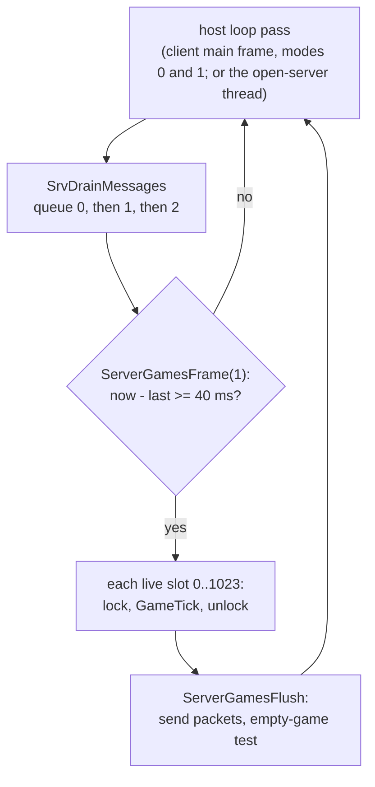
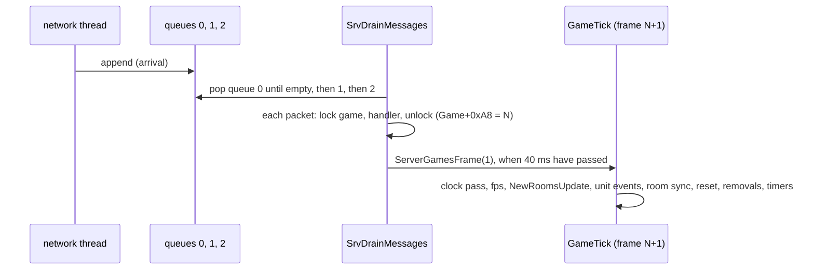

# 0001 — The server frame, part 1: the frame loop, GameTick's passes and the client-message drain

> **Subsystem:** sim/frame
> **Question:** how often and in which order does the server run a frame for each game, what does `GameTick` do in
> each of its passes (and which of them draw, on which seed), where are client messages applied relative to
> `GameTick` and in which order within one drain, and do two games share any state a frame touches? And: what would a
> frame window (ADR-0022) log, and how many lines per frame?
> **Date:** 2026-10-30   **Plan:** 0055 (Phase 1, batch P1.1)   **Status:** open (P1.2 reads `GameRunUnitEvents` and
> the queue, P1.3 the timers and the activation order)

Static reading of the pinned `Game.exe` in Ghidra (project copy `workspace/ghidra-r55`, symbols replayed from
`re/symbols.csv`) and objdump, plus three emulated maps (run:2026-10-30-frame-emu,
[experiments](experiments.md#run2026-10-30-frame-emu)). The RNG reach comes from `re/ghidra_scripts/RngCallGraph.java`
(`33801ca2…`), the absolute-address writes of a call closure from `tools/frame_globals.py` (`dc1b7218…`, over
`tools/callee_writes.py`'s walk), the byte-level call and pointer scans from `tools/xrefscan.py` (`4db25be3…`), the log volumes from
`tools/frame_volume.py` (`ad663e61…`). Every kept static output is under `workspace/logs/r55/static/` (`manifest.sha256`
`07094f49…`, 19 lines, one path base: that directory; `commands.txt` gives the command of each file). Names below are `re/symbols.csv` names.

## Answer (summary)

- [I] **The frame loop.** Each pass of the host loop drains the client messages (`SrvDrainMessages`) and then calls
  `ServerGamesFrame(1)`, which ticks **every live game once**, in slot order 0..1023 (`0x00882D38`), if at least one
  interval has passed since its clock, and otherwise returns at once. The interval is `1000 / 25` = 40 ms
  (`g_ServerFps` 25 in the image; its setter has no caller), measured on `timeGetTime() & 0x7FFFFFFF`; the clock keeps
  at most one interval of debt, so a stall is caught up by at most one extra frame. Each game is locked by its own
  critical section for its tick. Two loops do this: the client's main frame in game modes 0 and 1 (single player and
  the local host) and the open-server thread. (fn:sub_0052FC20_ServerGamesFrame@0x0052FC20,
  fn:sub_0044EFA0_ClientMainFrame@0x0044EFA0, fn:sub_0044CF20_OpenServerThread@0x0044CF20, data:g_ServerFps@0x00731014)
- [I] **`GameTick`'s order.** `frame += 1` (`Game+0xA8`); a debug fault switch (`Game+0x1DC8`, 1–4); then
  `ActsClockPass`, `GameFpsStats`, `NewRoomsUpdate`, `GameRunUnitEvents`, `ClientsRoomSync`, `ActUnitsFrameReset`,
  `ActsRoomRemovalsClear`; then `QUESTS_TimersRun` if `frame % 20 = 0`, `RoomsDeactivate` if `frame % 12 = 0`, the
  level-unload tick of each act if `frame % 11 = 0`, and `0x0052D310` every frame. The "two act passes" of ai/0001 § 1
  are the act clock pass and a frames-per-second counter; the "two more passes" after the room sync are the
  updated-unit reset and the room-removal clear. `GameTickAlt`, the other caller of `GameTick`, is unreached: its only
  caller is a stub no code or data references. (fn:sub_0052D870_GameTick@0x0052D870, 0x0052D8DF–0x0052D96C,
  fn:sub_005645E0_GameTickAlt@0x005645E0, 0x00564C97)
- [I] **The four passes P1.1 reads draw nothing of their own.** With the later batches' passes and two specified entry
  points as stops, the RNG call graphs of `ActsClockPass` and `ActUnitsFrameReset` hold no RNG function (564 and 614
  functions; 54 and 57 indirect calls not followed), `GameFpsStats` holds 5 functions and none, `ActsRoomRemovalsClear`
  549 and none. Their only routes to a draw are `EquipReqRefresh` (from the clock pass, for every client's player when an
  act's clock changes) and `UnitFree` (from the reset, for an inventory item whose item flag 1 is set). (§ 4;
  fn:sub_0052D7B0_ActsClockPass@0x0052D7B0, fn:sub_0053B000_ActUnitsFrameReset@0x0053B000, 0x0055FDE8, 0x00557FE7)
- [C] **Three emulated maps** (840 cases, 0 mismatches, no traced access outside the declared memory):
  `ActClockTick` (the step of the six dwords at `[act+4]` and the return), `UnitMarkUpdated` (bit `0x2000` of
  `+0xC4` set and the unit pushed on the **front** of the list at `room+0x1C`) and `RoomUpdatedClear`.
  (run:2026-10-30-frame-emu, fn:sub_0061C040_ActClockTick@0x0061C040, fn:sub_0064C040_UnitMarkUpdated@0x0064C040,
  fn:sub_0064C160_RoomUpdatedClear@0x0064C160)
- [I] So `ActUnitsFrameReset`, which walks that list from its head, visits a room's updated units **newest first**;
  the list holds the units marked this frame that are still in that room: a unit taken out of a room's unit list is
  unlinked from its updated list and loses bit `0x2000` (§ 3.3). (0x0053B044,
  fn:sub_0053B000_ActUnitsFrameReset@0x0053B000)
- [I] **Client messages are applied between frames, never inside `GameTick`.** `SrvDrainMessages` empties three FIFO
  queues one after the other: queue 0 (system messages: create, join; `SrvClientMsgDispatch`), queue 1 (in-game
  packets of every client of every game, in arrival order; `SrvProcessClientMessage` → `SrvPacketDispatch`), queue 2
  (host control; `SrvHostMessage`). Each in-game packet takes its game's lock and runs its handler at once. So a packet
  applied while `Game+0xA8 = N` acts before every pass of frame `N + 1`. (fn:sub_0052CFE0_SrvDrainMessages@0x0052CFE0,
  fn:sub_006BEAD0_NetQueuePop@0x006BEAD0, fn:sub_0053F3D0_SrvProcessClientMessage@0x0053F3D0)
- [I] **Two games share no seed; one global couples them.** In `GameTick`'s whole closure (2 429 functions; 771
  indirect calls not followed) every RNG call takes its seed through a pointer and no absolute address is a seed
  argument; the absolute writes in game code are the frames-per-second counters, the hit-class counter
  (`g_HitClassCounter`, process-wide), the null-parent seed salt, a scratch list inside `ITEMS_BuildUnique`, the client
  tables, the save counter and the data caches. One of these carries game state across games:
  **`g_HitClassCounter`**, a byte with one writer that nothing resets, so the element nibble a hit picks in one game
  depends on the hits picked before it in the process (other games, and earlier games of the same process). It decides
  the nibble only for a hit with two or more of its four element fields above 0, and the one server reader found
  (`GetHitRoll`'s divisor) gives the same result for every element nibble. (§ 6; data:g_HitClassCounter@0x0088CAD0,
  0x0057CE4F)
- **The frame-window estimate (for the P1 review)**: 12.5–36.3 lines per frame (town, outdoor pack, maze boss), or
  3 100–9 100 lines per 250-frame window and 31 000–91 000 for the ten windows of Phase 2b, against plan 0045's
  measured 4.09 lines per frame and 17 786 lines per session. So a window session logs 3 to 9 times plan 0045's rate per
  frame, and the whole Phase 2b run 1.8 to 5.1 plan-0045 sessions' worth: under 0055 Q2's ten-times trigger. The risk is
  the breakpoint rate (310–910 stops per game second at 25 frames per second), which the pilot window measures. (§ 7)

## Leads used

- None. No community source was opened for this batch; every claim is read from the binary.

## Functions

| Address | Name | Role | Tag |
|---|---|---|---|
| `0x0044BD20` | `sub_0044BD20_ClientWaitDrain` | in modes 0 and 1, drains the messages with no frame (a wait loop) | I |
| `0x0044CF20` | `sub_0044CF20_OpenServerThread` | the open-server thread: drain, frame, flush; sleeps 30 ms after a tick, 10 ms otherwise | I |
| `0x0044EFA0` | `sub_0044EFA0_ClientMainFrame` | the client's main frame; in modes 0 and 1 drain, frame, flush | I |
| `0x0052B2D0` | `sub_0052B2D0_NetQueuePop1` | pop queue 1 (in-game packets) | I |
| `0x0052B2F0` | `sub_0052B2F0_NetQueuePop0` | pop queue 0 (system messages) | I |
| `0x0052B310` | `sub_0052B310_NetQueuePop2` | pop queue 2 (host control) | I |
| `0x0052CC20` | `sub_0052CC20_SrvHostMessage` | queue 2's handler (kinds 1, 0xFA–0xFD; host callbacks) | I |
| `0x0052CFE0` | `sub_0052CFE0_SrvDrainMessages` | drain queues 0, 1, 2 in that order, each until empty | I |
| `0x0052D720` | `sub_0052D720_GameFpsStats` | frames-per-second counter (`Game+0xAC/+0xB0/+0xB4`, three globals); no game effect | I |
| `0x0052D7B0` | `sub_0052D7B0_ActsClockPass` | per act: clock tick; on a change, every client's player refreshed and packet 0x53 sent to the act's clients | I |
| `0x0052DA90` | `sub_0052DA90_GameUnlock` | leave `Game+0x18` | I |
| `0x0052DF80` | `sub_0052DF80_SetServerFps` | `g_ServerFps = n`, interval `1000 / n`; no caller | I |
| `0x0052E320` | `sub_0052E320_ClientFlushPackets` | send a client's queued packets | I |
| `0x0052E650` | `sub_0052E650_HashFind` | id lookup in a hash table (games by id) | I |
| `0x0052E770` | `sub_0052E770_GameClose` | close a game (host callback with `frame / 25`) | I |
| `0x0052E860` | `sub_0052E860_GameLockById` | find a game by id and enter its lock | I |
| `0x0052FD90` | `sub_0052FD90_ServerGamesFlush` | per game: flush every client; close an empty game (§ 1) | I |
| `0x0052FEE0` | `sub_0052FEE0_ClientGameLock` | the locked game of a client in a game | I |
| `0x00537860` | `sub_00537860_ClientGetPlayer` | a client's player unit (`+0x170` guid, `+0x174`) | I |
| `0x0053A770` | `sub_0053A770_ClientSendRoomRemovals` | from `ClientRoomSync`: packet 0x0A per removal note of the near rooms | I |
| `0x0053A820` | `sub_0053A820_ActsRoomRemovalsClear` | per flagged act (`+0x58`): free every room's removal notes | I |
| `0x0053B280` | `sub_0053B280_ClientQueuePacket` | append bytes to a client's packet buffer | I |
| `0x0053BDA0` | `sub_0053BDA0_ClientSendUnitPacket6` | 6-byte packet (opcode in `DL`, type, guid); type 3 skipped | I |
| `0x0053C900` | `sub_0053C900_ClientSendActClock` | packet 0x53 (10 bytes) to one client | I |
| `0x0053F3D0` | `sub_0053F3D0_SrvProcessClientMessage` | queue 1's handler: lock, player check, `SrvPacketDispatch` | I |
| `0x0055FDE0` | `sub_0055FDE0_PlayerEquipRefresh` | `EquipReqRefresh(0)`, then `0x00621000(unit, 1)` when its argument is set | I |
| `0x00564C70` | `sub_00564C70_GameTickAltStub` | the only caller of `GameTickAlt`; no reference to it | I |
| `0x00619F90` | `sub_00619F90_RoomUpdatedList` | `&room+0x1C`; with `EDX` ≠ 0 sets the act's dirty word to 1 | I |
| `0x0061A2C0` | `sub_0061A2C0_RoomRemovalsFree` | free `room+0x18`'s notes | I |
| `0x0061A330` | `sub_0061A330_RoomRemovalsGet` | `room+0x18` | I |
| `0x0061AA60` | `sub_0061AA60_ActClockPtr` | `act+0x04` | I |
| `0x0061AB60` | `sub_0061AB60_RoomFlag4` | `room+0x34 & 4` | I |
| `0x0061BEE0` | `sub_0061BEE0_ClockStep` | one step of an act's light clock | I |
| `0x0061C040` | `sub_0061C040_ActClockTick` | step and report a change | I |
| `0x0061C330` | `sub_0061C330_ActClockGet` | `+0x00`, `+0x08` and `+0x30` of a clock | I |
| `0x0064C040` | `sub_0064C040_UnitMarkUpdated` | mark a unit updated this frame (78 call sites) | I |
| `0x0064C160` | `sub_0064C160_RoomUpdatedClear` | clear a room's updated list | I |
| `0x0064C1B0` | `sub_0064C1B0_RoomUpdatedUnlink` | unlink one unit from the list | I |
| `0x006BEAD0` | `sub_006BEAD0_NetQueuePop` | pop the head of one of the net context's queues | I |
| `0x0052FC20` | `sub_0052FC20_ServerGamesFrame` | (existing) § 1 | I |
| `0x0052D870` | `sub_0052D870_GameTick` | (existing) § 2 | I |
| `0x005645E0` | `sub_005645E0_GameTickAlt` | (existing) unreached | I |
| `0x0053B000` | `sub_0053B000_ActUnitsFrameReset` | (existing) § 3.3 | I |

Data: `g_ServerFrameInterval` `0x00883D60` (40), `g_ServerFrameLast` `0x00883D58`, `g_ServerFps` `0x00731014` (25),
`g_ServerLagFixed` `0x0073100C` (1, never written), `g_GameSlots` `0x00882D38` (1 024 dwords), `g_NetCtx`
`0x00882D08`, `g_ActClockTable0`, `g_ActClockTable1`, `g_ActClockTable2` (`0x007443F0`, `0x00744438`, `0x00744480`) (six rows of three dwords each: start, type, a colour word).

## Walkthrough

### 1. The frame loop

- [I] **`ServerGamesFrame(cap)`.** `now = timeGetTime() & 0x7FFFFFFF`; the last-frame clock `g_ServerFrameLast` is set
  to `now` on first use. If `(int)(now − last) < interval` it returns 0 (no game ticks). Otherwise `debt = now − last −
  interval`; with `cap` ≠ 0 and `debt ≥ interval` (unsigned) the debt is cut to `interval`; `last = now − debt`. Then
  for each slot dword of `g_GameSlots` (ascending, 1 024) that is neither 0 nor −1, `GameLockById(slot)` returns the
  game with its lock held, `GameTick(game)` runs, and the lock is left. It returns the performance-counter ticks spent
  when a game ticked, else 0. Every caller passes `cap = 1`, so one call runs at most one frame per game, and the clock
  never owes more than one interval: after a stall of any length, one call ticks and the next call ticks again at
  once; the third waits. (0x0052FC38–0x0052FD35, fn:sub_0052E860_GameLockById@0x0052E860)
- [I] **The interval** is `g_ServerFrameInterval = 1000 / g_ServerFps`, computed by a static initializer
  (0x006CAF10, its pointer in the CRT table at 0x006CC6F8) from the image's 25: 40 ms. The setter `SetServerFps`
  (0x0052DF80) has no call or pointer reference (`xrefscan.txt`: 0 hits). (data:g_ServerFrameInterval@0x00883D60)
- [I] **The lag scale `Game+0x1DBC`** is computed per game only when `g_ServerLagFixed` is 0; the image holds 1 and no
  instruction writes it (one read, 0x0052FCAE), so every frame stores 0x400. Its one reader is a host statistics query
  (0x0052EE9E in `0x0052ED10`). It has no game effect. (0x0052FCAE–0x0052FD0D)
- [I] **The two loops.** The client's main frame calls, in game modes 0 and 1 (`g_ClientGameMode`; 0 is single
  player, items/0011), `SrvDrainMessages`, `ServerGamesFrame(1)` and `ServerGamesFlush` (`(1, 0)` after a tick in mode
  0, `(0, 0)` always in mode 1) once per pass (0x0044F136–0x0044F162). The open-server thread does the same while its
  run flag is set and sleeps 30 ms after a tick and 10 ms otherwise (0x0044CF5A–0x0044D01D); in modes 6 and 8 the
  client sets that thread's stop flag and waits for it at exit (0x0044F303–0x0044F338). A third caller drains with no frame (`ClientWaitDrain`,
  0x0044BD3C). The scans agree: `SrvDrainMessages` has 4 call sites, `ServerGamesFrame` 3, `ServerGamesFlush` 3
  (`xrefscan.txt`).
- [I] **`ServerGamesFlush(force, x)`** returns at once when both arguments are 0 and less than 40 ms (`GetTickCount`)
  have passed since its last run. Otherwise, per live game in slot order: every client's queued packets are sent
  (`ClientFlushPackets(game, 1)`), and a game with no clients (`Game+0x8C` = 0) starts an empty timer at `Game+0x1DC0`
  and is closed (`GameClose`) once 300 000 ms have passed **or while `1500 < frame < 7500`**; a game with clients
  clears the timer. (This is the "7 500-frame test" plan 0055 P1.3 names; it sits in the flush, after the frame, not in
  `GameTick`.) (0x0052FD90–0x0052FE94, fn:sub_0052E770_GameClose@0x0052E770)
- [I] **`GameTickAlt`** ticks one game and then runs the same flush and empty-game test for it, with a realm-side
  queue table (`0x0088C708`, 32 locks at `0x0088C7A8`). Its only call (0x00564C97) is in a 0x2D-byte stub at
  0x00564C70 that no call, jump or pointer references (`xrefscan.txt`: 0 hits; Ghidra has no function there). So in
  this build every frame is run by `ServerGamesFrame`. (fn:sub_005645E0_GameTickAlt@0x005645E0)



### 2. `GameTick`

```c
// fn:sub_0052D870_GameTick@0x0052D870 (ECX game; the passes' registers as in the code)
game->frame += 1;                                   // +0xA8, 0x0052D87B
switch (game->debugFault) {                         // +0x1DC8: 1 write [0], 2 write [0xC0000001], 3 fatal, 4 0x0040B380
}
ActsClockPass(game);          // 0x0052D8DF  (ECX)
GameFpsStats(game);           // 0x0052D8E6  (ESI)
NewRoomsUpdate(game);         // 0x0052D8EB  (P1.3)
GameRunUnitEvents(game);      // 0x0052D8F2  (P1.2)
ClientsRoomSync(game);        // 0x0052D8F9  (EBX; P1.3)
ActUnitsFrameReset(game);     // 0x0052D900
ActsRoomRemovalsClear(game);  // 0x0052D907
if (frame % 20 == 0) QUESTS_TimersRun(game);        // 0x0052D920   signed idiv, all three
if (frame % 12 == 0) RoomsDeactivate(game);         // 0x0052D938
if (frame % 11 == 0) for act 0..4: if (game->act[a]) 0x0061AA20(act);   // ActLevelsUnloadTick, 0x0052D95F
0x0052D310();                                       // 0x0052D96C (EDI game): the 1 500-frame sweep (P1.3)
```

- [I] The order above is read from the call sequence 0x0052D8DF–0x0052D96C, which has no branch between the seven
  passes. The debug switch `Game+0x1DC8` is written only by a host command (0x0052F6B7 in `0x0052F630`) and is 0 in
  a normal game. (fn:sub_0052D870_GameTick@0x0052D870)
- [I] **Corrections to the earlier readings.** ai/0001 § 1 and drlg/0009 § 1 place "two act passes" before
  `NewRoomsUpdate` and "two more passes" after the room sync without naming them: they are `ActsClockPass`,
  `GameFpsStats`, `ActUnitsFrameReset` and `ActsRoomRemovalsClear` (§ 3). ai/0001 § 11 says `ActUnitsFrameReset`
  walks "the units" of a room's `+0x1C` list each frame: that list holds only the units **marked updated** this frame
  (§ 3.3), and only acts whose dirty word is set are walked. (0x0052D8DF–0x0052D907, 0x0053B02C–0x0053B054)

### 3. The passes P1.1 reads

#### 3.1 `ActsClockPass` (the act light clock)

- [I] For each act index `a` 0..4 with `Game+0xBC[a]` set, `ActClockTick(act, a)`; when it returns non-zero,
  `ActClockGet` reads the clock's `+0x00`, `+0x08` and `+0x30` into a 10-byte packet `0x53, u32 [+0x00], u32
  [+0x08], u8 [+0x30]`, and for every client of `Game+0x88` (next `+0x4A8`) whose player exists
  (`ClientGetPlayer(client, 0)`): `PlayerEquipRefresh(game, player, 1)`, then, if the client's state `+0x04` is 4 and
  its act byte `+0x1AC` equals `a`, `ClientSendActClock(client, packet)`. So **every** client's player is refreshed
  when any act's clock changes, and only that act's clients get the packet. (0x0052D7C6–0x0052D85B)
- [C] **The clock step** (the emulated map, family `env`, 420 cases), on the dwords of the structure at `[act+4]`:
  `p = +0x00` (0..5), `v = +0x04`, `c = +0x08`, `k = +0x28`, `f = +0x30`, `b = +0x34`, with `a` the act index argument
  and `T0`, `T1`, `T2` the rows `(start, type, …)` of the tables at 0x007443F0, 0x00744438, 0x00744480 (`type` is the
  row's second dword, `start` its first);
  ```
  c += 1
  if f == 0:
      if a == 3: c += 15
      elif T0[p].type == 2: c += 1; if a == 2: c += 8
  if c >= k*360: c = 0                                  ; signed, 32-bit product
  n = (p + 1 == 6) ? 0 : p + 1
  T = f == 0 ? T0 : (a == 3 ? T1 : T2)
  if c > T[n].start * k:                                ; signed
      p = n;  (v, c) = f == 0 ? (T0[p].type, T0[p].start*k) : (T2[p].type, T2[p].start*k)
  if k != 0:
      q = c / k (truncating);  if |q - b| > 16: b = q; return 1
  return (p, v) changed ? 1 : 0                         ; a null clock returns 0
  ```
  The flag-set path compares against `T1` in act index 3 but takes the new values from `T2`, as the code does
  (0x0061BF4F–0x0061BFA7). (run:2026-10-30-frame-emu, fn:sub_0061C040_ActClockTick@0x0061C040,
  fn:sub_0061BEE0_ClockStep@0x0061BEE0, data:g_ActClockTable0@0x007443F0)
- [I] The three tables are constants of the image: the xrefs to them are reads only (their values are in the image,
  not copied here). The two products are signed 32-bit `imul`s: `k × 360` fits up to `k` = 5 965 232
  (2 147 483 520) and wraps from 5 965 233 (to −2 147 483 416); `start × k` with the largest start, 350, fits up to
  `k` = 6 135 667 (2 147 483 450). Past the bound the compare runs on the wrapped value; the cases keep `k` below
  5 000, so the wrapped range is not emulated. (0x0061BF1F, 0x0061BF66, 0x0061BF97)
- [I] What the clock is: its tables hold a colour word per row (0x0061BCE0 blends two rows' bytes into `+0x18..+0x1A`),
  the 0x53 packet carries the period and the counter to the client, and the scale and
  flag are set where an act is loaded (`0x0061C240`, called from `ClientActLoad` and three others), so it is the act's
  day-and-night light. Where the scale `k` comes from on the server is not read (open question 2).

#### 3.2 `GameFpsStats`

- [I] `GetTickCount`; when 1 000 ms or more have passed since `Game+0xB4`, it sets `Game+0xAC = frames × 1000 /
  elapsed` (unsigned) and the global `0x00731010`, zeroes `Game+0xB0` and keeps a maximum in `0x00883D48` (from the
  heap statistics of `0x0040A040`); `Game+0xB0` counts frames. None of the three globals has a reader outside the
  pass but `0x00883D48` (read by `0x0052DBA0`, a statistics getter). No draw (5 functions). (0x0052D720–0x0052D7A3)

#### 3.3 `ActUnitsFrameReset` and the updated-unit list

- [C] **The mark** (family `mark`, 300 cases): `UnitMarkUpdated(unit)` takes `r = [[unit+0x2C]+0x00]` for unit types
  2, 4 and 5 and `r = [[unit+0x2C]+0x1C]` for the others (0 when `[unit+0x2C]` is 0); if `r` ≠ 0, `[r+0x34] & 4` = 0 and
  bit `0x2000` of `[unit+0xC4]` is clear, it sets the bit, writes `[unit+0xE0] = [r+0x1C]`, `[r+0x1C] = unit` and
  `[[r+0x2C]+0x00] = 1`. Otherwise it writes nothing. (run:2026-10-30-frame-emu, fn:sub_0064C040_UnitMarkUpdated@0x0064C040,
  fn:sub_00619F90_RoomUpdatedList@0x00619F90)
- [I] The room flag 4 is the client copy's bit (`DungeonRoomLife+0x34`, drlg/0009), so only server rooms list
  their units. (fn:sub_0061AB60_RoomFlag4@0x0061AB60)
- [I] **Leaving a room unlinks the mark.** `0x0064C370(unit)` (`UnitRoomUnlink`, 30 direct call sites; frame/0002 § 7) takes the unit out
  of its room's unit list (`room+0x74` through the getter `0x00619F60`, next `+0xE8`), then calls `RoomUpdatedUnlink`
  (0x0064C42D, the unlink's only call site) and clears bit `0x2000` of `+0xC4` (0x0064C432). So a unit that changes
  room in a frame is no longer on the old room's list and can be marked again in the new one; the reset visits it in
  the new room's list only. Which of the 30 callers run inside a frame (a move between rooms, a free): frame/0002 § 7 (P1.2).
  (0x0064C3BF, 0x0064C42D–0x0064C432, fn:sub_0064C1B0_RoomUpdatedUnlink@0x0064C1B0)
- [I] `UnitMarkUpdated` has 78 direct call sites (`xrefscan.txt`; Ghidra lists 74, the other four, 0x00570A6F,
  0x00570B4F, 0x005717B2 and 0x0064FAC7, lie in code Ghidra has no function for): among them `UNIT_SetMode` (2),
  `STATE_Set`, `STATE_ApplyTimed`, `UnitSetStateBit` (2), `COMBAT_GetHit` (3), `ClientRoomSync`, `UnitTeleport` (2),
  `PathReplan`, `PathRoomUpdate` and skill do functions (`xrefs-mark.txt`). The rest are unfollowed.
- [I] **The reset.** For each act index 0..4 whose act's dirty word `+0x00` is set: for each room from `ActRoomsHead`
  along `+0x7C`, each unit of the room's updated list along `+0xE0` gets `UnitFrameReset` (save/0001 § 8: flag
  clears per unit type, the inventory pass `0x00597B00`), then `RoomUpdatedClear(room)`; then the dirty word is set to
  0. After the five acts, `0x0053FAE0`. (0x0053B02C–0x0053B079, fn:sub_00553220_UnitFrameReset@0x00553220)
- [C] **The clear** (family `clear`, 120 cases, 0 to 7 listed units): every listed unit loses bit `0x2000` and its
  `+0xE0` link, the head becomes 0, the act word is untouched (the getter's `EDX` is 0). (run:2026-10-30-frame-emu,
  fn:sub_0064C160_RoomUpdatedClear@0x0064C160)
- [I] So within one room the reset visits the units in the **reverse** of the order they were first marked this frame
  (a push on the front; a unit already marked is not pushed again while it stays in the room), and rooms in `ActRoomsHead` order (P1.3 reads
  that order). (0x0053B02C–0x0053B054, 0x0064C0AD–0x0064C0B5)

#### 3.4 `ActsRoomRemovalsClear` and the removal notes

- [I] `RoomUnitOp(room, type, guid)` (0x0061A270) pushes a 12-byte note `{type, guid, next}` on `room+0x18` and sets
  the act's `+0x58`. `ClientRoomSync` sends each note of the client's near rooms as packet 0x0A (6 bytes: opcode,
  type, guid; missiles skipped), except the client's own player (`ClientSendRoomRemovals`, 0x0053A7D8–0x0053A7FE).
  After the sync, `ActsRoomRemovalsClear` frees every room's notes of each act with `+0x58` set and clears it. So a
  removal noted in frame N is sent in frame N's sync and gone before frame N + 1. (fn:sub_0053A820_ActsRoomRemovalsClear@0x0053A820,
  fn:sub_0061A2C0_RoomRemovalsFree@0x0061A2C0, fn:sub_0053A770_ClientSendRoomRemovals@0x0053A770)

### 4. Draws per pass

`cg-*.txt` (stops: the passes of P1.2 and P1.3, `GameRunUnitEvents`, `NewRoomsUpdate`, `ClientsRoomSync`,
`QUESTS_TimersRun`, `RoomsDeactivate`, `0x0061AA20`, `0x0052D310`; the `-spec` files add `EquipReqRefresh`,
`UnitFree`, `RoomUpdateOne`, `SUnitCreate`, `MissileCreate`, `UNIT_SetMode`, `SKILLS_SrvDo`, `PlayerSetSkill`).

| Pass (call site) | Own draws | Reach through a stop |
|---|---|---|
| `ActsClockPass` (0x0052D8DF) | none: 564 functions, 0 RNG, 54 indirect calls not followed | `EquipReqRefresh` (0x0055FDE8), per client's player on a clock change; its subtree reaches `PlayerSetSkill` → `AuraSelect` → `SKILLS_SrvDo` and, through it, missile and unit creation (118 RNG functions without the stop) |
| `GameFpsStats` (0x0052D8E6) | none: 5 functions | — |
| `ActUnitsFrameReset` (0x0052D900) | none: 614 functions, 0 RNG, 57 indirect calls not followed | `UnitFree` (0x00557FE7, in `0x00557FD0`, from the inventory pass `0x00597B00` for an inventory item whose item flag 1 is set); its subtree reaches `PlayerPortalClose` → `RoomUpdateOne` (room population) and `UNIT_SetMode` → `UNIT_AnimInit` |
| `ActsRoomRemovalsClear` (0x0052D907) | none: 549 functions (the fatal and allocator paths), 0 RNG, 54 indirect calls in library code not followed | — |

- [I] So in a frame where no act clock changes and no listed unit frees an item, these four passes leave every seed
  as it was. When they do draw, the draws are those of the specified callee (items/sockets for `EquipReqRefresh`;
  skills/dispatch, plan 0046, for the aura re-selection; monsters/spawn for room population) on the seeds those
  specs name; the frame order places them after the client messages and before `NewRoomsUpdate` (the clock pass) or
  after the room sync (the reset). Not read here: whether a clock change can actually change a player's usable
  equipment (open question 1). (`cg-0x0052D7B0-spec.txt`, `cg-0x0053B000-spec.txt`)
- [I] **The packet handlers** (the 91 non-null `g_SrvPacketTable` entries, 1..0x66; 9 of them are 2-instruction
  stubs) reach 135 RNG functions (2 960 functions, 140 indirect calls not followed; `cg-pkt.txt`): their draws happen
  in the drain, before the next `GameTick`, on the seeds their subsystems' specs name. Per-handler reach is not
  computed here. (data:g_SrvPacketTable@0x006E0D18, fn:sub_0054D750_SrvPacketDispatch@0x0054D750)

### 5. Messages: the drain

- [I] **The queues.** `NetQueuePop(ctx, q, buf, max)` takes the head of queue `q` (`ctx+0x870[q]`, next `+0x5BC`) under
  the context's lock `ctx+0x854`, copies at most 0x5B4 bytes and returns the length, or −1 when the queue is empty; the
  enqueue at 0x006BF493 and 0x006C0A87 appends at the tail (`ctx+0x874[q]`). So each queue is FIFO.
  (fn:sub_006BEAD0_NetQueuePop@0x006BEAD0, 0x006BF493–0x006BF4BB)
- [I] **The drain** pops queue 0 until empty, each message to `SrvClientMsgDispatch` (game create 0x67, join; items/0011 § *The writer
  of `game+0x6A`*), then queue 1 until empty, each to `SrvProcessClientMessage`, then queue 2 until empty, each to `SrvHostMessage`
  (kinds 1, 0xFD: host callbacks; 0xFA, 0xFB, 0xFC: host counters and replies). A message that arrives while its queue
  is being drained is drained in the same pass (the network thread appends under the same lock): which drain a message
  falls in is arrival, outside this plan (ADR-0022). (0x0052CFFF–0x0052D06E)
- [I] **An in-game packet** (`SrvProcessClientMessage`): the client's game is found and locked (`ClientGameLock`; a
  client in no game is logged "[ProcessClientMessage] Client %d is not in any game" and dropped); `client+0x3D8 =
  GetTickCount()`; if the client's player exists and is a player unit (type 0), `SrvPacketDispatch(packet, len)` runs
  the handler of `g_SrvPacketTable[opcode]` at once (opcode 1..0x66; the mode test `PlayerModeAllowed(1, 0, 0)`
  except for 0x14, 0x15, 0x3C, 0x43, 0x66, and 0x41 only in mode 0x11; items/0008); the game is unlocked. The packets
  of all clients and all games share queue 1, so their order is their arrival order. (0x0053F3D0–0x0053F46B,
  fn:sub_0054D750_SrvPacketDispatch@0x0054D750)
- [I] **Relative to the frame.** The drain runs before `ServerGamesFrame` in the same loop pass and never inside it:
  `SrvPacketDispatch` has one call site (0x0053F459, in `SrvProcessClientMessage`), that one one (0x0052D03E, in the
  drain), and the drain's four call sites are the three loops of § 1 (`xrefscan.txt`);
  a loop pass that does not tick still drains. So a packet applied while `Game+0xA8 = N` takes effect in the state that
  frame `N + 1`'s passes start from, and several drains can fall between two frames. A window logs `Game+0xA8` at the
  handler (§ 7).

### 6. Do two games share state a frame touches?

- [I] `frame_globals.py 0x0052D870` (`globals-tick.txt`: 2 429 functions, 771 indirect calls not followed, 181
  absolute writes to 139 addresses of `.data`) and the same over the drain (`globals-drain.txt`: 2 621 functions, 194
  writes, 143 addresses). The game-code addresses among them:

  | Address | Writer | Shared effect |
  |---|---|---|
  | `0x00731010`, `0x00883D48`, `0x00883D68` | `GameFpsStats` | statistics only (§ 3.2) |
  | `0x0088CAD0` `g_HitClassCounter` | `HitClassPick` (read, then +1) | **yes**: the start index `counter & 3` of the next pick in any game (anim/0003 § 7) |
  | `0x008846E8` `g_UnitSeedSaltCounter` | `UnitSeedInit`, null-parent path only | none on a reproducible path (rng/0002) |
  | `0x008846F8` (8-byte rows) | `ITEMS_BuildUnique` | a candidate list written and read within one call |
  | `0x008842A8`, `0x00883EA8` | `ClientCreate`, `0x00539DA0` | the client hash lists |
  | `0x00883D6C` | `SaveViaCallback` | a save counter |
  | `0x00882CDC`, `0x00882CE4`, `0x00882D0C` | network helpers | network state |
  | `0x00731000`, `0x00882D34` (drain only) | `0x0052C110`, `0x0052C170` | the game-id and slot allocation at create and close |
  | `0x008ADBB4`, `0x0096CC68…`, `0x0096D60C` | `DT1_LoadCached`, `CompTokenTableBuild`, `DS1_LoadCached` | data caches |

  The rest are the library, CRT, logging and language code (`0x004…`, `0x0068…`–`0x006B…`).
- [I] **No shared seed.** In `GameTick`'s RNG call graph without stops (`cg-tick-full.txt`: 2 550 functions, 119 RNG
  functions, 205 draw sites), the six instructions before each draw hold one absolute address, the salt store
  `0x00552E67`; every seed is reached through a register. The window of six instructions is the tool's; a seed address
  loaded earlier into a register is not excluded by it, and the 145 indirect calls are not followed.
- [I] So for one game the frame touches no other game's state except through `g_HitClassCounter` (and the process-wide
  caches, which hold file data). The counter is a byte (`mov dl, [0x0088CAD0]`, `add dl, 1`, store at 0x0057CE4F), past
  `.data`'s raw size in the image and so 0 at load, and its one store is the increment: no game create or close resets
  it. A reimplementation that runs one game reproduces the hit-class sequence only if it carries the counter's value
  in, from the process start or from the hits of every game before or beside it. Its effect is the element nibble of a
  hit with two or more of cold, fire, lightning and poison above 0 (with one or none the scan finds the same entry from
  any start; anim/0003 § 7); `GetHitRoll` gives one divisor for every element nibble, and the other readers of
  `Unit+0xB0` are not enumerated (anim/0003, open questions). ADR-0022's one-game scope (0055 Q5) holds with the counter
  as a process-wide input (ruled at the P1.1 review, plan 0055 log). (data:g_HitClassCounter@0x0088CAD0,
  fn:sub_0057CE30_HitClassPick@0x0057CE30, 0x0057CE4F)

### 7. The frame-window log design (Phase 2b)

A window is a run of consecutive frames in which every in-scope event of every unit is logged with its entry and exit
seeds (ADR-0022). Proposed lines (sites for P1.2 and P1.3 to confirm):

| Line | Site | Fields | Per frame |
|---|---|---|---|
| `FT0`, `FT1` | `GameTick` entry 0x0052D870, return 0x0052D974 | frame, game seed (`Game+0xD0`); at `FT0` also the byte `g_HitClassCounter` (P1.1 review) | 2 |
| `FP` | the pass call sites 0x0052D8DF … 0x0052D96C | site, game seed; written only when the game seed differs from the last logged value | 0 when no pass draws |
| `ACL` | after `ActClockTick`, 0x0052D7D7, non-zero returns only | act, period, counter | rare |
| `UE0`, `UE1` | the unit-event runner's dispatch and return (P1.2: the per-type lists of `GameRunUnitEvents`; the 20 sites in frame/0002 § 8) | unit type, guid, list (every-frame or slot), kind, unit seed, game seed | 2 per event |
| `MSG0`, `MSG1` | `SrvPacketDispatch` entry 0x0054D750 and return | `Game+0xA8`, client, opcode, length; at the return the player's seed and the game seed | 2 per packet (logged inputs) |
| `SYS` | `SrvClientMsgDispatch` 0x0053F100 | type | rare |
| `RU0`, `RU1` | the room population (P1.3: `NewRoomsUpdate`, `RoomUpdateOne`) | room, room seed, game seed | per activation |
| `TM` | the three timer calls | which, frame | 0.23 (1/20 + 1/12 + 1/11) |

*2026-10-30 (P1.3, `lane/r55c`):* the `RU0`/`RU1` and `TM` sites, the new `TQ`, `RC`, `RR` lines and the queue line
(`QE`, `QF`) are in [frame/0003 § 9](0003-timers-activation.md#9-the-frame-window-log-design-closed-phase-2b), with the
re-estimate (15.9–50.9 lines per frame at the mid queue rates; `MSG` counted at 2 lines per message, where the estimate
below counts 1). (fn:sub_0052D160_NewRoomsUpdate@0x0052D160, 0x0052D920)

- **The estimate** (`tools/frame_volume.py estimate`, `volume-estimate.txt`): from stated per-scene inputs (a
  player's events, monsters awake, the share in an every-frame mode, slot events per monster per frame, missiles,
  object and item events, messages):

  | Scene | Events per frame | Lines per frame | Lines per 250-frame window |
  |---|---:|---:|---:|
  | town (1 player, 8 NPCs) | 5.1 | 12.5 | 3 136 |
  | outdoor pack (1 player, 15 monsters, 3 missiles) | 14.2 | 31.0 | 7 756 |
  | maze boss (1 player, boss and 10 minions, 8 missiles) | 16.9 | 36.3 | 9 081 |

  Ten windows of 250 frames: 31 361–90 811 lines.
- **Against the kept logs**: plan 0045's 18 sessions log 320 144 lines over 78 340 frames, 4.09 lines per frame and
  17 786 lines per session (1.08–12.45 per frame by session; `volume-p45.txt`). Plan 0050's anim logger, which filters
  its slot-list dispatches, logs 0.016–0.535 dispatch and every-frame-start lines per frame (`volume-anim-events.txt`),
  so the filtered loggers see an order of magnitude fewer events than a window must log; the window's own count is
  not measured by any kept log.
- **For 0055 Q2** (the injected logger: needed if the estimate exceeds ten times plan 0045's per-session lines): a
  window session of three 250-frame windows logs 9 400–27 200 lines, 0.5–1.5 times a plan-0045 session; the whole
  Phase 2b run 1.8–5.1 times. The trigger is not met on volume. The rate per frame is 3–9 times plan 0045's mean
  (12.5–36.3 against 4.09; plan 0045's Necromancer sessions reached 10.9 and 12.5), that is 310–910 breakpoint stops
  per game second at 25 frames per second, which slows the game under gdb. Those are logged lines; the breakpoint
  stops are more, since a conditional site stops whether or not it writes: the eight unconditional `FP` sites and the
  `ACL` site once per loaded act add at least 9 stops a frame, about 21–45 stops per frame or 530–1 140 per game
  second (P1.1 review). The frame clock keeps at most one interval
  of debt (§ 1), so a slowed game still runs every frame in order, only later; the inputs' frames are logged. The pilot
  window decides whether gdb keeps up.
- **Window and scene proposal**: as 0055 Phase 2b, with the scenes made concrete: a pilot window in the Act I town (the
  NPCs' wander and the player's walk, about 12 lines per frame), then the town, an outdoor level with a pack (Blood Moor
  or Cold Plains), and a maze level with a superunique (Den of Evil with Corpsefire). Every window of 250 frames holds
  at least 12 frames with `frame % 20 = 0`, 20 with `% 12` and 22 with `% 11`; a room activation needs the player to
  walk into a new room inside the window. Shared-seed pairs come from the game seed: units created by two units' events
  in one frame (missiles, a kill's drop) draw from `Game+0xD0`.



## Data touched

- `struct:Game+0xA8` (frame), `struct:Game+0xAC..+0xB4` (fps), `struct:Game+0xBC` (acts), `struct:Game+0x88`
  (clients, next `+0x4A8`), `struct:Game+0x8C` (client count), `struct:Game+0x18` (lock), `struct:Game+0x1DB8`,
  `+0x1DBC` (lag), `+0x1DC0` (empty timer), `+0x1DC4`, `+0x1DC8` (debug fault).
- `struct:DungeonActFrame+0x00` (dirty word), `struct:DungeonActFrame+0x04` (the light clock: `+0x00` period, `+0x04` value, `+0x08` counter,
  `+0x18..+0x1A` colour bytes, `+0x28` scale, `+0x30` flag, `+0x34` last bucket), `struct:DungeonActFrame+0x58` (removal notes
  flag).
- `struct:DungeonRoomLife+0x18` (removal notes), `struct:DungeonRoomLife+0x1C` (updated units, next `struct:Unit+0xE0`), `struct:DungeonRoomLife+0x2C`
  (act), `struct:DungeonRoomLife+0x34` bit 4, `struct:DungeonRoomLife+0x7C` (next room).
- `struct:Unit+0xC4` bit `0x2000` (updated this frame), `struct:Unit+0xE0`.
- `struct:Client+0x04` (state), `+0x170`, `+0x174` (player), `+0x1AC` (act), `+0x3D4` bit 1, `+0x3D8` (last
  message time).
- No excel table is read by these passes. Types: [re/types/lifecycle.h](../../../re/types/lifecycle.h) (`DungeonRoomLife`
  `+0x18`, `+0x1C`; `DungeonActFrame`; `ActClock`), written with this batch.

## Dead ends

- The two passes before `NewRoomsUpdate` looked like act unit passes (ai/0001 § 1's "two act passes"); one is the
  light clock, the other a statistics counter.
- `callee_writes.py --all-writes` lists only writes through a base register; absolute-address stores need
  `frame_globals.py`.

## Open questions

1. **Can a clock change draw?** `ActsClockPass` refreshes every player's equipment on any act's clock change; whether
   that refresh can change a skill (an item stat that depends on the time of day, ItemStatCost op 6 and 7?) and so run
   `AuraSelect` is not read. A window across a clock change (the packet 0x53) with the seeds at `FP` settles it.
2. **The clock scale on the server.** `ActClockTick`'s `k` (`+0x28`) and the flag `+0x30` are set at act load
   (`0x0061C240`, `0x0061C180`); the server's values, and so how often the clock pass sends 0x53, are not read.
3. **The inventory free in `UnitFrameReset`.** Which item has item flag 1 at the reset (and so reaches `UnitFree`) is
   not read; P1.2 or a window logs it.
4. **The 78 marking sites** are not each read; the order claim (newest first) holds for whatever marks a unit.
5. **The window estimate's inputs** (events per unit per frame) are readings and assumptions, not measurements: the
   pilot window measures them.
6. **The room-removal function `0x0064C370`** (§ 3.3): its name and which of its 30 callers run inside a frame (a unit
   moving between rooms, a unit freed) are P1.2's, with the unit-event passes.
   *2026-10-30 (P1.2, `lane/r55b`):* answered in [frame/0002 § 7](0002-unit-events-queue.md#7-unitroomunlink-0x0064c370-and-its-callers):
   `UnitRoomUnlink`; 16 server callers reach a `GameTick` pass by Ghidra's references, 2 more from the AI table, 1
   through an unfollowed quest callback, 6 are client-only and 4 sites lie in unreferenced code.
   (fn:sub_0064C370_UnitRoomUnlink@0x0064C370)
