# 0002 — The server frame, part 2: the unit events and the event queue

> **Subsystem:** sim/frame
> **Question:** in `GameRunUnitEvents`, in which order are the units' queued events run (per unit type, per list, per
> record), how does `EventQueueAt` / `EventQueueEveryFrame` insert a record, what happens to a record queued, cancelled
> or freed while a list is being walked, what does each unit type's event table run per kind (and which kinds a frozen
> monster drops), what happens to the events of a unit made inactive, and which callers of `0x0064C370` (the room
> unlink) run inside a frame?
> **Date:** 2026-10-30   **Plan:** 0055 (Phase 1, batch P1.2)   **Status:** open (P1.3 reads the timers and the
> activation order)

Static reading of the pinned `Game.exe` in Ghidra (project copy `workspace/ghidra-r55b`, symbols replayed from
`re/symbols.csv` at lane start) and objdump, plus six emulated families (run:2026-10-30-frame-emu-2,
[experiments](experiments.md#run2026-10-30-frame-emu-2)). It builds on [frame/0001](0001-tick-and-messages.md)
(P1.1): `GameRunUnitEvents` is `GameTick`'s fourth pass (0x0052D8F2). Tools: the RNG reach from
`re/ghidra_scripts/RngCallGraph.java` (`33801ca2…`), the upward caller walk from `re/ghidra_scripts/CallersUp.java`
(`642a8a1e…`, new, `tools/ghidra.sh callersup`), the event tables and the queue call sites from `tools/frame_events.py`
(`7bf28d97…`, new), the byte-level call and pointer scans from `tools/xrefscan.py` (`4db25be3…`), the models from
`tools/frame_queue_emu.py` (`44ff146b…`, new). Every kept static output is under `workspace/logs/r55b/static/`
(`manifest.sha256` `99488028…`, 52 lines, one path base: that directory; `commands.txt` gives the command of each
file). Names below are `re/symbols.csv` names.

## Answer (summary)

- [I] **The pass.** `GameRunUnitEvents` writes `frame % 64` (`Game+0xA8`, signed remainder) into the event control
  (`Game+0xB8`, 0xA20 bytes) and makes ten walks in a fixed order: missiles, players, monsters, objects, items; for
  each type first its **every-frame list**, then **the current slot** of its 64-slot ring. Each walk reads its list's
  head when it starts, so a record queued during an earlier walk of the same frame is found by a later walk of its
  own list. (fn:sub_005414D0_GameRunUnitEvents@0x005414D0, 0x005414EC–0x00541589)
- [I] **The order inside a list is the queue order, not a hash order.** An every-frame record is pushed on the
  **front** of its type's every-frame list, so that list runs **newest first**; a timed record is appended at the
  **tail** of slot `frame % 64` of its type, so a slot runs **oldest queued first**, and of its records only those
  whose frame equals `Game+0xA8` run (each freed after its run); the others (frames 64·k later) are passed over.
  The unit type picks the list through `g_UnitTypeEventList` (player 0, monster 1, object 3, missile 2, item 4). This
  answers the plan's open question 3. (fn:sub_005415E0_EventQueueEveryFrame@0x005415E0,
  fn:sub_005416B0_EventQueueAt@0x005416B0, data:g_UnitTypeEventList@0x006E0B9C)
- [C] **The queue and the walks, emulated** (1 400 cases, 0 mismatches, no traced access outside the declared image,
  every case compared byte for byte over the control, both record blocks and eight units): the kind bound
  (`kind < 15`, signed), the raise of a frame ≤ the current one to the current + 1, frame −1 sent to the every-frame
  list **with the callback dropped**, the slot append and the every-frame push, the record taken from the first block
  with a free record and given back to the **first** block's free list, last freed first; the free of a record
  (unlink from its list and from its unit's chain); the walker's saved next moved past a freed record; a record freed
  while it runs only marked (flag 8) and freed by the walker after its run; the five runners and the whole pass with
  real re-entrant callbacks, and the first dispatch reached named by its type. (run:2026-10-30-frame-emu-2,
  fn:sub_00540CD0_EventFree@0x00540CD0, fn:sub_00540F60_PlayerEventsRun@0x00540F60)
- [I] **Queued, cancelled or freed during a pass.** A timed record queued during a pass never runs in this frame (its
  frame is at least the current + 1). An every-frame record queued during a pass runs in this frame only if its type's
  list is walked later in the frame (a missile's or player's event queueing for a monster, an object or an item);
  queued into the list being walked or one already walked, it first runs next frame. A record freed during a walk is
  never run after it: the walker keeps its next in `Event+0xA18`, which the free moves on. A unit freed during a pass
  loses all its records at once (`UnitFreeAllEvents`, from each type's free). A unit moved between rooms keeps its
  records: no record holds a room. (fn:sub_00540EE0_UnitFreeAllEvents@0x00540EE0, 0x00540CE8–0x00540CF3)
- [C] **Raised in part** (P1.2 review, a logged second source): the every-frame half above for **players and
  monsters**. anim/0001's `ef-first` check (run:2026-10-27-anim, `2026-10-27-anim-check.txt` `2c3a7ddb…`, 9 682
  starts, 0 mismatched) logs every `SUNIT_ModeEveryFrame` start with the runner's phase: the 658 monster starts queued
  during the missile or player walks (`ef-first-ps-m-offset=0` 481 and `ef-first-ad-m-offset=0` 177; logger phases
  1–4) ran in that frame, where "a walk sees only its list as it stood when the pass began" puts them in the next; the
  2 819 monster starts queued in or after the monster walks and all 6 205 player starts ran in the next frame. The
  objects', items' and missiles' every-frame cases stay `[I]` (no logged start), as does the rest of the bullet above.
  (run:2026-10-27-anim, fn:SUNIT_ModeEveryFrame@0x00553F00, 0x0054150D)
- [I] **The event tables** (kind 0..14): players `g_PlayerEventFuncs` (10 entries), monsters `g_MonEventFuncs` (11),
  objects `g_ObjEventFns` (12, kinds 0..11), items `g_ItemEventFuncs` (3: kinds 3, 4, 12); every missile event runs
  `MissileDoFrame` whatever its kind. Kind 0 is the mode frame, 1 the mode end, 2 the monster AI, 3 the regeneration
  (players, monsters) and the item replenish, 12 the timed stat-list expiry of players, monsters and items (an object's entries 12–14 are null, which its dispatch treats as fatal; 0x006E19E0). The 269 queue sites push a
  constant kind (265 `UnitQueueEvent` sites; 0x00541800 at kind 14, with a callback, from `UnitTeleport`; 3 every-frame
  sites, kinds 0, 0, 5). (§ 3, `event-tables.txt`, `event-kinds.txt`)
- [I] **The freeze drop** (a frozen monster): `MonEventDispatch` runs only kinds 3, 4, 5, 8 and 12 for a monster with
  state 1 (`freeze`) that is not dead; a dropped timed record is still freed, a dropped every-frame record stays and
  runs again once the freeze ends. Players have no such drop in their dispatch. (fn:sub_005A7F80_MonEventDispatch@0x005A7F80)
- [I] **Draws.** The pass's own code, the runners and the queue draw nothing (8 functions, 0 RNG, the 10 callback calls
  unfollowed; the queue entries 563 functions, 0 RNG, with `0x005544B0` a stop), except one branch of `EventQueueAt`:
  queueing a monster's AI event (kind 2) while it has state 54 (`uninterruptable`) runs
  `UninterruptibleEnd`, which clears the state and, under state 92 (`death_delay`), kills the monster or applies a hit
  (118 RNG functions reachable). Each event kind's draws are those of its function (§ 5's reach table): draw-free by
  direct calls are player kinds 5 and 12, monster kinds 5, 7, 10 and 12, object kinds 1 and 4, item kinds 4 and 12.
  (`cg-runevents.txt`, `cg-queue.txt`, fn:sub_005544B0_UninterruptibleEnd@0x005544B0)
- [I] **Inactive units' events.** A unit made inactive (released room, `InactiveUnitSaveTest` → `UnitFree`) loses its
  records with the unit; the saved record carries an event only for a shrine: the earliest pending kind-5 frame
  (`UnitEventFirstFrame`, split into two u16 fields), queued again at that frame when the room is restored, or at the
  next frame if it has passed. (0x00542FE4–0x00543005, 0x00542C60–0x00542C87, fn:sub_005415A0_UnitEventFirstFrame@0x005415A0)
- [I] **`0x0064C370` is `UnitRoomUnlink`** (30 call sites): it takes a unit out of its room's unit list (`Room+0x74`,
  next `Unit+0xE8`), lowers the room's player count `Room+0x28` for a player or a monster of alignment 2, unlinks it
  from the room's updated list and clears bit `0x2000`, and clears the unit's room. Of its callers, 16 server
  functions reach a `GameTick` pass by Ghidra's references (most also the message drain), 2 more run from the AI table
  (rows 131 and 138's think, found by a raw pointer scan), 1 (the A5Q3 town return) is reached only through a quest
  callback not followed, 6 client functions run in the client's frame only, and 4 sites lie in code nothing references.
  (§ 7, fn:sub_0064C370_UnitRoomUnlink@0x0064C370, `callersup-unlink-pass.txt`)

## Leads used

- None. No community source was opened for this batch; every claim is read from the binary.

## Functions

| Address | Name | Role | Tag |
|---|---|---|---|
| `0x00540BB0` | `sub_00540BB0_EventBlockNew` | a record block: 0x7088 bytes, 600 records linked in address order | I |
| `0x00540C30` | `sub_00540C30_EventRecordTake` | the first block with a free record (else a new block linked second), pop, zero 0x30 bytes | I |
| `0x00540CD0` | `sub_00540CD0_EventFree` | § 2.3 | I |
| `0x00540DF0` | `sub_00540DF0_EventRecordAlloc` | take a record, link it at the head of the unit's chain, unit, guid, type | I |
| `0x00540EA0` | `sub_00540EA0_UnitCancelEventsByCb` | free the unit's records of one kind and callback (1 site) | I |
| `0x00540EE0` | `sub_00540EE0_UnitFreeAllEvents` | free every record of a unit, clear its unit field, chain head 0 | I |
| `0x00540F30` | `sub_00540F30_UnitEventsReset` | the same when the chain is not empty, then head 0 (5 unit inits) | I |
| `0x00541400` | `sub_00541400_GameEventCtlFree` | free every block and the control (game free, 0x0052C860) | I |
| `0x00541470` | `sub_00541470_GameEventCtlCreate` | the control, zeroed, and its first block (both game creates) | I |
| `0x00541680` | `sub_00541680_UnitQueueEveryFrameCb` | every-frame queue with a callback; no reference | I |
| `0x00541800` | `sub_00541800_UnitQueueEventCb` | timed queue with a callback (1 site, `UnitTeleport`) | I |
| `0x00553970` / `0x00553980` | `sub_00553970_UnitEventChainSet` / `sub_00553980_UnitEventChainGet` | `Unit+0xDC` | I |
| `0x005544B0` | `sub_005544B0_UninterruptibleEnd` | state 54 cleared; under state 92 kill or hit; a monster's kind-2 records cancelled (13 sites) | I |
| `0x00555580` | `sub_00555580_UnitDetach` | from `UnitFree`: interaction end, path, `UnitRoomUnlink` (argument 0) | I |
| `0x0055F120` | `sub_0055F120_ItemEvent4Nop` | item kind 4: `ret` | I |
| `0x0055F130` | `sub_0055F130_ItemEvent12TimedExpire` | item kind 12: `UNIT_ExpireTimedLists(unit, frame)` | I |
| `0x00562DA0` | `sub_00562DA0_ItemEventDispatch` | `g_ItemEventFuncs[kind]` after `IsBadCodePtr` (fatal on a null entry) | I |
| `0x00580B70` / `0x005A7F00` | `sub_00580B70_PlrEvent6Expire` / `sub_005A7F00_MonEvent6Expire` | kind 6: free the record at `Unit+0xA4` when its frame has come, mark updated, bit `0x100`; else queue kind 6 at that frame | I |
| `0x00580BE0` | `sub_00580BE0_PlrEvent11Every30` | player kind 11: `0x005406A0`, `0x00575630`, then kind 11 again at frame + 30 | I |
| `0x005814D0` | `sub_005814D0_ObjEvent5ShrineReset` | object kind 5: for a shrine, mark updated, bit 0, `UNIT_SetMode(0)`, clear `+0x14`→`+0x0C` | I |
| `0x005A4370` | `sub_005A4370_MonEvent7UMod` | monster kind 7: `UModEventRun(unit, 0, 2)` | I |
| `0x005A7EF0` | `sub_005A7EF0_MonEvent12TimedExpire` | monster kind 12: `UNIT_ExpireTimedLists(unit, frame)` | I |
| `0x005A7F70` | `sub_005A7F70_MonEvent10TargetClear` | monster kind 10: `MonForcedTargetClear` | I |
| `0x00619F20` | `sub_00619F20_RoomPlayerCountDec` | `Room+0x28 −= 1` (fatal below 1) | I |
| `0x00619F60` | `sub_00619F60_RoomUnitListPtr` | `&Room+0x74` | I |
| `0x00620B50` | `sub_00620B50_UnitClearRoom` | types 2, 4, 5: `[Unit+0x2C] = 0`; else the path's room through `0x00648A90` | I |
| `0x0064C370` | `sub_0064C370_UnitRoomUnlink` | § 7 | I |
| `0x005414D0` | `sub_005414D0_GameRunUnitEvents` | (existing) § 1 | I |
| `0x00540F60`, `0x00541060`, `0x00541160`, `0x00541240`, `0x00541320` | `…PlayerEventsRun`, `…MonEventsRun`, `…ObjEventsRun`, `…MissileEventsRun`, `…ItemEventsRun` | (existing) § 2.4 | I |
| `0x005415E0`, `0x00541650`, `0x005416B0`, `0x005417D0` | `…EventQueueEveryFrame`, `…UnitQueueEveryFrame`, `…EventQueueAt`, `…UnitQueueEvent` | (existing) § 2.1–2.2 (`UnitQueueEvent` is already `C` from anim/0001) | I |
| `0x00540E60` | `UNIT_CancelEvents` | (existing) § 2.3 | I |
| `0x005415A0` | `sub_005415A0_UnitEventFirstFrame` | (existing) the earliest positive frame of the unit's records of a kind, 0 if none (12 sites) | I |

Data: `g_UnitTypeEventList` `0x006E0B9C` (7 dwords read: `0, 1, 3, 2, 4, −1` for types 0..5 and, at index 6 (no unit),
the first bytes of the string `.\GAME\Event.cpp` at 0x006E0BB4); the four event tables of § 3.

## Walkthrough

### 1. The control and the pass

- [I] **The control** (`Game+0xB8`, created zeroed with its first block at game create by `GameEventCtlCreate`,
  called from `GameCreateA` 0x00530B45 and `GameCreate` 0x00530D63; freed with every block at game free, 0x0052C860):
  `+0x000` the current slot; `+0x004` the slot heads `[5][64]`; `+0x504` the slot tails `[5][64]`; `+0xA04` the five
  every-frame heads; `+0xA18` the walker's saved next; `+0xA1C` the first record block. A block holds 600 records of
  0x30 bytes, its free list at `+0x7080` (initially in address order) and the next block at `+0x7084`; a new block is
  linked second, after the first (0x00540C5B–0x00540C73). The record layout is `re/types/anim.h` `UnitEvent`, the
  control `EventCtl`. The source path string next to the type table is `.\GAME\Event.cpp`. (struct:EventCtl+0xA18,
  struct:UnitEvent+0x02, fn:sub_00541470_GameEventCtlCreate@0x00541470, fn:sub_00540BB0_EventBlockNew@0x00540BB0)
- [I] **The pass** (fn:sub_005414D0_GameRunUnitEvents@0x005414D0, ECX game):

  ```c
  ctl->curSlot = game->frame % 64;                     // and 0x8000003F / dec / or 0xFFFFFFC0 / inc: C remainder
  MissileEventsRun(0, ctl->everyHead[2]);   MissileEventsRun(1, ctl->slotHead[2][ctl->curSlot]);
  PlayerEventsRun (0, ctl->everyHead[0]);   PlayerEventsRun (1, ctl->slotHead[0][ctl->curSlot]);
  MonEventsRun    (0, ctl->everyHead[1]);   MonEventsRun    (1, ctl->slotHead[1][ctl->curSlot]);
  ObjEventsRun    (0, ctl->everyHead[3]);   ObjEventsRun    (1, ctl->slotHead[3][ctl->curSlot]);
  ItemEventsRun   (0, ctl->everyHead[4]);   ItemEventsRun   (1, ctl->slotHead[4][ctl->curSlot]);
  ```

  Each head is loaded right before its call (0x005414EE, 0x005414FD, 0x0054150D, 0x0054151E, 0x0054152B,
  0x0054153C, 0x0054154C, 0x0054155D, 0x0054156D, 0x0054157E), so a walk sees what earlier walks queued into its
  list. The frame counter only grows by one per `GameTick` (frame/0001 § 2); a record due at frame `F` lies in slot
  `F % 64` and is passed over `(F − queued frame − 1) / 64` times before it runs. The counter is a signed 32-bit
  value: it holds for 2 147 483 647 frames (994.2 days at 25 frames per second); the next increment wraps to
  −2 147 483 648, where the raise below compares a positive frame against a negative current one and keeps it. No
  case emulates that.

```mermaid
flowchart LR
  T["GameRunUnitEvents (frame N)"] --> M0["missiles: every-frame, newest first"]
  M0 --> M1["missiles: slot N % 64, frame = N only"]
  M1 --> P0["players: every-frame"] --> P1["players: slot"]
  P1 --> O0["monsters: every-frame"] --> O1["monsters: slot"]
  O1 --> B0["objects: every-frame"] --> B1["objects: slot"]
  B1 --> I0["items: every-frame"] --> I1["items: slot"]
```



### 2. The queue

#### 2.1 `EventQueueAt` (timed)

```c
// fn:sub_005416B0_EventQueueAt@0x005416B0 (ECX kind, EDX game, EAX frame; unit, callback, a, b), ret 0x10
if (kind >= 15) return;                                       // signed: a negative kind passes, stored as a byte
if (frame == -1) { EventQueueEveryFrame(kind, unit, game, /*callback*/ 0, a, b); return; }   // 0x005416D5: push 0
if (frame <= game->frame) frame = game->frame + 1;           // signed
if (unit && unit->type == 1 && kind == 2 && UNIT_HasState(unit, 54)) UninterruptibleEnd(unit, 0);
rec = EventRecordAlloc(game, unit);                           // § 2.3
rec->a = a; rec->kind = (u8)kind; rec->frame = frame; rec->b = b; rec->callback = callback;
L = g_UnitTypeEventList[rec->unitType];  s = frame % 64;
rec->next = 0; rec->prev = ctl->slotTail[L][s]; if (rec->prev) rec->prev->next = rec; ctl->slotTail[L][s] = rec;
if (ctl->slotHead[L][s] == 0) ctl->slotHead[L][s] = rec;
```

- [C] As written, for the declared inputs (`qat`, 400 cases: 250 kept at their frame, 79 with the frame raised, 14
  sent to the every-frame list (3 of them with a callback that is dropped), 20 refused by the kind bound, 37 more that
  end at `UNIT_HasState` with `(unit, 54)`, an observed boundary (41 boundary cases in all, 4 of them raised first);
  14 with a negative kind, 24 taken from the second block, 241 into a slot that already holds records). The control "insert at the slot's head" fails all 241 cases that separate it.
  `UnitQueueEvent` (`UnitQueueEvent(game, unit, kind, frame, a, b)`, 265 sites) and `UnitQueueEventCb` (0x00541800)
  only pass their arguments. (run:2026-10-30-frame-emu-2, fn:sub_005417D0_UnitQueueEvent@0x005417D0)
- [I] So a frame-−1 request through `UnitQueueEventCb` would lose its callback; its one caller (`UnitTeleport`,
  0x00555046) passes a frame that is not read here. A null unit is not a valid input: `g_UnitTypeEventList[6]` is
  string bytes (0x41475C2E), and type 5 maps to −1, which indexes the tails into the item list's heads; the call sites
  read pass a unit (their unit types are not enumerated).
- [I] **The state-54 branch** (0x00541701–0x00541712): `UninterruptibleEnd(unit, 0)` clears state 54, and if the unit
  has a game: under state 92 it clears 92 and either kills the unit (`UnitKilled(0, 1)`, when `UnitStoredUnit9C`
  gives none) or applies a hit from that unit (`COMBAT_GetHit`, a zeroed 0x70-byte hit with flag 2); then, for a
  monster, `UNIT_CancelEvents(2, 0)` frees its pending AI events. Only after that is the new AI record allocated, so
  it replaces them. (0x005544B9–0x0055455A, fn:sub_005544B0_UninterruptibleEnd@0x005544B0)

#### 2.2 `EventQueueEveryFrame`

- [C] `EventQueueEveryFrame` (EBX kind, EAX unit, EDI game; callback, a, b; ret 0xC): with `kind < 15`, a record with
  flag 4 and frame −1, pushed on the **front** of `everyHead[g_UnitTypeEventList[type]]` (`next` the old head,
  `prev` 0). `qef`: 150 cases (138 queued, 12 refused), 0 mismatches; the control "append at the tail" fails the 36 it
  separates. `UnitQueueEveryFrame(game, unit, kind, a, b)` passes callback 0. (run:2026-10-30-frame-emu-2,
  0x00541633–0x00541646, fn:sub_00541650_UnitQueueEveryFrame@0x00541650)
- [I] **Who queues every frame**: `UnitQueueEveryFrame` has 3 sites, `SUNIT_ModeEveryFrame` (kind 0, the mode's
  every-frame event; anim/0001), `MissileUnitInit` (kind 0: every missile has one, so each missile runs
  `MissileDoFrame` every frame) and `ImpAttach` (kind 5); `UnitQueueEveryFrameCb` has none; `EventQueueAt`'s
  frame −1 path is the third route (0x005416D7). (`event-kinds.txt`, `xrefscan.txt`)

#### 2.3 Allocation, free and cancel

- [I] **Allocation** (`EventRecordAlloc`, EAX unit, ECX game): `EventRecordTake` walks the blocks from `+0xA1C` to
  the first with a free record, pops its free list's head and zeroes 0x30 bytes; the record is linked at the
  **head** of the unit's chain (`Unit+0xDC`, next `+0x24`, prev `+0x28`), with `unit`, `guid = Unit+0x0C` (−1 without
  a unit) and `unitType` (6 without a unit). Both blocks exhausted calls `EventBlockNew` (the allocator), not
  emulated. (0x00540DF0–0x00540E59, 0x00540C30–0x00540C99)
- [C] **`EventFree`** (ESI record, EDI game), `free` 300 cases, 0 mismatches (run:2026-10-30-frame-emu-2,
  fn:sub_00540CD0_EventFree@0x00540CD0):

  ```c
  if (rec->flags & 1) { rec->flags |= 8; return; }            // running: freed by the walker after the run
  if (rec == ctl->walkNext) ctl->walkNext = rec->next;
  unlink rec from its list (prev->next, or the list head; next->prev, or the slot tail when it was the tail);
  if (rec->unit) unlink rec from the unit's chain (or set Unit+0xDC to rec->unitNext);
  rec->next = ctl->pBlocks->pFree; rec->prev = 0; ctl->pBlocks->pFree = rec; rec->flags = 2;   // first block, always
  ```

  The cases cover 62 running records, 163 slot and 75 every-frame unlinks, 160 at a list head and 184 at a tail, 96
  where the record is the walker's next, 26 with no unit; the control "no advance of the walker" fails the 96 it
  separates. The other fields are left as they were. (run:2026-10-30-frame-emu-2, fn:sub_00540CD0_EventFree@0x00540CD0)
- [C] **Cancel and free-all** (`cancel`, 150 cases, 0 mismatches): `UNIT_CancelEvents(game, unit, kind, a)` frees, in
  chain order (newest first), each of the unit's records whose kind byte equals `kind` and whose `a` equals `a` when
  `a` ≠ 0 (60 cases); `UnitCancelEventsByCb` the same on the callback, with no zero shortcut (27); `UnitFreeAllEvents`
  frees every record and clears its `unit` field, then sets the chain head to 0 (27), `UnitEventsReset` likewise
  (36). The run's control "kind only" separates 3 cases and fails them; the P1.2 review scored three more wrong
  readings against the kept `cancel.out` (`tools/frame_queue_controls.py` `758a1eea…`, `workspace/logs/r55b/review/cancel-controls.txt`
  `063b97d8…`): `a` compared even when 0 separates 10, a callback of 0 taken as "any" separates 3 (`UnitCancelEventsByCb`),
  the chain walked oldest first separates 5; each fails every case it separates. Thin but sufficient: each half is
  matched byte for byte where a wrong reading differs, and no reading tried passes a separating case.
  (run:2026-10-30-frame-emu-2, fn:UNIT_CancelEvents@0x00540E60, fn:sub_00540EE0_UnitFreeAllEvents@0x00540EE0)
- [I] The next record of the chain is read before each free (0x00540E79, 0x00540EB9, 0x00540F00). No case separates
  it: `EventFree` leaves `+0x24` as it was, so a read after the free gives the same dumps. (fn:UNIT_CancelEvents@0x00540E60)
- [I] **Who frees all of a unit's records**: `UnitFreeAllEvents` has 6 references: `UnitEventsReset` and one per unit
  type's free (0x00534A45 in `0x005349D0`, players; 0x0057373A in `0x005736A0`, monsters; 0x00552A34 in `0x00552A00`,
  objects; 0x0059F8F6 in `0x0059F8E0`, missiles; 0x00557F08 in `0x00557EE0`, items), each called from `UnitFree`'s
  type switch (0x00555600); `UnitEventsReset` from the five unit inits (`PlayerUnitAlloc`, `MonsterInit`,
  `OBJ_ServerInit`, `MissileUnitInit`, `ItemQuestHook`). The chain getter and setter have their 6 and 4 call sites in
  0x00540DF0–0x005415DB only. (`xrefs-events.txt`, `xrefscan.txt`)

#### 2.4 The runners

```c
// fn:sub_00541060_MonEventsRun@0x00541060 (EAX head, EBX ctl, ECX game; mode), ret 4; the other four alike
ctl->walkNext = 0;
for (rec = head; rec; rec = ctl->walkNext) {
    ctl->walkNext = rec->next;                               // saved before the run
    if (mode == 1 && rec->frame != game->frame) continue;     // a slot record due 64·k frames later
    rec->flags |= 1;
    if (rec->callback) rec->callback(game, rec->unit, rec->kind, rec->a, rec->b);
    else               MonEventDispatch(game, rec->unit, rec->kind, rec->a, rec->b);
    rec->flags &= ~1;
    if (mode == 1 || (rec->flags & 8)) EventFree(rec);
}
```

- [C] The five runners as written (`run`, 300 cases, 30 per runner and mode, 169 slot records not due and passed over,
  35 ending at the type's dispatch with its arguments compared: `(game, unit, kind, a, b)` for players and monsters,
  `(game, unit, kind)` for objects, missiles and items) and the whole pass (`tick`, 100 cases, 67 complete, 33 ending
  at the first dispatch reached; the control "players before missiles" fails the 33 it separates). The re-entrant
  callback is the game's own `UnitQueueEveryFrame` (0x00541650, which has the callback signature): each run queues one
  every-frame record, which the walk does not visit, and the freed records come back in order from the free list,
  so the final state fixes the order of every run. The control "next read after the run" fails the 96 it separates.
  Not covered: any dispatch or event function, and a callback that frees another record (the free's advance is
  covered by `free`). (run:2026-10-30-frame-emu-2, fn:sub_00540F60_PlayerEventsRun@0x00540F60,
  fn:sub_00541060_MonEventsRun@0x00541060, fn:sub_00541160_ObjEventsRun@0x00541160,
  fn:sub_00541240_MissileEventsRun@0x00541240, fn:sub_00541320_ItemEventsRun@0x00541320)
- [I] So, for a reimplementer: within one frame a unit's events run in the order (its type's place in the five) ×
  (every-frame before timed) × (every-frame newest first, timed in queue order). Two units of one type interleave by
  their records' places in the shared list, not by unit. What a unit is or where it stands plays no part. (fn:sub_005414D0_GameRunUnitEvents@0x005414D0,
  fn:sub_005415E0_EventQueueEveryFrame@0x005415E0, fn:sub_005416B0_EventQueueAt@0x005416B0)

### 3. The event tables per unit type

From `event-tables.txt` (names from `re/symbols.csv`; the dispatch: players and monsters test `kind < 15`, unsigned
(0x00581226, 0x005A7F89), and a null entry, objects and items (no kind bound, 0x00586AD7, 0x00562DA7) call `IsBadCodePtr` on the
entry and stop the process on a bad one, missiles ignore the kind):

| Kind | Players (`g_PlayerEventFuncs`) | Monsters (`g_MonEventFuncs`) | Objects (`g_ObjEventFns`) | Items (`g_ItemEventFuncs`) |
|---:|---|---|---|---|
| 0 | `PlayerModeFrameEvent` | `MonModeFrameEvent` | `0x00581700` | — |
| 1 | `PlayerModeEnd` | `MonModeEndEvent` | `ObjEvOperateEnd` | — |
| 2 | — | `MonAiEvent` | `0x00581510` | — |
| 3 | `RegenEvent` | `MonRegenEvent` | `0x005818B0` | `ITEMEVENT_Replenish` |
| 4 | — | — | `OBJ_TrapEvent` | `ItemEvent4Nop` |
| 5 | `StateDoFunc` | `StateDoFunc` | `ObjEvent5ShrineReset` | — |
| 6 | `PlrEvent6Expire` | `MonEvent6Expire` | `0x00581620` | — |
| 7 | — | `MonEvent7UMod` | `ObjEvent7Thunk` (quests) | — |
| 8 | `EVENT_SelectedAuraTick` | `EVENT_SelectedAuraTick` | `0x00581250` | — |
| 9 | `EVENT_ItemAuraTick` | `EVENT_ItemAuraTick` | `0x00585CE0` | — |
| 10 | — | `MonEvent10TargetClear` | `0x00586850` | — |
| 11 | `PlrEvent11Every30` | — | `0x00581410` | — |
| 12 | `EVENT_TimedListExpire` | `MonEvent12TimedExpire` | — | `ItemEvent12TimedExpire` |
| 13 | `TradeStateTick` | — | — | — |
| 14 | — | — | — | — |

- [I] Every missile record, of any kind, runs `MissileFrameEvent` → `MissileDoFrame`; kind 14 has no table entry and
  is queued only with a callback (`UnitTeleport`). The object handlers left as addresses are not read here.
  (fn:sub_005ADCC0_MissileFrameEvent@0x005ADCC0, fn:OBJ_EventDispatch@0x00586AD0, data:g_ObjEventFns@0x006E19B0,
  data:g_PlayerEventFuncs@0x006E1810, data:g_MonEventFuncs@0x006E2490, data:g_ItemEventFuncs@0x006E117C)
- [I] **The queue sites by kind** (`event-kinds.txt`, the push nearest the call; all 269 are constants): `UnitQueueEvent`
  kind 0: 18 sites, 1: 60, 2: 30, 3: 18, 4: 1, 5: 5, 6: 6, 7: 45, 8: 7, 9: 7, 10: 3, 11: 3, 12: 42, 13: 20. The file
  names the function of each site; 14 sites have none in Ghidra (7 of them are not in its references at all). Which unit type each site queues for is
  not enumerated; the kind's meaning depends on it (the table above). (fn:sub_005417D0_UnitQueueEvent@0x005417D0,
  fn:sub_00541650_UnitQueueEveryFrame@0x00541650, fn:sub_00541800_UnitQueueEventCb@0x00541800)

### 4. The freeze drop

```c
// fn:sub_005A7F80_MonEventDispatch@0x005A7F80 (ECX game, EDX unit; kind, a, b)
if ((unsigned)kind > 14) return;                              // cmp 0xE / ja: the runner passes the kind byte zero-extended,
                                                              // so a negative kind EventQueueAt accepted arrives as 241..255, dropped
if (kind not in {3, 4, 5, 8, 12} && UNIT_HasState(unit, 1) && !UnitIsDead(unit)) return;   // dropped
if (g_MonEventFuncs[kind]) g_MonEventFuncs[kind](game, unit, a, b);
```

- [I] Kept while frozen: regeneration (3), the state do-function (5), the selected-aura tick (8) and the timed-list
  expiry (12); kind 4 has no monster entry. Dropped: the mode frame and end (0, 1), the AI (2), kinds 6, 7, 9, 10. The
  drop is in the dispatch, after the runner has set the running flag, so a dropped timed record is freed like a run
  one and a dropped every-frame record stays on its list. A record with a callback is not dispatched and so never
  dropped. (0x005A7F80, fn:sub_00541060_MonEventsRun@0x00541060)

### 5. Draws per pass

`cg-*.txt` (`commands.txt` gives the roots):

| Root | Functions | RNG functions | Indirect calls not followed |
|---|---:|---:|---:|
| `GameRunUnitEvents`, the five dispatches as stops | 8 | 0 | 10 (the runners' callback calls) |
| the queue, free, cancel, control entries, `0x005544B0` as a stop | 563 | 0 | 54 |
| `UninterruptibleEnd` (0x005544B0) | 2 097 | 118 | 112 |
| the player table's entries | 2 272 | 118 | 116 |
| the monster table's | 2 163 | 123 | 119 |
| the object table's | 2 222 | 133 | 113 |
| the item table's | 2 102 | 118 | 112 |
| `MissileFrameEvent` | 2 099 | 118 | 113 |

- [I] Per entry (`cg-kind-summary.txt`): with no RNG function by direct calls are player 5 and monster 5
  (`StateDoFunc`: 2 functions, its one indirect call the state's do-function), player 12 and monster 12 and item 12
  (`UNIT_ExpireTimedLists`, 572–573 functions, 57 indirect), monster 7 (`UModEventRun`, 2 indirect), monster 10, object 1
  (566), object 4 (`OBJ_TrapEvent`, 551) and item 4. Object kinds 2 and 5 reach one, `UNIT_AnimInit`'s object
  draw (anim/0001 § 11). Every other entry reaches 118 or more RNG functions; which of them a given event takes is
  its subsystem's (the mode, AI, skill, combat and item specs), a boundary oracle for the frame model (ADR-0004). (fn:sub_005A7F80_MonEventDispatch@0x005A7F80,
  fn:sub_00581220_PlayerEventDispatch@0x00581220, fn:OBJ_EventDispatch@0x00586AD0, fn:sub_00562DA0_ItemEventDispatch@0x00562DA0)
- [I] So the draws of the unit-event pass are the draws of the event functions it runs, in the order of § 2.4, plus
  the state-54 branch inside any queue call that queues a monster's AI event. The pass touches no seed of its own. (fn:sub_005414D0_GameRunUnitEvents@0x005414D0, 0x00541701–0x00541712)

### 6. Inactive units

- [I] **Save.** `InactiveUnitSave` (the object and type-5 branch of the inactive record) keeps, for an object that is
  a shrine (`UNIT_IsShrine`), `UnitEventFirstFrame(unit, 5)`: the earliest positive frame among the unit's kind-5
  records (0 if none; every-frame records, frame −1, are skipped), its high half in record `+0x20` and its low half in
  `+0x24` (0x00542FE4–0x00543005). Monsters and items keep no event: their save functions do not call
  `UnitEventFirstFrame` (its 12 sites: 2 here, `ItemReplenishDurTimer`, `ItemReplenishQtyTimer`, `ItemCopy` ×2,
  `PlrModeEndPending`, `PlrSeqLeaveOk`, `MonModeStartNeutral`, `MonAiDelayEarlier`, `AiThornHulk` ×2; `xrefs-chain.txt`) and none of them reads the
  chain otherwise (the getter's call sites, § 2.3). The unit is then freed, and its records with it.
- [I] **Restore.** `RoomInactiveUnitsRestore`, for a shrine object whose saved record's `+0x14` is non-zero (0x00542C5A, the field not read here) with a saved
  frame `f = hi << 16 | lo`, `f ≠ 0` and `hi ≥ 0` as a signed 16-bit value: `UnitQueueEvent(5, max(f, frame + 1))` (0x00542C60–0x00542C87). Another object
  branch queues `n` kind-2 events at `frame + k·d`, k = 1..n, from saved counters (0x00542D66–0x00542DB0; not read
  further). The monster restore (`InactiveMonstersRestore`) has no queue call site of its own (`event-kinds.txt`); where a
  restored monster's first events come from is not read here.
  (fn:sub_00542E30_InactiveUnitSave@0x00542E30, fn:sub_00542B40_RoomInactiveUnitsRestore@0x00542B40,
  fn:UNIT_IsShrine@0x00621B00)

### 7. `UnitRoomUnlink` (0x0064C370) and its callers

```c
// fn:sub_0064C370_UnitRoomUnlink@0x0064C370 (unit), ret 4
room = UnitGetRoom(unit);
if (!room) { if (unit->roomNext /*+0xE8*/) fatal; return; }
for (prev = 0, u = room->units /*+0x74*/; u; prev = u, u = u->roomNext)
    if (u == unit) { unlink; unit->roomNext = 0;
                     if (unit->type == 0 || (unit->type == 1 && UnitAlignGet(unit) == 2)) RoomPlayerCountDec(room);
                     found = 1; break; }
RoomUpdatedUnlink(unit);  unit->flags &= ~0x2000;          // 0x0064C42D, 0x0064C432 (frame/0001 § 3.3)
if (found) UnitClearRoom(unit);
```

- [I] The function as read (0x0064C370–0x0064C440). The updated-list unlink and the bit clear run whether or not the
  unit was found in the room's list. (fn:sub_00619F20_RoomPlayerCountDec@0x00619F20,
  fn:sub_00620B50_UnitClearRoom@0x00620B50, fn:sub_00619F60_RoomUnitListPtr@0x00619F60)
- [I] **The 30 call sites** (`xrefscan.txt`): 26 in 25 Ghidra functions, 4 in code with no function. The upward walk
  (`callersup-unlink-pass.txt`, depth 40, the eleven `GameTick` passes, the drain, the flush, the game creates and the
  client loops as roots; a pointer in a table is credited to the code that references the table; fn:sub_0064C370_UnitRoomUnlink@0x0064C370)
  gives:

  | Caller | Reaches |
  |---|---|
  | `UnitDetach` (0x005555D8; from `UnitFree`) | passes 1, 3, 4, 5, 6, 9, 11; the drain; the flush and the host loops outside a frame (shutdown save) |
  | `InvGridPut`, `PathRoomUpdate`, `GoldPickup`, `0x0058BEC0`, `0x0055EF20`, `0x0055D0D0`, `0x0055D370`, `0x005600A0`, `0x00563560` (×2), `A5Q3_ThawTimer`, `SkillDo57IronGolem` | passes 1, 3, 4, 5, 6, 9, 11; the drain; the flush and the host loops outside a frame |
  | `0x0055CF50` | pass 4 only (`PlrModeMoveFrame` → `UnitInteract`) |
  | `0x00558B90` (the expiry sweep's item removal) | pass 11 (`0x0052D310`) only |
  | `0x0064C450`, `0x0064FC20` (path clears) | pass 9 (`RoomsDeactivate`); the flush and the host loops; not the drain |
  | `0x005EE3C0`, `0x005EF620` | no Ghidra reference; the raw scan finds each once in `g_MonAiTable` (0x0073D250, 0x0073D2C0: the think of rows 131 and 138), so they run from `MonAiEvent`, pass 4 (`unref-sites.txt`) |
  | `A5Q3_TownReturn` (0x00589486) | only through `A5Q3_Init` (a `g_QuestDescs` entry, 0x00731828), whose callbacks are called indirectly: not followed |
  | `0x00460D50`, `0x004AED30`, `0x004C1A70`, `0x004CD170`, `0x004BCA50`, `0x00465870` | the client's main frame only (client units) |
  | 0x00463C6A, 0x0054550C, 0x00558B68, 0x0064FAAF | in code at 0x00463C60, 0x005454E0, 0x00558B40, 0x0064FAA0 that no call, jump or pointer reaches (0 hits each) |

  "Reaches" is a shortest path per root by Ghidra's references and the table rule; up to 500 functions of a walk
  have no reference Ghidra lists (indirect callers unfollowed), so a "only" in the table means only by those
  references. Pass numbers are frame/0001's order (1 `ActsClockPass` … 11 `0x0052D310`).
- [I] So inside a frame `UnitRoomUnlink` runs when a unit is freed (`UnitDetach`), moves to another room on its path
  (`PathRoomUpdate`), goes into an inventory or is picked up, is removed by the expiry sweep, or leaves the room for
  an AI or quest reason; and between frames from the same functions under the packet handlers. In each case the unit
  leaves its room's updated list (frame/0001 § 3.3), so `ActUnitsFrameReset` (pass 6) does not visit it in the old
  room. (fn:sub_00555580_UnitDetach@0x00555580, fn:sub_0064FAD0_PathRoomUpdate@0x0064FAD0, 0x0064C42D)

### 8. For the frame window (Phase 2b)

- [I] **The `UE0` / `UE1` sites** of frame/0001 § 7: each runner has four calls, a callback call and a dispatch call
  per mode. Slot mode (1) and every-frame mode (0), callback then dispatch: players 0x00540FB2, 0x00540FC4 (mode 1)
  and 0x00541016, 0x0054102B (mode 0); monsters 0x005410B2, 0x005410C4 and 0x00541116, 0x0054112B; objects
  0x005411B2, 0x005411BF and 0x00541209, 0x00541216; missiles 0x00541292, 0x0054129F and 0x005412E9, 0x005412F6;
  items 0x00541372, 0x0054137F and 0x005413C9, 0x005413D6. At each, `ESI` is the record (kind `[ESI]`, frame
  `[ESI+4]`, unit `[ESI+8]`, guid `[ESI+0xC]`), so one breakpoint per site gives `UE0` with the list and mode from
  the site; `UE1` is the instruction after the call. A dropped monster event (§ 4) still logs both lines.
  (fn:sub_00540F60_PlayerEventsRun@0x00540F60, fn:sub_00541060_MonEventsRun@0x00541060,
  fn:sub_00541160_ObjEventsRun@0x00541160, fn:sub_00541240_MissileEventsRun@0x00541240,
  fn:sub_00541320_ItemEventsRun@0x00541320)
- [I] **The queue line** a window needs to place an event queued inside the frame: `UnitQueueEvent`'s entry
  (0x005417D0: game, unit, kind, frame) and `EventQueueEveryFrame` (0x005415E0: EBX kind, EAX unit) cover all 269
  sites; the record's slot and position follow from §§ 2.1–2.2. The window volume estimate of frame/0001 § 7 did not
  count these lines (one per queued event). (fn:sub_005417D0_UnitQueueEvent@0x005417D0,
  fn:sub_005415E0_EventQueueEveryFrame@0x005415E0)
  *2026-10-30 (P1.3, `lane/r55c`):* corrected in [frame/0003 § 9](0003-timers-activation.md#9-the-frame-window-log-design-closed-phase-2b):
  `UnitQueueEvent`'s entry misses `UnitQueueEventCb`'s queue (0x0054181A, `UnitTeleport`'s one site), and an
  unconditional `EventQueueEveryFrame` breakpoint logs a frame −1 record twice (its call 0x005416D7 from `EventQueueAt`);
  the queue line is `EventQueueAt`'s entry 0x005416B0 plus `EventQueueEveryFrame`'s entry when its return address is
  not 0x005416DC. (fn:sub_005416B0_EventQueueAt@0x005416B0)
- *P1.2 review ruling:* the estimate is redone at **P1.3**, not at the pilot: P1.3 closes the log design (its `RU0`/`RU1`
  and `TM` sites) and re-runs `tools/frame_volume.py estimate` with the queue line and a stated queue rate per run
  event, so that the pilot's "three times its estimate" stop compares a measurement with an estimate that counts every
  line it logs. (plan 0055 log, 2026-10-30)

## Data touched

- `struct:Game+0xA8` (frame), `struct:Game+0xB8` (the event control).
- `struct:EventCtl+0x000`, `+0x004`, `+0x504`, `+0xA04`, `+0xA18`, `+0xA1C`; a block's `+0x7080`, `+0x7084`.
- `struct:UnitEvent+0x00` (kind byte), `+0x02` (flags 1 running, 2 free, 4 every frame, 8 free after run), `+0x04`,
  `+0x08`, `+0x0C`, `+0x10`, `+0x14`, `+0x18`, `+0x1C`, `+0x20`, `+0x24`, `+0x28`, `+0x2C`.
- `struct:Unit+0x00` (type), `struct:Unit+0x0C` (guid), `struct:Unit+0xDC` (the record chain), `struct:Unit+0xE8`
  (next in the room), `struct:Unit+0xC4` bit `0x2000`, `struct:Unit+0xA4` (kind 6's record).
- `struct:DungeonRoomLife+0x28` (players), `struct:DungeonRoomLife+0x74` (units).
- No excel table is read by the queue or the pass. Types: [re/types/anim.h](../../../re/types/anim.h) (`UnitEvent`
  flags corrected, `EventCtl`, `EventBlock` new with this batch).

## Dead ends

- `RngCallGraph` stops with an error on a root Ghidra has no function for (six table entries: 0x00580BE0, 0x005A4370,
  0x005A7F70, 0x005A7EF0, 0x0055F120, 0x0055F130); their callees are the roots instead (`commands.txt`).
- A byte test for the kind (`push imm8` right before the call) finds the constant at only 67 of the 265 sites; the
  push nearest the call over the disassembly finds all 265.
- The cross-type case (a record of one type queueing an every-frame record for a unit of another type) cannot be
  built with the game's own callback, which queues for the record's own unit; in the emulation it stays a reading of
  § 1. *P1.2 review:* the kept anim logs carry it for a monster's every-frame start queued during the missile or player
  walks (658 starts, run:2026-10-27-anim; Answer bullet "Raised in part"); objects and items stay a reading.

## Open questions

1. **The object handlers** `0x00581700`, `0x00581510`, `0x005818B0`, `0x00581620`, `0x00581250`, `0x00585CE0`,
   `0x00586850`, `0x00581410` are named by kind only; objects/0001 or a later batch reads them.
2. **Kind 6's record at `Unit+0xA4`** (its frame from `0x006611D0`, freed by `0x006611A0`) and player kind 11's two
   calls (`0x005406A0`, `0x00575630`, every 30 frames) are not read.
   *2026-10-30 (P1.3, `lane/r55c`):* answered in [frame/0003 §§ 6–7](0003-timers-activation.md#6-player-kind-11-frame0002-open-question-2):
   `Unit+0xA4` is the overhead chat record (an end frame `8n + 125` after its creation); kind 11 sends the party's and
   the pets' status packets after pruning dead pets with `PetRemove(guid, 0)`. Neither draws by direct reach (565 and
   601 functions, `UninterruptibleEnd` unreachable from both, the pet release unreachable from kind 11), so both are
   draw-free events of the frame model, not boundary oracles. The 118 RNG functions of § 5 for these entries come
   through those two stops. (fn:sub_00580BE0_PlrEvent11Every30@0x00580BE0, fn:sub_00580B70_PlrEvent6Expire@0x00580B70)
3. **Which unit types each `UnitQueueEvent` site queues for** is not enumerated (§ 3); a window logs kind and type.
4. **`A5Q3_TownReturn`'s caller** and the four unreferenced `UnitRoomUnlink` sites: a window or a reading of the quest
   callback table settles whether the first runs in a frame.
5. **The frame counter's wrap** (§ 1) is a bound, not a behaviour anyone reaches (994 days).
6. **The second block's link** (`EventRecordTake` links a new block second) and the allocator path are not emulated:
   no case uses more than 32 records.

*P1.2 review (2026-10-30), which of these gate the next steps:* none gates P1.3 or Phase 2a. Phase 2a orders logged
events, which questions 1, 3, 4 and 6 do not change (the order is the queue order whatever a handler does or which
block a record sits in), and question 5 is out of reach. Question 2 is **added to P1.3's scope**: player kind 11 runs
for every player every 30 frames, so about eight times in every 250-frame window of Phase 2b, and its two callees (and
kind 6's record at `Unit+0xA4`) must be read for their draws before the pilot, or be ruled boundary oracles at the P1
review. Questions 1 and 4 bear on Phase 2b's scenes only (object events and the Act V quest), and question 3 is logged
by a window's `UE0` line.
