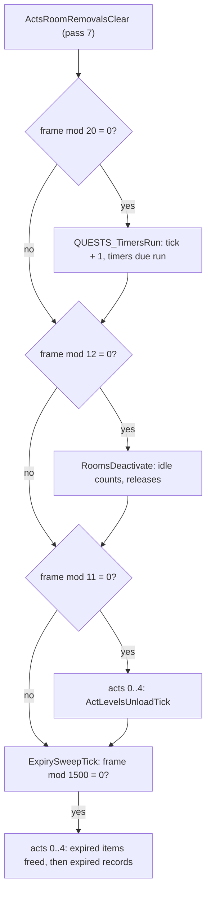
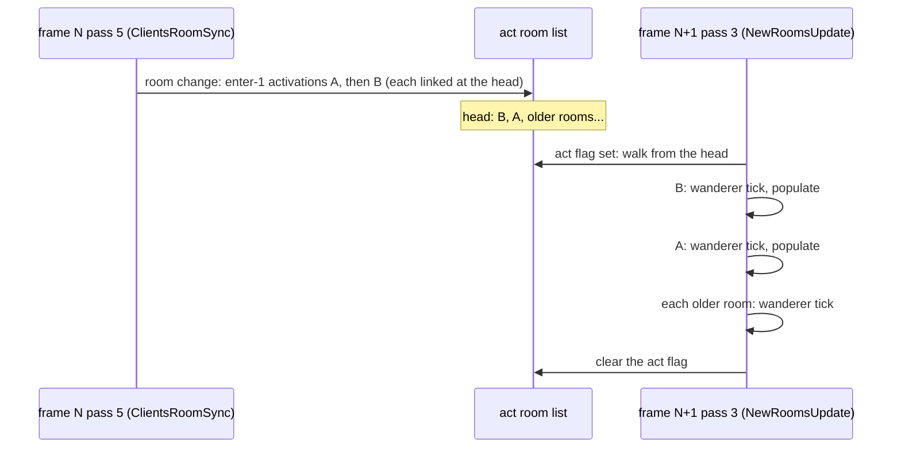

# 0003 — The server frame, part 3: the timers, the room passes and the activation order

> **Subsystem:** sim/frame
> **Question:** what do `GameTick`'s last four calls (`QUESTS_TimersRun` every 20 frames, `RoomsDeactivate` every
> 12, the level-unload tick every 11, `0x0052D310` every frame with its 1 500-frame sweep) and its two room passes
> (`NewRoomsUpdate`, `ClientsRoomSync`) do, in which order do they visit their lists, and which of them draw on which
> seed? In which order are an act's rooms (`ActRoomsHead`) walked and a frame's new rooms populated, and what would a
> log-free build take as the activation-order record? Added at the P1.2 review: what do player kind 11's two callees
> (`0x005406A0`, `0x00575630`) and kind 6's `Unit+0xA4` record do, and do they draw? And: the window log design closed
> and its volume re-estimated with the queue line.
> **Date:** 2026-10-30   **Plan:** 0055 (Phase 1, batch P1.3)   **Status:** open (closes Phase 1; reviewed 2026-10-30, the P1 review: accepted with fixes)

Static reading of the pinned `Game.exe` in Ghidra (project copy `workspace/ghidra-r55c`, symbols replayed from
`re/symbols.csv` at lane start) and objdump, plus five emulated families (run:2026-10-30-frame-emu-3,
[experiments](experiments.md#run2026-10-30-frame-emu-3)). It builds on [frame/0001](0001-tick-and-messages.md) (P1.1:
`GameTick`'s order, the drain, the empty-game close in the flush) and [frame/0002](0002-unit-events-queue.md) (P1.2:
the unit-event pass and the queue), and on the readings of these passes already filed by drlg/0009 (§§ 1–4, 11),
monsters/0002 § 1 and quests/0001 § 5, which this finding cites and does not repeat. Tools: the RNG reach from
`re/ghidra_scripts/RngCallGraph.java` (`33801ca2…`), the byte-level scans from `tools/xrefscan.py` (`4db25be3…`), the
timer registrations and the emulation models from `tools/frame_timers.py` (`1dd75a73…`, new), the volume from
`tools/frame_volume.py` (`9c540028…`, `estimate13` new; its `estimate` still prints P1.1's output byte for byte). Every
kept static output is under `workspace/logs/r55c/static/` (`manifest.sha256` `abfc7c4d…`, 80 lines, one path base:
that directory; `commands.txt` gives the command of each file). Names below are `re/symbols.csv` names.

## Answer (summary)

- [I] **The four periodic calls, in frame order after `ActsRoomRemovalsClear`.** `QUESTS_TimersRun` (`frame % 20 =
  0`), `RoomsDeactivate` (`% 12`), the level-unload tick of acts 0..4 (`% 11`), then `sub_0052D310_ExpirySweepTick`
  every frame, which does its work only when `frame % 1500 = 0` (signed `idiv`, 0x0052D316–0x0052D320). None draws of
  its own: with the specified phases' entries as stops, their RNG call graphs hold no RNG function (548, 587, 572 and
  587 functions). Their routes to a draw are a quest timer's callback (§ 2), the save and free of a released room's
  units (`InactiveUnitSaveTest`, `ActiveRoomFree`: drlg/lifecycle), a level the unload test builds (`DRLG_LevelCreate`,
  on that level's own seed) and the free of an expired item (`UnitFree`). (§ 1; fn:sub_0052D870_GameTick@0x0052D870,
  0x0052D920, 0x0052D938, 0x0052D95F, 0x0052D96C)
- [C] **Five emulated maps** (1 300 cases, 0 mismatches, no traced access outside the declared image; at each observed
  boundary the boundary, its arguments and its call site asserted): `QUESTS_TimersRun`'s walk (head first, the
  unsigned `due < tick`, the unlink of a timer whose callback returns 1, the re-arm `due = tick + period`, the wrap of
  every `due` at tick `0xFFFFFFFF`), `RoomsDeactivate`'s idle count up to the first room whose count passes 10 (acts 0..4,
  each act's list from its head; the case ends at `RoomReleaseAllowed`), the 1 500-frame sweep (the period, acts 0..4, an act's expired items
  `expiry ≤ frame` before its inactive records `expiry < frame`), the kind-6 handlers of players and monsters (the
  unsigned `frame ≤ Game+0xA8` test, the free or the re-queue at the record's frame) and `NewRoomsUpdate`'s act walk
  (acts 0..4 whose `+0x54` is set, the room list from its head, the flag cleared after the walk). Each half has a
  wrong reading that fails every case it separates (counts in § 8). (run:2026-10-30-frame-emu-3)
- [I] **The quest timers run newest-registered first.** `QUESTS_TimerAdd` pushes a timer on the **front** of the
  control's list (0x00543F6D, 0x00543F83) and `QUESTS_TimersRun` walks it from the head, so in one pass the timers run
  in reverse registration order. 26 registration sites name 21 callbacks (`timer-adds.txt`): 13 reach no RNG
  function, 2 reach one only through a specified entry (`SUnitCreate` and the others of frame/0001's list), and 6 draw
  through quest content: monster spawns (the A5Q3 thaw, Izual's ghost, Diablo, the A3Q3 guardians), the Tristram
  portal's level-point pick and the Dark Wanderer's quest-seed step. (§ 2; fn:QUESTS_TimerAdd@0x00543F10,
  fn:QUESTS_TimersRun@0x00543E10)
- [I] **An act's room list is newest first.** `DUNGEON_RoomCreate`, whose one caller is `DRLG_RoomActivate`
  (0x00642369), links the new active room at the **head** of the act's list (`room+0x7C = act+0x10; act+0x10 = room`,
  0x0061991F–0x00619922) and sets the act's new-rooms flag `+0x54` (0x00619925); `ActiveRoomFree` unlinks a room in
  place (0x0061A93E–0x0061A975). So every pass that walks `ActRoomsHead` (`NewRoomsUpdate`, `RoomsDeactivate`, the
  expiry sweep, `ActUnitsFrameReset`, `ActsRoomRemovalsClear` and three other server functions) visits an act's rooms
  from the most recently activated to the oldest. (§ 4; fn:DUNGEON_RoomCreate@0x00619890,
  fn:sub_0061A910_ActiveRoomFree@0x0061A910, fn:sub_0061A180_ActRoomsHead@0x0061A180)
- [I] **A frame's new rooms are populated in reverse activation order, acts 0..4.** Rooms activated in frame N's
  `ClientsRoomSync` (pass 5) are walked by frame N+1's `NewRoomsUpdate` (pass 3) from the act's head: the newest first,
  each populated (presets, inactive restore, objects, population) as the walk reaches it; then the act's older rooms,
  each given only the wanderer tick (one draw on its own room seed). The act's flag is cleared **after** the walk
  (0x0052D21D), so a room activated during the walk itself (`NearWarpTest`'s level-point lookup can activate one,
  drlg/0005 § 9) is linked ahead of the walk's position and loses the flag that would bring a next walk: it waits,
  unpopulated, for the next frame in which another room of its act is created. That is a room of the act being
  walked; one created in a later act is walked in the same pass, one in an earlier act in the next frame (P1 review).
  (§ 4; fn:sub_0052D160_NewRoomsUpdate@0x0052D160,
  0x0052D1B0, 0x0052D21D)
- [I] **The activation-order record.** A log-free build needs, per frame: for each client in the game's client list
  (newest client first, `ClientCreate`'s front push 0x00539B42–0x00539B53) whose player's room at pass 5 differs from
  its client's current room, the new room; and every on-demand activation (`RoomActivateB`: warp destination,
  waypoint, level point, preset build) with its frame and the pass it runs in. From these, the DRLG near lists and the
  reference rules (drlg/0009 § 2) give which rooms are created and in which order, hence each act's list order, each
  frame's population order, the idle counts and so the releases. The player's room is the result of its movement in
  pass 4, so the record cannot be derived from the client messages alone without the movement simulation (path and
  collision): it is an input of the chain (as chain/README's activation row states) or the output of a movement model.
  (§ 5; fn:sub_005380D0_ClientRoomSync@0x005380D0, fn:sub_00537B50_ClientRoomChange@0x00537B50)
- [I] **`ClientsRoomSync` draws nothing of its own.** Per client in state 3, 4 or 5 it runs `ClientRoomSync` (the room
  removal packets, the room change with its level-change quest event and its reference walk, the player marked
  updated), and every 8 192 frames (`frame & 0x80001FFF = 0`, 0x0052D45C) saves the clients unless `AutosaveTick` set
  its flag. With the specified entries, `LevelInit` (level builds on the level's seed), `AutosaveTick` and
  `UninterruptibleEnd` as stops its graph holds no RNG function (1 180 functions); the reference callbacks
  (`g_DrlgRefEnterFns`, `g_DrlgRefLeaveFns`, called indirectly) reach one, `DRLG_PresetUnitDropRolls`, through enter
  3's DS1 load (drlg/preset, on the level seed). *(P1 review:)* "nothing of its own" holds with the two saves
  stopped: the frame-8 192 save (`SaveGameClients`, 0x0052D4BD, when `AutosaveTick` leaves the flag 0, as it does
  when it returns at its `0x00730FFC` test, 0x0052D353; the caller sets the flag 0 first, 0x0052D461) and `AutosaveTick` reach 28 RNG functions through item paths,
  not read for their seed here; the frame model treats a frame `≡ 0 (mod 8 192)` as a boundary (§ 3).
  (§ 3; fn:sub_0052D440_ClientsRoomSync@0x0052D440, data:g_DrlgRefEnterFns@0x00744384, 0x0052D4AE–0x0052D4BD)
- [I] **Player kind 11 draws nothing on a live party's or pet's data.** Every 30 frames for each player (the first
  run 250 frames after its placement, `0x00534AD0`) it runs `sub_005406A0_PlrPartyStatusSend` (to the player's own client,
  packet 0x7F about each other party member, and 0x90 for one beyond 50 subtiles) and
  `sub_00575630_PlrPetsStatusSend`, which first prunes the
  player's pet lists of every pet whose unit is missing or dead (`PetRemove(guid, 0)`, mercenaries excepted) and then
  sends packet 0x7F for each pet of a PetType row with `partysend`. With the release path that only a non-zero
  `PetRemove` argument reaches (`0x00574450`, the pet's kill or mode change) and `UninterruptibleEnd` (kind 2 of a
  monster only) as stops, kind 11's graph holds no RNG function (601 functions; its one indirect call in game code, the
  per-player callback `0x00574410`, rooted separately: 553 functions, none). So kind 11 can be modelled as draw-free,
  not as a boundary oracle; what it sends is out of the frame model. (§ 6; fn:sub_00580BE0_PlrEvent11Every30@0x00580BE0,
  0x005755FB, 0x00575132, 0x005748CC)
- [I] **Kind 6's `Unit+0xA4` is the unit's overhead chat record** (`.\Chat\Chat.cpp`): created by packet 0x14's
  handler (a client's overhead message), by `OBJOP_Shrine`, by `0x005DE330` (a number) and by the object kind-6
  handler, with a lifetime of `8·n + 125` frames for an `n`-character text (`n ≤ 254`) stored at `+0x04` as the frame
  it ends. Kind 6 frees it when that frame has come and marks the unit updated, else queues itself again at that frame.
  It draws nothing (565 functions with `UninterruptibleEnd` stopped, unreachable for kind 6). (§ 7;
  fn:sub_00661110_ChatRecordNew@0x00661110, fn:sub_00580B70_PlrEvent6Expire@0x00580B70)
- [I] **The window log design, closed** (§ 9): `TM` at the three timer call sites and `TQ` at each quest timer run;
  `RU0`/`RU1` per room of `NewRoomsUpdate`'s walk and of `RoomUpdateOne`; `RC` at each room created, `RR` at each
  release; the queue line at `EventQueueAt`'s entry and `EventQueueEveryFrame`'s (when not forwarded from
  `EventQueueAt`), which covers `UnitTeleport`'s timed queue that frame/0002 § 8's `UnitQueueEvent` site misses.
  (fn:sub_005416B0_EventQueueAt@0x005416B0, 0x0052D1C4, 0x0061995E)
- **The re-estimate for the P1 review** (`tools/frame_volume.py estimate13`, at the stated mid queue rates): 15.9–50.9
  lines per frame (town, outdoor pack, maze boss), 3 965–12 723 per 250-frame window, 39 653–127 231 for ten windows;
  a three-window session 11 896–38 169 lines, 0.67–2.15 plan-0045 sessions. That is 27–40 % above P1.1's 12.5–36.3, the
  queue line most of the rise. 0055 Q2's volume trigger (a session above 177 860 lines) is not met at the high rates
  either (42 902). Breakpoint stops: 32.9–67.9 per frame, 820–1 700 per game second. (§ 9)
- [I] **The frame's shared seeds** (P1 review, from frame/0001 § 4, frame/0002 § 5 and §§ 1–7 here): a seed that two
  units' or two rooms' draws in one frame can both step, so that their order decides the values. (1) The **game seed**:
  every unit creation (population and the inactive restore in pass 3, two draws per restored item; the unit events;
  the quest timers' spawns; the drain's handlers). (2) **Each level's seed**: the DS1 preset rolls of the rooms its
  activations load (pass 5, and on-demand activations), the level-point lookups inside a population (pass 3) and the
  Tristram portal timer; a level build itself does not depend on build order. (3) The **object-region seed**, carried
  across rooms, operates and timer events (chain/0001 § 3.2, `[C]` there). (4) The **quest seed** (A3Q7's step). A
  room's own seed (the activation re-seed, its tiles, its wanderer tick on every walk of its act) is stepped by that
  room alone. The saves at frames `≡ 0 (mod 8 192)` are not read for their seed (§ 3). (fn:sub_00555230_SUnitCreate@0x00555230,
  fn:DRLG_PresetUnitDropRolls@0x00667620, fn:sub_0054DB50_NearWarpTest@0x0054DB50, fn:OBJRGN_Create@0x00546C60,
  fn:QUESTS_GetSeed@0x005438B0, fn:sub_0054F060_RoomWandererTick@0x0054F060)

## Leads used

- None. No community source was opened for this batch; every claim is read from the binary or cited from an earlier
  finding.

## Functions

| Address | Name | Role | Tag |
|---|---|---|---|
| `0x0052D310` | `sub_0052D310_ExpirySweepTick` | every frame: when `frame % 1500 = 0`, for acts 0..4 the item free and the record expiry (§ 1.4) | I |
| `0x00534AD0` | `sub_00534AD0_PlrPlaceEventsInit` | a placed player's mode command, kind 3 at frame + 1 and kind 11 at frame + 250 | I |
| `0x0053CDF0` | `sub_0053CDF0_ClientSendPartyUnit` | packet 0x7F (life, guid, level) to a client and, for a player farther than 50, 0x90 (position) | I |
| `0x00542AC0` | `sub_00542AC0_ActInactiveItemRecsExpire` | an act's inactive-record lists (`Game+0xD8 + 4a`): free item records with `0 < expiry < frame` | I |
| `0x005406A0` | `sub_005406A0_PlrPartyStatusSend` | player kind 11, first call: the party's other members get 0x7F/0x90 | I |
| `0x0054A290` | `sub_0054A290_SrvPkt14OverheadChat` | packet 0x14: the unit's chat record replaced, kind 6 at `max(frame + 1, end)` | I |
| `0x005531C0` | `sub_005531C0_PlayerGetClient` | a player's client (player data `+0x9C`); 0 for a non-player | I |
| `0x005538D0` | `sub_005538D0_GamePlayersForEach` | each player of the game's 128 hash buckets without state 7: `EDX(arg)` | I |
| `0x00554630` | `sub_00554630_UnitPartyId` | a player's party id, −1 if none | I |
| `0x00558B90` | `sub_00558B90_ActExpiredItemsFree` | act `a`'s rooms: an item unit with `0 ≠ expiry ≤ frame` unlinked and freed | I |
| `0x00574410` | `sub_00574410_PetRemovedSendCb` | per-player callback of a pet removal (a packet) | I |
| `0x00574450` | `sub_00574450_PetUnitRelease` | a removed pet's unit: kill (MonStats flag) or mode command | I |
| `0x00574850` | `sub_00574850_PetListUnlink` | unlink one pet from a type's list, broadcast, then release (argument ≠ 0) or clear `+0xC4` bit 31 | I |
| `0x00575590` | `sub_00575590_PetListPrune` | every pet type but 7: `PetRemove(guid, 0)` for a pet missing or dead | I |
| `0x00575630` | `sub_00575630_PlrPetsStatusSend` | player kind 11, second call: prune, then 0x7F per `partysend` pet | I |
| `0x005DE330` | `sub_005DE330_UnitOverheadNumber` | a number as the unit's chat record, kind 6 at its end | I |
| `0x0061AA20` | `sub_0061AA20_ActLevelsUnloadTickWrap` | `GameTick`'s per-act call: `ActLevelsUnloadTick` | I |
| `0x00661110` | `sub_00661110_ChatRecordNew` | a chat record: lifetime `8n + 125`, end frame, language, text | I |
| `0x006611A0` | `sub_006611A0_ChatRecordFree` | free a chat record | I |
| `0x006611D0` | `sub_006611D0_ChatRecordEnd` | the record's end frame `+0x04` | I |
| `0x00543E10` / `0x00543F10` | `QUESTS_TimersRun` / `QUESTS_TimerAdd` | (existing) § 2 | C |
| `0x0052D240` | `sub_0052D240_RoomsDeactivate` | (existing) § 1.2 | C |
| `0x00643200` | `sub_00643200_ActLevelsUnloadTick` | (existing) § 1.3 | I |
| `0x0052D160` / `0x0052D0F0` | `sub_0052D160_NewRoomsUpdate` / `sub_0052D0F0_RoomUpdateOne` | (existing) § 4 | C |
| `0x0052D440` / `0x005380D0` | `sub_0052D440_ClientsRoomSync` / `sub_005380D0_ClientRoomSync` | (existing) § 3 | I |
| `0x00619890` | `DUNGEON_RoomCreate` | (existing) § 4 | C |
| `0x00580B70` / `0x005A7F00` / `0x00580BE0` | `…PlrEvent6Expire` / `…MonEvent6Expire` / `…PlrEvent11Every30` | (existing) §§ 6–7 | I |

## Walkthrough

### 1. The periodic calls

`GameTick` makes them after `ActsRoomRemovalsClear`, in this order (frame/0001 § 2, 0x0052D912–0x0052D96C): the timer
pass, the deactivation, the unload tick per act, the sweep tick. The remainders are signed (`idiv`) on the frame
already incremented at the tick's start.



#### 1.1 `QUESTS_TimersRun` — § 2.

#### 1.2 `RoomsDeactivate`

- [I] As drlg/0009 § 4 reads it: per act slot 0..4 (`Game+0xBC`), per room from `ActRoomsHead` with the next pointer
  read **before** the room's tests (0x0052D272), `RoomIdleCount` (`+0x0C = 0` while `+0x78` ≠ 0, else `+0x0C + 1`,
  0x0061A7B9–0x0061A7D1), and a count above 10 (signed `jle`, 0x0052D27B) with `RoomReleaseAllowed` saves each unit
  of the room (`InactiveUnitSaveTest`, the next unit read first, 0x0052D2A0–0x0052D2A9) and frees the room
  (`ActiveRoomFree`, 0x0052D2BB). (fn:sub_0052D240_RoomsDeactivate@0x0052D240, fn:sub_0061A790_RoomIdleCount@0x0061A790)
- [C] Emulated (`deact`, run:2026-10-30-frame-emu-3): the idle count of every room walked, the act order and the
  first room whose count passes 10 (ending at `RoomReleaseAllowed`, with its act and room arguments and its call
  0x0052D284). Not covered: the release test, the saves and the free (after the boundary), and the "next read before
  the tests" order, which no case can separate (no case frees a room). (fn:sub_0052D240_RoomsDeactivate@0x0052D240)
- [I] **Draws**: with the specified entries as stops (`InactiveUnitSaveTest`, `UnitFree`, …; `cg-0x0052D240-spec.txt`)
  587 functions and no RNG function; without them 119 (`cg-0x0052D240.txt`). The release's draws are drlg/lifecycle's
  (the unit saves) on the seeds that spec names.

#### 1.3 The level-unload tick

- [I] Per act (`0x0061AA20` → `ActLevelsUnloadTick`), each level of the act's list (`act+0x47C`, next `+0x1AC`) with
  no reference (`+0x0C` = 0) and built rooms (`+0x10` ≠ 0) counts down `+0x1D4`; at 0, `LevelUnloadCheck` either
  allows the unload (`LevelUnload(…, 1)`) or the countdown is re-armed to 10 (drlg/0009 § 4).
  (fn:sub_00643200_ActLevelsUnloadTick@0x00643200)
- [I] **New here:** `LevelUnloadCheck` returns 0 while any of the level's DRLG rooms has status below 4 or the built
  bit `0x100000`; otherwise, for each of the eight vis levels of the level (`LevelVisIds`), it finds that level in the
  act's list and, **when it is not there, builds it** (`DRLG_LevelCreate`), then refuses the unload if a vis room of
  that level linked to this one (its `+0x28` bit `0x10 << k` for the vis slot `k` that names this level) is still in
  use, and otherwise frees those rooms' link records. So an unload test can create a neighbouring level's record (its
  level seed and, for a preset level, its preset roll on that seed). Its graph reaches 2 RNG functions, both inside
  `DRLG_LevelCreate` (`RNG_SeedInit` at 0x00642B62, `PresetLevelCreate`'s `RangeB`); with it stopped, none (572
  functions). The level seed does not depend on the order in which levels are built (chain/0001 § 3.2, run:2026-10-11-seed-tree),
  so this creation is invisible to every other seed. (fn:sub_00643060_LevelUnloadCheck@0x00643060, fn:DRLG_LevelCreate@0x00642AE0,
  0x006430E9)

#### 1.4 The expiry sweep tick

- [I] `sub_0052D310_ExpirySweepTick` (EDI game) returns at once unless `frame % 1500 = 0`; then for act index 0..4 it
  calls `ActExpiredItemsFree(game, a)` and `ActInactiveItemRecsExpire(game, a)` in that order (0x0052D322–0x0052D33D;
  drlg/0009's correction of § 11). `ActExpiredItemsFree` walks act `a`'s rooms from the head and each room's unit list
  (`+0x74`, next `+0xE8` read first): an item (type 4) whose item data `+0x24` is non-zero and **`≤ frame`** (signed,
  0x00558BE7) is taken out of its room (`RoomUnitOp`, `UNIT_CollUnmarkRect`, `UnitRoomUnlink`), loses `+0xC4` bit 1, is
  sent to every player (`GamePlayersForEach` with `0x00557FA0`) and freed (`UnitFree`). `ActInactiveItemRecsExpire`
  frees each inactive item record whose expiry is non-zero and **`< frame`** (signed, 0x00542AF0–0x00542AFF).
  (fn:sub_00558B90_ActExpiredItemsFree@0x00558B90, fn:sub_00542AC0_ActInactiveItemRecsExpire@0x00542AC0)
- [C] Emulated (`sweep`): the period, the act order, items before records within an act, the two comparisons (`≤` for
  units, `<` for records) up to the first unit reached (`UnitGetRoom`, call 0x00558BED) or the first record freed (the
  unlink written, then the free at 0x00542B1B). (run:2026-10-30-frame-emu-3)
- [I] **Draws**: through `UnitFree` only (587 functions and none with the specified stops; the callback `0x00557FA0`
  rooted separately: 589 functions, none). The sweep is the one pass that removes units by a frame test alone, so its
  frames (multiples of 1 500, 60 s of game time) are where a window can see an item disappear without an event.

### 2. The quest timers

```c
// fn:QUESTS_TimerAdd@0x00543F10 (ECX quest, EDX callback, [esp+4] period): fatal while the list runs (+0x04)
t = alloc(0x14); t->next = ctl->head; t->fn = cb; t->quest = quest;     // 0x00543F6D, 0x00543F70, 0x00543F75
t->due = ctl->tick + period; t->period = period; ctl->head = t;         // 0x00543F78–0x00543F83: a front push
// fn:QUESTS_TimersRun@0x00543E10 (ECX game)
if (++ctl->tick == 0xFFFFFFFF) for (t in list) t->due = -1 - t->due;     // 0x00543E2D–0x00543E4E
ctl->running = 1;
for (prev = 0, t = ctl->head; t; t = next) {
    next = t->next;                                                     // read before the callback, 0x00543E68
    if (t->due < ctl->tick) {                                           // unsigned (jae), 0x00543E65–0x00543E6E
        if (IsBadCodePtr(t->fn)) fatal;
        if (t->fn(game /*ECX*/, t->quest /*EDX*/) == 1) {               // AL, 0x00543E85–0x00543E87
            unlink t (prev ? prev->next : ctl->head) = next; free(t); continue;   // prev unchanged
        }
        t->due = t->period + ctl->tick;                                 // 0x00543ECB–0x00543ED1
    }
    prev = t;
}
ctl->running = 0;
```

- [I] The reading above (0x00543E10–0x00543EE6, 0x00543F10–0x00543F8C). quests/0001 § 5 has the registration, the
  20-frame boundary, the first run `p + 1` boundaries later and the period `20·(p + 1)` frames `[I]`/`[C]` in part;
  new here: the front push (timers run **newest registered first** within a pass), the callback's registers, the
  unsigned compare and the walk's next read before the callback. (fn:QUESTS_TimersRun@0x00543E10)
- [C] Emulated (`timers`, run:2026-10-30-frame-emu-3): the walk order, the unsigned strict compare, the re-arm from
  the tick, the unlink at a callback's 1 (ending at the free with the freed timer in `EDX` and the call site of the
  head or the inner unlink), the wrap. The callbacks are game functions that return a constant `AL`, and the
  `IsBadCodePtr` import slot is given a game function returning 0 (a stated stand-in for the OS call, the input
  declared in the memory spec). Not covered: `QUESTS_TimerAdd` (it allocates), what any real callback does, the free.
  The front push stays `[I]`: it is read, not emulated. (run:2026-10-30-frame-emu-3)
- [I] **The registrations and their reach** (`timer-adds.txt`, 26 sites; `cg-timer-summary.txt`, each callback's
  graph alone and with frame/0001's specified stops plus `UninterruptibleEnd`; fn:QUESTS_TimerAdd@0x00543F10):

  | Callbacks | Reach |
  |---|---|
  | A1Q1 `DoneTimer` (8), A1Q2 `DoneTimer` (15), A1Q4 `GibbetTimer` (register), A1Q5 `DeathTimer` (7), A1Q6 `DeathTimer` (1) and `OfferTimer` (20), A2Q1 (12), A2Q3 (10), A2Q5 (3), A2Q6 (8), the A2Q3 eclipse (`RandLoHi(15, 17)` at registration), A3Q6 `DeathTimer` (12), `0x0058B770` (A5Q4, 8; no Ghidra function, its call `0x00544300` and callback `0x0058AEA0` rooted) | no RNG function (550–589 functions) |
  | `0x0058BD50` (A5Q5, 2), A2Q6 `LairPortalTimer` (1, or the staff's `(Range − 75)/20`) | none with the specified stops (559, 569); 118 without (unit creation) |
  | A5Q3 `ThawTimer` (1), A4Q1 `GhostTimer` (3), A4Q2 `Timer` (1; four sites), A3Q3 `GuardianTimer` (7) | monster spawns (`SpawnAtPos` → `MonSpawnTry`, `SpecialMonSpawn`: monsters/spawn and special) and, for A4Q2, the game-end path (`0x00530590`) |
  | A1Q4 `TristramPortalTimer` (1) | `PortalObjectCreate` → `LevelPointFind` (the level-seed step, drlg/0005 § 9) |
  | A3Q7 `AfterglowTimer` (2; the Dark Wanderer) | one LCG step of its own on the quest seed (`QUESTS_GetSeed`, 0x005BD3DD–0x005BD3E6), then `SUnitCreate` |

  So the timer pass draws on the game seed (unit creation), the quest seed and level seeds, only through quest
  content, at frames `≡ 0 (mod 20)`; the frame model takes each run callback's draws from the quest spec or as a
  boundary oracle (ADR-0004). (fn:QUESTS_TimerAdd@0x00543F10, fn:QUESTS_GetSeed@0x005438B0)

### 3. `ClientsRoomSync` and `ClientRoomSync`

- [I] `ClientsRoomSync` (EBX game): `autosave = (frame & 0x80001FFF) = 0` (a signed `frame % 8192 = 0`,
  0x0052D453–0x0052D472); a fatal test (`0x0053FCA0`); `AutosaveTick(game, &flag)`; when `autosave` and the flag is 0,
  `SaveGameClients` (0x0052D4A1–0x0052D4BD). Then each client from `Game+0x88` (next `+0x4A8` read before the client's
  work, 0x0052D4D7): state 3 (joining): `ClientRoomSync`, and if the client's room is set and it has a player, the
  act start (`[JOIN 6]` log, packets, the host callback at 0x0052D635); state 4: `ClientRoomSync`; state 5:
  `ClientRoomSync` and, with a room, the act packets. (fn:sub_0052D440_ClientsRoomSync@0x0052D440,
  fn:sub_0052D350_AutosaveTick@0x0052D350)
- [I] **The client order** is the list order: `ClientCreate` pushes a client on the front (0x00539B42–0x00539B53), so
  the newest client is synced first. One client in single player. (fn:sub_00539A30_ClientCreate@0x00539A30)
- [I] `ClientRoomSync(game, client)`: with a player: its room `R` (`UnitGetRoom`); the removal packets
  (`ClientSendRoomRemovals`, frame/0001 § 3.4) and two client updates (`0x0053A620`, `0x006258D0` with `0x00548520`);
  under unit `+0xC8` bit 21 two calls (`0x0055DF00(1, 1)`, `0x0055F4F0(1)`, not read); `client+0x1B0 += 1`; **if `R` differs from the client's room
  `+0x1B4`**: on a level change `QUESTS_RaiseLevelChange` and `TownLevelLeave`, then `ClientRoomChange(R)` (the
  reference walk, drlg/0009 § 2); then `0x0053FC20` and, if the player still has a room, `UnitMarkUpdated(player)`.
  (fn:sub_005380D0_ClientRoomSync@0x005380D0, fn:sub_00537B50_ClientRoomChange@0x00537B50)
- [I] **Draws** (`cg-0x0052D440*.txt`): 2 480 functions and 118 RNG functions alone; with frame/0001's stops and the
  room, population and level entries 2 025 and 75 (routes: the reference walk's `LevelInit` builds through
  `RoomNeighboursEnsure` and `WarpPairLink`, 47; the autosave's item paths, 28); adding `LevelInit`, `AutosaveTick`
  and `UninterruptibleEnd` as stops, 1 180 functions and none. Of its 71 indirect calls, 16 are in game code: the
  enter and leave tables (rooted: `cg-drlgref*.txt`, 923 functions and 56 RNG alone, 625 and 1 with the stops, that
  one `DRLG_PresetUnitDropRolls` through enter 3's `RoomPrepareFiles` → DS1 load), the callback `0x00548520` (rooted:
  554 functions, none), the save and host callbacks, the player and unit walks' callbacks and the stat-list
  callbacks, not followed. So the room sync's draws are the room activations' (drlg/room-tiles: the re-seed and the
  tile draws on the room's own seed), the level builds' (on each level's seed) and the preset rolls (drlg/preset), all
  on per-level and per-room seeds, never the game seed, by direct reach **with the saves stopped**. *(P1 review:)* the
  save half is open: `AutosaveTick` (every frame) and `SaveGameClients` (a frame `≡ 0 (mod 8 192)` with the flag 0,
  0x0052D4AE–0x0052D4BD) carry the "autosave's item paths, 28" above, whose seed is not read; in single player
  `AutosaveTick` does not save (save/0001 row 2, run:2026-10-27-sweep-d2s-play), but whether the frame-8 192
  `SaveGameClients` runs there is not read. A window that holds such a frame logs it as a boundary (Phase 2b).
  (fn:sub_0061B390_DrlgRefAddNear@0x0061B390,
  fn:DRLG_PresetUnitDropRolls@0x00667620, fn:sub_006424A0_LevelInit@0x006424A0)

### 4. The act room list and the new-room walk

- [I] **Insertion and removal.** `DUNGEON_RoomCreate(act, …)` zeroes a 0x80-byte room, seeds `+0x6C` from its
  argument, links it at the head (`+0x7C` = the old head, `act+0x10` = room, 0x0061991F–0x00619922), sets `act+0x54 = 1`
  (0x00619925) and then builds its near list and collision map. Its one call is in `DRLG_RoomActivate` (0x00642369,
  `xrefscan`: 1 site). `ActiveRoomFree(act, room)` finds the room from the head and links its predecessor (or the
  head) to its next (0x0061A93E–0x0061A975); its two calls are `RoomsDeactivate` (0x0052D2BB) and `RoomTilesRelease`
  (0x0066F1CA, the client's leave-3 path). So the list holds the act's active rooms, most recently created first,
  relative order otherwise kept. (fn:DUNGEON_RoomCreate@0x00619890, fn:sub_0061A910_ActiveRoomFree@0x0061A910)
- [I] *(P1 review:)* after the near list (0x00619931–0x00619946) `DUNGEON_RoomCreate` calls the act's `+0x4C` with
  the new room in `ECX` when it is non-zero (0x0061994B–0x00619954), before its return. Its writer is not read
  (open question 7); the frame model assumes it is 0 on the server. (fn:DUNGEON_RoomCreate@0x00619890, 0x00619954)
- [I] **Its walkers** (`ActRoomsHead`, 11 call sites by the raw scan, 10 in Ghidra functions): `NewRoomsUpdate`,
  `RoomsDeactivate`, `ActsRoomRemovalsClear`, `ActUnitsFrameReset`, `ActExpiredItemsFree`, `0x005545C0`,
  `0x00573C00`, `A4Q2_DiabloSummon` on the server; `0x0044C750` and `0x0046B0D0` on the client; and a site at
  0x0053B0BF in code that Ghidra gives no function (not read). (`xrefs-rooms.txt`,
  fn:sub_0061A180_ActRoomsHead@0x0061A180)
- [I] **`NewRoomsUpdate`** (monsters/0002 § 1, drlg/0009 § 3): acts 0..4 (`Game+0xBC`), each with `+0x54` ≠ 0
  (0x0052D1A9): from the head (0x0052D1B0) to the end (next `+0x7C`, 0x0052D211), the wanderer tick on **every**
  room (0x0052D1C4), then a room with bit 0 of `+0x34` clear is populated and gets bits 0 and 1; one with bit 0 set and
  bit 1 clear is restored. After the walk, `+0x54 = 0` (0x0052D21D). (fn:sub_0052D160_NewRoomsUpdate@0x0052D160)
- [C] Emulated (`nru`): which act is walked first, the head room reached first (ending at `RoomWandererTick` with the
  game and the room, from its call 0x0052D1C4) and the flag cleared on an act with no room. The walk past the first
  room and the population calls are after the boundary. (run:2026-10-30-frame-emu-3)
- [I] **So, in one frame's walk**, an act's rooms created since its last walk come first, newest first, then its
  older rooms. Rooms created in frame N (`ClientsRoomSync` is pass 5, after `NewRoomsUpdate`) are populated in frame
  N+1, in reverse creation order, act 0 first; each older room's wanderer tick steps its own seed again on every walk
  of its act (monsters/0002 § 1's "an already populated room's seed keeps moving"), that is once per frame in which
  any room of the act was created. `RoomUpdateOne`'s three callers populate one room at once, outside this order
  (drlg/0009 § 1). (fn:sub_0052D160_NewRoomsUpdate@0x0052D160, fn:sub_0052D0F0_RoomUpdateOne@0x0052D0F0)
- [I] **A room created during the walk.** The walk reads the act's head once (0x0052D1B0); a room created while it
  runs (an activation inside a population, such as `NearWarpTest` → `LevelPointFind` → `RoomActivateB`, drlg/0005
  § 9, 17 times in run:2026-10-14-collision) is linked before the walk's position, so it is not visited, and the flag
  its creation set is cleared at the walk's end. It is populated at the next walk of its act, which needs another room
  of that act to be created (or `RoomUpdateOne`). Not checked against a log: no kept log stamps both the activation
  and the population with a frame (open question 2). *(P1 review:)* this holds for a room of the act being walked.
  A room created in a later act (index above the current one) is linked before that act's head is read
  (0x0052D1B0) and its flag is read at 0x0052D1A9, so it is populated in the same pass. A room created in an earlier
  act, whose walk is over, keeps its flag and is populated in the next frame's walk. (0x0052D1B0, 0x0052D21D,
  fn:sub_0061B730_RoomActivateB@0x0061B730)



### 5. The activation-order record

- [I] **Within one room change** the rooms are created in the order of the reference walk's enter-1 calls:
  `DrlgRefAdd(new, 0)` first walks the new room's near list (which holds the room itself) in list order, each near
  room recursing to distance 3 before its own enter test (drlg/0009 § 2), and a room is activated at its first enter-1
  test that passes (status and the counts below it zero) while it has no active room. So the creation order is the
  new room's near-list order restricted to the rooms not yet active, with enter 2's tail call (a status-3 room whose
  files become ready) as the one other route. (fn:sub_0061B490_DrlgRefAdd@0x0061B490,
  fn:sub_0061B2D0_DrlgEnter1Activate@0x0061B2D0)
- [I] **Across one frame**: clients in list order (§ 3), each client's room change, then the on-demand activations at
  their own passes (warps and waypoints in the drain or the unit events; level points inside a population).
  (fn:sub_0052D440_ClientsRoomSync@0x0052D440, fn:sub_0061B730_RoomActivateB@0x0061B730)
- [I] **What a log-free build takes as input**, per frame: (a) for each client whose player's room at pass 5 is not
  its client room, the new DRLG room (the frame and the client's position in the list); (b) every `RoomActivateB` call
  (frame, pass, room) and every `RoomUpdateOne` call; (c) the room pins (`0x400000`, set and cleared by portal objects,
  drlg/0009 § 4), which hold a release back. From (a)–(c) the near lists (fixed by the level build) and §§ 1.2, 4 give
  the creations, each act's list order, each frame's population order, the idle counts and the releases. The record
  is not derivable from the client messages alone: the room a player stands in at pass 5 is the end of its movement in
  pass 4 (the path and collision of plan 0050's movement work), so without a movement model it is a logged input, as
  the chain spec's activation row (18 459 `AROOM` activations, run:2026-10-21-chain2) already takes it. With a
  movement model, (a) follows from the player's position each frame; (b) still needs the warp and waypoint requests
  (client messages) and the population's level-point lookups, which are modelled (drlg/0005 § 9). This answers the
  chain spec's activation-order `[L]` with a stated limit: the order is derivable from (a)–(c), and (a) needs movement.
  (fn:sub_005380D0_ClientRoomSync@0x005380D0, fn:sub_0061B730_RoomActivateB@0x0061B730, fn:sub_0052D0F0_RoomUpdateOne@0x0052D0F0)

### 6. Player kind 11 (frame/0002 open question 2)

```c
// fn:sub_00580BE0_PlrEvent11Every30@0x00580BE0 (ECX game, EDX player)
PlrPartyStatusSend(game, player);                  // 0x00580BE6
PlrPetsStatusSend(game, player);                   // 0x00580BEF
UnitQueueEvent(game, player, 11, frame + 30, 0, 0);  // 0x00580BF4–0x00580C08
```

- [I] **Its first run** is queued by `PlrPlaceEventsInit` (`0x00534AD0`: a mode command, kind 3 at frame + 1, kind 11
  at frame + 250, 0x00534B1D), called by `SUnitPathCreate` (0x005548DA) and `UnitRelocate` (0x00554AD8). So a player
  runs kind 11 every 30 frames from 250 frames after its placement, about 8 times in a 250-frame window.
  (fn:sub_00534AD0_PlrPlaceEventsInit@0x00534AD0)
- [I] **`PlrPartyStatusSend`**: the player's client (`PlayerGetClient`, player data `+0x9C`, 0x005406B6); for a
  player in a party (`UnitPartyId` ≠ −1, `PartyFind`), each member's unit other than the player
  (0x005406E2–0x005406FB) is sent to that client by `ClientSendPartyUnit`: packet 0x7F (10 bytes: player flag, life percent capped at 0xFFFF, guid,
  level id) to the player's client, when `0x0053CD80` allows it, and for a player member farther than 50 subtiles
  (`UnitEdgeDistance`) packet 0x90 (13 bytes, its subtile position). (fn:sub_005406A0_PlrPartyStatusSend@0x005406A0,
  fn:sub_0053CDF0_ClientSendPartyUnit@0x0053CDF0)
- [I] **`PlrPetsStatusSend`**: with pet lists (player data `+0x44`): `PetListPrune`, which for every pet type 1..count
  − 1 except 7 (`hireable`) calls `PetRemove(guid, 0)` (push 0 at 0x005755FB) for each pet whose unit is not found or
  is dead; then, for each pet type whose PetType `+0x004` bit 2 (`partysend`) is set, each pet record without bit 0 of
  its first byte gets `ClientSendPartyUnit`. `PetRemove(guid, 0)` unlinks the record (`PetListUnlink`), sends the
  removal to every player (`GamePlayersForEach` with `0x00574410`) and, the argument being 0, clears bit 31 of the
  pet's `+0xC4` instead of releasing it: the release (`PetUnitRelease`, a kill or a mode command) is called only when
  the argument is non-zero (0x00575132–0x00575137, 0x005748CC–0x005748D5). (fn:sub_00575630_PlrPetsStatusSend@0x00575630,
  fn:sub_00575590_PetListPrune@0x00575590, fn:sub_005750E0_PetRemove@0x005750E0, tbl:PetType.txt:partysend)
- [I] **Draws** (`cg-k11-stop.txt`): with `PetUnitRelease` (unreached from kind 11, above) and `UninterruptibleEnd`
  (reached from `UnitQueueEvent` only for a monster's kind 2, 0x005416F7–0x005416FF) as stops, 601 functions, no RNG
  function, 55 indirect calls not followed: one in game code (0x00553914, `GamePlayersForEach`'s callback, here
  `0x00574410`: rooted, 553 functions, none) and 54 in library code. `PlrPartyStatusSend` alone: 582 functions, none.
  Without the stops, `PlrPetsStatusSend` reaches 118 RNG functions, all through `PetUnitRelease`.
  So kind 11 does not draw; it can be modelled as a draw-free event (its packets are outside the frame model), not a
  boundary oracle. (fn:sub_00574450_PetUnitRelease@0x00574450, 0x005755FB)

### 7. Kind 6 and the chat record (frame/0002 open question 2)

- [I] **The record** (`ChatRecordNew(pool, text, frame)`, `.\Chat\Chat.cpp` line 0x32): `n` = the text's length, 0
  makes no record, at most 254; `+0x00 = 8n + 125` (the lifetime in frames), `+0x04 = 8n + 125 + frame` (its end frame),
  `+0x08` the language index, `+0x10` the text. (fn:sub_00661110_ChatRecordNew@0x00661110)
- [I] **Its server writers**: packet 0x14's handler (`g_SrvPacketTable` entry 0x006E0DB8; a client's overhead
  message, length 4..0x113): the unit's old record freed, the new one stored at `Unit+0xA4`, the unit marked updated
  with `+0xC4` bit `0x100`, then kind 6 queued at `max(frame + 1, end)` (unsigned); `UnitOverheadNumber`
  (`0x005DE330`, `"%d"`, from 0x005728CF) the same with kind 6 at the end frame; `OBJOP_Shrine` (0x00583D26) and the
  object kind-6 handler `0x00581620` for objects. (fn:sub_0054A290_SrvPkt14OverheadChat@0x0054A290,
  fn:sub_005DE330_UnitOverheadNumber@0x005DE330)
- [I] **Kind 6** (players `0x00580B70`, monsters `0x005A7F00`, the same code): no unit or no record, nothing; if the
  end frame is `≤ Game+0xA8` (unsigned `ja`, 0x00580B8B–0x00580B91), `ChatRecordFree(pool, record)`, `+0xA4 = 0`, the
  unit marked updated, `+0xC4 |= 0x100`; else kind 6 queued again at the end frame (0x00580BBD–0x00580BC8).
- [C] Emulated (`k6`): the three branches of both handlers, the unsigned `≤`, the free's arguments and call site, the
  re-queue's kind and frame. The writes after the free are not covered (after the boundary). (run:2026-10-30-frame-emu-3)
- [I] **Draws**: none (565 functions each with `UninterruptibleEnd` stopped, which kind 6 cannot reach;
  `cg-0x00580B70-stop.txt`, `cg-0x005A7F00-stop.txt`). frame/0002's 2 098-function, 118-RNG reach for these entries
  came through that branch alone.

### 8. Emulation (run:2026-10-30-frame-emu-3)

Five families, 1 300 cases, 0 mismatches, 0 stopped, 0 traced (experiments). The separating counts, per half of each
claim (a wrong reading's cases that differ from the model's prediction; each fails every case it separates):

| Family (cases) | Half of the claim | Wrong reading | Separating |
|---|---|---|---:|
| `timers` (300) | walk from the head | from the tail | 74 |
| | `due < tick` strict | `≤` | 47 |
| | unsigned | signed | 89 |
| | the wrap at `0xFFFFFFFF` | no wrap | 23 |
| | re-arm `tick + period` | `due + period` | 176 |
| | unlink before the free | no unlink | 76 |
| `deact` (300) | release above 10 | at 10 or above | 86 |
| | reset while a client is near | no reset | 263 |
| | acts 0..4 | 4..0 | 77 |
| `sweep` (300) | period 1 500 | 20 | 34 |
| | items: `expiry ≤ frame` | `<` | 15 |
| | records: `expiry < frame` | `≤` | 110 |
| | acts 0..4 | 4..0 | 73 |
| | items before records | records first | 10 |
| `k6` (200) | `end ≤ frame` | `<` | 26 |
| | unsigned | signed | 24 |
| `nru` (200) | the head first | the tail first | 45 |
| | flag cleared after the walk | kept | 101 |
| | acts 0..4 | 4..0 | 63 |

Halves no case separates, so tagged I: the deactivation's next-pointer read before the tests, the sweep's
next-pointer reads, `QUESTS_TimerAdd`'s front push (not emulated). No symbol raise (ADR-0015 scope, review-fixes
rule 14).

### 9. The frame-window log design, closed (Phase 2b)

The P1.1 lines (frame/0001 § 7) and P1.2's `UE0`/`UE1` sites (frame/0002 § 8) stand. P1.3's lines and the corrected
queue line:

| Line | Site | Fields | Per frame (estimate inputs) |
|---|---|---|---|
| `TM` | the call sites 0x0052D920 (timers), 0x0052D938 (deactivation), 0x0052D95F (unload, per act), and 0x0052D322 (the sweep's branch, when `frame % 1500 = 0`) | which, frame, game seed | 0.224 (one act loaded: 1/20 + 1/12 + 1/11; each further loaded act adds 1/11 and the sweep 1/1 500; P1 review) |
| `TQ` | `QUESTS_TimersRun`'s callback call 0x00543E85, and its return | callback, quest, due, tick; at the return `AL` and the game seed | rare (a quest timer due) |
| `RU0`, `RU1` | `NewRoomsUpdate`'s per-room call 0x0052D1C4 and the next-room load 0x0052D211; `RoomUpdateOne`'s entry 0x0052D0F0 and returns 0x0052D133, 0x0052D151 | act, room, `+0x34`, the room seed (`+0x6C`), the game seed; `RoomUpdateOne`'s return address | 2 per room walked: every active room of an act each time one of its rooms was created |
| `RC` | `DUNGEON_RoomCreate`'s return 0x0061995E | act, room, its DRLG room and level, frame | per room created |
| `RR` | `ActiveRoomFree`'s entry 0x0061A910 | act, room, frame | per release |
| `QE` | `EventQueueAt`'s entry 0x005416B0 (ECX kind, EAX frame, EDX game, `[esp+4]` unit) | unit type and guid, kind, frame asked | 1 per timed queue (also frame −1) |
| `QF` | `EventQueueEveryFrame`'s entry 0x005415E0 when its return address is not 0x005416DC (that call is `EventQueueAt`'s frame −1, already a `QE`) | unit type and guid, kind | 1 per every-frame queue |

- [I] **The queue line's correction** (frame/0002 § 8 proposed `UnitQueueEvent`'s entry and `EventQueueEveryFrame`):
  `EventQueueAt` has two callers, `UnitQueueEvent` (0x005417E8) and `UnitQueueEventCb` (0x0054181A, the one site in
  `UnitTeleport`), and `EventQueueEveryFrame` three (0x00541666 in `UnitQueueEveryFrame`, 0x00541698 in the
  unreferenced `0x00541680`, 0x005416D7 in `EventQueueAt`'s frame −1 branch) (`xrefscan`). So `UnitQueueEvent`'s
  entry misses the teleport's queue and an every-frame breakpoint without the return test logs a frame −1 queue
  twice; the two sites above log every record once. *(P1 review:)* a `QE` line is a request: a kind of 15 or more
  (signed `jge`, 0x005416B7–0x005416BF) logs a `QE` and queues nothing, and the state-54 branch of frame/0002 runs
  after the entry, so the order model pairs `QE` lines with records, not one to one with lines.
  (fn:sub_005416B0_EventQueueAt@0x005416B0, fn:sub_005415E0_EventQueueEveryFrame@0x005415E0)
- [I] **The breakpoint sites that stop without writing a line**: frame/0001 § 7's 9 (`FP`, `ACL`), the act loop of
  `NewRoomsUpdate` when no act is flagged (none: `RU0` is per room), the `TM` sites (conditional, at most 3 a frame);
  the estimate counts 17 fixed stops a frame. (0x0052D1A9, 0x0052D920–0x0052D95F)
- **The re-estimate** (`volume-estimate13.txt`, `tools/frame_volume.py estimate13`). Its inputs are the P1.1 scene
  rates (unchanged), the queue rates per run event stated below, `MSG` at 2 lines per message (P1.1's estimate counted
  1, its own table 2), and the room inputs: a frame with a room created 1 in 100 (town) or 1 in 50 (outdoor, maze)
  frames, 2.5 rooms created then, 25–30 active rooms in the act, a release 1 in 250 or 1 in 125 frames. **Queue rates**
  (records queued per run event; stated, not measured: no kept log counts every queue): an every-frame event 0.1 (it
  queues only at a mode change), a slot event 1.5 (a mode end queues the next mode's end and often its AI event; an AI
  event queues its next), a missile event 1.0, an object or item event 1.0, a client message 1.0; low and high rates
  are about half and about double.

  | Scene | Lines per frame (low / mid / high) | of which `QE`+`QF` (mid) | Per 250-frame window (mid) | Stops per frame (mid) |
  |---|---:|---:|---:|---:|
  | town (1 player, 8 NPCs) | 14.9 / 15.9 / 17.1 | 2.59 | 3 965 | 32.9 |
  | outdoor pack (1 player, 15 monsters, 3 missiles) | 37.7 / 41.3 / 45.5 | 8.74 | 10 329 | 58.3 |
  | maze boss (1 player, boss and 10 minions, 8 missiles) | 45.0 / 50.9 / 57.2 | 13.01 | 12 723 | 67.9 |

  Ten windows (mid): 39 653–127 231 lines (P1.1: 31 361–90 811). A three-window session (mid): 11 896–38 169 lines,
  0.67–2.15 times plan 0045's 17 786; at the high rates 12 839–42 902, under a quarter of 0055 Q2's 177 860. The
  pilot's stop ("measured lines per frame above three times its estimate") at the mid town estimate is 47.6 lines per
  frame. The rate the pilot must carry: 820–1 700 breakpoint stops per game second at 25 frames per second.

## Data touched

- `struct:Game+0xA8` (frame), `struct:Game+0xBC` (acts), `struct:Game+0xD8` (inactive-record lists per act),
  `struct:Game+0x88` (clients, next `+0x4A8`), `struct:Game+0x10F4` (quest control: `+0x04` running, `+0x10` timers,
  `+0x14` tick; a timer `+0x00` callback, `+0x04` quest, `+0x08` due, `+0x0C` period, `+0x10` next),
  `struct:Game+0x1C` (the memory pool), `struct:Game+0x1120` (the players' 128 hash buckets).
- `struct:DungeonActFrame+0x10` (the room list head), `+0x54` (new rooms), `+0x478`, `+0x47C` (levels, next
  `+0x1AC`; countdown `+0x1D4`).
- `struct:DungeonRoomLife+0x0C` (idle count), `+0x34` bits 0, 1, `+0x6C` (room seed), `+0x74` (units), `+0x78`
  (clients near), `+0x7C` (next room).
- `struct:Unit+0xA4` (the chat record: `+0x00` lifetime, `+0x04` end frame, `+0x08` language, `+0x10` text),
  `struct:Unit+0xC4` bits `0x100`, bit 31, `struct:Unit+0x14` item data `+0x24` (expiry).
- `struct:Client+0x04` (state 3, 4, 5), `+0x1B0`, `+0x1B4` (room), player data `+0x44` (pet lists, 12 bytes per type;
  a pet record `+0x04` guid, `+0x14` next).
- `tbl:PetType.txt:partysend` (`+0x004` bit 2), read by `PlrPetsStatusSend`; `DataTables+0xBE8` / `+0xBF0` (PetType
  rows, 0xE0 bytes, and count).

## Dead ends

- `RngCallGraph` stops with an error on a root Ghidra has no function for: the leave callbacks 0x0061B530,
  0x0061B540, 0x0061B550 (each a jump to `DrlgStatusRecompute`, which is the root instead) and the timer callback
  `0x0058B770` (its call and callback are the roots).
- **The emulator's memory spec**: a `bytes` directive of 0x1000 bytes or more was not applied before each case (the
  previous case's writes stayed), while 0x200–0xFFF bytes were (`dev/zerotest/`); the kept run's spec writes 0x800-byte
  directives. No earlier kept run of this subsystem uses a directive that long (P1.1 and P1.2's memory specs scanned).

## Open questions

1. **The kind-11 and kind-6 packets** (0x7F, 0x90, the chat record's packet) are outside the frame model; a window
   logs the events, not the packets.
2. **A room created during `NewRoomsUpdate`'s walk** (§ 4) waits for its act's next walk: no kept log stamps both the
   activation and the population with a frame, so this stays a reading; a Phase 2b window in a level whose population
   runs a level-point lookup (`Position` 0 levels 4, 44, 76, 106 activated one in run:2026-10-14-collision) settles it.
3. **The queue rates per run event** are stated inputs; the pilot window measures them (`QE`+`QF` per `UE0`).
4. **The 16 game-code indirect calls of `ClientsRoomSync`'s graph** other than the reference tables and `0x00548520`
   (the save and host callbacks, the walkers' and the stat lists' callbacks) are not followed.
5. **`0x0053B0BF`**, the eleventh `ActRoomsHead` call, lies in code Ghidra gives no function; not read.
6. **The mercenary exception** of `PetListPrune` (type 7 skipped): a dead mercenary stays in its list; where it
   leaves is not read here.
7. **The act's room-create callback** (`+0x4C`, called by `DUNGEON_RoomCreate` at 0x00619954, § 4; P1 review): its
   writer is not read. A lead only: the client's `DUNGEON_ActCreate` call (0x0044E13D) passes two code pointers,
   0x00459150 and 0x004591A0, as its last two arguments, where the server's (0x0053ACA0) passes 0; that
   `+0x4C` is one of them, so 0 on the server, is `[L]`.
