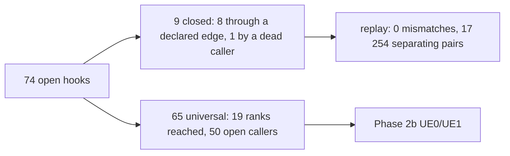

# 0005 — The server frame, part 5: the dispatchers behind the open hooks

> **Subsystem:** sim/frame
> **Question:** which pointer table or stored callback reaches each of the 74 hooks that frame/0004's direct-call reach left open, in which pass of the tick does its dispatcher run, and does the frame order still hold over the corpus once those hooks are placed?
> **Date:** 2026-11-03   **Plan:** 0055 (Phase 2a-ii)   **Status:** open (review requested)

A static read of the pinned `Game.exe` in Ghidra (project copy `workspace/ghidra-r55f`, symbols replayed) and `objdump`, then a replay of the kept logs. Tool `tools/frame.py` (`9d6487a6…`; the check ran on `a21171fc…`, commit `966613c8`; the later revision changes one anchor string), tests `tools/test_frame.py` (`02d81f8c…`, 23 tests). Run record: [experiments § run:2026-11-03-frame-order-2](experiments.md#run2026-11-03-frame-order-2).

## Answer (summary)

- [I] **Nine of the 74 hooks close; 65 do not.** Eight close through a declared table or callback, and `PayGold` closes because its one open caller, 0x00578ED0, has no reference (§ 4). Each of the 65 reaches 19 of the 21 ranks through the declared edges (all but `GameFpsStats` and the unload tick) and keeps 50 functions with no caller, so the tool gives it the only sound set, every rank, and calls it `universal`. (§ 5, `reach.txt`, run:2026-11-03-frame-order-2)
- [I] **Why the 65 stay open.** 54 functions stay open over all hooks, all at or below 0x0052F720, none in the walks' own code: callbacks passed to client controls and handler lists, whose registrars I did not read (§ 7). Closing them could add at most the two missing ranks, so it would not narrow any of the 65: the reach has no calling context, and a few hub functions carry every pass into each hook (§ 7, `reads/chains-example.txt`). So static dispatch cannot place these 65 hooks; Phase 2b's `UE0`/`UE1` lines can.
- [C] **No order mismatch with the wider model.** Over the 331 corpus logs: 501 689 frames with two or more events, 383 349 with two or more events placed by a closed set (192 294 in Phase 2a), 3 713 293 placed events (646 824 by their own kind, the rest by the pair they are nested in), 0 mismatches, 0 nesting conflicts. 17 254 consecutive pairs separate the order (14 061 in Phase 2a), 9 029 of them without the logged phase (3 105): anim 16 935, skills 319, every other logger 0. The controls fail: monsters' walks before players' 42 148 events in 19 242 frames, slot before every-frame 9 608 / 7 924, missiles after items 8 885 / 729, the drain before the tick 95 / 95. (§ 6, fn:sub_005414D0_GameRunUnitEvents@0x005414D0, fn:sub_0052D870_GameTick@0x0052D870, run:2026-11-03-frame-order-2)
- [C] **Three hooks' passes are separated by logged pairs**, each ending at the pass and not at the chain's middle links: `PathStep` 3 820 pairs (a monster's step after the players' slot walk; the player half stays `[I]`), `UNIT_AnimAdvance` 568, `RunStaminaDrain` 90. `MonKnockbackEnd` has one pair and stays `[I]`; `PathStepCollide`, `PlayerGiveGold`, `ItemRepairAll`, `ItemRepairBroken` and `PayGold` have none. (§ 5, § 6, fn:sub_00650840_PathStep@0x00650840, fn:UNIT_AnimAdvance@0x00623E00, fn:sub_0057F240_RunStaminaDrain@0x0057F240, run:2026-11-03-frame-order-2)
- [C] **Phase 2a's model is reproduced.** `check --direct` gives Phase 2a's totals, controls, separating pairs and hand-offs: the only difference in `check.txt` is the new counter lines. The seed hand-offs and the slot and every-frame order sections of the new run equal Phase 2a's. (`check-direct/check.txt`, run:2026-11-03-frame-order, run:2026-11-03-frame-order-2)
- [I] **Done-when: not met as written.** 0 mismatches holds everywhere a set exists, but 118 340 of the 501 689 frames hold fewer than two events with a closed set, and an event of a universal kind outside a closed pair tests nothing. Counting them, 501 659 frames place two or more and 494 897 place all their events; that count is vacuous and is not offered as meeting the clause. The remainder goes to Phase 2b (§ 8). (run:2026-11-03-frame-order-2)

## Leads used

None. The tables' names and the reading of their dispatchers come from this image and the reviewed findings of this project.

## Functions

No new name and no symbol row. A table with no row in `re/symbols.csv` is written by its address (`tbl_…` in the tool). The dispatchers and invokers are in §§ 2–3.

## Walkthrough

### 1. How the reach follows a table

- [I] **Edges.** `reach` walks callers upward. To the direct calls it adds, as call edges: a declared table's entry → the function holding each dispatch site; a callback passed to a function that calls it before returning (an *iterator*) → the passing function; a callback stored by a *registrar* → the invoker; a quest record field → its invokers; a callback in a stack block → the block's consumer; a conditional branch into another function's entry (0x00542E1C → `InactiveUnitSave`). (fn:sub_00542E30_InactiveUnitSave@0x00542E30, `reach.txt`, tools/frame.py)
- [I] **Self-checks.** The tool refuses to start if a declared site is not an indirect call or jump (or a direct call to an iterator), or if a `DEAD` function has a reference. (tools/frame.py `_follow`, `test_site_and_dead_checks`)
- [I] **Function entries.** Table entries and code pointers after `int3` padding become function entries. Without this, a body with no symbol row folded into the function before it: a first pass closed 88 of 89 hooks falsely (§ Dead ends). The well use 0x00585720 was one such case. (`dev/reach-dev3.txt`, `reach.txt`)
- [I] **Unexplained references.** `reach` lists references in a hook's closure that no declared edge accounts for, since one could be an undeclared caller. Of the 24 closed hooks, 21 have none; `UNIT_AnimAdvance`, `PathStep` and `PathStepCollide` have 5, 8 and 8, all to functions at 0x00480810, 0x004D30C0, 0x004D3630 and 0x004D37F0, unread. (`reach.txt`)
- [I] **Rank 21 is outside the tick.** Everything that does not run under `GameTick` while the stamp reads N runs after tick N's passes and before tick N + 1's, because `GameTick` raises the stamp before its first pass. So the host loops take the drain's rank. This assumes one thread runs both the client frame and the ticks, which is the single-player loop of frame/0001 § 1; the open-server thread of modes 6 and 8 would break it. `GameTick` itself is a root of ranks 1–20. (0x0052D87B, fn:sub_0052D870_GameTick@0x0052D870, 0x0044F136–0x0044F162)

### 2. The tables

- [I] Each row is a read of the dispatch site. "Pass" is the dispatcher's own result in `dispatchers.txt`; "universal" as in the summary; "not listed" means not in that run. (`dispatchers.txt`, run:2026-11-03-frame-order-2)

| Table | Anchor | Stride × rows | Index | Dispatch sites | Pass |
|---|---|---|---|---|---|
| `g_SkillStartFuncs` | data:g_SkillStartFuncs@0x00732140 | 0x4 × 66, field 0 | Skills.txt srvstfunc | SKILLS_SrvStart 0x0056F640: load 0x0056F76D, call 0x0056F784 | universal |
| `g_SkillDoFuncs` | data:g_SkillDoFuncs@0x007322B0 | 0x4 × 153, field 0 | Skills.txt srvdofunc | SKILLS_SrvDo 0x0056F968; StateDoFunc 0x0056D805; CallDoFunc 0x0056D831; COMBAT_PrgFinisher 0x005D53F8, 0x005D544C | SrvDo, CallDoFunc, PrgFinisher universal; StateDoFunc plr and mon walks |
| `g_PlayerModeStartFuncs` | data:g_PlayerModeStartFuncs@0x006E1740 | 0x8 × 20, field 0,4 | player mode (0..19); field 0 at a point, 4 at a unit | PlayerModeCmd 0x00580A60; PLAYER_ModeCmdUnit 0x00580B61; PlayerDeath 0x00580F44 (row 1); PlayerModeEnd 0x00581174 (row 4) | universal |
| `g_PlayerModeFrameFuncs` | data:g_PlayerModeFrameFuncs@0x00732C10 | 0x4 × 20, field 0 | player mode (Unit+0x10) | PlayerModeFrameEvent 0x005811D0: load 0x005811F1, call 0x00581204 | plr walks |
| `g_MonModeRecords` | data:g_MonModeRecords@0x006E2260 | 0x10 × 21, field 0,4,8 | monster mode (0..15) and five class records; via MonModeRecord 0x005A78A0 | MonSetMode 0x005A7D67 (start); MonModeFrameEvent 0x005A7BD6 (frame); MonModeEndEvent 0x005A7C16 (end) | MonSetMode universal; frame and end mon walks |
| `g_ShrineEffects` | data:g_ShrineEffects@0x006E1850 | 0xC × 23, field 0 | Shrines.txt effect class | OBJOP_Shrine 0x00583C70: load 0x00583DCC, call 0x00583DD4 | universal |
| `tbl_006E2218` | `0x006E2218` | 0x4 × 9, field 0 | 0x005A6000's first argument | 0x005A6000: load 0x005A604D, call 0x005A605C | drain |
| `g_ObjInitFns` | data:g_ObjInitFns@0x00731BC0 | 0x4 × 80, field 0 | Objects.txt InitFn | OBJ_ServerInit 0x0054F6F9 | universal |
| `g_ObjPopulateFns` | data:g_ObjPopulateFns@0x00731D00 | 0x4 × 10, field 0 | Objects.txt PopulateFn | RoomObjectsPopulate 0x005527EE, 0x005528C8, 0x005529F3 | universal |
| `g_ObjPseudoFns` | data:g_ObjPseudoFns@0x00731D28 | 0x4 × 10, field 0 | the preset pseudo-object kind | OBJ_PresetPseudoDispatch 0x0054F514 | universal |
| `g_ObjTrapFns` | data:g_ObjTrapFns@0x00732CEC | 0x4 × 11, field 0 | Objects.txt trap kind | OBJ_TrapEvent 0x005818AA (jmp, any row), 0x00581810, 0x00581843, 0x0058187A (row 2) | obj walks |
| `g_ObjOperateFns` | data:g_ObjOperateFns@0x00732D18 | 0x4 × 101, field 0 | Objects.txt OperateFn | OBJ_OperateDispatch 0x0058450E | universal |
| `g_UModHandlers` | data:g_UModHandlers@0x0073C008 | 0x4 × 44, field 0 | MonUMod row | UModHandlerThunk 0x005A2113; SpecialModsApply 0x005A2153, 0x005A21AC; MinionRestore 0x005A4815, 0x005A4834; ModAppendApply 0x005A48B0 | universal |
| `g_UModEventFns` | data:g_UModEventFns@0x0073C0B8 | 0x4 × 390, field 0 | 6 * MonUMod row + event | 0x005A4270: load 0x005A42DD, call 0x005A42F2; event 5 load 0x005A4317, call 0x005A432D | universal |
| `g_MissileCollideTypes` | data:g_MissileCollideTypes@0x0073C720 | 0x8 × 9, field 0 | Missiles.txt CollideType | MissileMoveCollide 0x005AE1F0 passes it to FindUnitAtCell (call 0x005AE3A4) | mis walks |
| `g_MissileSrvDoFuncs` | data:g_MissileSrvDoFuncs@0x0073C768 | 0x4 × 53, field 0 | Missiles.txt pSrvDoFunc (count 0x0073C71C) | MissileDoFrame 0x005ADCA7 | mis walks |
| `g_MissileSrvHitFuncs` | data:g_MissileSrvHitFuncs@0x0073C840 | 0x4 × 71, field 0 | Missiles.txt pSrvHitFunc (count 0x0073C83C) | MISSILE_HitUnit 0x005AE0BB, 0x005AE126; MissDo31SidePair 0x005B02F0 | HitUnit universal; MissDo31 mis walks |
| `g_MissileSrvDmgFuncs` | data:g_MissileSrvDmgFuncs@0x0073C960 | 0x4 × 31, field 0 | Missiles.txt pSrvDmgFunc (count 0x0073C95C) | MISSILE_HitUnit 0x005AE17F | universal |
| `g_MonAiTable` | data:g_MonAiTable@0x0073CA18 | 0x10 × 148, field 4,8,12 | MonStats AI number (< 0x94); via MonAiEntryGet 0x005B15D0 | MonAiInit 0x005B0F18 (field 4); fields 8 and 12 stored at AiCtl+4 by MonAiInit, called by MonAiEvent 0x005B186F | field 4 universal; 8, 12 mon walks |
| `g_MonAiStateRows` | data:g_MonAiStateRows@0x0073D358 | 0x10 × 18, field 4,8,12 | the AI state (< 0x12); via MonAiEntryGet 0x005B15D0 | as g_MonAiTable | as g_MonAiTable |
| `g_StatEventFuncs` | data:g_StatEventFuncs@0x007325B0 | 0x4 × 50, field 0 | stat event kind (< 0x32) | AddStatEvent 0x0056E740 passes the entry to UNIT_AddEvent 0x005C0AD0 (stored in the unit's +0x90 list); UNIT_DispatchEvent 0x005C0C8E calls it | universal |
| `g_PropFuncTable` | data:g_PropFuncTable@0x007462F8 | 0x4 × 37, field 0 | Properties.txt func (count g_nPropFuncs 0x00745B54) | PROP_ApplyBlock 0x0065FDF5 | universal |
| `g_ItemUseFns` | data:g_ItemUseFns@0x00741790 | 0x8 × 31, field 0,4 | Misc/item pSpell (count 0x0074178C); field 0 test, 4 use | ItemUse 0x005BF31E (test), 0x005BF388 (use) | universal |
| `g_SkillsCalcFuncs` | data:g_SkillsCalcFuncs@0x00745774 | 0x4 × 14, field 0 | calc function number | pushed to CALC_Eval 0x006C0BC0 by its callers (SKILLS_GetToHit 0x00644A69 and six more) | the callers' |
| `g_MissCalcFuncs` | data:g_MissCalcFuncs@0x00745828 | 0x4 × 8, field 0 | calc function number | pushed to CALC_Eval by MISS_EvalCalc 0x0064B840 | the caller's |
| `g_ItemCalcFuncs` | data:g_ItemCalcFuncs@0x0074463C | 0x4 × 8, field 0 | calc function number | pushed to CALC_Eval by ITEMS_EvalCalc 0x00627C6A | the caller's |
| `g_DrlgRefEnterFns` | data:g_DrlgRefEnterFns@0x00744384 | 0x4 × 4, field 0 | room status | RoomPrepareFiles 0x0061B388; DrlgRefAddNear 0x0061B410, 0x0061B469; DrlgRefAdd 0x0061B4DA | universal |
| `g_DrlgRefLeaveFns` | data:g_DrlgRefLeaveFns@0x00744394 | 0x4 × 4, field 0 | room status | DrlgLeave3Release 0x0061B5AA; DrlgRefRemoveNear 0x0061B5E0, 0x0061B62E; DrlgRefMove 0x0061B71E (row 0); 0x0061B690 0x0061B6DA (row 1) | not listed |
| `g_CubePortalFns` | data:g_CubePortalFns@0x006E11C8 | 0x4 × 4, field 0 | the cube portal output | RecipeOutputCreate 0x00565D45 | quests + drain |
| `g_QuestDescs` | data:g_QuestDescs@0x00731510 | 0x18 × 37, field 0 | quest number (count 0x00731888) | QUESTS_InitGame 0x00545E2B | drain |
| `tbl_0073188C` | `0x0073188C` | 0x8 × 4, field 0 | intro record (count 0x007318AC) | QUESTS_InitGame 0x00545EDA | drain |
| `g_ClientPktHandlers` | data:g_ClientPktHandlers@0x007114D0 | 0xC × 175, field 0,8 | server-to-client packet id (< 0xAF) | 0x0045F7B0: entry 0x0045F823, call 0x0045F8E9 (field 0); 0x0045FA40: entry 0x0045FAC3, call 0x0045FAE0 (field 8) | not listed (client) |
| `g_ClientUModHandlers` | data:g_ClientUModHandlers@0x00724D78 | 0x4 × 44, field 0 | MonUMod row (client) | ClientMonModsApply 0x004AD080, 0x004AD0A5 | not listed (client) |
| `tbl_0072D7F8` | `0x0072D7F8` | 0x4 × 8, field 0 | 0x004EDA80's index | 0x004EDA80: load 0x004EDB17, call 0x004EDB1F | not listed (client) |
| `tbl_006D61B0` | `0x006D61B0` | 0xC × 11, field 8 | {kind, window message, handler} records | registered by 0x00451DB0 -> 0x00451C70 -> 0x00420BF0.. -> 0x00420A70; called by the message dispatch 0x00420054, 0x00420281, 0x004202E1 | not listed (client) |

- [I] **Bounds.** Rows are the code's count or index test where it has one, or the finding that gave them: `g_ObjOperateFns` 101 (objects/0001), `g_PlayerModeFrameFuncs` 20 (the mode), `g_ShrineEffects` 23 (the run of code pointers ends at row 22). The dwords after them are other data, such as the {function, value, value} records from row 150 of the operate table. (fn:OBJ_OperateDispatch@0x00584420, fn:sub_005811D0_PlayerModeFrameEvent@0x005811D0, fn:OBJOP_Shrine@0x00583C70)
- [I] **A second indirection.** AI functions: `MonAiInit` copies a row's field 8 or 12 to `AiCtl+4`, and `MonAiEvent` calls it at 0x005B186F. Other readers of `AiCtl+4` are unfollowed. Stat events: `AddStatEvent` passes the entry to `UNIT_AddEvent`, which stores it in the unit's `+0x90` list; `UNIT_DispatchEvent` calls it at 0x005C0C8E. (fn:sub_005B0E00_MonAiInit@0x005B0E00, fn:sub_005B1740_MonAiEvent@0x005B1740, fn:sub_0056E740_AddStatEvent@0x0056E740, fn:UNIT_AddEvent@0x005C0AD0, fn:UNIT_DispatchEvent@0x005C0C30)
- [I] **A table with no reader.** The 20 dwords at 0x00732C60 repeat `PlrModeStartMoveUnit` and `PlrModeStartSkillUnit`, and no code address points into them. Those functions are reached through `g_PlayerModeStartFuncs` field 4. (0x00732C60, fn:sub_0057F190_PlrModeStartMoveUnit@0x0057F190, fn:sub_0057FEF0_PlrModeStartSkillUnit@0x0057FEF0)

### 3. The callbacks

- [I] **Iterators (20), each with the call of its argument:** `GameForEachUnit` 0x00553871; `GamePlayersForEach` 0x00553914; `SKILLS_ForUnitsInRange` 0x0056B98C; `PartyForEach` 0x00540585; `PartyForEachInLevel` 0x005405BC, 0x005405E9, 0x00540636; `MonGroupForEach` 0x0058F42C; `SkillForUnitsNearTarget` 0x0056E8D1; `NearestUnitFind` 0x0065A8C2; `FindUnitAtCell` 0x00641EA7; `SkillAreaBlock` 0x0056DDB7 and its wrapper `UnitsInRangeCall`; `AiUnitSearch` through its searchers 0x005DCF40, 0x005DCFEC, 0x005DCEAA and, for 0x005DD050, a wrapper callback 0x005DD020 not read further; `CALC_Eval` 0x006C0C28–0x006C0D9B; `QUESTS_SetState`, which passes it to `GameForEachUnit`; `RepairCost` 0x0062FF45; `SkillCallOnSelf` 0x0056B75C; and 0x00574DE0 (0x00574E88), 0x0056DBC0 (0x0056DC9F), 0x005E8F20 (0x005E8FFF), 0x0052DED0 (0x0052DF2A). Six pushes sit before a branch or another call and are listed in `ARG_SITES`. (fn:sub_005537D0_GameForEachUnit@0x005537D0, fn:CALC_Eval@0x006C0BC0, tools/frame.py)
- [I] **Registrars (5):** `QUESTS_TimerAdd` → `QUESTS_TimersRun` 0x00543E85; `UNIT_AddEvent` → `UNIT_DispatchEvent` 0x005C0C8E; `STATLIST_SetRemoveCallback` → `STATLIST_Unlink` 0x00626BE7; `UnitStatListCreate` (list `+0x5C`) → `STATLIST_CacheAdd` 0x0062513E and `STATLIST_CacheWrite` 0x006251E4; `SHRINE_ApplyState` (fifth argument → block `+0x20`, `STATE_ApplyTimed` at 0x00582850) → `STATLIST_Unlink`. (fn:QUESTS_TimerAdd@0x00543F10, fn:QUESTS_TimersRun@0x00543E10, fn:STATLIST_SetRemoveCallback@0x00625CE0, fn:STATLIST_Unlink@0x006269F0, fn:sub_00626D40_UnitStatListCreate@0x00626D40, fn:SHRINE_ApplyState@0x00582800)
- [I] **Quest record fields (18 offsets), stored by the quest code:** `+0xA0 + 4·event` → `QUESTS_DispatchEvent` 0x00543965 and `QUESTS_DispatchUnitEvent` 0x005439F9; also `+0xC4` → 0x00543C87, `+0xAC` → 0x00546AA3, `+0xD4` → 0x00546393, `+0xD8` → 0x005465B3; `+0xE8` → 0x005442AD, 0x00546135; `+0xEC` → 0x005446A0; `+0xF0` → 47 sites (5 in `QuestsPlayerJoin`, 42 in the quest code). Of the 1 614 stored-field edges, none is stored by a function outside the quest code (`reads/edges.txt`). The offsets from `+0xD4` up are given the two dispatchers as well, since the event index is not bounded in the read. (fn:QUESTS_DispatchEvent@0x005438E0, fn:QUESTS_DispatchUnitEvent@0x005439A0, fn:sub_00546270_QuestsPlayerJoin@0x00546270)
- [I] **Stack blocks (18 stores):** `STATE_ApplyTimed` (block `+0x20`, the list's remove callback → `STATLIST_Unlink`), `MissileCreate` (params `+0x54`, called at 0x0059FE35), `SkillAreaBlock` (block `+0x20`, called at 0x0056DDB7). The match is a store to `[ebp-X]` within 60 instructions before the call, not a proof that the slot lies in the block; the 18 are listed in `reads/edges.txt` and were read by name only. (fn:STATE_ApplyTimed@0x0056E970, fn:sub_0059FA30_MissileCreate@0x0059FA30, fn:sub_0056DCC0_SkillAreaBlock@0x0056DCC0)
- [I] **One-offs (2):** `HolyFreezeRemoveCb`, in a block passed with `AURA_ApplyToTarget` to `SkillCallOnSelf` (0x005D0A7B) and applied at 0x005CEE38; and 0x005943B0, loaded at 0x005E7A41 and called at 0x005E7A51. (fn:sub_005D0770_HolyFreezeRemoveCb@0x005D0770, fn:AURA_ApplyToTarget@0x005CEDC0)

### 4. Roots outside the tick, and code with no caller

- [I] **Host roots (7):** `ClientMainFrame`, `OpenServerThread`, `ClientWaitDrain`, `ServerGamesFrame` and the image's entry at rank 21, `GameTick` at ranks 1–20, and `CreateClassSelect` at rank 21. The last is a judgement: 11 records of the front-end's control tables point at it (0x0070AEF0…) and no code address points into them, so its invoker is unread. (fn:sub_0044EFA0_ClientMainFrame@0x0044EFA0, fn:sub_0052FC20_ServerGamesFrame@0x0052FC20, fn:CRT_tmainCRTStartup@0x006827A5, fn:sub_00433BF0_CreateClassSelect@0x00433BF0)
- [I] **Dead (12), checked by the tool:** no direct call, jump, branch or pointer to 0x005368F0, 0x00564C70, 0x00578ED0, 0x00579090, 0x005A5470, 0x005AD9D0, 0x005F7F10, 0x00534630, 0x00530930, 0x00543CE0, 0x00543DE0, 0x00595160. `objdump` desynchronises just before 0x005A5470 (a jump table in code), so its body is not in the instruction index. 0x005EEB10 is referenced only from its own body. The SEH handler 0x006CA530 is pushed into the `fs:0` chain and is left out as a caller in a frame. (fn:sub_00578ED0_NpcHealDead@0x00578ED0, fn:sub_00530930_GameCreateA@0x00530930, `reach.txt`)

### 5. The 74 hooks

- [I] Chains run root first; a bracket says how that function is called by the one before it. Every chain is one shortest path, not the whole reach. The set of a monster-typed event narrows to the monster roots (and rank 21) in the check. `universal` means the reach stays open with the declared edges followed; the chain shown is a path that exists, not the hook's pass. (`reach.txt`, `kinds.tsv`, run:2026-11-03-frame-order-2)

| # | Hook | Kinds | Tag, status | Pass set | Chain |
|---|---|---|---|---|---|
| 1 | `0x005357D0` PLAYER_DeathGoldLoss | economy DG0 | [I] universal | any (reached: 19 of 21) | `pkt06` → `0x00549830` PktReadUnit → `0x00580A70` PLAYER_ModeCmdUnit → `0x00580EC0` PlayerDeath [g_PlayerModeStartFuncs[0]+4 @0x00580B61] → `0x00535AB0` PlayerDeathExpLossGate → `0x005357D0` PLAYER_DeathGoldLoss |
| 2 | `0x0053FF00` UnitAddGoldStat | economy UG0 | [I] universal | any (reached: 19 of 21) | `pkt31` → `0x00579510` NPC_SellItem → `0x0055B060` PlayerGiveGold → `0x0053FF00` UnitAddGoldStat |
| 3 | `0x00540E60` UNIT_CancelEvents | anim CAN | [I] universal | any (reached: 19 of 21) | `pkt58` → `0x00540E60` UNIT_CancelEvents |
| 4 | `0x005417D0` UnitQueueEvent | anim CQ | [I] universal | any (reached: 19 of 21) | `pkt14` → `0x005417D0` UnitQueueEvent |
| 5 | `0x005539B0` SUNIT_ScheduleModeEvents | anim SCH | [I] universal | any (reached: 19 of 21) | `g_PlayerEventFuncs[1]` → `0x0057FE30` PlrModeStartGetHit [g_PlayerModeStartFuncs[4]+0 @0x00581174] → `0x005539B0` SUNIT_ScheduleModeEvents |
| 6 | `0x00553B10` RescheduleFromPct | anim RSC | [I] universal | any (reached: 19 of 21) | `g_PlayerEventFuncs[5]+g_MonEventFuncs[5]` → `0x005D5A30` SkillDo42DragonTalon [g_SkillDoFuncs[42] @0x0056D805] → `0x0056E210` → `0x00553B10` RescheduleFromPct |
| 7 | `0x00553C70` RescheduleSkip | anim RSC | [I] universal | any (reached: 19 of 21) | `g_PlayerEventFuncs[5]+g_MonEventFuncs[5]` → `0x005D68A0` SkillDo48BladeFury [g_SkillDoFuncs[48] @0x0056D805] → `0x00553C70` RescheduleSkip |
| 8 | `0x00553DC0` RescheduleAt | anim RSC | [I] universal | any (reached: 19 of 21) | `g_PlayerEventFuncs[5]+g_MonEventFuncs[5]` → `0x005CF900` SkillDo67Charge [g_SkillDoFuncs[67] @0x0056D805] → `0x00553DC0` RescheduleAt |
| 9 | `0x00555600` UnitFree | anim FREE | [I] universal | any (reached: 19 of 21) | `MissileDoFrame` → `0x00555600` UnitFree |
| 10 | `0x00557AD9` ItemInitStats (fn `0x00557AB0`) | economy GA0 | [I] universal | any (reached: 19 of 21) | `SrvDrainMessages` → `0x00542B40` RoomInactiveUnitsRestore → `0x005557D0` PresetUnitDispatch → `0x00557AB0` ItemInitStats |
| 11 | `0x00558530` ItemReplenishDurTimer | h6b RPE, h6b RPS | [I] universal | any (reached: 19 of 21) | `pkt28` → `0x00562660` ITEMS_InsertSocket → `0x00558530` ItemReplenishDurTimer |
| 12 | `0x00558580` ItemReplenishQtyTimer | h6b RPE, h6b RPS | [I] universal | any (reached: 19 of 21) | `pkt28` → `0x00562660` ITEMS_InsertSocket → `0x00558580` ItemReplenishQtyTimer |
| 13 | `0x005589A0` DropGoldFind | economy GF0, economy GFK | [I] universal | any (reached: 19 of 21) | `MissileDoFrame` → `0x005AF300` MissDo18ChestSpawner [g_MissileSrvDoFuncs[18] @0x005ADCA7] → `0x00585E00` → `0x00585B90` ObjectChestDrop → `0x0055A6D0` TC_ResolveDrops → `0x005589A0` DropGoldFind |
| 14 | `0x00559300` DropGoldPile | economy GPL | [I] universal | any (reached: 19 of 21) | `g_ObjEventFns[4]` → `0x00582380` OBJTRAP_ObjectCreate [g_ObjTrapFns[5] @0x005818AA] → `0x00555230` SUnitCreate → `0x0054F5D0` OBJ_ServerInit → `0x0054F8C0` OBJINIT_GoldPiles [g_ObjInitFns[28] @0x0054F6F9] → `0x00559300` DropGoldPile |
| 15 | `0x00559A30` DropItemAtUnit | economy DUL | [I] universal | any (reached: 19 of 21) | `MissileDoFrame` → `0x005AF300` MissDo18ChestSpawner [g_MissileSrvDoFuncs[18] @0x005ADCA7] → `0x00585E00` → `0x00559A30` DropItemAtUnit |
| 16 | `0x00559E30` ITEMS_DurabilityLossRoll | economy DL0 | [I] universal | any (reached: 19 of 21) | `g_PlayerEventFuncs[5]+g_MonEventFuncs[5]` → `0x0056F070` SKILL_AttackDo [g_SkillDoFuncs[1] @0x0056D805] → `0x0057D4F0` COMBAT_DeliverQueued → `0x0057D3D0` COMBAT_DurabilityLoss → `0x00559E30` ITEMS_DurabilityLossRoll |
| 17 | `0x0055A090` DropGoldAmount | economy DA0 | [I] universal | any (reached: 19 of 21) | `pkt4F` → `0x00535510` PlayerDropGold → `0x0055A090` DropGoldAmount |
| 18 | `0x0055B060` PlayerGiveGold | economy GG0 | [I] dispatch | quests+drain | `pkt31` → `0x00579510` NPC_SellItem → `0x0055B060` PlayerGiveGold |
| 19 | `0x0055B800` MonStatCallback | stats SCB | [I] universal | any (reached: 19 of 21) | `pkt28` → `0x00562660` ITEMS_InsertSocket → `0x006276C0` → `0x00625150` STATLIST_CacheWrite → `0x0055B800` MonStatCallback [registered by UnitStatListCreate at 0x00534914, called @0x006251E4] |
| 20 | `0x0055DBC0` EquipReqRefresh | stats EQR | [I] universal | any (reached: 19 of 21) | `ClientsRoomSync` → `0x0055DF00` → `0x0055DBC0` EquipReqRefresh |
| 21 | `0x0055F900` ItemRepairBroken | economy IB0 | [I] dispatch | item walks + quests + drain | `g_ItemEventFuncs[3]` → `0x00562C40` ReplenishStep → `0x0055F900` ItemRepairBroken |
| 22 | `0x0056C310` ItemConsumeOne | economy IC0 | [I] universal | any (reached: 19 of 21) | `g_PlayerEventFuncs[8]+g_MonEventFuncs[8]` → `0x0056F7F0` SKILLS_SrvDo → `0x0056C3F0` PLAYER_UseAmmo → `0x0056C310` ItemConsumeOne |
| 23 | `0x0056C3F0` PLAYER_UseAmmo | economy UA0 | [I] universal | any (reached: 19 of 21) | `g_PlayerEventFuncs[8]+g_MonEventFuncs[8]` → `0x0056F7F0` SKILLS_SrvDo → `0x0056C3F0` PLAYER_UseAmmo |
| 24 | `0x0056C740` STATE_GroupClear | stats GRP | [I] universal | any (reached: 19 of 21) | `g_PlayerEventFuncs[5]+g_MonEventFuncs[5]` → `0x005C6EC0` SkillDo116Shapeshift [g_SkillDoFuncs[116] @0x0056D805] → `0x0056C740` STATE_GroupClear |
| 25 | `0x0056D940` SpawnOwnedMonster | skills SP0 | [I] universal | any (reached: 19 of 21) | `MissileDoFrame` → `0x005AEDA0` MissileSpawnOwnedMonster [g_MissileSrvDoFuncs[13] @0x005ADCA7] → `0x0056D940` SpawnOwnedMonster |
| 26 | `0x0056E970` STATE_ApplyTimed | combat STA, skills STA, stats STA0 | [I] universal | any (reached: 19 of 21) | `g_PlayerEventFuncs[5]+g_MonEventFuncs[5]` → `0x005C3B90` SkillDo59Attract [g_SkillDoFuncs[59] @0x0056D805] → `0x0056E970` STATE_ApplyTimed |
| 27 | `0x0056EF90` SKILLS_SetDelayState | anim DLY, skills DLY | [I] universal | any (reached: 19 of 21) | `g_PlayerEventFuncs[8]+g_MonEventFuncs[8]` → `0x0056F7F0` SKILLS_SrvDo → `0x0056EF90` SKILLS_SetDelayState |
| 28 | `0x0056F640` SKILLS_SrvStart | skills SST0 | [I] universal | any (reached: 19 of 21) | `g_PlayerEventFuncs[5]+g_MonEventFuncs[5]` → `0x005CAF30` SkillDo83DeliverRestart [g_SkillDoFuncs[83] @0x0056D805] → `0x0056F640` SKILLS_SrvStart |
| 29 | `0x0056F7F0` SKILLS_SrvDo | skills SDO0 | [I] universal | any (reached: 19 of 21) | `g_PlayerEventFuncs[8]+g_MonEventFuncs[8]` → `0x0056F7F0` SKILLS_SrvDo |
| 30 | `0x005761C0` ItemRepairAll | economy IR0 | [I] dispatch | drain | `pkt31` → `0x00578050` NpcRepair → `0x005761C0` ItemRepairAll |
| 31 | `0x00576D90` PayGold | economy PG0 | [I] reach | drain | `pkt31` → `0x00578050` NpcRepair → `0x00576D90` PayGold |
| 32 | `0x0057C6C0` COMBAT_ApplyDamage | combat AD0 | [I] universal | any (reached: 19 of 21) | `g_PlayerEventFuncs[5]+g_MonEventFuncs[5]` → `0x005C98F0` SkillDo21Telekinesis [g_SkillDoFuncs[21] @0x0056D805] → `0x0057C6C0` COMBAT_ApplyDamage |
| 33 | `0x0057CB00` GetHitRoll | anim GR0 | [I] universal | any (reached: 19 of 21) | `g_PlayerEventFuncs[5]+g_MonEventFuncs[5]` → `0x005C98F0` SkillDo21Telekinesis [g_SkillDoFuncs[21] @0x0056D805] → `0x0057CEE0` COMBAT_GetHit → `0x0057CB00` GetHitRoll |
| 34 | `0x0057CEE0` COMBAT_GetHit | anim GH | [I] universal | any (reached: 19 of 21) | `g_PlayerEventFuncs[5]+g_MonEventFuncs[5]` → `0x005C98F0` SkillDo21Telekinesis [g_SkillDoFuncs[21] @0x0056D805] → `0x0057CEE0` COMBAT_GetHit |
| 35 | `0x0057D3D0` COMBAT_DurabilityLoss | economy CD0, economy CDS, economy CDU, economy CDW | [I] universal | any (reached: 19 of 21) | `g_PlayerEventFuncs[5]+g_MonEventFuncs[5]` → `0x0056F070` SKILL_AttackDo [g_SkillDoFuncs[1] @0x0056D805] → `0x0057D4F0` COMBAT_DeliverQueued → `0x0057D3D0` COMBAT_DurabilityLoss |
| 36 | `0x0057EC10` COMBAT_MeleeHitTest | combat EV0 | [I] universal | any (reached: 19 of 21) | `g_PlayerEventFuncs[5]+g_MonEventFuncs[5]` → `0x0056F070` SKILL_AttackDo [g_SkillDoFuncs[1] @0x0056D805] → `0x0057EC10` COMBAT_MeleeHitTest |
| 37 | `0x0057EDD0` PlrModeLeaveOk | anim PL0, anim PLE | [I] universal | any (reached: 19 of 21) | `pkt41` → `0x005809D0` PlayerModeCmd → `0x0057EDD0` PlrModeLeaveOk |
| 38 | `0x0057EEC0` PlayerModeAllowed | anim PA0 | [I] universal | any (reached: 19 of 21) | `SrvPacketDispatch` → `0x0057EEC0` PlayerModeAllowed |
| 39 | `0x0057F240` RunStaminaDrain | anim DR0 | [C] dispatch: 90 pairs | plr-ef+plr-slot | `g_PlayerEventFuncs[0]` → `0x00580C20` PlrModeMoveFrame [g_PlayerModeFrameFuncs[2] @0x00581204] → `0x0057F240` RunStaminaDrain |
| 40 | `0x00580000`  (fn `0x0057FF70`) | anim OQ | [I] universal | any (reached: 19 of 21) | `g_PlayerEventFuncs[1]` → `0x00580310` HandsRefresh → `0x00580030` → `0x0057FF70` |
| 41 | `0x00583C70` OBJOP_Shrine | stats SHR0 | [I] universal | any (reached: 19 of 21) | `g_PlayerEventFuncs[5]+g_MonEventFuncs[5]` → `0x005C98F0` SkillDo21Telekinesis [g_SkillDoFuncs[21] @0x0056D805] → `0x00584420` OBJ_OperateDispatch → `0x00583C70` OBJOP_Shrine [g_ObjOperateFns[2] @0x0058450E] |
| 42 | `0x00585720`  | stats WEL0 | [I] universal | any (reached: 19 of 21) | `g_PlayerEventFuncs[5]+g_MonEventFuncs[5]` → `0x005C98F0` SkillDo21Telekinesis [g_SkillDoFuncs[21] @0x0056D805] → `0x00584420` OBJ_OperateDispatch → `0x005858A0` [g_ObjOperateFns[22] @0x0058450E] → `0x00585720` |
| 43 | `0x0059FA30` MissileCreate | skills MC0 | [I] universal | any (reached: 19 of 21) | `MissileDoFrame` → `0x005AE680` MissDo06SubPerCell [g_MissileSrvDoFuncs[6] @0x005ADCA7] → `0x0059FA30` MissileCreate |
| 44 | `0x005A4F50` MonAttackStats | combat MAS0, skills MAS0 | [I] universal | any (reached: 19 of 21) | `g_PlayerEventFuncs[5]+g_MonEventFuncs[5]` → `0x005CE9F0` SkillDo150Smite [g_SkillDoFuncs[150] @0x0056D805] → `0x005A4F50` MonAttackStats |
| 45 | `0x005A8520` MonKnockbackEnd | anim KBE | [I] dispatch | mon-ef+mon-slot | `g_MonEventFuncs[1]` → `0x005A8520` MonKnockbackEnd [g_MonModeRecords[13]+8 @0x005A7C16] |
| 46 | `0x005AD730` MISSILE_ApplyDamage | combat MS0 | [I] universal | any (reached: 19 of 21) | `g_MonEventFuncs[7]` → `0x005A4270` UModEventRun → `0x005A2620` MonDeathDamage [g_UModEventFns[56] @0x005A42F2] → `0x0057E090` → `0x005AD730` MISSILE_ApplyDamage |
| 47 | `0x005ADF10` MISSILE_HitUnit | skills MH0 | [I] universal | any (reached: 19 of 21) | `MissileDoFrame` → `0x005AF540` MissDo20FollowOwner [g_MissileSrvDoFuncs[20] @0x005ADCA7] → `0x005ADF10` MISSILE_HitUnit |
| 48 | `0x005C0C40` UNIT_DispatchEvent (fn `0x005C0C30`) | skills EVH | [I] universal | any (reached: 19 of 21) | `g_MonEventFuncs[3]` → `0x005C0C30` UNIT_DispatchEvent |
| 49 | `0x005D5220` COMBAT_PrgFinisher | skills PF0 | [I] universal | any (reached: 19 of 21) | `g_PlayerEventFuncs[5]+g_MonEventFuncs[5]` → `0x0056F070` SKILL_AttackDo [g_SkillDoFuncs[1] @0x0056D805] → `0x005D5220` COMBAT_PrgFinisher |
| 50 | `0x00623E00` UNIT_AnimAdvance | anim AD0 | [C] dispatch: 568 pairs, after the players' slot walk; 5 client references unexplained | mon-ef+mon-slot+drain | `g_MonEventFuncs[0]` → `0x005A7350` [g_MonModeRecords[0]+4 @0x005A7BD6] → `0x00623E00` UNIT_AnimAdvance |
| 51 | `0x00623F50` UNIT_AnimSetRate | anim SR | [I] universal | any (reached: 19 of 21) | `g_PlayerEventFuncs[1]` → `0x0057FCA0` PlayerDeathModeEnd → `0x005533D0` SUNIT_AnimInit → `0x00623F50` UNIT_AnimSetRate |
| 52 | `0x00624390` UNIT_AnimInit | anim OA0 | [I] universal | any (reached: 19 of 21) | `pkt4F` → `0x00624690` UNIT_SetMode → `0x00624390` UNIT_AnimInit |
| 53 | `0x00624690` UNIT_SetMode | anim MSET | [I] universal | any (reached: 19 of 21) | `pkt4F` → `0x00624690` UNIT_SetMode |
| 54 | `0x00624F60` StatListGetValue | stats RD | [I] universal | any (reached: 19 of 21) | `ClientsRoomSync` → `0x00625480` STATS_GetUnitStat → `0x00624F60` StatListGetValue |
| 55 | `0x006250B0` STATLIST_CacheAdd | stats CA | [I] universal | any (reached: 19 of 21) | `g_PlayerEventFuncs[5]+g_MonEventFuncs[5]` → `0x0056F1F0` SKILL_MeleeDeliverDo [g_SkillDoFuncs[2] @0x0056D805] → `0x00626E10` STATLIST_LinkToUnit → `0x00626920` STATLIST_Propagate → `0x006250B0` STATLIST_CacheAdd |
| 56 | `0x00625150` STATLIST_CacheWrite | stats CW | [I] universal | any (reached: 19 of 21) | `pkt28` → `0x00562660` ITEMS_InsertSocket → `0x006276C0` → `0x00625150` STATLIST_CacheWrite |
| 57 | `0x00626920` STATLIST_Propagate | stats PRP | [I] universal | any (reached: 19 of 21) | `g_PlayerEventFuncs[5]+g_MonEventFuncs[5]` → `0x0056F1F0` SKILL_MeleeDeliverDo [g_SkillDoFuncs[2] @0x0056D805] → `0x00626E10` STATLIST_LinkToUnit → `0x00626920` STATLIST_Propagate |
| 58 | `0x006269F0` STATLIST_Unlink | stats ULK | [I] universal | any (reached: 19 of 21) | `g_ItemEventFuncs[12]` → `0x00627460` UNIT_ExpireTimedLists → `0x00626C00` STATLIST_Free → `0x006269F0` STATLIST_Unlink |
| 59 | `0x00626E10` STATLIST_LinkToUnit | stats LNK | [I] universal | any (reached: 19 of 21) | `g_PlayerEventFuncs[5]+g_MonEventFuncs[5]` → `0x0056F1F0` SKILL_MeleeDeliverDo [g_SkillDoFuncs[2] @0x0056D805] → `0x00626E10` STATLIST_LinkToUnit |
| 60 | `0x00627860` STATLIST_EnableDamageStats | stats DMG | [I] universal | any (reached: 19 of 21) | `pkt60` → `0x005616A0` PlayerSwapWeapons → `0x0055C2C0` ITEMS_AttachToOwner → `0x00627910` StatListLinkOwner → `0x00627860` STATLIST_EnableDamageStats |
| 61 | `0x006279A0` UNIT_ToggleStatListByState | stats TGL | [I] universal | any (reached: 19 of 21) | `pkt60` → `0x005616A0` PlayerSwapWeapons → `0x0055C2C0` ITEMS_AttachToOwner → `0x00663CC0` SETS_UpdateOnEquip → `0x00663A20` SETS_ToggleItemAProps → `0x006279A0` UNIT_ToggleStatListByState |
| 62 | `0x00627A40` STATLIST_DisableDamageStats | stats DMG | [I] universal | any (reached: 19 of 21) | `pkt60` → `0x005616A0` PlayerSwapWeapons → `0x0055C2C0` ITEMS_AttachToOwner → `0x00627910` StatListLinkOwner → `0x00627A40` STATLIST_DisableDamageStats |
| 63 | `0x0062EAF0` ItemReqCheck | stats RQ0, stats RQ91, stats RQD, stats RQF, stats RQL | [I] universal | any (reached: 19 of 21) | `ClientsRoomSync` → `0x0054AA40` → `0x005606B0` ItemEquip → `0x0062EAF0` ItemReqCheck |
| 64 | `0x0062EFB0` ITEMS_TradePriceCore | economy PR0 | [I] universal | any (reached: 19 of 21) | `pkt31` → `0x00578050` NpcRepair → `0x0062FDC0` ItemTradePrice → `0x0062EFB0` ITEMS_TradePriceCore |
| 65 | `0x0062FE60` RepairCost | economy RC0 | [I] universal | any (reached: 19 of 21) | `pkt31` → `0x00578050` NpcRepair → `0x0062FE60` RepairCost |
| 66 | `0x00646D60` SKILLS_RefreshPassive | stats PAS | [I] universal | any (reached: 19 of 21) | `pkt41` → `0x0056DFA0` → `0x00646D60` SKILLS_RefreshPassive |
| 67 | `0x00647960` SKILLS_CanUse | skills CU0 | [I] universal | any (reached: 19 of 21) | `pkt05` → `0x00549AD0` PLRMSG_SkillAtXY → `0x00647960` SKILLS_CanUse |
| 68 | `0x00650150` PathStepCollide | anim CT | [I] dispatch: 8 client references unexplained | mis, plr, mon walks + drain | `g_PlayerEventFuncs[0]` → `0x00580460` PlrModeSkillFrame [g_PlayerModeFrameFuncs[7] @0x00581204] → `0x00554CA0` UnitMoveStep → `0x00650840` PathStep → `0x00650660` PathStepMove → `0x00650150` PathStepCollide |
| 69 | `0x00650840` PathStep | anim PS0 | [C] dispatch: 3 820 pairs, monsters' steps after the players' slot walk; the player half [I]; 8 client references unexplained | mis, plr, mon walks + drain | `g_PlayerEventFuncs[0]` → `0x00580460` PlrModeSkillFrame [g_PlayerModeFrameFuncs[7] @0x00581204] → `0x00554CA0` UnitMoveStep → `0x00650840` PathStep |
| 70 | `0x00660120` SetBonusApply | stats SBA | [I] universal | any (reached: 19 of 21) | `pkt60` → `0x005616A0` PlayerSwapWeapons → `0x0055C2C0` ITEMS_AttachToOwner → `0x00663CC0` SETS_UpdateOnEquip → `0x00663B40` SETS_UpdateOwnerBonusList → `0x00660120` SetBonusApply |
| 71 | `0x006637B0` MERC_ResurrectCost | economy MC0 | [I] universal | any (reached: 19 of 21) | `pkt31` → `0x00579C00` MERC_Resurrect → `0x006637B0` MERC_ResurrectCost |
| 72 | `0x00663A20` SETS_ToggleItemAProps | stats TIP | [I] universal | any (reached: 19 of 21) | `pkt60` → `0x005616A0` PlayerSwapWeapons → `0x0055C2C0` ITEMS_AttachToOwner → `0x00663CC0` SETS_UpdateOnEquip → `0x00663A20` SETS_ToggleItemAProps |
| 73 | `0x00663B40` SETS_UpdateOwnerBonusList | stats UOB | [I] universal | any (reached: 19 of 21) | `pkt60` → `0x005616A0` PlayerSwapWeapons → `0x0055C2C0` ITEMS_AttachToOwner → `0x00663CC0` SETS_UpdateOnEquip → `0x00663B40` SETS_UpdateOwnerBonusList |
| 74 | `0x00663CC0` SETS_UpdateOnEquip | stats MSK, stats UOE | [I] universal | any (reached: 19 of 21) | `pkt60` → `0x005616A0` PlayerSwapWeapons → `0x0055C2C0` ITEMS_AttachToOwner → `0x00663CC0` SETS_UpdateOnEquip |

### 6. The replay

- [C] Totals of `check/check.txt` (`f4f4499d…`):

  | logger | frames with 2+ events | 2+ closed sets | separating pairs |
  |---|---:|---:|---:|
  | anim | 205 483 | 141 562 | 16 935 |
  | skills | 21 449 | 8 229 | 319 |
  | stats | 244 047 | 224 056 | 0 |
  | combat | 26 884 | 6 636 | 0 |
  | economy | 3 291 | 2 517 | 0 |
  | economy2 | 277 | 236 | 0 |
  | economy-hire | 61 | 57 | 0 |
  | two-combat | 177 | 56 | 0 |
  | h6b | 20 | 0 | 0 |

  Stats, combat and the economy logs now hold placed frames, and none of their pairs separates anything, so those frames agree trivially. (run:2026-11-03-frame-order-2)
- [C] Separating pairs that involve a hook closed here: 4 436 of the 17 254 (`pairs.txt`). The largest: `PDS` → `PS0` 3 135, `EF` → `PS0` 642, `PDS` → `AD0` 296, `EF` → `AD0` 272, `DR0` → `PS0` 43. Through the return-address rule, which now closes more often: `PDS` → `MSET` 2 222, `PDS` → `CAN` 487, `MF0` → `SDO0` 184 (6 in Phase 2a). (`check/check.txt`, run:2026-11-03-frame-order-2)
- [C] What a pair shows: `PDS` → `PS0` excludes "this step ran before the players' slot walk". It does not separate the monsters' two walks from rank 21, and a player-typed `PS0` keeps rank 21 in its set, so it separates nothing after it. (`check/check.txt`, run:2026-11-03-frame-order-2)
- [C] Seed hand-offs: unchanged from Phase 2a, 1 023 086 handed, 42 310 stepped, 0 reversed, 0 off (they use the logged order and do not depend on the kind map). `rechain` was not re-run, for the same reason. (`check/check.txt`, run:2026-11-03-frame-order-2)
- [I] Events still unplaced in frames with 2+ events: 7 704 of 6 176 531. The kinds with no set are `EF` without a phase (2 932 events), the logger's `WINX` (4 534 in such frames), `SWC` (207) and `NS1` (11). These counts are per kind and are not split further. (`classes.txt`, `check/check.txt`)

### 7. What stays open

- [I] **The 54 functions** are listed in `reach.txt` with their references. 50 are shared by all 65 universal hooks. They are pushed or loaded in code such as 0x004B5890, 0x004B4830, 0x00482EF0 and 0x0044EFA0 and passed to functions I did not read (`0x00451BB0`, `0x0049E7E0`, `0x004B7EB0` and others). Their reason is an unfollowed registration, not a missing table. 0x0052F720 pushes itself and lies beside the server code; its role is unread. (`reach.txt`)
- [I] **Why following them would not help.** The reach is context-insensitive. `SKILLS_SrvDo` reaches `ActsClockPass` through 0x0056FF10 ← 0x005701B0 ← 0x0055DA70 ← `EquipReqRefresh` ← 0x0055FDE0, and `RoomsDeactivate` through `MonStatCallback` as a list's `+0x5C` callback ← `STATLIST_CacheAdd` ← `STATLIST_Propagate` ← `STATLIST_LinkToUnit` ← 0x005543B0 ← 0x005431F0 ← `InactiveUnitSaveTest`. Those paths exist in the graph; whether the game takes them for a skill's do event is not a question the graph can answer. (`reads/chains-example.txt`, fn:SKILLS_SrvDo@0x0056F7F0, fn:sub_0052D7B0_ActsClockPass@0x0052D7B0, fn:sub_0052D240_RoomsDeactivate@0x0052D240)

### 8. Phase 2a's Done-when

- [I] **First clause, not met as written.** 0 mismatches over all 383 349 frames with two or more closed sets. The 118 340 others cannot fail. Phase 2b's `UE0`/`UE1` lines place every line between them by observation, which closes the 65 hooks that the static read cannot. (run:2026-11-03-frame-order-2)
- [I] **Second clause, as ruled at the Phase 2a check:** met, and unchanged by this step. (run:2026-11-03-frame-order)

## Data touched

The tables of § 2. `struct:Game+0xA8` is the stamp every logger reads. No table column gains a meaning.

## Dead ends

- Declaring the tables with the original function list closed 88 of 89 hooks (`dev/diag-before-entries.txt`): bodies with no symbol row had folded into their neighbours, which hid the client callbacks. With entries added, 24 close.
- The first full pass (`dev/aborted1/`) ran with `g_PlayerModeFrameFuncs` at 40 rows, `g_ObjOperateFns` at 163 and `g_ShrineEffects` at 30, which counted other data as table rows. It was stopped at about 105 logs and kept as a development output.
- A downward closure from `GameTick` was tried to prove that a function outside it cannot run in the tick. It held 6 107 functions and 299 undeclared indirect sites after imports were removed, before the row bounds were corrected (`dev/downward-closure.txt`): too many to read here, and it would only have closed the 65 at every rank.

## Open questions

1. Whether a logged event of a universal kind is the server's or the client's call: most loggers do not filter, so a rank 21 member stays in many closed sets too. Phase 2b's lines settle it.
2. The registrars behind § 7's 54 functions: unread, and left unread unless a spec needs them.
