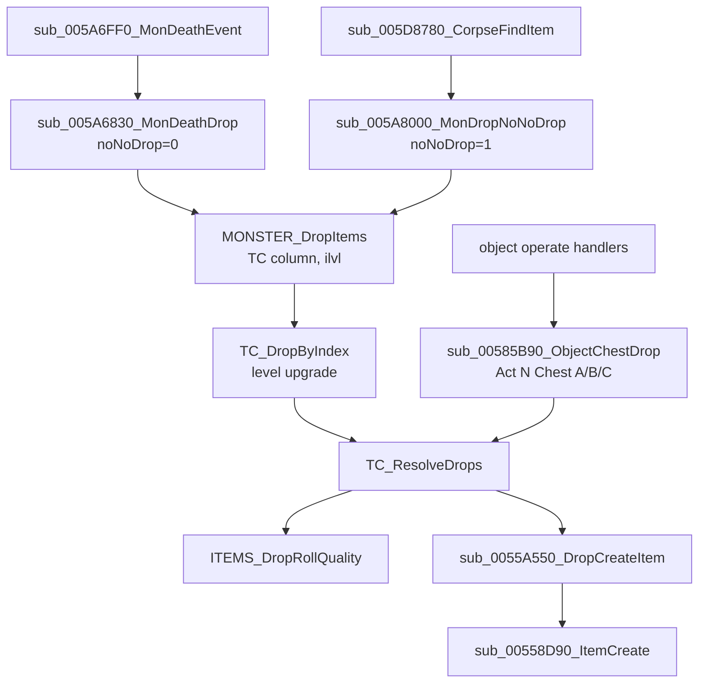

# 0001 — Treasure class resolution: from a monster's death to the item-creation call

> **Subsystem:** items/tc
> **Question:** Which TC does a kill use, how does the game walk it (picks, NoDrop, recursion, ratios), which seed does each draw come from, and what does item creation receive?
> **Date:** 2026-10-11   **Plan:** 0004 (Phase 1)   **Status:** open (Phase 1 read `[I]`; Phase 1b cross-check done; Phase 2 done: 328/328 resolver calls of run:2026-10-11-tc-drops reproduced by `tools/tc.py replay`, since plan 0010 Phase 2 also with the quality roll modelled and no oracle; plan 0011: party count `[C]` by run:2026-10-12-tc-party (175/175 calls, two clients); champion column and champion-before-unique order `[C]` by run:2026-10-12-tc-champion (124/124 calls, Nightmare, 2 champions); superunique-first order and Normal/Hell champions stay `[I]`; plan 0020 Phase 2: the classic total, the classic scan with no skipped entry, and the throwable refund `[C]` by run:2026-10-13-quality (485/485 classic calls); the classic skip, miss, `version` reject and Long Sword fallback stay `[I]`; plan 0038 batch S2a, 2026-10-16: 20 statements raised and 18 in part over 166 kept stock logs, tables and a second xref tool, 8 reclassified, [§ Plan 0038 batch S2a](#plan-0038-batch-s2a-2026-10-16); plan 0038 batch H2a, 2026-10-20: 9 statements raised and 4 in part by run:2026-10-20-sweep-items-tc, [§ Plan 0038 batch H2a](#plan-0038-batch-h2a-2026-10-20); plan 0038 batch H2b, 2026-10-20: 1 statement raised and 1 in part by run:2026-10-20-sweep-items-chain, [§ Plan 0038 batch H2b](#plan-0038-batch-h2b-2026-10-20))

Names of structs and fields are ours. "Game" is the server game object passed in ECX (`game+0x6D`, `game+0x70`, seed
`+0xD0` as in [rng/0002](../rng/0002-seed-tree.md)). "Source unit" is the unit the drop comes from (the dying monster, or
the chest object). A "unit seed" is `unit+0x20` ([rng/0002](../rng/0002-seed-tree.md)). Unit type 0 = player,
1 = monster, 4 = item (`unit+0x00`), class id at `unit+0x04`. Stat ids are `itemstatcost` record numbers:
12 `level`, 14 `gold`, 79 `item_goldbonus`, 80 `item_magicbonus`, 100 `monster_playercount`.

## Answer (summary)

The tags below are those of the Phase 1–2 record. [§ Plan 0038 batch S2a](#plan-0038-batch-s2a-2026-10-16) raises
further statements; where it lists one, its tag and evidence take precedence over the bullet here.

- [C] **Two game fields steer every branch.** `game+0x6D` (u8) is the difficulty index 0–2 and `game+0x70` (u32) is
  non-zero in an expansion game. Three readers agree: the area-level lookup indexes `levels` `MonLvl1..3` with `+0x6D`
  (`< 3` checked) and switches to `MonLvl1Ex..3Ex` when `+0x70 ≠ 0`, the monster drop indexes the `monstats`
  `TreasureClass*` columns with `+0x6D × 8` (the stride between the normal, `(N)` and `(H)` groups), and the resolver
  uses `+0x70` to choose between the classic and expansion probability sums. (fn:sub_0061DCA0_LevelMonLvl@0x0061DCA0,
  fn:MONSTER_DropItems@0x005A6600, fn:TC_ResolveDrops@0x0055A6D0, tbl:Levels.txt:MonLvl1Ex, tbl:MonStats.txt:TreasureClass1(N))
- [I] **Monster death → TC.** `MONSTER_DropItems` takes the difficulty's group of four `monstats` TC columns and picks:
  superunique → `superuniques` record `+0x2C + 2·diff` (or `TreasureClass3` if the record is missing); otherwise
  champion (monster type flag `0x04`) → `TreasureClass2`; unique (flag `0x08`) → `TreasureClass3`; anything else,
  minions included → `TreasureClass1`. Then `TreasureClass4` replaces it when `TCQuestId ≠ 0`, the column is set, and the
  killer's player has not completed that quest (three quest-state tests, left to `items/quest-drops`).
  (fn:MONSTER_DropItems@0x005A6600, tbl:MonStats.txt:TreasureClass1..4, tbl:MonStats.txt:TCQuestId, tbl:MonStats.txt:TCQuestCP)
- [C] **TC column for normal, minion, unique and superunique monsters (Normal and Nightmare):** in all 317 monster calls
  of run:2026-10-11-tc-drops, the base TC is `monstats` `TreasureClass1`/`TreasureClass1(N)` for monsters with neither type flag `0x04` nor `0x08`
  (minions, flag `0x10`, included), `TreasureClass3`/`TreasureClass3(N)` for unique monsters (flags `0x09`), and the
  `superuniques` row's `TC`/`TC(N)` for superuniques (flags `0x0b`: Bishibosh → `Act 1 Super A` in Normal, Rakanishu →
  `Act 1 (N) Super B` in Nightmare). The champion branch is the next bullet; the quest TC is not confirmed (§3). `tools/tc.py replay`
  checks the base TC of every monster call against `monstats.bin` / `superuniques.txt` (317/317 across the eleven logs:
  280 normal, 28 minion, 7 unique, 2 superunique, 0 champion). (fn:MONSTER_DropItems@0x005A6600, tbl:MonStats.txt:TreasureClass1, tbl:MonStats.txt:TreasureClass3, run:2026-10-11-tc-drops: fifth session, `tools/tc.py replay`)
- [C] **Champion column, and champion before unique (Nightmare, expansion, single player, one monster class):** a
  monster with type flag `0x04` takes `TreasureClass2`, and the champion test runs before the unique test. Both
  champion kills of run:2026-10-12-tc-champion are class 61 (`fallenshaman4`) with `mflags=0d`: live champions carry
  the champion flag `0x04` **together with** `0x08` (the unique flag) and `0x01`. Both logged `DROP base=698`,
  `Act 1 (N) Champ C` = `TreasureClass2(N)` of row 61, not 783 `Act 1 (N) Unique C` = `TreasureClass3(N)`, which a
  unique test placed first would have chosen; a unique of the same class (`mflags=09`) in the same run logged
  `DROP base=783`. `tools/tc.py replay` asserts the base TC of all 121 monster calls of the run (98 normal, 17 minion,
  2 champion, 4 unique). Not exercised: Normal and Hell champions, other classes, a classic game, and a monster with
  both `0x02` and `0x04` (every logged superunique has `0x0b`), so the superunique-first part of the order stays `[I]`.
  (fn:MONSTER_DropItems@0x005A6600 0x005A66C0–0x005A66D8, fn:sub_005A0180_MonTypeFlag@0x005A0180, tbl:MonStats.txt:TreasureClass2, run:2026-10-12-tc-champion)
- [I] **Level-based TC upgrade** happens only for the top TC of a monster drop, and only if all of these hold: expansion
  game, difficulty > 0, the source is a monster, and its `monstats` row has neither `noRatio` nor `boss`. Then
  `TC_GetByIndex(tc, mlvl)` (mlvl = the monster's `level` stat) walks forward from the base TC while the next TC has the
  same `group` and its `level` ≤ mlvl, and returns the last one reached. Sub-TCs are never upgraded (`TC_GetByIndex(…, 0)`).
  (fn:TC_DropByIndex@0x0055AFA0, fn:TC_GetByIndex@0x00654E00, tbl:TreasureClassEx.txt:group, tbl:TreasureClassEx.txt:level)
- [C] **Level upgrade, observed part:** in an expansion game the upgrade level is 0 for every Normal monster drop (53
  calls) and the monster's level in Nightmare (167 calls, normal, minion, unique and superunique sources). The forward walk
  reproduces in every call: 12 upgrades one step up the group (`Miss A` → `Miss B`, `H2H A` → `H2H B`, `Unique A` →
  `Unique B` at mlvl 40), 9 calls kept at `H2H B` because the next TC's level is 41, and 146 calls keep a base TC whose
  own `level` is above mlvl (`Act 1 (N) Super B`, level 41, included). run:2026-10-12-tc-champion adds 121 Nightmare
  monster calls, among them the champion group (group 18): both champions walk two steps, `Act 1 (N) Champ C` (698,
  level 41) → `Act 2 (N) Champ B` (700, level 44) at mlvl 44, stopping before `Act 2 (N) Champ C` (level 45); and one
  `boss` monster (Andariel, class 156) logged upgrade level 0 in Nightmare. The `noRatio` and classic gates were not
  exercised; no stock `noRatio` monster has a TC. `tools/tc.py replay` asserts the upgrade level (`DROP lvl`) of all 438
  monster calls (317 + 121) and the forward walk from it. (fn:TC_DropByIndex@0x0055AFA0, fn:TC_GetByIndex@0x00654E00, tbl:MonStats.txt:noRatio, tbl:MonStats.txt:boss, run:2026-10-11-tc-drops: fifth session, `tools/tc.py replay`; run:2026-10-12-tc-champion)
- [I] **Every TC-level draw steps the source unit's seed** (`unit+0x20`): the pick/NoDrop roll is an inlined guarded
  range draw identical to `RNG_Range` (`n < 1` → 0 with no step; power of two → mask; else `low % n`). The
  per-item quality roll (`ITEMS_DropRollQuality`, 0–6 calls of `RNG_RangeB`) draws from the same seed, so the
  TC walk and the quality rolls interleave on it. Item units themselves get their seeds from the **game** seed
  `+0xD0` (two draws in `sub_00555230_SUnitCreate`), because drops pass no seed in the creation parameters.
  (fn:TC_ResolveDrops@0x0055A6D0 0x0055A9FC–0x0055AA3F, fn:ITEMS_DropRollQuality@0x00558640, fn:sub_00558D90_ItemCreate@0x00558D90)
- [C] **Picks.** Positive `Picks`: each pick draws `roll = rand(total + NoDrop')` (`total` = expansion or classic sum);
  `roll < NoDrop'` drops nothing, else `roll − NoDrop'` selects the entry. Negative `Picks`: no draw; pick *k*
  (0-based, `k < |Picks|`) selects the entry whose cumulative range contains *k*, so entry *i* fires `Prob_i` times in
  order. (fn:TC_ResolveDrops@0x0055A6D0, tbl:TreasureClassEx.txt:Picks, run:2026-10-11-tc-drops: 328 calls reproduced by `tools/tc.py`, every positive pick draw, `Picks = -3` unique TCs and `Picks = -4` superunique TCs)
- [I] **Picks, unobserved edges.** A negative-`Picks` walk stops early when `k ≥ total` (every negative-`Picks` TC in the
  run had `total == |Picks|`: `Act 1 Unique A/B` 3/3, `Act 1 Super A` / `Act 1 (N) Super B` 4/4, so the stop never
  fired), and `Picks = 0` is stored as 1 at load (no such TC was hit). (fn:TC_ResolveDrops@0x0055A6D0, tbl:TreasureClassEx.txt:Picks)
  *2026-10-20, plan 0038 batch H2a:* the stop is now `[C]`: it fired on the classic Countess (`Picks` −2, classic total
  1; `NEG roll=1 total=1`, then `TCEND` with no `SEL`), [§ Plan 0038 batch H2a](#plan-0038-batch-h2a-2026-10-20) tc 34
  (fn:TC_ResolveDrops@0x0055A6D0 0x0055AABC–0x0055AAC4, run:2026-10-20-sweep-items-tc). `Picks = 0` stays `[I]`, d-none.
- [I] **NoDrop scaling** (positive picks, `NoDrop ≠ 0`, recomputed on every pick): `n = party + (players − party) / 2`
  (C signed division), where `party` = alive members of the killer's party in the killer's level, 1 if none, clamped to
  ≤ 8, and `players` = alive player units in the game, raised to the `/players` value in some game types. A monster
  source caps `n` at `max(1, monster_playercount)`. For `n > 1`, with x87 values `r = ND/(ND+T)`, `p = r^n`
  (repeated multiplication), `NoDrop' = trunc(T·(1 − (1 − p)) / (1 − p))`, or 0 when `1 − p == 0`.
  (fn:TC_ResolveDrops@0x0055A6D0 0x0055A8A1–0x0055A9D7, fn:sub_00535790_PlayerCount@0x00535790, fn:sub_005408E0_PartyCountInLevel@0x005408E0)
- [I] **Recursion** is an explicit stack of up to 64 frames `{tc, picksLeft, ratio[6]}`. A sub-TC entry pushes a frame
  (reusing the current frame when its picks are exhausted, a tail call). The child's ratio is
  `max(parent, sub-TC)` per field (`Magic`, `Rare`, `Set`, `Unique` and two unnamed fields). Output stops entirely
  after `max` items (6 for monster drops). (fn:TC_ResolveDrops@0x0055A6D0 0x0055AB68–0x0055AC2F)
- [C] **Item creation leaves the source seed alone:** the source unit's seed is the same before and after every
  `sub_0055A550_DropCreateItem` call of the run (all created items of 328 calls). (fn:sub_0055A550_DropCreateItem@0x0055A550, run:2026-10-11-tc-drops)
- [C] **NoDrop' for party 1 and 2:** with `party = 1` and `players` 1 or 8 (`/players 8`), `n` = 1 or 4, and with
  `party = 2`, `players = 2` (two clients), `n = 2`; `NoDrop'` equals the x87 formula of §6 at 53-bit precision
  (control word `0x027F` logged, in single player and in the TCP/IP host) in every call, for (NoDrop, total) =
  (100, 60), (125, 38) and (100, 47). (fn:TC_ResolveDrops@0x0055A6D0 0x0055A93B, run:2026-10-11-tc-drops, run:2026-10-12-tc-party: 68 `NDIN n=2` lines)
- [C] **Party count: level, not distance.** `party` counts the killer and the members of the killer's party that are
  in the killer's level (room → level id equality); a partied player in the same level counts at any distance
  (`party = 2` in 44 calls with the partner 26–375 subtiles away, 37 of them more than two screens), while an
  unpartied player in the same level (4 calls) and a partied player in another level (84 calls) give `party = 1`.
  `tools/tc.py replay` checks every logged `PARTY` against this rule computed from the logged player positions, levels
  and party list. Not exercised: a dead member, more than two players, the clamp at 8, and a monster killer (the
  owner path). (fn:sub_005405A0_PartyForEachInLevel@0x005405A0, fn:sub_005408E0_PartyCountInLevel@0x005408E0, run:2026-10-12-tc-party)
- [C] **Hand-off to the quality roll (expansion, Normal and Nightmare, single player, player killers):** for an item
  entry with no forced quality the resolver calls `ITEMS_DropRollQuality` with the picked item's index (EAX),
  its own `ilvl` argument (ECX), the current frame's ratio words (the first four, `Magic`, `Rare`, `Set`, `Unique`,
  are read) and its killer, on the source unit's seed; the returned code 1–7 is the quality handed to creation.
  `tools/tc.py replay --quality model` feeds the model exactly these model-side values (item from the selected entry,
  `ilvl` from the call, ratio words from the frame after inheritance, magic find of the killer from its save) and
  reproduces every quality, every seed after the roll and the final seed of 328 + 124 + 1269 calls with no oracle.
  (fn:TC_ResolveDrops@0x0055A6D0 0x0055ADBA, fn:ITEMS_DropRollQuality@0x00558640, run:2026-10-11-tc-drops,
  run:2026-10-12-quality)
- [I] **Hand-off, the rest.** For an item entry: quality = 7 (unique entry), 5 (set entry), the caller's forced quality, or
  the roll above, whose result means 1 low, 2 normal, 3 superior, 4 magic, 5 set, 6 rare, 7 unique (0 only for a
  missing record, see [items/0002](0002-quality-roll.md)); then `sub_0055A550_DropCreateItem(game, item, source,
  quality, uniqueOrSetIndex+1, upgradeFlags)` builds a 0x84-byte creation record (source unit, game, item ilvl = source's
  `level` stat or area level, drop position, quality) and calls `sub_00558D90_ItemCreate`. `mul=` scales a gold pile by
  `mul/256`; gold find is applied afterwards. (fn:sub_0055A550_DropCreateItem@0x0055A550, fn:sub_005589A0_DropGoldFind@0x005589A0)

## Leads used

Phase 1 read no community TC documentation; the code was located from our own symbols (`TC_GetByIndex` callers,
data/0001). Phase 1b (2026-10-11) then compared the finished claims with two registered sources, both written for
1.10/1.11 LoD (evidence-rules § Community cross-checks). Agreement promotes nothing: every tag above is unchanged.

- [L] src:pd-item-generation: TC columns by monster type: `TreasureClass2` = champion, `TreasureClass3` = unique
  (non-quest), `TreasureClass4` = unique quest drop, each repeated per difficulty. **held with refinement**
  Detail: 1.14d picks superunique → champion → unique → normal (§3), and the quest TC replaces *whichever* TC was chosen
  when `TCQuestId` is set and the quest is open; it is not tied to the unique flag (0x005A6705–0x005A67F1).
  [run:2026-10-12-tc-champion](experiments.md#run2026-10-12-tc-champion) (2026-10-12) logged two Nightmare champions on
  `TreasureClass2(N)`; the champion column is now `[C]` by that run, not by this source. A further refinement the
  source does not state: live champions also carry the unique flag (`mflags=0d`), so the champion column wins only
  because its test comes first (§3). Verdict unchanged.
- [L] src:hrus-mf-guide: champions all drop from the champion TC group, and minions use the regular monster TC.
  **held** Detail: minions carry neither type flag `0x04` nor `0x08` and take `TreasureClass1` (§3). The champion half
  was observed in [run:2026-10-12-tc-champion](experiments.md#run2026-10-12-tc-champion): both champions' drops started
  in `Act 1 (N) Champ C` and upgraded within the champion group (group 18) to `Act 2 (N) Champ B`. The run, not this
  source, makes the champion column `[C]`. Verdict unchanged.
- [L] src:pd-item-generation: superunique TC. **not covered** Detail: neither source says where a superunique's TC
  comes from; 1.14d reads `superuniques +0x2C + 2·diff`, falling back to `TreasureClass3` (§3).
- [L] src:pd-item-generation: level upgrade in Nightmare and Hell only; `boss=1` monsters never upgrade; TCs included in
  the selected TC are not upgraded; the game "selects the highest level TC in the group that is equal to or less than the
  Mlvl". **held with refinement** Detail: 1.14d adds three conditions the source omits (expansion game only, source is a
  monster, `noRatio` also blocks, 0x0055AFAA–0x0055AFE8), and the walk only moves *forward* from the base TC, so a base
  TC whose own `level` exceeds mlvl is kept rather than replaced by a lower one (§4).
- [L] src:hrus-mf-guide: upgrade "until the monster level > actual TC level" to the next TC of the same group.
  **held** Detail: same forward walk as §4; the source does not state the difficulty or expansion gates.
- [L] src:hrus-mf-guide: negative `Picks` are not random: the monster always takes the given number of picks from
  the named sub-TCs (example: 2 from one entry, 2 from the next). **held with refinement** Detail: in 1.14d entry *i*
  fires `Prob_i` times in entry order with no draw, and the loop stops early once the pick index reaches the
  probability total (§5).
- [L] src:pd-item-generation: Countess's `-2` TC "drops left to right across her TC until she reaches 2". **held**
  Detail: matches the cumulative-range walk of §5.
- [L] src:pd-item-generation: `NewNoDrop = int(ProbSum / (1/((NoDrop/(NoDrop+ProbSum))^N) − 1))`. **held with refinement**
  Detail: algebraically the same as §6 (`p·T/(1 − p)`), but 1.14d evaluates `(1 − (1 − p))·T/(1 − p)` in x87 with `p` built
  by `n − 1` multiplications, returns 0 when `1 − p == 0`, applies it only for `n > 1`, and caps `n` at the monster's
  `monster_playercount` (stat 100), which the source does not mention (0x0055A8A1–0x0055A9D7).
- [L] src:hrus-mf-guide: `New NoDrop = ND^NDE/(1 − ND^NDE) · SumProb`, `ND = NoDrop/(NoDrop + Sum)`. **held with refinement**
  Detail: same refinements as the entry above.
- [L] src:pd-item-generation: N counts 1 for the killer, 1 for each player "partied with you and within two screens
  of you", 0.5 for every other player, rounded down. **contradicted** Detail: 1.14d has no distance test. Party members
  count in full when they are alive **in the killer's level** (`sub_005405A0_PartyForEachInLevel` compares
  unit → room → level id, `level+0x1D0`; re-read 2026-10-11), and the rest count half through
  `party + (players − party) / 2`. Backlog: [2026-10-11 reverser → architect, *NoDrop party test*](../../backlog.md).
  Settled by [run:2026-10-12-tc-party](experiments.md#run2026-10-12-tc-party): a partied player 311–375 subtiles away
  in the killer's level counted (`party = 2`); the verdict stays **contradicted**.
- [L] src:hrus-mf-guide: unpartied players, or partied players "not close to you (around 2 screens)", count 0.5.
  **contradicted** Detail: as above; same [backlog entry](../../backlog.md) (*NoDrop party test*).
- [L] src:pd-item-generation: `/players` adds only unpartied players: settings 1–2 → N 1, 3–4 → 2, 5–6 → 3,
  7–8 → 4. **held with refinement** Detail: 1.14d takes `players = max(alive players, /players value)` (game types
  1–3 only, `sub_00535790_PlayerCount`), which gives exactly that table for a lone player; with real players it is a
  maximum, not an addition.
- [L] src:pd-item-generation and src:hrus-mf-guide: at most 6 items drop per kill. **held** Detail: `max = 6` for monster
  drops; the whole resolution stops at the 6th created item (§5, §8).
- [L] src:pd-item-generation: how the `Unique`/`Set`/`Rare`/`Magic` columns combine through nested TCs. **not covered**
  Detail: neither registered source states it; 1.14d takes the per-field maximum (§7). A forum post that appears to say
  "highest per quality" could not be fetched and is not cited.
- [L] src:pd-item-generation: `ArmoN`/`WeapN` hold the items with level in `(N − 3, N]`, `Armo03` … `Armo87`; item
  weights by item type (3 for most, 2 claws, 1 class-specific, 1 wands/staves/sceptres). **held with refinement**
  Detail: 1.14d builds the window `L − 3 < level ≤ L` for L up to 96 (160 TCs, the top ones only as full as the item
  levels allow), weights each item by its `type`'s `Rarity` (minimum 1), and also filters `quest`, `spawnable` and type
  38 (§9). The per-type weights quoted were not compared against `ItemTypes.Rarity`.

## Functions

| Address | Name | Role | Tag |
|---|---|---|---|
| `0x005A6FF0` | `sub_005A6FF0_MonDeathEvent` | monster death event (reached through the table at `0x006E2260`); calls the death drop | C |
| `0x005A6830` | `sub_005A6830_MonDeathDrop` | death drop guard: skips if `unit+0xC4` bit 17 is set or the spot is blocked; `noNoDrop = 0` | C |
| `0x005A8000` | `sub_005A8000_MonDropNoNoDrop` | the same drop with `noNoDrop = 1`; called by the corpse skill `0x005D8780` | C |
| `0x005D8780` | `sub_005D8780_CorpseFindItem` | skill on a corpse (`skills` record, corpse state `0x76`), rolls `RNG_Range(monster seed, 100)` (that roll unmodelled, `[I]`). *2026-10-21:* the rolls are two `RNG_Range(…, 100)` on the caster's seed (`EDX` → `edi`, `add edi, 0x20` at `0x005D8808`; `0x005D8814`, `0x005D882F`), `[I]`, [skills/0012](../skills/0012-barbarian.md) § 4 | C |
| `0x005A6600` | `MONSTER_DropItems` | TC column choice, ilvl, calls `TC_DropByIndex` | C |
| `0x0055AFA0` | `TC_DropByIndex` | level-upgrade gate, `TC_GetByIndex`, `TC_ResolveDrops` | C |
| `0x00654E00` | `TC_GetByIndex` | index → TC, with the group/level walk | I |
| `0x0055A6D0` | `TC_ResolveDrops` | the pick loop (all of the walkthrough) | C |
| `0x00558640` | `ITEMS_DropRollQuality` | quality code 1–7 (0 on a missing record) from `itemratio`, ratios, MF; 0–6 draws on the source seed; read in [items/0002](0002-quality-roll.md) | I |
| `0x0055A550` | `sub_0055A550_DropCreateItem` | builds the creation record, calls item creation | C |
| `0x00558D90` | `sub_00558D90_ItemCreate` | `.\ITEMS\Items.cpp` creation; seeds from the record only if asked | C |
| `0x005589A0` | `sub_005589A0_DropGoldFind` | gold × (100 + GF) / 100 | C |
| `0x00558200` | `sub_00558200_UnitDropLevel` | ilvl source: monster/player `level` stat, else area level; ≥ 1 | I |
| `0x0061DCA0` | `sub_0061DCA0_LevelMonLvl` | `levels` `MonLvl[diff]` or `MonLvlEx[diff]` | I |
| `0x00535790` | `sub_00535790_PlayerCount` | alive players, raised to the `/players` override in game types 1–3 | I |
| `0x00535780` | `sub_00535780_SetPlayersOverride` | `/players N` stores N if `N ≤ 8` (unsigned) | I |
| `0x005408E0` | `sub_005408E0_PartyCountInLevel` | alive party members in the player's level | C |
| `0x005405A0` | `sub_005405A0_PartyForEachInLevel` | calls a callback for each party member in the player's level (level-id equality) | C |
| `0x005404F0` | `sub_005404F0_PartyCountAliveCb` | callback: count the member if not dead | I |
| `0x00620BB0` | `sub_00620BB0_UnitGetRoom` | a unit's room (path or static position by unit type) | I |
| `0x0061A1B0` | `sub_0061A1B0_RoomGetLevelId` | room → DRLG room → level → id (`+0x10`, `+0x58`, `+0x1D0`), through `0x0066BAB0` | I |
| `0x00540290` | `sub_00540290_PartyFind` | party record by id in the list `game+0x1D2C` (`+4` first; record `+0` u16 id, `+4` members `{unit id, next}`, `+8` next) | I |
| `0x00540710` | `sub_00540710_PartyIdOfUnit` | party id of a player, or `0xFFFF` | I |
| `0x00552F60` | `sub_00552F60_GameFindUnit` | unit by type and id in the game's hash lists (id `unit+0x0C`) | I |
| `0x006488C0` | `sub_006488C0_PathGetX` | dynamic path `+0x02` u16 subtile x | I |
| `0x00648900` | `sub_00648900_PathGetY` | dynamic path `+0x06` u16 subtile y | I |
| `0x00648A80` | `sub_00648A80_PathGetRoom` | dynamic path `+0x1C` room | I |
| `0x004F5610` | `sub_004F5610_WindowCreate` | main window creation; stops with "Only one copy of Diablo II may run at a time" when `FindWindowA` finds its class (plan 0011 harness) | I |
| `0x005541B0` | `sub_005541B0_UnitIsDead` | death modes / flag `+0xC6` bit 0 | I |
| `0x0058F0D0` | `sub_0058F0D0_MonsterOwner` | a monster's owning player unit, else 0; `C` for a summon only ([items/0002](0002-quality-roll.md) § 7) | C |
| `0x005A03A0` | `sub_005A03A0_MonSuperUniqueId` | superunique index or −1 (type flag `0x02`) | I |
| `0x005A0180` | `sub_005A0180_MonTypeFlag` | `monsterData+0x16 & mask` | I |
| `0x006556E0` | `sub_006556E0_SuperUniqueGet` | `superuniques` record (0x34 B) or 0 | I |
| `0x00451F80` | `MONSTATS_GetRecord` | `monstats` record (0x1A8 B) by index or 0 | C |
| `0x006335F0` | `ITEMS_GetRecord` | `g_pItems` record (0x1A8 B) by index or 0 | I |
| `0x00628700` | `ITEMS_GetType` | item record `+0x11E` (`type`) | I |
| `0x00628860` | `ITEMTYPES_IsThrowable` | itemtypes record `+0x10` (`Throwable`) | C |
| `0x00629A90` | `ITEMS_IsType` | item index is of type t (`type`, then `type2`, through the equivalence bitmap) | I |
| `0x00629BB0` | `ITEMS_UnitIsType` | same test for an item unit | I |
| `0x00585B90` | `sub_00585B90_ObjectChestDrop` | object/chest drop: "Act N Chest A/B/C" TC, calls `TC_ResolveDrops` | I |
| `0x00654E80` | `TC_GetChestTC` | `g_ChestTCs[(act + 5·diff)·3 + tier]` | I |
| `0x0065A2C0` | `TC_BuildChestTable` | fills `g_ChestTCs` from the TC names at load | I |
| `0x00654010` | `TC_GrowEntries` | entry array realloc (0x1C per entry) | I |
| `0x00654080` | `TC_AddEntry` | appends an entry, stamps the running sums | C |
| `0x006540C0` | `TC_SetEntryProb` | adds a probability to the sums (classic sum only if not expansion-only) | C |
| `0x00637910` | `ITEMRATIO_Select` | `itemratio` row by uber/class flags, version ≤ arg, highest version; read in [items/0002](0002-quality-roll.md#2-row-selection--itemratio_select-0x00637910) | I |
| `0x00682FD0` | `CRT_ftol2` | x87 → int truncation | I |

## Walkthrough

### 1. Runtime TC layout (built at load, read by the resolver)

`g_pTreasureClasses` entries are 0x2C bytes ([data/0001 §7](../data/0001-excel-loader.md#7-treasure-classes-at-load-time)).
`TC_LoadTreasureClassEx` and `TC_ParseItemCell` write the fields, `TC_ResolveDrops` reads them, and the offsets agree.
That is the second-code-path corroboration for the layout below. Header in [`re/types/tc.h`](../../../re/types/tc.h).

| off | type | field | written from |
|---|---|---|---|
| `+0x00` | s16 | group | `group` + number of auto-TC item types (5) if `group ≠ 0`, else 0 |
| `+0x02` | u16 | level | `level` |
| `+0x04` | s32 | nEntries | |
| `+0x08` | s32 | totalClassic | sum of `Prob` of entries **not** flagged expansion-only |
| `+0x0C` | s32 | totalExp | sum of all `Prob` |
| `+0x10` | s32 | picks | `Picks` (0 stored as 1) |
| `+0x14` | s32 | noDrop | `NoDrop` |
| `+0x18` | u16 | — | not written by the loader (0) |
| `+0x1A` | u16[6] | ratio | `Magic`, `Rare`, `Set`, `Unique`, then two words from record `+0x30/+0x32` (always 0) |
| `+0x28` | ptr | entries | 0x1C bytes each |

[C] layout by writer/reader agreement (0x006547D0, 0x00654440, 0x0055A6D0).

Entry (0x1C bytes): `+0x00` cumClassic, `+0x04` cumExp (the sums **before** this entry was added); `+0x08` u16
index (item record, or TC index); `+0x0A` u16 (unique/set record index, or the `mul=`/`ma=`/`mg=` value); `+0x0C` u8
flags: `0x01` unique, `0x02` set, `0x04` TC, `0x10` expansion-only; `+0x0E..+0x18` u16 ×6 from `cm=`, `cr=`, `cs=`,
`cu=`, `ce=`, `cg=` (same order as the TC ratio words).

- [I] An entry is **expansion-only** (flag `0x10`, excluded from `totalClassic`) when it is an item whose `version`
  (`+0xF6`) ≥ 100, any unique or set reference, or a sub-TC whose own `totalClassic` is 0. (0x00654440, 0x006540C0, tbl:Weapons.txt:version)
- [I] Only `mul=` occurs in the shipped `treasureclassex.txt` (81 cells, all `gld,mul=…`). No `cu=`/`cs=`/`cr=`/`cm=`/`ce=`/`cg=`
  and no non-zero record `+0x30` exist, so the ratio-modifier and upgrade-flag paths below never run with stock data.
  (fn:TC_ParseItemCell@0x00654440, tbl:TreasureClassEx.txt:Item1)

### 2. Entry points



- [I] `TC_GetByIndex` has two callers, `TC_DropByIndex` and `TC_ResolveDrops` (sub-TCs). `TC_ResolveDrops` has two,
  `TC_DropByIndex` (monsters) and `sub_00585B90_ObjectChestDrop` (objects). `TC_DropByIndex` has one,
  `MONSTER_DropItems`. Gambling and vendor stock do not reach the resolver through these functions. (xrefs of 0x00654E00, 0x0055A6D0, 0x0055AFA0)
- [I] The object path (named only; callers belong to `objects`): `TC_GetChestTC(diff, act, tier)` reads
  `g_ChestTCs`, which `TC_BuildChestTable` filled at load with `"Act %d%s Chest %s"` for diff suffix `""`/`" (N)"`/`" (H)"`,
  act 1–5 and `A`/`B`/`C`. The resolver gets the object as source, the operating player as killer, `max = 6`, an output
  array, and no level upgrade. (0x00585B90, 0x00654E80, 0x0065A2C0, data:g_ChestTCs@0x0096C5F4)
- [C] **The chest tier** (added 2026-10-16, plan 0038 batch S4b; the arithmetic `0x00585C01`–`0x00585C87`, read with
  objdump and Ghidra):

  ```
  lid  = RoomGetLevelId(UnitGetRoom(object))          ; the chest's own room's level (0x00585BF0, 0x00585C03)
  act  = DRLG_ActFromLevelId(lid)                       ; 0x00585C0B
  v    = LevelMonLvl(lid, diff, exp)                    ; Levels +0x10 + 2·diff (MonLvl) or +0x16 + 2·diff (MonLvlEx),
                                                        ; s16; 1 when diff ≥ 3, lid ≤ 0 or lid ≥ the level count
  a    = LevelMonLvl(T[act].lo, diff, exp)              ; T = 0x006E1988, two level ids per act
  b    = LevelMonLvl(T[act].hi, diff, exp)
  t    = (|b − a| + 1) / 3                              ; signed i32 ÷ 3 (imul 0x55555556, add the sign bit)
  tier = v < a + t ? 0 : (v ≥ a + 2t ? 2 : 1)           ; signed compares (jge, setge)
  tc   = TC_GetChestTC(diff, act, tier)
  ```

  The table at 0x006E1988 holds `(2, 37)`, `(41, 73)`, `(76, 102)`, `(104, 108)`, `(109, 136)` for acts I–V. Corroboration:
  `python3 -I tools/tc_sweep.py chest` reproduces the TC of all 59 object calls of run:2026-10-15-objects (three
  difficulties, classic and expansion, acts I, II, III and V, tiers 0–2) from this model. The model takes the level from
  the operating player's `PLR` line, since the logger has no line naming the chest's level. `python3 -I
  tools/sweep_s4b.py chestroom` shows that this is the chest's own level in every call. It ties each call's source
  object (`TCR src`) to the room it was created in (`OI0`, or `OU0` then `OUX`) and that room to its `CB` level: 59 of 59
  equal the `PLR` level. Both tier boundaries occur in the logged calls (`v = a + t` in 14, `v = a + 2t` in 5), so the
  strictness of both compares is decided by the logs. The `|b − a|` and the return-1 guards of `LevelMonLvl` have no
  stock observable: `b ≥ a` for every act, difficulty and game type, and every chest's level is a valid id (checked at
  the S4b review). (fn:sub_00585B90_ObjectChestDrop@0x00585B90, fn:sub_0061DCA0_LevelMonLvl@0x0061DCA0,
  fn:DRLG_ActFromLevelId@0x006427F0, fn:TC_GetChestTC@0x00654E80, tbl:Levels.txt:MonLvl, run:2026-10-15-objects)
- [C] **The chest drop passes its tier as the resolver's `ilvl`** (added 2026-10-16, plan 0038 batch S2a; raised in
  batch S4b): the call at 0x00585CD2 pushes the tier (0, 1 or 2) in the `ilvl` slot, and its own forced-quality argument
  in the forced-quality slot. Since the resolver's `ilvl` feeds only the quality roll (§ 8), a chest drop's quality roll
  runs at `ilvl` 0–2, while the item's own level is taken again from the source. Corroboration: the 59 chest calls of
  run:2026-10-15-objects log `TCR ilvl` = the modelled tier in every call (`tc_sweep.py chest`; addendum 2026-10-16
  under that run). (fn:sub_00585B90_ObjectChestDrop@0x00585B90, fn:TC_ResolveDrops@0x0055A6D0, run:2026-10-15-objects)

### 3. Monster TC selection — `MONSTER_DropItems` (0x005A6600)

Arguments: ECX game, stack `(monster, noNoDrop, ctx)`, with `ctx+8` = killer unit. `diff = game+0x6D`.

```c
mon  = MONSTATS_GetRecord(monster->classId);
ilvl = sub_00558200_UnitDropLevel(monster);        // monster: level stat 12; ≥ 1
su   = sub_005A03A0_MonSuperUniqueId(monster);     // −1 unless type flag 0x02
if (su != -1) {
    rec = sub_006556E0_SuperUniqueGet(su);
    tc  = rec ? rec->tc[diff] /*+0x2C + 2·diff*/ : mon->tc[diff][2] /*TreasureClass3*/;
} else if (MonTypeFlag(monster, 0x04)) tc = mon->tc[diff][1];   // TreasureClass2
else if   (MonTypeFlag(monster, 0x08)) tc = mon->tc[diff][2];   // TreasureClass3
else                                   tc = mon->tc[diff][0];   // TreasureClass1
if (mon->TCQuestId && mon->tc[diff][3] && ctx && (p = ctx->killer)) {
    if (p->type != 0) p = owner-or-summoner player of p;            // 0x0058F0D0, 0x0063A690/0x00625760(0x800)
    if (p && p->type == 0 && (q = questData(p)) &&
        QuestState(q, TCQuestId, 15) != 1 && QuestState(q, TCQuestId, 1) != 1 &&
        QuestState(q, TCQuestId, TCQuestCP) != 1)
        tc = mon->tc[diff][3];                                       // TreasureClass4
}
TC_DropByIndex(game, monster, ctx->killer, tc, /*forcedQuality*/0, ilvl, noNoDrop, /*out*/0, /*count*/0, /*max*/0);
```

- [I] Column offsets: `monstats +0x86 + 8·diff + 2·k`, k = 0..3 (TreasureClass1..4). (0x005A66AC–0x005A66FA, 0x005A67E9, tbl:MonStats.txt:TreasureClass1)
- [I] The order is superunique, then champion, then unique. A minion (no `0x04`/`0x08`) uses `TreasureClass1`.
  Type-flag meanings `0x02` superunique, `0x04` champion, `0x08` unique are inferred from which column each flag
  selects; the flag word is `monsterData+0x16` (`unit+0x14` → `+0x16`). (0x005A03A0, 0x005A0180)
- [C] Champion before unique, read in r2: when `sub_005A03A0_MonSuperUniqueId` returns −1 (0x005A66A0), the code tests
  `MonTypeFlag(monster, 4)` first (0x005A66C0–0x005A66CE) and takes `word [mon + diff·8 + 0x88]` (`TreasureClass2`,
  0x005A66D0); only if that fails does it test flag 8 (0x005A66DD–0x005A66EB) for `+0x8A` (`TreasureClass3`).
  `MonTypeFlag` returns `(flags16 & mask) ≠ 0` (0x005A0193–0x005A01A1), so a champion that also has `0x08` set still
  takes `TreasureClass2`. Live champions carry `0x0d` (`0x01 | 0x04 | 0x08`, logged low byte of the flag word), and
  both took `TreasureClass2(N)`. Corroboration: run:2026-10-12-tc-champion (Nightmare, class 61 only). The meaning of
  bit `0x01`, set on every logged unique (`0x09`), superunique (`0x0b`) and champion, but not on Andariel (`0x08`), is
  not read. (fn:MONSTER_DropItems@0x005A6600, fn:sub_005A0180_MonTypeFlag@0x005A0180, run:2026-10-12-tc-champion)
- [I] The quest replacement needs the killer to resolve to a player; `QuestState(…) == 1` on any of the three tests
  keeps the normal TC. The quest-state semantics are left to `items/quest-drops`. (0x005A6705–0x005A67F1, 0x0065C310)
- [I] The death drop is skipped when the monster unit has `+0xC4` bit 17 set, or when a collision test at its position
  (mask `0x801`) fails. Class 344 (`bonewall`) is a fatal error there. (0x005A6830)
  *2026-10-20, plan 0038 batch H2a:* both skips are now `[C]` (113 bit-17 and 2 collision skips of 973 death drops);
  the `bonewall` fatal error stays `[I]`, [§ Plan 0038 batch H2a](#plan-0038-batch-h2a-2026-10-20) tc 22 (fn:sub_005A6830_MonDeathDrop@0x005A6830,
  run:2026-10-20-sweep-items-tc).

### 4. Level upgrade — `TC_DropByIndex` (0x0055AFA0) and `TC_GetByIndex` (0x00654E00)

```c
lvl = 0;
if (game->expansion && game->difficulty > 0 && src && src->type == 1 &&
    (mon = MONSTATS_GetRecord(src->classId)) && !(mon->flags0C & 0x04 /*noRatio*/) && !(mon->flags0C & 0x40 /*boss*/))
    lvl = GetUnitStat(src, 12 /*level*/, 0);
tc = TC_GetByIndex(tcIndex, lvl);
if (tc) TC_ResolveDrops(game, src, killer, tc, forcedQ, ilvl, noNoDrop, out, count, max);

TC *TC_GetByIndex(u16 idx, int lvl) {
    if (idx == 0 || idx >= g_nTreasureClasses) return NULL;
    t = &g_TC[idx];
    if (lvl > 0 && t->group != 0 && t[1].group == t->group) {
        for (;;) {
            if (lvl < t[1].level) return t;          // next is too high: keep t
            t = t + 1;
            if (t[1].group != t->group) return t;     // end of the group run
        }
    }
    return t;
}
```

- [C] The base TC is always eligible whatever its own `level`; the walk only moves forward. 146 Nightmare calls keep a
  base TC whose `level` is above mlvl (Phase 1b case b). (0x00654E00, run:2026-10-11-tc-drops: fifth session)
- [I] Normal difficulty, classic games, `noRatio` monsters and `boss` monsters never upgrade. Superuniques do, unless
  their `monstats` row has `boss` or `noRatio`. (0x0055AFAA–0x0055AFE8, `0x006CE270` = bit 2, `0x006CE280` = bit 6,
  tbl:MonStats.txt:noRatio, tbl:MonStats.txt:boss)
- [I] The walk reads `t[1]` without a bound check. The loader stops at the first empty name, so the last loaded TC
  is `Pandemonium Key C` (index 1012, `group` blank → 0). A group run cannot extend into it, but a walk that reaches
  the last TC of a run still reads the next entry's `group`; with stock data every run is followed by a loaded TC.
  (0x00654E00, fn:TC_LoadTreasureClassEx@0x006547D0)

### 5. The pick loop — `TC_ResolveDrops` (0x0055A6D0)

Arguments: ECX game, EDX source unit (its seed is the one drawn), stack `(killer, tc, forcedQuality, ilvl, noNoDrop,
out[], count*, max)`. If `out` is null and `max < 1`, `max = 6`; if `out` is set, `max = 0` is fatal. `*count = 0`.
`expansion = game->expansion`.

```c
cur = 0;  frame[0] = { tc, max(1, |tc->picks|), tc->ratio[0..5] };  throwRetries = 0;
for (;;) {
  if (frame[cur].tc && total(frame[cur].tc)) {
    while (frame[cur].picksLeft) {
      f = &frame[cur];  t = f->tc;
      total = expansion ? t->totalExp : t->totalClassic;
      if (!total) break;
      if (t->picks < 0) {
          roll = |t->picks| - f->picksLeft;            // 0, 1, 2, … no draw
          if (roll >= total) break;                    // abandons this frame
      } else {
          nd = t->noDrop;
          if (nd) nd = ScaleNoDrop(nd, total, …);      // §6
          range = noNoDrop ? total : total + nd;
          roll  = range < 1 ? 0 : RNG_Range(&src->seed, range);   // inlined, draw#1 per pick
          if (!noNoDrop) {
              if (roll < nd) { f->picksLeft--; continue; }        // NoDrop
              roll -= nd;
          }
      }
      f->picksLeft--;
      i = expansion ? BSearchCum(t, roll) : LinearClassic(t, roll);   // §5.1
      if (i >= t->nEntries) continue;
      e = &t->entries[i];
      if (e->flags & 0x04) { PushSubTC(e->index); continue; }         // §7, changes cur
      if (e->index == 0xFFFF) continue;
      ItemPick(e);                                                    // §8, may return
    }
  }
  if (cur == 0) return;
  cur--;                                                              // resume the parent
}
```

- [I] All seeds named here are the source unit's `unit+0x20`. The inlined draw is `mul 0x6AC690C5 / add / adc`
  (0x0055AA03–0x0055AA3F) with the `range < 1` guard and the power-of-two mask: the same values and stepping as
  `RNG_Range` ([rng/0001](../rng/0001-rng-core.md)).
- [I] `picks` and `noDrop` are re-read from the TC each iteration, and the NoDrop scaling is recomputed for every pick.
  (fn:TC_ResolveDrops@0x0055A6D0)
- [I] `roll < nd` uses a signed compare. A pick that ends on `index == 0xFFFF`, on a classic out-of-range scan, or on a
  rejected item still consumes the pick. (fn:TC_ResolveDrops@0x0055A6D0)

#### 5.1 Entry selection

- [C] **Expansion:** binary search over `cumExp`. Returns the entry whose `cumExp == roll` if one exists, else
  `max(lo − 1, 0)` where `lo` is the first entry with `cumExp > roll`. Probabilities are ≥ 1 (cells with `Prob < 1` are
  dropped at load), so this is the entry whose half-open range `[cumExp, cumExp + Prob)` contains `roll`. Corroborated
  by bit-exact reproduction: `tools/tc.py replay` asserts the logged `SEL` index of every expansion pick of the 328
  calls (all expansion games). (0x0055AA93–0x0055AAEB, run:2026-10-11-tc-drops)
- [I] **Classic:** linear scan from 0. Entries flagged `0x10` are skipped. The first unflagged entry *i* with
  `i == n − 1` or `roll < entries[i+1].cumClassic` (signed compare) is chosen. If the scan runs off the end (only
  possible when the last entries are all expansion-only), nothing drops. (0x0055AAED–0x0055AB33)
- [C] **Classic, observed part:** in a classic game the pick draws over `totalClassic`, and the scan picks the entry
  whose classic range holds the roll, also when expansion-only entries follow it. `tools/tc.py replay` asserts the
  `SEL` index and every draw of all 485 calls of a classic Normal session: 664 selections, 53 in TCs with
  expansion-only entries, 14 of them on the last classic entry just before such entries. With `totalExp` and the
  `cumExp` search, 41 calls break. Not exercised: an expansion-only entry *before* the chosen one (the skip itself;
  a scan without it, or the `cumExp` search, gives the same result on this log), and a scan that runs off the end.
  (0x0055AAED–0x0055AB33, run:2026-10-13-quality, `tools/tc.py replay`, added check)

### 6. NoDrop scaling (0x0055A8A1–0x0055A9D7)

```c
party = 1;
if (killer) {
    p = killer->type != 0 ? sub_0058F0D0_MonsterOwner(killer) : killer;   // monster → its owning player
    if (p && p->type == 0 && (k = sub_005408E0_PartyCountInLevel(game, p)) >= 2)
        party = k < 8 ? k : 8;
}
n = party + (sub_00535790_PlayerCount(game) - party) / 2;   // signed, truncates toward 0
if (src && src->type == 1) {
    cap = GetUnitStat(src, 100 /*monster_playercount*/, 0);  if (cap < 1) cap = 1;
    if (n >= cap) n = cap;
}
if (n > 1) {                                   // x87, precision control as set at run time
    r = (long double)nd / (long double)(nd + total);    // fild nd; fild (nd+total); fdivp
    p = r;  repeat n−1 times: p = p * r;                 // fmul st(1), unrolled ×8
    q = 1.0 - p;                                         // fld1; fld st0; fsubrp st(2)
    if (q == 0.0) nd = 0;                                // fldz; fucomp
    else          nd = _ftol((1.0 - q) * total / q);     // fsub st(1); fimul total; fdivrp; truncation
}
```

- [I] `PlayerCount` counts the units in the 128 hash lists at `game+0x1120` (next pointer `unit+0xE4`; the player list) that are not in state 7
  (`playerbody`) and not dead (`sub_005541B0_UnitIsDead`: modes 0/17 for players, 0/12 for monsters, or
  `unit+0xC6` bit 0). If `game+0x6A` ∈ {1, 2, 3} and `g_PlayersOverride` (`/players N`, accepted for 0 ≤ N ≤ 8) is
  larger, the override is used. (0x00535790, 0x005538D0, 0x00535760, 0x00535780, data:g_PlayersOverride@0x00883D70)
- [C] `PartyCountInLevel` counts the player and party members (party list `game+0x1D2C`) that are in the same level
  (`room → levelId`); the level test and the absence of a distance test are confirmed by
  [run:2026-10-12-tc-party](experiments.md#run2026-10-12-tc-party) (summary bullet *Party count*). `[I]`: the dead
  test, and that without a room or party it counts the player alone. (0x005408E0, 0x005405A0, 0x005404F0)
  Re-read in Phase 1b because community docs say "within two screens": `sub_005405A0_PartyForEachInLevel` gets the
  player's room (`sub_00620BB0_UnitGetRoom`: for players and monsters the dynamic path `unit+0x2C` `+0x1C`), its
  level id (`sub_0061A1B0_RoomGetLevelId` loads `room+0x10`, the DRLG room, and calls `0x0066BAB0`: `+0x58` → level,
  `+0x1D0` → id, the layout of [rng/0002](../rng/0002-seed-tree.md); corrected 2026-10-12, the earlier text left out
  the `+0x10` hop), and calls the counting callback
  `sub_005404F0_PartyCountAliveCb` for each party member whose room's level id is equal. There is no distance
  test. A member without a room is skipped; a player without a room or party counts itself only.
- [I] The NoDrop scaling uses the **unscaled** `nd` and `total` as integers and keeps every intermediate in x87
  registers. The multiplication count is exactly `n − 1`. `(1 − q)` is computed, not `p` reused, so rounding of `q`
  matters. `0x00682FD0` truncates toward zero on both its SSE2 and x87 branches.

### 7. Recursion into a sub-TC (0x0055AB68–0x0055AC2F)

```c
sub    = TC_GetByIndex(e->index, 0);          // no level upgrade
parent = cur;
if (frame[cur].picksLeft > 0) cur++;          // else reuse the same frame (tail call)
if (cur >= 64) fatal(0xFEA);
frame[cur].tc = sub;  frame[cur].picksLeft = max(1, |sub->picks|);
for (k = 0; k < 6; k++)                        // each field read before it is written
    frame[cur].ratio[k] = (frame[parent].ratio[k] == 0 || sub->ratio[k] > frame[parent].ratio[k])
                          ? sub->ratio[k] : frame[parent].ratio[k];        // = max, u16
```

- [C] Ratios combine by **maximum** down the chain, field by field, as unsigned 16-bit values: `Act 1 Super A`
  (`1024,972,800,800`) over `Act 1 Uitem A` (`1024,800,800,800`) reaches the quality roll as `1024,972,800,800` in all
  12 oracle entries under it, and a zero-ratio parent takes the child's values (sessions 3–4). (0x0055AB68–0x0055AC2F,
  run:2026-10-11-tc-drops)
- [I] The child sees the
  parent's ratios as they are at the moment of the push (including any `cm=`…`cg=` raises from §8).
  (0x0055AB68–0x0055AC2F)
- [I] The parent's remaining picks resume after the child frame is exhausted (frames are a stack; the outer loop pops).
  (0x0055AB68–0x0055AC2F, fn:TC_ResolveDrops@0x0055A6D0)
- [I] A sub-TC with no picks left in its parent overwrites the parent's frame. This does not change the order of draws.
  (0x0055AB68–0x0055AC2F)

### 8. Item pick and hand-off (0x0055AC5F–0x0055AF59)

```c
if (!expansion) {
    rec = ITEMS_GetRecord(e->index);
    if (!rec || rec->version >= 100) continue;                // classic: reject expansion items
    for (k = 0; k < 6; k++) f->ratio[k] = max(f->ratio[k], e->mod[k]);   // cm/cr/cs/cu/ce/cg, classic only
}
if      (e->flags & 0x01) { quality = 7; uidx = e->aux + 1; }     // unique entry
else if (e->flags & 0x02) { quality = 5; uidx = e->aux + 1; }     // set entry
else { uidx = 0; quality = forcedQ ? forcedQ
                                   : ITEMS_DropRollQuality(game, src, killer, f->ratio, /*ECX*/ilvl, /*EAX*/e->index); }
up = 0;
if (f->ratio[4] && (RNG_Next(&src->seed) & 0x3FF) < f->ratio[4]) up  = 0x04;   // inlined step
if (f->ratio[5] && (RNG_Next(&src->seed) & 0x3FF) < f->ratio[5]) up |= 0x10;
item = e->index;
if (!expansion && ITEMTYPES_IsThrowable(ITEMS_GetType(item))) {
    if (throwRetries++ < 10) { f->picksLeft++; continue; }    // refund the pick
    item = sub_00633680_ItemIndexByCode('lsd ');              // Long Sword (0x0055AEBA; the index)
}
unit = sub_0055A550_DropCreateItem(game, item, src, quality, uidx, up);
if (!unit) continue;
if (ITEMS_UnitIsType(unit, 4 /*gold*/) && e->aux)
    SetStat(unit, 14, (GetUnitStat(unit, 14, 0) * e->aux) >> 8);   // mul=, arithmetic shift
if (out) out[*count] = unit;
if (++*count >= max) return;                                 // whole resolution ends
sub_005589A0_DropGoldFind(killer, unit);
```

- [I] **Order of draws on the source seed for one item pick:** the pick roll (§5), then the quality roll's draws, then
  the two upgrade draws (only when their ratio word is non-zero, never with stock data), then item creation (which draws
  from the game seed, below). (0x0055AC5F–0x0055AF59, fn:TC_ResolveDrops@0x0055A6D0)
- [I] The per-entry ratio raises `cm=`…`cg=` are applied **only in classic games** (the block sits behind
  `game+0x70 == 0`, 0x0055AC75) and they persist in the frame for the rest of that TC's picks.
- [I] Classic games also reject items with `version ≥ 100` (pick consumed) and re-pick throwable item types: the first
  10 throwables in one resolver call refund their pick, later ones become a Long Sword. The test uses the item's
  `type` only, through `ItemTypes.Throwable` (itemtypes `+0x10`). The quality roll has already drawn by then.
  (0x0055AE6E–0x0055AEC2, tbl:ItemTypes.txt:Throwable)
  *2026-10-21, plan 0038 batch H2c (forced):* `[C]` now for the bound of 10 per call, the Long Sword `lsd` and the
  order after the quality roll; the `version ≥ 100` reject stays `[I]` (d-none), [§ Plan 0038 batch H2c](#plan-0038-batch-h2c-2026-10-21)
  tc 10, 55, 56 (0x0055AE6E–0x0055AEC7, run:2026-10-21-throw-forced).
- [C] **Throwable refund, observed part:** in a classic Normal session 16 picks of throwable types were refunded,
  at most 3 in one call. They were `tpot` potions (11), javelins, a throwing axe and a throwing knife. Each came after
  its quality roll (`QIN`/`QOUT` logged) with no `CPRE`, and the pick was taken again. Without the refund, 13 of the
  485 calls break. Not exercised: the Long Sword after the tenth throwable, and the `version ≥ 100` reject (classic
  TCs reached no such item record). (0x0055AE6E–0x0055AEC2, tbl:ItemTypes.txt:Throwable, run:2026-10-13-quality,
  `tools/tc.py replay`, added check)
- **ADR-0013 read list of the throwable re-pick** (plan 0038 batch H2c, written 2026-10-21 before its forced run;
  inventory § 6 ruling 1). The code is 0x0055AE6E–0x0055AEC7, from the expansion test to the `lsd ` index store; the
  creation call at 0x0055AEC8 and the loop's next pick at 0x0055AF5E are outside it. `tools/sweep_h2c.py reads` walks it
  and its callees (output `workspace/logs/h2c/check/check-reads.txt`). Every memory operand of the code itself:
  - `[EBP−0x528]` the game and `game+0x70` its expansion flag (0x0055AE6E, 0x0055AE74);
  - `[EBP−0x50C]` (u16) the picked item index, which 0x0055AC69 stored from the entry's `index` (the pick's output,
    read at 0x0055AE7A, written with the `lsd ` index at 0x0055AEC2);
  - `[EBP−0x53C]` the call's throwable counter, zeroed once at the call's entry (0x0055A71D, the only other write) and
    read and incremented at 0x0055AE91/0x0055AE9F;
  - `[EBP−0x51C]` the frame's picks-left pointer, through which 0x0055AEAD adds 1 to `f->picksLeft`. The value is not
    read: the add does not depend on it.
  - The `lsd ` code is an immediate (`push $0x2064736c`).
  - Callees: `ITEMS_GetType` (0x00628700: `ITEMS_GetRecord`, Items record `+0x11E`), `ITEMTYPES_IsThrowable`
    (0x00628860: `*g_pDataTables` `+0xBF8`/`+0xBFC`, the ItemTypes array and count, record × 0xE4, `+0x10` read by
    a data-indexed row, so the whole stock `Throwable` column), `ITEMS_GetRecord` (0x006335F0: the Items count
    0x0096CA58 and base 0x0096CA5C), and `sub_00633680_ItemIndexByCode` (0x00633680: the code tree 0x0096BCC4,
    `EXCEL_FindCode` 0x006BD130). The excerpt above named `ITEMS_GetByCode` until 2026-10-21; the call is
    `sub_00633680_ItemIndexByCode`, which returns the index. The fatal-error stops (0x00408090, 0x00408A60,
    0x00681E09) are not followed.
  - **No TreasureClassEx read.** Six functions and 131 instructions. None of them references `g_TCLink`,
    `g_pTreasureClasses` or `g_nTreasureClasses` (0x0096C5E8/EC/F0), or a register operand at DataTables `+0x9B8`,
    `+0x9BC` or `+0x9C0`. None calls a `TC_` function, and there is no indirect call. Those globals are the only route
    to TC data after load: the `.bin` buffer is local to `TC_LoadTreasureClassEx` and freed, data/0001. Over the whole
    `.text` the three globals are referenced only by eight `TC_` functions and `MONSTATS_Load` (`g_TCLink`, the TC
    name lookup at load). The other ten sites at `+0x9B8`/`+0x9BC` (0x006B088A–0x006B1235) are fields of some other
    structure, not DataTables: the same base is also indexed at `+0x27CC` and `+0x49D2`. All 50 sites are the
    `TCREF` lines of the same output.
  - The code's inputs from the resolver are the item index (the pick's decision) and the frame's picks-left word
    (written from the TC's `Picks` at the frame's push, only incremented here). The ruling's reading: the edited cells
    choose which item is picked, and the claims are about any throwable once picked.
  (0x0055AE6E–0x0055AEC7, 0x0055A71D, fn:ITEMTYPES_IsThrowable@0x00628860, fn:sub_00633680_ItemIndexByCode@0x00633680)
- [I] `mul=` applies to any item that is of type `gold` (type 4, via the type-equivalence test); the shift is `sar 8`
  on the signed product. Gold find applies only to items whose `type` is exactly 4. It is
  `gold = gold × (100 + GF(killer) + GF(owner of killer)) / 100` (signed, `imul 0x51EB851F` = exact `/ 100`), with GF
  = stat 79 `item_goldbonus`. It is **skipped for the item that reaches `max`**. (0x0055AEF2–0x0055AF59, 0x005589A0)
  *2026-10-20, plan 0038 batch H2a:* `[C]` now for `GOLD_TYPE` 4, the `mul=` product (one case), the gold-find product
  on own type 4 (202 cases) and its skip at `max` (8 calls); the equivalence half is d-none on stock data (only `gld`
  is of type 4 by any route) and signedness stays `[I]`, [§ Plan 0038 batch H2a](#plan-0038-batch-h2a-2026-10-20) tc 11, 59, 60, 71
  (fn:sub_005589A0_DropGoldFind@0x005589A0, run:2026-10-20-sweep-items-tc).
- [I] **Creation record** built by `sub_0055A550_DropCreateItem` (0x84 bytes, zeroed): `+0x00` source unit, `+0x08`
  game, `+0x0C` ilvl = `sub_00558200`-style level of the source (monster: stat 12; player: base stat 12; other:
  `MonLvl[Ex][diff]` of its level; minimum 1), `+0x14` item record index, `+0x18` = 3, `+0x1C/+0x20` drop position
  (free spot near the source, `0x00555DA0`, returns the room), `+0x24` room, `+0x28` u16 = 1, `+0x2A` u16 =
  `game+0x78`, `+0x30` quality, `+0x40` unique/set index + 1 (0 = none), `+0x80` flags = upgrade bits, plus bit 0 when
  the source is monster class 391 (`hellbovine`). The `ilvl` argument of the resolver only feeds the quality roll; the
  item's own level comes from the source again inside the record. (0x0055A550)
- [I] **Item seed.** `sub_00558D90_ItemCreate(game, record, 0)` creates the unit with `sub_00555230_SUnitCreate`,
  which seeds it from the game seed `+0xD0` (two draws, [rng/0002](../rng/0002-seed-tree.md)). It overwrites the unit
  seed and the item-data seed from record `+0x48`/`+0x4C` only when its third argument or record `+0x2C` is non-zero.
  Drops pass neither, so their item seeds come from the game seed. In a classic game it also refuses an item record
  with `version ≥ 100`. (0x00558D90)
  *2026-10-20, plan 0038 batch H2b (tc 58, raised in part):* `[C]` for the item seed of a drop (988 drops, no record
  seed, the two game-seed steps reproduced); the classic `version ≥ 100` refusal stays `[I]` (d-none), [§ Plan 0038 batch H2b](#plan-0038-batch-h2b-2026-10-20).

### 9. Auto item-type TCs (`weapN`, `armoN`, `bowN`, `meleN`, `abowN`)

`TC_BuildAutoTCs` (0x006541C0) settles the architect's backlog entry on it:

- [I] One TC per itemtypes record with `TreasureClass ≠ 0`, in table order, for L = 3, 6, …, 96. The name is
  `"%s%d"` of the type code as rebuilt by `0x006BD180` (spaces become NUL, so `bow ` → `bow3`). If that rebuild fails,
  no TC is allocated for that L, which would shift the numbering (does not happen with stock data: 160 TCs).
- [I] Each is created with `picks` 1, `group` 0, `level` L − 3, `noDrop` 0 and all ratios 0, so it never upgrades and
  inherits its ratios from the TC that references it. (fn:TC_BuildAutoTCs@0x006541C0)
- [I] Entries are items, in item-index order (weapons, armor, misc), passing: `quest` (`+0x12A`) = 0, `spawnable`
  (`+0x133`) ≠ 0, the item is of the type, the item is **not** of type 38 (`tpot`) unless the TC is for type 38 itself,
  and `L − 3 < level (+0xFD) ≤ L`. Probability = `max(1, Rarity)` of the item's own `type` record (itemtypes `+0x1E`).
  Items with `version ≥ 100` are flagged expansion-only. (0x0065428B–0x00654361, tbl:ItemTypes.txt:Rarity,
  tbl:Weapons.txt:spawnable, tbl:Weapons.txt:level)

### 10. The quality roll as seen from the resolver (`ITEMS_DropRollQuality`)

Moved to [items/0002](0002-quality-roll.md) (plan 0010), which reads the roll to the instruction and reproduces it
with no oracle; the resolver's side of the call is the hand-off in the summary and §8.

## Data touched

- `tbl:TreasureClassEx.txt:Picks`, `group`, `level`, `Magic`, `Rare`, `Set`, `Unique`, `NoDrop`, `Item1..10`, `Prob1..10`
  (runtime copies, §1)
- `tbl:MonStats.txt:TreasureClass1..4`, `(N)`, `(H)` (`+0x86 + 8·diff + 2·k`), `TCQuestId` (`+0x9E`), `TCQuestCP` (`+0x9F`),
  `noRatio` (`+0x0C` bit 2), `boss` (`+0x0C` bit 6)
- `superuniques` `+0x2C + 2·diff` (TC per difficulty; no table doc yet)
- `tbl:Levels.txt:MonLvl1..3`, `MonLvl1Ex..3Ex` (`+0x10`, `+0x16`)
- `tbl:Weapons.txt:version` (`+0xF6`), `type` (`+0x11E`), `type2` (`+0x120`), `level` (`+0xFD`), `quest` (`+0x12A`),
  `spawnable` (`+0x133`); same offsets in Armor/Misc
- `tbl:ItemTypes.txt:Throwable` (`+0x10`), `TreasureClass` (`+0x1D`), `Rarity` (`+0x1E`); `Magic`/`Rare`/`Normal` (`+0x14..+0x16`) are read by the quality roll ([items/0002](0002-quality-roll.md#data-touched))
- `itemratio` rows (via `ITEMRATIO_Select`, [items/0002](0002-quality-roll.md))
- stats 12, 14, 79, 80, 100 (`itemstatcost` ids)
- `struct:Game+0x6D` difficulty, `+0x6A` game type, `+0x70` expansion, `+0x78`, `+0xD0` seed, `+0x1120` player lists,
  `+0x1D2C` parties; `struct:Unit+0x20` seed, `+0x14` monster data (`+0x16` type flags, `+0x26` superunique id)

## Dead ends

- `TC_GetByName` (0x00654DD0) has no code callers; drops never look a TC up by name at run time.
- `ma=`/`mg=` write the same word (`+0x0A`) as `mul=`. Nothing in the resolver reads `+0x0A` except the gold multiply and
  the unique/set index, so for a non-gold item these modifiers have no effect here.

## Plan 0038 batch S2a (2026-10-16)

Static batch S2a of [plan 0038](../../plans/0038-inferred-claims-sweep.md) took 47 inferred statements of
[items/tc](../../specs/items/tc.md), rows of [the inventory](../../plans/0038-inventory/items-tc.md) as listed in
[§ 5 of its README](../../plans/0038-inventory/README.md#5-batch-list). No session was played. Each raised claim rests
on a second code path, a full-table check, or a new check over the kept logs of the item runs, recorded as a dated
addendum to each run (ruling 2026-10-15 (a)); the addenda are in [experiments.md](experiments.md) under each run.

**The checks** (all rerunnable; `tools/tc_sweep.py` and `tools/xrefscan.py`, with `tools/tc.py` and
`tools/quality.py` as the models; Ghidra 12.1 for the first-tool xrefs):

```
python3 -I tools/tc_sweep.py logs --write workspace/logs/sweep-s2a-manifest.txt
python3 -I tools/tc_sweep.py replay    # 166 stock logs of 11 item runs: 9390 calls, 9390 reproduced, 0 failed
python3 -I tools/tc_sweep.py drops     # DROP/TCR pairing; creation records (IC0) against CPRE/TCR
python3 -I tools/tc_sweep.py cf        # counterfactual models: each must fail where its rule decides
python3 -I tools/tc_sweep.py tables    # full-table checks of treasureclassex, the item tables, itemratio
python3 -I tools/tc_sweep.py chest     # object chest TCs, over the run:2026-10-15-objects logs
python3 -I tools/tc_sweep.py b6save    # the tc-champion Andariel drop from the input save
python3 -I tools/xrefscan.py 0x0055A6D0 0x0055AFA0 0x00558640 0x00637910
tools/ghidra.sh xrefs 0x0055A6D0 0x0055AFA0 0x00558640 0x00637910
```

- **The log set** is every kept log of the stock sessions (no loose table, no `-direct`) of the item runs that load
  `tools/gdb/tc-drops.gdb`: run:2026-10-11-tc-drops (11 logs), run:2026-10-12-two-clients (1), run:2026-10-12-tc-party (2),
  run:2026-10-12-tc-champion (1), run:2026-10-12-quality (1), run:2026-10-13-quality (2), run:2026-10-14-uniques (30),
  run:2026-10-14-affixes (51), run:2026-10-14-props (5), run:2026-10-15-items-chain (the 9 stock logs) and
  run:2026-10-16-quest-drops (53). Every sha256 equals the one the run record or its manifest gives (166 of 166). The
  forced runs are left out, so no claim below reads an edited cell (ADR-0013). The quality roll is modelled
  (`tools/quality.py`, no oracle) in 9184 calls, at the magic find of the record or the logged `QMF`; the 206 calls of the
  two plan 0011 two-client logs keep the ADR-0004 oracle, because no record gives those players' magic find.
- **The replay** reproduces every call: 9390 calls in Normal, Nightmare and Hell (3231, 5283, 876), 801 of them
  classic; 39 048 positive and 1374 negative picks, 4640 NoDrop picks, 28 617 sub-TC pushes, 7115 creation calls,
  6967 modelled quality rolls, 2909 x87 NoDrop evaluations. The existing checks of each run are unchanged (each
  run's own line of `tc_sweep.py replay` is the run's earlier count).
- **Counterfactuals** (`tc_sweep.py cf`, the same 9390 calls; a rule that decides calls must break them when switched off):
  no `MAX_DROP` stop 4 failed; no resume of the parent frame 630; every sub-TC on a new frame (no tail call) 0;
  auto-TC weight from the TC's type 1235; A2 without its `version` clause 158 of 801 classic calls, without its sub-TC
  clause 28, without its unique/set clause 0; NoDrop' as `p·T/(1 − p)`, at 24-bit or at 64-bit precision 0 each; the
  classic scan without its skip 0, by the `cumExp` search 0.

Per row (inventory row, spec line at the inventory's commit, outcome):

- **tc 3** (L30) **raised.** [C] `TC_DropByIndex` calls `TC_ResolveDrops` with `TC_GetByIndex(base, lvl)`: each of the
  9265 `DROP` lines with a non-zero base (logged inside `TC_DropByIndex` at 0x0055AFED) is followed by the resolver call
  of the same source, whose TC equals the model's walk from that base and level; the 752 `DROP` lines with base 0 are
  followed by no resolver call (`GetByIndex` returns none). (fn:TC_DropByIndex@0x0055AFA0, fn:TC_GetByIndex@0x00654E00,
  run:2026-10-11-tc-drops and the ten other runs above, `tc_sweep.py drops`)
- **tc 4** (L31) **raised.** [C] The object chest drop calls the resolver directly, with no `TC_DropByIndex`: the 125
  object calls (`stype=2`) of the log set have no `DROP` line of their own, and the resolver's second call site is
  0x00585CD2 in `sub_00585B90_ObjectChestDrop` (Ghidra xrefs and `xrefscan.py`). (fn:sub_00585B90_ObjectChestDrop@0x00585B90,
  fn:TC_ResolveDrops@0x0055A6D0, run:2026-10-11-tc-drops)
- **tc 5** (L33) **raised.** [C] `TC_ResolveDrops` has exactly two callers and `TC_DropByIndex` one: Ghidra's
  references and a raw scan of the image's bytes agree. The scan finds two `call rel32` to 0x0055A6D0 (0x0055B019,
  0x00585CD2), one to 0x0055AFA0 (0x005A6817 in `MONSTER_DropItems`), no `jmp`/`jcc` to either, and no 4-byte
  occurrence of either address in any section, so no pointer table holds them. Vendor stock and gambling therefore
  cannot reach the resolver through these two functions. (fn:TC_ResolveDrops@0x0055A6D0, fn:TC_DropByIndex@0x0055AFA0,
  fn:MONSTER_DropItems@0x005A6600, `tools/xrefscan.py`)
- **tc 7** (L81) **raised.** [C] `MAX_DROP` 6: every one of the 9265 monster calls passes `max = 0` and no array, and the
  model's stop at 6 reproduces the 111 calls that made 6 items; in 4 of them picks were left, and without the stop those
  4 fail (one in run:2026-10-12-quality, three Duriel kills in run:2026-10-16-quest-drops). (fn:TC_ResolveDrops@0x0055A6D0,
  `tc_sweep.py cf` nomax)
- **tc 12** (L140) **raised.** [C] The entry layout (0x1C bytes) by writer/reader agreement, offset by offset:
  `TC_AddEntry` writes `+0x00` cumClassic and `+0x04` cumExp from the TC's two totals; `TC_SetEntryProb` adds the
  probability to `+0x04` of every later entry always and to `+0x00` only for an entry not flagged expansion-only;
  `TC_ParseItemCell` writes `+0x08` index (u16), `+0x0A` (u16: the unique or set row, or the `mul=`/`ma=`/`mg=` value),
  `+0x0C` flags (`|0x10`, `|0x04`, `|0x11`, `|0x12`) and the u16 words `+0x0E` `cm=`, `+0x10` `cr=`, `+0x12` `cs=`,
  `+0x14` `cu=`, `+0x16` `ce=`, `+0x18` `cg=`. `TC_ResolveDrops` reads the same offsets with the same 0x1C stride:
  `+0x0C & 0x10` and the next entry's `+0x00` in the classic scan, `+0x04` in the expansion search, `+0x0C & 0x04`, `+0x08`,
  `+0x0A` as `uidx − 1` and as the gold multiplier, and `+0x0E…+0x18` into frame ratio words 0–5 in the classic raise,
  whose words 4 and 5 drive the upgrade draws. The replay exercises `+0x00`, `+0x04`, `+0x08` and `+0x0C` on every pick.
  Scope: the layout; what the `cm=`…`cg=` words do stays `[I]` (d-edit). (fn:TC_AddEntry@0x00654080,
  fn:TC_SetEntryProb@0x006540C0, fn:TC_ParseItemCell@0x00654440, fn:TC_ResolveDrops@0x0055A6D0)
- **tc 13** (L144) **reclassified d-none.** No row of the stock `treasureclassex` has `Picks` 0 (852 loaded rows), so
  the `0 → 1` store has no observable. (fn:TC_LoadTreasureClassEx@0x006547D0, tbl:TreasureClassEx.txt:Picks, `tc_sweep.py tables`)
- **tc 14** (L145) **raised in part.** [C] The `version` and sub-TC clauses of the expansion-only flag decide the classic
  totals: without the first, 158 of the 801 classic calls fail; without the second, 28. (fn:TC_ParseItemCell@0x00654440,
  fn:TC_SetEntryProb@0x006540C0, run:2026-10-13-quality, run:2026-10-14-affixes, `tc_sweep.py cf`)
  **Remainder `[I]`:** the unique/set clause; the two such entries of the stock table (`ROP (N)`/`ROP (H)`) are reached
  by no classic call (d-edit, as tc 53).
- **tc 15** (L148) **reclassified d-none.** No stock `Prob` cell is below 1 (3404 item cells), so the skip at load has no
  observable. (fn:TC_ParseItemCell@0x00654440, tbl:TreasureClassEx.txt:Prob1)
- **tc 16** (L155) **raised.** [C] Full-table check of the loaded `treasureclassex.bin`: of 3404 item cells the only
  modifier is `mul=` (81 cells), and the `+0x30`/`+0x32` words are 0 in all 852 rows. So the H3 raises and the H5 upgrade
  draws never run with stock data; the replay agrees (no upgrade draw, `up = 0` in all 7115 `CPRE` lines).
  (fn:TC_ParseItemCell@0x00654440, tbl:TreasureClassEx.txt:Item1, `tc_sweep.py tables`)
- **tc 18** (L182) **raised.** [C] The row is `MonStats[classId]`: the base-TC check of `tc.py` derives every monster
  call's TC from the `monstats` record of the logged class, in all 9265 monster calls (63, 125 and 23 classes in Normal,
  Nightmare and Hell, classic and expansion). (fn:MONSTATS_GetRecord@0x00451F80, fn:MONSTER_DropItems@0x005A6600,
  tbl:MonStats.txt:TreasureClass1)
- **tc 19** (L183) **raised in part.** [C] The drop `ilvl` is the monster's `level` stat: in all 5777 calls with the
  upgrade gate open, the resolver's `ilvl` (from `sub_00558200_UnitDropLevel` in `MONSTER_DropItems`) equals the level
  that `TC_DropByIndex` reads itself with `GetUnitStat(src, 12)`, a second code path. (fn:sub_00558200_UnitDropLevel@0x00558200,
  fn:TC_DropByIndex@0x0055AFA0) **Remainder `[I]`:** the floor `max(1, ·)`, which no logged monster needed (d-none).
- **tc 21** (L194) **raised.** [C] B7: every monster call passes forced quality 0, `noNoDrop` 0 and `max` 0 (9265 of
  9265); `max` 0 means no output array, since an array with `max` 0 is the fatal `0xF44` (0x0055A6D0).
  (fn:MONSTER_DropItems@0x005A6600, fn:TC_ResolveDrops@0x0055A6D0)
- **tc 23** (L223) **raised in part.** [C] Champions take `TreasureClass2` in Normal (30 calls), Nightmare (104, and 12 in
  classic games) and Hell (11), over 35 monster classes. (fn:MONSTER_DropItems@0x005A6600 0x005A66C0–0x005A66D8,
  run:2026-10-16-quest-drops for Normal, run:2026-10-14-affixes for classic, run:2026-10-14-props, run:2026-10-15-items-chain
  and run:2026-10-16-quest-drops for Hell) **Remainder `[I]`:** superunique before champion; no logged monster
  carries `0x02` with `0x04` (champions `0x0d`, `0x2d`, `0x4d`; superuniques `0x0b`), d-none.
- **tc 24** (L226) **raised.** [C] Flag `0x01` takes no part in the column choice: uniques with `0x08` alone (11 calls,
  the act bosses) and with `0x09` (212) both take `TreasureClass3`, and champions take `TreasureClass2` with `0x01` set.
  (fn:MONSTER_DropItems@0x005A6600, fn:sub_005A0180_MonTypeFlag@0x005A0180)
- **tc 25** (L228) **raised.** [C] Hell takes the `(H)` columns by the same `8·d` stride: 875 Hell monster calls (410
  normal, 400 minion, 11 champion, 20 unique, 34 superunique) pass the base-TC check. The spec's "no Hell call was
  recorded" is stale. (0x005A66AC–0x005A66FA, tbl:MonStats.txt:TreasureClass1(H), run:2026-10-14-uniques,
  run:2026-10-15-items-chain, run:2026-10-16-quest-drops)
- **tc 28** (L246) **raised.** [C] The Andariel sighting follows from the B6 rule (`[C]` by run:2026-10-16-quest-drops)
  applied to the input save: the save the run record installs (sha256 `0063262a…`, now
  `workspace/runtime/owner-chars/LightSorc-noacts.d2s`) has Nightmare quest word 6 = 0, so bits 15, 1 and `TCQuestCP` (1)
  are clear at the kill and `b6_model` takes `TreasureClass4(N)` 834, the logged base. (fn:MONSTER_DropItems@0x005A6600
  0x005A6705–0x005A67F1, run:2026-10-12-tc-champion, `tc_sweep.py b6save`)
- **tc 29** (L272) **raised in part.** [C] The upgrade gate: open (`lvl` = the monster's level) in all 5777 expansion calls
  above Normal from monsters with neither `boss` nor `noRatio`; closed (`lvl` 0) in 2708 expansion Normal calls, in 775
  classic calls (316 of them in Nightmare) and in 5 `boss` calls (Andariel in Nightmare and Hell, Duriel and class 250 in
  Nightmare). An object never reaches the gate (tc 4). (fn:TC_DropByIndex@0x0055AFA0 0x0055AFAA–0x0055AFE8,
  tbl:MonStats.txt:boss) **Remainder `[I]`:** the `noRatio` gate; no stock `noRatio` monster has a TC (d-none).
- **tc 30** (L277) **raised in part.** [C] `GetByIndex`: the forward walk reproduces in all 5777 gated calls (3239 moved
  1 to 5 steps, 2538 kept, 972 with a base TC whose level is above `mlvl`), and index 0 returns none in all 752 `DROP`
  lines with base 0. (fn:TC_GetByIndex@0x00654E00) **Remainder `[I]`:** `idx ≥ g_nTreasureClasses`; no stock TC column
  holds such an index (d-none).
- **tc 31** (L310) **raised in part.** [C] The classic gate (316 classic Nightmare calls, `lvl` 0), the upgrade of
  superuniques (106 gated calls) and the `boss` gate (5 calls). (fn:TC_DropByIndex@0x0055AFA0 0x0055AFAA–0x0055AFE8)
  **Remainder `[I]`:** `noRatio` (d-none, as tc 29).
- **tc 32** (L313) **raised.** [C] Full-table check: the 18 group runs of the runtime TC array all end before the last
  loaded TC (index 1012 `Pandemonium Key C`, group 0), so the unbounded read of `TC[idx+1]` always reads a loaded TC.
  (fn:TC_GetByIndex@0x00654E00, tbl:TreasureClassEx.txt:group)
- **tc 33** (L350) **raised in part** (review 2026-10-16: was "raised"). [C] D1–D5 reproduce in all 9390 calls (9184
  with the quality roll modelled and no oracle). (fn:TC_ResolveDrops@0x0055A6D0) **Remainder `[I]`:** the lines of the
  block that no call reached: `out ≠ none` with `max = 0` (fatal), `index = 0xFFFF` and the classic run off the end
  (tc 38, tc 74; d-none), and the `T = 0` break, which the counts do not show reached.
- **tc 34** (L361, L388; 2 statements) **reclassified (b).** The negative-`Picks` stop at `k ≥ total` is reachable with
  stock data only by the three `Countess` TCs in a **classic** game (`Picks` −2, classic total 1); it never fired in the
  1374 negative picks of the log set. Route: a classic Countess kill (a new recipe on the `tc-drops` logger). The
  `Picks = 0` half of L388 is d-none (tc 13). (fn:TC_ResolveDrops@0x0055A6D0, tbl:TreasureClassEx.txt:Picks)
  **2026-10-20, batch H2a:** L361 **raised**, L388 **raised in part** (remainder `Picks = 0`, d-none): the stop fired
  once, on the classic Countess of session 10, [§ Plan 0038 batch H2a](#plan-0038-batch-h2a-2026-10-20)
  (fn:TC_ResolveDrops@0x0055A6D0 0x0055AABC–0x0055AAC4, run:2026-10-20-sweep-items-tc).
- **tc 35** (L370), **tc 36** (L377) **raised.** [C] Each pick decrements `picksLeft` (every pick of the 9390 calls), and
  the call returns `count` when frame 0 runs out (`TCEND` count and seed, 9390 calls). (fn:TC_ResolveDrops@0x0055A6D0)
- **tc 38** (L397) **raised in part.** [C] A pick that ends on a sub-TC is consumed (28 617 pushes). (fn:TC_ResolveDrops@0x0055A6D0)
  **Remainder `[I]`:** `index = 0xFFFF` (no loaded entry has it), the classic scan off the end and the classic `version`
  reject, both unreachable for any table this loader builds (tc 41, tc 74); d-none.
- **tc 39** (L403) **raised.** [C] An exhausted frame pops to its parent, which continues its picks: 1899 pops, each
  resuming its parent; ending the call instead fails 630 calls. (fn:TC_ResolveDrops@0x0055A6D0 0x0055AF80, `tc_sweep.py cf` nopop)
- **tc 40** (L422) **raised in part** (review 2026-10-16: was "raised"). [C] The classic `SelectEntry` picks the entry
  whose classic range holds the roll in all 801 classic calls (485 Normal, 316 Nightmare), 254 selections in TCs with
  expansion-only entries after the chosen one. (0x0055AAED–0x0055AB33, run:2026-10-13-quality, run:2026-10-14-affixes)
  **Remainder `[I]`, d-none:** the skip of an expansion-only entry and the run off the end, which L422's block also
  states (tc 41); the `noskip` and `cumexp` counterfactuals both reproduce the 801 calls, so the logs cannot tell them
  apart.
- **tc 41** (L442) **reclassified d-none.** The skip of an expansion-only entry and the run off the end have no observable
  in any table the loader builds. An expansion-only entry adds nothing to the classic sum, so for one before the chosen
  entry, `entries[k+1].cumClassic = entries[k].cumClassic`, which is the classic sum before the last entry that was not
  chosen, or 0, and so ≤ roll: the scan without the skip passes it too. The last classic entry has `cumClassic` of its
  successor equal to `totalClassic` > roll, so the scan stops there and never runs off the end. Checked over every roll of
  every stock TC with an expansion-only entry (95 383 selections: 0 differ, 0 off the end) and over the 801 classic calls
  (no-skip model 801 of 801). (0x0055AAED–0x0055AB33, `tc_sweep.py tables`, `tc_sweep.py cf`)
- **tc 42** (L465) **raised in part.** [C] F1–F4 reproduce on every NoDrop pick: 9589 `PARTY`, `PLAYERS` and 9089 `CAP`
  lines, and 2909 x87 evaluations at `n` 2 and 4 (five distinct `(NoDrop, T, n)`). (fn:TC_ResolveDrops@0x0055A6D0
  0x0055A8A1–0x0055A9D7, run:2026-10-11-tc-drops, run:2026-10-12-tc-party) **Remainder `[I]`:** the cap never acted
  (`monster_playercount` ≥ `n` in all 9089 `CAP` lines; H2a row tc 47), and the party clamp at 8, a dead member and a
  monster killer's owner (d-2c, tc 43–46).
- **tc 48** (L540) **raised in part** (review 2026-10-16: was "raised"). [C] `PushSubTC`: 28 617 pushes (1907 on a new
  frame, 26 710 tail calls), each frame starting with `max(1, |picks|)` picks. (0x0055AB68–0x0055AC2F) **Remainder
  `[I]`, d-none:** the `cur ≥ 64` fatal `0xFEA` of the same block (the deepest logged stack is 2 frames; inventory row
  tc 6).
- **tc 49** (L559) **raised in part.** [C] The ratio maximum reads each parent word before it writes it: 9075 tail-call
  pushes with a non-zero parent ratio (parent = the frame overwritten) reproduce the maximum. (0x0055AB68–0x0055AC2F)
  **Remainder `[I]`:** the child seeing a parent's classic raises (d-edit).
- **tc 50** (L560) **raised.** [C] The tail call does not change the order of draws: a model that puts every sub-TC on a
  new frame reproduces the same 9390 calls (26 710 tail calls among them). (0x0055AB68, `tc_sweep.py cf` notail)
- **tc 51** (L589) **raised in part.** [C] H1, H4 (the quality roll in 6967 picks, a forced quality in 57), H5 (no
  upgrade draw, `up = 0` in every `CPRE`), H6 (the refund, already `[C]`), H7 and the `count ≥ max` end of H8.
  (0x0055AC5F–0x0055AF59) **Remainder `[I]`:** H2's reject (unreachable, tc 74), H3 (d-edit), the `mul=` and gold find of
  H8–H9 (the gold line of H2a), unique and set entries (d-edit). *2026-10-20:* H8–H9 raised and raised in part by
  [batch H2a](#plan-0038-batch-h2a-2026-10-20) (tc 59, 60, 71; run:2026-10-20-sweep-items-tc).
- **tc 52** (L637) **raised.** [C] The quality roll steps `src.seed` 0 to 6 times with `RangeB`: 6967 rolls modelled with
  no oracle inside whole calls, with every draw count from 0 to 6 (5100, 24, 133, 651, 184, 709, 166), in the three
  difficulties, classic and expansion. (fn:ITEMS_DropRollQuality@0x00558640, fn:RNG_RangeB@0x0045C3E0,
  run:2026-10-14-affixes, run:2026-10-16-quest-drops)
- **tc 57** (L665) **raised in part.** [C] The creation record's flag bit 0 is set exactly for a `hellbovine` source (221 of
  221 cow drops, 0 of the 4796 other drops), its upgrade bits are 0, its quality is the resolver's, and its `ilvl` is
  the source monster's level (5017 drops, `IC0` against `TCR`). (fn:sub_0055A550_DropCreateItem@0x0055A550,
  run:2026-10-16-quest-drops, `tc_sweep.py drops`) **Remainder `[I]`:** the `ilvl` of an object or player source (no
  `IC0` line follows an object drop in the item runs).
- **tc 58** (L669) **reclassified (b).** The `IC0` lines hold the item seed `{start, 666}` (`start` ≠ 0 in all 5017 drops,
  so it is not taken from the zeroed creation record) but not the game seed, so the route's condition fails. New piece:
  log `game+0xD0` at `sub_00558D90_ItemCreate` entry and after `sub_00552E90_ItemSeedInit`, then model the two draws.
  The classic refusal of a `version ≥ 100` record is d-none (no classic drop reaches one, tc 74).
  (fn:sub_00558D90_ItemCreate@0x00558D90, fn:sub_00552E90_ItemSeedInit@0x00552E90)
- **tc 61** (L689), **tc 62** (L706) **raised.** [C] The 160 auto TCs that `tc.py` builds from the tables (types with
  `TreasureClass`, L = 3…96, the `quest`, `spawnable`, type and `tpot` filters, the level window) reproduce 1799
  selections inside them; weighting the entries by the TC type's `Rarity` instead of the item's own type breaks 1235
  calls. (fn:TC_BuildAutoTCs@0x006541C0, tbl:ItemTypes.txt:Rarity, `tc_sweep.py cf` autoweight)
- **tc 64** (L712) **shortfall (record placement).** The chest model reproduces all 59 object calls of
  run:2026-10-15-objects: act by `DRLG_ActFromLevelId`, the act's two reference levels from the table at 0x006E1988
  (`2, 37`, `41, 73`, `76, 102`, `104, 108`, `109, 136`), `w = (|lvl₂ − lvl₁| + 1) / 3`, tier 0 below `lvl₁ + w`, 2 from
  `lvl₁ + 2w`, else 1, the TC `Act a%s Chest X`, in three difficulties, classic and expansion, acts 1, 2, 3 and 5. The
  object's level is taken as the player's (`PLR` line), the logger giving no other. It also shows that the call passes
  the **tier as the resolver's `ilvl`** (0x00585CD2; 59 of 59 `TCR ilvl` = tier), so the quality roll of a chest drop
  runs at `ilvl` 0–2. These logs belong to the objects run, whose record is outside the S2 cluster: the claim is raised
  when the addendum lands there (backlog). (fn:sub_00585B90_ObjectChestDrop@0x00585B90, fn:TC_GetChestTC@0x00654E80,
  fn:DRLG_ActFromLevelId@0x006427F0, fn:sub_0061DCA0_LevelMonLvl@0x0061DCA0)
  **2026-10-16, batch S4b: raised.** [C] The addendum is now in the objects run record (run:2026-10-15-objects,
  entry "2026-10-16, plan 0038 S2a tc 64 and S4b"), and `tools/sweep_s4b.py chestroom` ties each call to the chest's own
  room level (59 of 59 equal the `PLR` level). The tier arithmetic and the `ilvl` hand-off are now `[C]` in § 2.
  (fn:sub_00585B90_ObjectChestDrop@0x00585B90, run:2026-10-15-objects)
- **tc 66** (L759) **raised.** [C] Sub-TC picks interleave depth first: 1907 new-frame pushes, each child finishing before
  its parent's next pick, in the order every logged pick seed asserts. (fn:TC_ResolveDrops@0x0055A6D0)
- **tc 67** (L763) **raised in part.** [C] `count` and the order of creation calls (9390 `TCEND` counts, 7115 `CPRE` in
  order). (fn:TC_ResolveDrops@0x0055A6D0) **Remainder `[I]`:** the content of the output array (not logged).
- **tc 68** (L768) **reclassified (b).** One creation call per item reproduces (7115 `CPRE`/`CPOST` pairs); the game-seed
  steps need the logger line of tc 58. (fn:sub_00558D90_ItemCreate@0x00558D90)
- **tc 69** (L857) **raised in part.** [C] IEEE binary64 with round-to-nearest-even reproduces F4: the 53-bit model
  matches all 2909 logged evaluations. The 53-bit precision rests on the control word `0x027F` logged at each
  evaluation; the replay alone does not single it out, since the 24- and 64-bit models also match (`tc_sweep.py cf`).
  (0x0055A8A1–0x0055A9D7, run:2026-10-11-tc-drops) **Remainder `[I]`, d-none:** "do
  not use `p·T/(1 − p)`". Over every stock `(NoDrop, T)` pair with `n` 2 to 8 (168 cases), `p·T/(1 − p)`, 24-bit,
  64-bit and exact rational arithmetic all truncate to the same `NoDrop'` as the game, and so do the 2909 logged
  evaluations; the warning is a code reading with no stock observable.
- **tc 72** (L871) **raised in part.** [C] Only equality of neighbouring `group` words matters: every walk of every TC at
  every level 0–99 (101 200) is the same with and without the offset. (fn:TC_GetByIndex@0x00654E00, `tc_sweep.py tables`)
  **Remainder `[I]`, d-none:** the `+5` itself (`group + DAT_0096d4b0`, fn:TC_LoadTreasureClassEx@0x006547D0), which no
  reader can observe.
- **tc 73** (L873) **raised in part.** [C] Classic games differ in the draw total (the A2 clauses, tc 14) and the entry
  selection (tc 40); the throwable re-pick is `[C]` already. (fn:TC_ResolveDrops@0x0055A6D0) **Remainder `[I]`:** the
  reject (d-none, tc 74), the raises (d-edit), the Long Sword (H2c).
- **tc 74** (L876) **reclassified d-none.** The skip and the run off the end (tc 41), and the `version` reject: A2 flags
  every item entry with `version ≥ 100` expansion-only (`TC_ParseItemCell`, `TC_BuildAutoTCs`) and the classic scan never
  selects a flagged entry, so H2 never meets such a record (0 rejects in 801 classic calls). The raises stay d-edit and
  the Long Sword H2c. (0x0055AAED–0x0055AB33, 0x0055AC75)

**Tally:** 47 statements: 20 raised, 18 raised in part (the remainder named on each line), 8 reclassified (d-none: tc 13,
15, 41, 74; (b): tc 34 ×2, 58, 68), 1 shortfall (tc 64, record placement).

**Symbols:** `TC_ResolveDrops`, `TC_DropByIndex`, `MONSTER_DropItems`, `MONSTATS_GetRecord`, `TC_AddEntry` and
`TC_SetEntryProb` move to `C` in `re/symbols.csv` (their roles above are now reproduced or settled by two code paths).

## Plan 0039 batch P1b (2026-10-17)

Row Q21 of [plan 0039](../../plans/done/0039-backlog-sweep-4.md). Static (objdump, Ghidra on the lane's copy). No game run.

- [I] **`unit+0xC4` bit 17 (`0x20000`) is "no death drop".** The operand scan finds two readers (a load of `+0xC4`
  followed by `shr 0x11`; no `test` of `0x20000` on `+0xC4`): the death-drop guard `sub_005A6830_MonDeathDrop` (0x005A6861)
  and 0x00542031 in 0x00541FE0, which copies bits 26 and 17 into a saved-unit record (`+0x4C` ← `0x007314C0`, `+0x50` |=
  `0x007314C4` or `0x007314C8`); 0x00541E20 copies them back (0x00541F9E–0x00541FC6), so the bit survives that save.
  Writers: `or [reg+0xC4], 0x20000` occurs **21 times** in the image (count corrected at the architect's review,
  2026-10-17; the batch said five; **20** in fact, the 21st match being a bit-29 OR, and 30 direct writers in all:
  [§ Plan 0039 batch P1c](#plan-0039-batch-p1c-2026-10-17)). The five read here:
  - `sub_005B1CF0_MonPostCreateBoss` for monster classes 340–343 (`boneprison1`–`4`) and 366 (`compellingorb`)
    (0x005B1E54, 0x005B1E79);
  - `sub_0056D940_SpawnOwnedMonster`, on a monster it spawns for another unit and gives that unit as owner
    (0x0056D9F0);
  - `sub_005AD3A0_MonSetNoDeathDrop`, on its argument when a unit it looks up has `+0xC4` bit 9 clear (0x005AD3C2);
  - 0x00541FC6, the restore above.

  Not read: 0x005B2EC2 in `sub_005B2A00_MonSpawnTry` (after a `0x005543B0` call with mode 0, 1 or 2), 0x005BBBE9 in
  `sub_005BAB60_A3Q4_FigurineDrop`, 0x005BBC41 in `sub_005BBC00_A3Q5_CouncilDeath`, 0x005E02A1 in
  `sub_005E0070_UberTristramDrop`, and 12 sites in the unnamed code after `MERCAI_PickSkill` (0x005E61F7, 0x005E6238,
  0x005E9F38, 0x005EA09A, 0x005EA1DF, 0x005EA246, 0x005F6698, 0x005F6A58, 0x005FB5CF, 0x005FB91F, 0x005FB9CF). So the
  list above is not the full set of units that skip the death drop; the meaning of the bit rests on its two readers.
  (Corrected by [§ Plan 0039 batch P1c](#plan-0039-batch-p1c-2026-10-17): 0x005BBBE9 is in the compelling-orb object
  init `sub_005BBBA0_ObjInitCompellingOrb`, 0x005E02A1 in the `MosquitoNest` AI, and the 11 sites listed as "12" are
  MonAI self-removals.)

  (fn:sub_005A6830_MonDeathDrop@0x005A6830, fn:sub_005B1CF0_MonPostCreateBoss@0x005B1CF0,
  fn:sub_0056D940_SpawnOwnedMonster@0x0056D940, fn:sub_005AD3A0_MonSetNoDeathDrop@0x005AD3A0, tbl:MonStats.txt:Id)
- [I] **`game+0x78` is the game's item version** (u16), which the drop paths copy to creation record `+0x2A`
  (`sub_0055A550_DropCreateItem` at 0x0055A5E3, `sub_00559A30_DropItemAtUnit` at 0x00559C32). The logged values agree: record `+0x2A` =
  101 in the 132 expansion and 2 in the 8 classic cube records ([items/0008](0008-cube.md) cube 29), and `g78` = 101 in
  every `WHDR` line of run:2026-10-16-player (expansion games only). (struct:Game+0x78, run:2026-10-15-cube)
- **The `hellbovine` bit (stale).** Creation flag bit 0 lets set 29 (`Cow King's Leathers`) be picked: [items/0004
  § 4](0004-uniques-sets.md) and its § Plan 0038 batch S2b (221 cow drops with the bit).
- [I] **The "upgrade bits" are forced ethereal (`0x04`) and forced sockets (`0x10`).** `sub_00556CA0_ItemRollEthereal` makes
  the item ethereal when record `+0x80` has `0x04` (0x00556D24) or its own draw says so; `sub_00556B60_ItemRollSockets`
  makes its `RNG_Range(100)` draw, then skips with `0x08` and, with `0x10`, replaces the draw by 0 so that sockets are
  always added (0x00556C14–0x00556C24). [items/0006](0006-properties.md) § 6 calls them "the forced bits" without
  saying which is which. The resolver sets `0x04` from `ce=` (ratio word 4) and `0x10` from `cg=` (word 5), in a classic
  game only (§ 8), where the ethereal roll does not run (item version < 100), so `ce=` has no effect at all; no stock
  cell has either. "Exceptional/elite upgrade" in § Open questions was a wrong guess. (fn:sub_00556CA0_ItemRollEthereal@0x00556CA0,
  fn:sub_00556B60_ItemRollSockets@0x00556B60, tbl:TreasureClassEx.txt:Item1)
- [I] **A forced quality on a gold or potion entry.** The resolver hands any item entry the caller's forced quality and
  makes no quality roll (§ 8); `ItemCreateByQuality`'s last override then writes 2 for every base whose own type has
  `Normal` = 1, which `gold` and the potion types `hpot`, `mpot`, `rpot`, `spot`, `apot`, `wpot` and `tpot` have. So a
  sparkle chest's gold or potion is built as quality 2, after the source seed skipped the quality draws; `elix` has
  `Normal` 0 and would keep the forced quality. (0x005574E3–0x00557567, tbl:ItemTypes.txt:Normal)
- **`superuniques` has no table doc (stale):** [SuperUniques](../../tables/SuperUniques.md) exists.

## Plan 0039 batch P1c (2026-10-17)

Follow-up (a) of the P1b review ([backlog](../../backlog.md), 2026-10-17 architect → reverser). Static: an operand
scan of the objdump listing (scratch script, not kept), Ghidra on the lane's copy and `tools/xrefscan.py`. No game run.

### Which units skip the death drop (`unit+0xC4` bit 17)

- [I] **The writer count.** P1b gave "21" `or [reg+0xC4], 0x20000` sites. An exact scan finds **20**. The 21st
  match is at 0x00458E0E, `or [ebx+0xC4], 0x20000000` (bit 29), which a text search for `0x20000` also catches.
  OR-immediates that include bit 17 with other bits add **9** more sites, and one register OR stored to `+0xC4` adds
  1 (0x005CC9B4, `or eax, 0x4020000`). That makes **30 direct writers**: 0x4020000 at 6 sites, 0x402000E at 3,
  0x4020200 at 1. No `mov [reg+0xC4], imm` sets the bit (the four such stores at 0x005B66BA…0x005BAB11 write code
  pointers into quest data, not units). A computed word copied in whole would escape the scan; the restore at
  0x00541FC6 is the one copy of the bit that was found.
- **The 30 writers by unit kind** (the five P1b read are marked "P1b"):

  | kind | site(s) | function | note |
  |---|---|---|---|
  | a class with MonStats `Align` 1 (113 classes: town NPCs, critters, hirelings, player summons) | 0x005B2EC2 | `MonSpawnTry`, after `MonAlignSet(2)` | every creation through `MonSpawnTry` ([MonStats](../../tables/MonStats.md) `Align`) |
  | bone prisons 340–343, `compellingorb` 366 | 0x005B1E54, 0x005B1E79 | `MonPostCreateBoss` | P1b |
  | a monster spawned for another unit | 0x0056D9F0 | `SpawnOwnedMonster` | P1b |
  | `MonSetNoDeathDrop`'s argument | 0x005AD3C2 | `MonSetNoDeathDrop` | P1b |
  | an inactive monster restored | 0x00541FC6 | `0x00541E20` | P1b; copies the saved bit |
  | the Travincal compelling orb (object InitFn 60 spawns class 366) | 0x005BBBE9 | `sub_005BBBA0_ObjInitCompellingOrb` (pointer at `0x00731CB0` = `g_ObjInitFns` slot 60) | P1b placed this site in `A3Q4_FigurineDrop`; it is the next function |
  | the compelling orb at its death | 0x005BBC41 | `A3Q5_CouncilDeath` (class 366 branch) | sets the bit in the quest death callback |
  | monsters that end themselves through their AI: the bit, then `sub_005DDFC0_MonAiSetMode(0, 0, 0)` (death mode) | 0x005E02A1, 0x005E61F7, 0x005E6238, 0x005E9F38, 0x005EA09A, 0x005EA1DF, 0x005EA246, 0x005F6698, 0x005F6A58, 0x005FB5CF, 0x005FB91F, 0x005FB9CF | the AI functions of `g_MonAiTable` (16-byte rows, slot `+8`, indexed by MonStats `AI`) | see the next table; P1b listed 0x005E02A1 under `UberTristramDrop` and the other 11 as "skill code" |
  | a monster spawned by a spawner AI or skill | 0x005CBED9, 0x005D2567, 0x005D2E15, 0x005FB536, 0x005FCA71 | `srvdofunc` 91 (`Nest`, `EvilHutSpawner`), 135 (`MinionSpawner`), 140 (`Baal Tentacle`), AI 76 `EvilHole` (`evilhole1`–`5`, `demonhole`), `sub_005FC860_BaalCloneSpawn` (class 570 `baalclone`) | 0x4020000 |
  | a monster brought back to life | 0x005CC9B4, 0x005C5533, 0x005C0888 | `0x005CC960` from `srvdofunc` 97 (`Resurrect`, `Resurrect2`); `0x005C5430` from `srvdofunc` 58 (`Revive`); `sub_005C07A0_SkillReviveDo`, a corpse callback of `0x005C09E0` | 0x4020000, 0x402000E, 0x402000E |
  | a hireling | 0x005732A3, 0x00579B69 | `MERC_Init`; `sub_00579AA0_MercRevive` (resurrection) | 0x4020200, 0x402000E |

  The AI rows. The MonStats classes are read from the shipped `.txt` by `AI` name; `monai` has no `Expansion` row,
  and the MonStats one is skipped.

  | AI index | `monai` row | function | classes | when |
  |---:|---|---|---|---|
  | 43 | `FoulCrowNest` | 0x005F6650 | `crownest1`–`4` | its spawn count `≥` the AI parameter `+0x62` of the difficulty |
  | 45 | `Sarcophagus` | 0x005F6A10 | `sarcophagus` | its spawn count past the AI parameter of the difficulty |
  | 77 | `Trap-Missile` | 0x005FB5B0 | `trap-firebolt`, `trap-lightning` | on its ending branch (condition not read) |
  | 80 | `Trap-Poison` | 0x005FB900 | `trap-poisoncloud` | as row 77 |
  | 83 | `MosquitoNest` | 0x005E0260 | `suckernest1`–`4` | its spawn count past the AI parameter of the difficulty |
  | 88 | `7TIllusion` | 0x005EA080 | `seventombs` | on its second tick |
  | 91 | `DarkWanderer` | 0x005EA130 | `darkwanderer` | two branches of its state 2 (conditions not read) |
  | 92 | `Trap-Nova` | 0x005FB9B0 | `trap-nova` | as row 77 |
  | 99 | `TrappedSoul` | 0x005E9F10 | `trappedsoul1`, `trappedsoul2` | every tick (the bit is set before anything else) |
  | 129 | `GenericSpawner` | 0x005E61B0 | `evilhut` | no target, or spawn count reached |

  The table base comes from `sub_005B15D0_MonAiEntryGet`, which with `EDX` = 0 returns `0x0073CA18 + 16·AI` for
  `AI` < 148 (0x005B161F–0x005B1635). (data:g_MonAiTable@0x0073CA18, fn:sub_005B15D0_MonAiEntryGet@0x005B15D0,
  fn:sub_005DDFC0_MonAiSetMode@0x005DDFC0, fn:sub_005BBBA0_ObjInitCompellingOrb@0x005BBBA0,
  fn:sub_005BBC00_A3Q5_CouncilDeath@0x005BBC00, fn:sub_005B2A00_MonSpawnTry@0x005B2A00, fn:MERC_Init@0x00573270,
  fn:sub_00579AA0_MercRevive@0x00579AA0, fn:sub_005FC860_BaalCloneSpawn@0x005FC860,
  fn:sub_005C07A0_SkillReviveDo@0x005C07A0, tbl:MonStats.txt:AI, tbl:MonStats.txt:Align, tbl:Skills.txt:srvdofunc)
- [I] **For items/tc:** the units that skip the death drop are those in the table, read off the code. That covers the
  113 `Align` 1 classes when made through `MonSpawnTry`, the AI self-removals, spawned and raised minions, hirelings
  and the two compelling-orb sites. It is a lower bound for the reason above. The bit's meaning still rests on its two
  readers (§ Plan 0039 batch P1b). `0x005C09E0` is not a skill. It is `STATEVENT_Reanimate`, the
  `itemeventfunc` 31 handler of the item property `reanimate` (stat 155), which stock *Tomb Reaver* and *Faith* carry
  ([items/0002 § Plan 0049 Phase 1](0002-quality-roll.md#plan-0049-phase-1-2026-10-20-static), fn:STATEVENT_Reanimate@0x005C09E0).
## Plan 0038 batch H6d (2026-10-17)

Harness batch H6d of [plan 0038](../../plans/0038-inferred-claims-sweep.md) (run:2026-10-17-sweep-quest-b6,
[experiments](experiments.md#run2026-10-17-sweep-quest-b6)) took two inferred statements of
[items/tc](../../specs/items/tc.md), rows 26 and 27 of [the inventory](../../plans/0038-inventory/items-tc.md). The
evidence is the B6 groups of the run, ledger in [items/0010 § Plan 0038 batch H6d](0010-quest-drops.md#plan-0038-batch-h6d-2026-10-17)
(qd 11).

- **tc 26** (L232: the quest TC replaces the column the drop would use; a non-player killer is resolved to its owner)
  **raised.** [C] In the two kills by a non-player (session 6: the Rogue Scout hireling, class 271; session 9: the
  player's Hydra, class 352), `MONSTER_DropItems` resolved the killer to the owning player (`B6O`), read that player's
  word 6 and replaced the TC so far (`TreasureClass1` 830, `Andariel`) with `TreasureClass4` (833, `Andarielq`). The `DROP`
  base was 833 in both, reproduced by `tools/tc.py replay`. The same replacement held for the player's own kills
  (Andariel ×5 in Normal, Nightmare, Hell and classic, Baal fresh), and the done Baal kept 881. (fn:MONSTER_DropItems@0x005A6600
  0x005A6705–0x005A67F1, fn:sub_0058F0D0_MonsterOwner@0x0058F0D0, run:2026-10-17-sweep-quest-b6)
- **tc 27** (L244: the pet, hireling, `exp`-state and party killers were not run) **raised in part.** [C] Pet (a Hydra)
  and hireling (the Rogue Scout) kills now ran (sessions 9 and 6). Each was resolved to the owner, and the TC walk still
  got the unresolved killer (`B6X` killer and the drop's `TCR ktype=1 kclass=271`/`352`). **Remainder:** the
  `exp`-state killer (shortfall, stays `[I]`: `B6E` was 0 in both kills) and the party (d-2c, as filed). (fn:MONSTER_DropItems@0x005A6600
  0x005A6705–0x005A67F1, run:2026-10-17-sweep-quest-b6)

## Plan 0038 batch H2a (2026-10-20)

Harness batch H2a of [plan 0038](../../plans/0038-inferred-claims-sweep.md)
([run:2026-10-20-sweep-items-tc](experiments.md#run2026-10-20-sweep-items-tc), 12 sessions on harness slot 2, stock data)
took 13 inferred statements of [items/tc](../../specs/items/tc.md), rows of [the inventory](../../plans/0038-inventory/items-tc.md)
(tc 34 by [§ 2.6](../../plans/0038-inventory/README.md#26-moves-made-by-the-batch-reviews)); the quality rows are in
[items/0002 § Plan 0038 batch H2a](0002-quality-roll.md#plan-0038-batch-h2a-2026-10-20). Spec lines are those of the
inventory's commit `a398945`.

**The checks** (in `workspace/logs/h2a`; outputs in `check/`, each cited by sha256 in the run record; the 12 logs pass
`sha256sum -c items-tc-manifest.sha256` from that directory):

```
python3 -I tools/sweep_h2a.py logs $(cat items-tc-run.lst)          # chain, deathx, gold, players, objects, nonodrop, negstop
python3 -I tools/sweep_h2a.py static ../../runtime/game/game.exe    # call sites, table references, seven instruction patterns
python3 -I tools/sweep_h2a.py goldtypes                             # item records of type 4 (full table)
for l in $(cat items-tc-run.lst); do python3 -I tools/tc.py replay $l; done   # 873 calls, 873 reproduced, 0 failed
```

`sweep_h2a.py logs` ends `0 bad`: every rule its docstring lists holds on every line of the 12 logs. Its counts below
are copied from `check/check-sweep_h2a.txt` (`7ea37c28…`), the static ones from `check/check-static.txt` (`d1bc1830…`).

Per row (inventory row, spec line, outcome):

- **tc 1** (L28) **raised.** [C] The monster death drop runs death event → `MonDeathDrop` → `MONSTER_DropItems`. All 973
  `MDD0` lines (the entry of `MonDeathDrop`) return to 0x005A702C, after the one `call rel32` to 0x005A6830 in the image
  (0x005A7027, inside `MonDeathEvent`); `MonDeathEvent` has no `call rel32` and one 4-byte reference, 0x006E2260 in
  `.rdata`, so it is reached through that table. The 858 death drops that pass the guard (`MDDX`) are the 858
  `MONSTER_DropItems` entries returning to 0x005A68D6, each with `noNoDrop = 0`; with the 12 of tc 2 they are the 870
  `DROP` lines, each after its `MDI`. (fn:sub_005A6FF0_MonDeathEvent@0x005A6FF0, fn:sub_005A6830_MonDeathDrop@0x005A6830,
  fn:MONSTER_DropItems@0x005A6600, run:2026-10-20-sweep-items-tc)
- **tc 2** (L29) **raised.** [C] A corpse skill re-drops through `MonDropNoNoDrop` with `noNoDrop = 1`. Session 6 (the
  `FindBar` Barbarian, Find Item on corpses) logged 31 `CorpseFindItem` entries, all returning to 0x0056F96A in
  `SKILLS_SrvDo`; the function has no `call rel32` and one reference, 0x007323D0 in `.data`, entry 72 of
  `g_SkillDoFuncs` (0x007322B0). 12 of them call `MonDropNoNoDrop` (`MNN`, return 0x005D8894 after the only call,
  0x005D888F), and each of the 12 enters `MONSTER_DropItems` from 0x005A801C with `noNoDrop = 1` and a `TCR` with
  `nonodrop=1`. The other 19 make no drop (the skill's own `RNG_Range(…, 100)` test is not modelled here). No `CFI`
  line occurs in the other 11 sessions. (fn:sub_005D8780_CorpseFindItem@0x005D8780,
  fn:sub_005A8000_MonDropNoNoDrop@0x005A8000, fn:SKILLS_SrvDo@0x0056F7F0, data:g_SkillDoFuncs@0x007322B0,
  run:2026-10-20-sweep-items-tc)
- **tc 11** (L86) **raised.** [C] `GOLD_TYPE` is itemtypes record 4 (`gold`): 0x0055AEF2 pushes 4 to
  `ITEMS_UnitIsType`, and over all 713 created units the `GTY` line gives `is4 = 1` for the 207 `gld` units (item class
  523, own type 4) and 0 for the 506 others. (0x0055AEF2, fn:ITEMS_UnitIsType@0x00629BB0, tbl:ItemTypes.txt:Code,
  run:2026-10-20-sweep-items-tc)
- **tc 22** (L201) **raised in part.** [C] The death drop is skipped on `unit+0xC4` bit 17 or a failed collision test:
  of the 973 `MDD0`, 113 stop at the bit-17 test (`MDDB bit17=1` exactly when the logged `+0xC4` has bit 17; classes 19
  `fallen1` 79 and 22 `fallen4` 34), 2 at the collision test (mask `0x801`, `MDDC coll=0001`), and 858 go on; no
  `MONSTER_DropItems` entry follows a skipped one. (fn:sub_005A6830_MonDeathDrop@0x005A6830 0x005A6867, 0x005A687F,
  run:2026-10-20-sweep-items-tc) **Remainder `[I]`, shortfall:** the `bonewall` (class 344) fatal error; no class 344
  died.
- **tc 34**, first statement (L361) **raised.** [C] A negative-`Picks` frame stops when `roll ≥ total`: in the classic
  Normal Countess kill (session 10, monster class 45, `Picks` −2, classic total 1) the second pick logged
  `NEG roll=1 total=1` and went straight to `TCEND`, with no `SEL` line (0x0055AB35, where the entry scan ends) and the
  seed of the pick before it. The other 62 negative picks of the 12 logs (roll < total) are each followed by `SEL`, so a
  reading without the stop (`jge 0x0055AF73` at 0x0055AAC4) would have logged one there too. `tools/tc.py replay`
  reproduces the call. (fn:TC_ResolveDrops@0x0055A6D0 0x0055AABC–0x0055AAC4, tbl:TreasureClassEx.txt:Picks,
  run:2026-10-20-sweep-items-tc)
- **tc 34**, second statement (L388) **raised in part.** [C] Its stop half, as above: the stop has now fired once.
  (fn:TC_ResolveDrops@0x0055A6D0 0x0055AAC4, run:2026-10-20-sweep-items-tc)
  **Remainder, d-none:** `Picks = 0` stored as 1 (row 13; no loaded row has `Picks` 0).
- **tc 37** (L395) **raised.** [C] With `noNoDrop` the NoDrop term is computed but neither widens the range nor rejects:
  in all 12 `nonodrop=1` calls the `NDP` total `nd'` is above 0, the first `PICK` range equals the TC total (`nd'` not
  added), and no pick is rejected as NoDrop; the 12 calls replay. (fn:TC_ResolveDrops@0x0055A6D0 0x0055A9D9–0x0055AA59,
  fn:sub_005A8000_MonDropNoNoDrop@0x005A8000, run:2026-10-20-sweep-items-tc)
- **tc 45** (L517) **raised.** [C] The `/players` override applies in a TCP/IP game: in session 5 (one client hosting a
  TCP/IP game alone, Normal, `/players 8`) all 161 resolver calls have `g6a = 2` and `pover = 8`, the 159 `PLAYERS` lines
  are 8 (one player in the game), and the NoDrop picks replay at `n = 4` (161 of 161). (fn:sub_00535790_PlayerCount@0x00535790,
  data:g_PlayersOverride@0x00883D70, run:2026-10-20-sweep-items-tc)
- **tc 47** (L523) **raised.** [C] The `monster_playercount` cap applies only to a monster source: the 4 object calls
  (`stype = 2`, the chests of session 1, `pover = 8`) have no `CAP` line and 16 `NDIN` lines at `n = 4`, while the
  monster calls of the same log carry 142 `CAP` lines. (0x0055A926, fn:TC_ResolveDrops@0x0055A6D0,
  run:2026-10-20-sweep-items-tc)
- **tc 59** (L671) **raised.** [C] Reaching `max` ends the call and that item gets no gold find: 8 calls reached
  `count = 6` (`GMAX`); each goes from `GMAX` to `TCEND` with no `DropGoldFind` entry (`GF0`), while the 705 items below
  `max` each enter it (713 `GMAX`, 705 `GF0`, every one from 0x0055AF5E). (0x0055AF4F, fn:sub_005589A0_DropGoldFind@0x005589A0,
  run:2026-10-20-sweep-items-tc)
- **tc 60** (L674) **raised in part.** [C] `mul=` on gold and gold find on the item's own type 4. One `mul=` product:
  the Countess's `gld,mul=1280` pile, 45 × 1280 `sar 8` = 225; then its gold find, 225 × 455 ÷ 100 = 1023. Gold find:
  202 products, each `gold × (100 + GF) ÷ 100` truncated (factors 540 ×162, 455 ×37, 180 ×3, the three characters'
  gold find 440, 355, 80); skipped for the 489 items whose own type is not 4 (no `GF2` follows `GF1`) and for the 14
  items of sources with no killer (`GF0` with killer 0). (0x0055AF21–0x0055AF2F, fn:sub_005589A0_DropGoldFind@0x005589A0 0x005589AE,
  0x005589E9, run:2026-10-20-sweep-items-tc) **Remainder:** the type-equivalence half is d-none (`sweep_h2a.py
  goldtypes`: of 659 item records only `gld` is of type 4 by its type, `type2` or their `Equiv` ancestors, so the
  equivalence test and an own-type test agree on stock data); signedness stays `[I]` (every product is positive, so
  signed and unsigned arithmetic agree).
- **tc 70** (L861) **raised in part.** [C] `/players` acts as a floor in game types 2 and 3 for a lone player: `PLAYERS`
  is 8 with `pover = 8` in game type 2 (159 lines) and type 3 (376 lines), and 1 with `pover = 0` (319 lines).
  (fn:sub_00535790_PlayerCount@0x00535790, run:2026-10-20-sweep-items-tc) **Remainder `[I]`:** game type 1 and a type
  outside 1–3 (shortfall: no such game was hosted), and a floor below the live player count (one-player games only).
- **tc 71** (L869) **raised.** [C] `max` is global to the call and the sixth item skips gold find: the 8 calls of tc 59 each
  made their six items at the ends of separate sub-TC descents (12 to 59 `SUB` pushes per call, at least one between
  any two items), and each stops at the sixth created item with no `GF0`. (0x0055AEF2–0x0055AF59, run:2026-10-20-sweep-items-tc)

**Tally:** 13 statements: 9 raised (tc 1, 2, 11, 34 L361, 37, 45, 47, 59, 71), 4 raised in part (tc 22, 34 L388, 60,
70; the remainder named on each line), 0 shortfall, 0 reclassified.

**Symbols:** `sub_005A6FF0_MonDeathEvent`, `sub_005A6830_MonDeathDrop`, `sub_005A8000_MonDropNoNoDrop`,
`sub_005D8780_CorpseFindItem` and `sub_005589A0_DropGoldFind` move to `C` in `re/symbols.csv`: each role holds on two
sources, the logged entries and return addresses of the run and the static call-site and reference scan
(`sweep_h2a.py static`).

## Plan 0038 batch H2b (2026-10-20)

Harness batch H2b of [plan 0038](../../plans/0038-inferred-claims-sweep.md)
([run:2026-10-20-sweep-items-chain](experiments.md#run2026-10-20-sweep-items-chain), 13 kept sessions on harness slot
2, stock data) took two inferred statements of [items/tc](../../specs/items/tc.md), rows 58 and 68 of
[the inventory](../../plans/0038-inventory/items-tc.md) (both by
[§ 2.6](../../plans/0038-inventory/README.md#26-moves-made-by-the-batch-reviews)); spec lines are those of the
inventory's commit `a398945`. The seed lines and the model they are checked against are in
[items/0004 § Plan 0038 batch H2b](0004-uniques-sets.md#plan-0038-batch-h2b-2026-10-20); the counts are from
`check/check-sweep_h2b.txt`, and every resolver call of the run replays with `tools/tc.py replay` (`check/check-tc.txt`:
1 118 calls, 0 failed).

- **tc 58** (L669, H7) **raised in part.** [C] A drop's item seed comes from the game seed, not from `src.seed`: in
  all 988 drop creations (`GS0` between `CPRE` and `CPOST`, return 0x0055A6B4) the record passes no seed (argument 0,
  `+0x2C` 0, and no `GS3` line in the run), the unit seed and the item seed are those of two game-seed steps from the
  game seed at `ItemCreate`'s entry (`{g1.low, 666}`, `{g2.low, 666}`), and the source seed at `CPOST` equals that at
  `CPRE` in all 988. **Remainder `[I]`, d-none:** the classic refusal of an item record with `version ≥ 100`
  (0x00558DBC, `game+0x70` = 0): the classic TC scan never yields such an item (row 74), and no other classic creation
  path names one. (fn:sub_00558D90_ItemCreate@0x00558D90, fn:sub_00555230_SUnitCreate@0x00555230,
  fn:sub_00552E90_ItemSeedInit@0x00552E90, run:2026-10-20-sweep-items-chain)
- **tc 68** (L768) **raised.** [C] For each item the resolver makes one creation call, and the unit constructor steps
  `game.seed`: `sub_0055A550_DropCreateItem` has one call to `ItemCreate` (0x0055A6AF), and every `CPRE`…`CPOST` pair
  that names a unit holds exactly one `GS0`, with return address 0x0055A6B4 and the record's item index equal to
  `CPRE`'s item (988 of 988); in each the game seed at `GS1` is two steps on from that at `GS0`, and no step follows
  before `GQ0` (`GS2`, `GS4` and `GQ0` carry `GS1`'s game seed, 1 043 of 1 043 creations).
  (fn:sub_0055A550_DropCreateItem@0x0055A550, fn:sub_00558D90_ItemCreate@0x00558D90, run:2026-10-20-sweep-items-chain)

**Correction carried (rule 12):** § 8's *Item seed* bullet now points here for its `[C]` half
(fn:sub_00558D90_ItemCreate@0x00558D90, run:2026-10-20-sweep-items-chain).

**Symbols:** `sub_00558D90_ItemCreate` and `sub_0055A550_DropCreateItem` I → C (their entries and return addresses
logged on 988 drops, the Functions table updated).

**Tally:** 2 statements: 1 raised (tc 68), 1 raised in part (tc 58).

## Plan 0038 batch H2c (2026-10-21)

Forced harness batch H2c of [plan 0038](../../plans/0038-inferred-claims-sweep.md)
([run:2026-10-21-throw-forced](experiments.md#run2026-10-21-throw-forced), three kept sessions on harness slot 2, a
loose `treasureclassex.bin` under `-direct` whose `Act 1 Junk` names three classic throwables; inventory § 6 ruling 1)
took four inferred statements of [items/tc](../../specs/items/tc.md), rows 10 (2), 55 and 56 of
[the inventory](../../plans/0038-inventory/items-tc.md). The read list of the code under test (§ 8, committed before
the run) has no TreasureClassEx read; the edited cells choose which item is picked. Counts are from the kept, hashed
`check/check-logs.txt` and `check/check-tc.txt` (`workspace/logs/h2c/h2c-check.sha256`).

- **tc 10** (L84 `THROW_RETRIES`, L85 `LONG_SWORD`; 2 statements) **raised.** [C] In a classic game the first 10
  throwable picks of one resolver call refund their pick and every later one in that call becomes the item of code
  `lsd`: over 100 calls with a throwable pick, the counter runs 0, 1, 2… from 0 in each call; all 937 refunds (`THF`)
  are at counter 0–9 and all 141 Long Swords (`THL`) at 10 or 11; 93 calls reached the bound (45 of 10 refunds and one
  `lsd`, 48 of 10 and two), and in each the refunds before the first `lsd` number exactly 10. The index
  `sub_00633680_ItemIndexByCode('lsd ')` returns is 31 (Weapons row 31, `lsd`), and the next creation (`CPRE`) is of
  that index all 141 times. A bound other than 10 would put a refund at 10 or an `lsd` below it in some of the 93 calls.
  `tools/tc.py replay` reproduces the 377 resolver calls of the three logs with the same counts (refund 452/284/201,
  `lsd` 45/56/40). Classic only: the `THR` lines all carry expansion flag 0, and the stock control (H2b's logs) has 13
  expansion creations of throwable types and 0 classic ones. (0x0055AE6E–0x0055AEC7, 0x0055A71D,
  fn:sub_00633680_ItemIndexByCode@0x00633680, run:2026-10-21-throw-forced)
- **tc 55** (L649, H6) **raised.** [C] The throwable test uses the picked item's type through `ItemTypes.Throwable`
  and runs after the pick's quality roll: each of the 1 078 `THR` lines (the branch after `ITEMTYPES_IsThrowable`
  returned non-zero) follows the `QOUT` of the same item with no `PICK` between, and all 1 078 quality rolls had stepped
  the source seed, so a test before the roll would have left a different seed for the next pick (the replay
  reproduces the seed chain of every call). Every `THR` item is of a throwable type (`tkf`/`tkni`, `tax`/`taxe`,
  `jav`/`jave`), and none of the 394 classic creations of the run (nor the 659 of H2b's classic logs) is of a throwable
  type; the first 10 refund and later ones become `lsd` as tc 10. Classic only, with the expansion control above. The
  upgrade draws between the roll and the test do not run on these tables (ratio words 4 and 5 are 0 in every
  `QIN` of the three logs).
  (0x0055AE6E–0x0055AEC2, fn:ITEMTYPES_IsThrowable@0x00628860, tbl:ItemTypes.txt:Throwable,
  run:2026-10-21-throw-forced)
- **tc 56** (L657, H6/H2 "not exercised") **raised in part.** [C] The Long Sword after the tenth throwable, as tc 10.
  **Remainder `[I]`, d-none:** the `version ≥ 100` reject of H2 (the classic scan never yields such an entry, A2 and
  row 74; inventory § 6 ruling 1). (0x0055AE6E–0x0055AEC7, run:2026-10-21-throw-forced)

**Correction carried (rule 12):** § 8's throwable bullet now points here for its `[C]` part.

**Symbols:** `ITEMTYPES_IsThrowable` I → C (its non-zero return logged at 0x0055AE9C on 1 078 picks, all of throwable
types; no classic creation of a throwable type).

**Tally:** 4 statements: 3 raised (tc 10 ×2, 55), 1 raised in part (tc 56).

## Open questions

- **x87 precision control** in other renderers. Every logged evaluation shows control word `0x027F` (53-bit, round
  to nearest): single player in [run:2026-10-11-tc-drops](experiments.md#run2026-10-11-tc-drops) and the TCP/IP host
  in [run:2026-10-12-tc-party](experiments.md#run2026-10-12-tc-party) (68 lines), one renderer. Open: whether another
  renderer sets a different precision before 0x0055A93B.
- **Champion TC column**: answered for Nightmare by [run:2026-10-12-tc-champion](experiments.md#run2026-10-12-tc-champion)
  (2 champions in 627 logged calls, 503 + 124; both `TreasureClass2(N)`, `[C]` in §3). Still open: a champion in
  Normal or Hell, in a classic game, of another class, and whether any monster carries both `0x02` and `0x04` (the
  superunique test comes first in the code, `[I]`). The meaning of type-flag bit `0x01` belongs to `monsters`.
- **Quest TC, one sighting.** In the same run Andariel (class 156, `mflags=08`) logged `DROP base=834`,
  `Andarielq (N)` = `TreasureClass4(N)`, not `TreasureClass3(N)` (831) (run:2026-10-12-tc-champion). The killer's quest state is not logged and the replay accepts either column, so §3's quest replacement
  stays `[I]` until `items/quest-drops` logs the three quest tests. The sighting fits the static reading of
  [items/0010 § 2–3](0010-quest-drops.md#2-b6-the-quest-tc-switch-and-the-killer): the drop runs before Andariel's
  script sets bit 1, so a fresh killer gets the quest TC.
- `game+0x6A` values: 3 in every single-player call ([run:2026-10-11-tc-drops](experiments.md#run2026-10-11-tc-drops))
  and 2 in every call of a TCP/IP game logged on the host, Normal and Nightmare
  ([run:2026-10-12-two-clients](experiments.md#run2026-10-12-two-clients),
  [run:2026-10-12-tc-party](experiments.md#run2026-10-12-tc-party)). Value 1 is unobserved. ~~Whether
  `/players` applies in a TCP/IP game was not tested (no `/players` typed; `pover=0` throughout).~~ *Answered
  2026-10-20, plan 0038 batch H2a:* it applies: a lone TCP/IP host (`g6a` 2) with `/players 8` logs `PLAYERS` 8 in 159
  lines and every call replays at `n = 4` ([§ Plan 0038 batch H2a](#plan-0038-batch-h2a-2026-10-20) tc 45; fn:sub_00535790_PlayerCount@0x00535790,
  run:2026-10-20-sweep-items-tc). Still open: game type 1 and the override below a larger live player count.
- ~~Quest-drop tests (`0x0065C310` with 15, 1 and `TCQuestCP`), and the killer resolution through `0x0063A690` /
  `0x00625760(…, 0x800)`~~: answered statically in [items/0010 § 2–3](0010-quest-drops.md#2-b6-the-quest-tc-switch-and-the-killer)
  (`[I]`; the record is the resolved killer's own; `0x0063A690` tests the states with `states.txt` `exp`; the bits per boss).
- ~~`unit+0xC4` bit 17 (skips the death drop), `game+0x78` (copied into the creation record) and the `hellbovine` flag
  bit: their meanings belong to `monsters` and item creation.~~ [§ Plan 0039 batch P1b](#plan-0039-batch-p1b-2026-10-17): bit 17 is set for bone prisons, the compelling
  orb and owned spawns; `game+0x78` is the item version; the cow bit gates set 29. (Item `+0x129` and itemtypes `+0x14..+0x16` are answered in
  [items/0002 §1](0002-quality-roll.md#1-arguments-and-early-returns-0x005586400x005586ce).)
- ~~`ce=`/`cg=` upgrade bits `0x04`/`0x10` in the creation flags: what item creation does with them (exceptional/elite
  upgrade?) belongs to item creation; the quality roll does not read them (items/0002). Not reachable with stock data.~~
  Forced ethereal and forced sockets ([§ Plan 0039 batch P1b](#plan-0039-batch-p1b-2026-10-17)).
- **`/players` in run 18.** The session typed `/players 1`, yet every resolver call of that log has `pover=8`. Did the
  command reach the game (chat focus, typo, or a game type where it is ignored)? The NoDrop draws still reproduce with the
  logged values, so the model is unaffected, but how `/players` sets the override is not confirmed by this run.
- **Unique-item names in TC entries.** `ROP (N)` / `ROP (H)` → `Annihilus` is a unique-item name. The loader side is
  read in [specs/data/excel.md G4](../../specs/data/excel.md#g-treasure-classes): a unique name resolves to a unique entry
  (flag `0x11`, `[I]`; fn:TC_ParseItemCell@0x00654440), which the resolver hands on with quality 7 (§8, 0x0055AC5F–0x0055AF59). Still open: a run that reaches those TCs
  (`tools/tc.py` does not resolve the two cells yet).
