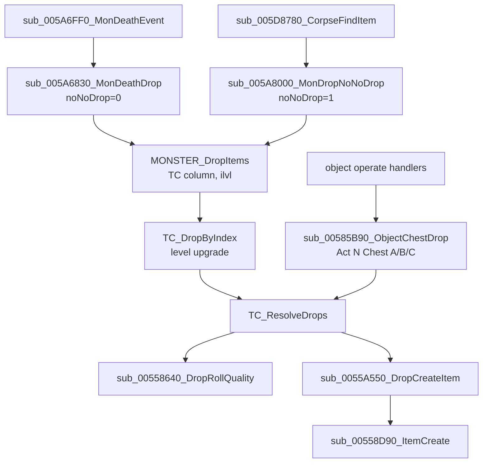

# 0001 — Treasure class resolution: from a monster's death to the item-creation call

> **Subsystem:** items/tc
> **Question:** Which TC does a kill use, how does the game walk it (picks, NoDrop, recursion, ratios), which seed does each draw come from, and what does item creation receive?
> **Date:** 2026-10-11   **Plan:** 0004 (Phase 1)   **Status:** open (Phase 1 read `[I]`; Phase 1b cross-check done; Phase 2 done: 328/328 resolver calls of run:2026-10-11-tc-drops reproduced by `tools/tc.py replay`, since plan 0010 Phase 2 also with the quality roll modelled and no oracle; plan 0011: party count `[C]` by run:2026-10-12-tc-party (175/175 calls, two clients); champion column and champion-before-unique order `[C]` by run:2026-10-12-tc-champion (124/124 calls, Nightmare, 2 champions); superunique-first order, Normal/Hell champions and the classic branch stay `[I]`)

Names of structs and fields are ours. "Game" is the server game object passed in ECX (`game+0x6D`, `game+0x70`, seed
`+0xD0` as in [rng/0002](../rng/0002-seed-tree.md)). "Source unit" is the unit the drop comes from (the dying monster, or
the chest object). A "unit seed" is `unit+0x20` ([rng/0002](../rng/0002-seed-tree.md)). Unit type 0 = player,
1 = monster, 4 = item (`unit+0x00`), class id at `unit+0x04`. Stat ids are `itemstatcost` record numbers:
12 `level`, 14 `gold`, 79 `item_goldbonus`, 80 `item_magicbonus`, 100 `monster_playercount`.

## Answer (summary)

- [C] **Two game fields steer every branch.** `game+0x6D` (u8) is the difficulty index 0–2 and `game+0x70` (u32) is
  non-zero in an expansion game. Three readers agree: the area-level lookup indexes `levels` `MonLvl1..3` with `+0x6D`
  (`< 3` checked) and switches to `MonLvl1Ex..3Ex` when `+0x70 ≠ 0`, the monster drop indexes the `monstats`
  `TreasureClass*` columns with `+0x6D × 8` (the stride between the normal, `(N)` and `(H)` groups), and the resolver
  uses `+0x70` to choose between the classic and expansion probability sums. (fn:sub_0061DCA0_LevelMonLvl@0x0061DCA0,
  fn:MONSTER_DropItems@0x005A6600, fn:TC_ResolveDrops@0x0055A6D0, tbl:Levels.txt:MonLvl1Ex, tbl:MonStats.txt:TreasureClass1(N))
- [I] **Monster death → TC.** `MONSTER_DropItems` takes the difficulty's group of four `monstats` TC columns and picks:
  superunique → `superuniques` record `+0x2C + 2·diff` (or `TreasureClass3` if the record is missing); otherwise
  champion (monster type flag `0x04`) → `TreasureClass2`; unique (flag `0x08`) → `TreasureClass3`; anything else,
  minions included → `TreasureClass1`. Then `TreasureClass4` replaces it when `TCQuestId ≠ 0`, the column is set, and the
  killer's player has not completed that quest (three quest-state tests, left to `items/quest-drops`).
  (fn:MONSTER_DropItems@0x005A6600, tbl:MonStats.txt:TreasureClass1..4, tbl:MonStats.txt:TCQuestId, tbl:MonStats.txt:TCQuestCP)
- [C] **TC column for normal, minion, unique and superunique monsters (Normal and Nightmare):** in all 317 monster calls
  of run:2026-10-11-tc-drops, the base TC is `monstats` `TreasureClass1`/`TreasureClass1(N)` for monsters with neither type flag `0x04` nor `0x08`
  (minions, flag `0x10`, included), `TreasureClass3`/`TreasureClass3(N)` for unique monsters (flags `0x09`), and the
  `superuniques` row's `TC`/`TC(N)` for superuniques (flags `0x0b`: Bishibosh → `Act 1 Super A` in Normal, Rakanishu →
  `Act 1 (N) Super B` in Nightmare). The champion branch is the next bullet; the quest TC is not confirmed (§3). `tools/tc.py replay`
  checks the base TC of every monster call against `monstats.bin` / `superuniques.txt` (317/317 across the eleven logs:
  280 normal, 28 minion, 7 unique, 2 superunique, 0 champion). (fn:MONSTER_DropItems@0x005A6600, tbl:MonStats.txt:TreasureClass1, tbl:MonStats.txt:TreasureClass3, run:2026-10-11-tc-drops: fifth session, `tools/tc.py replay`)
- [C] **Champion column, and champion before unique (Nightmare, expansion, single player, one monster class):** a
  monster with type flag `0x04` takes `TreasureClass2`, and the champion test runs before the unique test. Both
  champion kills of run:2026-10-12-tc-champion are class 61 (`fallenshaman4`) with `mflags=0d`: live champions carry
  the champion flag `0x04` **together with** `0x08` (the unique flag) and `0x01`. Both logged `DROP base=698`,
  `Act 1 (N) Champ C` = `TreasureClass2(N)` of row 61, not 783 `Act 1 (N) Unique C` = `TreasureClass3(N)`, which a
  unique test placed first would have chosen; a unique of the same class (`mflags=09`) in the same run logged
  `DROP base=783`. `tools/tc.py replay` asserts the base TC of all 121 monster calls of the run (98 normal, 17 minion,
  2 champion, 4 unique). Not exercised: Normal and Hell champions, other classes, a classic game, and a monster with
  both `0x02` and `0x04` (every logged superunique has `0x0b`), so the superunique-first part of the order stays `[I]`.
  (fn:MONSTER_DropItems@0x005A6600 0x005A66C0–0x005A66D8, fn:sub_005A0180_MonTypeFlag@0x005A0180, tbl:MonStats.txt:TreasureClass2, run:2026-10-12-tc-champion)
- [I] **Level-based TC upgrade** happens only for the top TC of a monster drop, and only if all of these hold: expansion
  game, difficulty > 0, the source is a monster, and its `monstats` row has neither `noRatio` nor `boss`. Then
  `TC_GetByIndex(tc, mlvl)` (mlvl = the monster's `level` stat) walks forward from the base TC while the next TC has the
  same `group` and its `level` ≤ mlvl, and returns the last one reached. Sub-TCs are never upgraded (`TC_GetByIndex(…, 0)`).
  (fn:TC_DropByIndex@0x0055AFA0, fn:TC_GetByIndex@0x00654E00, tbl:TreasureClassEx.txt:group, tbl:TreasureClassEx.txt:level)
- [C] **Level upgrade, observed part:** in an expansion game the upgrade level is 0 for every Normal monster drop (53
  calls) and the monster's level in Nightmare (167 calls, normal, minion, unique and superunique sources). The forward walk
  reproduces in every call: 12 upgrades one step up the group (`Miss A` → `Miss B`, `H2H A` → `H2H B`, `Unique A` →
  `Unique B` at mlvl 40), 9 calls kept at `H2H B` because the next TC's level is 41, and 146 calls keep a base TC whose
  own `level` is above mlvl (`Act 1 (N) Super B`, level 41, included). run:2026-10-12-tc-champion adds 121 Nightmare
  monster calls, among them the champion group (group 18): both champions walk two steps, `Act 1 (N) Champ C` (698,
  level 41) → `Act 2 (N) Champ B` (700, level 44) at mlvl 44, stopping before `Act 2 (N) Champ C` (level 45); and one
  `boss` monster (Andariel, class 156) logged upgrade level 0 in Nightmare. The `noRatio` and classic gates were not
  exercised; no stock `noRatio` monster has a TC. `tools/tc.py replay` asserts the upgrade level (`DROP lvl`) of all 438
  monster calls (317 + 121) and the forward walk from it. (fn:TC_DropByIndex@0x0055AFA0, fn:TC_GetByIndex@0x00654E00, tbl:MonStats.txt:noRatio, tbl:MonStats.txt:boss, run:2026-10-11-tc-drops: fifth session, `tools/tc.py replay`; run:2026-10-12-tc-champion)
- [I] **Every TC-level draw steps the source unit's seed** (`unit+0x20`): the pick/NoDrop roll is an inlined guarded
  range draw identical to `RNG_Range` (`n < 1` → 0 with no step; power of two → mask; else `low % n`). The
  per-item quality roll (`sub_00558640_DropRollQuality`, 0–6 calls of `RNG_RangeB`) draws from the same seed, so the
  TC walk and the quality rolls interleave on it. Item units themselves get their seeds from the **game** seed
  `+0xD0` (two draws in `sub_00555230_SUnitCreate`), because drops pass no seed in the creation parameters.
  (fn:TC_ResolveDrops@0x0055A6D0 0x0055A9FC–0x0055AA3F, fn:sub_00558640_DropRollQuality@0x00558640, fn:sub_00558D90_ItemCreate@0x00558D90)
- [C] **Picks.** Positive `Picks`: each pick draws `roll = rand(total + NoDrop')` (`total` = expansion or classic sum);
  `roll < NoDrop'` drops nothing, else `roll − NoDrop'` selects the entry. Negative `Picks`: no draw; pick *k*
  (0-based, `k < |Picks|`) selects the entry whose cumulative range contains *k*, so entry *i* fires `Prob_i` times in
  order. (fn:TC_ResolveDrops@0x0055A6D0, tbl:TreasureClassEx.txt:Picks, run:2026-10-11-tc-drops: 328 calls reproduced by `tools/tc.py`, every positive pick draw, `Picks = -3` unique TCs and `Picks = -4` superunique TCs)
- [I] **Picks, unobserved edges.** A negative-`Picks` walk stops early when `k ≥ total` (every negative-`Picks` TC in the
  run had `total == |Picks|`: `Act 1 Unique A/B` 3/3, `Act 1 Super A` / `Act 1 (N) Super B` 4/4, so the stop never
  fired), and `Picks = 0` is stored as 1 at load (no such TC was hit). (fn:TC_ResolveDrops@0x0055A6D0, tbl:TreasureClassEx.txt:Picks)
- [I] **NoDrop scaling** (positive picks, `NoDrop ≠ 0`, recomputed on every pick): `n = party + (players − party) / 2`
  (C signed division), where `party` = alive members of the killer's party in the killer's level, 1 if none, clamped to
  ≤ 8, and `players` = alive player units in the game, raised to the `/players` value in some game types. A monster
  source caps `n` at `max(1, monster_playercount)`. For `n > 1`, with x87 values `r = ND/(ND+T)`, `p = r^n`
  (repeated multiplication), `NoDrop' = trunc(T·(1 − (1 − p)) / (1 − p))`, or 0 when `1 − p == 0`.
  (fn:TC_ResolveDrops@0x0055A6D0 0x0055A8A1–0x0055A9D7, fn:sub_00535790_PlayerCount@0x00535790, fn:sub_005408E0_PartyCountInLevel@0x005408E0)
- [I] **Recursion** is an explicit stack of up to 64 frames `{tc, picksLeft, ratio[6]}`. A sub-TC entry pushes a frame
  (reusing the current frame when its picks are exhausted, a tail call). The child's ratio is
  `max(parent, sub-TC)` per field (`Magic`, `Rare`, `Set`, `Unique` and two unnamed fields). Output stops entirely
  after `max` items (6 for monster drops). (fn:TC_ResolveDrops@0x0055A6D0 0x0055AB68–0x0055AC2F)
- [C] **Item creation leaves the source seed alone:** the source unit's seed is the same before and after every
  `sub_0055A550_DropCreateItem` call of the run (all created items of 328 calls). (fn:sub_0055A550_DropCreateItem@0x0055A550, run:2026-10-11-tc-drops)
- [C] **NoDrop' for party 1 and 2:** with `party = 1` and `players` 1 or 8 (`/players 8`), `n` = 1 or 4, and with
  `party = 2`, `players = 2` (two clients), `n = 2`; `NoDrop'` equals the x87 formula of §6 at 53-bit precision
  (control word `0x027F` logged, in single player and in the TCP/IP host) in every call, for (NoDrop, total) =
  (100, 60), (125, 38) and (100, 47). (fn:TC_ResolveDrops@0x0055A6D0 0x0055A93B, run:2026-10-11-tc-drops, run:2026-10-12-tc-party: 68 `NDIN n=2` lines)
- [C] **Party count: level, not distance.** `party` counts the killer and the members of the killer's party that are
  in the killer's level (room → level id equality); a partied player in the same level counts at any distance
  (`party = 2` in 44 calls with the partner 26–375 subtiles away, 37 of them more than two screens), while an
  unpartied player in the same level (4 calls) and a partied player in another level (84 calls) give `party = 1`.
  `tools/tc.py replay` checks every logged `PARTY` against this rule computed from the logged player positions, levels
  and party list. Not exercised: a dead member, more than two players, the clamp at 8, and a monster killer (the
  owner path). (fn:sub_005405A0_PartyForEachInLevel@0x005405A0, fn:sub_005408E0_PartyCountInLevel@0x005408E0, run:2026-10-12-tc-party)
- [C] **Hand-off to the quality roll (expansion, Normal and Nightmare, single player, player killers):** for an item
  entry with no forced quality the resolver calls `sub_00558640_DropRollQuality` with the picked item's index (EAX),
  its own `ilvl` argument (ECX), the current frame's ratio words (the first four, `Magic`, `Rare`, `Set`, `Unique`,
  are read) and its killer, on the source unit's seed; the returned code 1–7 is the quality handed to creation.
  `tools/tc.py replay --quality model` feeds the model exactly these model-side values (item from the selected entry,
  `ilvl` from the call, ratio words from the frame after inheritance, magic find of the killer from its save) and
  reproduces every quality, every seed after the roll and the final seed of 328 + 124 + 1269 calls with no oracle.
  (fn:TC_ResolveDrops@0x0055A6D0 0x0055ADBA, fn:sub_00558640_DropRollQuality@0x00558640, run:2026-10-11-tc-drops,
  run:2026-10-12-quality)
- [I] **Hand-off, the rest.** For an item entry: quality = 7 (unique entry), 5 (set entry), the caller's forced quality, or
  the roll above, whose result means 1 low, 2 normal, 3 superior, 4 magic, 5 set, 6 rare, 7 unique (0 only for a
  missing record, see [items/0002](0002-quality-roll.md)); then `sub_0055A550_DropCreateItem(game, item, source,
  quality, uniqueOrSetIndex+1, upgradeFlags)` builds a 0x84-byte creation record (source unit, game, item ilvl = source's
  `level` stat or area level, drop position, quality) and calls `sub_00558D90_ItemCreate`. `mul=` scales a gold pile by
  `mul/256`; gold find is applied afterwards. (fn:sub_0055A550_DropCreateItem@0x0055A550, fn:sub_005589A0_DropGoldFind@0x005589A0)

## Leads used

Phase 1 read no community TC documentation; the code was located from our own symbols (`TC_GetByIndex` callers,
data/0001). Phase 1b (2026-10-11) then compared the finished claims with two registered sources, both written for
1.10/1.11 LoD (evidence-rules § Community cross-checks). Agreement promotes nothing: every tag above is unchanged.

- [L] src:pd-item-generation: TC columns by monster type: `TreasureClass2` = champion, `TreasureClass3` = unique
  (non-quest), `TreasureClass4` = unique quest drop, each repeated per difficulty. **held with refinement**
  Detail: 1.14d picks superunique → champion → unique → normal (§3), and the quest TC replaces *whichever* TC was chosen
  when `TCQuestId` is set and the quest is open; it is not tied to the unique flag (0x005A6705–0x005A67F1).
  [run:2026-10-12-tc-champion](experiments.md#run2026-10-12-tc-champion) (2026-10-12) logged two Nightmare champions on
  `TreasureClass2(N)`; the champion column is now `[C]` by that run, not by this source. A further refinement the
  source does not state: live champions also carry the unique flag (`mflags=0d`), so the champion column wins only
  because its test comes first (§3). Verdict unchanged.
- [L] src:hrus-mf-guide: champions all drop from the champion TC group, and minions use the regular monster TC.
  **held** Detail: minions carry neither type flag `0x04` nor `0x08` and take `TreasureClass1` (§3). The champion half
  was observed in [run:2026-10-12-tc-champion](experiments.md#run2026-10-12-tc-champion): both champions' drops started
  in `Act 1 (N) Champ C` and upgraded within the champion group (group 18) to `Act 2 (N) Champ B`. The run, not this
  source, makes the champion column `[C]`. Verdict unchanged.
- [L] src:pd-item-generation: superunique TC. **not covered** Detail: neither source says where a superunique's TC
  comes from; 1.14d reads `superuniques +0x2C + 2·diff`, falling back to `TreasureClass3` (§3).
- [L] src:pd-item-generation: level upgrade in Nightmare and Hell only; `boss=1` monsters never upgrade; TCs included in
  the selected TC are not upgraded; the game "selects the highest level TC in the group that is equal to or less than the
  Mlvl". **held with refinement** Detail: 1.14d adds three conditions the source omits (expansion game only, source is a
  monster, `noRatio` also blocks, 0x0055AFAA–0x0055AFE8), and the walk only moves *forward* from the base TC, so a base
  TC whose own `level` exceeds mlvl is kept rather than replaced by a lower one (§4).
- [L] src:hrus-mf-guide: upgrade "until the monster level > actual TC level" to the next TC of the same group.
  **held** Detail: same forward walk as §4; the source does not state the difficulty or expansion gates.
- [L] src:hrus-mf-guide: negative `Picks` are not random: the monster always takes the given number of picks from
  the named sub-TCs (example: 2 from one entry, 2 from the next). **held with refinement** Detail: in 1.14d entry *i*
  fires `Prob_i` times in entry order with no draw, and the loop stops early once the pick index reaches the
  probability total (§5).
- [L] src:pd-item-generation: Countess's `-2` TC "drops left to right across her TC until she reaches 2". **held**
  Detail: matches the cumulative-range walk of §5.
- [L] src:pd-item-generation: `NewNoDrop = int(ProbSum / (1/((NoDrop/(NoDrop+ProbSum))^N) − 1))`. **held with refinement**
  Detail: algebraically the same as §6 (`p·T/(1 − p)`), but 1.14d evaluates `(1 − (1 − p))·T/(1 − p)` in x87 with `p` built
  by `n − 1` multiplications, returns 0 when `1 − p == 0`, applies it only for `n > 1`, and caps `n` at the monster's
  `monster_playercount` (stat 100), which the source does not mention (0x0055A8A1–0x0055A9D7).
- [L] src:hrus-mf-guide: `New NoDrop = ND^NDE/(1 − ND^NDE) · SumProb`, `ND = NoDrop/(NoDrop + Sum)`. **held with refinement**
  Detail: same refinements as the entry above.
- [L] src:pd-item-generation: N counts 1 for the killer, 1 for each player "partied with you and within two screens
  of you", 0.5 for every other player, rounded down. **contradicted** Detail: 1.14d has no distance test. Party members
  count in full when they are alive **in the killer's level** (`sub_005405A0_PartyForEachInLevel` compares
  unit → room → level id, `level+0x1D0`; re-read 2026-10-11), and the rest count half through
  `party + (players − party) / 2`. Backlog: [2026-10-11 reverser → architect, *NoDrop party test*](../../backlog.md).
  Settled by [run:2026-10-12-tc-party](experiments.md#run2026-10-12-tc-party): a partied player 311–375 subtiles away
  in the killer's level counted (`party = 2`); the verdict stays **contradicted**.
- [L] src:hrus-mf-guide: unpartied players, or partied players "not close to you (around 2 screens)", count 0.5.
  **contradicted** Detail: as above; same [backlog entry](../../backlog.md) (*NoDrop party test*).
- [L] src:pd-item-generation: `/players` adds only unpartied players: settings 1–2 → N 1, 3–4 → 2, 5–6 → 3,
  7–8 → 4. **held with refinement** Detail: 1.14d takes `players = max(alive players, /players value)` (game types
  1–3 only, `sub_00535790_PlayerCount`), which gives exactly that table for a lone player; with real players it is a
  maximum, not an addition.
- [L] src:pd-item-generation and src:hrus-mf-guide: at most 6 items drop per kill. **held** Detail: `max = 6` for monster
  drops; the whole resolution stops at the 6th created item (§5, §8).
- [L] src:pd-item-generation: how the `Unique`/`Set`/`Rare`/`Magic` columns combine through nested TCs. **not covered**
  Detail: neither registered source states it; 1.14d takes the per-field maximum (§7). A forum post that appears to say
  "highest per quality" could not be fetched and is not cited.
- [L] src:pd-item-generation: `ArmoN`/`WeapN` hold the items with level in `(N − 3, N]`, `Armo03` … `Armo87`; item
  weights by item type (3 for most, 2 claws, 1 class-specific, 1 wands/staves/sceptres). **held with refinement**
  Detail: 1.14d builds the window `L − 3 < level ≤ L` for L up to 96 (160 TCs, the top ones only as full as the item
  levels allow), weights each item by its `type`'s `Rarity` (minimum 1), and also filters `quest`, `spawnable` and type
  38 (§9). The per-type weights quoted were not compared against `ItemTypes.Rarity`.

## Functions

| Address | Name | Role | Tag |
|---|---|---|---|
| `0x005A6FF0` | `sub_005A6FF0_MonDeathEvent` | monster death event (reached through the table at `0x006E2260`); calls the death drop | I |
| `0x005A6830` | `sub_005A6830_MonDeathDrop` | death drop guard: skips if `unit+0xC4` bit 17 is set or the spot is blocked; `noNoDrop = 0` | I |
| `0x005A8000` | `sub_005A8000_MonDropNoNoDrop` | the same drop with `noNoDrop = 1`; called by the corpse skill `0x005D8780` | I |
| `0x005D8780` | `sub_005D8780_CorpseFindItem` | skill on a corpse (`skills` record, corpse state `0x76`), rolls `RNG_Range(monster seed, 100)` | I |
| `0x005A6600` | `MONSTER_DropItems` | TC column choice, ilvl, calls `TC_DropByIndex` | I |
| `0x0055AFA0` | `TC_DropByIndex` | level-upgrade gate, `TC_GetByIndex`, `TC_ResolveDrops` | I |
| `0x00654E00` | `TC_GetByIndex` | index → TC, with the group/level walk | I |
| `0x0055A6D0` | `TC_ResolveDrops` | the pick loop (all of the walkthrough) | I |
| `0x00558640` | `sub_00558640_DropRollQuality` | quality code 1–7 (0 on a missing record) from `itemratio`, ratios, MF; 0–6 draws on the source seed; read in [items/0002](0002-quality-roll.md) | I |
| `0x0055A550` | `sub_0055A550_DropCreateItem` | builds the creation record, calls item creation | I |
| `0x00558D90` | `sub_00558D90_ItemCreate` | `.\ITEMS\Items.cpp` creation; seeds from the record only if asked | I |
| `0x005589A0` | `sub_005589A0_DropGoldFind` | gold × (100 + GF) / 100 | I |
| `0x00558200` | `sub_00558200_UnitDropLevel` | ilvl source: monster/player `level` stat, else area level; ≥ 1 | I |
| `0x0061DCA0` | `sub_0061DCA0_LevelMonLvl` | `levels` `MonLvl[diff]` or `MonLvlEx[diff]` | I |
| `0x00535790` | `sub_00535790_PlayerCount` | alive players, raised to the `/players` override in game types 1–3 | I |
| `0x00535780` | `sub_00535780_SetPlayersOverride` | `/players N` stores N if `N ≤ 8` (unsigned) | I |
| `0x005408E0` | `sub_005408E0_PartyCountInLevel` | alive party members in the player's level | C |
| `0x005405A0` | `sub_005405A0_PartyForEachInLevel` | calls a callback for each party member in the player's level (level-id equality) | C |
| `0x005404F0` | `sub_005404F0_PartyCountAliveCb` | callback: count the member if not dead | I |
| `0x00620BB0` | `sub_00620BB0_UnitGetRoom` | a unit's room (path or static position by unit type) | I |
| `0x0061A1B0` | `sub_0061A1B0_RoomGetLevelId` | room → DRLG room → level → id (`+0x10`, `+0x58`, `+0x1D0`), through `0x0066BAB0` | I |
| `0x00540290` | `sub_00540290_PartyFind` | party record by id in the list `game+0x1D2C` (`+4` first; record `+0` u16 id, `+4` members `{unit id, next}`, `+8` next) | I |
| `0x00540710` | `sub_00540710_PartyIdOfUnit` | party id of a player, or `0xFFFF` | I |
| `0x00552F60` | `sub_00552F60_GameFindUnit` | unit by type and id in the game's hash lists (id `unit+0x0C`) | I |
| `0x006488C0` | `sub_006488C0_PathGetX` | dynamic path `+0x02` u16 subtile x | I |
| `0x00648900` | `sub_00648900_PathGetY` | dynamic path `+0x06` u16 subtile y | I |
| `0x00648A80` | `sub_00648A80_PathGetRoom` | dynamic path `+0x1C` room | I |
| `0x004F5610` | `sub_004F5610_WindowCreate` | main window creation; stops with "Only one copy of Diablo II may run at a time" when `FindWindowA` finds its class (plan 0011 harness) | I |
| `0x005541B0` | `sub_005541B0_UnitIsDead` | death modes / flag `+0xC6` bit 0 | I |
| `0x0058F0D0` | `sub_0058F0D0_MonsterOwner` | a monster's owning player unit, else 0; `C` for a summon only ([items/0002](0002-quality-roll.md) § 7) | C |
| `0x005A03A0` | `sub_005A03A0_MonSuperUniqueId` | superunique index or −1 (type flag `0x02`) | I |
| `0x005A0180` | `sub_005A0180_MonTypeFlag` | `monsterData+0x16 & mask` | I |
| `0x006556E0` | `sub_006556E0_SuperUniqueGet` | `superuniques` record (0x34 B) or 0 | I |
| `0x00451F80` | `MONSTATS_GetRecord` | `monstats` record (0x1A8 B) by index or 0 | I |
| `0x006335F0` | `ITEMS_GetRecord` | `g_pItems` record (0x1A8 B) by index or 0 | I |
| `0x00628700` | `ITEMS_GetType` | item record `+0x11E` (`type`) | I |
| `0x00628860` | `ITEMTYPES_IsThrowable` | itemtypes record `+0x10` (`Throwable`) | I |
| `0x00629A90` | `ITEMS_IsType` | item index is of type t (`type`, then `type2`, through the equivalence bitmap) | I |
| `0x00629BB0` | `ITEMS_UnitIsType` | same test for an item unit | I |
| `0x00585B90` | `sub_00585B90_ObjectChestDrop` | object/chest drop: "Act N Chest A/B/C" TC, calls `TC_ResolveDrops` | I |
| `0x00654E80` | `TC_GetChestTC` | `g_ChestTCs[(act + 5·diff)·3 + tier]` | I |
| `0x0065A2C0` | `TC_BuildChestTable` | fills `g_ChestTCs` from the TC names at load | I |
| `0x00654010` | `TC_GrowEntries` | entry array realloc (0x1C per entry) | I |
| `0x00654080` | `TC_AddEntry` | appends an entry, stamps the running sums | I |
| `0x006540C0` | `TC_SetEntryProb` | adds a probability to the sums (classic sum only if not expansion-only) | I |
| `0x00637910` | `ITEMRATIO_Select` | `itemratio` row by uber/class flags, version ≤ arg, highest version; read in [items/0002](0002-quality-roll.md#2-row-selection--itemratio_select-0x00637910) | I |
| `0x00682FD0` | `CRT_ftol2` | x87 → int truncation | I |

## Walkthrough

### 1. Runtime TC layout (built at load, read by the resolver)

`g_pTreasureClasses` entries are 0x2C bytes ([data/0001 §7](../data/0001-excel-loader.md#7-treasure-classes-at-load-time)).
`TC_LoadTreasureClassEx` and `TC_ParseItemCell` write the fields, `TC_ResolveDrops` reads them, and the offsets agree.
That is the second-code-path corroboration for the layout below. Header in [`re/types/tc.h`](../../../re/types/tc.h).

| off | type | field | written from |
|---|---|---|---|
| `+0x00` | s16 | group | `group` + number of auto-TC item types (5) if `group ≠ 0`, else 0 |
| `+0x02` | u16 | level | `level` |
| `+0x04` | s32 | nEntries | |
| `+0x08` | s32 | totalClassic | sum of `Prob` of entries **not** flagged expansion-only |
| `+0x0C` | s32 | totalExp | sum of all `Prob` |
| `+0x10` | s32 | picks | `Picks` (0 stored as 1) |
| `+0x14` | s32 | noDrop | `NoDrop` |
| `+0x18` | u16 | — | not written by the loader (0) |
| `+0x1A` | u16[6] | ratio | `Magic`, `Rare`, `Set`, `Unique`, then two words from record `+0x30/+0x32` (always 0) |
| `+0x28` | ptr | entries | 0x1C bytes each |

[C] layout by writer/reader agreement (0x006547D0, 0x00654440, 0x0055A6D0).

Entry (0x1C bytes): `+0x00` cumClassic, `+0x04` cumExp (the sums **before** this entry was added); `+0x08` u16
index (item record, or TC index); `+0x0A` u16 (unique/set record index, or the `mul=`/`ma=`/`mg=` value); `+0x0C` u8
flags: `0x01` unique, `0x02` set, `0x04` TC, `0x10` expansion-only; `+0x0E..+0x18` u16 ×6 from `cm=`, `cr=`, `cs=`,
`cu=`, `ce=`, `cg=` (same order as the TC ratio words).

- [I] An entry is **expansion-only** (flag `0x10`, excluded from `totalClassic`) when it is an item whose `version`
  (`+0xF6`) ≥ 100, any unique or set reference, or a sub-TC whose own `totalClassic` is 0. (0x00654440, 0x006540C0, tbl:Weapons.txt:version)
- [I] Only `mul=` occurs in the shipped `treasureclassex.txt` (81 cells, all `gld,mul=…`). No `cu=`/`cs=`/`cr=`/`cm=`/`ce=`/`cg=`
  and no non-zero record `+0x30` exist, so the ratio-modifier and upgrade-flag paths below never run with stock data.

### 2. Entry points



- [I] `TC_GetByIndex` has two callers, `TC_DropByIndex` and `TC_ResolveDrops` (sub-TCs). `TC_ResolveDrops` has two,
  `TC_DropByIndex` (monsters) and `sub_00585B90_ObjectChestDrop` (objects). `TC_DropByIndex` has one,
  `MONSTER_DropItems`. Gambling and vendor stock do not reach the resolver through these functions. (xrefs of 0x00654E00, 0x0055A6D0, 0x0055AFA0)
- [I] The object path (named only; callers belong to `objects`): object level = area level of its room's level; the
  act's level range (`0x006E1988` table) is cut into thirds, tier A/B/C = 0/1/2; `TC_GetChestTC(diff, act, tier)` reads
  `g_ChestTCs`, which `TC_BuildChestTable` filled at load with `"Act %d%s Chest %s"` for diff suffix `""`/`" (N)"`/`" (H)"`,
  act 1–5 and `A`/`B`/`C`. The resolver gets the object as source, the operating player as killer, `max = 6`, an output
  array, and no level upgrade. (0x00585B90, 0x00654E80, 0x0065A2C0, data:g_ChestTCs@0x0096C5F4)

### 3. Monster TC selection — `MONSTER_DropItems` (0x005A6600)

Arguments: ECX game, stack `(monster, noNoDrop, ctx)`, with `ctx+8` = killer unit. `diff = game+0x6D`.

```c
mon  = MONSTATS_GetRecord(monster->classId);
ilvl = sub_00558200_UnitDropLevel(monster);        // monster: level stat 12; ≥ 1
su   = sub_005A03A0_MonSuperUniqueId(monster);     // −1 unless type flag 0x02
if (su != -1) {
    rec = sub_006556E0_SuperUniqueGet(su);
    tc  = rec ? rec->tc[diff] /*+0x2C + 2·diff*/ : mon->tc[diff][2] /*TreasureClass3*/;
} else if (MonTypeFlag(monster, 0x04)) tc = mon->tc[diff][1];   // TreasureClass2
else if   (MonTypeFlag(monster, 0x08)) tc = mon->tc[diff][2];   // TreasureClass3
else                                   tc = mon->tc[diff][0];   // TreasureClass1
if (mon->TCQuestId && mon->tc[diff][3] && ctx && (p = ctx->killer)) {
    if (p->type != 0) p = owner-or-summoner player of p;            // 0x0058F0D0, 0x0063A690/0x00625760(0x800)
    if (p && p->type == 0 && (q = questData(p)) &&
        QuestState(q, TCQuestId, 15) != 1 && QuestState(q, TCQuestId, 1) != 1 &&
        QuestState(q, TCQuestId, TCQuestCP) != 1)
        tc = mon->tc[diff][3];                                       // TreasureClass4
}
TC_DropByIndex(game, monster, ctx->killer, tc, /*forcedQuality*/0, ilvl, noNoDrop, /*out*/0, /*count*/0, /*max*/0);
```

- [I] Column offsets: `monstats +0x86 + 8·diff + 2·k`, k = 0..3 (TreasureClass1..4). (0x005A66AC–0x005A66FA, 0x005A67E9, tbl:MonStats.txt:TreasureClass1)
- [I] The order is superunique, then champion, then unique. A minion (no `0x04`/`0x08`) uses `TreasureClass1`.
  Type-flag meanings `0x02` superunique, `0x04` champion, `0x08` unique are inferred from which column each flag
  selects; the flag word is `monsterData+0x16` (`unit+0x14` → `+0x16`). (0x005A03A0, 0x005A0180)
- [C] Champion before unique, read in r2: when `sub_005A03A0_MonSuperUniqueId` returns −1 (0x005A66A0), the code tests
  `MonTypeFlag(monster, 4)` first (0x005A66C0–0x005A66CE) and takes `word [mon + diff·8 + 0x88]` (`TreasureClass2`,
  0x005A66D0); only if that fails does it test flag 8 (0x005A66DD–0x005A66EB) for `+0x8A` (`TreasureClass3`).
  `MonTypeFlag` returns `(flags16 & mask) ≠ 0` (0x005A0193–0x005A01A1), so a champion that also has `0x08` set still
  takes `TreasureClass2`. Live champions carry `0x0d` (`0x01 | 0x04 | 0x08`, logged low byte of the flag word), and
  both took `TreasureClass2(N)`. Corroboration: run:2026-10-12-tc-champion (Nightmare, class 61 only). The meaning of
  bit `0x01`, set on every logged unique (`0x09`), superunique (`0x0b`) and champion, but not on Andariel (`0x08`), is
  not read. (fn:MONSTER_DropItems@0x005A6600, fn:sub_005A0180_MonTypeFlag@0x005A0180, run:2026-10-12-tc-champion)
- [I] The quest replacement needs the killer to resolve to a player; `QuestState(…) == 1` on any of the three tests
  keeps the normal TC. The quest-state semantics are left to `items/quest-drops`. (0x005A6705–0x005A67F1, 0x0065C310)
- [I] The death drop is skipped when the monster unit has `+0xC4` bit 17 set, or when a collision test at its position
  (mask `0x801`) fails. Class 344 (`bonewall`) is a fatal error there. (0x005A6830)

### 4. Level upgrade — `TC_DropByIndex` (0x0055AFA0) and `TC_GetByIndex` (0x00654E00)

```c
lvl = 0;
if (game->expansion && game->difficulty > 0 && src && src->type == 1 &&
    (mon = MONSTATS_GetRecord(src->classId)) && !(mon->flags0C & 0x04 /*noRatio*/) && !(mon->flags0C & 0x40 /*boss*/))
    lvl = GetUnitStat(src, 12 /*level*/, 0);
tc = TC_GetByIndex(tcIndex, lvl);
if (tc) TC_ResolveDrops(game, src, killer, tc, forcedQ, ilvl, noNoDrop, out, count, max);

TC *TC_GetByIndex(u16 idx, int lvl) {
    if (idx == 0 || idx >= g_nTreasureClasses) return NULL;
    t = &g_TC[idx];
    if (lvl > 0 && t->group != 0 && t[1].group == t->group) {
        for (;;) {
            if (lvl < t[1].level) return t;          // next is too high: keep t
            t = t + 1;
            if (t[1].group != t->group) return t;     // end of the group run
        }
    }
    return t;
}
```

- [C] The base TC is always eligible whatever its own `level`; the walk only moves forward. 146 Nightmare calls keep a
  base TC whose `level` is above mlvl (Phase 1b case b). (0x00654E00, run:2026-10-11-tc-drops: fifth session)
- [I] Normal difficulty, classic games, `noRatio` monsters and `boss` monsters never upgrade. Superuniques do, unless
  their `monstats` row has `boss` or `noRatio`. (0x0055AFAA–0x0055AFE8, `0x006CE270` = bit 2, `0x006CE280` = bit 6,
  tbl:MonStats.txt:noRatio, tbl:MonStats.txt:boss)
- [I] The walk reads `t[1]` without a bound check. The loader stops at the first empty name, so the last loaded TC
  is `Pandemonium Key C` (index 1012, `group` blank → 0). A group run cannot extend into it, but a walk that reaches
  the last TC of a run still reads the next entry's `group`; with stock data every run is followed by a loaded TC.

### 5. The pick loop — `TC_ResolveDrops` (0x0055A6D0)

Arguments: ECX game, EDX source unit (its seed is the one drawn), stack `(killer, tc, forcedQuality, ilvl, noNoDrop,
out[], count*, max)`. If `out` is null and `max < 1`, `max = 6`; if `out` is set, `max = 0` is fatal. `*count = 0`.
`expansion = game->expansion`.

```c
cur = 0;  frame[0] = { tc, max(1, |tc->picks|), tc->ratio[0..5] };  throwRetries = 0;
for (;;) {
  if (frame[cur].tc && total(frame[cur].tc)) {
    while (frame[cur].picksLeft) {
      f = &frame[cur];  t = f->tc;
      total = expansion ? t->totalExp : t->totalClassic;
      if (!total) break;
      if (t->picks < 0) {
          roll = |t->picks| - f->picksLeft;            // 0, 1, 2, … no draw
          if (roll >= total) break;                    // abandons this frame
      } else {
          nd = t->noDrop;
          if (nd) nd = ScaleNoDrop(nd, total, …);      // §6
          range = noNoDrop ? total : total + nd;
          roll  = range < 1 ? 0 : RNG_Range(&src->seed, range);   // inlined, draw#1 per pick
          if (!noNoDrop) {
              if (roll < nd) { f->picksLeft--; continue; }        // NoDrop
              roll -= nd;
          }
      }
      f->picksLeft--;
      i = expansion ? BSearchCum(t, roll) : LinearClassic(t, roll);   // §5.1
      if (i >= t->nEntries) continue;
      e = &t->entries[i];
      if (e->flags & 0x04) { PushSubTC(e->index); continue; }         // §7, changes cur
      if (e->index == 0xFFFF) continue;
      ItemPick(e);                                                    // §8, may return
    }
  }
  if (cur == 0) return;
  cur--;                                                              // resume the parent
}
```

- [I] All seeds named here are the source unit's `unit+0x20`. The inlined draw is `mul 0x6AC690C5 / add / adc`
  (0x0055AA03–0x0055AA3F) with the `range < 1` guard and the power-of-two mask: the same values and stepping as
  `RNG_Range` ([rng/0001](../rng/0001-rng-core.md)).
- [I] `picks` and `noDrop` are re-read from the TC each iteration, and the NoDrop scaling is recomputed for every pick.
- [I] `roll < nd` uses a signed compare. A pick that ends on `index == 0xFFFF`, on a classic out-of-range scan, or on a
  rejected item still consumes the pick.

#### 5.1 Entry selection

- [C] **Expansion:** binary search over `cumExp`. Returns the entry whose `cumExp == roll` if one exists, else
  `max(lo − 1, 0)` where `lo` is the first entry with `cumExp > roll`. Probabilities are ≥ 1 (cells with `Prob < 1` are
  dropped at load), so this is the entry whose half-open range `[cumExp, cumExp + Prob)` contains `roll`. Corroborated
  by bit-exact reproduction: `tools/tc.py replay` asserts the logged `SEL` index of every expansion pick of the 328
  calls (all expansion games). (0x0055AA93–0x0055AAEB, run:2026-10-11-tc-drops)
- [I] **Classic:** linear scan from 0. Entries flagged `0x10` are skipped. The first unflagged entry *i* with
  `i == n − 1` or `roll < entries[i+1].cumClassic` is chosen. If the scan runs off the end (only possible when the last
  entries are all expansion-only), nothing drops. (0x0055AAED–0x0055AB33)

### 6. NoDrop scaling (0x0055A8A1–0x0055A9D7)

```c
party = 1;
if (killer) {
    p = killer->type != 0 ? sub_0058F0D0_MonsterOwner(killer) : killer;   // monster → its owning player
    if (p && p->type == 0 && (k = sub_005408E0_PartyCountInLevel(game, p)) >= 2)
        party = k < 8 ? k : 8;
}
n = party + (sub_00535790_PlayerCount(game) - party) / 2;   // signed, truncates toward 0
if (src && src->type == 1) {
    cap = GetUnitStat(src, 100 /*monster_playercount*/, 0);  if (cap < 1) cap = 1;
    if (n >= cap) n = cap;
}
if (n > 1) {                                   // x87, precision control as set at run time
    r = (long double)nd / (long double)(nd + total);    // fild nd; fild (nd+total); fdivp
    p = r;  repeat n−1 times: p = p * r;                 // fmul st(1), unrolled ×8
    q = 1.0 - p;                                         // fld1; fld st0; fsubrp st(2)
    if (q == 0.0) nd = 0;                                // fldz; fucomp
    else          nd = _ftol((1.0 - q) * total / q);     // fsub st(1); fimul total; fdivrp; truncation
}
```

- [I] `PlayerCount` counts the units in the 128 hash lists at `game+0x1120` (next pointer `unit+0xE4`; the player list) that are not in state 7
  (`playerbody`) and not dead (`sub_005541B0_UnitIsDead`: modes 0/17 for players, 0/12 for monsters, or
  `unit+0xC6` bit 0). If `game+0x6A` ∈ {1, 2, 3} and `g_PlayersOverride` (`/players N`, accepted for 0 ≤ N ≤ 8) is
  larger, the override is used. (0x00535790, 0x005538D0, 0x00535760, 0x00535780, data:g_PlayersOverride@0x00883D70)
- [C] `PartyCountInLevel` counts the player and party members (party list `game+0x1D2C`) that are in the same level
  (`room → levelId`); the level test and the absence of a distance test are confirmed by
  [run:2026-10-12-tc-party](experiments.md#run2026-10-12-tc-party) (summary bullet *Party count*). `[I]`: the dead
  test, and that without a room or party it counts the player alone. (0x005408E0, 0x005405A0, 0x005404F0)
  Re-read in Phase 1b because community docs say "within two screens": `sub_005405A0_PartyForEachInLevel` gets the
  player's room (`sub_00620BB0_UnitGetRoom`: for players and monsters the dynamic path `unit+0x2C` `+0x1C`), its
  level id (`sub_0061A1B0_RoomGetLevelId` loads `room+0x10`, the DRLG room, and calls `0x0066BAB0`: `+0x58` → level,
  `+0x1D0` → id, the layout of [rng/0002](../rng/0002-seed-tree.md); corrected 2026-10-12, the earlier text left out
  the `+0x10` hop), and calls the counting callback
  `sub_005404F0_PartyCountAliveCb` for each party member whose room's level id is equal. There is no distance
  test. A member without a room is skipped; a player without a room or party counts itself only.
- [I] The NoDrop scaling uses the **unscaled** `nd` and `total` as integers and keeps every intermediate in x87
  registers. The multiplication count is exactly `n − 1`. `(1 − q)` is computed, not `p` reused, so rounding of `q`
  matters. `0x00682FD0` truncates toward zero on both its SSE2 and x87 branches.

### 7. Recursion into a sub-TC (0x0055AB68–0x0055AC2F)

```c
sub    = TC_GetByIndex(e->index, 0);          // no level upgrade
parent = cur;
if (frame[cur].picksLeft > 0) cur++;          // else reuse the same frame (tail call)
if (cur >= 64) fatal(0xFEA);
frame[cur].tc = sub;  frame[cur].picksLeft = max(1, |sub->picks|);
for (k = 0; k < 6; k++)                        // each field read before it is written
    frame[cur].ratio[k] = (frame[parent].ratio[k] == 0 || sub->ratio[k] > frame[parent].ratio[k])
                          ? sub->ratio[k] : frame[parent].ratio[k];        // = max, u16
```

- [C] Ratios combine by **maximum** down the chain, field by field, as unsigned 16-bit values: `Act 1 Super A`
  (`1024,972,800,800`) over `Act 1 Uitem A` (`1024,800,800,800`) reaches the quality roll as `1024,972,800,800` in all
  12 oracle entries under it, and a zero-ratio parent takes the child's values (sessions 3–4). (0x0055AB68–0x0055AC2F,
  run:2026-10-11-tc-drops)
- [I] The child sees the
  parent's ratios as they are at the moment of the push (including any `cm=`…`cg=` raises from §8).
- [I] The parent's remaining picks resume after the child frame is exhausted (frames are a stack; the outer loop pops).
- [I] A sub-TC with no picks left in its parent overwrites the parent's frame. This does not change the order of draws.

### 8. Item pick and hand-off (0x0055AC5F–0x0055AF59)

```c
if (!expansion) {
    rec = ITEMS_GetRecord(e->index);
    if (!rec || rec->version >= 100) continue;                // classic: reject expansion items
    for (k = 0; k < 6; k++) f->ratio[k] = max(f->ratio[k], e->mod[k]);   // cm/cr/cs/cu/ce/cg, classic only
}
if      (e->flags & 0x01) { quality = 7; uidx = e->aux + 1; }     // unique entry
else if (e->flags & 0x02) { quality = 5; uidx = e->aux + 1; }     // set entry
else { uidx = 0; quality = forcedQ ? forcedQ
                                   : sub_00558640_DropRollQuality(game, src, killer, f->ratio, /*ECX*/ilvl, /*EAX*/e->index); }
up = 0;
if (f->ratio[4] && (RNG_Next(&src->seed) & 0x3FF) < f->ratio[4]) up  = 0x04;   // inlined step
if (f->ratio[5] && (RNG_Next(&src->seed) & 0x3FF) < f->ratio[5]) up |= 0x10;
item = e->index;
if (!expansion && ITEMTYPES_IsThrowable(ITEMS_GetType(item))) {
    if (throwRetries++ < 10) { f->picksLeft++; continue; }    // refund the pick
    item = ITEMS_GetByCode('lsd ');                           // Long Sword
}
unit = sub_0055A550_DropCreateItem(game, item, src, quality, uidx, up);
if (!unit) continue;
if (ITEMS_UnitIsType(unit, 4 /*gold*/) && e->aux)
    SetStat(unit, 14, (GetUnitStat(unit, 14, 0) * e->aux) >> 8);   // mul=, arithmetic shift
if (out) out[*count] = unit;
if (++*count >= max) return;                                 // whole resolution ends
sub_005589A0_DropGoldFind(killer, unit);
```

- [I] **Order of draws on the source seed for one item pick:** the pick roll (§5), then the quality roll's draws, then
  the two upgrade draws (only when their ratio word is non-zero, never with stock data), then item creation (which draws
  from the game seed, below).
- [I] The per-entry ratio raises `cm=`…`cg=` are applied **only in classic games** (the block sits behind
  `game+0x70 == 0`, 0x0055AC75) and they persist in the frame for the rest of that TC's picks.
- [I] Classic games also reject items with `version ≥ 100` (pick consumed) and re-pick throwable item types: the first
  10 throwables in one resolver call refund their pick, later ones become a Long Sword. The test uses the item's
  `type` only, through `ItemTypes.Throwable` (itemtypes `+0x10`). The quality roll has already drawn by then.
  (0x0055AE6E–0x0055AEC2, tbl:ItemTypes.txt:Throwable)
- [I] `mul=` applies to any item that is of type `gold` (type 4, via the type-equivalence test); the shift is `sar 8`
  on the signed product. Gold find applies only to items whose `type` is exactly 4. It is
  `gold = gold × (100 + GF(killer) + GF(owner of killer)) / 100` (signed, `imul 0x51EB851F` = exact `/ 100`), with GF
  = stat 79 `item_goldbonus`. It is **skipped for the item that reaches `max`**. (0x0055AEF2–0x0055AF59, 0x005589A0)
- [I] **Creation record** built by `sub_0055A550_DropCreateItem` (0x84 bytes, zeroed): `+0x00` source unit, `+0x08`
  game, `+0x0C` ilvl = `sub_00558200`-style level of the source (monster: stat 12; player: base stat 12; other:
  `MonLvl[Ex][diff]` of its level; minimum 1), `+0x14` item record index, `+0x18` = 3, `+0x1C/+0x20` drop position
  (free spot near the source, `0x00555DA0`, returns the room), `+0x24` room, `+0x28` u16 = 1, `+0x2A` u16 =
  `game+0x78`, `+0x30` quality, `+0x40` unique/set index + 1 (0 = none), `+0x80` flags = upgrade bits, plus bit 0 when
  the source is monster class 391 (`hellbovine`). The `ilvl` argument of the resolver only feeds the quality roll; the
  item's own level comes from the source again inside the record. (0x0055A550)
- [I] **Item seed.** `sub_00558D90_ItemCreate(game, record, 0)` creates the unit with `sub_00555230_SUnitCreate`,
  which seeds it from the game seed `+0xD0` (two draws, [rng/0002](../rng/0002-seed-tree.md)). It overwrites the unit
  seed and the item-data seed from record `+0x48`/`+0x4C` only when its third argument or record `+0x2C` is non-zero.
  Drops pass neither, so their item seeds come from the game seed. In a classic game it also refuses an item record
  with `version ≥ 100`. (0x00558D90)

### 9. Auto item-type TCs (`weapN`, `armoN`, `bowN`, `meleN`, `abowN`)

`TC_BuildAutoTCs` (0x006541C0) settles the architect's backlog entry on it:

- [I] One TC per itemtypes record with `TreasureClass ≠ 0`, in table order, for L = 3, 6, …, 96. The name is
  `"%s%d"` of the type code as rebuilt by `0x006BD180` (spaces become NUL, so `bow ` → `bow3`). If that rebuild fails,
  no TC is allocated for that L, which would shift the numbering (does not happen with stock data: 160 TCs).
- [I] Each is created with `picks` 1, `group` 0, `level` L − 3, `noDrop` 0 and all ratios 0, so it never upgrades and
  inherits its ratios from the TC that references it.
- [I] Entries are items, in item-index order (weapons, armor, misc), passing: `quest` (`+0x12A`) = 0, `spawnable`
  (`+0x133`) ≠ 0, the item is of the type, the item is **not** of type 38 (`tpot`) unless the TC is for type 38 itself,
  and `L − 3 < level (+0xFD) ≤ L`. Probability = `max(1, Rarity)` of the item's own `type` record (itemtypes `+0x1E`).
  Items with `version ≥ 100` are flagged expansion-only. (0x0065428B–0x00654361, tbl:ItemTypes.txt:Rarity,
  tbl:Weapons.txt:spawnable, tbl:Weapons.txt:level)

### 10. The quality roll as seen from the resolver (`sub_00558640_DropRollQuality`)

Moved to [items/0002](0002-quality-roll.md) (plan 0010), which reads the roll to the instruction and reproduces it
with no oracle; the resolver's side of the call is the hand-off in the summary and §8.

## Data touched

- `tbl:TreasureClassEx.txt:Picks`, `group`, `level`, `Magic`, `Rare`, `Set`, `Unique`, `NoDrop`, `Item1..10`, `Prob1..10`
  (runtime copies, §1)
- `tbl:MonStats.txt:TreasureClass1..4`, `(N)`, `(H)` (`+0x86 + 8·diff + 2·k`), `TCQuestId` (`+0x9E`), `TCQuestCP` (`+0x9F`),
  `noRatio` (`+0x0C` bit 2), `boss` (`+0x0C` bit 6)
- `superuniques` `+0x2C + 2·diff` (TC per difficulty; no table doc yet)
- `tbl:Levels.txt:MonLvl1..3`, `MonLvl1Ex..3Ex` (`+0x10`, `+0x16`)
- `tbl:Weapons.txt:version` (`+0xF6`), `type` (`+0x11E`), `type2` (`+0x120`), `level` (`+0xFD`), `quest` (`+0x12A`),
  `spawnable` (`+0x133`); same offsets in Armor/Misc
- `tbl:ItemTypes.txt:Throwable` (`+0x10`), `TreasureClass` (`+0x1D`), `Rarity` (`+0x1E`); `Magic`/`Rare`/`Normal` (`+0x14..+0x16`) are read by the quality roll ([items/0002](0002-quality-roll.md#data-touched))
- `itemratio` rows (via `ITEMRATIO_Select`, [items/0002](0002-quality-roll.md))
- stats 12, 14, 79, 80, 100 (`itemstatcost` ids)
- `struct:Game+0x6D` difficulty, `+0x6A` game type, `+0x70` expansion, `+0x78`, `+0xD0` seed, `+0x1120` player lists,
  `+0x1D2C` parties; `struct:Unit+0x20` seed, `+0x14` monster data (`+0x16` type flags, `+0x26` superunique id)

## Dead ends

- `TC_GetByName` (0x00654DD0) has no code callers; drops never look a TC up by name at run time.
- `ma=`/`mg=` write the same word (`+0x0A`) as `mul=`. Nothing in the resolver reads `+0x0A` except the gold multiply and
  the unique/set index, so for a non-gold item these modifiers have no effect here.

## Open questions

- **x87 precision control** in other renderers. Every logged evaluation shows control word `0x027F` (53-bit, round
  to nearest): single player in [run:2026-10-11-tc-drops](experiments.md#run2026-10-11-tc-drops) and the TCP/IP host
  in [run:2026-10-12-tc-party](experiments.md#run2026-10-12-tc-party) (68 lines), one renderer. Open: whether another
  renderer sets a different precision before 0x0055A93B.
- **Champion TC column**: answered for Nightmare by [run:2026-10-12-tc-champion](experiments.md#run2026-10-12-tc-champion)
  (2 champions in 627 logged calls, 503 + 124; both `TreasureClass2(N)`, `[C]` in §3). Still open: a champion in
  Normal or Hell, in a classic game, of another class, and whether any monster carries both `0x02` and `0x04` (the
  superunique test comes first in the code, `[I]`). The meaning of type-flag bit `0x01` belongs to `monsters`.
- **Quest TC, one sighting.** In the same run Andariel (class 156, `mflags=08`) logged `DROP base=834`,
  `Andarielq (N)` = `TreasureClass4(N)`, not `TreasureClass3(N)` (831). The killer's quest state is not logged and the replay accepts either column, so §3's quest replacement
  stays `[I]` until `items/quest-drops` logs the three quest tests.
- `game+0x6A` values: 3 in every single-player call ([run:2026-10-11-tc-drops](experiments.md#run2026-10-11-tc-drops))
  and 2 in every call of a TCP/IP game logged on the host, Normal and Nightmare
  ([run:2026-10-12-two-clients](experiments.md#run2026-10-12-two-clients),
  [run:2026-10-12-tc-party](experiments.md#run2026-10-12-tc-party)). Value 1 is unobserved. Whether
  `/players` applies in a TCP/IP game was not tested (no `/players` typed; `pover=0` throughout).
- Quest-drop tests (`0x0065C310` with 15, 1 and `TCQuestCP`), and the killer resolution through `0x0063A690` /
  `0x00625760(…, 0x800)`: left to `items/quest-drops`.
- `unit+0xC4` bit 17 (skips the death drop), `game+0x78` (copied into the creation record) and the `hellbovine` flag
  bit: their meanings belong to `monsters` and item creation. (Item `+0x129` and itemtypes `+0x14..+0x16` are answered in
  [items/0002 §1](0002-quality-roll.md#1-arguments-and-early-returns-0x005586400x005586ce).)
- `ce=`/`cg=` upgrade bits `0x04`/`0x10` in the creation flags: what item creation does with them (exceptional/elite
  upgrade?) belongs to item creation; the quality roll does not read them (items/0002). Not reachable with stock data.
- **`/players` in run 18.** The session typed `/players 1`, yet every resolver call of that log has `pover=8`. Did the
  command reach the game (chat focus, typo, or a game type where it is ignored)? The NoDrop draws still reproduce with the
  logged values, so the model is unaffected, but how `/players` sets the override is not confirmed by this run.
- **Unique-item names in TC entries.** `ROP (N)` / `ROP (H)` → `Annihilus` is a unique-item name. The loader side is
  read in [specs/data/excel.md G4](../../specs/data/excel.md#g-treasure-classes): a unique name resolves to a unique entry
  (flag `0x11`, `[I]`), which the resolver hands on with quality 7 (§8). Still open: a run that reaches those TCs
  (`tools/tc.py` does not resolve the two cells yet).
