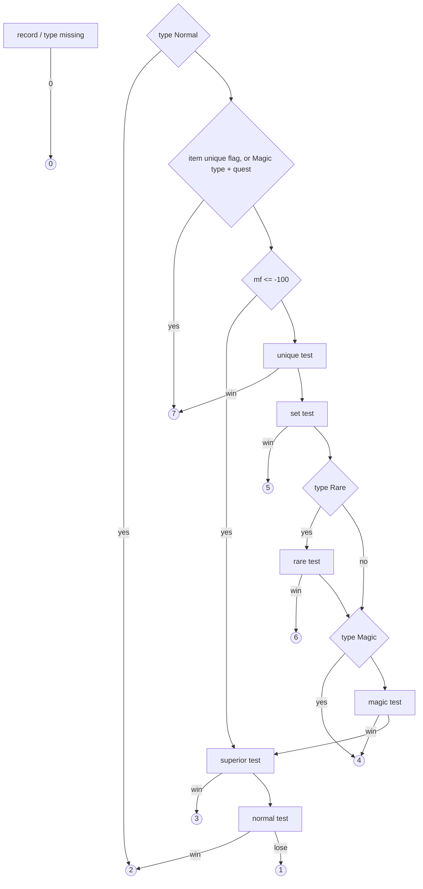

# 0002 — The drop quality roll: from a picked item to a quality code

> **Subsystem:** items/quality
> **Question:** Once `TC_ResolveDrops` has picked an item, how does `sub_00558640_DropRollQuality` choose its quality, what does it draw, and what does each returned code mean?
> **Date:** 2026-10-12   **Plan:** 0010 (Phase 1)   **Status:** open (Phase 1 read `[I]`; the reading reproduces all 266 rolls of run:2026-10-11-tc-drops offline with magic find 0; Phase 1b cross-check done 2026-10-12, one contradiction (classic row) for Phase 2; Phase 2 reproduction pending)

Names of structs and fields are ours. "Source unit" and "unit seed" (`unit+0x20`) are as in
[items/0001](0001-tc-resolution.md). The "ratio words" are the four u16 of the TC frame passed by the resolver, in TC
column order: `[0]` `Magic`, `[1]` `Rare`, `[2]` `Set`, `[3]` `Unique` ([items/0001 §7](0001-tc-resolution.md#7-recursion-into-a-sub-tc-0x0055ab680x0055ac2f)).
`d` below is `ilvl − qlvl`. Divisions are C `int` divisions (truncate toward zero) unless stated.

## Answer (summary)

- [C] **The roll returns codes below 2: the quality is not 2–7.** The run logged the codes 1 ×8, 2 ×231, 3 ×4, 4 ×19
  and 6 ×4 at the roll's exit (266 rolls; six further `QOUT q=4` lines of tc-run19 are a forced quality, `fq=4`, with no
  roll), and code 1 is the loss of the last test, the normal-vs-low draw (`cmp eax,0x80 / sbb / neg / add 1` at
  0x00558974, the only path that yields 1; the 8 logged 1s all reproduce through it). (fn:sub_00558640_DropRollQuality@0x00558640,
  run:2026-10-11-tc-drops)
- [I] **The full range is 0–7.** The other return paths, not exercised by the run, give 0 (no item or no item type
  record), 5 (set test won) and 7 (unique test won, or the two early unique returns); the function returns no other
  value. From the disassembly alone. (0x00558660–0x00558668, 0x005586B3–0x005586BE, 0x00558807–0x00558812)
- [I] **Meaning of the codes:** 1 low quality, 2 normal, 3 superior, 4 magic, 5 set, 6 rare, 7 unique; 0 only on a
  missing record. 7 and 5 are also what the resolver passes for a unique or set TC entry; item creation's quality
  dispatcher (`sub_00557450_ItemCreateByQuality`) has one case per code (and 8, 9, never returned here) and falls back
  7 → 6 → 4 → 3 → 2 and 5 → 4 → 3 → 2. (fn:TC_ResolveDrops@0x0055A6D0, fn:sub_00557450_ItemCreateByQuality@0x00557450)
- [I] **Three early returns, no draw:** item type `Normal` (itemtypes `+0x16`) → 2; item `unique` (`+0x129`) → 7; item type
  `Magic` (`+0x14`) and item `quest` (`+0x12A`) → 7. (0x00558696–0x005586CE, tbl:ItemTypes.txt:Normal,
  tbl:Weapons.txt:unique, tbl:Misc.txt:quest)
- [I] **Row:** `ITEMRATIO_Select(item, diff, 100)` keeps rows whose `Class Specific` equals "the item's own type has a
  `Class` (< 7)", whose `Uber` equals "the item is a `weap`/`armo` whose `ubercode` or `ultracode` is its own `code`,
  not `tpot`, not a quest item", and whose `Version ≤ 100`; the highest `Version` wins, the later row on a tie. The drop
  roll always passes 100, so **the `Version` 1 rows are used in classic games too**; no match is a fatal error
  (`0xE8D`), never a fallback. (fn:ITEMRATIO_Select@0x00637910, fn:ITEMS_IsClassSpecific@0x00629F70,
  fn:sub_0062B4D0_ItemRatioUber@0x0062B4D0)
- [I] **Tests in order:** unique, set, rare (only if the type's `Rare` is set), then magic (an always-`Magic` type returns 4
  before this test), then superior, then normal/low. The first four compute `c = (base − d / divisor) × 128`, divide by
  the magic-find factor, raise `c` to the row's `*Min`, subtract `c × ratio / 1024`, and win **without a draw** if
  `c < 1`, else draw `RNG_RangeB(&src->seed, c)` and win on `< 128`. Superior and normal use `(base − d / divisor) × 128`
  only (no magic find, minimum or ratio). So a call draws 0 to 6 times. (0x0055872F–0x00558986)
- [I] **Magic find** is stat 80 of the killer plus stat 80 of its owner (only a monster killer has one); killers that
  are neither players nor monsters count 0. With `mf ≠ 0`: `mf ≤ −100` skips the unique, set, rare and magic tests
  entirely; otherwise unique/set/rare divide `c` by `F(mf, 250/500/600)` with
  `F(mf, k) = mf + 100` for `mf ≤ 10`, else `100 + mf·k / (mf + k)` (`int`), and magic by `mf + 100`, all as
  `c = c·100 / F`, **before** the minimum. (fn:sub_005585D0_DropMagicFind@0x005585D0,
  fn:sub_00558610_MagicFindDiminish@0x00558610)
- [I] **Low, normal, superior:** superior wins when `(HiQuality − d / HiQualityDivisor) × 128 < 1` or its draw is `< 128`
  (code 3); otherwise `n = (Normal − d / NormalDivisor) × 128`: `n < 1` → 2 with no draw, else one draw, `< 128` → 2,
  `≥ 128` → 1. Two draws at most. (0x00558921–0x00558986)
- [I] **One caller:** `TC_ResolveDrops` (0x0055ADBA) is the only call site. Item creation has its own quality roll,
  `sub_00556F60_ItemRollQualityCreate`, which also reads `ITEMRATIO_Select` but draws from the **item** seed with a
  different formula; it is named here and left to the creation rows. (fn:sub_00556F60_ItemRollQualityCreate@0x00556F60)
- Offline check (supporting, not a promotion): `tools/quality.py check`, a first cut of the model of this reading,
  reproduces the quality code and the source seed after the roll in all 266 QIN/QOUT pairs of
  [run:2026-10-11-tc-drops](experiments.md#run2026-10-11-tc-drops) with magic find assumed 0 (§ Offline check below).
  The `[C]` promotion is plan 0010 Phase 2 (killers' magic find confirmed from the saves, oracle removed from `tools/tc.py`).

## Leads used

Phase 1 read no community quality documentation; the code was located from our own symbols (`TC_ResolveDrops` call at
0x0055ADBA, items/0001 §8). Phase 1b (2026-10-12) then fetched and compared the two registered sources, both written
for 1.10/1.11 LoD (evidence-rules § Community cross-checks; fetched in-session per ADR-0007, sections in
[sources.md](../../sources.md)). Agreement promotes nothing: every tag above is unchanged. Quotes are from the pages
as fetched.

**Quality chance formula**

- [L] src:pd-item-generation: `Chance = (BaseChance – ((ilvl-qlvl)/Divisor)) * 128`, then
  `Chance = Chance*100/(100+EffectiveMF)`, then `if (Chance<MinChance) Chance=MinChance`, then
  `FinalChance = Chance-(Chance*QualityFactor/1024)`, success when `RND[FinalChance] < 128`; "int" truncation.
  **held with refinement** Detail: same terms and order as §4 (base, MF, minimum, ratio, draw). 1.14d adds what the
  source omits: a final chance `< 1` wins with no draw (0x00558770–0x0055878C), the draw is `RNG_RangeB` (mask for a power of
  two, so `c ≤ 128` always wins), and the magic test has the same shape with `MagicMin`; superior and normal/low use
  the base term only (§6), which the source does not describe. Its act-boss cap example
  `128/(6400-(6400*983/1024))` is the §4 arithmetic with `UniqueMin` 6400 and a ratio word of 983.
- [L] src:hrus-mf-guide: unique check `Chance = BaseChance – (mlvl-qlvl)/UniqueDiv`, `×128`, `×100/(100+EffectiveMF)`,
  `If UniqueMin>Chance then Chance=UniqueMin`, `Chance – (Chance × UniqueFactor/1024)`, random number in
  `0..Chance−1` lower than 128. **held with refinement** Detail: 1.14d uses the `ilvl` the resolver passes (items/0001
  §8), not the monster level as such (the two are equal for an ordinary monster drop); divisions truncate (§3); the
  `< 1` no-draw win is not in the source.

**Test order**

- [L] src:pd-item-generation: unique first, "then set check… then rare check, then magic check, then normal check".
  **held with refinement** Detail: 1.14d's order is the same (§§4–6), with three branches the source omits: the
  early returns before any test (§1), the rare test skipped when the type's `Rare` is 0, and always-`Magic` types
  returning 4 before the magic test (§5). The superior test sits between magic and normal (§6).
- [L] src:hrus-mf-guide: "Check for being unique, if failed check for being set, if failed check for being rare, if
  failed check for being magic." **held** Detail: same first four tests (§4–5); superior/normal/low not covered there.
- [L] src:pd-item-generation, src:hrus-mf-guide: how superior, normal and low are decided (§6). **not covered**

**Magic find, diminishing returns**

- [L] src:pd-item-generation: `Effective MF=(MF*Factor)/(MF+Factor)`, Factor 250 unique, 500 set, 600 rare.
  **held with refinement** Detail: same constants and form for `mf > 10` (§7). 1.14d applies `mf` **linearly for
  `mf ≤ 10`** (`cmp ecx,0x6E / jg` at 0x00558613 on `mf+100`), which the source's formula does not have: at
  `mf = 10` the source gives 2500/260 = 9 after truncation, 1.14d 10. `mf ≤ −100` skipping the four tests and
  negative MF are not covered by either source. Phase 2 case: an MF value in 1–10 (plan 0010 log 2026-10-12).
- [L] src:hrus-mf-guide: same formula and factors; the magic check uses full MF with no diminishing returns.
  **held with refinement** Detail: magic uses `F = mf + 100` (§5, 0x005588DD), as the source says; the `mf ≤ 10`
  branch is the same refinement as above.
- [L] src:pd-item-generation, src:hrus-mf-guide: MF is applied before the minimum, the TC factor after it.
  **held** Detail: §4 order (0x00558740–0x0055878C).
- [L] src:hrus-mf-guide: "If your mercenary makes the killing blow, the sum of his MF and your MF is used, when your
  character makes the killing blow, only his MF is used." **held** Detail: §7, a monster killer's stat 80 plus its
  owner's; which monsters have an owner record stays the open question below. src:pd-item-generation: **not covered**.

**ItemRatio row selection**

- [L] src:pd-item-generation: "The game selects correct raw using Version, Uber and Class Specific fields"; `Uber` is
  1 for exceptional and elite items. **held** Detail: §2 key (`ITEMS_IsClassSpecific`, `sub_0062B4D0_ItemRatioUber`,
  `Version ≤ arg`).
- [L] src:pd-item-generation: "The two rows for Classic mode include the raw for normal and the raw for exceptional
  items… The four rows for LoD mode include…" (classic games use the `Version` 0 rows). **contradicted** for the drop
  roll. Detail: re-read 2026-10-12: `push 0x64` at 0x005586D7 is a constant, with no read of the game's expansion
  flag on the way (0x005586D0–0x005586DB); `ITEMRATIO_Select` keeps `Version ≤ 100` and the highest version
  (0x00637983–0x00637995); the loader (`0x006378E0`) loads the six rows with no filter, and the only other reader of
  the rows is the creation-side roll (0x00556FD9), which passes 0 for a version-0 item. So in 1.14d a classic
  **drop** uses the `Version` 1 rows and only the creation-side roll can reach the `Version` 0 rows. The reading is
  unchanged (`[I]`, §2); it is settled by the classic-character case added to plan 0010 Phase 2 (backlog
  reverser → reverser, 2026-10-12).
- [L] src:hrus-mf-guide: "lines for normal, exceptional/elite, class-specific normal and class-specific
  exceptional/elite items" (LoD). **held** Detail: the four `Version` 1 rows (records 2–5), §2; classic not covered.

**Not covered by either source:** the returned code numbering (§ Answer), the early returns (§1), `ITEMRATIO_Select`'s
tie rule and the fatal `0xE8D` (§2), the `< 1` no-draw wins, the `mf ≤ −100` bypass, killers that are neither player
nor monster (§7).

## Functions

| Address | Name | Role | Tag |
|---|---|---|---|
| `0x00558640` | `sub_00558640_DropRollQuality` | the drop quality roll: code 0–7, 0–6 draws on the source seed | I |
| `0x005585D0` | `sub_005585D0_DropMagicFind` | ESI killer: stat 80 of the killer (type 0 or 1) plus its owner's | I |
| `0x00558610` | `sub_00558610_MagicFindDiminish` | ECX `mf+100`, EDX = stack `k`: `mf+100` if ≤ 110, else `100 + mf·k/(mf+k)` | I |
| `0x00637910` | `ITEMRATIO_Select` | `itemratio` row by class-specific, uber, `Version ≤ arg` (arg 0 or 100), highest version | I |
| `0x00629F70` | `ITEMS_IsClassSpecific` | itemtypes `Class` (`+0x21`) of the item's own `type` is < 7 | I |
| `0x0062B4D0` | `sub_0062B4D0_ItemRatioUber` | item is `weap`/`armo`, `ubercode` or `ultracode` = `code`, `type ≠ tpot`, `quest = 0` | I |
| `0x00625500` | `sub_00625500_UnitGetStat` | `(unit, stat, layer)` → value through the unit's stat list `unit+0x5C` | I |
| `0x0062A670` | `sub_0062A670_ItemGetVersion` | item unit → item data `+0x30` (u16); fatal for a non-item | I |
| `0x00556F60` | `sub_00556F60_ItemRollQualityCreate` | creation-side quality roll (item seed); out of scope | I |
| `0x00557450` | `sub_00557450_ItemCreateByQuality` | creation: quality dispatch and fallbacks (cases 1–9) | I |
| `0x005572A0` | `sub_005572A0_ItemFallbackNormal` | sets quality 2 and builds a normal item | I |
| `0x00557320` | `sub_00557320_ItemFallbackSuperior` | sets quality 3, then `0x005C2AD0` | I |
| `0x00557380` | `sub_00557380_ItemFallbackMagic` | sets quality 4, then `0x005565E0` | I |
| `0x005573F0` | `sub_005573F0_ItemFallbackRare` | sets quality 6, then `0x005C21A0` | I |

## Walkthrough

### 1. Arguments and early returns (0x00558640–0x005586CE)

Register and stack use, from the prologue and `ret 0x10`: EAX item index (`items` record number), ECX `ilvl` (the
resolver's `ilvl` argument, a signed `int`), stack `(game, src, killer, ratio*)`. This matches the call at 0x0055ADBA
read in [items/0001 §8](0001-tc-resolution.md#8-item-pick-and-hand-off-0x0055ac5f0x0055af59).

```c
// fn:sub_00558640_DropRollQuality@0x00558640 (trimmed, our names)
rec = ITEMS_GetRecord(item);                 if (!rec) return 0;
t   = ITEMS_GetType(item);                   // rec->type (+0x11E), signed
if (t < 0 || t >= g_pDataTables->nItemTypes /*+0xBFC*/) return 0;
ty  = &itemtypes[t];                         // 0xE4-byte records at +0xBF8
if (ty->Normal /*+0x16*/)                     return 2;
if (rec->unique /*+0x129*/)                   return 7;
if (ty->Magic /*+0x14*/ && rec->quest /*+0x12A*/) return 7;
```

- [I] The tests use the item's own `type` only (not `type2`, not the `Equiv` chain). (0x0055866B–0x005586CE)
- [I] With stock data: `Normal` is set for 31 types (`gold`, potions, gems, runes, keys, scrolls, books, `tpot`, `body`,
  quivers and others); `unique` (`+0x129`) for 18 items (`hst`, `msf`, `qf1`, `qf2`, `hfh`, `hdm`, `bks`, `bkd`, `g33`, `d33`,
  `g34`, `j34`, `bbb`, `tr1`, `tr2`, `mss`, `ass`, `std`); the `Magic`-type quest rule hits only `vip` (an `amul`). Counts
  from `excel_bin.py` over the merged tables. (tbl:ItemTypes.txt:Normal, tbl:Weapons.txt:unique, tbl:Misc.txt:unique)

### 2. Row selection — `ITEMRATIO_Select` (0x00637910)

```c
// fn:ITEMRATIO_Select@0x00637910, stdcall (item, diff, u16 version), ret 0xC
cls  = ITEMS_IsClassSpecific(item);          // 0/1
uber = sub_0062B4D0_ItemRatioUber(item);     // 0/1
if (version != 0 && version != 100) fatal(0x61D);
best = -1; bestVer = -1;
for (i = 0; i < g_nItemRatio; i++) {
    r = &g_pItemRatio[i];                    // 0x44-byte records
    if (r->ClassSpecific /*+0x43 u8*/ == cls && r->Uber /*+0x42 u8*/ == uber
        && r->Version /*+0x40 u16*/ <= version && (int)r->Version >= bestVer) { best = i; bestVer = r->Version; }
}
return best >= 0 ? &g_pItemRatio[best] : 0;
```

- [I] The second argument (the drop roll passes `game+0x6D`, the difficulty) is not read. (0x00637910–0x006379B1)
- [I] `>=` on the version makes a later row win a tie. Stock data has no tie (one row per key and version). (0x0063798F–0x00637995)
- [I] `ITEMS_IsClassSpecific`: the itemtypes record of `rec->type` (signed, bounds-checked, else 0) has `Class`
  (`+0x21`, u8, blank stored as `0xFF`) `< 7`. Stock types with a class: `amaz`, `barb`, `necr`, `pala`, `sorc`, `assn`,
  `drui`, `h2h`, `orb`, `head`, `ashd`, `phlm`, `pelt`, `cloa`, `abow`, `aspe`, `ajav`, `h2h2`. (fn:ITEMS_IsClassSpecific@0x00629F70, tbl:ItemTypes.txt:Class)
- [I] `sub_0062B4D0_ItemRatioUber`: `ITEMS_IsType(item, 50 /*armo*/)` or `ITEMS_IsType(item, 45 /*weap*/)` (type
  equivalence, [items/0001](0001-tc-resolution.md#functions)), and (`ubercode == code` or `ultracode == code`, compared
  as 4-byte words at `+0x88`/`+0x8C` against `+0x80`), and `type ≠ 38` (`tpot`), and `quest == 0`. So "uber" means an
  exceptional or elite base. (fn:sub_0062B4D0_ItemRatioUber@0x0062B4D0, tbl:Weapons.txt:ubercode, tbl:Armor.txt:ultracode)
- [I] **Classic games.** The drop roll pushes the constant 100 (0x005586D7) whatever `game+0x70` is, so it selects among
  rows with `Version` 0 and 1 and takes the `Version` 1 row of its key. The `Version` 0 rows (`(0,0,0)` and `(0,1,0)`)
  are reachable only with the argument 0, which only the creation-side roll passes (§7). A classic drop therefore uses
  the same row as an expansion drop. Not observed (no classic run).
- [I] No matching row (impossible with stock data: every (uber, class) pair has a `Version` 1 row) is a fatal error
  `0xE8D` in the caller (0x005586E6), not a fallback.

The six stock rows ([ItemRatio](../../tables/ItemRatio.md)), keyed (Version, Uber, Class Specific): (0,0,0), (0,1,0), (1,0,0),
(1,1,0), (1,0,1), (1,1,1). The drop roll can only reach records 2–5.

### 3. Shared terms (0x00558705–0x0055873D)

```c
d    = ilvl - rec->level;          // int; rec->level is items +0xFD, u8 (the item's qlvl)
mf   = sub_005585D0_DropMagicFind(killer);    // ESI = killer
useMF = 0;
if (mf != 0) { if (mf <= -100) goto superior; useMF = 1; }   // signed compare with 0xFFFFFF9C
m100 = mf + 100;
```

- [I] `d` is signed and can be negative (item level above `ilvl`). Every `d / divisor` is `cdq; idiv` (truncation toward
  zero), with the divisor a u32 column read as a signed `int`. A zero divisor would fault; no stock row has one. (0x0055872F–0x00558733)
- [I] `x << 7` (`shl 7`) is the ×128; all products are 32-bit `imul`. (0x0055873D, 0x0055875F)

### 4. Unique, set, rare (0x0055872F–0x005588AF)

Each test is the same block with its own columns, factor and ratio word:

| Order | Test | `base`, `divisor`, `min` (itemratio) | MF factor `k` | ratio word | win → code |
|---|---|---|---|---|---|
| 1 | unique | `Unique` `+0x00`, `UniqueDivisor` `+0x04`, `UniqueMin` `+0x08` | 250 | `[3]` Unique (`+6`) | 7 |
| 2 | set | `Set` `+0x18`, `SetDivisor` `+0x1C`, `SetMin` `+0x20` | 500 | `[2]` Set (`+4`) | 5 |
| 3 | rare, only if itemtypes `Rare` (`+0x15`) ≠ 0 | `Rare` `+0x0C`, `RareDivisor` `+0x10`, `RareMin` `+0x14` | 600 | `[1]` Rare (`+2`) | 6 |

```c
c = (base - d / divisor) << 7;
if (useMF) { f = sub_00558610_MagicFindDiminish(m100, k); if (f != 0) c = c * 100 / f; }
if (c <= min) c = min;                                   // signed compare: c = max(c, min)
c -= (int)(ratio[w] * c) / 1024;                         // u16 ratio zero-extended; signed /1024 (cdq/and 0x3FF/add/sar 10)
if (c < 1) return code;                                  // no draw
if (RNG_RangeB(&src->seed, c) < 128) return code;        // draw; unsigned compare (jb)
```

- [I] Order of operations: base term, magic find, minimum, ratio, then the draw. The minimum is applied **after** magic
  find and **before** the ratio, so a ratio word can still push `c` below the minimum. (0x00558740–0x0055878C for unique)
- [I] The ratio subtraction is `c − trunc(ratio·c / 1024)`; `c ≥ min > 0` there, so the truncation is a floor. A ratio of
  1024 or more makes `c ≤ 0`, an automatic win with no draw. (0x00558770–0x0055878C)
- [I] `RNG_RangeB` ([rng/0001](../rng/0001-rng-core.md)): one LCG step of the source unit seed `unit+0x20`, then
  `low & (c−1)` when `c` is a power of two, else `low % c` (unsigned). Any `c ≤ 128` therefore always wins, with a draw.
  (fn:RNG_RangeB@0x0045C3E0)
- [I] A rare test is skipped (no draw) when the item's own type has `Rare = 0`. (0x00558829–0x00558830)

### 5. Magic (0x005588B1–0x0055891F)

```c
if (ty->Magic /*+0x14*/) return 4;                       // always-magic types: ring, amul, char, jewl, charms, mboq, mxbq
c = (row->Magic - d / row->MagicDivisor) << 7;           // +0x24, +0x28
if (useMF) c = c * 100 / m100;                           // no diminishing returns, no zero test (m100 ≥ 1 here)
if (c <= row->MagicMin /*+0x2C*/) c = row->MagicMin;
c -= (int)(ratio[0] * c) / 1024;                          // Magic word (+0)
if (c < 1 || RNG_RangeB(&src->seed, c) < 128) return 4;
```

- [I] An always-magic type reaches this point only after losing the unique, set and (if allowed) rare tests, so it is
  4 at worst; it never reaches the superior/normal tests. (0x005588B1–0x005588C5)

### 6. Superior, normal, low (0x00558921–0x00558986)

```c
superior:                                                 // also the target of mf <= -100
c = (row->HiQuality - d / row->HiQualityDivisor) << 7;   // +0x30, +0x34
if (c < 1) return 3;                                      // no draw
if (RNG_RangeB(&src->seed, c) < 128) return 3;
n = (row->Normal - d / row->NormalDivisor) << 7;         // +0x38, +0x3C
if (n < 1) return 2;                                      // no draw
return RNG_RangeB(&src->seed, n) < 128 ? 2 : 1;           // cmp 0x80; sbb; neg; add 1
```

- [I] Two draws at most decide among low, normal and superior: one for superior, then one for normal vs low.
  No magic find, no minimum and no ratio word enter these two tests. (0x00558921–0x00558986)
- [I] A `c < 1` or `n < 1` result wins its test (superior; normal) without a draw. Low quality (1) needs a draw `≥ 128`
  on a normal chance of at least 129. With the record-2 values (`Normal` 2, `NormalDivisor` 2): `d ≥ 4` gives `n ≤ 0`
  (normal, no draw), `d` 2–3 gives `n = 128` (normal, one draw that always wins), and only `d ≤ 1` leaves room for low quality. (0x00558930, 0x00558965)



### 7. Magic find (0x005585D0, 0x00558610)

```c
// fn:sub_005585D0_DropMagicFind@0x005585D0, ESI = killer
if (!killer || killer->type > 1) return 0;               // unsigned: players (0) and monsters (1) only
mf = sub_00625500_UnitGetStat(killer, 80, 0);
if ((o = sub_0058F0D0_MonsterOwner(killer)))  mf += sub_00625500_UnitGetStat(o, 80, 0);
return mf;

// fn:sub_00558610_MagicFindDiminish@0x00558610, ECX = mf + 100, EDX = stack arg = k
if (ecx <= 110) return ecx;
return (ecx - 100) * k / (ecx - 100 + k) + 100;          // int, cdq/idiv
```

- [I] **Whose stat 80.** A player killer: its own (`MonsterOwner` returns 0 for a non-monster). A monster killer
  (summon, minion of a monster, hireling, or a plain monster): its own stat 80 plus that of the unit
  `sub_0058F0D0_MonsterOwner` returns, which reads `monsterData+0x28` (the owner record) and looks the unit up through
  `0x00552F60`. Which monsters have that owner record filled (summons and hirelings, presumably not monster minions) is
  not read here. Any other killer type (an object, a missile) gives 0. Layer 0 of stat 80 (`item_magicbonus`). (fn:sub_005585D0_DropMagicFind@0x005585D0, fn:sub_0058F0D0_MonsterOwner@0x0058F0D0)
- [I] **Diminishing returns** apply to unique (`k` 250), set (500) and rare (600) only. The threshold is `mf + 100 > 110`,
  so `mf` 1–10 is applied linearly (`F = 100 + mf`), and from 11 on `F = 100 + trunc(mf·k / (mf + k))`. Magic uses
  `F = 100 + mf` always. Each test then sets `c = trunc(c·100 / F)` (signed). `F == 0` skips the division (unreachable:
  `mf > −100` there). (fn:sub_00558610_MagicFindDiminish@0x00558610, 0x0055875F–0x00558763, 0x005588DD–0x005588E3)
- [I] **Negative magic find** between −99 and −1 makes `F < 100`, so `c` grows (worse odds); `−100` or lower bypasses
  all four tests and goes straight to superior/normal/low. `mf = 0` skips the division altogether (same result as `F` = 100). (0x0055871F–0x00558722, 0x00558963)
- [I] Before or after the minimum: **before** (§4). (0x00558740–0x0055876E)

### 8. The other quality roll and the creation fallbacks (named only)

- [I] `TC_ResolveDrops` at 0x0055ADBA is the only caller of `sub_00558640_DropRollQuality` (Ghidra xrefs). Other
  callers of `ITEMRATIO_Select`: `sub_00556F60_ItemRollQualityCreate` (0x00556FD9) only.
- [I] `sub_00556F60_ItemRollQualityCreate(itemUnit, record)` returns the record's quality (`+0x30`) at once when the
  item's version (`sub_0062A670_ItemGetVersion`) is non-zero and the quality is set; otherwise it selects a row with
  version 100 or 0 (by the item's version), and walks the codes 7, 6, 5, 4, 3, 2 (table at `0x006E1138`), drawing
  `RNG_RangeB(item seed, …)` and winning on 0. Its formula differs from the drop roll (no ×128, no magic find, no
  ratio words). It is called from `sub_00557450_ItemCreateByQuality` and its fallback helpers. Its callers (vendors,
  gambling, cube, quest items) belong to the item-creation rows; nothing in plan 0010 depends on it. (fn:sub_00556F60_ItemRollQualityCreate@0x00556F60)
- [I] **Impossible unique or set.** `sub_00557450_ItemCreateByQuality` (called from `0x00557AB0`, which
  `sub_00558D90_ItemCreate` calls at 0x00558EBB) switches on the quality: 7 calls the unique builder `0x005566B0`; on
  failure an item with durability (`0x00629930`) and a non-zero version gets stats 72/73 ×3 (capped at 255), then the
  chain rare (`sub_005573F0_ItemFallbackRare`) → magic → superior → normal. 5 calls the set builder `0x005C2940`; on
  failure the same durability step ×2, then magic → superior → normal. 6 falls back to magic → superior → normal,
  4 to superior → normal, 3 and 1 to normal. The decompile only was read; the builders and the conditions
  before the switch (`0x0062E9E0`, `0x00628CD0`, `0x0062A0F0`, `0x0062E990`, `0x00628C70`, `0x0062EA30`, which can rewrite
  the quality to 4, 7 or 2) are left to `items/uniques-sets` and `items/affixes`. (fn:sub_00557450_ItemCreateByQuality@0x00557450)

## Offline check against run:2026-10-11-tc-drops

`tools/quality.py check` (first cut; Phase 2 extends it) implements §§1–7, reads the tables with `tools/excel_bin.py`
(default: merged `data/global/excel`), draws with `tools/rng.py`, and replays every QIN line (item, ilvl, source seed,
ratio words) of the eleven logs of [run:2026-10-11-tc-drops](experiments.md#run2026-10-11-tc-drops) against the QOUT
line that must follow it, asserting the code and the seed after the roll. No resync: each pair starts from its own
logged seed, and a QIN without its QOUT fails. Magic find is not logged; the tool uses `--mf` (default 0) for every pair.

```
python3 -I tools/quality.py check workspace/logs/tc-run{2,4,5,6,9,10,13,16,17,18,19}.log
266 pairs, 266 reproduced, 0 failed (mf=0); codes 1:8 2:231 3:4 4:19 6:4; draws 0:188 2:2 3:15 4:6 5:29 6:26; itemratio rows 2:66 3:3 4:8 5:1 None:188; 6 QOUT without QIN (forced quality) skipped
```

| Result | Value |
|---|---|
| QIN/QOUT pairs | 266, **266 reproduced** (code and exit seed), 0 failed; exit 0 |
| Codes | 1 ×8, 2 ×231, 3 ×4, 4 ×19, 6 ×4 (plus 6 forced `q=4` with no QIN, tc-run19, `fq=4`) |
| Draws per roll | 0 ×188, 2 ×2, 3 ×15, 4 ×6, 5 ×29, 6 ×26 |
| Exits (`-v`) | `Normal` type 188 (no draw, no row); magic won with no draw at ratio `Magic` 1024: 10; normal `n < 1`: 25; always-magic type: 3; won on a draw: 40 (low 8, normal 18, superior 4, magic 6, rare 4; one rare under the ratio words `1024,972,800,800`) |
| itemratio records | 2 ×66, 3 ×3, 4 ×8, 5 ×1 (all `Version` 1); 188 early returns select no row |
| Killers (TCR `ktype`/`kclass`) | player 265 (Barbarian 236, Sorceress 29), monster 1 (`navi`, class 266) |

- Sensitivity (throw-away variants of the same model, not kept): selecting the `Version` 0 rows (as an argument of 0
  would) gives 39 failures; swapping codes 1 and 2 gives 26. Removing the minimum clamp changes nothing in this set (no
  test came near its `*Min` with `mf = 0`), so the clamp and the whole magic-find path are untested by these logs.
- Assumptions: the killers' magic find is 0 (not logged; to be confirmed from the saves in Phase 2), and the `navi`
  killer has no owner record or no stat 80.
- This check supports the reading; it does not promote it (Phase 2 does, after the magic-find run and with the oracle
  removed from `tools/tc.py replay`).

## Data touched

- `tbl:ItemRatio.txt:Unique`, `UniqueDivisor`, `UniqueMin`, `Rare`, `RareDivisor`, `RareMin`, `Set`, `SetDivisor`,
  `SetMin`, `Magic`, `MagicDivisor`, `MagicMin`, `HiQuality`, `HiQualityDivisor`, `Normal`, `NormalDivisor`,
  `Version` (`+0x40` u16), `Uber` (`+0x42`), `Class Specific` (`+0x43`); `data:g_pItemRatio@0x0096CC4C`,
  `data:g_nItemRatio@0x0096CC48`. Semantics settled here for the archivist (backlog).
- `tbl:ItemTypes.txt:Magic` (`+0x14`), `Rare` (`+0x15`), `Normal` (`+0x16`), `Class` (`+0x21`)
- `tbl:Weapons.txt:level` (`+0xFD`), `unique` (`+0x129`), `quest` (`+0x12A`), `type` (`+0x11E`), `code` (`+0x80`),
  `ubercode` (`+0x88`), `ultracode` (`+0x8C`); same offsets in Armor and Misc
- stat 80 `item_magicbonus` (layer 0) of the killer and of its owner
- `struct:Unit+0x20` seed (source unit), `+0x00` type, `+0x14` monster data (`+0x28` owner record), `+0x5C` stat list;
  `struct:Game+0x6D` (passed to `ITEMRATIO_Select`, unused)

## Dead ends

- The Ghidra decompile of the call shows `ITEMRATIO_Select(item, diff, 100)` as if the difficulty mattered; the
  callee never reads its second argument.

## Open questions

- Which monsters have an owner for magic find (`monsterData+0x28`): summons and hirelings are expected, monster minions
  are not. Resolve by reading where `+0x28` is written, or in Phase 2 by a kill from a summon/hireling with magic find on
  the player.
- The killers' magic find in run:2026-10-11-tc-drops (assumed 0): read stat 80 from the saves used (Phase 2).
- Classic games: the constant version 100 says classic drops use the `Version` 1 rows; no classic run exists.
  src:pd-item-generation says classic uses the `Version` 0 rows (contradicted, § Leads used); a required case of plan
  0010 Phase 2.
- Magic find 1–10: linear in 1.14d (§7), diminished in both sources' formula; a Phase 2 case.
- The creation-side roll `sub_00556F60_ItemRollQualityCreate` and the pre-switch overrides in
  `sub_00557450_ItemCreateByQuality`: read with the creation rows (`items/uniques-sets`, `items/affixes`).
