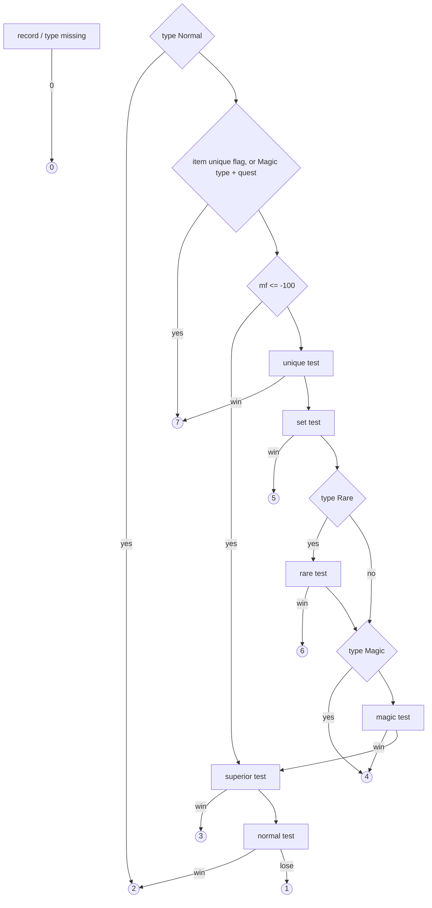

# 0002 — The drop quality roll: from a picked item to a quality code

> **Subsystem:** items/quality
> **Question:** Once `TC_ResolveDrops` has picked an item, how does `ITEMS_DropRollQuality` choose its quality, what does it draw, and what does each returned code mean?
> **Date:** 2026-10-12   **Plan:** 0010 (Phases 1, 1b, 2)   **Status:** open (Phase 1 read; Phase 1b cross-check, one contradiction (classic row); Phase 2: run:2026-10-12-quality and run:2026-10-13-quality reproduce 1916 rolls with no oracle and promote the roll to `[C]` for single player, Normal and Nightmare, expansion and classic, a player or summon killer, MF 0, 10 and 100; the classic rows, MF 1–10 and the owner's MF are settled; MF < 0, hireling/minion killers, Hell and the `*Min` clamp stay `[I]`; plan 0038 batch S2a, 2026-10-16: 9 statements raised and 7 in part, [§ Plan 0038 batch S2a](#plan-0038-batch-s2a-2026-10-16); plan 0038 batch S2c, 2026-10-16: 1 statement raised in part, [§ Plan 0038 batch S2c](#plan-0038-batch-s2c-2026-10-16))

Names of structs and fields are ours. "Source unit" and "unit seed" (`unit+0x20`) are as in
[items/0001](0001-tc-resolution.md). The "ratio words" are the four u16 of the TC frame passed by the resolver, in TC
column order: `[0]` `Magic`, `[1]` `Rare`, `[2]` `Set`, `[3]` `Unique` ([items/0001 §7](0001-tc-resolution.md#7-recursion-into-a-sub-tc-0x0055ab680x0055ac2f)).
`d` below is `ilvl − qlvl`. Divisions are C `int` divisions (truncate toward zero) unless stated.

## Answer (summary)

The tags below are those of the plan 0010 record. [§ Plan 0038 batch S2a](#plan-0038-batch-s2a-2026-10-16) raises
further statements; where it lists one, its tag and evidence take precedence over the bullet here.

- [C] **The roll returns the codes 1 to 7, and the model reproduces each.** run:2026-10-11-tc-drops logged 1 ×8,
  2 ×231, 3 ×4, 4 ×19 and 6 ×4 at the roll's exit (266 rolls; six further `QOUT q=4` lines of tc-run19 are a forced
  quality, `fq=4`, with no roll); run:2026-10-12-quality adds 5 (set test won on a draw, 9 in session B, 1 in A) and 7
  (unique test won on a draw, 4 in B, 1 in A). Code 1 is the loss of the last test, the normal-vs-low draw
  (`cmp eax,0x80 / sbb / neg / add 1` at 0x00558974, the only path that yields 1; all 12 logged 1s reproduce through
  it). `tools/quality.py check` reproduces the code and the exit seed of all 1916 rolls (266 + 65 + 782 + 574 + 229;
  run:2026-10-13-quality adds every code 1–7 again, in Nightmare at MF 10 and in a classic Normal game).
  (fn:ITEMS_DropRollQuality@0x00558640, run:2026-10-11-tc-drops, run:2026-10-12-quality, run:2026-10-13-quality)
- [I] **The full range is 0–7.** 0 (no item or no item type record) and the two early unique returns (7) are not
  exercised; the function returns no other value. From the disassembly alone. (0x00558660–0x00558668,
  0x005586B3–0x005586BE, 0x00558807–0x00558812)
- [I] **Meaning of the codes:** 1 low quality, 2 normal, 3 superior, 4 magic, 5 set, 6 rare, 7 unique; 0 only on a
  missing record. 7 and 5 are also what the resolver passes for a unique or set TC entry; item creation's quality
  dispatcher (`sub_00557450_ItemCreateByQuality`) has one case per code (and 8, 9, never returned here) and falls back
  7 → 6 → 4 → 3 → 2 and 5 → 4 → 3 → 2. (fn:TC_ResolveDrops@0x0055A6D0, fn:sub_00557450_ItemCreateByQuality@0x00557450)
- [C] **Item type `Normal` returns 2 with no draw and no row:** 853 rolls (188 + 48 + 617 in the old logs, session A and session B) of
  `Normal` types (itemtypes `+0x16`) come back as 2 with the source seed unchanged, as the model predicts.
  (0x00558696, tbl:ItemTypes.txt:Normal, run:2026-10-11-tc-drops, run:2026-10-12-quality)
- [I] **The other two early returns, no draw:** item `unique` (`+0x129`) → 7; item type `Magic` (`+0x14`) and item
  `quest` (`+0x12A`) → 7. Not exercised. (0x005586AA–0x005586CE, tbl:Weapons.txt:unique, tbl:Misc.txt:quest)
- [C] **Rows used by expansion drops (Nightmare and Normal):** the four `Version` 1 rows, records 2 `(1,0,0)`,
  3 `(1,1,0)`, 4 `(1,0,1)` and 5 `(1,1,1)` (Version, Uber, Class Specific), chosen by the key below: records 2 ×186,
  3 ×41, 4 ×27, 5 ×6 over the 260 rolls that reach a test. Forcing the uber key to 0 breaks 7 rolls, to 1 breaks 13,
  forcing the class key to 0 breaks 10, and the `Version` 0 rows break 39 of the old set. (fn:ITEMRATIO_Select@0x00637910,
  tbl:ItemRatio.txt:Version, run:2026-10-12-quality, run:2026-10-11-tc-drops)
- [C] **Classic drops use the same `Version` 1 rows.** In a classic Normal game (`exp=0` on every call), all 52 rolls
  that reach a test logged record 2 (51) or 3 (1), and all 229 rolls reproduce with those rows. With the `Version` 0
  rows, 29 of the 52 come out wrong, both classic uniques among them. (0x005586D7, fn:ITEMRATIO_Select@0x00637910,
  tbl:ItemRatio.txt:Version, run:2026-10-13-quality)
- [I] **Row:** `ITEMRATIO_Select(item, diff, 100)` keeps rows whose `Class Specific` equals "the item's own type has a
  `Class` (< 7)", whose `Uber` equals "the item is a `weap`/`armo` whose `ubercode` or `ultracode` is its own `code`,
  not `tpot`, not a quest item", and whose `Version ≤ 100`; the highest `Version` wins, the later row on a tie. The drop
  roll always passes 100, so **the `Version` 1 rows are used in classic games too**; no match is a fatal error
  (`0xE8D`), never a fallback. (fn:ITEMRATIO_Select@0x00637910, fn:ITEMS_IsClassSpecific@0x00629F70,
  fn:sub_0062B4D0_ItemRatioUber@0x0062B4D0)
- [C] **Tests in order** (Nightmare and Normal, expansion and classic, single player, MF 0, 10 and 100): unique, set, rare (only if the
  type's `Rare` is set: three charm rolls skip it), then magic (an always-`Magic` type returns 4 before this test: 14
  rolls, among them `ring`, `amul`, `jewl`, `scha`, `lcha`), then superior, then normal/low. The first four compute
  `c = (base − d / divisor) × 128`, divide by the magic-find factor, subtract `c × ratio / 1024`, and win **without a
  draw** if `c < 1` (ratio word 1024: 61 rolls), else draw `RNG_RangeB(&src->seed, c)` and win on `< 128`. Superior and
  normal use `(base − d / divisor) × 128` only (no magic find, minimum or ratio). A call draws 0 to 6 times (all seven
  counts logged). Every draw, code and exit seed of 1916 rolls reproduces, and whole resolver calls reproduce with the
  roll modelled and no oracle (`tools/tc.py replay --quality model`: 328 + 124 + 1269 + 944 expansion calls; the
  classic calls stop at the TC pick, which `tc.py` does not model for classic games).
  (fn:ITEMS_DropRollQuality@0x00558640 0x0055872F–0x00558986, run:2026-10-12-quality, run:2026-10-11-tc-drops,
  run:2026-10-13-quality)
- [I] **The minimum clamp** (raise `c` to the row's `*Min` after magic find and before the ratio) never acted: every
  pre-clamp chance in the runs stayed above `UniqueMin` 6400, `RareMin` 3200, `SetMin` 5600 and `MagicMin` 192.
  (0x00558767–0x0055876E, tbl:ItemRatio.txt:RareMin, tbl:ItemRatio.txt:SetMin)
  *Corrected 2026-10-14 (backlog spec-writer → reverser):* this line named the minima `SetMin` 3200 and `RareMin` 5600.
  The table has `RareMin` 3200 at `+0x14` and `SetMin` 5600 at `+0x20` (§ 4; `excel_bin.py dump … itemratio`). No tag moves.
- [C] **Magic find with diminishing returns (player killer, MF 100 and 0):** the roll uses the player killer's stat 80
  (the save's equipped items: 50 + 50); unique/set/rare divide `c` by `F = 100 + trunc(mf·k / (mf + k))` with `k` 250,
  500, 600 (171, 183, 185 at MF 100), magic by `mf + 100`, as `c = trunc(c·100 / F)`; MF 0 divides nothing. Sessions A
  and B each reproduce at MF 100 and at no other MF from −150 to 400. A linear factor (`F = mf + 100` in all four
  tests) gets 31 rolls of B and 3 of A wrong (unique 9, set 13, rare 12 by first diverging test); swapping or merging
  the `k` values breaks 20–27 rolls, and magic without MF or with `k` 600 breaks 3 or 11. (fn:ITEMS_DropMagicFind@0x005585D0,
  fn:ITEMS_MagicFindDiminish@0x00558610 0x0055861E–0x0055862C, 0x0055875F–0x00558763, 0x005588DD–0x005588E3,
  run:2026-10-12-quality)
- [C] **Magic find 1–10 is linear.** At MF 10 (one item, `Wisp`) all 574 rolls reproduce with `F = mf + 100` in all
  four tests, and the diminishing form already at MF 10 (`F` 109) breaks 24 of them. With the logged MF removed, only
  MF 10 reproduces every roll, among values from −20 to 100. (0x00558613–0x0055861B, run:2026-10-13-quality)
- [C] **A summon kill uses its owner's MF.** The 85 rolls of kills by the Necromancer's skeletons (monster class 363,
  stat 80 = 0) log the owner path (`QOWN` the player, `QOMF` 10, `QMF` 10). Dropping the owner's 10 breaks 27 of them.
  (fn:ITEMS_DropMagicFind@0x005585D0, fn:sub_0058F0D0_MonsterOwner@0x0058F0D0, run:2026-10-13-quality)
- [I] **Magic find, unexercised parts:** hireling and monster-minion killers (whether they have an owner); killers
  that are neither players nor monsters count 0; `mf ≤ −100` skips the unique, set, rare and magic tests; and the
  order magic find **before** the minimum (the clamp never acted). (fn:ITEMS_DropMagicFind@0x005585D0,
  fn:ITEMS_MagicFindDiminish@0x00558610)
- [C] **Low, normal, superior:** superior wins when `(HiQuality − d / HiQualityDivisor) × 128 < 1` or its draw is `< 128`
  (code 3); otherwise `n = (Normal − d / NormalDivisor) × 128`: `n < 1` → 2 with no draw, else one draw, `< 128` → 2,
  `≥ 128` → 1. Two draws at most. Observed: superior 4 + 13 (all on a draw), low 8 + 2 + 2, normal with no draw
  and with a draw. (0x00558921–0x00558986, run:2026-10-11-tc-drops, run:2026-10-12-quality)
- [I] **One caller:** `TC_ResolveDrops` (0x0055ADBA) is the only call site. Item creation has its own quality roll,
  `sub_00556F60_ItemRollQualityCreate`, which also reads `ITEMRATIO_Select` but draws from the **item** seed with a
  different formula; it is named here and left to the creation rows. (fn:sub_00556F60_ItemRollQualityCreate@0x00556F60)
- Reproduction (plan 0010 Phase 2, § Reproduction below): `tools/quality.py check` reproduces all 1916 logged rolls
  (code and exit seed, no resync, no oracle). Magic find comes from the killers' saves (0 in
  [run:2026-10-11-tc-drops](experiments.md#run2026-10-11-tc-drops), 100 in
  [run:2026-10-12-quality](experiments.md#run2026-10-12-quality)) or from the logged `QMF` (10 and 0 in
  [run:2026-10-13-quality](experiments.md#run2026-10-13-quality), matching the saves); `tools/tc.py replay --quality
  model` reproduces every expansion resolver call of the three runs with the roll modelled.

## Leads used

Phase 1 read no community quality documentation; the code was located from our own symbols (`TC_ResolveDrops` call at
0x0055ADBA, items/0001 §8). Phase 1b (2026-10-12) then fetched and compared the two registered sources, both written
for 1.10/1.11 LoD (evidence-rules § Community cross-checks; fetched in-session per ADR-0007, sections in
[sources.md](../../sources.md)). Agreement promotes nothing: every tag above is unchanged. Quotes are from the pages
as fetched.

**Quality chance formula**

- [L] src:pd-item-generation: `Chance = (BaseChance – ((ilvl-qlvl)/Divisor)) * 128`, then
  `Chance = Chance*100/(100+EffectiveMF)`, then `if (Chance<MinChance) Chance=MinChance`, then
  `FinalChance = Chance-(Chance*QualityFactor/1024)`, success when `RND[FinalChance] < 128`; "int" truncation.
  **held with refinement** Detail: same terms and order as §4 (base, MF, minimum, ratio, draw). 1.14d adds what the
  source omits: a final chance `< 1` wins with no draw (0x00558770–0x0055878C), the draw is `RNG_RangeB` (mask for a power of
  two, so `c ≤ 128` always wins), and the magic test has the same shape with `MagicMin`; superior and normal/low use
  the base term only (§6), which the source does not describe. Its act-boss cap example
  `128/(6400-(6400*983/1024))` is the §4 arithmetic with `UniqueMin` 6400 and a ratio word of 983.
- [L] src:hrus-mf-guide: unique check `Chance = BaseChance – (mlvl-qlvl)/UniqueDiv`, `×128`, `×100/(100+EffectiveMF)`,
  `If UniqueMin>Chance then Chance=UniqueMin`, `Chance – (Chance × UniqueFactor/1024)`, random number in
  `0..Chance−1` lower than 128. **held with refinement** Detail: 1.14d uses the `ilvl` the resolver passes (items/0001
  §8), not the monster level as such (the two are equal for an ordinary monster drop); divisions truncate (§3); the
  `< 1` no-draw win is not in the source.

**Test order**

- [L] src:pd-item-generation: unique first, "then set check… then rare check, then magic check, then normal check".
  **held with refinement** Detail: 1.14d's order is the same (§§4–6), with three branches the source omits: the
  early returns before any test (§1), the rare test skipped when the type's `Rare` is 0, and always-`Magic` types
  returning 4 before the magic test (§5). The superior test sits between magic and normal (§6).
- [L] src:hrus-mf-guide: "Check for being unique, if failed check for being set, if failed check for being rare, if
  failed check for being magic." **held** Detail: same first four tests (§4–5); superior/normal/low not covered there.
- [L] src:pd-item-generation, src:hrus-mf-guide: how superior, normal and low are decided (§6). **not covered**

**Magic find, diminishing returns**

- [L] src:pd-item-generation: `Effective MF=(MF*Factor)/(MF+Factor)`, Factor 250 unique, 500 set, 600 rare.
  **held with refinement** Detail: same constants and form for `mf > 10` (§7). 1.14d applies `mf` **linearly for
  `mf ≤ 10`** (`cmp ecx,0x6E / jg` at 0x00558613 on `mf+100`), which the source's formula does not have: at
  `mf = 10` the source gives 2500/260 = 9 after truncation, 1.14d 10. `mf ≤ −100` skipping the four tests and
  negative MF are not covered by either source. The refinement is observed: at MF 10 the source's form (`F` 109)
  breaks 24 of 574 rolls (run:2026-10-13-quality).
- [L] src:hrus-mf-guide: same formula and factors; the magic check uses full MF with no diminishing returns.
  **held with refinement** Detail: magic uses `F = mf + 100` (§5, 0x005588DD), as the source says; the `mf ≤ 10`
  branch is the same refinement as above.
- [L] src:pd-item-generation, src:hrus-mf-guide: MF is applied before the minimum, the TC factor after it.
  **held** Detail: §4 order (0x00558740–0x0055878C).
- [L] src:hrus-mf-guide: "If your mercenary makes the killing blow, the sum of his MF and your MF is used, when your
  character makes the killing blow, only his MF is used." **held** Detail: §7, a monster killer's stat 80 plus its
  owner's. Observed for a summon (skeletons, run:2026-10-13-quality); a mercenary kill is not logged, and which
  other monsters have an owner record stays the open question below. src:pd-item-generation: **not covered**.

**ItemRatio row selection**

- [L] src:pd-item-generation: "The game selects correct raw using Version, Uber and Class Specific fields"; `Uber` is
  1 for exceptional and elite items. **held** Detail: §2 key (`ITEMS_IsClassSpecific`, `sub_0062B4D0_ItemRatioUber`,
  `Version ≤ arg`).
- [L] src:pd-item-generation: "The two rows for Classic mode include the raw for normal and the raw for exceptional
  items… The four rows for LoD mode include…" (classic games use the `Version` 0 rows). **contradicted** for the drop
  roll. Detail: re-read 2026-10-12: `push 0x64` at 0x005586D7 is a constant, with no read of the game's expansion
  flag on the way (0x005586D0–0x005586DB); `ITEMRATIO_Select` keeps `Version ≤ 100` and the highest version
  (0x00637983–0x00637995); the loader (`0x006378E0`) loads the six rows with no filter, and the only other reader of
  the rows is the creation-side roll (0x00556FD9), which passes 0 for a version-0 item. So in 1.14d a classic
  **drop** uses the `Version` 1 rows and only the creation-side roll can reach the `Version` 0 rows. Settled
  by run:2026-10-13-quality (a classic character in Normal): every logged row is record 2 or 3, all 229 rolls reproduce
  with them, and the `Version` 0 rows break 29 of 52. The code reading stands, now `[C]` (§2).
- [L] src:hrus-mf-guide: "lines for normal, exceptional/elite, class-specific normal and class-specific
  exceptional/elite items" (LoD). **held** Detail: the four `Version` 1 rows (records 2–5), §2; classic not covered.

**Not covered by either source:** the returned code numbering (§ Answer), the early returns (§1), `ITEMRATIO_Select`'s
tie rule and the fatal `0xE8D` (§2), the `< 1` no-draw wins, the `mf ≤ −100` bypass, killers that are neither player
nor monster (§7).

## Functions

| Address | Name | Role | Tag |
|---|---|---|---|
| `0x00558640` | `ITEMS_DropRollQuality` | the drop quality roll: code 0–7, 0–6 draws on the source seed (keeps its `sub_` name: specs/items cite it, rename with their sweep) | C |
| `0x005585D0` | `ITEMS_DropMagicFind` | ESI killer: stat 80 of the killer (type 0 or 1) plus its owner's | C |
| `0x00558610` | `ITEMS_MagicFindDiminish` | ECX `mf+100`, EDX = stack `k`: `mf+100` if ≤ 110, else `100 + mf·k/(mf+k)` | C |
| `0x00637910` | `ITEMRATIO_Select` | `itemratio` row by class-specific, uber, `Version ≤ arg` (arg 0 or 100), highest version | C |
| `0x00629F70` | `ITEMS_IsClassSpecific` | itemtypes `Class` (`+0x21`) of the item's own `type` is < 7 | I |
| `0x0062B4D0` | `sub_0062B4D0_ItemRatioUber` | item is `weap`/`armo`, `ubercode` or `ultracode` = `code`, `type ≠ tpot`, `quest = 0` | I |
| `0x00625500` | `sub_00625500_UnitGetStat` | `(unit, stat, layer)` → value through the unit's stat list `unit+0x5C` | I |
| `0x0062A670` | `sub_0062A670_ItemGetVersion` | item unit → item data `+0x30` (u16); fatal for a non-item | I |
| `0x00556F60` | `sub_00556F60_ItemRollQualityCreate` | creation-side quality roll (item seed); items/0008 § 8.1 | C |
| `0x00557450` | `sub_00557450_ItemCreateByQuality` | creation: quality dispatch and fallbacks (cases 1–9) | I |
| `0x005572A0` | `sub_005572A0_ItemFallbackNormal` | sets quality 2 and builds a normal item | I |
| `0x00557320` | `sub_00557320_ItemFallbackSuperior` | sets quality 3, then `0x005C2AD0` | I |
| `0x00557380` | `sub_00557380_ItemFallbackMagic` | sets quality 4, then `0x005565E0` | I |
| `0x005573F0` | `sub_005573F0_ItemFallbackRare` | sets quality 6, then `0x005C21A0` | I |

## Walkthrough

### 1. Arguments and early returns (0x00558640–0x005586CE)

Register and stack use, from the prologue and `ret 0x10`: EAX item index (`items` record number), ECX `ilvl` (the
resolver's `ilvl` argument, a signed `int`), stack `(game, src, killer, ratio*)`. This matches the call at 0x0055ADBA
read in [items/0001 §8](0001-tc-resolution.md#8-item-pick-and-hand-off-0x0055ac5f0x0055af59).

```c
// fn:ITEMS_DropRollQuality@0x00558640 (trimmed, our names)
rec = ITEMS_GetRecord(item);                 if (!rec) return 0;
t   = ITEMS_GetType(item);                   // rec->type (+0x11E), signed
if (t < 0 || t >= g_pDataTables->nItemTypes /*+0xBFC*/) return 0;
ty  = &itemtypes[t];                         // 0xE4-byte records at +0xBF8
if (ty->Normal /*+0x16*/)                     return 2;
if (rec->unique /*+0x129*/)                   return 7;
if (ty->Magic /*+0x14*/ && rec->quest /*+0x12A*/) return 7;
```

- [I] The tests use the item's own `type` only (not `type2`, not the `Equiv` chain). (0x0055866B–0x005586CE)
- [I] With stock data: `Normal` is set for 31 types (`gold`, potions, gems, runes, keys, scrolls, books, `tpot`, `body`,
  quivers and others); `unique` (`+0x129`) for 18 items (`hst`, `msf`, `qf1`, `qf2`, `hfh`, `hdm`, `bks`, `bkd`, `g33`, `d33`,
  `g34`, `j34`, `bbb`, `tr1`, `tr2`, `mss`, `ass`, `std`); the `Magic`-type quest rule hits only `vip` (an `amul`). Counts
  from `excel_bin.py` over the merged tables. (tbl:ItemTypes.txt:Normal, tbl:Weapons.txt:unique, tbl:Misc.txt:unique)

### 2. Row selection — `ITEMRATIO_Select` (0x00637910)

```c
// fn:ITEMRATIO_Select@0x00637910, stdcall (item, diff, u16 version), ret 0xC
cls  = ITEMS_IsClassSpecific(item);          // 0/1
uber = sub_0062B4D0_ItemRatioUber(item);     // 0/1
if (version != 0 && version != 100) fatal(0x61D);
best = -1; bestVer = -1;
for (i = 0; i < g_nItemRatio; i++) {
    r = &g_pItemRatio[i];                    // 0x44-byte records
    if (r->ClassSpecific /*+0x43 u8*/ == cls && r->Uber /*+0x42 u8*/ == uber
        && r->Version /*+0x40 u16*/ <= version && (int)r->Version >= bestVer) { best = i; bestVer = r->Version; }
}
return best >= 0 ? &g_pItemRatio[best] : 0;
```

- [I] The second argument (the drop roll passes `game+0x6D`, the difficulty) is not read. (0x00637910–0x006379B1)
- [I] `>=` on the version makes a later row win a tie. Stock data has no tie (one row per key and version). (0x0063798F–0x00637995)
- [I] `ITEMS_IsClassSpecific`: the itemtypes record of `rec->type` (signed, bounds-checked, else 0) has `Class`
  (`+0x21`, u8, blank stored as `0xFF`) `< 7`. Stock types with a class: `amaz`, `barb`, `necr`, `pala`, `sorc`, `assn`,
  `drui`, `h2h`, `orb`, `head`, `ashd`, `phlm`, `pelt`, `cloa`, `abow`, `aspe`, `ajav`, `h2h2`. (fn:ITEMS_IsClassSpecific@0x00629F70, tbl:ItemTypes.txt:Class)
- [I] `sub_0062B4D0_ItemRatioUber`: `ITEMS_IsType(item, 50 /*armo*/)` or `ITEMS_IsType(item, 45 /*weap*/)` (type
  equivalence, [items/0001](0001-tc-resolution.md#functions)), and (`ubercode == code` or `ultracode == code`, compared
  as 4-byte words at `+0x88`/`+0x8C` against `+0x80`), and `type ≠ 38` (`tpot`), and `quest == 0`. So "uber" means an
  exceptional or elite base. (fn:sub_0062B4D0_ItemRatioUber@0x0062B4D0, tbl:Weapons.txt:ubercode, tbl:Armor.txt:ultracode)
- [C] **Classic games.** The drop roll pushes the constant 100 (0x005586D7) whatever `game+0x70` is, so it selects among
  rows with `Version` 0 and 1 and takes the `Version` 1 row of its key. A classic drop therefore uses the same row as an
  expansion drop. Observed in a classic Normal game: records 2 ×51 and 3 ×1, never 0 or 1, and 229/229 rolls reproduced
  (run:2026-10-13-quality).
- [I] The `Version` 0 rows (`(0,0,0)` and `(0,1,0)`) are reachable only with the argument 0, which only the
  creation-side roll passes (§8). (0x00556FD9)
- [I] No matching row (impossible with stock data: every (uber, class) pair has a `Version` 1 row) is a fatal error
  `0xE8D` in the caller (0x005586E6), not a fallback.

The six stock rows ([ItemRatio](../../tables/ItemRatio.md)), keyed (Version, Uber, Class Specific): (0,0,0), (0,1,0), (1,0,0),
(1,1,0), (1,0,1), (1,1,1). The drop roll can only reach records 2–5.

### 3. Shared terms (0x00558705–0x0055873D)

```c
d    = ilvl - rec->level;          // int; rec->level is items +0xFD, u8 (the item's qlvl)
mf   = ITEMS_DropMagicFind(killer);    // ESI = killer
useMF = 0;
if (mf != 0) { if (mf <= -100) goto superior; useMF = 1; }   // signed compare with 0xFFFFFF9C
m100 = mf + 100;
```

- [I] `d` is signed and can be negative (item level above `ilvl`). Every `d / divisor` is `cdq; idiv` (truncation toward
  zero), with the divisor a u32 column read as a signed `int`. A zero divisor would fault; no stock row has one. (0x0055872F–0x00558733)
- [I] `x << 7` (`shl 7`) is the ×128; all products are 32-bit `imul`. (0x0055873D, 0x0055875F)

### 4. Unique, set, rare (0x0055872F–0x005588AF)

Each test is the same block with its own columns, factor and ratio word:

| Order | Test | `base`, `divisor`, `min` (itemratio) | MF factor `k` | ratio word | win → code |
|---|---|---|---|---|---|
| 1 | unique | `Unique` `+0x00`, `UniqueDivisor` `+0x04`, `UniqueMin` `+0x08` | 250 | `[3]` Unique (`+6`) | 7 |
| 2 | set | `Set` `+0x18`, `SetDivisor` `+0x1C`, `SetMin` `+0x20` | 500 | `[2]` Set (`+4`) | 5 |
| 3 | rare, only if itemtypes `Rare` (`+0x15`) ≠ 0 | `Rare` `+0x0C`, `RareDivisor` `+0x10`, `RareMin` `+0x14` | 600 | `[1]` Rare (`+2`) | 6 |

```c
c = (base - d / divisor) << 7;
if (useMF) { f = ITEMS_MagicFindDiminish(m100, k); if (f != 0) c = c * 100 / f; }
if (c <= min) c = min;                                   // signed compare: c = max(c, min)
c -= (int)(ratio[w] * c) / 1024;                         // u16 ratio zero-extended; signed /1024 (cdq/and 0x3FF/add/sar 10)
if (c < 1) return code;                                  // no draw
if (RNG_RangeB(&src->seed, c) < 128) return code;        // draw; unsigned compare (jb)
```

- [I] Order of operations: base term, magic find, minimum, ratio, then the draw. The minimum is applied **after** magic
  find and **before** the ratio, so a ratio word can still push `c` below the minimum. (0x00558740–0x0055878C for unique)
- [I] The ratio subtraction is `c − trunc(ratio·c / 1024)`; `c ≥ min > 0` there, so the truncation is a floor.
  (0x00558770–0x0055878C)
- [C] A ratio word of 1024 makes `c = 0`, a win with no draw: 61 logged rolls (magic and rare tests under
  `Act N Uitem`-style ratios) return with the seed of the previous test. (0x00558770–0x0055878C, run:2026-10-12-quality,
  run:2026-10-11-tc-drops)
- [C] `RNG_RangeB` ([rng/0001](../rng/0001-rng-core.md)): one LCG step of the source unit seed `unit+0x20`, then
  `low & (c−1)` when `c` is a power of two, else `low % c` (unsigned). Any `c ≤ 128` therefore always wins, with a draw.
  Every draw of the 1916 rolls reproduces with it. (fn:RNG_RangeB@0x0045C3E0, run:2026-10-12-quality, run:2026-10-13-quality)
- [C] A rare test is skipped (no draw) when the item's own type has `Rare = 0`: three charm rolls (`scha`, `lcha`) go
  from the set test to the always-magic return with two draws. (0x00558829–0x00558830, run:2026-10-12-quality)

### 5. Magic (0x005588B1–0x0055891F)

```c
if (ty->Magic /*+0x14*/) return 4;                       // always-magic types: ring, amul, char, jewl, charms, mboq, mxbq
c = (row->Magic - d / row->MagicDivisor) << 7;           // +0x24, +0x28
if (useMF) c = c * 100 / m100;                           // no diminishing returns, no zero test (m100 ≥ 1 here)
if (c <= row->MagicMin /*+0x2C*/) c = row->MagicMin;
c -= (int)(ratio[0] * c) / 1024;                          // Magic word (+0)
if (c < 1 || RNG_RangeB(&src->seed, c) < 128) return 4;
```

- [C] An always-magic type reaches this point only after losing the unique, set and (if allowed) rare tests, so it is
  4 at worst; it never reaches the superior/normal tests. 14 rolls (3 in the old logs; `ring` 6, `amul`, `jewl`, `scha` 2, `lcha` in A and B).
  (0x005588B1–0x005588C5, run:2026-10-12-quality)

### 6. Superior, normal, low (0x00558921–0x00558986)

```c
superior:                                                 // also the target of mf <= -100
c = (row->HiQuality - d / row->HiQualityDivisor) << 7;   // +0x30, +0x34
if (c < 1) return 3;                                      // no draw
if (RNG_RangeB(&src->seed, c) < 128) return 3;
n = (row->Normal - d / row->NormalDivisor) << 7;         // +0x38, +0x3C
if (n < 1) return 2;                                      // no draw
return RNG_RangeB(&src->seed, n) < 128 ? 2 : 1;           // cmp 0x80; sbb; neg; add 1
```

- [C] Two draws at most decide among low, normal and superior: one for superior, then one for normal vs low.
  No magic find, no minimum and no ratio word enter these two tests: at MF 100 the 13 superior and 2 low results of
  session B reproduce with the unscaled terms. (0x00558921–0x00558986, run:2026-10-12-quality)
- [I] A `c < 1` or `n < 1` result wins its test (superior; normal) without a draw. Low quality (1) needs a draw `≥ 128`
  on a normal chance of at least 129. With the record-2 values (`Normal` 2, `NormalDivisor` 2): `d ≥ 4` gives `n ≤ 0`
  (normal, no draw), `d` 2–3 gives `n = 128` (normal, one draw that always wins), and only `d ≤ 1` leaves room for low quality. (0x00558930, 0x00558965)



### 7. Magic find (0x005585D0, 0x00558610)

```c
// fn:ITEMS_DropMagicFind@0x005585D0, ESI = killer
if (!killer || killer->type > 1) return 0;               // unsigned: players (0) and monsters (1) only
mf = sub_00625500_UnitGetStat(killer, 80, 0);
if ((o = sub_0058F0D0_MonsterOwner(killer)))  mf += sub_00625500_UnitGetStat(o, 80, 0);
return mf;

// fn:ITEMS_MagicFindDiminish@0x00558610, ECX = mf + 100, EDX = stack arg = k
if (ecx <= 110) return ecx;
return (ecx - 100) * k / (ecx - 100 + k) + 100;          // int, cdq/idiv
```

- [C] **A player killer's own stat 80, items included:** `sub_00625500_UnitGetStat(killer, 80, 0)` returns the sum of
  the equipped items' `item_magicbonus` (100 for `LightSorc`, from the save; 0 for the run:2026-10-11-tc-drops
  characters), and nothing else is added for a player. (fn:ITEMS_DropMagicFind@0x005585D0, run:2026-10-12-quality)
- [I] **Whose stat 80, the rest.** A player killer: its own (`MonsterOwner` returns 0 for a non-monster). A monster killer
  (summon, minion of a monster, hireling, or a plain monster): its own stat 80 plus that of the unit
  `sub_0058F0D0_MonsterOwner` returns, which reads `monsterData+0x28` (the owner record) and looks the unit up through
  `0x00552F60`. Which monsters have that owner record filled: summons, hirelings, and also the minions of unique and
  superunique bosses ([§ Plan 0039 batch P1b](#plan-0039-batch-p1b-2026-10-17)). Any other killer type (an object, a missile) gives 0. Layer 0 of stat 80 (`item_magicbonus`). (fn:ITEMS_DropMagicFind@0x005585D0, fn:sub_0058F0D0_MonsterOwner@0x0058F0D0)
- [C] **A summon has an owner:** for 85 kills by Raise Skeleton skeletons (monster class 363), `MonsterOwner`
  returned the Necromancer (`QOWN otype=0 oclass=2`). The roll used the skeleton's stat 80 (0) plus the owner's (10)
  and reproduces only with the owner's part. (fn:sub_0058F0D0_MonsterOwner@0x0058F0D0, run:2026-10-13-quality)
- [C] **Diminishing returns** apply to unique (`k` 250), set (500) and rare (600) only: from `mf` 11 on
  `F = 100 + trunc(mf·k / (mf + k))`; magic uses `F = 100 + mf`. Each test then sets `c = trunc(c·100 / F)` (signed).
  At MF 100 the linear alternative gets 34 rolls wrong (run:2026-10-12-quality, § Reproduction).
  (fn:ITEMS_MagicFindDiminish@0x00558610, 0x0055875F–0x00558763, 0x005588DD–0x005588E3, run:2026-10-12-quality)
- [C] The threshold is `mf + 100 > 110`, so `mf` 1–10 is applied linearly (`F = 100 + mf`), for every test. At MF 10
  the diminishing form (`F` 109) breaks 24 of 574 rolls. (0x00558613–0x0055861B, run:2026-10-13-quality)
- [I] `F == 0` skips the division (unreachable: `mf > −100` there). (0x00558613–0x0055861B)
- [I] **Negative magic find** between −99 and −1 makes `F < 100`, so `c` grows (worse odds); `−100` or lower bypasses
  all four tests and goes straight to superior/normal/low. `mf = 0` skips the division altogether (same result as `F` = 100). (0x0055871F–0x00558722, 0x00558963)
- [I] Before or after the minimum: **before** (§4). (0x00558740–0x0055876E)

### 8. The other quality roll and the creation fallbacks (named only)

- [I] `TC_ResolveDrops` at 0x0055ADBA is the only caller of `ITEMS_DropRollQuality` (Ghidra xrefs). Other
  callers of `ITEMRATIO_Select`: `sub_00556F60_ItemRollQualityCreate` (0x00556FD9) only.
- [I] `sub_00556F60_ItemRollQualityCreate(itemUnit, record)` returns the record's quality (`+0x30`) at once when the
  item's version (`sub_0062A670_ItemGetVersion`) is non-zero and the quality is set; otherwise it selects a row with
  version 100 or 0 (by the item's version), and walks the codes 7, 6, 5, 4, 3, 2 (table at `0x006E1138`), drawing
  `RNG_RangeB(item seed, …)` and winning on 0. Its formula differs from the drop roll (no ×128, no magic find, no
  ratio words). It is called from `sub_00557450_ItemCreateByQuality` and its fallback helpers. Its callers (vendors,
  gambling, cube, quest items) belong to the item-creation rows; nothing in plan 0010 depends on it. (fn:sub_00556F60_ItemRollQualityCreate@0x00556F60)
- [C] Its drawing body (a record with quality 0, item version ≥ 1) and its second call in the fallback helpers are
  read and reproduced in [items/0008 § 8.1](0008-cube.md#81-sub_00556f60_itemrollqualitycreate-with-a-record-of-quality-0):
  `c = base − d / divisor` per code 7..2 with d = 1 for a `misc` item, else max(ilvl − level, 1), a win on c ≤ 0 or on
  `RNG_RangeB(item seed, c)` = 0, else 3 or 1 by the record's flag 0x40; 29 cube creations.
  (fn:sub_00556F60_ItemRollQualityCreate@0x00556F60, run:2026-10-15-cube)
- [I] **Impossible unique or set.** `sub_00557450_ItemCreateByQuality` (called from `0x00557AB0`, which
  `sub_00558D90_ItemCreate` calls at 0x00558EBB) switches on the quality: 7 calls the unique builder `0x005566B0`; on
  failure an item with durability (`0x00629930`) and a non-zero version gets stats 72/73 ×3 (capped at 255), then the
  chain rare (`sub_005573F0_ItemFallbackRare`) → magic → superior → normal. 5 calls the set builder `0x005C2940`; on
  failure the same durability step ×2, then magic → superior → normal. 6 falls back to magic → superior → normal,
  4 to superior → normal, 3 and 1 to normal. The decompile only was read; the builders and the conditions
  before the switch (`0x0062E9E0`, `0x00628CD0`, `0x0062A0F0`, `0x0062E990`, `0x00628C70`, `0x0062EA30`, which can rewrite
  the quality to 4, 7 or 2) are left to `items/uniques-sets` and `items/affixes`. (fn:sub_00557450_ItemCreateByQuality@0x00557450)

## Reproduction (plan 0010 Phase 2)

`tools/quality.py check` implements §§1–7, reads the tables with `tools/excel_bin.py` (default: merged
`data/global/excel`), draws with `tools/rng.py`, and replays every QIN line (item, ilvl, source seed, ratio words)
against the QOUT line that must follow it, asserting the code and the seed after the roll. No resync: each pair starts
from its own logged seed, and a QIN without its QOUT fails. Magic find is the logged `QMF` value when the log has one
(logger lines added in Phase 2, below), 0 when the call has no killer, else the `--mf` input. The logs before
run:2026-10-13-quality have no `QMF`, so for them the input comes from the killer's save. `--mf-linear` is the counterfactual without diminishing returns.
`tools/tc.py replay --quality model [--mf N]` runs the same model inside whole resolver calls in place of the
QIN/QOUT oracle (ADR-0004): the model's quality and seed are carried on, and QOUT is only asserted.

```
python3 -I tools/quality.py check workspace/logs/tc-run{2,4,5,6,9,10,13,16,17,18,19}.log
266 pairs, 266 reproduced, 0 failed (mf input=0; mf source input:78 unused:188); codes 1:8 2:231 3:4 4:19 6:4; draws 0:188 2:2 3:15 4:6 5:29 6:26; itemratio rows 2:66 3:3 4:8 5:1 None:188; 6 QOUT without QIN (forced quality) skipped
python3 -I tools/quality.py check workspace/logs/tc-quality-1.log --mf 100
782 pairs, 782 reproduced, 0 failed (mf input=100; mf source input:165 unused:617); codes 1:2 2:687 3:13 4:53 5:9 6:14 7:4; draws 0:617 1:4 2:18 3:55 4:3 5:83 6:2; itemratio rows 2:107 3:36 4:18 5:4 None:617; 29 QOUT without QIN (forced quality) skipped
python3 -I tools/quality.py check workspace/logs/tc-champion-1.log --mf 100
65 pairs, 65 reproduced, 0 failed (mf input=100; mf source input:16 no-killer:1 unused:48); codes 1:2 2:55 4:5 5:1 6:1 7:1; draws 0:48 1:1 2:2 3:5 5:6 6:3; itemratio rows 2:13 3:2 4:1 5:1 None:48; 0 QOUT without QIN (forced quality) skipped
```

| Check | Session B (`tc-quality-1`) | Session A (`tc-champion-1`) | run:2026-10-11-tc-drops |
|---|---|---|---|
| Rolls reproduced at the save's MF | 782/782 (MF 100) | 65/65 (MF 100) | 266/266 (MF 0) |
| Same at MF 0 | 751 (31 fail) | 63 (2 fail) | — |
| Same with linear MF (`--mf-linear`, MF 100) | 751 (31 fail) | 62 (3 fail) | — |
| MF values from −150 to 400 that reproduce every roll | 100 only | 100 only | 0 only for tc-run6 and tc-run19 |
| Resolver calls, no oracle (`tc.py replay --quality model`) | 1269/1269 | 124/124 | 328/328 |

**Linear against diminishing.** With `F = mf + 100` in the unique, set and rare tests (as in the magic test), at MF
100 the chances shrink to 171/200, 183/200 and 185/200 of the game's, and 34 rolls change. By the first test whose outcome
differs: unique 9 (B QIN#45, #53, #120, #216, #299, #497, #578, #595; A QIN#38), set 13 (B 11, A 2), rare 12 (B). The
linear model wins a test the game lost in 16 of them and loses one the game won in 18. Examples: B QIN#53 (item 396,
`ilvl` 46, ratio words 0): the game rolls a **unique** with `c` 30091 and draw 1, the linear model has `c` 25728, draws
776 and ends low quality; B QIN#216 (item 48, `ilvl` 49): the game's unique chance 27022 loses on 11932 and the item ends
normal, the linear chance 23104 wins on 12. So the diminishing step decides outcomes, which is the plan's case.
(run:2026-10-12-quality)

| Result | Value |
|---|---|
| Codes (all three sets) | 1 ×12, 2 ×973, 3 ×17, 4 ×77, 5 ×10, 6 ×19, 7 ×5 (rolled; forced qualities skipped) |
| Exits, B (`-v`) | `Normal` type 617; always-magic type 10; unique won 4, set 9, rare 14 (6 with no draw), magic 43 (40 with no draw), superior 13, normal 70 with no draw, low 2 |
| itemratio records | 2 ×186, 3 ×41, 4 ×27, 5 ×6 (all `Version` 1); early returns select none |
| Killers | players (Barbarian, Sorceress; the Sorceress `LightSorc` with MF 100 in A and B), one `navi` monster (old logs), null killers (one roll past the early returns, in A) |

- Sensitivity (throw-away variants, not kept), over A and B unless stated: one `k` (250) for all three tests 27
  failures; unique/set `k` swapped 20; set/rare swapped 27; magic without MF 3; magic diminished with `k` 600 11;
  the diminishing formula applied from MF 1 (no linear branch) 0, so these sessions do not test the `mf ≤ 10` branch
  (run:2026-10-13-quality does, below). Over all 1113
  rolls: uber key forced to 0 → 7 failures, forced to 1 → 13, class key forced to 0 → 10; over the old set,
  `Version` 0 rows → 39, codes 1 and 2 swapped → 26.
- The killers' MF in the old logs is 0 by their saves (run:2026-10-12-quality, *Killers' MF*); the `navi` killer's roll
  and A's null-killer roll give the same result at MF 0 and 100, so they test nothing about owners.
- No roll reached a `*Min` clamp (§4), and no roll took the unique-flag or quest early returns (§1).

**run:2026-10-13-quality: MF 10, a summon killer, a classic game.** Two owner-played sessions under the logger below:
MfNecro (expansion, Nightmare, MF 10 from `Wisp`, Raise Skeleton) and ClassicSorc (classic, Normal, MF 0).

```
python3 -I tools/quality.py check workspace/logs/tc-quality-2.log --mf 10
574 pairs, 574 reproduced, 0 failed (mf input=10; mf source logged:141 unused:433); codes 1:3 2:488 3:9 4:55 5:3 6:15 7:1; draws 0:433 1:1 2:5 3:63 4:5 5:64 6:3; itemratio rows 2:87 3:44 4:5 5:5 None:433; 10 QOUT without QIN (forced quality) skipped
python3 -I tools/quality.py check workspace/logs/tc-quality-3.log
229 pairs, 229 reproduced, 0 failed (mf input=0; mf source logged:52 unused:177); codes 1:9 2:199 3:3 4:12 6:4 7:2; draws 0:177 1:2 3:14 4:2 5:15 6:19; itemratio rows 2:51 3:1 None:177; 12 QOUT without QIN (forced quality) skipped
```

| Check | Session 1 (`tc-quality-2`, MF 10) | Session 2 (`tc-quality-3`, classic) |
|---|---|---|
| Rolls reproduced, logged MF | 574/574 | 229/229 |
| Logged MF removed: values that reproduce every roll | 10 only (of −20…100; 9 and 11 fail 30 and 9) | 0 only (of 0, 5, 10, 20) |
| Diminishing already at MF 10 (`F` 109) | 24 fail | — |
| Owner's MF dropped on the 85 skeleton kills | 27 fail | — |
| `Version` 0 rows | — | 29 of 52 fail |
| Resolver calls, no oracle (`tc.py replay --quality model`) | 944/944 | 485/485 since the classic TC pick was modelled (plan 0020 Phase 2; 302 before, the other 183 stopped at it) |

Session 1's replay first failed 18 superunique calls: `tc.py` counted the `Expansion` marker row of
`superuniques.txt` as a record, which put every id ≥ 42 off by one. This was a tool bug, fixed in `tc.py`; the game's
table has no record for the marker. Details and examples are in the
[run record](experiments.md#run2026-10-13-quality).

**Logger (Phase 2; first run under wine in run:2026-10-13-quality, where every line fired as described).** `tools/gdb/tc-drops.gdb` now also prints, between QIN and QOUT: `QROW row=` after
`ITEMRATIO_Select` returns (0x005586E0, `(EAX − g_pItemRatio) / 0x44`, −1 for no row; data:g_pItemRatio@0x0096CC4C);
`QKMF kmf= ktype= kclass=` after the first `sub_00625500_UnitGetStat(killer, 80, 0)` in
`ITEMS_DropMagicFind` (0x005585E4; the callee is stdcall, `ret 0xC` at 0x00625518, so EAX is the value and ESI
still the killer); `QOWN otype= oclass=` when `sub_0058F0D0_MonsterOwner` returned an owner (0x005585F1, EAX);
`QOMF omf=` after the owner's stat read (0x005585FB); and `QMF mf=` back in the roll (0x00558719, EAX = the sum the
tests use). Each breakpoint is in a function with one call site (0x0055ADBA, 0x00558714), so no return-address test
is needed, and the values are the game's own `GetStat` results: the logger reads no stat list and calls nothing. Both
checkers parse these lines (synthetic log test: QROW and QMF inserted into session B's log reproduce 782/782 and
1269/1269; one altered QROW fails). Under wine (run:2026-10-13-quality) the lines printed on all 193 rolls that
passed the early returns, and `QMF = QKMF + QOMF` held on each.

## Data touched

- `tbl:ItemRatio.txt:Unique`, `UniqueDivisor`, `UniqueMin`, `Rare`, `RareDivisor`, `RareMin`, `Set`, `SetDivisor`,
  `SetMin`, `Magic`, `MagicDivisor`, `MagicMin`, `HiQuality`, `HiQualityDivisor`, `Normal`, `NormalDivisor`,
  `Version` (`+0x40` u16), `Uber` (`+0x42`), `Class Specific` (`+0x43`); `data:g_pItemRatio@0x0096CC4C`,
  `data:g_nItemRatio@0x0096CC48`. Semantics settled here for the archivist (backlog).
- `tbl:ItemTypes.txt:Magic` (`+0x14`), `Rare` (`+0x15`), `Normal` (`+0x16`), `Class` (`+0x21`)
- `tbl:Weapons.txt:level` (`+0xFD`), `unique` (`+0x129`), `quest` (`+0x12A`), `type` (`+0x11E`), `code` (`+0x80`),
  `ubercode` (`+0x88`), `ultracode` (`+0x8C`); same offsets in Armor and Misc
- stat 80 `item_magicbonus` (layer 0) of the killer and of its owner
- `struct:Unit+0x20` seed (source unit), `+0x00` type, `+0x14` monster data (`+0x28` owner record), `+0x5C` stat list;
  `struct:Game+0x6D` (passed to `ITEMRATIO_Select`, unused)

## Dead ends

- The Ghidra decompile of the call shows `ITEMRATIO_Select(item, diff, 100)` as if the difficulty mattered; the
  callee never reads its second argument.

## Plan 0038 batch S2a (2026-10-16)

Static batch S2a of [plan 0038](../../plans/0038-inferred-claims-sweep.md) took 18 inferred statements of
[items/quality](../../specs/items/quality.md), rows of [the inventory](../../plans/0038-inventory/items-quality.md). The
checks, the log set (166 kept stock logs of 11 item runs, sha256 checked) and the counterfactuals are those of
[items/0001 § Plan 0038 batch S2a](0001-tc-resolution.md#plan-0038-batch-s2a-2026-10-16); the addenda are under each run
in [experiments.md](experiments.md). Inside the 9184 resolver calls replayed with the roll modelled and no oracle,
6967 rolls reproduce (1867 reach a test; 1607 log `QROW`), in Normal, Nightmare and Hell, classic and expansion.
`tools/uniques.py check` over the stock logs of run:2026-10-14-uniques, -affixes, -props, run:2026-10-15-items-chain and
run:2026-10-16-quest-drops reproduces 5616 creations, 0 failed.

- **quality 1** (L42) **raised.** [C] `TC_ResolveDrops` at 0x0055ADBA is the only call site: Ghidra's references and a
  raw scan of the image's bytes (`tools/xrefscan.py`) agree, one `call rel32` to 0x00558640, no `jmp`/`jcc`, and no
  4-byte occurrence of the address in any section. The same two tools give `ITEMRATIO_Select` its two callers,
  0x005586DB and 0x00556FD9. (fn:ITEMS_DropRollQuality@0x00558640, fn:ITEMRATIO_Select@0x00637910)
- **quality 5** (L115) **raised.** [C] Signed 32-bit arithmetic, truncating division and `<< 7` reproduce all 6967
  rolls; 86 of the rolls that reach a test have `d < 0`, and dividing `d` by the divisors with floor division instead
  breaks 35 calls. (fn:ITEMS_DropRollQuality@0x00558640 0x0055872F–0x0055873D, `tc_sweep.py cf` q-floor)
- **quality 7** (L152) **raised in part.** [C] The tests read the item's own `type` record on every roll (6967).
  (0x0055866B–0x00558696) **Remainder `[I]`, d-none:** the `type < 0 or ≥ nItemTypes` return 0 (no item record has such a
  type, quality 31).
- **quality 10** (L162) **raised in part.** [C] Not the `Equiv` chain: reading `Normal`, `Magic` and `Rare` over the
  item's types and their `Equiv` ancestors breaks 33 calls (126 bases differ, 98 of them in some TC).
  (0x0055866B–0x005586CE, tbl:ItemTypes.txt:Normal, `tc_sweep.py cf` q-equiv) **Remainder `[I]`, d-none:** not `type2`;
  no stock base's `type2` sets any of the three bytes its own type lacks (full table; the `type2` model breaks nothing).
- **quality 11** (L169) **raised.** [C] Full-table check of Weapons, Armor and Misc: the `unique` flag is set on 18 bases
  (`d33`, `g33`, `hdm`, `hfh`, `hst`, `msf`, `qf1`, `qf2`, `bks`, `bkd`, `j34`, `g34`, `bbb`, `tr1`, `mss`, `ass`, `tr2`,
  `std`), `vip` is the only base with a `Magic` type and `quest`, and none of the 19 is an entry of any TC, the 160 auto
  TCs included, so neither early return is taken by a drop. (0x005586AA–0x005586CE, tbl:Weapons.txt:unique,
  tbl:Misc.txt:quest, `tc_sweep.py tables`)
- **quality 13** (L188) **raised in part.** [C] `ITEMRATIO_Select` S1, S2 and the selection loop of S3–S4: the model's row
  equals the logged `QROW` on 1607 rolls, records 2, 3, 4 and 5 each in Normal, Nightmare and Hell.
  (fn:ITEMRATIO_Select@0x00637910, fn:ITEMS_IsClassSpecific@0x00629F70, run:2026-10-14-uniques,
  run:2026-10-16-quest-drops) **Remainder `[I]`, d-none:** the fatal `0x61D` and the tie rule (quality 4, 15).
- **quality 14** (L212) **raised.** [C] The uber key: 414 `QROW`-logged rolls of exceptional and elite weapons and armour
  (records 3 and 5, all three difficulties) and 1193 of other bases (records 2 and 4) reproduce. (fn:sub_0062B4D0_ItemRatioUber@0x0062B4D0,
  fn:ITEMS_IsType@0x00629A90, tbl:Weapons.txt:ubercode)
- **quality 18** (L232) **raised in part.** [C] With no killer the roll gets magic find 0 before any stat read: 14 rolls
  of kills credited to no unit log `QMF mf=0` and no `QKMF` line (7 in run:2026-10-16-quest-drops, 6 in
  run:2026-10-13-quality, 1 in run:2026-10-14-affixes). (fn:ITEMS_DropMagicFind@0x005585D0) **Remainder `[I]`:** a killer of type > 1 (none logged).
- **quality 19** (L245) **raised in part.** [C] `d` is signed and negative when the item's level is above `ilvl` (86
  rolls; the floor-division model breaks 35 calls). (0x0055872F–0x00558733) **Remainder `[I]`, d-none:** `rec.level` as
  u8; the highest stock item level is 90, so u8 and s8 read alike.
- **quality 24** (L315) **raised in part.** [C] `d ÷ div` truncates toward zero (as quality 19). (0x0055872F–0x00558733,
  0x00558921–0x00558986) **Remainder `[I]`, d-none:** the zero-divisor fault (no stock divisor is 0).
- **quality 25** (L347) **shortfall.** The superior win with no draw (`c < 1`) never happened: the largest `d` that reached
  the superior test was 78 for records 2/4 (it needs 96) and 52 for records 3/5 (it needs 72). Stays `[I]`; no stock
  drop seen so far comes near. (0x00558930)
- **quality 26** (L353) **raised.** [C] Low quality needs `n = (Normal − d ÷ NormalDivisor) × 128 ≥ 129`: over every
  ItemRatio row, that is `d ≤ 1` for records 2 and 4 and `d ≤ −1` for records 3 and 5, and each of the 76 logged low
  outcomes has its record and `d` inside those bounds. (0x00558921–0x00558986, tbl:ItemRatio.txt:Normal,
  tbl:ItemRatio.txt:NormalDivisor, `tc_sweep.py tables`)
- **quality 27** (L362) **raised.** [C] The creation-side roll runs on every drop and draws nothing there: `[C]` in
  [items/0004 § Answer](0004-uniques-sets.md#answer-summary) (run:2026-10-14-uniques), and on the stock logs every one of
  the 5017 drop creations enters `ItemCreateByQuality` with the item seed `{start, 666}` and every builder entry seed
  carries no draw from it. (fn:sub_00556F60_ItemRollQualityCreate@0x00556F60, 0x005574CC, run:2026-10-15-items-chain)
- **quality 28** (L376) **shortfall.** Of the four pre-switch overrides only two fire in the stock creations (5616 item
  creations, and 9224 more in run:2026-10-15-vendors): `ItemTypes.Normal` → 2 (3655 times, never changing the quality)
  and the base `unique` → 7 (13 times, twice changing 2 to 7 on quest creations, not drops). The `Magic`-type and
  `Rare = 0` rules and the order never act. Stays `[I]`. (fn:sub_00557450_ItemCreateByQuality@0x00557450 0x005574E3–0x00557567)
- **quality 29** (L387) **raised in part.** [C] The first fallback step of each chain: 4 unique failures go to rare and
  47 set failures to magic, each after the durability step and with the fallback builder entered on `{S, 666}`; a base
  with `unique` succeeds with no row (2 quest creations). (fn:sub_00557450_ItemCreateByQuality@0x00557450,
  run:2026-10-16-quest-drops, run:2026-10-14-affixes) **Remainder `[I]`:** the later steps (no fallback builder failed).
- **quality 30** (L397) **raised.** [C] Creation never draws on `src.seed`: it is the same before and after each of the
  7115 creation calls; the game, unit and item seed draws are `[C]` in items/0004 (5017 stock drop seeds `{start, 666}`).
  (fn:sub_0055A550_DropCreateItem@0x0055A550, fn:sub_00552E90_ItemSeedInit@0x00552E90, run:2026-10-15-items-chain)
- **quality 33** (L537) **raised.** [C] Truncation, not floor, for a negative `d` (quality 5, 19). (0x0055872F–0x00558733)
- **quality 35** (L542) **raised.** [C] The difficulty passed to `ITEMRATIO_Select` is unused: the model selects with no
  difficulty and matches `QROW` in Normal (439 rolls), Nightmare (981) and Hell (187). (fn:ITEMRATIO_Select@0x00637910)

**Tally:** 18 statements: 9 raised, 7 raised in part (the remainder named on each line), 2 shortfall (quality 25, 28),
0 reclassified. No symbol changes (`ITEMS_DropRollQuality` and `ITEMRATIO_Select` are `C` already).

## Plan 0038 batch S2c (2026-10-16)

Static batch S2c of [plan 0038](../../plans/0038-inferred-claims-sweep.md) took one inferred statement of
[items/quality](../../specs/items/quality.md), row 16 of [the inventory](../../plans/0038-inventory/items-quality.md).
The checks are `tools/sweep_s2c.py static callers` and `cube` (reports `workspace/logs/sweep-s2c-*.txt`). The batch's
other ledgers are in [items/0008 § Plan 0038 batch S2c](0008-cube.md#plan-0038-batch-s2c-2026-10-16) and the sections
it links.

- **quality 16** (L218) **raised in part.** [C] Only the creation-side roll can pass 0: `ITEMRATIO_Select` has two
  call sites (Ghidra and the raw scan agree); `ITEMS_DropRollQuality` pushes the constant `0x64` (0x005586D7), and
  `sub_00556F60_ItemRollQualityCreate` computes `cmp ax, 1; sbb ecx, ecx; and ecx, −100; add ecx, 100`, which is 0 only
  for an item version below 1 (0x00556FB7–0x00556FC0). ItemRatio records 0 and 1 are the `Version` 0 rows.
  (fn:ITEMRATIO_Select@0x00637910, fn:ITEMS_DropRollQuality@0x00558640, fn:sub_00556F60_ItemRollQualityCreate@0x00556F60,
  tbl:ItemRatio.txt:Version) **Remainder:** that the rows are reachable. The cube's classic quality-0 outputs (4 in
  run:2026-10-15-cube) are created at item version 2, which passes 100, so they use the `Version` 1 rows; a version-0
  creation needs a game whose item version is 0, and no logged game has one (101 in expansion, 2 in classic).

## Plan 0039 batch P1b (2026-10-17)

Row Q19 of [plan 0039](../../plans/0039-backlog-sweep-4.md). Static (objdump, Ghidra on the lane's copy) and a table
survey. No game run.

### Q19 (a): whose stat 80 a monster killer adds (`monsterData+0x28`)

- [I] **`monsterData+0x28` points to the monster's AI block; the owner is that block's `+0x28` game, `+0x2C` unit id,
  `+0x30` unit type.** `sub_0058F0D0_MonsterOwner` reads those three and calls `sub_00552F60_GameFindUnit(game, type,
  id)` (0x0058F0E5–0x0058F0FA); a block with `+0x28` = 0, or a unit no longer in the game, gives no owner.
  `sub_0058F030_MonSetOwner(game /*ECX*/, monster /*EDX*/, id, type, a, b)` writes them (0x0058F078–0x0058F084);
  `sub_0058F380_MonGroupForEach` ([monsters/0003](../monsters/0003-special-monsters.md)) reads the same fields as the group leader, and
  `sub_0058F100_MonGroupAddMember` appends a member's id to the leader block's list `+0x34`.
  (fn:sub_0058F0D0_MonsterOwner@0x0058F0D0, fn:sub_0058F030_MonSetOwner@0x0058F030,
  fn:sub_0058F100_MonGroupAddMember@0x0058F100)
- [I] **`MonSetOwner` has 26 call sites, and monster minions are among them.** Hirelings: `MERC_Init` (2 sites).
  `sub_005A0C00_UniqueMinions` sets each minion's owner to the boss (`EDX` = the minion, id =
  `sub_00451F50_UnitGetId(boss)`, type 1, 0x005A0C94–0x005A0CA6), then `sub_0058F100_MonGroupAddMember(game, boss,
  minion)` adds the minion's id to the boss's list (0x005A0CAB–0x005A0CB0). A superunique's minions take the same path:
  `SuperUniqueSpawn` calls `sub_005A2120_SpecialModsApply` with the `MinGrp`/`MaxGrp` range and minions = 1
  (0x005A4B6C–0x005A4B8E), which calls `UniqueMinions` (0x005A2135, its only caller) (added at the architect's review).
  `sub_005A09E0_SpecialMonPlace` (0x005A0B9B) sets the placed boss as its own owner (`EDX` and the id are the same
  unit); 0x005A4DD8 in `sub_005A49B0_SuperUniqueSpawn` does the same in one record's hard-coded tail (a `switch` case,
  before `EscortSpawn`), not for every superunique. A monster spawned for another unit
  (`sub_0056D940_SpawnOwnedMonster`, 0x0056DA15) gets that unit. MonStats party minions of a `SetBoss` leader are linked
  to it through the same pair (`0x0058F030`/`0x0058F100`, [monsters/0002](../monsters/0002-room-population.md) § MonStats
  minions, `[C]` there), so they have their leader as owner too. The other sites
  (`sub_005B24E0_EscortSpawn`, `sub_005B2570_TentacleMinionsSpawn`, and 0x00579ADB,
  0x0058F50F, 0x005A2CDD, 0x005A2D50, 0x005AEEF1, 0x005B3192, 0x005B324A, 0x005B3389, 0x005C08C0, 0x005C5611,
  0x005C5A15, 0x005C5D97, 0x005C5DAD, 0x005FCAA1, 0x005FCACB) are not followed here.
- [I] **So a minion's kill adds its leader's stat 80, and a boss's kill its own a second time,** while the leader is
  still in the game. Whether any stock monster carries stat 80 (which would make this visible) is not checked here.
  For a hireling or a summon the owner is the player (§ 7, run:2026-10-16-hirelings). (fn:ITEMS_DropMagicFind@0x005585D0)

### Q19 (b): which stock bases the pre-switch overrides change (survey)

The overrides of [items/0004 § 2](0004-uniques-sets.md#2-pre-switch-overrides-0x005574e30x00557567) test the base's own
`type` record (`sub_0062E9E0_ItemTypeMagic` reads `+0x14`, `sub_0062E990_ItemTypeRare` `+0x15`,
`sub_0062EA30_ItemTypeNormal` `+0x16`, through `0x0062B400`, no `Equiv` walk; a missing record counts as `Normal`
only) and the base's `unique` (`+0x129`) and `quest` (`+0x12A`). Survey of the 659 rows of the shipped Weapons, Armor
and Misc against ItemTypes (data, `[C]` for the counts):

- `Magic` = 1: 7 bases (`rin`, `amu`, `vip`, `jew`, `cm1`–`cm3`); `vip` has `quest` and so gets 7, the others 4 unless
  already 4–9. The `Magic` types `char`, `mboq` and `mxbq` have no base of their own. This is what
  [ItemTypes](../../tables/ItemTypes.md) already lists; the "two quivers" of the earlier scratch read are those two
  base-less types, not `bowq`/`xboq`.
- `Rare` = 0 (6 → 4): 153 bases of 30 types (potions, gems, runes, scrolls, books, keys, gold, quivers, body parts,
  charms, quest items and the like).
- `unique` flag (→ 7): 18 bases, `d33`, `g33`, `hdm`, `hfh`, `hst`, `msf`, `qf1`, `qf2`, `bks`, `bkd`, `j34`, `g34`, `bbb`,
  `tr1`, `mss`, `ass`, `tr2` (all `quest`) and `std` (no `quest`).
- `Normal` = 1 (→ 2, last): 121 bases of 24 types; no base has a type without a record.

(fn:sub_00557450_ItemCreateByQuality@0x00557450 0x005574E3–0x00557567, tbl:ItemTypes.txt:Magic, tbl:ItemTypes.txt:Rare,
tbl:ItemTypes.txt:Normal, tbl:Weapons.txt:unique, tbl:Misc.txt:quest)

## Plan 0039 batch P1c (2026-10-17)

Follow-up (b) of the P1b review ([backlog](../../backlog.md), 2026-10-17 architect → reverser). Static: Ghidra on the
lane's copy, objdump and `tools/xrefscan.py`. No game run.

### The 17 `MonSetOwner` sites P1b did not follow

`sub_0058F030_MonSetOwner(game ECX, monster EDX, id, type, a, b)` has 26 `call` sites in `.text`. P1b followed nine:
`MERC_Init` (2), `UniqueMinions`, `SpecialMonPlace`, `SuperUniqueSpawn` (0x005A4DD8), `SpawnOwnedMonster` and the
three `MinionsSpawn` sites. The other 17, read here:

| site | function | the monster | its owner |
|---|---|---|---|
| 0x005B2546 | `EscortSpawn` | each escort of a boss | the boss (`id` = boss `+0x0C`, type 1); `MonGroupAddMember` |
| 0x005B26D9 | `TentacleMinionsSpawn` | each tentacle | the monster that spawns them (its id, type 1); group add |
| 0x005B3192 | `sub_005B3130_FormationLeaderSpawn` | a formation leader | itself (`id` = new unit's `+0x0C`, `a` = 1) |
| 0x005B324A | `sub_005B31B0_FormationMembersSpawn` | each formation member | the leader passed in; group add |
| 0x005B3389 | `sub_005B3270_FormationSpawn`, case 5 | a unit made by `SpawnAtPos` | the unit given as the third argument (`[ebp+0x10]`: id by `UnitGetId`, type by `sub_0044BE50_UnitGetType`) |
| 0x005FCAA1, 0x005FCACB | `sub_005FC860_BaalCloneSpawn` | Baal's clone (class 570) | Baal (`ESI`); group add |
| 0x005AEEF1 | `sub_005AEDA0_MissileSpawnOwnedMonster` (pointer at `0x0073C79C`, a missile-side table) | a monster made by `SpawnOwnedMonster` | the missile's owner unit (found by id); group add, mod 15 `partydead` appended |
| 0x005C5A15 | `sub_005C58B0_SkillBoneWallDo` (`srvdofunc` 60, `Bone Wall`) | the wall piece | the caster (type and id; none → type 6, id −1); mod 15 appended |
| 0x005C5D97, 0x005C5DAD | `sub_005C5D00_SkillBonePrisonDo` (`srvdofunc` 62, `Bone Prison`) | the prison pieces | the first piece: the caster; the others: the first piece, group add |
| 0x005C5611 | `sub_005C55C0_SummonFinish`, called from `srvdofunc` 58 (`Revive`) at 0x005C5855 | the revived monster | the caster (none → type 6, id −1); mod 21 `killself` with its timer |
| 0x005C08C0 | `sub_005C07A0_SkillReviveDo`, a corpse callback of `0x005C09E0` | a monster raised from a corpse | the caster, found by id |
| 0x0058F50F | `sub_0058F4D0_MonSetOwnerRestore`, from `sub_005424F0_InactiveMonstersRestore` (0x005427FB) | a restored inactive monster | its saved owner, and the saved block `+0x34` |
| 0x00579ADB | `sub_00579AA0_MercRevive` | the old mercenary | none (id −1): unlinked before it is freed |
| 0x005A2CDD | `sub_005A2CC0_PartyDeadKillMember` | each member of a `partydead` group | none (id −1), then death mode |
| 0x005A2D50 | `sub_005A2D10_UModPartyDeadDeath` (`g_UModEventFns` mod 15, slot 1) | a dying `partydead` monster | none (id −1); its owner, if a monster and not itself, is put in death mode as well |

`g_UModEventFns` is a table of six code pointers per MonUMod row, called as `[0x0073C0B8 + 4·(6·mod + event)]`
(0x005A42DD), or `[0x0073C0CC + 24·mod]` for event 5 (0x005A4317). Slot 91 is mod 15 (`partydead`), event 1.
(fn:sub_0058F030_MonSetOwner@0x0058F030, fn:sub_005B24E0_EscortSpawn@0x005B24E0,
fn:sub_005B2570_TentacleMinionsSpawn@0x005B2570, fn:sub_005B3270_FormationSpawn@0x005B3270,
fn:sub_005FC860_BaalCloneSpawn@0x005FC860, fn:sub_005AEDA0_MissileSpawnOwnedMonster@0x005AEDA0,
fn:sub_005C58B0_SkillBoneWallDo@0x005C58B0, fn:sub_005C5D00_SkillBonePrisonDo@0x005C5D00,
fn:sub_005C55C0_SummonFinish@0x005C55C0, fn:sub_0058F4D0_MonSetOwnerRestore@0x0058F4D0,
fn:sub_005A2D10_UModPartyDeadDeath@0x005A2D10, data:g_UModEventFns@0x0073C0B8, tbl:Skills.txt:srvdofunc)

- [I] **For items/quality** (a monster killer adds its owner's stat 80, § Plan 0039 batch P1b). Owners are set for
  these kinds, and a kill by one of them also counts its owner's stat 80 while the owner is in the game:
  - escorts (the boss);
  - tentacles (their spawner);
  - formation members (their leader; a leader owns itself);
  - Baal's clone (Baal);
  - the bone wall and prison pieces, revived and raised monsters, and missile-spawned monsters (the caster or the
    missile's owner);
  - a restored inactive monster (its saved owner).

  Unique and superunique minions, MonStats party minions, hirelings and summons were already shown in P1b. The three
  "none" rows only clear a link. (fn:sub_0058F0D0_MonsterOwner@0x0058F0D0, fn:ITEMS_DropMagicFind@0x005585D0)
- Which callers reach `FormationSpawn` (0x0054E1CB in `PresetGroupSpawn`, and 0x005B3559) and which caster
  `0x005C09E0` belongs to are not read.

## Open questions

- ~~Which other monsters have an owner for magic find (`monsterData+0x28`)? A summon (skeleton) does (§7). Hirelings are
  expected to, monster minions are not. Resolve by reading where `+0x28` is written, or by a hireling kill under the
  `QOWN`/`QOMF` lines.~~ Read in [§ Plan 0039 batch P1b](#plan-0039-batch-p1b-2026-10-17): minions of unique and superunique bosses do have one (their boss), and a boss
  is its own owner.
- The `*Min` clamp and the order MF-before-minimum: no logged chance came near a minimum; it needs a large
  `ilvl − qlvl` (about 300 for the unique test) or a very high MF, or a different table, so it may stay `[I]`.
- Normal and Hell difficulty with magic find, negative MF, and the two unexercised early returns (unique flag, quest).
- The creation-side roll `sub_00556F60_ItemRollQualityCreate` and the pre-switch overrides in
  `sub_00557450_ItemCreateByQuality`: read with the creation rows (`items/uniques-sets`, `items/affixes`).
