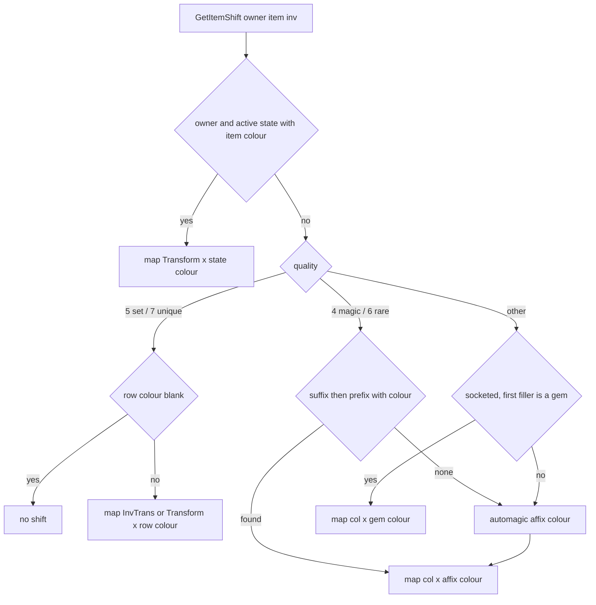

# 0003 — Item graphics: cel file choice, colour shifts, worn layers and component codes

> **Subsystem:** items/graphics (no research-map row; see *Open questions*)
> **Question:** Which inventory and ground cel does the game draw for an item, how is its palette shift chosen from the base `Transform`/`InvTrans` and the unique/set/affix colour, and how do Armor `component`, the body-part columns, `armtype` and `compcode` reach the worn layers?
> **Date:** 2026-10-12   **Plan:** 0015 (Phase 4)   **Status:** answered (static reading, `[I]`; two named runtime cases open)

Static reading of the pinned `Game.exe` only; no run. Names of functions, structs and fields are ours. "Item record"
is the Weapons/Armor/Misc record (`ITEMS_GetRecord`), "item data" the per-unit item struct at `unit+0x14`, and
"quality" the item data `+0x00` value (1 low … 7 unique, 8, 9, from [items/0002](0002-quality-roll.md)). Item flag
`0x10` (item data `+0x18`) is the identified bit ([save/0001](../save/0001-d2s-io.md)). Rendering stays tools-only
(ADR-0005): this finding describes what the game selects, not how a reimplementation must draw it.

## Answer (summary)

- [I] **Inventory cel of a unique or set item.** `ITEMGFX_SelectCelName` picks the inventory name in this order,
  first non-empty wins: (1) only if the item is **identified** and a **set** item: the SetItems row's `invfile`
  (`+0x62`), else the base's `setinvfile` (record `+0x60`); (2) only if **identified** and **unique** with a file
  index **> 0**: the UniqueItems row's `invfile` (`+0x5A`), else the base's `uniqueinvfile` (`+0x40`); (3) if the
  base's item type has `VarInvGfx` > 0: the type's `InvGfx[min(g, VarInvGfx − 1)]` (`+0x24 + 32·i`), `g` the item's
  stored picture index (item data `+0x49`, below 1 read as 0); (4) the base's `invfile` (`+0x20`).
  (fn:ITEMGFX_SelectCelName@0x004DABC0, 0x004DABE8–0x004DACB3, fn:sub_0062E920_ItemInvGfxName@0x0062E920,
  tbl:SetItems.txt:invfile, tbl:UniqueItems.txt:invfile, tbl:Armor.txt:setinvfile, tbl:Armor.txt:uniqueinvfile,
  tbl:ItemTypes.txt:VarInvGfx)
- [I] **Ground cel.** The base's `flippyfile` (`+0x00`), replaced by the UniqueItems row's `flippyfile` (`+0x3A`,
  unique, file index ≥ 0) or the SetItems row's (`+0x42`, set) when that is non-empty. No identification test, no
  base `unique…`/`set…` column, no `VarInvGfx`. Item modes 3 and 5 use the ground set; modes 0, 1, 2, 4 and 6 use the
  inventory set. (0x004DACBB–0x004DAD11, fn:sub_004DAA70_ItemModeToArtSet@0x004DAA70)
- [I] **Shift = file [type] × map [colour].** `ITEMGFX_GetItemShift(owner, item, &code, inv)` returns
  `ITEMGFX_GetShiftMap(type, colour)` where `type` is the base's `InvTrans` (`+0x142`) when `inv ≠ 0` and its
  `Transform` (`+0x141`) otherwise, and `colour` comes, by quality, from: unique → `invtransform`/`chrtransform`
  (`+0x39`/`+0x38`), set → `invtransform`/`chrtransform` (`+0x41`/`+0x40`); a blank (negative) colour returns **no
  shift** (no fallback). Magic and rare → the first of suffix slots 1–3 then prefix slots 1–3 whose affix
  `+0x56` ≠ `0xFF`, else the automagic affix (`+0x36`). Other qualities → the first socketed item's gem colour
  if it is a `gem`, else the automagic affix. With a non-null owner, an active state with an item colour (States
  `+0x2C` < 21, item of the state's type `+0x2A`) wins first, always with `Transform`.
  (fn:ITEMGFX_GetItemShift@0x0062C100, 0x0062C1A9–0x0062C54D, tbl:UniqueItems.txt:chrtransform,
  tbl:SetItems.txt:invtransform, tbl:Armor.txt:Transform, tbl:Armor.txt:InvTrans)
- [I] **Views.** The UI item-cel draw passes `inv = 1` (`InvTrans` × `invtransform`); the world unit draw (ground)
  and every worn-layer path pass `inv = 0` (`Transform` × `chrtransform`). (fn:sub_0046EE80_ItemCelDrawUi@0x0046EE80
  call 0x0046EF47, fn:sub_00471EC0_UnitDraw@0x00471EC0 call 0x004721C9, fn:sub_004DB570_WornLayerShift@0x004DB570,
  fn:sub_0063DA70_CompositeItemLayer@0x0063DA70, fn:sub_0063E510_CompositeFromEquip@0x0063E510)
- [I] **Files and maps.** Transform type *n* (1..8) is file *n* in the order grey, grey2, gold, brown, greybrown,
  invgrey, invgrey2, invgreybrown; type 0 is no shift. Each file's first `0x1500` bytes are read into slot *n* of a
  `0x6900`-byte-per-slot buffer, and map *c* is `slot_n + c·0x100`, so **map *c* is the 256 bytes at `c·256`**, with
  `c < 21`. Both views use the same eight files; the column (`Transform` or `InvTrans`) picks the type, so the `inv…`
  files are not inventory-only. (fn:ITEMGFX_LoadShiftFilesB@0x00600B80, fn:ITEMGFX_LoadShiftFileB@0x006009C0,
  fn:ITEMGFX_GetShiftMap@0x00600C20, fn:ITEMGFX_LoadShiftFilesA@0x00505550, fn:ITEMGFX_ShiftMapFromCode@0x005038D0)
- [I] **`gold` and `brown` are never served.** Both getters return no map for types 3 and 4 (`cmp 2 / jle`,
  `cmp 4 / jle → 0`), though both loaders read all eight files. `grey` (type 1) is served. So of the three identical
  files only `grey` can reach a pixel. (0x00600C37–0x00600C3F, 0x005038FB–0x00503903)
- [I] **Worn layers.** A non-torso equipped item's layer is its record's `component` (`+0x115`, the `composit.txt`
  row; > 15 means none), overridden to RH (5) / LH (6) when the item is the one `0x0063C050` returns for
  inventory slot 5 / 6. A torso item (body location 3) instead
  fills six layers from its body-part bytes: **TR ← `Torso`, LG ← `Legs`, RA ← `rArm`, LA ← `lArm`, S1 ← `rSPad`,
  S2 ← `lSPad`**, each an `armtype` row whose `Token` (`+0x20`) is the layer's component code.
  (fn:ITEMS_GetComponent@0x00628660, fn:sub_0063DA70_CompositeItemLayer@0x0063DA70,
  fn:sub_0063D690_ArmorPartsRead@0x0063D690, fn:sub_0064F500_ArmorPartForLayer@0x0064F500,
  fn:sub_0065B620_ArmTypeRecord@0x0065B620, tbl:Armor.txt:component, tbl:armtype.txt:Token)
- [I] **`compcode.bin` is read for monster components.** `COMPCODE_GetCode(i)` (row *i* → 4-byte code) has two
  callers, both resolving a MonStats2 layer's component list (count `+0x15 + k`, row bytes `+0x26 + 12·k + n`) to a
  DCC code for a monster unit. No item path reads it. (fn:COMPCODE_GetCode@0x006117D0,
  fn:sub_00664860_MonComponentCode@0x00664860, fn:sub_00664930_MonStatsComponentCode@0x00664930,
  tbl:MonStats2.txt:HDv)

## Leads used

None. The eight file-name strings and their two push sites came from the archivist's backlog entry (data and string
references, [item-palette.md](../../formats/item-palette.md)); each was re-read here. No community source was opened.

## Functions

| Address | Name | Role | Tag |
|---|---|---|---|
| `0x00505470` | `ITEMGFX_LoadShiftFileA` | `Data\Global\Items\Palette\<name>.dat`, `0x1500` bytes → `g_ItemShiftMapsA + n·0x6900` | I |
| `0x00505550` | `ITEMGFX_LoadShiftFilesA` | calls the above for n = 1..8 in file order | I |
| `0x005038D0` | `ITEMGFX_ShiftMapFromCode` | packed code → map in copy A | I |
| `0x00503BA0` | `sub_00503BA0_CompositeDraw` | composite unit draw; per layer, colour byte `0xFF` = none, else map from code | I |
| `0x006009C0` | `ITEMGFX_LoadShiftFileB` | as `…FileA`, into `g_ItemShiftMapsB` | I |
| `0x00600B80` | `ITEMGFX_LoadShiftFilesB` | n = 1..8, called from the client init `0x0044E200` | I |
| `0x00600C20` | `ITEMGFX_GetShiftMap` | (type, colour) → map in copy B, or 0 | I |
| `0x0062A250` | `ITEMGFX_PackShiftCode` | `type·32 + (colour & 31)` as a byte, 0 if invalid | I |
| `0x0062C100` | `ITEMGFX_GetItemShift` | the colour decision (owner, item, out code, inv) | I |
| `0x004DB7B0` | `sub_004DB7B0_GfxDescFromUnit` | fills a draw descriptor from a unit; items → mode map + name | I |
| `0x004DAA70` | `sub_004DAA70_ItemModeToArtSet` | item mode → 4 (inventory art) or 3 (ground art) | I |
| `0x004DABC0` | `ITEMGFX_SelectCelName` | cel name for the art set (both orders above) | I |
| `0x005FE610` | `sub_005FE610_GfxCelPath` | item art set 3 or 4 → `DATA\GLOBAL\items\<name>.dc6` | I |
| `0x0046EE80` | `sub_0046EE80_ItemCelDrawUi` | UI item cel draw, `inv = 1` | I |
| `0x00471EC0` | `sub_00471EC0_UnitDraw` | world unit draw; items `inv = 0` | I |
| `0x004DB570` | `sub_004DB570_WornLayerShift` | client: shift of the item worn on a layer, `inv = 0` | I |
| `0x0063E510` | `sub_0063E510_CompositeFromEquip` | per equipped item: layer tokens and colour bytes | I |
| `0x0063DA70` | `sub_0063DA70_CompositeItemLayer` | non-torso item → one layer | I |
| `0x0063D690` | `sub_0063D690_ArmorPartsRead` | record `+0x116..+0x11B` → six part bytes | I |
| `0x0064F420` | `sub_0064F420_LayerIsArmorPart` | true for layers 1, 2, 3, 4, 8, 9 | I |
| `0x0064F500` | `sub_0064F500_ArmorPartForLayer` | layer → part byte | I |
| `0x0063D710` | `sub_0063D710_CompTokenTableBuild` | builds `g_CompTokenTable` (`lit`, `med`, `hvy`, then item codes) | I |
| `0x0063D900` | `sub_0063D900_CompTokenIndex` | code → index in `g_CompTokenTable` (1..254, 0 = none) | I |
| `0x00628660` | `ITEMS_GetComponent` | record `+0x115` | I |
| `0x0062E8D0` | `sub_0062E8D0_ItemVarInvGfx` | item type `+0x23` | I |
| `0x0062E920` | `sub_0062E920_ItemInvGfxName` | item type `InvGfx[i]` | I |
| `0x006283F0` | `sub_006283F0_ItemInvGfxIndex` | item data `+0x49` | I |
| `0x00627E70` | `ITEMS_GetQuality` | item data `+0x00`, 2 for a non-item | I |
| `0x00629DA0` | `ITEMS_GetFileIndex` | item data `+0x28` (unique/set row) | I |
| `0x006280A0` | `ITEMS_CheckFlags` | item data `+0x18 & mask` | I |
| `0x0062BC20` | `sub_0062BC20_ItemMaxSockets` | type `MaxSock1/25/40` by level, capped | I |
| `0x00483470` | `UNIQUEITEMS_GetRecord` | row → `0x14C`-byte record | I |
| `0x00633EE0` | `sub_00633EE0_MagicAffixRecord` | 1-based affix id → `0x90`-byte record | I |
| `0x006372C0` | `sub_006372C0_GemsRecord` | row → `0xC0`-byte Gems record | I |
| `0x006117D0` | `COMPCODE_GetCode` | compcode row → code | I |
| `0x00664860` | `sub_00664860_MonComponentCode` | monster unit, layer, n → code | I |
| `0x00664930` | `sub_00664930_MonStatsComponentCode` | MonStats row, layer, n → code | I |
| `0x0065B5E0` | `sub_0065B5E0_CompositRecord` | composit row (`0x34` bytes) | I |
| `0x0065B620` | `sub_0065B620_ArmTypeRecord` | armtype row (`0x34` bytes) | I |

Data: `g_ItemShiftMapsA` `0x00842710`, `g_ItemShiftMapsB` `0x008ADBB8` (9 slots × `0x6900`), `g_pCompCode`
`0x0096BCAC` with count `g_nCompCode` `0x0096BCB4`, `g_pArmType` `0x0096D4E8`, `g_pComposit` `0x0096D4EC`,
`g_CompTokenTable` `0x0096CC68` (255 × 8 bytes).

## Walkthrough

### 1. The eight files (two copies)

```c
// fn:ITEMGFX_LoadShiftFilesB@0x00600B80 (fastcall: ecx = name, edx = n), copy A at 0x00505550 is the same with eax/ecx
ITEMGFX_LoadShiftFileB("grey", 1);  ... ("invgreybrown", 8);
// fn:ITEMGFX_LoadShiftFileB@0x006009C0
path = "Data\\Global\\Items\\Palette\\" + name + ".dat";
if (!open(path)) fatal();                    // no fallback (the memset branch at 0x00600B20 is unreachable)
read(g_ItemShiftMapsB + n * 0x6900, 0x1500); // 21 maps x 256
```

- [I] Two identical loaders fill two buffers with the same eight files in the same order: copy A from
  `0x004F8FE0` (called from three init paths), copy B from the client init `0x0044E200`. Slot 0 is never loaded. Only
  `0x1500` bytes are read whatever the file size. (0x00505525–0x00505539, 0x00600B4C–0x00600B5E)
- [I] Getters, same arithmetic in both copies (fn:ITEMGFX_GetShiftMap@0x00600C20, fn:ITEMGFX_ShiftMapFromCode@0x005038D0):

```c
// fn:ITEMGFX_GetShiftMap@0x00600C20 (stdcall)
u8 *GetShiftMap(int type, int colour) {
    if (type < 9 && colour < 21 && type != 0 && (type <= 2 || type > 4))
        return g_ItemShiftMapsB + (type * 0x69 + colour) * 0x100;   // slot type, map colour
    return NULL;
}
// fn:ITEMGFX_ShiftMapFromCode@0x005038D0 (ecx = packed code byte)
type = code >> 5; colour = code & 31;
if (colour > 20) return NULL;
if (type == 0) return g_ItemShiftMapsA + (8 * 0x69 + colour) * 0x100;  // type 8 wrapped (8·32 = 256)
if (type < 9 && (type <= 2 || type > 4)) return g_ItemShiftMapsA + (type * 0x69 + colour) * 0x100;
return NULL;
```

- [I] `ITEMGFX_PackShiftCode` builds the code as the low byte of `type·32 + (colour & 31)` for type 1..8 and
  colour ≤ 20, else 0, so a type-8 code wraps to `colour` and `ShiftMapFromCode` reads `type == 0` as 8.
  (0x0062A250–0x0062A268)

### 2. Choosing the cel name (`ITEMGFX_SelectCelName`)

`sub_004DB7B0_GfxDescFromUnit` handles an item unit (unit type 4) by `sub_004DAA70_ItemModeToArtSet` (modes 0, 1, 2, 4,
6 → 4; 3, 5 → 3; jump table at `0x004DAA9C`) and `ITEMGFX_SelectCelName`. `sub_005FE610_GfxCelPath` turns art set 3 or
4 into `DATA\GLOBAL\items\<name>.dc6` (`0x005FE7F5`/`0x005FE807`, format string `0x006E35D4`).

```c
// fn:ITEMGFX_SelectCelName@0x004DABC0 (trimmed; rec = base item record)
if (desc->artset == 4) {                                       // inventory
    g = item_data->invgfx;                                     // +0x49
    if (CheckFlags(item, 0x10) && Quality(item) == 5) {        // identified set item
        s = SETITEMS_GetRecord(FileIndex(item));
        if (s && s->invfile[0])  { desc->name = s->invfile;   return; }   // +0x62
        if (rec->setinvfile[0])  { desc->name = rec->setinvfile; return; } // +0x60
    }
    if (CheckFlags(item, 0x10) && Quality(item) == 7) {        // identified unique
        if (FileIndex(item) > 0 && (u = UNIQUEITEMS_GetRecord(FileIndex(item))) && u->invfile[0])
            { desc->name = u->invfile; return; }               // +0x5A
        if (rec->uniqueinvfile[0]) { desc->name = rec->uniqueinvfile; return; } // +0x40
    }
    if (type->VarInvGfx) { desc->name = type->InvGfx[min(max(g,0) , VarInvGfx-1)]; return; }
    desc->name = rec->invfile;                                 // +0x20
} else if (desc->artset == 3) {                                // ground
    desc->name = rec->flippyfile;                              // +0x00
    if (Quality(item) == 7) { if (FileIndex(item) < 0) return; p = UNIQUEITEMS_GetRecord(..)->flippyfile; } // +0x3A
    else if (Quality(item) == 5) p = SETITEMS_GetRecord(..)->flippyfile;  // +0x42
    if (p && p[0]) desc->name = p;
}
```

- [I] The unique test is `jle` on the file index (`0x004DAC69`): unique row 0 never shows its own `invfile` and goes
  to the base's `uniqueinvfile`. In stock data row 0 (`The Gnasher`, base `hax`) names `invhaxu`, which is also `hax`'s
  `uniqueinvfile`, so nothing visible changes. The ground branch tests `jl` (`0x004DACD6`): row 0 is allowed there.
- [I] Unidentified unique and set items skip steps 1–2 and show the variable or base inventory art. The ground art has
  no identification test. (0x004DABFE, 0x004DAC4D)

### 3. The colour decision (`ITEMGFX_GetItemShift`)

```c
// fn:ITEMGFX_GetItemShift@0x0062C100 (stdcall, 4 args; trimmed)
u8 *GetItemShift(Unit *owner, Unit *item, u8 *code, int inv) {
    if (!item) return 0;
    if (owner)                                                  // worn paths only
        for (s in g_StatesWithItemColour)                       // list at datatables+0x18C, count +0x190
            if (StateActive(owner, s) && S[s].colour < 21 && UnitIsType(item, S[s].itemtype)) // +0x2C, +0x2A
                return GetShiftMap(rec(item)->Transform, S[s].colour);  // Transform even if inv; code not set
    q = item is an item with data ? item_data->quality : 2;
    switch (q) {
    case 4: case 6:                                             // magic, rare
        for (slot in suffix[0..2] (+0x3E,+0x40,+0x42), then prefix[0..2] (+0x38,+0x3A,+0x3C))
            if ((a = MagicAffixRecord(slot)) && a->colour != 0xFF) goto have_affix;   // +0x56
        goto automagic;
    case 5: s = SETITEMS_GetRecord(FileIndex(item)); c = inv ? s->invtransform : s->chrtransform; // +0x41 / +0x40
            if (c < 0) return 0;  *code = Pack(rec->Transform, c);
            return GetShiftMap(inv ? rec->InvTrans : rec->Transform, c);
    case 7: u = UNIQUEITEMS_GetRecord(FileIndex(item)); c = inv ? u->invtransform : u->chrtransform; // +0x39 / +0x38
            ...same as case 5...
    default:                                                    // 1, 2, 3, 8, 9
        if (item is item && rec->hasinv /*+0x137*/ && MaxSockets(item) > 0 && (flags & 0x800)
            && (g = first item in item's inventory) && UnitIsType(g, 20 /*gem*/)) {
            gem = GemsRecord(rec(g)->+0xF0);  *code = Pack(rec->Transform, gem->+0x2F);
            return GetShiftMap(inv ? rec->InvTrans : rec->Transform, gem->+0x2F);
        }
    automagic:
        a = MagicAffixRecord(item_data->autoaffix /*+0x36*/); if (!a || a->colour == 0xFF) return 0;
    have_affix:
        *code = (rec->Transform - 1 < 8 && a->colour < 21) ? rec->Transform * 32 + (a->colour & 31) : 0;
        return GetShiftMap(inv ? rec->InvTrans : rec->Transform, a->colour);
    }
}
```

- [I] The quality switch is `sub eax,4; cmp eax,3; ja default` with table `0x0062C57C`: case 4 at `0x0062C1EC`, case 7
  (UniqueItems, `call 0x00483470` at `0x0062C2E5`, `+0x38`/`+0x39`) and case 5 (SetItems, `call 0x00483440` at
  `0x0062C385`, `+0x40`/`+0x41`), default at `0x0062C40A`. The colour bytes are read `movsx` and a negative one (`0xFF`,
  the blank) returns 0 at once (`0x0062C2FA`, `0x0062C39A`).
- [I] The returned `code` always packs **`Transform`**, never `InvTrans`, whatever `inv` is. Only the composite paths
  use it. (0x0062C308, 0x0062C340, 0x0062C4DD, fn:ITEMGFX_PackShiftCode@0x0062A250)
- [I] So a unique or set item with a colour but base type 0 gets no shift; with blank colour it gets no shift even if
  it has an automagic affix with a colour. Field offsets of the item data affix slots and `+0x36` are those of
  [save/0001](../save/0001-d2s-io.md); the affix `+0x56`, Gems `+0x2F`, States `+0x2A`/`+0x2C` and the Misc `+0xF0`
  link are offsets read here, their column names are not checked against a table doc. (0x0062C2FA, 0x0062C39A, fn:ITEMGFX_GetShiftMap@0x00600C20)



### 4. Who asks, with which `inv`

- [I] `sub_0046EE80_ItemCelDrawUi` (12 call sites in the UI range `0x00468…0x004C0…`) calls
  `GetItemShift(0, item, &c, 1)` at `0x0046EF47`, so the inventory icon uses `InvTrans` × `invtransform`.
- [I] `sub_00471EC0_UnitDraw` calls `GetItemShift(0, item, &c, 0)` for unit type 4 at `0x004721C9`: a ground item uses
  `Transform` × `chrtransform`.
- [I] Worn: `sub_004DB570_WornLayerShift` (`0x004DB659`), `sub_0063DA70_CompositeItemLayer` (`0x0063DB52`) and
  `sub_0063E510_CompositeFromEquip` (`0x0063E5F3`) pass the owner and `inv = 0`. The two composite builders store
  the code **+ 1** (`add byte [ebx], 1` at `0x0063E604`) and `0xFF` when there is no shift.
- [I] The map pointer reaches the active render driver's draw entry (driver table `0x0072DA80`, entry `+0x84`:
  DirectDraw `0x00511FB0`, GDI `0x006C84B0`, Glide `0x0050B0D0`, Direct3D `0x006B6B40`) and from there
  `0x006014C0`. The per-pixel use was not read (*Open questions*).

### 5. Worn layers: `component`, body parts, `armtype`

```c
// fn:sub_0063E510_CompositeFromEquip@0x0063E510, per equipped item (mode 1), by body location (item data +0x44)
loc 1, 4, 5 (and not item type 75 circ): sub_0063DA70_CompositeItemLayer(...)
loc 3: parts[6] = rec[+0x116..+0x11B];                     // rArm, lArm, Torso, Legs, rSPad, lSPad
       for (layer = 0; layer < 16; layer++) if (LayerIsArmorPart(layer)) {    // 1,2,3,4,8,9
           at = ArmTypeRecord(ArmorPartForLayer(layer, parts));                // 1→Torso 2→Legs 3→rArm 4→lArm 8→rSPad 9→lSPad
           token[layer] = CompTokenIndex(at->Token /*+0x20*/);  colour[layer] = GetItemShift(owner,item,..,0) ? code+1 : 0xFF;
       }
// fn:sub_0063DA70_CompositeItemLayer@0x0063DA70
layer = ITEMS_GetComponent(item);                          // rec+0x115
if (item == InvGetBodyItem(inv, 5)) layer = 5; else if (item == InvGetBodyItem(inv, 6)) layer = 6;   // 0x0063C050
else if (layer > 15) return;
token[layer] = CompTokenIndex(...);  colour[layer] = ... code+1 or 0xFF;   // register arguments not traced
```

- [I] Layer numbers are `composit.txt` rows (HD 0, TR 1, LG 2, RA 3, LA 4, RH 5, LH 6, SH 7, S1 8, S2 9 …), the same
  table `sub_0065B5E0_CompositRecord` reads into the client's 16 layer tokens (`0x004DA790`). The part → layer map is
  the jump table of `sub_0064F500_ArmorPartForLayer` (`0x0064F500`: 1 → `p[2]`, 2 → `p[3]`, 3 → `p[0]`, 4 → `p[1]`,
  8 → `p[4]`, 9 → `p[5]`) over `sub_0063D690_ArmorPartsRead` (`p[0..5]` = `+0x116..+0x11B`).
- [I] Tokens are stored as indices into `g_CompTokenTable`, built once by `sub_0063D710_CompTokenTableBuild`:
  `lit`, `med`, `hvy` at 1..3, then each item's `alternategfx` (`+0x90`), else its `code` (`+0x80`). For a body armour
  the `armtype` token must be one of those (stock tokens are `lit`, `med`, `hvy`). (fn:sub_0063D710_CompTokenTableBuild@0x0063D710, fn:sub_0063D900_CompTokenIndex@0x0063D900)

### 6. `compcode`

- [I] `DATATBLS_LoadCodeLists` stores the table at `g_pCompCode` and its count at `g_nCompCode`
  (`0x006127B8`/`0x006127DA`). `COMPCODE_GetCode` is the only reader of the pointer besides the free routine
  `0x00612EA0`; its callers `sub_00664860_MonComponentCode` (unit type 1 only) and `sub_00664930_MonStatsComponentCode`
  index MonStats2 `+0x26 + 12·layer + n` after checking `n < +0x15 + layer`. The compcode link table (`0x0096BCB0`) is
  also read by `0x00657010` (not read in detail; likely the MonStats2 code → row resolution).
- [I] `sub_00664860_MonComponentCode` replaces the code from two hard-coded per-layer tables (`0x007489A8`, strings
  `lit lit des des hvy …`, and `0x00748A18`) when the monster's level is in act index 1 and a client test
  (`0x00463900`) returns 0 or `0xAA`. Not followed further.

## Data touched

`tbl:Weapons.txt:flippyfile`, `invfile`, `uniqueinvfile`, `setinvfile` (record `+0x00/+0x20/+0x40/+0x60`, same in
Armor and Misc) · `tbl:Armor.txt:Transform` `+0x141`, `tbl:Armor.txt:InvTrans` `+0x142`, `hasinv` `+0x137`,
`component` `+0x115`, `rArm`..`lSPad` `+0x116..+0x11B`, `code` `+0x80`, `alternategfx` `+0x90` ·
`tbl:UniqueItems.txt:chrtransform` `+0x38`, `invtransform` `+0x39`, `flippyfile` `+0x3A`, `invfile` `+0x5A` ·
`tbl:SetItems.txt:chrtransform` `+0x40`, `invtransform` `+0x41`, `flippyfile` `+0x42`, `invfile` `+0x62` ·
`tbl:ItemTypes.txt:VarInvGfx` `+0x23`, `InvGfx1..6` `+0x24 + 32·i`, `MaxSock1/25/40` `+0x1A..+0x1C` ·
`tbl:armtype.txt:Token` `+0x20` · composit `Token` `+0x20` (no table doc) · `tbl:compcode.txt:code` ·
`tbl:MonStats2.txt:HDv` (`+0x15 + k`, `+0x26 + 12·k`) · affix record `+0x56`, Gems record `+0x2F`, States record
`+0x2A`/`+0x2C` (offsets only) · item data `+0x00` quality, `+0x18` flags (`0x10`, `0x800`), `+0x28` file index,
`+0x36` automagic, `+0x38..+0x42` affix slots, `+0x44` body location, `+0x49` picture index ·
files `data/global/items/palette/{grey,grey2,gold,brown,greybrown,invgrey,invgrey2,invgreybrown}.dat`.

## Check against plan 0009's index (`tools/item_art.py`, `tools/palette.py`)

| Item | Index / tool | Game (this finding) | Verdict |
|---|---|---|---|
| file order | `ITEM_SHIFT_FILES`, type *n* → file *n* | same | agrees |
| map *c* | bytes `c·256` of the file | same, `c < 21` | agrees |
| view pairing | inv: `InvTrans` × `invtransform`; drop and worn: `Transform` × `chrtransform` | same | agrees (item-palette.md lead → this finding) |
| types 3, 4 | `shift_map` accepts them (`gold`, `brown`) | no shift | disagrees; no stock row uses 3 or 4, so no render changes |
| blank colour | no shift | no shift (no automagic fallback) | agrees |
| ground cel | own `flippyfile`, else base `flippyfile` | same | agrees |
| inventory cel | own `invfile` → base `uniqueinvfile`/`setinvfile` → base `invfile` | adds the `VarInvGfx` step before the base `invfile`, identification gating, and unique row 0 skipping its own file | disagrees for **41 rows** (30 UniqueItems, 11 SetItems on `rin`, `amu`, `jew`, `cm1..3` with no own file): the game shows `InvGfx[g]`, the index shows `invrin`/`invamu`/… |
| worn layer | `component` → composit row, 16 none | same, with RH/LH slot override and > 15 none | agrees |
| body-armour parts | `rArm`→RA, `lArm`→LA, `Torso`→TR, `Legs`→LG, `rSPad`→S1, `lSPad`→S2 | same | agrees (armtype.md lead → this finding) |

The disagreements go to the archivist ([backlog](../../backlog.md)).

## Dead ends

- `0x00606B00` (entry 4 of the table at `0x006E3688` that `0x006014C0` calls through) remaps the literal pixel bytes of
  DC6-style run data in place through a 256-byte table (`mov dl, [edx+esi]` at `0x00606B33`) and skips transparent
  runs. Its register use does not match the ten stack arguments `0x006014C0` pushes, so whether it is the item-shift
  application is not established. Not used for any claim.
- The two copies of the shift buffers are not one per view: copy A serves the composite (worn) draw through packed
  codes, copy B every `GetItemShift` caller.

## Open questions

- **Is pixel index 0 remapped?** The map is passed to the driver draw entry (*§4*); the per-pixel loop was not read.
  DC6 encodes transparency as runs, so only a literal 0 byte would meet entry 0. Resolves by reading the DirectDraw
  path under `0x00511FB0` → `0x006014C0` → `0x006E3688[k]`, or by a runtime read (draw one shifted item, compare the
  frame buffer with the palette).
- **The `+1` on composite colour bytes.** `sub_0063E510_CompositeFromEquip` stores code + 1; `sub_00503BA0_CompositeDraw`
  decodes a layer byte directly (`0x00503D9A`, `0xFF` = none). The step that undoes the `+1` (packet or client copy)
  was not traced.
- The Misc `+0xF0` u32 that `GetItemShift` passes to `sub_006372C0_GemsRecord` is 0 in every `.bin` record
  ([Misc](../../tables/Misc.md)); it is presumably filled at load. Not traced.
- **Subsystem.** This reading touches item, unit-draw and composite code. If the architect wants `items/graphics` as
  a research-map row, the spec would cover cel choice and shift choice; rendering stays tools-only (ADR-0005).
