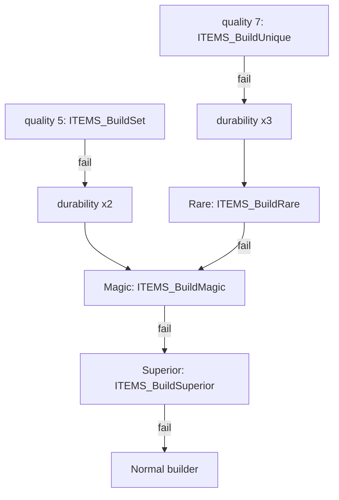

# 0004 — Unique and set selection, and the creation fallbacks

> **Subsystem:** items/uniques-sets
> **Question:** Once a dropped item reaches creation with quality 7 (unique) or 5 (set), which `UniqueItems` or `SetItems` row does it become, what does the choice draw, and what happens when no row fits?
> **Date:** 2026-10-14   **Plan:** 0019 (Phase 1)   **Status:** open (Phase 1 read from the decompile and the disassembly; Phase 1b cross-check done 2026-10-14; Phase 2 reproduced 2026-10-14, § 10)

Names of structs and fields are ours. "Record" is the 0x84-byte creation record that `sub_0055A550_DropCreateItem`
builds ([items/0001 § 8](0001-tc-resolution.md#8-item-pick-and-hand-off-0x0055ac5f0x0055af59), `struct:ItemCreateRec`
in `re/types/uniquesets.h`). "Item seed" is the item-data seed at `ItemData+0x04`, which is **not** the unit seed at
`Unit+0x20` ([rng/0002](../rng/0002-seed-tree.md)). "Item version" is `ItemData+0x30`, copied from `Game+0x78`
(`sub_0062A670_ItemGetVersion`): non-zero for every item a game creates, < 100 in a classic game, ≥ 100 in an
expansion game. The quality codes are those of [items/0002](0002-quality-roll.md): 1 low, 2 normal, 3 superior,
4 magic, 5 set, 6 rare, 7 unique, plus 8 and 9 which drops never request.

## Answer (summary)

- [C] **Where it sits.** For a drop the order is: the quality roll on the source unit's seed (items/0002), then
  `sub_00558D90_ItemCreate`, whose `sub_00555230_SUnitCreate` draws the unit seed from the game seed and `sub_00552E90_ItemSeedInit`
  draws once more from the game seed and sets `ItemData+0x10 = low`, item seed = `{low, 666}`. Then
  `sub_00557AB0_ItemInitStats` draws only on the **unit** seed (quantity, durability, defense, picture), and
  `sub_00557450_ItemCreateByQuality` runs. The unique or set pick is the **first draw on the item seed** for every
  drop except an item of type 11, whose setup (`0x0065E8E0`, called from `ItemInitStats`) draws on it first. The
  entry seed of `ItemCreateByQuality` was `{ItemData+0x10, 666}` in all 1 823 logged creations, and the pick draw
  reproduced from it. The type-11 exception stays `[I]`, because no item of type 11 was logged.
  (fn:sub_00552E90_ItemSeedInit@0x00552E90, fn:sub_00557AB0_ItemInitStats@0x00557AB0,
  fn:sub_00557450_ItemCreateByQuality@0x00557450, run:2026-10-14-uniques, run:2026-10-14-uniques-forced)
- [C] **`sub_00556F60_ItemRollQualityCreate` is reached on the drop path but never draws there.** It is called first
  in `ItemCreateByQuality` (0x005574CC) and again at the start of each fallback step. Each time the item version is
  non-zero and the record's quality (`+0x30`) is set, so it returns that quality at once. Its drawing body runs only
  for an item of version 0 or a record with quality 0, which no drop produces. Every builder entry seed in the runs
  equals the seed the model carries with no draw in this function. (fn:sub_00556F60_ItemRollQualityCreate@0x00556F60, run:2026-10-14-uniques, run:2026-10-14-uniques-forced)
- [I] **Pre-switch overrides**, applied in this order to the item's quality before the switch: an `ItemTypes.Magic`
  type gets 7 if its base is a quest item, else 4 unless the quality is already 4..9. An `ItemTypes.Rare` = 0 type
  turns 6 into 4. A base with Weapons/Armor/Misc `unique` set gets 7. An `ItemTypes.Normal` type (or an item with no
  type record) gets 2. A later rule overwrites an earlier one. The model of the four rules predicted the switch quality
  of all 1 823 logged creations (`[C]` for the result on drops). Only the `Normal` rule fired, 1 325 times, and it never
  changed the value, because the drop roll's early returns already produce what the rules would write (§ 10). The order
  of the rules stays `[I]`. (§ 2, 0x005574E3–0x00557567, run:2026-10-14-uniques, run:2026-10-14-uniques-forced)
- [C] **Unique candidates** (`ITEMS_BuildUnique`): every `UniqueItems` row in table order that passes, in this
  order: `version` < 100 or item version ≥ 100; `enabled`; `code` = the base's code; `ladder` clear, or the game's
  type byte (`Game+0x6A`) non-zero, or a ladder game (`Game+0x74`); `lvl` ≤ the item's ilvl (signed 16-bit
  compare). Weight = `rarity`, raised to 1 when < 1. `carry1`, `lvl req` and `nolimit` are not tested here. In single
  player `Game+0x6A` is 3 (items/0001), so ladder rows are candidates. The model's filter reproduced the logged
  candidate list, total and row of all 116 unique builds (115 forced, 1 stock; classic and expansion, three
  difficulties). These include
  two ladder rows picked in single player (`Djinnslayer` 290, `Leviathan` 317), which is case (c). (§ 3, § 10,
  fn:ITEMS_BuildUnique@0x005566B0, run:2026-10-14-uniques, run:2026-10-14-uniques-forced)
- [C] **Set candidates** (`ITEMS_BuildSetPick`): every `SetItems` row in table order that passes, in this order: its
  set's `version` (copied into the row at load, `+0x22`) < 100 or item version ≥ 100; `lvl` ≤ ilvl; `item` = the
  base's code; and a row of set 29 only when the record's flag bit 0 is set (the source is a `hellbovine`). Weight =
  `rarity`, 0 raised to 1. There is no `enabled`, ladder or once-per-game test for sets. The filter was reproduced
  over 75 set builds (72 forced, 3 stock). The set-29 test stays `[I]`, because no `hellbovine` was killed. (§ 4,
  § 10, fn:ITEMS_BuildSetPick@0x005C25C0, run:2026-10-14-uniques, run:2026-10-14-uniques-forced)
- [C] **The pick.** If the record names a row (`+0x40` = row + 1, from a TC cell) **and that row passed the filter**,
  it is taken with no draw. Otherwise **one** draw on the item seed: `r = low % total`, with total = the sum of the
  weights; the row is the first candidate whose cumulative weight exceeds `r`. Uniques draw through `RNG_RangeOffset`
  (base 0), sets through `RNG_RangeB`; both are the guarded `low % n` of rng/0001. No candidate means no draw and a
  failed build. The single draw, its value and the seed after it matched every logged pick, including multi-candidate
  bases: classic `rin` rows 120/121/122 at 15/15/1 (case (e)), expansion `rin` 120/121, and set `amu` with nine
  candidates. The TC-named preference has no stock case (no stock TC that a drop reached names a row, § 10) and stays `[I]`
  (*TC-named unique* below): a forced-path log agrees, but it edits the table the claim is about (ADR-0010). (§ 10,
  fn:ITEMS_BuildUnique@0x005566B0, fn:ITEMS_BuildSetPick@0x005C25C0, fn:RNG_RangeOffset@0x00472280, run:2026-10-14-uniques, run:2026-10-14-uniques-forced)
- [C] **Once per game.** A unique row built in a game sets bit `row` of a 4096-bit set at `Game+0x1B24` (cleared at
  game creation) unless the row's `nolimit` bit is set. A later pick of a marked row **fails the build** with no
  re-pick, so the item falls back to rare. A quest base skips the test (`[I]`: no quest base was built). The game's bit
  set, read at every unique builder entry, equalled the model's set of rows built in that game every time, and a pick
  of row 86 (`brs`), already built in the same classic game, failed and fell back to rare. That is case (a).
  (fn:ITEMS_UniqueMarkMade@0x00556530, § 3.3, § 10, run:2026-10-14-uniques-forced)
- [C] **Failures and fallbacks.** Unique: with no candidate, a base with the `unique` flag still succeeds with no row
  (file index −1, no properties). Any other failure applies the durability step (stats 72 and 73 ×3, capped at 255,
  when the base has durability and the item version is non-zero) and then rare → magic → superior → normal. Set: ×2,
  then magic → superior → normal. Each fallback step clears the affixes and the file index, **restores the item seed
  to `{S, 666}`** where S is the seed's low word saved just before the failed builder, writes the new quality to the
  item and the record, and calls the next builder. Reproduced over 39 unique failures (38 with no candidate, 1 already
  made), each going to rare, and 47 set failures, each going to magic. The logged durability values and the `{S, 666}`
  entry seed of each fallback builder matched. Not reached in the runs, so `[I]`: a fallback builder that fails in
  turn (the chain past its first step), and the success with no row on a base with the `unique` flag. (§ 5, § 10,
  fn:sub_00557450_ItemCreateByQuality@0x00557450, run:2026-10-14-uniques, run:2026-10-14-uniques-forced)
- [I] **TC-named unique.** A TC cell that is a unique name becomes an entry with flags `0x11`, `index` = the base item
  of that row's `code`, `aux` = the row. The name tree keeps the **first** row of a duplicated name, so `Rainbow
  Facet` resolves to record 392 and `Azurewrath` to record 29 (disabled). Row 0 cannot be named, because the parser
  accepts hits ≥ 1. The named row is only a preference: it must pass the filter for its item's ilvl like any other.
  A forced-path log agrees (TreasureClassEx edited, plan 0027 Phase 3): `The Oculus` (284) was taken with no draw three
  times, and its second named creation per game found the row made; `Azurewrath` resolved to 29, failed `enabled`, found
  no `crs` candidate and fell back to rare, six times. It stays `[I]`: the edit is the TC cell the claim is about, and
  only edited data reaches a named row in a run (ADR-0010; architect review 2026-10-15). (fn:TC_ParseItemCell@0x00654440, fn:EXCEL_NameTreeInsert@0x006BD490,
  § 6, run:2026-10-15-uniques-tcnamed-forced)
- [C] **`sets.bin` runtime slots** (backlog 2026-10-14): `+0x0C` is the member count and `+0x110..+0x127` six
  pointers to the member `setitems` records, both filled by the loader. The loader's writes and two readers agree:
  the version-0 set builder and the set bonus code. (§ 7, fn:sub_00634DC0_LoadSetTables@0x00634DC0,
  fn:sub_005C2740_ItemBuildSetV0@0x005C2740, fn:sub_00660120_SetBonusApply@0x00660120, struct:SetsRec+0x0C)
- [I] `sets` `+0x08` is not written by the loader, and no reader was found. No code reads a set level: the loader has
  no `level` column, and the set filter tests `SetItems.lvl`. (§ 7, 0x00634DC0, 0x005C263E)

## Leads used

Phase 1 was written from the code with no lead. The sources below were fetched and read afterwards, on 2026-10-14, for
the plan 0019 Phase 1b cross-check (blind first): `src:d2dfg-blizzard` again (§ UniqueItems.txt, § SetItems.txt,
§ Sets.txt), and the new `src:pk-uniqueitems-guide`, `src:pk-setitems-guide`, `src:pk-sets-guide`,
`src:arreat-summit-item-pages`, `src:maxroll-d2r-items` and `src:fandom-d2-unique-set`. None of them has game code.
The PureDiablo item-generation tutorial and wiki pages refused every fetch (HTTP 403) and were not read
(`src:pd-item-generation-tutorial`). `src:d2dfg-blizzard` describes Diablo II: Resurrected: its UniqueItems section has
`firstLadderSeason`, `lastLadderSeason` and `diablocloneweight`, which 1.14d does not have. `src:maxroll-d2r-items` is
written for D2R. So a contradiction with either may be a version difference that a reimplementer must not "correct".
Agreement promotes nothing.

Three claims are `contradicted`. All are required cases of Phase 2 (backlog, 2026-10-14 reverser → reverser, and the
plan log). None is an error in this finding. The two that the code decides (`enabled` on a TC-named row, `rarity` in
a classic game) were re-read with r2 on 2026-10-14 (`0x00556878`–`0x005569A0`). `forced = row` (`0x005568FC`) is reached only
after the `enabled` bit test (`test [0x6CE268], eax` / `je` skip at `0x005568AD`–`0x005568B3`), and the weight
`max(1, rarity)` (`0x00556910`–`0x00556920`) is added with no branch on the item version (`[ebp−0xC]`, read only at
`0x005568A0`). Both read as in § 3.2, so nothing is corrected and the tags stay `[I]`.

**Candidate filter: version, enabled, ladder**

- [L] src:d2dfg-blizzard (UniqueItems `version`): "<100 = Classic mode | 100 = Expansion mode". **held with refinement**
  Detail: the test excludes a row with `version` ≥ 100 only when the item version is < 100. Classic rows stay candidates
  in an expansion game (`0x0055689A`–`0x005568A4`, § 3.2).
- [L] src:pk-uniqueitems-guide (`version`): "0 for CD2, 1 for enhanced CD2, 100 for LoD". **held**
  Detail: 0 and 1 are both < 100, so both are classic rows for the test (§ 3.2).
- [L] src:d2dfg-blizzard and src:pk-sets-guide (Sets `version`): 0 = classic (and expansion), 100 = expansion only.
  **held with refinement**
  Detail: `SetItems` has no version. The loader copies the set's `version` into each member row (`+0x22`), and the set
  filter tests that copy (§§ 4, 7).
- [L] src:pk-uniqueitems-guide (`Enabled`): "0 for undropable, 1 for dropable". **held**
  Detail: `enabled` (flag bit 0) is the second test (§ 3.2).
- [L] src:d2dfg-blizzard (UniqueItems `enabled`): a row with 0 "cannot be dropped randomly, but can still be drop
  explicitly from a treasure class". **contradicted** (backlog 2026-10-14 reverser → reverser, case d)
  Detail: in 1.14d a TC-named row is preferred only if it passes the whole filter, `enabled` included. A disabled named
  row falls to the weighted pick over the base's enabled rows (§§ 3.2, 6; re-read with r2, above). The guide is the D2R
  one. In stock data the only disabled row a TC cell could reach by name is `Azurewrath` → 29 (`crs`), and no stock TC
  names it (scratch read, *Open questions*). Case (d) ran on a forced path and agrees: the named disabled row was not built
  (run:2026-10-15-uniques-tcnamed-forced). The verdict rests on the code reading (`[I]`, ADR-0010).
- [L] src:d2dfg-blizzard (`firstLadderSeason`, `lastLadderSeason`): integer season ranges; blank or 0 = available in
  non-ladder. **contradicted** (later build; backlog 2026-10-14 reverser → reverser, case c)
  Detail: 1.14d has no season columns. It has one `ladder` bit (flag bit 3), which excludes a row only when
  `Game+0x6A` = 0 and `Game+0x74` = 0 (§ 3.2). This is the D2R scheme; do not port it. Phase 1's required case (c), a
  ladder row picked in single player, covers it.
- [L] src:pk-uniqueitems-guide (`Ladder`): the item "can not be found in nonladder games on the Realms".
  **held with refinement**
  Detail: the bit is ignored whenever `Game+0x6A` ≠ 0 or `Game+0x74` ≠ 0. The realm values of these fields are out of
  reach (§ 3.2).
- [L] src:arreat-summit-item-pages (Unique Basics, "(Ladder Only)"): such an item "can only be found by Battle.net Ladder
  Characters as well as Single Player, TCP/IP, and Open Battle.net Characters". **held with refinement**
  Detail: `Game+0x6A` is 3 in single player and 2 in TCP/IP (logged, items/0001), so the row is a candidate there. The
  Open Battle.net value was not logged.
- [L] src:d2dfg-blizzard (`carry1`): only one such item may be carried. **held with refinement**
  Detail: the builder does not read `carry1` (§ 3.2). It is an inventory rule, not part of the drop filter.

**`lvl` against ilvl**

- [L] src:d2dfg-blizzard (UniqueItems and SetItems `lvl`): "The item level for the item, which controls what object or
  monster needs to be in order to drop this item". **held with refinement**
  Detail: the row passes when `(int16) lvl` ≤ the item's ilvl (`ITEMS_GetItemLevel`, raised to 1), not when it is
  compared with the source's level directly (`0x005568E3`–`0x005568E9`, `0x005C263E`).
- [L] src:pk-uniqueitems-guide (`Lvl`): "The level a monster must be to drop this item". **held with refinement**
  Detail: as above. The compared value is the ilvl.
- [L] src:pk-setitems-guide (`lvl`): sources must be "at least this level or higher to be able to drop this item,
  otherwise they would drop a magical item with twice normal durability". **held**
  Detail: `lvl` ≤ ilvl (§ 4). With no candidate the set build fails, durability ×2, then magic (§ 5).
- [L] src:pk-sets-guide (Sets `level`): "reference only, not loaded into game". **held**
  Detail: the `sets` loader has no `level` column, and the set filter reads `SetItems.lvl` (§ 7).

**`rarity` and the pick**

- [L] src:d2dfg-blizzard (UniqueItems `rarity`): the weights are summed into a denominator and each row is chosen with
  `rarity / Σ`; "The minimum 'rarity' value equals 1". **held**
  Detail: weight `max(1, rarity)`, `r = low % Σ`, first candidate whose cumulative weight exceeds `r` (§ 3.2).
- [L] src:d2dfg-blizzard (UniqueItems `rarity`): "(Only works for games in Expansion mode)". **contradicted** (backlog
  2026-10-14 reverser → reverser, case e)
  Detail: 1.14d weights by `rarity` in every game whose item version is non-zero, classic included. No version test
  touches the weight (re-read with r2, above). Classic bases with unequal weights exist in stock data: `rin` rows
  120/121/122 at 15/15/1 and `amu` rows 117/118/119 at 20/5/10 (`tools/unique_survey.py`). The guide's sentence may
  describe D2R or the version-0 path (§ 3.1: first match, no draw), which no drop reaches.
- [L] src:d2dfg-blizzard (SetItems `rarity`): the same weighting, minimum 1. **held with refinement**
  Detail: a set weight of 0 counts as 1, but a negative one is kept as is (§ 4). Stock set rows hold 1, 3 or 7.
- [L] src:pk-setitems-guide (`Rarity`): "rarity/total_rarity", the example 100 and 1 giving 100/101 and 1/101, values
  0 to 255. **held with refinement**
  Detail: as above. The field is read as a 32-bit value (`+0x34`), so the 0..255 range is a data convention, not a
  limit in the code.
- The seed (the item seed), the single draw, its place before the property rolls, and the preference for a TC-named
  row: **not covered** by any source read.

**No candidate, the fallback chain and the durability bonus**

- [L] src:maxroll-d2r-items (Durability, "Failed Unique Items"): a failed unique becomes a rare when the ilvl is too low
  for the unique or the unique "has already dropped in the current game", with triple durability, capped at 255.
  **held with refinement**
  Detail: ×3 on stats 72 and 73, each capped at 255, and only when the base has durability (§ 5). The chain goes on past
  rare: magic, superior, normal, each from `{S, 666}`. With no candidate and a base `unique` flag, the build succeeds
  with no row instead (§ 3.3, not covered by the source).
- [L] src:maxroll-d2r-items (Durability, "Failed Set Items"): a failed set becomes magic when "the item base does not have
  a Set quality version", with double durability. **held with refinement**
  Detail: the set build also fails when every row of the base fails `lvl` or the version test, or is set 29 without a
  `hellbovine` source (§ 4). The chain then goes magic → superior → normal (§ 5).
- [L] src:arreat-summit-item-pages (Item Basics, Ethereal): "Failed Set (double durability magic) and Failed Unique
  (triple durability rare) items spawn with twice and thrice the normal durability", and an ethereal failed set has
  "normal durability + 1". **held with refinement**
  Detail: the ×2 or ×3 comes before the post-switch ethereal step (§ 8, outside the Phase 2 boundary), which then sees
  the fallback quality (4 or 6), not 5. So a failed set can be ethereal. The ethereal arithmetic is not read here.
- [L] src:arreat-summit-item-pages (Item Basics): "Durability is capped at 333". **not covered**
  Detail: the failure step caps at 255 (§ 5). A 333 cap on maximum durability, if any, lies in the property code
  (`items/properties`).
- The pre-switch overrides (§ 2) and the reseed `{S, 666}` before each fallback step: **not covered** by any source read.

**Repeated uniques**

- [L] src:arreat-summit-item-pages (Unique Basics): "the same Unique will not drop more than once in each game from
  Monsters or Chests". **held with refinement**
  Detail: the row's bit in `Game+0x1B24` is set on a successful build (unless `nolimit`) and tested **after** the pick.
  Picking a marked row fails the build, with no re-pick, so the item becomes a rare (§ 3.3).
- [L] src:maxroll-d2r-items (Unique Items, Mechanics): "A Unique item can only drop once per game". **held**
  Detail: as above.
- [L] src:fandom-d2-unique-set (diablo-archive, Unique Items (Diablo II)): "a specific unique can only drop once a game,
  whereas a Set item could drop more than once". **held**
  Detail: set items have no once-per-game test (§ 4).
- [L] src:fandom-d2-unique-set (diablo.fandom, Unique Items, "Unique Item Appearance Limit"): in earlier versions a
  unique held by a player in the game was not generated again; after a patch it can be, but "will not appear more than
  once in a single play". **held with refinement**
  Detail: 1.14d tests only the per-game bitset, never what players carry (§ 3.3). The possession rule is pre-1.14d; do
  not port it.
- [L] src:fandom-d2-unique-set (same section): a unique generated in the gambling window "will not be dropped by enemies
  until you start a new session". **not covered**
  Detail: gambling is out of scope here (`items/vendors`). It would fit the mark being made inside the shared builder
  (§ 3.3), a lead for that plan.
- [L] src:d2dfg-blizzard (UniqueItems `nolimit`): requires the base's `quest` field; with 1 the item "can be created and
  will automatically be identified". **held with refinement**
  Detail: `nolimit` (flag bit 1) only skips the marking, and a quest base skips the made test (§ 3.3). The builder
  clears the identified flag of every unique (`0x00556A23`), so automatic identification, if it happens, is elsewhere
  and not read. Every stock row has `nolimit` blank.
- [L] src:pk-uniqueitems-guide (`Nolimit`): its effect is unknown, "none of the items seem to use it". **not covered**

**Set-specific claims**

- [L] src:arreat-summit-item-pages (Set Basics): "Set Items cannot be Ethereal"; (Unique Basics): "Unique Items can be
  Ethereal". **held**
  Detail: the ethereal step skips quality 5 and not 7 (§ 8).
- [L] src:arreat-summit-item-pages (Cow King's Leathers): "This Set can only be collected in the Cow Level".
  **held with refinement**
  Detail: the test is the source monster, not the level: set 29 rows pass only when the record's `+0x80` bit 0 is set,
  which happens for a `hellbovine` source (§ 4).

## Functions

| Address | Name | Role | Tag |
|---|---|---|---|
| `0x00557450` | `sub_00557450_ItemCreateByQuality` | quality → builder switch, pre-switch overrides, fallbacks, post-switch steps | C |
| `0x00557AB0` | `sub_00557AB0_ItemInitStats` | quantity, durability, defense, picture (unit seed), then `ItemCreateByQuality` | I |
| `0x00556F60` | `sub_00556F60_ItemRollQualityCreate` | creation-side quality roll; returns the record quality on the drop path | I |
| `0x005566B0` | `ITEMS_BuildUnique` | unique candidate filter, pick, once-per-game test | C |
| `0x00556530` | `ITEMS_UniqueMarkMade` | marks the row in `Game+0x1B24` unless `nolimit` | C |
| `0x005564D0` | `sub_005564D0_UniqueItemMadeTest` | quality 7 and its row marked | I |
| `0x005564A0` | `sub_005564A0_UniqueMadeTestV0` | row marked (version-0 path) | I |
| `0x005C2940` | `ITEMS_BuildSet` | version ≠ 0 → `ITEMS_BuildSetPick`, else the version-0 builder | C |
| `0x005C25C0` | `ITEMS_BuildSetPick` | set candidate filter and pick | C |
| `0x005C2740` | `sub_005C2740_ItemBuildSetV0` | version-0 set builder (by set membership) | I |
| `0x005573F0` | `sub_005573F0_ItemFallbackRare` | reset, quality 6, `ITEMS_BuildRare` | C |
| `0x00557380` | `sub_00557380_ItemFallbackMagic` | reset, quality 4, `ITEMS_BuildMagic` | C |
| `0x00557320` | `sub_00557320_ItemFallbackSuperior` | reset, quality 3, `ITEMS_BuildSuperior` | I |
| `0x005572A0` | `sub_005572A0_ItemFallbackNormal` | reset, quality 2, normal builder | I |
| `0x00557250` | `sub_00557250_ItemClearAffixes` | 3 prefixes, 3 suffixes, the two rare names, file index −1 | I |
| `0x005C21A0` | `ITEMS_BuildRare` | fails at once if the type cannot be rare; else the rare builder | I |
| `0x005565E0` | `ITEMS_BuildMagic` | magic builder (affixes, `items/affixes`) | I |
| `0x005C2AD0` | `ITEMS_BuildSuperior` | superior builder | I |
| `0x005C2FB0` | `ITEMS_BuildLow` | low-quality builder | I |
| `0x00556F30` | `sub_00556F30_ItemBuildNormalCase` | quality 2 case: normal builder by version | I |
| `0x00556E80` | `ITEMS_BuildNormal` | normal builder, version ≠ 0 | I |
| `0x00556D80` | `sub_00556D80_ItemBuildNormalV0` | normal builder, version 0 | I |
| `0x0065FEC0` | `sub_0065FEC0_ItemApplyProps` | unique (mode 3, 12 slots) and set (mode 4) properties, `items/properties` | I |
| `0x00556CA0` | `sub_00556CA0_ItemRollEthereal` | post-switch ethereal roll (item seed) | I |
| `0x00556B60` | `sub_00556B60_ItemRollSockets` | post-switch socket roll for qualities 1..3 (item seed) | I |
| `0x0062E9E0` | `sub_0062E9E0_ItemTypeMagic` | `ItemTypes.Magic` (`+0x14`) | I |
| `0x0062E990` | `sub_0062E990_ItemTypeRare` | `ItemTypes.Rare` (`+0x15`) | I |
| `0x0062EA30` | `sub_0062EA30_ItemTypeNormal` | `ItemTypes.Normal` (`+0x16`); 1 when the type has no record | C |
| `0x00628C70` | `sub_00628C70_ItemBaseIsUnique` | base `unique` (`+0x129`) | I |
| `0x00628CD0` | `sub_00628CD0_ItemBaseIsQuest` | base `quest` (`+0x12A`) | I |
| `0x0062A0F0` | `sub_0062A0F0_ItemQualityMagicPlus` | item quality in 4..9 | I |
| `0x00629930` | `sub_00629930_ItemHasDurability` | `nodurability` 0, `durability` ≠ 0, stat 152 < 1 | C |
| `0x00627EA0` | `ITEMS_SetQuality` | `ItemData+0x00` | I |
| `0x00629DF0` | `ITEMS_SetFileIndex` | `ItemData+0x28` (unique or set row, −1 none) | C |
| `0x00627D90` | `ITEMS_GetSeed` | `&ItemData+0x04` | I |
| `0x00627E20` | `ITEMS_SetStartSeed` | `ItemData+0x10` | I |
| `0x006281E0` | `ITEMS_GetItemLevel` | `ItemData+0x2C`, raised to 1 (written back) | C |
| `0x00627260` | `sub_00627260_UnitSetStat` | set stat (unit, id, value, layer) | I |
| `0x00650E50` | `RNG_GetLow` | returns `seed.low` | I |
| `0x00472280` | `RNG_RangeOffset` | `__fastcall(seed, base, n)`: `n` < 1 → `base`, no step; else `base + low % n` after one step | C |
| `0x00654440` | `TC_ParseItemCell` | unique and set names in TC cells (data/0001 § 7) | I |
| `0x006BD490` | `EXCEL_NameTreeInsert` | name tree insert; an equal name is freed, not linked | I |
| `0x006342B0` | `sub_006342B0_LoadUniqueItems` | loads `uniqueitems`; post-load row loop at 0x00634D30 | I |
| `0x00634DC0` | `sub_00634DC0_LoadSetTables` | loads `sets` and `setitems`; links members to sets | I |
| `0x00660120` | `sub_00660120_SetBonusApply` | partial and full set bonuses by member count `+0x0C` | I |
| `0x00565AB0` | `sub_00565AB0_RecipeOutputCreate` | the cube's output builder; clears a unique's made bit after a `reg` rebuild ([items/0008 § 3.3](0008-cube.md#33-building-one-output)) | I |

Data: `data:g_pUniqueItems@0x0096C854` (count `data:g_nUniqueItems@0x0096C858`, name tree
`data:g_UniqueItemsLink@0x0096C850`), `data:g_pSets@0x0096C83C` (`data:g_nSets@0x0096C840`, `data:g_SetsLink@0x0096C838`),
`data:g_pSetItems@0x0096C848` (`data:g_nSetItems@0x0096C84C`, `data:g_SetItemsLink@0x0096C844`), the candidate list
`data:g_UniqueCandidates@0x008846F8`, and the bit masks `data:g_BitMask32@0x006CE268` (`1 << i`) and
`data:g_BitMaskInv32@0x006CE2E8`.

## Walkthrough

### 1. `ItemCreateByQuality(game /*ECX*/, &item /*EDX*/, rec)` (0x00557450–0x00557A27)

```c
// fn:sub_00557450_ItemCreateByQuality@0x00557450 (trimmed, our names)
if (!item || item->type != 4 || !(base = ITEMS_GetRecord(item->classId))) return 0;
ITEMS_SetAutoAffix(item, 0); clear prefix[0..2], suffix[0..2], rareName[0..1];
q = sub_00556F60_ItemRollQualityCreate(item, rec);    // drops: returns rec->quality, no draw
if (rec->quality) q = rec->quality;
ITEMS_SetQuality(item, q);
/* § 2 pre-switch overrides */
switch (ITEMS_GetQuality(item)) {                     // jump table at 0x00557A2C
  case 7: ITEMS_SetFileIndex(item, -1);
          S = RNG_GetLow(ITEMS_GetSeed(item));        // saved low word (var_4)
          if (!ITEMS_BuildUnique(game, item, rec)) { Durability(item, 3); Rare → Magic → Superior → Normal; }
          break;
  case 5: ITEMS_SetFileIndex(item, -1);
          S = RNG_GetLow(ITEMS_GetSeed(item));
          if (!ITEMS_BuildSet(item /*ECX*/, rec /*EDX*/)) { Durability(item, 2); Magic → Superior → Normal; }
          break;
  case 6: clear rare names; S = …; if (!ITEMS_BuildRare(item, rec)) Magic → Superior → Normal; break;
  case 4: S = …; if (!ITEMS_BuildMagic(rec)) Superior → Normal; break;
  case 3: ITEMS_SetFileIndex(item, -1); S = …; if (!ITEMS_BuildSuperior(item, rec)) Normal; break;
  case 2: sub_00556F30_ItemBuildNormalCase(game); break;
  case 1: S = …; if (!ITEMS_BuildLow(item, rec)) Normal; break;
  case 8, 9: (crafted, and the two-name case) … else Normal;
  default: return 0;
}
/* § 8 post-switch steps */
return 1;
```

- [I] The saved `S` is the item seed's low word read with `RNG_GetLow` just before the builder (0x005576D3–0x005576E7
  for the unique case, 0x0055787E–0x0055788E for the set case). The fallback helpers take it by reference, except the
  normal step, which takes the value. (0x005576DA, 0x00557885)
- [I] Argument passing (from the disassembly, which Ghidra's decompile of these helpers garbles):
  `ITEMS_BuildUnique(game, item, rec)` is stdcall (`ret 0xC`). `ITEMS_BuildSet` takes the item in ECX and the record
  in EDX. The fallback helpers take `&item` in EAX (rare, magic, superior) or ECX (normal), `&S` in ESI (rare,
  superior) or EBX (magic) or the value `S` in EAX (normal), the record in EBX or ESI, and the game on the stack
  (normal). (0x0055776A–0x005577AD, 0x0055790F–0x00557939)

### 2. Pre-switch overrides (0x005574E3–0x00557567)

```c
if (ItemTypeMagic(item)) {                        // itemtypes +0x14
    if (ItemBaseIsQuest(item)) SetQuality(item, 7);            // base +0x12A
    else if (!ItemQualityMagicPlus(item)) SetQuality(item, 4); // quality not in 4..9
}
if (!ItemTypeRare(item) && GetQuality(item) == 6) SetQuality(item, 4);   // itemtypes +0x15
if (ItemBaseIsUnique(item)) SetQuality(item, 7);                         // base +0x129
if (ItemTypeNormal(item)) SetQuality(item, 2);                           // itemtypes +0x16
```

- [I] The tests run in this order and each writes the item's quality (`ITEMS_SetQuality`), so a later one wins. For
  example, a base with `unique` set whose type is `Normal` ends at 2. They do not write the record's `+0x30`.
  (fn:sub_0062E9E0_ItemTypeMagic@0x0062E9E0, fn:sub_00628CD0_ItemBaseIsQuest@0x00628CD0,
  fn:sub_0062A0F0_ItemQualityMagicPlus@0x0062A0F0, fn:sub_0062E990_ItemTypeRare@0x0062E990,
  fn:sub_00628C70_ItemBaseIsUnique@0x00628C70, fn:sub_0062EA30_ItemTypeNormal@0x0062EA30,
  tbl:ItemTypes.txt:Magic, tbl:ItemTypes.txt:Rare, tbl:ItemTypes.txt:Normal, tbl:Weapons.txt:unique, tbl:Weapons.txt:quest)
- [I] The type tests read the item type's record (`ItemTypes`, stride 0xE4, `g_DataTables+0xBF8`). For an item
  whose type has no record, `Magic` and `Rare` read as 0 and `Normal` as **1**, so the quality becomes 2.
  (0x0062EA30)
- [I] All four reach the drop path. A TC unique or set entry passes through them too: such an entry's quality 7 or
  5 becomes 2 if its base's type is `Normal`. A drop's own roll result goes through them as well. Which stock rows
  set the columns is data for Phase 2 (*Open questions*). (0x005574E3, 0x0055757B)

### 3. The unique builder `ITEMS_BuildUnique(game, item, rec)` (0x005566B0–0x00556A5B)

#### 3.1 Entry

- [I] It returns 0 if the base record is missing. When the base has durability and the item version is **0**, it
  multiplies stats 72 and 73 by 5 (capped at 255) first. A drop never has version 0. (0x005566DE–0x0055674B)
- [I] If `rec+0x2C` is non-zero (the record restores an existing item: the same flag that makes `ItemCreate` take
  its seeds from the record, items/0001 § 8), `rec+0x40` is the row itself, not row + 1. It is range-checked and set
  as the file index with no filter and no draw. Drops leave `+0x2C` at 0. (0x0055674E–0x005567A9)
- [I] With `rec+0x2C` = 0 and item version 0 (not a drop): the first row in table order passing `version` < 100,
  `enabled`, the ladder test and `code`, and not already made (or with a quest base) is taken. There is no `lvl`
  test and no draw. (0x005567AC–0x00556849, fn:sub_005564A0_UniqueMadeTestV0@0x005564A0)

#### 3.2 Candidates and pick (item version ≠ 0, the drop path)

```c
// fn:ITEMS_BuildUnique@0x005566B0, 0x00556878–0x005569A7 (trimmed)
n = 0; total = 0; forced = -1;
for (row = 0; row < g_nUniqueItems; row++) {
    u = &g_pUniqueItems[row];                                  // stride 0x14C
    if (u->version >= 100 && itemVersion < 100) continue;      // u16 +0x24
    if (!(u->flags & 1)) continue;                             // +0x2C bit 0, enabled
    if (base->code != u->code) continue;                       // base +0x80 vs +0x28
    if (!game->gameType && !game->ladder && (u->flags & 8)) continue;  // +0x6A byte, +0x74; bit 3 ladder
    if ((int16_t)u->lvl > ITEMS_GetItemLevel(item)) continue;  // +0x34, movsx
    if (rec->uniqueIdx1 && rec->uniqueIdx1 - 1 == row) forced = row;   // rec +0x40
    cand[n] = { row, total };                                  // g_UniqueCandidates, 8-byte pairs
    n++; total += max(1, u->rarity);                           // +0x30, signed
}
if (n == 0) return ItemBaseIsUnique(item) ? 1 : (ITEMS_SetFileIndex(item, -1), 0);
if (forced < 0) {
    r = RNG_RangeOffset(ITEMS_GetSeed(item), 0, total);        // one step; low % total
    for (c = 1; c < n && r >= cand[c].cumBefore; c++) ;
    forced = cand[c - 1].row;
}
```

- [I] The order of the tests is the order of the comparisons above (C short-circuit); `ITEMS_GetItemLevel` is called
  only for rows that passed the first four. It raises `ItemData+0x2C` to 1 when it is below 1 and writes that back.
  (0x00556895–0x005568E9, fn:ITEMS_GetItemLevel@0x006281E0)
- [C] **The ladder test** passes when the row has no `ladder` bit, or when the game's byte `+0x6A` is non-zero, or when
  `Game+0x74` (ladder) is non-zero. The logged value of `+0x6A` is 3 in single player and 2 in a TCP/IP game
  (items/0001, *Open questions*), so in both a `ladder` row is a candidate like any other. Only a game with type byte 0
  and no ladder excludes them. (0x005568C3–0x005568D8, struct:Game+0x6A, struct:Game+0x74, § 10, run:2026-10-14-uniques-forced)
- [I] Not tested by the builder: `carry1` (bit 2), `nolimit` (bit 1, read later by `ITEMS_UniqueMarkMade`) and
  `lvl req`. (0x00556895–0x00556920, tbl:UniqueItems.txt:carry1, tbl:UniqueItems.txt:lvl req)
- [C] **Draw.** The seed is the item seed (`ITEMS_GetSeed` = `&ItemData+0x04`). There is exactly one step when no
  row is forced and there is at least one candidate, and none otherwise. `RNG_RangeOffset(seed, 0, n)` is the guarded
  `low % n` of `RNG_Range`, and `total` ≥ `n` ≥ 1 here. The walk returns the first candidate whose cumulative weight
  exceeds `r`. (0x00556970–0x005569A0, fn:RNG_RangeOffset@0x00472280, fn:ITEMS_GetSeed@0x00627D90, § 10, run:2026-10-14-uniques, run:2026-10-14-uniques-forced)
- [I] Row classes ([UniqueItems § Row classes](../../tables/UniqueItems.md#row-classes)): label rows (empty `code`) never
  match a base code, and the `nobase` and disabled rows fail `enabled`, so none of them can be picked on this path.
  (0x005568AA–0x005568C1)

#### 3.3 After the pick

```c
// 0x005569AD–0x00556A53
if (!base->quest && game && (row > 0x1000 || (game->uniqueMade[row >> 5] & g_BitMask32[row & 31])))
    { ITEMS_SetFileIndex(item, -1); return 0; }          // already made in this game
if (row < 0 || row >= g_nUniqueItems || base->code != g_pUniqueItems[row].code) return 0;
ITEMS_SetFileIndex(item, row);
if (!ITEMS_UniqueMarkMade(game /*stack*/, item /*EDI*/)) { ITEMS_SetFileIndex(item, -1); return 0; }
ITEMS_SetFlag(item, 0x10, 0);                            // not identified
sub_0065FEC0_ItemApplyProps(3, 0, item, 0, 0, 0);        // items/properties
return 1;
```

- [C] **The made-uniques set** is 128 dwords (rows 0..4095) at `Game+0x1B24`; `sub_00530BF0_GameCreate` clears
  those 0x200 bytes. The bound test admits row 4096, which would read the next field, and fails rows above it.
  `ITEMS_UniqueMarkMade` sets bit `row` after a successful pick unless the row's flag bit 1 (`nolimit`) is set. For a
  base that is not a quest item and a row already marked, it fails instead; the builder has already made that test.
  The test comes **after** the pick, so a marked row is not removed from the candidates: picking it fails the whole
  build. A forced (TC-named) row is tested the same way. (0x005569AD–0x005569E4, fn:ITEMS_UniqueMarkMade@0x00556530,
  fn:sub_005564D0_UniqueItemMadeTest@0x005564D0, fn:sub_00530BF0_GameCreate@0x00530BF0, struct:Game+0x1B24, § 10, run:2026-10-14-uniques-forced)
- [I] Nothing found on the drop path clears a bit. The functions using the offset 0x1B24 (Ghidra `findscalar`) are
  the two game constructors, the three made-uniques functions above, the unique builder, a whole-struct copy
  (`0x00450950`) and `sub_00565AB0_RecipeOutputCreate`. The last one clears a unique's bit after it creates an item,
  when that bit was clear before (`g_BitMaskInv32`); it is not a drop path. (0x00565AB0, 0x00450C03)
- [I] A successful unique is created **unidentified** (flag `0x10` cleared), and its properties are applied by
  `sub_0065FEC0_ItemApplyProps` mode 3, which runs 12 property slots through `0x0065FE10`. (0x00556A23–0x00556A38,
  fn:sub_0065FEC0_ItemApplyProps@0x0065FEC0)
- [I] **No candidate.** When the base's `unique` flag (`+0x129`) is set, the builder returns success with the file
  index left at −1 and no properties applied: the item stays a quality-7 item with no row. Otherwise it fails.
  (0x00556942–0x00556963)

### 4. The set builder `ITEMS_BuildSet(item, rec)` (0x005C2940)

- [I] Item version ≠ 0 → `ITEMS_BuildSetPick(rec)` with the item in EBX; version 0 → `sub_005C2740_ItemBuildSetV0`.
  (fn:ITEMS_BuildSet@0x005C2940)

```c
// fn:ITEMS_BuildSetPick@0x005C25C0 (trimmed)
ilvl = ITEMS_GetItemLevel(item); n = 0; total = 0; forced = -1;
for (row = 0; row < g_nSetItems; row++) {
    s = &g_pSetItems[row];                                   // stride 0x1B8
    if (s->setVersion >= 100 && itemVersion < 100) continue; // u16 +0x22, filled at load (§ 7)
    if ((int16_t)s->lvl > ilvl) continue;                    // +0x30, movsx
    if (base->code != s->code) continue;                     // +0x28
    if (s->set == 29 && !(rec->flags & 1)) continue;         // u16 +0x2C; rec +0x80 bit 0 = hellbovine source
    if (rec->uniqueIdx1 && rec->uniqueIdx1 - 1 == row) forced = row;
    cand[n] = { row, s->rarity ? s->rarity : 1 };            // +0x34; a negative value is kept
    total += cand[n].w; n++;
}
if (forced < 0) {
    if (total == 0) return 0;
    r = RNG_RangeB(ITEMS_GetSeed(item), total);
    for (c = 0; c < n && r >= cand[c].w; c++) r -= cand[c].w;
    if (c == n) return 0;
    forced = cand[c].row;
}
ITEMS_SetFileIndex(item, forced); ITEMS_SetFlag(item, 0x10, 0);
sub_0065FEC0_ItemApplyProps(4, 0, item, 0, 0, 0); return 1;
```

- [I] The test order is version, `lvl`, code, set 29. The candidate list is a 512-dword stack array (256 pairs).
  (0x005C2630–0x005C26A2)
- [I] The version tested is the **set's** `version`, which the loader copies into each member row at `+0x22`
  (§ 7). So a classic game (item version < 100) gets only the members of classic sets, and an expansion game gets
  all of them. (0x005C2630, 0x00634DC0)
- [I] Set 29 is reachable only from a record whose `+0x80` bit 0 is set. `sub_0055A550_DropCreateItem` sets that bit
  when the source is monster class 391 (`hellbovine`, items/0001 § 8). (0x005C264E–0x005C265F)
- [C] **Draw**: one `RNG_RangeB` step on the item seed when no row is forced and `total` > 0, and none otherwise. The
  walk subtracts each weight until `r` is smaller than one; that row is chosen. With weights ≥ 1 this is the same
  choice as the unique walk. (0x005C26C1–0x005C2706, fn:RNG_RangeB@0x0045C3E0, § 10, run:2026-10-14-uniques, run:2026-10-14-uniques-forced)
- [I] No once-per-game test, no `enabled` and no ladder test exist for set items. The returned item is unidentified
  and gets its properties from mode 4 (9 + 10 slots for version ≠ 0, the last 10 using the row's `add func`
  `+0x87`). (0x005C270D–0x005C2729, 0x0065FEC0)
- [C] **No candidate, or `total` = 0** → return 0 with no draw. (0x005C26B6–0x005C26BB, § 10, run:2026-10-14-uniques, run:2026-10-14-uniques-forced)
- [I] `sub_005C2740_ItemBuildSetV0` (version 0, not a drop): doubles stats 72/73 itself, draws one start index on
  the item seed over the leading classic sets, walks all of them from that start through each set's member pointers
  (`+0x110`, count `+0x0C`), and keeps the **last** member whose code matches. On failure it restores the item seed
  to `{S, 666}` itself. (0x005C2740)

### 5. Failure, durability and the fallback chain



- [C] **Durability step**: only when `sub_00629930_ItemHasDurability` holds (base `nodurability` 0, `durability` ≠
  0, a stat list, stat 152 < 1) and the item version is ≥ 1: `stat72 = min(255, k·GetUnitStat(72))` and
  `stat73 = min(255, k·GetUnitBaseStat(73))`, k = 3 after a unique failure and 2 after a set failure (`cmp 0xFF; jl`,
  so 255 and above become 255). The values come from `sub_00557AB0_ItemInitStats`, so the fallback item keeps the
  raised durability. (0x005576F7–0x00557765, 0x0055789E–0x0055790A, fn:sub_00629930_ItemHasDurability@0x00629930,
  tbl:Weapons.txt:durability, tbl:Weapons.txt:nodurability, § 10, run:2026-10-14-uniques, run:2026-10-14-uniques-forced)
- [C] **Each fallback step** (`sub_005573F0_ItemFallbackRare`, `sub_00557380_ItemFallbackMagic`,
  `sub_00557320_ItemFallbackSuperior`, `sub_005572A0_ItemFallbackNormal`) does, in this order:
  `sub_00557250_ItemClearAffixes` (prefixes, suffixes, rare names, file index −1); `ITEMS_SetStartSeed(item, S)`
  (`ItemData+0x10`); `RNG_SeedInit(item seed, S)` → `{S, 666}`; `sub_00556F60_ItemRollQualityCreate` (returns at
  once on a drop); quality := 6, 4, 3 or 2 on the item **and** in `rec+0x30`. The rare, magic and superior steps then
  read the seed's low word back into `S` (unchanged: no draw since the reseed) and call their builder.
  (fn:sub_005573F0_ItemFallbackRare@0x005573F0, fn:sub_00557380_ItemFallbackMagic@0x00557380,
  fn:sub_00557320_ItemFallbackSuperior@0x00557320, fn:sub_005572A0_ItemFallbackNormal@0x005572A0,
  fn:ITEMS_SetStartSeed@0x00627E20, fn:RNG_SeedInit@0x00650E40, § 10, run:2026-10-14-uniques, run:2026-10-14-uniques-forced)
- [C] **Seed consequence.** On a drop the item seed at builder entry is `{ItemData+0x10, 666}` (§ 1 summary), so S
  is `ItemData+0x10`, and every fallback step starts from exactly the state the failed builder started from. The
  draws of a failed builder are discarded. (0x005572B2–0x005572C3, fn:sub_00552E90_ItemSeedInit@0x00552E90, § 10, run:2026-10-14-uniques, run:2026-10-14-uniques-forced)
- [I] Where each step's own code takes over: `ITEMS_BuildRare` returns 0 at once if the type cannot be rare
  (`ItemTypes.Rare` = 0); otherwise it calls the rare builder `0x005C1BF0` (version ≠ 0), which draws affixes from the
  item seed. `ITEMS_BuildMagic` picks a prefix and a suffix (`0x005C18E0`, or the record's forced affixes at
  `+0x68`/`+0x74`). `ITEMS_BuildSuperior` and the normal builders are not read. All of them are
  `items/affixes`. The normal step is last and its result is not tested. (0x005C21A0, 0x005565E0, 0x005572ED)
- [I] Other qualities' chains, for completeness: 6 → magic → superior → normal, 4 → superior → normal, 3 → normal,
  1 → normal, 8 → normal, 9 → normal (when either of its two name draws is 0). (0x0055760A–0x0055786C)

### 6. A TC cell that names a unique or a set item

- [I] `TC_ParseItemCell` looks a cell that is not an item code or a TC name up in the `uniqueitems` name tree (a hit
  must be ≥ 1), then in the `setitems` tree (a hit ≥ 0). On a hit it adds an entry with `index` = the item record
  of the row's `code` (`ITEMS_GetByCode`), `aux` = the row, and flags `0x11` (unique) or `0x12` (set). Both carry the
  expansion-only bit `0x10`. (0x00654553, fn:TC_ParseItemCell@0x00654440)
- [I] The resolver turns such an entry into quality 7 or 5 with `rec+0x40 = aux + 1` (items/0001 § 8). The builder
  prefers that row **only if it passes the candidate filter** for this item (the forced-path log of cases (b) and (d)
  agrees, run:2026-10-15-uniques-tcnamed-forced; `[I]` under ADR-0010, as above). Otherwise it makes the ordinary weighted
  pick over the base's candidates, so a named row whose `lvl` exceeds the drop's ilvl yields another unique of
  the same base. (0x005568EB–0x005568FC, 0x005C2661–0x005C2672)
- [I] **Duplicated names.** Each loader adds every row's `index` to its name tree in row order, keyed by the
  lower-cased name truncated to 32 bytes. `EXCEL_NameTreeInsert` frees a node whose name equals an existing one and
  does not link it, and the tree search stops at the first equal node, returning that node's row. So the **first**
  row of a name wins: `Rainbow Facet` → 392, `Azurewrath` → 29 (the disabled `crs` row, which then fails `enabled`
  and falls to the weighted pick over `crs` candidates). Row 0 (`The Gnasher`) can never be TC-named, because a hit
  of 0 is rejected. The `Azurewrath` case is logged on a forced path: record `+0x40` = 30, base `crs`
  (run:2026-10-15-uniques-tcnamed-forced; agrees, `[I]` under ADR-0010).
  (0x006BD4CE–0x006BD4F2, 0x006BD44A–0x006BD473, 0x00634D30–0x00634D85, fn:EXCEL_FindName@0x006BD3C0)

### 7. Load-time slots in `uniqueitems`, `setitems` and `sets` (the backlog questions)

```c
// fn:sub_006342B0_LoadUniqueItems@0x006342B0, post-load loop 0x00634D30
for (i = 0; i < g_nUniqueItems; i++) { u->rowIndex /*+0x00*/ = i; EXCEL_AddName(g_UniqueItemsLink, u->name /*+0x02*/);
    u->nameKey /*+0x22*/ = STRTABLE_GetByKey(u->name) ?: 0x1507; }
// fn:sub_00634DC0_LoadSetTables@0x00634DC0, after loading "setitems"
for (i = 0; i < g_nSetItems; i++) {
    s->rowIndex /*+0x00*/ = i; EXCEL_AddName(g_SetItemsLink, s->name /*+0x02*/);
    s->nameKey /*+0x24*/ = STRTABLE_GetByKey(s->name) ?: 0x1507;
    set = (int16_t)s->set;                                          // +0x2C
    if (set >= 0 && set < g_nSets && g_pSets[set].nMembers /*+0x0C*/ < 6) {
        s->setVersion /*+0x22*/ = g_pSets[set].version;            // +0x04
        s->memberSlot /*+0x2E*/ = g_pSets[set].nMembers;
        g_pSets[set].members[g_pSets[set].nMembers++] /*+0x110*/ = s;
    }
}
```

- [C] **`sets` `+0x0C` is the member count and `+0x110..+0x127` holds six pointers to the member `setitems`
  records.** The loader fills them in the loop above, which runs once `setitems` is loaded, and two other code paths read them the same way:
  `sub_005C2740_ItemBuildSetV0` walks `members[0 .. nMembers−1]` and reads each member's code at `+0x28` and its row
  at `+0x00`; `sub_00660120_SetBonusApply` reads `+0x0C` as the member count when it decides between partial and full
  bonuses. (Second code path: writer 0x00634DC0, readers 0x005C2740 and 0x00660120; struct:SetsRec+0x0C,
  fn:sub_00634DC0_LoadSetTables@0x00634DC0, fn:sub_005C2740_ItemBuildSetV0@0x005C2740,
  fn:sub_00660120_SetBonusApply@0x00660120)
- [I] A set member that would be a seventh is not linked, and its `+0x22` version stays 0. Stock data has at most 6
  members ([Sets § Row identity](../../tables/Sets.md#row-identity)). (0x00634DC0)
- [I] `sets` `+0x08` is written neither by the column descriptors (`index` at `+0x00`, `name` at `+0x02`, `version`
  at `+0x04`, then the bonus quads from `+0x10`) nor by the post-load loop. No reader was found in the code read here
  (three of the four `SETS_GetRecord` callers, the two set builders; `ITEMS_ReadFull` not read). (0x00634DC0, fn:SETS_GetRecord@0x00483410)
- [I] **No set level exists at run time.** The `sets` descriptors have no `level` column, and the only level test
  for set items reads `SetItems.lvl` (`+0x30`). (0x00634DC0, 0x005C263E, tbl:SetItems.txt:lvl)
- [I] **Load-time slots in the two item tables** (for the archivist): in both, `+0x000` is the row's own index. The
  `index` string is declared 32 bytes long (descriptor length 0x1F at `+0x02`), so `+0x22` is a separate u16:
  `uniqueitems` puts the name's string key there, and `setitems` puts its set's version there. `setitems` `+0x024` is
  the name's string key and `+0x02E` the member slot, the upper half of the `set` slot. (0x00634D40–0x00634D69,
  0x00634DC0, tbl:SetItems.txt:index, tbl:UniqueItems.txt:index)

### 8. After the switch (named only, the Phase 2 boundary)

- [I] For a quality in 1..9: an expansion item (version ≥ 100) goes through `sub_00556CA0_ItemRollEthereal`. That is
  one `RNG_Range(item seed, 100)` draw when the item is a weapon or armour with durability, quality ≠ 1 and ≠ 5, not a
  quest base and the record's `+0x80` bit 1 is clear; ethereal when `< 5` or forced by the record. So **a unique can
  be ethereal and a set item cannot**. Then qualities 1..3 go through `sub_00556B60_ItemRollSockets` (item seed),
  and in an expansion game every quality except 5 and 7 gets the base's automagic group (`+0xF8`, `0x005C1940`).
  (0x00557943–0x00557A0C, fn:sub_00556CA0_ItemRollEthereal@0x00556CA0, fn:sub_00556B60_ItemRollSockets@0x00556B60)
- [I] The two "upgrade" bits that the resolver sets in the record's `+0x80` from the TC's two unnamed ratio words
  (items/0001 § 8, never set with stock data) are read here: `0x04` forces the ethereal result, and `0x10` makes the
  socket roll's draw count as 0, so the item is socketed. `0x08` skips the socket roll. (0x00556CA0, 0x00556B60,
  struct:ItemCreateRec+0x80)

### 9. No ItemRatio read on the builder path (the ADR-0010 precondition)

Plan 0019 Phase 2 uses a forced-path run ([ADR-0010](../../adrs/0010-forced-path-runs.md)) with an edited
`itemratio.bin`. That run is valid for a claim only if the code it corroborates does not read ItemRatio itself.

- [I] **Only `ITEMRATIO_Select` reads the ItemRatio records.** In the whole `.text` of the pinned `game.exe`, the
  table pointer `data:g_pItemRatio@0x0096CC4C` and its count `data:g_nItemRatio@0x0096CC48` are referenced at eight
  places only: four in the loader `ITEMS_LoadItemRatio` (0x00637874, 0x006378E6, 0x006378F1, 0x00637901) and four in
  `ITEMRATIO_Select` (0x00637962, 0x0063796A, 0x0063799F, 0x006379B5). Both were found by a byte search for the two
  absolute addresses. (fn:ITEMS_LoadItemRatio@0x00637620, fn:ITEMRATIO_Select@0x00637910)
- [I] **`ITEMRATIO_Select` has two callers**, found by a search for every `call rel32` that targets it:
  `ITEMS_DropRollQuality` (0x005586DB), which is the quality roll the forced run edits, and the drawing body of
  `sub_00556F60_ItemRollQualityCreate` (0x00556FD9). On a drop, that body is never entered. The function leaves at
  0x00556F7E when the item version is ≥ 1 and the record's quality `+0x30` is non-zero, which is before 0x00556FD9
  (§ 1). Its helper `sub_0062B4D0_ItemRatioUber` is called from 0x00637929 (inside `ITEMRATIO_Select`) and from
  0x0062B599. It reads the item's base, not the table. (fn:sub_00556F60_ItemRollQualityCreate@0x00556F60,
  fn:ITEMS_DropRollQuality@0x00558640)
- [I] So nothing between the entry of `sub_00557450_ItemCreateByQuality` and the builder chain's return reads
  ItemRatio. This covers the overrides, both builders, the made-uniques set, the durability step, the four fallback
  helpers, and the oracles `sub_0065FEC0_ItemApplyProps` and the rare, magic, superior and normal builders. The
  logs confirm that the creation-side roll makes no draw: every builder's entry seed equals `{ItemData+0x10, 666}`,
  or the pick's exit seed (run:2026-10-14-uniques, run:2026-10-14-uniques-forced). An edited ItemRatio therefore
  changes only which quality reaches the switch, and the builders still receive stock inputs.

### 10. Phase 2 reproduction (plan 0019)

`tools/uniques.py check` models `sub_00557450_ItemCreateByQuality` from its entry to the builder chain's return, as
ruled at the Phase 1 review. Its ADR-0004 oracles are `sub_0065FEC0_ItemApplyProps` (modes 3 and 4) and the rare,
magic, superior, low and normal builders. For each oracle the model asserts the item seed on entry, then takes the
logged exit seed and result. It asserts, per creation, the following:
- the switch quality after the overrides;
- every builder's entry seed, quality and file index;
- the game's made-uniques bits;
- the candidate lists, totals and forced rows, and the draw value and seed;
- the chosen row and its made bit;
- every durability value, and every fallback step's S;
- the seed, quality and file index at the join.

The drop chain before it is checked by `tools/tc.py replay --quality model` and `tools/quality.py check` on the same
logs. The run records are in [experiments.md](experiments.md#run2026-10-14-uniques) and
[experiments.md](experiments.md#run2026-10-14-uniques-forced).

| run | sessions | creations | unique builds | set builds | mismatches |
|---|---|---|---|---|---|
| `run:2026-10-14-uniques` (stock tables, Eldritch, expansion Hell) | 30 | 304 | 1 | 3 | 0 |
| `run:2026-10-14-uniques-forced` (edited `itemratio.bin` only, ADR-0010) | 54 | 1 519 | 115 | 72 | 0 |

Forced builds by mode and difficulty (unique / set): expansion Hell 24 / 27, expansion Nightmare 40 / 22, expansion
Normal 14 / 9, classic Nightmare 37 / 14. Frequencies are not read from the forced run (ADR-0010).

- [C] **Required cases** (run:2026-10-14-uniques-forced):
  - (a) A unique already built in the game: classic Nightmare, base `brs`, row 86 picked a second time. The pick
    failed with the durability step and fell back to rare (`uforcedu-3401`).
  - (c) Ladder rows picked in single player, with `Game+0x6A` = 3: `Djinnslayer` (290, `7sm`) and `Leviathan`
    (317, `uld`), each the only candidate of its base in expansion Hell.
  - (e) The `rarity` weights in a classic game: classic `rin` at ilvl 53, candidates 120/121/122 at 15/15/1, total
    31, r = 20 → 121.
- [I] **(b), a TC-named unique, is out of reach on stock data.** The only TreasureClassEx cells that name a UniqueItems
  or SetItems row are `Annihilus` in `ROP (N)` and `ROP (H)` (`tools/uniques.py survey`, a committed survey). `ROP` is
  not the TC of any monster the runs could reach. No drop in either run had a record row (`+0x40` = 0 at every entry).
  The forced-row path and the duplicated-`index` rule of § 6 were later logged on a forced path that agrees (plan 0027
  Phase 3, run:2026-10-15-uniques-tcnamed-forced); they stay `[I]` (ADR-0010: only edited data reaches them). (tbl:TreasureClassEx.txt:Item1)
- [C] **The overrides on the drop path** (§ 2, run:2026-10-14-uniques, run:2026-10-14-uniques-forced). All four rules ran on every creation, and the model predicted the switch
  quality each time. Only the `Normal` rule wrote, 1 325 times, always over a record quality already 2. The quality
  roll's early returns already give what the rules write:
  - `Normal` type → 2;
  - a base with `unique`, or a `Magic` type with a quest base → 7;
  - a `Magic` type never gets below 4;
  - the rare test is skipped for a type with `Rare` = 0 (items/0002).

  So on a drop through the quality roll no override changes the quality (`[I]` as a general statement, from the two
  readings; `[C]` for the 1 823 logged creations). A TC entry with a forced quality could still meet one. No stock TC
  produced one in the runs. (§ 2, run:2026-10-14-uniques, run:2026-10-14-uniques-forced)
- [C] **Seed state after each builder.** For a successful unique or set build, the seed at the join equals the
  oracle's exit seed as logged. For a failed one, the seed at the builder's return equals the seed after the pick draw
  (or the entry seed when there was no draw), and the fallback builder's entry seed is `{S, 666}`. The fallback
  builders that ran (rare after a unique, magic after a set) always succeeded, so the chain past the first step was
  not reached. (§ 5, run:2026-10-14-uniques, run:2026-10-14-uniques-forced)
- Remaining oracles: `sub_0065FEC0_ItemApplyProps` (`items/properties`); `ITEMS_BuildRare`,
  `ITEMS_BuildMagic`, `ITEMS_BuildSuperior`, `ITEMS_BuildLow` and
  `sub_00556F30_ItemBuildNormalCase` / `ITEMS_BuildNormal` (`items/affixes`). The post-switch ethereal,
  socket and automagic steps (§ 8) lie outside the model.

## Boundary for Phase 2 (recommendation; the architect rules)

The model covers everything from `sub_00557450_ItemCreateByQuality`'s entry to the return of the builder chain:
- the pre-switch overrides (§ 2);
- the candidate filter, the forced row, the weighted pick and its single item-seed draw (§§ 3, 4);
- the made-uniques set (§ 3.3), which the model tracks per game from the logged builds;
- the durability step values (§ 5);
- the reseed `{S, 666}` before each fallback step and the quality each step writes.

The ADR-0004 oracles are the callees that draw on the item seed after the pick or inside a fallback. For each one the
model asserts the item seed on entry and takes the logged exit seed and return value:
1. `sub_0065FEC0_ItemApplyProps` (modes 3 and 4, `items/properties`). Its entry seed is the seed just after the pick
   draw (or the builder's entry seed for a forced row), so the pick itself is checked.
2. The fallback builders `ITEMS_BuildRare`, `ITEMS_BuildMagic`,
   `ITEMS_BuildSuperior` and the normal builder (`items/affixes`). Each one's entry seed is `{S, 666}`,
   which checks the reseed.

The post-switch steps (§ 8: ethereal, sockets, automagic) lie past the boundary and are not modelled. The logged
"seed after each builder" is the seed at the builder's return, before § 8.

Why this boundary:
- The pick is one draw on a seed whose entry state the model already knows (`{ItemData+0x10, 666}`, a game-seed draw
  that rng/0002 models). The draw is cheap to model, and asserting it at the oracle's entry lets Phase 2 confirm the pick
  without modelling any property.
- Modelling the property rolls (`0x0065FE10`, 12 or 19 slots, with the `items/properties` stat code) or the affix
  builders (`items/affixes`, not started) would take this plan into two subsystems that have no findings.
- Every fallback step restarts from `{S, 666}`. So the failed builder's internal draws never leak into the next
  step, and an oracle per builder loses nothing the model needs.

## Data touched

- `tbl:UniqueItems.txt:version` (`+0x24` u16), `enabled` (`+0x2C` bit 0), `ladder` (bit 3), `nolimit` (bit 1),
  `code` (`+0x28`), `rarity` (`+0x30`, s32), `lvl` (`+0x34`, s16); not read here: `carry1` (bit 2), `lvl req`.
  Read for `nolimit`: tbl:UniqueItems.txt:nolimit.
- `tbl:SetItems.txt:item` (`+0x28`), `set` (`+0x2C` u16), `lvl` (`+0x30` s16), `rarity` (`+0x34`), `add func`
  (`+0x87`, by the property code); `tbl:Sets.txt:version` (`+0x04`, copied to setitems `+0x22`).
- `tbl:Weapons.txt:code` (`+0x80`), `unique` (`+0x129`), `quest` (`+0x12A`), `durability` (`+0x112`),
  `nodurability` (`+0x113`), and the automagic group `+0xF8`; same offsets in Armor and Misc.
- `tbl:ItemTypes.txt:Magic` (`+0x14`), `Rare` (`+0x15`), `Normal` (`+0x16`).
- `tbl:TreasureClassEx.txt:Item1` (cells naming a unique or a set item).
- Stats 72 `durability`, 73 `maxdurability`, 152 (indestructible test).
- `struct:ItemCreateRec+0x2C` (restore flag), `+0x30` quality (written by the fallbacks), `+0x40` row + 1, `+0x80`
  flags (bit 0 hellbovine source, bit 1 no ethereal, bit 2 force ethereal); `struct:ItemData+0x04` item seed,
  `+0x10` start seed, `+0x28` file index, `+0x2C` ilvl, `+0x30` version; `struct:Game+0x6A`, `+0x74`, `+0x1B24`;
  `struct:SetsRec+0x0C`, `+0x110`; `struct:SetItemsRec+0x22`; `struct:UniqueItemsRec+0x2C`.

## Dead ends

- The Ghidra decompile of `sub_005573F0_ItemFallbackRare` and its siblings shows them as `void` with free registers
  (`in_EAX`, `unaff_ESI`). Their arguments, and the fact that each returns its builder's result, come from the call
  sites in the disassembly (§ 1).
- Ghidra types `ITEMS_BuildSetPick`'s version read as `psVar6[-7]` and the decompile looks like it reads inside
  the `index` string. The disassembly (`cmp word [esi − 0xE], 0x64` with `esi` = row + 0x30) confirms `+0x22`, and
  the loader shows that slot is written at load (§ 7).

## Open questions

- Answered in Phase 2 (§ 10). The committed `tools/uniques.py survey` lists the stock rows behind § 2 and § 3.3: the
  `Magic` and `Normal` item types, the 45 types with `Rare` = 0, the 27 bases with `unique` or `quest`, and the
  ladder rows. The overrides on drops are settled in § 10. The same survey lists the TreasureClassEx cells that name a
  UniqueItems or SetItems row. There are two, `Annihilus` in `ROP (N)` and `ROP (H)`, and no run reaches them (case (b),
  § 10).
- [L] Set 29 is `Cow King's Leathers` by a scratch read of `sets.txt` row 29. Its three members are the only rows
  `tools/unique_survey.py` lists under that set.
- `sets +0x08`: no writer and no reader found. A full search (every `g_DataTables+0xC0C` reader) would settle it.
- `game+0x6A` = 0 (which game type, and does any 1.14d game reach it?): it decides whether ladder uniques can drop.
  Single player and TCP/IP both have a non-zero type.
- `ITEMS_BuildSuperior`, the normal builders and `0x005C1BF0` (rare) are not read. They belong to `items/affixes`.
  Only their seed behaviour at the boundary matters here.
- Required Phase 2 cases from the Phase 1b cross-check (*Leads used*), one per `contradicted` verdict: **(c)** and
  **(e)** were reproduced in run:2026-10-14-uniques-forced (§ 10). **(d)**, a TC cell naming a disabled row, cannot be
  reached with stock data; it ran on a forced path in plan 0027 Phase 3 and agrees (run:2026-10-15-uniques-tcnamed-forced, §§ 3.2, 6), but
  stays `[I]`: the forced edit is the TC cell the claim is about (ADR-0010, architect review 2026-10-15).
- Not reached by the Phase 2 runs, so these keep their Phase 1 tag: a fallback builder failing in turn (the chain past its first step); a
  `unique`-flag base with no candidate; a quest base skipping the made test; a set-29 row;
  an item of type 11 drawing on the item seed before the pick.
- `nolimit` and automatic identification (`src:d2dfg-blizzard`): the builder clears the identified flag of every unique.
  Whether a `nolimit` or quest unique is identified later is not read. Every stock row has `nolimit` blank, so no drop
  reaches it.
