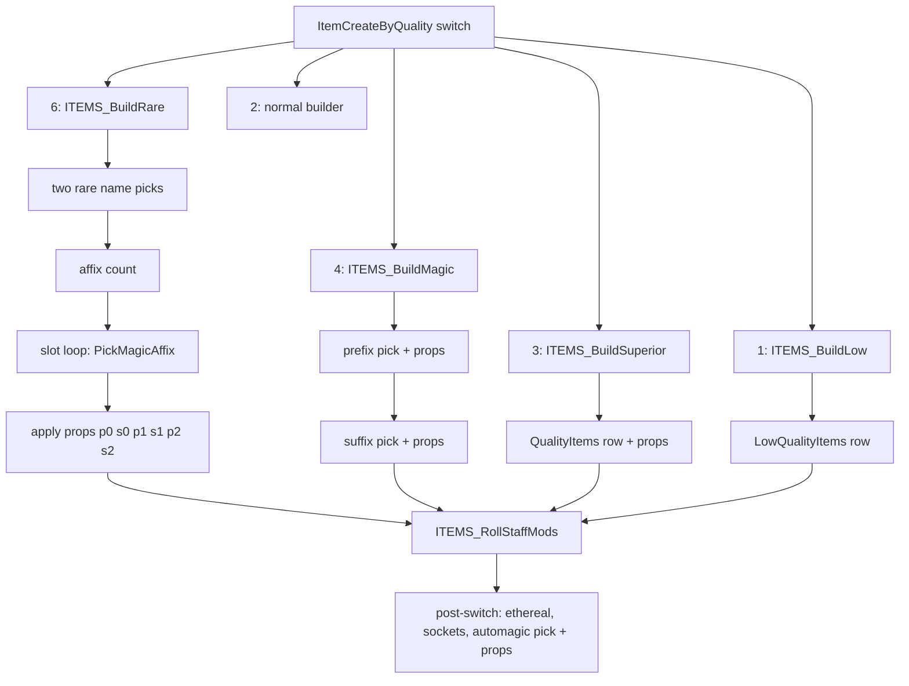

# 0005 — Affixes: alvl, magic and rare affix picks, automagic, the other builders

> **Subsystem:** items/affixes
> **Question:** Once an item's quality is settled (or a builder has fallen back), which `MagicPrefix`, `MagicSuffix`, `RarePrefix`, `RareSuffix` and `AutoMagic` rows does it get, and in which draw order on the item seed?
> **Date:** 2026-10-14   **Plan:** 0021 (Phase 1, Phase 1b)   **Status:** open (Phase 1 read from the decompile and the disassembly; Phase 1b cross-check done 2026-10-14, three contradictions with `src:arreat-summit-magic-items` and one with `src:d2dfg-blizzard`; Phase 2 bit-exact reproduction run:2026-10-14-affixes, 3 102 creations, 0 mismatches; plan 0038 batch S2b, 2026-10-16: `ITEMS_RollStaffMods` modelled with no oracle over 105 stock rolls, 9 statements raised and 8 in part (after the S2b review), 2 reclassified, [§ Plan 0038 batch S2b](#plan-0038-batch-s2b-2026-10-16); plan 0038 batch S2c, 2026-10-16: 2 statements raised and 1 in part, [§ Plan 0038 batch S2c](#plan-0038-batch-s2c-2026-10-16))

Names of structs and fields are ours. As in [items/0004](0004-uniques-sets.md): "record" is the 0x84-byte creation
record (`struct:ItemCreateRec`), "item seed" is the item-data seed at `ItemData+0x04` (not the unit seed at
`Unit+0x20`), "item version" is `ItemData+0x30` (< 100 classic game, ≥ 100 expansion game, never 0 for a created
item). Every draw named below is one step of the D2 LCG ([rng/0001](../rng/0001-rng-core.md)); "low" is the low word
after the step. `RNG_RangeOffset(seed, b, n)` is `b + low % n` after one step, or `b` with no step when `n` < 1
(fn:RNG_RangeOffset@0x00472280, items/0004). The affix records are `MagicAffixRec` and `RareAffixRec` in
`re/types/affixes.h`. Phase 1 was written from the code only; no community text had been read when it was written.

## Answer (summary)

The tags below are those of the plan 0021 record. [§ Plan 0038 batch S2b](#plan-0038-batch-s2b-2026-10-16) raises
further statements; where it lists one, its tag and evidence take precedence over the bullet here.

- [C] **Merged id spaces.** The loader appends `magicsuffix`, `magicprefix` and `automagic` (in that order) into one
  array of 0x90-byte records; an affix id is the merged index + 1, so suffix row r has id r + 1 and prefix row r has id
  `nSuffix + r + 1`. `raresuffix` then `rareprefix` are merged the same way (0x48-byte records). Item data holds
  these merged ids (prefixes `+0x38`, suffixes `+0x3E`, rare names `+0x32`/`+0x34`, automagic `+0x36`).
  (fn:sub_00633730_LoadMagicAffixes@0x00633730, fn:sub_00633F40_LoadRareAffixes@0x00633F40,
  fn:MAGICAFFIX_GetRecord@0x00633EE0, fn:RAREAFFIX_GetRecord@0x00634260, § 1; every logged candidate, name and
  property-record id matches the model's merged numbering, run:2026-10-14-affixes)
- [C] **alvl**: `i = max(ilvl, qlvl)`; if the base's `magic lvl` m ≠ 0, `alvl = i + m`; else with
  `h = qlvl / 2` (floor), `alvl = i − h` when `i < 99 − h`, else `2·i − 99`; then clamp to 1..99. This holds in a
  classic game too: the pick bodies split on item version 0, which no created item has, not on 100.
  (fn:ITEMS_PickMagicAffix@0x005C1560, 0x005C1664–0x005C16C2, fn:sub_005C18E0_PickMagicAffixByVersion@0x005C18E0,
  § 2, § 10; every logged pick, classic and expansion, run:2026-10-14-affixes)
- [C] **One magic-affix pick** (`ITEMS_PickMagicAffix`) draws: one step whose low bit decides "roll or not" (bit 0
  = 0 and the caller did not insist → no affix), then, if any row passes the filter, `RNG_RangeOffset(seed, 0,
  W + 1)` with W the sum of the weights. Weight = `frequency`, or `frequency × level` when the base has `magic lvl`.
  The candidate whose running sum first exceeds the draw wins; a draw of exactly W takes the **last** candidate.
  (0x005C15FD–0x005C163F, 0x005C1821–0x005C189E, § 3, § 4, run:2026-10-14-affixes)
- [C] **Filter order** per row of the block: `spawnable` (if asked) → `version` ≥ 100 needs an expansion item →
  `level` ≤ alvl and (`maxlevel` = 0 or ≥ alvl), skipped for the forced row → `rare` = 0 excludes the row on
  qualities 6, 8, 9 → the type test (classic stackable/throwable bases refused; a socket affix needs a socketable
  base; any `etype` match refuses; one `itype` match required) → the automagic group, if one is asked →
  `frequency` ≠ 0 → `classspecific` → the row's `group` not already on the item. (0x005C16D3–0x005C17AD,
  fn:ITEMS_MagicAffixTypeOk@0x0065E620, fn:sub_005C1500_AffixGroupTaken@0x005C1500, § 3, run:2026-10-14-affixes;
  the classic stackable/throwable refusal, the socket test and the forced row stay `[I]`: the run never needed them,
  see *Phase 2 results*)
- [C] **Magic:** a prefix pick (rolls on bit 0 = 1), then a suffix pick that must roll if no prefix was set; the
  properties of each are applied inside its pick, so the prefix's property draws come before the suffix pick. Both
  empty → the builder fails (→ superior). (fn:ITEMS_BuildMagic@0x005565E0, § 5, run:2026-10-14-affixes)
- [C] **Rare:** two name picks first (`RarePrefix`, then `RareSuffix`, each one uniform `RNG_RangeOffset` over the
  type-eligible rows), then the affix count: jewels (type 58) `3 + low % 2`; other bases one step and
  `{3,4,4,5,5,5,6,6}[low & 7]`. Each slot draws one step (bit 0 = 1 → suffix) unless one side is closed; a failed
  pick closes that side and the slot is retried; each side caps at 3. Properties are applied after all picks, in the
  order prefix 0, suffix 0, prefix 1, … (fn:ITEMS_BuildRareAffixes@0x005C1BF0, fn:ITEMS_PickRareName@0x005C1AB0,
  data:g_RareAffixCountTable@0x006E3014, § 6, run:2026-10-14-affixes; the jewel count `3 + low % 2` stays `[I]`,
  no rare jewel was logged)
- [C] **Automagic** (expansion item, every quality but 5 and 7, base `auto prefix` ≠ 0): one magic-affix pick over
  the `automagic` block restricted to rows whose `group` = the base's `auto prefix`, after the ethereal and socket
  rolls. (0x005579A8–0x00557A0C, fn:sub_005C1940_PickAutoAffixByVersion@0x005C1940, § 7, run:2026-10-14-affixes)
- [I] The automagic pick does not test `spawnable` (EDX = 0 at 0x005579DF). Every stock `automagic` row has
  `spawnable` 1, so no run can show it (architect ruling, plan 0021 Phase 1). (0x005579DF, tbl:AutoMagic.txt:spawnable)
- [C] **Superior** draws a `QualityItems` row by rejection sampling (uniform over 8 rows, or over the first 4 for a
  throwable or `nodurability` base, redrawing on a tried row); **low quality** draws `RNG_Range(seed, nLow)` for the
  name row; **normal** draws nothing of its own. (fn:ITEMS_BuildSuperiorPick@0x005C2970,
  fn:ITEMS_BuildLowPick@0x005C2D40, fn:ITEMS_BuildNormal@0x00556E80, § 8, run:2026-10-14-affixes)
- [C] Every builder ends with the class-item **staff mods** roll on the item seed: magic, rare and superior on
  success only, low always, and normal through a tail jump (`jmp 0x005C1260` at 0x00556F24, so the roll returns into
  `sub_00556F30_ItemBuildNormalCase`). The roll itself is an oracle. (fn:ITEMS_RollStaffMods@0x005C1260, 0x0055669D,
  0x005C1E3E, 0x005C2AAA, 0x005C2F98, 0x00556F24, § 9, run:2026-10-14-affixes)
- [I] **Boundary** (recommended in Phase 1, ruled by the architect): model everything above; keep
  `sub_0065FEC0_ItemApplyProps` (the property roll) and `ITEMS_RollStaffMods` as ADR-0004 oracles with the item seed
  asserted at entry and exit. See *Boundary for Phase 2* and *Phase 2 results*.
  (fn:sub_0065FEC0_ItemApplyProps@0x0065FEC0, fn:ITEMS_RollStaffMods@0x005C1260)

## Leads used

Phase 1 was written from the code with no lead (the plan's entry points came from items/0004). The sources below were
fetched and read afterwards, on 2026-10-14, for the plan 0021 Phase 1b cross-check (blind first): `src:d2dfg-blizzard`
(§ MagicPrefix.txt, § MagicSuffix.txt, § automagic.txt, § RarePrefix.txt, § RareSuffix.txt, § QualityItems.txt),
`src:arreat-summit-magic-items` (Magic Items, Jewels) and `src:arreat-summit-item-pages` (Item Basics § low quality,
§ superior). None has game code. `src:d2dfg-blizzard` describes Diablo II: Resurrected (items/0004), so a difference
from it may be a version difference. The only write-ups of the alvl formula that searches found (Lurker Lounge
threads) refused every fetch and were not read (`src:lurker-affix-threads`), so the alvl arithmetic has no fetched
lead beyond the Arreat Summit rule below. Agreement promotes nothing.

**Affix level and the candidate filter**
- [L] src:arreat-summit-magic-items: on monster drops the game "randomly choose[s] from all those that has a
  qlvl<=ilvl+2" (magic and rare items alike). **contradicted**
  Detail: 1.14d compares `level` (and `maxlevel`) with the alvl of § 2 (`max(ilvl, qlvl)`, minus `qlvl/2` or plus
  `magic lvl`), and draws by `frequency` weight (§ 4). The `ilvl + 2`, uniform rule exists only in the version-0 body
  `sub_005C12F0_PickMagicAffixV0`, which no created item reaches (§ 10). Settled by run:2026-10-14-affixes: 999 logged
  picks reproduce with alvl and `frequency` weights, 962 of them over a candidate set that differs from `level` ≤ ilvl + 2.
- [L] src:arreat-summit-magic-items: "Circlets, Staves, Wands and Orbs" have a Magic Level that adds to the level
  used for affixes. **held with refinement**
  Detail: `alvl = max(ilvl, qlvl) + magic lvl`, replacing the `qlvl/2` rule, and the weights become
  `frequency × level` on those bases (§ 2, § 4).
- [L] src:d2dfg-blizzard: `level` is "the minimum item level", `maxlevel` "the maximum item level" for the affix.
  **held with refinement**
  Detail: both are compared with alvl, not ilvl; `maxlevel` 0 means no maximum; the forced row skips both (§ 3).
- [L] src:d2dfg-blizzard: `spawnable` 0 → "never used", `rare` 0 → "not used for rare items", `version` "<100 =
  Classic mode | 100 = Expansion mode", for magic prefixes and suffixes. **held with refinement**
  Detail: as stated; `rare` 0 also excludes the row on qualities 8 and 9; `version` ≥ 100 rows are refused for an
  item of version < 100, version 0 and 1 rows stay eligible in expansion (§ 3).
- [L] src:d2dfg-blizzard: automagic `spawnable` 0 → "never used". **contradicted**
  Detail: the automagic pick passes `needSpawnable` = 0 (EDX = 0 at 0x005579DF), so `spawnable` is not tested there.
  All 36 stock `automagic` rows have `spawnable` 1, so the difference cannot show with stock data; ruled unreachable
  by the architect (plan 0021 Phase 1 review), the claim stays `[I]`.
- [L] src:d2dfg-blizzard: `classspecific` restricts the affix to class-specific items through the item type's
  `Class`. **held with refinement**
  Detail: the test refuses only when the item type has a class and it differs; a classless type passes it, and the
  `itype` list does the rest (§ 3).
- [L] src:d2dfg-blizzard: `itype1..7` allow and `etype1..5` exclude item types. **held with refinement**
  Detail: each list ends at its first value < 1; any `etype` match refuses first; an empty `itype` list refuses; a
  classic item refuses stackable and throwable bases; a socket property needs a socketable base (§ 3).
- [L] src:d2dfg-blizzard: `frequency` values of all possible affixes are summed and used as the denominator.
  **held with refinement**
  Detail: the draw is `low % (W + 1)`, so a draw of W goes to the last candidate (§ 4); `frequency` 0 rows are not
  candidates at all.
- [L] src:d2dfg-blizzard: no two affixes of one `group` on an item; blank `group` is group 0. **held with refinement**
  Detail: the test compares against every prefix and suffix already on the item, across the two tables; only
  `frequency` 0 rows have group 0 with stock data (§ 3).
- [L] src:d2dfg-blizzard: the three magic tables load in the order magicsuffix, magicprefix, automagic into one
  structure. **held**
  Detail: `sub_00633730_LoadMagicAffixes`; the ids are merged index + 1 (§ 1).

**Magic items**
- [L] src:arreat-summit-magic-items: "Both Prefix and Suffix: 25% / Only a Prefix: 25% / Only a Suffix: 50%".
  **held with refinement**
  Detail: these are the shares of the two bit draws when both sides have candidates; a side with no candidate
  shifts them (no eligible prefix → always a suffix only) (§ 5).

**Rare items**
- [L] src:arreat-summit-magic-items: "Rare Items have 2 to 6 magical properties". **contradicted**
  Detail: 1.14d sets 3 to 6 slots (`{3,4,4,5,5,5,6,6}[low & 7]`; jewels 3 or 4); fewer affixes only when a side runs
  out of candidates (§ 6). Settled by run:2026-10-14-affixes: counts 3/4/5/6 drawn 14/16/41/34 times over 105 rares,
  none with fewer than 3 affixes, one short of its count (a `buc` at ilvl 1 whose suffix side ran out).
- [L] src:arreat-summit-magic-items: each property "will have a 50/50 chance of being a Prefix and a Suffix", "never
  … more than 3 Prefixes or 3 Suffixes". **held with refinement**
  Detail: one bit per slot only while both sides are open; a failed pick closes its side and the slot is retried on
  the other side (§ 6).
- [L] src:arreat-summit-magic-items: "A Prefix or Suffix will never be picked more than once" and "Only one Prefix or
  Suffix will be picked per … group". **held with refinement**
  Detail: both follow from the group test (every live row has a non-zero group, so a picked row excludes itself); the
  test also spans prefixes against suffixes, which the stock numbering (prefix groups 101–142, suffix groups 1–45)
  makes moot (§ 3).
- [L] src:arreat-summit-magic-items (Jewels): "Rare Jewels can have up to four magical properties". **held with
  refinement**
  Detail: jewels get `3 + low % 2` slots, no other jewel-specific cap (§ 6).
- [L] src:arreat-summit-magic-items: rare names are random, "however, some names will not appear with some prefixes
  and suffixes". **contradicted** (read literally)
  Detail: both names are drawn before any affix and filtered by item type and version only (§ 6), so no name depends
  on the affixes. Settled by run:2026-10-14-affixes: all 105 rares draw both names before the count and every affix.
- [L] src:d2dfg-blizzard: rare prefixes and suffixes "are chosen at random from the list"; `version`, `itype1..7`,
  `etype1..4`. **held with refinement**
  Detail: uniform over the rows that pass the type and version test, one draw each, `name1` from `rareprefix` first;
  rows with no `itype` (`Warp`, `Rift`) never qualify (§ 6).

**Automagic, superior, low quality**
- [L] src:d2dfg-blizzard: automagic affixes are applied "regardless of their quality type". **held with refinement**
  Detail: only in expansion, and not on set (5) or unique (7) items (§ 7).
- [L] src:d2dfg-blizzard: superior: "randomly choose between one of these High Quality groups, if it is allowed for
  the item type"; ten flag columns `armor` … `belt`, `weapon` "except scepters, wands, and staves", `bow` for bows and
  crossbows. **held with refinement**
  Detail: rejection sampling over the rows (§ 8); the ten bytes of the type test pair with these columns in this
  order, which answers the layout question in *Open questions* as a lead only; a throwable or `nodurability` base draws
  from the first 4 rows only.
- [L] src:arreat-summit-item-pages: superior durability never shows on indestructible bows and on throwing weapons.
  **held with refinement**
  Detail: such bases draw from the first 4 `QualityItems` rows, which hold no `dur%` (§ 8, stock data).
- [L] src:arreat-summit-item-pages: low-quality armour has 75 % of normal defense and weapons 75 % of normal damage,
  rounded down; minimum damage at least 1. **held**
  Detail: `×75/100`, signed, floors 2/1/2/1 on the damage stats and 1 on defense (§ 8).
- Not covered by any fetched source: the staff mods (§ 9), the last-candidate rule, the rare count table itself, the
  draw order on the item seed (§ 12) and the alvl arithmetic beyond the Arreat Summit rule.

## Functions

A `C` in the table rests on the bit-exact reproduction run:2026-10-14-affixes.

| Address | Name | Role | Tag |
|---|---|---|---|
| `0x005565E0` | `ITEMS_BuildMagic` | magic builder: one prefix pick, one suffix pick | C |
| `0x00556A60` | `sub_00556A60_CharmForcedAffixes` | normal-quality charm: the record's forced prefix or suffix | I |
| `0x00556E80` | `ITEMS_BuildNormal` | normal builder (expansion) | C |
| `0x00556D80` | `sub_00556D80_ItemBuildNormalV0` | normal builder (classic) | I |
| `0x005C0D00` | `sub_005C0D00_AffixCandAdd` | appends `{id, record}` to the candidate list, cap 511 | C |
| `0x005C0D70` | `sub_005C0D70_StaffModsRollV0` | staff mods, classic | I |
| `0x005C0F90` | `sub_005C0F90_StaffModsRoll` | staff mods, expansion | C |
| `0x005C1260` | `ITEMS_RollStaffMods` | class skill bonuses of a class item type | C |
| `0x005C12F0` | `sub_005C12F0_PickMagicAffixV0` | magic affix pick, classic (uniform) | I |
| `0x005C1500` | `sub_005C1500_AffixGroupTaken` | group already used by a prefix or suffix on the item | C |
| `0x005C1560` | `ITEMS_PickMagicAffix` | magic affix pick, expansion (alvl, filter, weighted draw) | C |
| `0x005C18E0` | `sub_005C18E0_PickMagicAffixByVersion` | version dispatch, no automagic group | C |
| `0x005C1940` | `sub_005C1940_PickAutoAffixByVersion` | version dispatch with an automagic group | C |
| `0x005C19A0` | `sub_005C19A0_PickRareNameV0` | rare name pick, classic | I |
| `0x005C1AB0` | `ITEMS_PickRareName` | rare name pick (uniform over the type-eligible rows) | C |
| `0x005C1BC0` | `sub_005C1BC0_PickRareNameByVersion` | version dispatch for the quality 9 name pair | I |
| `0x005C1BF0` | `ITEMS_BuildRareAffixes` | rare builder body (expansion) | C |
| `0x005C1E80` | `sub_005C1E80_ItemBuildRareV0` | rare builder body (classic) | I |
| `0x005C21A0` | `ITEMS_BuildRare` | type test, then the rare body by version | C |
| `0x005C21D0` | `sub_005C21D0_ItemBuildCrafted` | quality 8 builder | C |
| `0x005C2970` | `ITEMS_BuildSuperiorPick` | superior row pick (`QualityItems`) | C |
| `0x005C2AD0` | `ITEMS_BuildSuperior` | superior builder | C |
| `0x005C2AF0` | `sub_005C2AF0_ItemBuildLowV0` | low-quality builder, classic | I |
| `0x005C2D40` | `ITEMS_BuildLowPick` | low-quality builder, expansion | C |
| `0x005C2FB0` | `ITEMS_BuildLow` | version dispatch for the low builders | C |
| `0x00627EC0` | `ITEMS_GetPrefix` | item data `+0x38 + 2i` | C |
| `0x00627EF0` | `ITEMS_SetPrefix` | | C |
| `0x00627F80` | `ITEMS_GetSuffix` | item data `+0x3E + 2i` | C |
| `0x00627FB0` | `ITEMS_SetSuffix` | | C |
| `0x00627FE0` | `ITEMS_GetRareName1` | item data `+0x32` | I |
| `0x00628010` | `ITEMS_SetRareName1` | | I |
| `0x00628070` | `ITEMS_SetRareName2` | item data `+0x34` | I |
| `0x00628740` | `ITEMS_GetQLvl` | base `level` (`+0x0FD`) | C |
| `0x006289F0` | `sub_006289F0_ItemBaseStackable` | base `stackable` (`+0x132`) | I |
| `0x00629900` | `sub_00629900_ItemBaseHasInv` | base `hasinv` (`+0x137`) | I |
| `0x0062B400` | `ITEMS_GetBaseType` | the base's `type` (ItemTypes row) | C |
| `0x0062BA80` | `sub_0062BA80_ItemTypeThrowable` | ItemTypes `Throwable` (`+0x10`) | I |
| `0x0062BBD0` | `sub_0062BBD0_ItemTypeStaffMods` | ItemTypes `StaffMods` (`+0x1F`), 7 = none | C |
| `0x0062C0B0` | `sub_0062C0B0_ItemTypeClass` | ItemTypes `Class` (`+0x21`), 7 = none | C |
| `0x00633730` | `sub_00633730_LoadMagicAffixes` | loads and merges suffix, prefix, automagic | C |
| `0x00633ED0` | `sub_00633ED0_GetMagicAffixInfo` | returns `&g_MagicAffixInfo` | C |
| `0x00633EE0` | `MAGICAFFIX_GetRecord` | merged id → record | C |
| `0x00633F40` | `sub_00633F40_LoadRareAffixes` | loads and merges raresuffix, rareprefix | C |
| `0x00634250` | `sub_00634250_GetRareAffixInfo` | returns `&g_RareAffixInfo` | I |
| `0x00634260` | `RAREAFFIX_GetRecord` | merged id → record | I |
| `0x00636B10` | `sub_00636B10_GetQualityItemsInfo` | returns `&g_QualityItemsInfo` | C |
| `0x00636B20` | `QUALITYITEMS_GetRecord` | row → `0x70`-byte record | C |
| `0x006375B0` | `sub_006375B0_GetLowQualityInfo` | returns `&g_LowQualityItemsInfo` | C |
| `0x0065E620` | `ITEMS_MagicAffixTypeOk` | magic affix type test | C |
| `0x0065E710` | `ITEMS_RareNameTypeOk` | rare name type test | C |
| `0x0065E7D0` | `sub_0065E7D0_QualityItemTypeOk` | superior row type test | C |
| `0x006E3014` | `g_RareAffixCountTable` | `int[8]` = 3,4,4,5,5,5,6,6 | C |
| `0x0096CAA0` | `g_RareAffixInfo` | merged rare name array | I |
| `0x0096CC50` | `g_QualityItemsInfo` | `{count, records}` | C |
| `0x0096CC58` | `g_LowQualityItemsInfo` | `{count, records}` | C |

## Walkthrough



### 1. The merged affix arrays and the ids (0x00633730, 0x00633F40)

```c
// fn:sub_00633730_LoadMagicAffixes@0x00633730 (trimmed)
suf  = DATATBLS_LoadTable(..., "magicsuffix", desc, &nS, 0x90);
pre  = DATATBLS_LoadTable(..., "magicprefix", desc, &nP, 0x90);
autom= DATATBLS_LoadTable(..., "automagic",   desc, &nA, 0x90);
g_MagicAffixInfo.count = nP + nA + nS;
info.base = info.suffixes = alloc(...);  memcpy(suffixes, suf, nS*0x90);
info.prefixes  = suffixes + nS;           memcpy(prefixes, pre, nP*0x90);
info.autoMagic = prefixes + nP;           memcpy(autoMagic, autom, nA*0x90);
for each record: rec->nameKey (+0x20) = STRTABLE_GetByKey(rec->name);
```

- [C] `g_MagicAffixInfo` (0x0096CA7C) is `{count, base, suffixes, prefixes, autoMagic}`; the three tables share one
  column descriptor. `MAGICAFFIX_GetRecord(id)` returns `base + (id − 1)·0x90` for 1 ≤ id ≤ count, else NULL.
  (fn:sub_00633730_LoadMagicAffixes@0x00633730, fn:sub_00633ED0_GetMagicAffixInfo@0x00633ED0,
  fn:MAGICAFFIX_GetRecord@0x00633EE0, data:g_MagicAffixInfo@0x0096CA7C, struct:MagicAffixInfo+0x08,
  run:2026-10-14-affixes)
- [C] `g_RareAffixInfo` (0x0096CAA0) is `{count, base, suffixes, prefixes}`: `raresuffix` first, then `rareprefix`,
  0x48-byte records; `RAREAFFIX_GetRecord(id)` = `base + (id − 1)·0x48`. (fn:sub_00633F40_LoadRareAffixes@0x00633F40,
  fn:RAREAFFIX_GetRecord@0x00634260, data:g_RareAffixInfo@0x0096CAA0, struct:RareAffixInfo+0x0C, run:2026-10-14-affixes)
- [C] **Every pick returns the merged index + 1.** So with stock data (747 suffix rows, 669 prefix rows), suffix row
  r is id r + 1, prefix row r is id 748 + r, automagic row r is id 1417 + r; rare suffix row r is id r + 1, rare
  prefix row r is id 156 + r. The item-data setters store these ids unchanged
  (`ITEMS_SetPrefix(item, id, i)` → `ItemData+0x38+2i`, `ITEMS_SetSuffix` → `+0x3E+2i`, `ITEMS_SetRareName1` →
  `+0x32`, `ITEMS_SetRareName2` → `+0x34`, `ITEMS_SetAutoAffix` → `+0x36`). The save writer stores the
  block-relative id (save/0001 § quality fields). (0x005C18A3–0x005C18C9, fn:ITEMS_SetPrefix@0x00627EF0,
  fn:ITEMS_SetSuffix@0x00627FB0, fn:ITEMS_SetRareName1@0x00628010, fn:ITEMS_SetRareName2@0x00628070,
  fn:ITEMS_GetPrefix@0x00627EC0, fn:ITEMS_GetSuffix@0x00627F80, fn:ITEMS_GetRareName1@0x00627FE0,
  fn:ITEMS_SetAutoAffix@0x00627F50, struct:ItemData+0x32, run:2026-10-14-affixes)
- [I] **Phase 0 questions settled by this:** `magicsuffix` record 0 is a real row with id 1 (a stored 0 means "none");
  `magicprefix` record 0 (blank) can never be picked, since its `frequency` is 0 and it names no `itype`. A stored
  rare `name1` of 160 is the merged id: `rareprefix` row 160 − 156 = 4. (tbl:MagicPrefix.txt:frequency,
  tbl:RarePrefix.txt:name)

### 2. alvl (0x005C1634–0x005C16C2)

```c
// fn:ITEMS_PickMagicAffix@0x005C1560 (from the disassembly)
qlvl = ITEMS_GetQLvl(item);                  // base level (+0x0FD), u8
alvl = ITEMS_GetItemLevel(item);             // ilvl
base = ITEMS_GetRecord(item->classId); if (!base) return 0;
if (alvl <= qlvl) alvl = qlvl;               // signed: jg keeps ilvl when ilvl > qlvl
m = base->magicLvl;                          // +0x140, u8
if (m) alvl += m;
else {
    h = qlvl / 2;                            // cdq; sub; sar 1 (qlvl >= 0, so floor)
    if (alvl < 99 - h) alvl = alvl - h;
    else               alvl = 2*alvl - h - (99 - h);   // = 2*alvl - 99
}
if (alvl <= 1) alvl = 1; else if (alvl >= 99) alvl = 99;
```

- [C] All comparisons are signed 32-bit; the clamp tests `≤ 1` first, so 1 and anything below become 1, then `≥ 99`
  becomes 99. `magic lvl` replaces the qlvl/2 rule entirely: such a base gets `max(ilvl, qlvl) + m` with no
  subtraction. (0x005C1671–0x005C16C2, fn:ITEMS_GetQLvl@0x00628740, fn:ITEMS_GetItemLevel@0x006281E0,
  tbl:Weapons.txt:level, tbl:Weapons.txt:magic lvl, tbl:Misc.txt:magic lvl, run:2026-10-14-affixes)
- [C] alvl is recomputed by every pick (it is not stored); for a given item all picks get the same value. The same
  alvl serves prefixes, suffixes and the automagic pick. (0x005C1664, run:2026-10-14-affixes)
- [I] Stock bases with `magic lvl` (data, from `tools/affix_survey.py`): the staves, wands and orbs with 1, and the
  circlets `ci0`..`ci3` with 3, 8, 13, 18. For those the weight also changes (§ 4). (tbl:Armor.txt:magic lvl)

### 3. `ITEMS_PickMagicAffix(item, needSpawnable, mustRoll, applyProps, isPrefix, forcedId, autoGroup)` (0x005C1560)

stdcall, `ret 0x1C`; reached through `sub_005C18E0_PickMagicAffixByVersion` (ECX = item, EDX = needSpawnable, then
mustRoll, applyProps, isPrefix, forcedId on the stack, autoGroup 0) or `sub_005C1940_PickAutoAffixByVersion` (same,
plus autoGroup). Both dispatchers call `sub_005C12F0_PickMagicAffixV0` instead when the item version is 0 (§ 10).

```c
// fn:ITEMS_PickMagicAffix@0x005C1560 (from the disassembly, our names)
info = &g_MagicAffixInfo;
if (autoGroup)     { first = info->autoMagic; end = info->base + info->count; }
else if (isPrefix) { first = info->prefixes;  end = info->autoMagic; }
else               { first = info->suffixes;  end = info->prefixes; }
n = (end - first) / 0x90;               if (!first) return 0;
blockStart = (first - info->base) / 0x90;
seed = ITEMS_GetSeed(item);
RNG_Step(seed);                                        // draw #1, always
ver = ItemGetVersion(item);
if ((seed->low & 1) == 0 && !mustRoll) return 0;       // no affix
/* § 2: alvl */
cands = 0; W = 0;
for (i = 0; i < n; i++) {
    r = &first[i];
    if (needSpawnable && (u8)r->spawnable == 0) continue;        // +0x54
    if (r->version >= 100 && ver < 100) continue;                // +0x22, u16
    forced = forcedId > 0 && i == forcedId - 1;
    if (!forced) {
        if (r->level > alvl) continue;                           // +0x58, signed
        if (r->maxLevel != 0 && r->maxLevel < alvl) continue;    // +0x60
    }
    if (r->rare == 0) { q = ITEMS_GetQuality(item); if (q == 6 || q == 8 || q == 9) continue; }  // +0x64
    if (!ITEMS_MagicAffixTypeOk(item, r)) continue;
    if (autoGroup && r->group != autoGroup) continue;            // +0x5C
    if ((u8)r->frequency == 0) continue;                         // +0x82
    if (r->classSpecific != 0xFF && ItemTypeClass(item) != 7
        && r->classSpecific != ItemTypeClass(item)) continue;    // +0x66
    if (AffixGroupTaken(item, r->group)) continue;
    if (forced) { id = blockStart + i; rec = r; goto chosen; }   // no weighted draw
    AffixCandAdd(list, &cands, blockStart + i, r);               // stored only while cands < 511
    W += m ? (u8)r->frequency * r->level : (u8)r->frequency;
}
if (cands <= 0) return 0;
x = RNG_RangeOffset(seed, 0, W + 1);                             // draw #2: low % (W + 1)
for (k = 0; k < cands; k++) {
    x -= m ? (u8)list[k].rec->frequency * list[k].rec->level : (u8)list[k].rec->frequency;
    if (x < 0) break;
}
if (k == cands) k = cands - 1;                                   // x == W: the loop exits on its last entry
id = list[k].id; rec = list[k].rec;
chosen:
if (applyProps) sub_0065FEC0_ItemApplyProps(0, 0, item, rec, 0, 0);
return id + 1;
```

- [C] **Draw #1 always happens** once the block exists, also when `mustRoll` is set (its bit is then ignored), and it
  comes before the candidate scan, so a pick that finds no candidate still costs one step. (0x005C15FD–0x005C1645,
  run:2026-10-14-affixes)
- [C] **The test order is the one above**, each test a `continue`. Widths: `spawnable`, `rare`, `frequency` and
  `classspecific` are read as bytes; `version` as u16 against the item version as u16; `level`, `maxlevel`, `group`
  as signed 32-bit. (0x005C16D3–0x005C17AD, run:2026-10-14-affixes)
- [I] **`ITEMS_MagicAffixTypeOk(item, r)`**, in order: (a) a classic item (version < 100) whose base is `stackable`
  or whose type is `Throwable` is refused; (b) if the base cannot hold sockets (`hasinv` = 0 or the type's max
  sockets = 0), a row whose `mod1code` is ≥ 0 is refused when that property index is out of range, has no record, or
  its first stat is 194 (`item_numsockets`; the `sock` property); (c) any `etype1..5` that the item is (`ITEMS_UnitIsType`,
  which walks the `Equiv` chains) refuses; the list ends at the first value < 1, so `0xFFFF` (−1) ends it; (d) the row
  passes only if one of `itype1..7` matches; the list ends at the first value < 1, and an empty list refuses.
  (fn:ITEMS_MagicAffixTypeOk@0x0065E620, fn:sub_006289F0_ItemBaseStackable@0x006289F0,
  fn:sub_0062BA80_ItemTypeThrowable@0x0062BA80, fn:sub_00629900_ItemBaseHasInv@0x00629900,
  fn:sub_0062BC20_ItemMaxSockets@0x0062BC20, fn:ITEMS_UnitIsType@0x00629BB0, tbl:MagicPrefix.txt:itype1,
  tbl:MagicPrefix.txt:etype1, tbl:MagicPrefix.txt:mod1code, tbl:Weapons.txt:stackable, tbl:Weapons.txt:hasinv,
  tbl:ItemTypes.txt:Throwable)
- [C] Tests (c) and (d), with `ITEMS_UnitIsType` as the `Equiv` closure of the base's `type` and `type2`, give the
  logged candidate list of every pick. Tests (a) and (b) refused no row in the run: no classic throwable base reached
  a pick, and no `sock` row fell in a socketless base's level window. (fn:ITEMS_MagicAffixTypeOk@0x0065E620,
  fn:ITEMS_UnitIsType@0x00629BB0, run:2026-10-14-affixes)
- [C] **`classspecific`**: 0xFF (blank) passes; otherwise the row passes when the item type's `Class` is 7 (none)
  or equals it. So a class-specific row is not refused on a classless type by this test; its `itype` list is what
  keeps it off such items. (0x005C1781–0x005C179E, fn:sub_0062C0B0_ItemTypeClass@0x0062C0B0,
  tbl:MagicPrefix.txt:classspecific, tbl:ItemTypes.txt:Class, run:2026-10-14-affixes)
- [C] **Group exclusion** (`sub_005C1500_AffixGroupTaken`, EBX = group, EDI = item): scans prefixes 0..2 until the
  first slot whose record is NULL, then suffixes 0..2 likewise; true if any of those records has the same `group`.
  Prefix and suffix groups are compared with each other. With stock data only frequency-0 rows have group 0, and the
  automagic groups (300–305) appear in neither magic table, so the cross-table comparisons never bite on the
  expansion path. (fn:sub_005C1500_AffixGroupTaken@0x005C1500, tbl:MagicPrefix.txt:group, tbl:AutoMagic.txt:group,
  run:2026-10-14-affixes)
- [I] **The forced row** (forcedId > 0, a block-relative id) skips only the level window; every other test still
  applies, and it returns without the weighted draw. If it fails a test the pick continues as a normal one. On the
  drop path `forcedId` is always 0, because `sub_0055A550_DropCreateItem` zeroes the record and nothing on the drop
  path writes `+0x68..+0x7C` (items/0001 § 8). (0x005C16FE–0x005C1713, 0x005C180B–0x005C181B,
  struct:ItemCreateRec+0x68)
- [C] Every pick logged on the drop path had `forcedId` 0 (ITEMS_PickMagicAffix's sixth argument).
  (fn:ITEMS_PickMagicAffix@0x005C1560, run:2026-10-14-affixes)
- [C] **The forced row on the cube path** (plan 0030 Phase 2): the cube's `pre=`/`suf=` reach the pick as `forcedId`,
  block-relative (`pre=331` → prefix *Prismatic*), taken with no weighted draw; 12 forced picks reproduced through
  `ITEMS_BuildMagic` ([items/0008 § 8.4](0008-cube.md#84-other-results)). (fn:ITEMS_PickMagicAffix@0x005C1560,
  run:2026-10-15-cube)
- [I] **Candidate cap.** `sub_005C0D00_AffixCandAdd` stores `{id, record}` and increments only while the count is
  < 511, but the weight is added regardless. With stock data no base has more than 165 type-eligible rows in one
  table (the survey's maximum, before the level filter), so the cap is unreachable.
  (fn:sub_005C0D00_AffixCandAdd@0x005C0D00)

### 4. The weighted draw (0x005C1821–0x005C189E)

- [C] `x = RNG_RangeOffset(seed, 0, W + 1)` (one step, `low % (W + 1)`); the candidates are walked in table order,
  subtracting each weight; the first that drives x below 0 wins. When x = W no subtraction goes negative, and the loop
  leaves with the last candidate selected (`jge 0x5C189E` at 0x005C188B with EDI on that entry), so the last
  candidate's effective weight is its weight + 1. (Ghidra's decompile shows this exit as a failure; the disassembly
  does not.) (0x005C1828–0x005C189E, run:2026-10-14-affixes)
- [C] Weight = `frequency` (byte) normally, `frequency × level` when the base's `magic lvl` ≠ 0 — the same rule in
  the sum and in the walk. (0x005C17CE–0x005C17EA, 0x005C185A–0x005C187C, tbl:MagicPrefix.txt:frequency,
  tbl:MagicPrefix.txt:level, run:2026-10-14-affixes)
- [C] So a pick costs exactly 1 step (no candidate, or no roll) or 2 steps, plus whatever `ItemApplyProps` draws
  when `applyProps` is set. (0x005C15FD, 0x005C1839, 0x005C18A3, run:2026-10-14-affixes)

### 5. Magic: `ITEMS_BuildMagic(rec)` (0x005565E0; item in `[ESI]`)

```c
// fn:ITEMS_BuildMagic@0x005565E0 (from the disassembly)
p = s = 0; sufMust = 0;
if (rec->forcedPrefix[0] < 0) sufMust = 1;                      // no prefix wanted
else {
    p = PickByVersion(item, /*spawnable*/1, /*mustRoll*/rec->forcedPrefix[0] > 0, /*apply*/1,
                      /*prefix*/1, rec->forcedPrefix[0]);
    ITEMS_SetPrefix(item, p, 0);
    if (p == 0) sufMust = 1;
    else if (rec->forcedSuffix[0] < 0) goto done;               // no suffix wanted
}
if (rec->forcedSuffix[0] > 0) sufMust = 1;
s = PickByVersion(item, 1, sufMust, 1, /*prefix*/0, rec->forcedSuffix[0]);
ITEMS_SetSuffix(item, s, 0);
done:
if (!p && !s) return 0;                                         // → superior fallback
ITEMS_SetFlag(item, 0x10, 0);
ITEMS_RollStaffMods(item, rec);
return 1;
```

- [C] On a drop (`forced*[0]` = 0): prefix pick with mustRoll 0 → bit 0 of its first step decides whether a prefix is
  attempted; then a suffix pick, with mustRoll 1 if no prefix was set (no roll, or no candidate), else mustRoll 0.
  So a magic item has a prefix only, a suffix only, or both, and each pick draws as in § 3. Properties are applied
  inside each pick (`applyProps` = 1): order of item-seed draws is prefix step, prefix pick draw, prefix properties,
  suffix step, suffix pick draw, suffix properties, staff mods. (0x005565E0–0x005566A7, run:2026-10-14-affixes)
- [C] The builder fails only if both slots are 0. With mustRoll forced for the suffix, that needs no eligible suffix
  (and no prefix). (0x00556673–0x00556684, run:2026-10-14-affixes)

### 6. Rare: `ITEMS_BuildRare` (0x005C21A0) → `ITEMS_BuildRareAffixes(rec)` (0x005C1BF0; item in ESI)

```c
// fn:ITEMS_BuildRareAffixes@0x005C1BF0 (from the decompile and the disassembly)
n1 = ITEMS_PickRareName(/*prefix*/1, item);  n2 = ITEMS_PickRareName(/*prefix*/0, item);  // V0 picks if version 0
if (!n1 || !n2) return 0;                                         // → magic fallback
ITEMS_SetRareName1(item, n1); ITEMS_SetRareName2(item, n2);
seed = ITEMS_GetSeed(item);
if (ITEMS_GetBaseType(item) == 58) count = RNG_RangeOffset(seed, 3, 2);   // jewel: 3 + low % 2
else { RNG_Step(seed); count = g_RareAffixCountTable[seed->low & 7]; }    // 3,4,4,5,5,5,6,6
np = ns = 0; preDone = sufDone = 0;
for (i = 0; i < count; i++) {
    if (preDone) { if (sufDone) break; goto suffix; }
    if (!sufDone) { RNG_Step(seed); if (seed->low & 1) goto suffix; }
    a = ITEMS_PickMagicAffix(item, 1, 1, 0, /*prefix*/1, rec->forcedPrefix[np], 0);
    if (!a) { preDone = 1; i--; continue; }                       // slot retried
    ITEMS_SetPrefix(item, a, np++); if (np > 2) preDone = 1; continue;
suffix:
    a = ITEMS_PickMagicAffix(item, 1, 1, 0, /*prefix*/0, rec->forcedSuffix[ns], 0);
    if (!a) { sufDone = 1; i--; continue; }
    ITEMS_SetSuffix(item, a, ns++); if (ns > 2) sufDone = 1;
}
if (!np && !ns) return 0;
ITEMS_SetFlag(item, 0x10, 0);
for (k = 0; k < 3; k++) { ApplyProps(prefix k); ApplyProps(suffix k); }  // skipped where the slot is 0
ITEMS_RollStaffMods(item, rec);
return 1;
```

- [I] `ITEMS_BuildRare` returns 0 at once when the item type's `Rare` is 0, else calls this body (version ≥ 1) or
  `sub_005C1E80_ItemBuildRareV0` (version 0, never for a created item). (fn:ITEMS_BuildRare@0x005C21A0,
  fn:sub_0062E990_ItemTypeRare@0x0062E990)
- [C] **The names come first**: `name1` from `rareprefix` (`ECX` = 1 at 0x005C1C06), `name2` from `raresuffix`
  (`ECX` = 0 at 0x005C1C26). Either 0 fails the builder before any affix draw. (0x005C1BF0–0x005C1C59,
  run:2026-10-14-affixes)
- [C] **`ITEMS_PickRareName(isPrefix /*ECX*/, item)`**: collects every row of the block that passes
  `ITEMS_RareNameTypeOk` (cap 511), then `RNG_RangeOffset(seed, 0, n)` (one step) picks uniformly. No level, no
  weight. `ITEMS_RareNameTypeOk`: row `version` ≥ 100 needs an expansion item; `etype1..4` refuse (list ends < 1);
  one of `itype1..7` required (list ends < 1; empty refuses), so `rareprefix` `Warp` and `Rift` (no `itype`) are
  never picked. (fn:ITEMS_PickRareName@0x005C1AB0, fn:ITEMS_RareNameTypeOk@0x0065E710, tbl:RarePrefix.txt:itype1,
  tbl:RareSuffix.txt:etype1, run:2026-10-14-affixes)
- [I] No candidate → 0 and no step; a classic stackable or throwable base is refused first. Only classic throwing
  weapons have no name candidate with stock data (`tools/affixes.py survey`), and no rare one was logged.
  (0x005C1B7E, 0x0065E71D–0x0065E737)
- [I] **The affix count**: one draw. Jewels (`ITEMS_GetBaseType` = 58, `jewl`) `RNG_RangeOffset(seed, 3, 2)` = 3 or 4;
  every other base one inline step and `data:g_RareAffixCountTable@0x006E3014` `[low & 7]` = 3,4,4,5,5,5,6,6, i.e.
  3 with 1/8, 4 with 2/8, 5 with 3/8, 6 with 2/8. (0x005C1C6F–0x005C1CAE, fn:ITEMS_GetBaseType@0x0062B400,
  tbl:ItemTypes.txt:Code)
- [C] **Each slot**: while neither side is closed, one step; bit 0 = 1 → suffix, else prefix. Once one side is closed
  no step is drawn and the other side is taken. Each pick is `ITEMS_PickMagicAffix(item, spawnable 1, mustRoll 1,
  applyProps 0, side, rec->forced…[n], 0)`, so it costs one step (bit ignored) plus the weighted draw. A pick that
  returns 0 closes its side and does **not** consume the slot (`i--`); a side also closes after its third affix.
  The loop ends after `count` filled slots or when both sides are closed. Prefixes and suffixes are therefore at most
  3 each, the jewel count included. The two fatal checks (`np > 2` / `ns > 2` before a pick, error lines 0x31D and
  0x32E) are unreachable. (0x005C1CB1–0x005C1E16, run:2026-10-14-affixes)
- [C] **Group exclusion** works across the whole item as it is built: each pick sees the prefixes and suffixes set by
  the earlier slots (§ 3). The rows' `rare` byte is tested with quality 6, so `rare` = 0 rows never appear.
  (fn:sub_005C1500_AffixGroupTaken@0x005C1500, 0x005C173F, run:2026-10-14-affixes)
- [C] **Properties after the loop**, interleaved prefix k, suffix k for k = 0..2, each through
  `sub_0065FEC0_ItemApplyProps(0, 0, item, rec, 0, 0)`; then the staff mods. So on a rare all pick draws precede
  all property draws. (0x005C1E16–0x005C1E70, run:2026-10-14-affixes)
- [I] The builder fails (→ magic fallback, reseeded) when a name pick fails or no affix was set. (0x005C1E71)

### 7. Automagic, after the quality switch (0x005579A8–0x00557A0C)

```c
// fn:sub_00557450_ItemCreateByQuality@0x00557450, post-switch (from the disassembly)
q = ITEMS_GetQuality(item); if (q < 1 || q > 9) return 0;
if (ver >= 100) sub_00556CA0_ItemRollEthereal(item);
if (q >= 1 && q <= 3) sub_00556B60_ItemRollSockets(item, ...);
if (ver >= 100 && q != 5 && q != 7 && base->autoPrefix /*+0xF8, u16*/) {
    id = PickAutoAffixByVersion(item, /*spawnable*/0, /*mustRoll*/1, /*apply*/0, /*prefix*/1, /*forced*/0, base->autoPrefix);
    if (id > 0) { ITEMS_SetAutoAffix(item, id); sub_0065FEC0_ItemApplyProps(0, 0, item, MAGICAFFIX_GetRecord(id), 0, 0); }
}
return 1;
```

- [I] The jump table at 0x00557A58 (index q − 1) is `0,0,0,0,1,0,1,0,0`: qualities 5 and 7 skip, all others
  (1, 2, 3, 4, 6, 8, 9) take the pick. (0x005579B3–0x005579BF)
- [C] Qualities 2, 3, 4 and 6 take the automagic pick (logged on each). (0x005579B3–0x005579BF,
  run:2026-10-14-affixes)
- [C] The pick is a § 3 pick over the `automagic` block with `autoGroup` = the base's `auto prefix`: no `spawnable`
  test (`[I]`: every stock row has `spawnable` 1), the level window on the same alvl, the `rare` test (so a rare item
  cannot get one of the 7 `rare` = 0
  automagic rows), the type test, `group` = `auto prefix`, `frequency`, class and group exclusion. It always draws
  its first step (mustRoll) and, with candidates, the weighted draw; the properties are applied by the caller after
  `ITEMS_SetAutoAffix`. So the automagic draws come after the builder, the ethereal roll and the socket roll.
  (fn:sub_005C1940_PickAutoAffixByVersion@0x005C1940, tbl:Weapons.txt:auto prefix, tbl:AutoMagic.txt:group,
  tbl:AutoMagic.txt:rare, run:2026-10-14-affixes)
- [C] A classic item never gets here (version < 100). (0x005579A2, run:2026-10-14-affixes)
- [I] A base whose `auto prefix` group has no eligible row gets no automagic and spends one step; with stock data no
  base and ilvl has such a group (`tools/affixes.py survey`). `automagic` group 301 is named by no base, so its rows
  are never picked from a drop. (0x005579A2, tbl:AutoMagic.txt:group)

### 8. Superior, low quality, normal

**Superior** — `ITEMS_BuildSuperior(item /*ECX*/, rec /*EDX*/)` (0x005C2AD0) reads the version and discards it, then
`ITEMS_BuildSuperiorPick` (0x005C2970):

```c
// fn:ITEMS_BuildSuperiorPick@0x005C2970 (from the decompile and the disassembly)
n = g_QualityItemsInfo.count;                               // 8 rows with stock data
if (sub_0062BA80_ItemTypeThrowable(item) || base->nodurability /*+0x113*/) n = 4;
tried[10] = {0};
for (;;) {
    do {
        if (n < 1) row = 0;                                  // no step
        else { RNG_Step(seed); row = (n & (n - 1)) == 0 ? (low & (n - 1)) : (low % n); }
    } while (tried[row]);
    q = QUALITYITEMS_GetRecord(row); if (!q) return 0;
    if (sub_0065E7D0_QualityItemTypeOk(item, q)) {
        ITEMS_SetFileIndex(item, row);
        sub_0065FEC0_ItemApplyProps(1, 0, item, q, 0, 0);
        ITEMS_RollStaffMods(item, rec);
        return 1;
    }
    tried[row] = 1;
    if (every row < n tried) return 0;                     // → normal fallback
}
```

- [C] Each draw is one step, the range draw of `RNG_Range` inlined (power of two → mask, else modulo). A row already
  tried is redrawn, so the number of steps is not fixed. The row is stored as the item's file index. The type test
  reads the record's bytes 0..9 as flags: byte 1 passes an item that is type 45 (`weap`, with `Equiv`) whose own base
  type is not 24/25/26/27/35 (scepter, wand, staff, bow, crossbow); byte 0 passes a type-50 (`armo`) item whose base
  type is not 2/15/16/19 (shield, boots, gloves, belt); otherwise the byte for the exact base type: 2 → byte 2,
  24 → 3, 25 → 4, 26 → 5, 27 and 35 → 6, 15 → 7, 16 → 8, 19 → 9. Which `.txt` columns those bytes hold is for the
  table doc (*Open questions*).
  (fn:ITEMS_BuildSuperior@0x005C2AD0, fn:ITEMS_BuildSuperiorPick@0x005C2970, fn:QUALITYITEMS_GetRecord@0x00636B20,
  fn:sub_0065E7D0_QualityItemTypeOk@0x0065E7D0, data:g_QualityItemsInfo@0x0096CC50, tbl:Weapons.txt:nodurability,
  run:2026-10-14-affixes)
- [I] The `tried` buffer is 10 bytes; a `QualityItems` table of more than 10 rows would overflow it. Stock has 8.
  (fn:ITEMS_BuildSuperiorPick@0x005C2970)

**Low quality** — `ITEMS_BuildLow` (0x005C2FB0) → `ITEMS_BuildLowPick` (0x005C2D40) in expansion:

- [C] `row = RNG_Range(item seed, nLow)` (one step; 4 rows with stock data) → file index; nothing else of the low
  builder but the staff mods (always called) draws on the item seed, and it succeeds for a weapon or an armour.
  (fn:ITEMS_BuildLowPick@0x005C2D40, 0x005C2D80, 0x005C2F93, run:2026-10-14-affixes)
- [I] After the row, only if the item has
  durability, the maximum durability `M = durability·33/100` (u8 base column, unsigned; at least 1) and the current
  `RNG_RangeB(unit seed, M/2) + M/2` (at least 1) — this draw is on the **unit** seed at `Unit+0x20`, not the item
  seed. Then a weapon (type 45) gets its damage stats ×75/100 (signed, floors at 2/1/2/1) and, if throwable, the
  throw damage; an armour (type 50) its defense ×75/100 (at least 1). Then the staff mods. Return 1 for a weapon or
  armour, else 0 (→ normal fallback). The version-0 body `sub_005C2AF0_ItemBuildLowV0` (no created item reaches it,
  § 10) uses `durability/3` and has no staff mods. (fn:ITEMS_BuildLowPick@0x005C2D40, fn:ITEMS_BuildLow@0x005C2FB0,
  fn:sub_005C2AF0_ItemBuildLowV0@0x005C2AF0, fn:sub_006375B0_GetLowQualityInfo@0x006375B0,
  data:g_LowQualityItemsInfo@0x0096CC58, fn:RNG_RangeB@0x0045C3E0, tbl:Weapons.txt:durability)

**Normal** — `sub_00556F30_ItemBuildNormalCase` → `ITEMS_BuildNormal` (0x00556E80, expansion):

- [C] No draw of its own on the item seed for a non-charm base; then `ITEMS_RollStaffMods` by a tail jump
  (0x00556F24). (fn:ITEMS_BuildNormal@0x00556E80, run:2026-10-14-affixes)
- [I] A charm (type 13) goes to `sub_00556A60_CharmForcedAffixes`; a body part (40) or player
  body part (7) gets a file index; a scroll (22) or book (18) gets a fixed suffix id by base code
  (`0x005C2540`, the table at `0x0096CC60`); then `ITEMS_RollStaffMods`. (fn:ITEMS_BuildNormal@0x00556E80,
  fn:sub_00556D80_ItemBuildNormalV0@0x00556D80)
- [I] `sub_00556A60_CharmForcedAffixes` picks a prefix and/or a suffix through § 3 with the record's forced ids (on a
  drop both 0: prefix with mustRoll 0, then suffix with mustRoll 1 if no prefix) and raises a fatal error (line
  0x372) if both are 0. A charm reaches the normal builder only as the end of a failed magic → superior chain
  (its type is `Magic`, items/0004 § 2). (fn:sub_00556A60_CharmForcedAffixes@0x00556A60)

### 9. Staff mods: `ITEMS_RollStaffMods(item /*ECX*/, rec /*EDX*/)` (0x005C1260)

Called at the end of the magic, rare, superior, low (expansion) and normal builders.

- [I] It does nothing unless the item type's `StaffMods` class c < 7 and that class has skills. Then, in
  expansion, `sub_005C0F90_StaffModsRoll(item, ilvl = rec+0x0C, firstSkill(c), bonus)` with bonus = ilvl when the
  record's `+0x80` bit 0x20 is set, else 0 (never set on a drop). (fn:ITEMS_RollStaffMods@0x005C1260,
  fn:sub_0062BBD0_ItemTypeStaffMods@0x0062BBD0, tbl:ItemTypes.txt:StaffMods, struct:ItemCreateRec+0x80)
- [C] `firstSkill(c)` (the EAX that `0x006460F0(c, 0)` returns at 0x005C128A) is the first id of the class's 30-id
  `Skills` run: logged on all 74 staff-mods rolls of the run, for classes 1 to 6 (36, 66, 96, 126, 221, 251). Class
  0 (`ama`, 6) was not logged. (0x005C1285–0x005C128A, tbl:Skills.txt:charclass,
  run:2026-10-14-affixes)
- [I] Draw sequence (all on the item seed, all `low % k` with an unsigned low): (1) `t = low % 100 + bonus`: ≥ 91 → 3
  mods, ≥ 71 → 2, ≥ 31 → 1, else none (1 when bonus ≠ 0). Tier: 5 if ilvl ≥ 37 and expansion, else 4 (≥ 25),
  3 (≥ 19), 2 (≥ 12), 1. Per mod: (2) `low % 100`: ≥ 81 → tier + 1, ≥ 31 → tier, ≥ 11 → tier − 1, else tier − 2
  (at least 1; at most 4 on a low-quality item); (3) up to 6 tries of one step each: skill = `low % 5 + (tier − 1)·5 +
  firstSkill`, accepted when it is not a repeat and the skill's item-type requirement (`+0x18`) is empty or met — if
  all 6 tries fail, the last skill drawn is used anyway; (4) unless the item is
  a low-quality expansion item, `low % 100 + bonus/2`: ≥ 90 → level 3, ≥ 60 → 2, else 1; the stat 107
  (`item_singleskill`) with the skill as layer is set to that level. (fn:sub_005C0F90_StaffModsRoll@0x005C0F90)
- [I] The classic body `sub_005C0D70_StaffModsRollV0` differs: no bonus, tier 4 at most, the skill try loops until a
  non-repeat other than 0x49, and the level draw is unconditional. (fn:sub_005C0D70_StaffModsRollV0@0x005C0D70)

### 10. Classic items (version < 100)

The version tests here are against 0 (classic body) except where they say 100, and every created item has version ≥ 1
(items/0004), so a classic **game's** items take the expansion bodies with version < 100. That means:

- [C] In a classic game the § 3 pick still runs, with `version` ≥ 100 rows excluded and the classic
  stackable/throwable refusal in the type test; the version-0 bodies (`sub_005C12F0_PickMagicAffixV0`: alvl = ilvl + 2,
  only `spawnable`, `version`, `level` ≤ alvl and the type test, uniform draw; `sub_005C1E80_ItemBuildRareV0`: count
  `4 + low % 3`, up to 252 redraws per slot against same id or group; `sub_005C19A0_PickRareNameV0`) are reached only
  by an item of version 0, which no drop creates. (fn:sub_005C18E0_PickMagicAffixByVersion@0x005C18E0,
  fn:sub_005C12F0_PickMagicAffixV0@0x005C12F0, fn:sub_005C1E80_ItemBuildRareV0@0x005C1E80,
  fn:sub_005C19A0_PickRareNameV0@0x005C19A0, fn:sub_0062A670_ItemGetVersion@0x0062A670, run:2026-10-14-affixes)
- [I] Hence the Phase 0 question "can the `frequency` 0 version-0 rows be picked": not on the drop path. The § 3 pick
  refuses `frequency` 0 in either game type; only the version-0 body, which ignores `frequency`, would take them.
  (tbl:MagicPrefix.txt:version, tbl:MagicPrefix.txt:frequency)

### 11. Qualities 8 and 9 (not on the drop path)

- [I] Case 8 clears the rare names, reseeds and calls `sub_005C21D0_ItemBuildCrafted`: two rare names, then
  `max(low % 5, tier(ilvl))` slots (tier 1..4 at ilvl > 30, 50, 70) filled like the classic rare (one step per slot
  for the side, up to 252 redraws against duplicates, forced ids from the record), properties after. Case 9 draws two
  rare names through `sub_005C1BC0_PickRareNameByVersion`. The drop quality roll returns only 1..7 (items/0002), so
  both are `items/cube` material. (0x005577B7–0x005577FC, 0x00557801–0x0055786C,
  fn:sub_005C21D0_ItemBuildCrafted@0x005C21D0, fn:sub_005C1BC0_PickRareNameByVersion@0x005C1BC0)
- [C] Case 8 as read in [items/0008 § 4](0008-cube.md#4-crafted-sub_005c21d0_itembuildcrafted-ecx-item-edx-creation-record):
  51 crafted items of the cube reproduced pick by pick and roll by roll (items/0008 § 8.4).
  (fn:sub_005C21D0_ItemBuildCrafted@0x005C21D0, run:2026-10-15-cube)

### 12. Where the draws sit on the item seed

For one drop, after the item seed is set to `{ItemData+0x10, 666}` (items/0004), in order:
1. the builder (§ 5, § 6, § 8), including its `ItemApplyProps` calls and the staff mods; a failed builder's draws are
   discarded by the reseed of the next fallback step (items/0004 § 5);
2. the ethereal roll (expansion; items/0004 § 8);
3. the socket roll (qualities 1–3);
4. the automagic pick and its properties (§ 7).

- [C] Magic: properties inside the picks (prefix props before the suffix pick). Rare: all picks, then all
  properties. Superior: the row draw(s), then its properties. Low: the row draw only (its durability draw is on the
  unit seed). (fn:ITEMS_BuildMagic@0x005565E0, fn:ITEMS_BuildRareAffixes@0x005C1BF0,
  fn:ITEMS_BuildSuperiorPick@0x005C2970, fn:ITEMS_BuildLowPick@0x005C2D40, run:2026-10-14-affixes)

## Answers to the Phase 0 questions

| Question (plan 0021, Phase 0 acceptance) | Answer | Tag |
|---|---|---|
| merged ids, `magicprefix` record 0 blank, `magicsuffix` record 0 real | ids are merged index + 1, suffixes first (§ 1) | I |
| rare `name1` of 160 | merged id: `rareprefix` row 4 (§ 1) | I |
| `frequency` 0 version-0 rows | never on the drop path (§ 3, § 10) | I |
| `0xFFFF` in absent `etype` columns | −1 as int16, ends the list (§ 3) | I |
| `automagic` group 301 | named by no base, never picked from a drop (§ 7) | I |
| magic record `+0x020`, `+0x057`; rare record `+0x000..+0x00F`; rare `version` | `+0x020` u16 is the string key of `Name`, written by the loader; `+0x057` is not read by any pick; in the rare record `+0x00C` is the loader's string key of `name`, `+0x00E` u16 is tested as `version` by `ITEMS_RareNameTypeOk` (0 in every row, so always passes), `+0x000..+0x00B` are read by no pick (§ 1, § 6) | I |
| the 27 `magicsuffix` rows and `rareprefix` `Warp`/`Rift` with no `itype` | never picked: an empty `itype` list refuses (§ 3, § 6) | I |

## Boundary for Phase 2 (recommendation; the architect rules)

**Model** (`tools/affixes.py`), from each builder's entry seed `{S, 666}`:
- alvl (§ 2); the § 3 filter and weighted draw, including draw #1 and the last-candidate rule; group exclusion against
  the slots already set;
- the magic builder (§ 5), the rare builder with its names, count and slot loop (§ 6);
- the superior row draws (§ 8; the type test is a fixed type table), the low-quality row draw;
- the automagic pick (§ 7), after the ethereal and socket rolls, which stay as plan 0019 left them.

**ADR-0004 oracles** (item seed asserted at entry; exit seed and result taken from the log):
1. `sub_0065FEC0_ItemApplyProps` — the property roll (`items/properties`): inside each magic pick, the six rare calls,
   the superior call, the automagic call. Asserting its entry seed checks every pick draw before it.
2. `ITEMS_RollStaffMods` — its draws are fully read (§ 9) but it needs the `Skills` table (no doc yet) and writes a
   property (`item_singleskill`); it is the last call of each builder, so asserting its entry seed checks the whole
   builder. Recommend modelling it later with `items/properties`; an oracle now.

The low-quality durability draw (unit seed) does not touch the item seed and needs no oracle. Crafted and quality 9
(§ 11) and the charm normal path are out of scope.

Why: the boundary keeps every *selection* (row ids, counts, names) in the model, which is this plan's question, and
leaves only property values outside, as the plan's TL;DR asks. Both oracles sit at points whose entry seed the model
predicts, so a wrong pick shows up as an entry-seed mismatch.

## Phase 2 results (run:2026-10-14-affixes)

`tools/affixes.py` models §§ 1–8 and § 12 from each builder's entry seed and checks every logged line
(experiments.md § run:2026-10-14-affixes); `tools/uniques.py` keeps the unique and set builders and the fallback
chain. Oracles: `sub_0065FEC0_ItemApplyProps` and `ITEMS_RollStaffMods` (entry seed asserted, exit seed from the log).
Logged boundaries: the post-switch ethereal (`sub_00556CA0_ItemRollEthereal`) and socket
(`sub_00556B60_ItemRollSockets`) rolls, entry seed asserted and exit seed from the log, so the automagic pick starts
from a logged seed.

- [C] 3 102 creations over classic Nightmare, expansion Nightmare and expansion Normal reproduce with 0 mismatches:
  366 magic, 105 rare, 35 superior, 31 low and 2 472 normal builds and 36 automagic picks; every candidate list, W,
  draw, chosen id, rare name, rare count, superior and low row, oracle entry seed, join seed and return seed matches.
  (fn:ITEMS_PickMagicAffix@0x005C1560, fn:ITEMS_BuildMagic@0x005565E0, fn:ITEMS_BuildRareAffixes@0x005C1BF0,
  fn:ITEMS_BuildSuperiorPick@0x005C2970, fn:ITEMS_BuildLowPick@0x005C2D40, run:2026-10-14-affixes)
- [C] **Contradictions of Phase 1b.** (1) alvl and weights: 962 of 999 picks had a candidate set other than the rows
  with `level` ≤ ilvl + 2, 989 drew over unequal weights. (2) Rare counts 3, 4, 5 and 6 were drawn 14, 16, 41 and 34
  times; no rare had fewer than 3 affixes. (3) Both rare names precede the count and every affix pick in all 105
  rares. (fn:ITEMS_PickMagicAffix@0x005C1560, data:g_RareAffixCountTable@0x006E3014,
  fn:ITEMS_PickRareName@0x005C1AB0, run:2026-10-14-affixes)
- [C] **A side running out.** With stock data a rare pick can fail only on low-ilvl bases with few affix groups, or on
  classic throwing weapons, which have no affix and no rare name at all (`python3 -I tools/affixes.py survey`). The
  run logged two: an expansion `buc` at ilvl 1, count 6, whose third suffix pick found no candidate, which closed the
  suffix side; with the prefix side full the loop ended at 5 affixes. And an `lgl` at ilvl 2, count 5, whose suffix
  side closed at slot 3; the slot was retried on the prefix side. (0x005C1DA6–0x005C1DB8, run:2026-10-14-affixes)
- [C] **`classspecific` on classless types.** 22 of the 26 class-specific rows picked sat on a type whose `Class` is
  none (e.g. *Raging*, class 4, on a `hal`), so stock rows do rely on the classless pass of § 3. 4 sat on a class item
  of the same class (`ob2`, `dr2`, `dr3`, `ba2`). (0x005C1781–0x005C179E, tbl:MagicPrefix.txt:classspecific,
  run:2026-10-14-affixes)
- [C] **Last-candidate rule:** 12 picks drew x = W and took the last candidate. (0x005C188B, run:2026-10-14-affixes)
- [I] Not reached, so still as read: the jewel count, the classic stackable/throwable refusal, the socket test, an
  empty rare name list, a failed magic builder, the charm path of the normal builder, automagic skipped on qualities
  5 and 7, the forced rows (every drop pick had `forcedId` 0) and the version-0 bodies. (0x005C1C77, 0x0065E62D,
  0x0065E64E, 0x005C1B7E, 0x0055667D, 0x00556E8D, 0x005579B8, 0x005C16FE, 0x005C12F0)
- [C] **Chained with the property model** (re-analysis 2026-10-15, `tools/items_chain.py`, items/experiments.md
  *Re-analysis 2026-10-15: the affix and property models chained*): with the `ItemApplyProps` oracle replaced by
  `tools/props.py`'s table walk, all 3 102 creations still reproduce and the 1 034 property-roll exit seeds are
  predicted; on run:2026-10-14-props and run:2026-10-14-props-forced, which have no affix lines, this pick model run
  without log lines predicts every one of the 754 affix and QualityItems calls (row, order, entry seed), the builders'
  success, 2 114 join seeds and the 18 automagic picks to the return seed. `ITEMS_RollStaffMods` on a type without
  `StaffMods` moves no seed (2 934 calls). (fn:ITEMS_PickMagicAffix@0x005C1560, fn:sub_0065FEC0_ItemApplyProps@0x0065FEC0,
  fn:ITEMS_RollStaffMods@0x005C1260, run:2026-10-14-affixes, run:2026-10-14-props-forced)
- [C] The plan 0019 logs (no affix lines) still reproduce through the chained check: 304 and 1 519 creations, the
  join seed asserted after the 246 and 1 305 low or normal builds that need no oracle. (fn:ITEMS_BuildNormal@0x00556E80,
  fn:ITEMS_BuildLowPick@0x005C2D40, run:2026-10-14-uniques, run:2026-10-14-uniques-forced, run:2026-10-14-affixes)
- [C] **End to end in one log** (plan 0027 Phase 3): with both item loggers in one session (`tools/gdb/items-chain.gdb`),
  `tools/items_chain.py both` reproduces 889 creations from both sides, 219 of them with an affix or QualityItems pick
  whose `ItemApplyProps` call is checked from the pick lines (candidates, weights, draws, `SUPD`) through the slot, roll
  and write lines, with no seed from the log in between (15 automagic, 45 magic, 74 rare and 165 superior calls).
  66 of the 219 have an `ITEMS_PickMagicAffix` pick (33 stock, 33 forced); the other 153 are superior QualityItems
  picks, most of them from the ItemRatio variant H sessions. Stock sessions alone: 186 creations, 36 end to end.
  (fn:ITEMS_PickMagicAffix@0x005C1560, fn:sub_0065FEC0_ItemApplyProps@0x0065FEC0, run:2026-10-15-items-chain,
  run:2026-10-15-items-chain-forced)

## Plan 0038 batch S2b (2026-10-16)

Static batch S2b of [plan 0038](../../plans/0038-inferred-claims-sweep.md) took 19 inferred statements of
[items/affixes](../../specs/items/affixes.md), rows of [the inventory](../../plans/0038-inventory/items-affixes.md)
(the § 5 list of [the inventory README](../../plans/0038-inventory/README.md#5-batch-list)). No game, wine or slot
was used. The checks are in `tools/items_sweep.py`; its reports and the log manifest are kept in `workspace/logs/`
(`sweep-s2b-manifest.txt`, sha256 `870bc2ee…3f082f1`, and `sweep-s2b-{staff,cf,scan,tables,static}.txt`).

**Log sets.** STOCK: the 148 kept stock logs of run:2026-10-14-uniques, -affixes, -props,
run:2026-10-15-items-chain (sessions 2701–2709) and run:2026-10-16-quest-drops, sha256 checked against their run
manifests (`python3 -I tools/items_sweep.py logs`). IR: the 122 logs of the three ItemRatio-only forced runs
(run:2026-10-14-uniques-forced, run:2026-10-14-props-forced, run:2026-10-15-items-chain-forced). ADR-0013 admits IR
for a claim whose code reads no ItemRatio cell. Every claim below that cites IR is about code after the drop quality
roll, and that code reads no ItemRatio record at all: [items/0004 § Plan 0038 batch S2b](0004-uniques-sets.md#plan-0038-batch-s2b-2026-10-16),
row 3. Counts are given per set, so each claim says what stock data alone shows.

**The staff-mods model (new, ADR-0004 oracle removed).** `affixes.staff_mods` models `ITEMS_RollStaffMods` and its
expansion body `sub_005C0F90_StaffModsRoll`, re-read in the disassembly (r2, 0x005C0F90–0x005C124F) next to the Ghidra
decompile:
- the count draw `t = low % 100 + bonus`: `> 90` → 3, `> 70` → 2, `> 30` → 1, else none (1 when bonus ≠ 0);
- the tier: ilvl `> 36` and item version ≥ 100 → 5, else `> 24` → 4, `> 18` → 3, `> 11` → 2, else 1;
- per mod, `u = low % 100`: `> 80` → tier + 1, `> 30` → tier, `> 10` → tier − 1, else tier − 2, at least 1, and at
  most 4 on a quality-1 item;
- up to 6 tries of `skill = low % 5 + 5·(tier' − 1) + firstSkill`, unsigned `low`;
  - a skill < 0 (`js`), ≥ the skill count or with no record skips the type test;
  - otherwise `itypea1` (`+0x18`, s16) < 1 or `ITEMS_UnitIsType` accepts it;
  - then it must differ from the three stored skills;
  - after 6 failed tries the last skill drawn is written and is **not** stored for the repeat test;
- the level draw `low % 100 + bonus/2` (`≥ 90` → 3, `≥ 60` → 2, else 1), skipped (level 1) on an expansion item of
  quality 1;
- `STATLIST_SetStat(list, 107, level, skill)`.

`tools/affixes.py check --staff model` and `tools/items_chain.py {props,both} --staff model` run it in place of the
oracle. The default stays the oracle (ADR-0004 switch).
- **On the STF0/STF1 brackets:** 105 stock rolls on a `StaffMods` type, each with its entry seed asserted, class and
  `firstSkill(c)` compared at `STFC` (104; seed 2101's logger had no `STFC` line) and its exit seed predicted:
  - by class: 1 ×26, 2 ×29, 3 ×10, 4 ×21, 5 ×16, 6 ×3;
  - by mods: 0 ×36, 1 ×37, 2 ×21, 3 ×11;
  - 4 457 more calls on types without `StaffMods` move no seed;
  - IR adds 21 rolls.
- **On the final lists:** the `item_singleskill` (107) entries at `LX` equal the model's writes on every compared
  creation: 354 stock lists (4 items with staff-mod entries), 2 812 IR lists (39 items). A creation where a property
  also wrote stat 107 is not compared (4 in IR).
- **The join seed after every builder** is now predicted on the logs without the affix lines. The builders that
  ended in the oracle with no logged exit ("staff mods: exit not checkable" in `tools/items_chain.py props`) are closed:
  8 stock (5 of run:2026-10-14-props, 3 of run:2026-10-15-items-chain) and 58 IR (37 and 21).
- **Sensitivity** (`tools/items_sweep.py cf`). These switches decide nothing; they show which rules the logs exercise.
  Breaking creations:
  - the classic tier going to 5: 1 stock;
  - a signed `low`: 9 stock and 1 IR;
  - no type test: 4 and 1;
  - a level draw on low-quality items: 2 stock;
  - drawing the pick from the seed's high word: 680 and 33;
  - an unsigned pick walk: 671 and 30.

  Consistency only (no creation broken): the count threshold at 30, and no tier cap at 4 on quality 1.
- Not reached: a record with the bonus bit (`+0x80 & 0x20`), the 6-try fallback, a quality-1 tier above 4, class 0
  (`ama`, first skill 6 by table only).

**Ledger.**

- **aff 1** (L61) **raised in part.** [C] (fn:sub_005C21D0_ItemBuildCrafted@0x005C21D0) No drop reaches qualities 8 or 9:
  - all 9 336 logged drop creations (5 017 stock, 4 319 IR) reach the switch with a quality of 1 to 7, and none
    enters the crafted builder;
  - `sub_005C21D0_ItemBuildCrafted` has one caller, case 8 of `sub_00557450_ItemCreateByQuality` (0x005577E0);
  - `sub_005C1BC0_PickRareNameByVersion` is called by case 9 (0x0055782E, 0x0055783A) and by the cube's
    `sub_00565AB0_RecipeOutputCreate` (0x00565EC7, 0x00565ED3), found by a raw scan of the image
    (`tools/xrefscan.py`, run by `items_sweep.py static`) and by Ghidra's references.

  (fn:sub_005C21D0_ItemBuildCrafted@0x005C21D0, fn:sub_005C1BC0_PickRareNameByVersion@0x005C1BC0,
  run:2026-10-14-affixes, run:2026-10-16-quest-drops) **Remainder `[I]`:** that the drop roll can return no value but
  0 to 7 for any input (items-quality 2, an emulation candidate).
- **aff 3** (L94) **raised.** [C] A second read with another tool: an r2 instruction scan of `ITEMS_PickMagicAffix`,
  `ITEMS_MagicAffixTypeOk`, `sub_005C1500_AffixGroupTaken`, `sub_005C0D00_AffixCandAdd` and the two version
  dispatchers (643 instructions) finds no displacement of `transformcolor` `+0x56`, `+0x57`, `levelreq` `+0x65`,
  `class` `+0x67`, `classlevelreq` `+0x68` or the price words `+0x84/+0x88/+0x8C`. *S2b review:* the pick loop
  addresses each record through `ESI` = record + 0x60 (`add esi, 0x60` at 0x005C16D0), so these bytes would also show
  as `[esi + 5]`, `[esi - 0xa]` and so on; the scan now has that pattern set too (151 instructions, 0 matches), and every
  non-stack memory operand of the seven functions, with its width, overlaps none of the bytes. `ITEMS_RareNameTypeOk` is the only
  code that dereferences a rare record (record in EBX; `ITEMS_PickRareName` only walks the `g_RareAffixInfo` pointers).
  It reads `+0x0E`, `+0x10..` and `+0x1E..`, none of `+0x000..+0x00B` (86 instructions). The candidate lists, which the
  model builds without these columns, reproduce: 1 458 stock and 62 IR. (fn:ITEMS_PickMagicAffix@0x005C1560,
  fn:ITEMS_RareNameTypeOk@0x0065E710, tbl:MagicPrefix.txt:levelreq)
- **aff 4** (L98) **raised in part.** [C] The absent `etype4`/`etype5` cells (0xFFFF, read as −1) never refuse a row.
  783 of the 1 452 magic rows hold them, and the 1 520 logged candidate lists (1 458 stock, 62 IR) reproduce with every
  list ending at its first value < 1. (fn:ITEMS_MagicAffixTypeOk@0x0065E620, tbl:MagicSuffix.txt:etype4)
  **Remainder `[I]`, d-none:** whether a list *ends* at its first value < 1 or only skips it. Full table: no magic or
  rare row has a value ≥ 1 after a value < 1, so no stock row tells them apart.
- **aff 7** (L127) and **aff 16** (L345) **reclassified → d-none.** The socket test refuses a row only for three
  `sock` rows (`Jeweler's`, `Artificer's`, `Mechanist's`). Full table, ilvl 1–99, classic and expansion: inside the
  level window, the test alone refuses them only on the five quest bases `d33`, `g33`, `hdm`, `hst` and `msf`. Each of
  those has `unique` set and is the entry of no TC (items/0002 § Plan 0038 batch S2a, quality 11), so no drop makes a
  magic pick for them. The logs agree: no pick was refused by this test. [inventory § 2.6](../../plans/0038-inventory/README.md#26-moves-made-by-the-batch-reviews).
- **aff 8** (L167) **raised.** [C] Signed 32-bit arithmetic, with "low" the low word after the step just made,
  reproduces every logged creation (5 144 stock, 703 IR). Drawing from the high word breaks 680 and 33 creations, and
  an unsigned subtract walk breaks 671 and 30 (sensitivity). (fn:ITEMS_PickMagicAffix@0x005C1560, 0x005C1828–0x005C189E)
- **aff 9** (L200) **raised.** [C] Full table: `magicsuffix` row 0 is a real row, `of Health`, with itypes 3, 37, 51,
  10, 12; it has frequency 0 and merged id 1. `magicprefix` row 0 is blank: no name, frequency 0, no itype. Row
  identity is pinned by `excel_bin.py diff` ([MagicPrefix](../../tables/MagicPrefix.md)).
  (tbl:MagicPrefix.txt:frequency, tbl:MagicSuffix.txt:frequency)
- **aff 10** (L229) **raised.** [C] Full table of Weapons, Armor and Misc: `magic lvl` is 1 on the 15 staves (`sst` …
  `6ws`), 8 wands and 15 orbs, and 3, 8, 13, 18 on the circlets `ci0`…`ci3`; no other base has one.
  (tbl:Weapons.txt:magic lvl, tbl:Armor.txt:magic lvl)
- **aff 15** (L338) **raised, with a correction.** [C] (fn:sub_005C0D00_AffixCandAdd@0x005C0D00) The cap of 511 is unreachable. Full table over every base,
  both game versions and the three socket bands (ilvl 1, 26, 41):
  - the most rows of one block that pass the version and type tests are **188** (`ci0`, suffixes, expansion), not 165;
  - of those, the rows that also have `spawnable` and frequency ≠ 0, which every candidate of a drop pick needs, are 135.

  (fn:sub_005C0D00_AffixCandAdd@0x005C0D00) Phase 3 corrects the number.
- **aff 22** (L461) **raised.** [C] Full table: 0 of the 201 `raresuffix` and `rareprefix` rows has `version` ≠ 0.
  (tbl:RarePrefix.txt:version)
- **aff 27** (L528) **raised in part.** [C] (fn:ITEMS_BuildLowPick@0x005C2D40) G2 and G3 for a weapon, and G4:
  - one low build has the property lines, IR, `propsf-5406-normal` (`9b7`, ilvl 31);
  - its stat 73 is `max(1, 50·33/100)` = 16;
  - stat 72 is 8 + `RangeB(unit seed, 8)` = 15, drawn from the unit seed that `IIS1` logged after `ItemInitStats`;
  - the four damage stats are `max(floor, x·75/100)`;
  - every low build enters the staff mods (`STF0` k = `low`: 52 stock, 2 of them on `StaffMods` types, modelled with
    no level draw).

  ADR-0013: the low builder reads no ItemRatio cell. (fn:ITEMS_BuildLowPick@0x005C2D40, run:2026-10-14-props-forced)
  **Remainder `[I]`:** the armour and throw branches of G3, and the false return for a base that is neither weapon
  nor armour (no stock drop; run:2026-10-15-cube logged one, cube 1 "low row 2 (not weapon/armour: fails)", which
  batch S2c may cite). G2 and G3 rest on one IR case (stock: none). *S2b review:* the durability value
  `M/2 + RangeB(unit seed, M/2)` is aff 28's remainder, not part of this raise; the `[C]` part is `M`, the four
  damage stats (two at their floors) and G4's call.
- **aff 28** (L544, L816, 2 statements) **raised in part** (S2b review; filed as raised). [C] (fn:ITEMS_BuildLowPick@0x005C2D40) The durability draw is a range draw on the **unit** seed:
  - the IR case above predicts stat 72 from the logged unit seed;
  - the item-seed model, with no durability draw, reproduces the item seed after every low build: 52 stock (31 + 21)
    and 3 IR, each asserted at the staff-mods entry or the join.

  So the draw is not on the item seed. (fn:ITEMS_BuildLowPick@0x005C2D40, fn:RNG_RangeB@0x0045C3E0,
  run:2026-10-14-affixes, run:2026-10-16-quest-drops, run:2026-10-14-props-forced) **Remainder `[I]`** (S2b review):
  that the draw is `RangeB` on the **unit** seed. One IR value (15 for `M` 16, stock: none) decides it, and a wrong
  seed or range form would match it by chance about one time in eight (`M/2` = 8 outcomes). The `[C]` part is "not on
  the item seed", from 55 asserted item seeds (52 stock).
- **aff 30, I1** (L575) **raised in part.** [C] (fn:ITEMS_RollStaffMods@0x005C1260) `ItemTypes.StaffMods` decides:
  - class < 7 → the roll, with `firstSkill(c)` the first skill of the class (logged 104 times, classes 1–6), and the
    exit seed predicted 105 times;
  - 7 → no draw, 4 457 stock calls;
  - the bonus is 0 on every drop;
  - full table: classes 0–6 have 30 skills each, first ids 6, 36, 66, 96, 126, 221, 251.

  (fn:ITEMS_RollStaffMods@0x005C1260, fn:sub_0062BBD0_ItemTypeStaffMods@0x0062BBD0, tbl:Skills.txt:charclass)
  **Remainder `[I]`:** the bonus branch (record `+0x80 & 0x20`, no drop sets it), a class with no skills (none in
  stock data, d-none), and class 0 in a run.
- **aff 30, I2–I6** (L579) **raised in part.** [C] (run:2026-10-14-affixes) The draw sequence:
  - all mod counts 0–3 occur, and the exit seeds and the 107 entries match (105 stock rolls, 4 stock items at `LX`;
    IR 21 rolls, 39 items);
  - the classic tier stops at 4 (the counterfactual tier 5 breaks a classic creation);
  - the item-type requirement refuses drawn skills (10 stock refusals; no type test breaks 4 creations);
  - a low-quality expansion item draws no level (2 stock; a level draw breaks both).

  (fn:sub_005C0F90_StaffModsRoll@0x005C0F90 0x005C0F90–0x005C124F, run:2026-10-14-affixes, run:2026-10-16-quest-drops,
  run:2026-10-15-items-chain) **Remainder `[I]`:** the 6-try fallback, the tier cap at 4 on low quality (never above 4
  in the logs), and the `bonus` and `bonus/2` terms. *S2b review:* also the strictness of each threshold (`>` or `≥`)
  at its boundary value, except the classic tier stop, which a flip breaks: `count-ge` passes (the count boundary 30
  never occurs), and no flip was run for the 90/70 count, 80/30/10 tier, 90/60 level or ilvl 36/24/18/11 boundaries.
- **aff 30** (L600) **raised.** [C] (0x005C0FCC) Every `low % k` of the roll is unsigned, and every draw is on the item seed:
  - the 105 exit seeds are predicted on the item seed;
  - a signed `low` breaks 9 stock and 1 IR creations (sensitivity).

  (0x005C0FCC, 0x005C1101, 0x005C11B6)
- **aff 34** (L634) **raised in part.** [C] Quality 5 skips the automagic step. One IR case: `propss-5309`, a set item
  (row 78) on `oba`, whose `auto prefix` is 303, makes no automagic pick, and the item seed at the return equals the
  socket roll's exit (`tools/props.py check`). Qualities 2, 3, 4 and 6 take the step (`[C]`, § 7). (0x005579B3–0x005579BF,
  run:2026-10-14-props-forced) Stock: none. **Remainder `[I]`:** the quality 7 skip (no unique on an automagic base was logged),
  and qualities 1, 8 and 9 taking the step.
- **aff 35** (L637) **raised.** [C] (tbl:AutoMagic.txt:group) Full table:
  - every base with an `auto prefix`, at every quality that reaches the step (1, 2, 3, 4, 6, 8, 9) and every ilvl from
    1 to 99, has at least one eligible row: 41 580 cases, the `rare` test and the class test included;
  - the `automagic` groups are 300–305, and group 301 is named by no base.

  A group with no eligible row would still cost draw 1 (§ 3, `[C]`). (0x005579A2, tbl:AutoMagic.txt:group,
  tbl:Weapons.txt:auto prefix)
- **aff 37** (L652) **raised.** [C] Full table: 232 magic rows have frequency 0 and version 0, and the § 3 filter
  refuses frequency 0 in either game type (`[C]`). Logs: none of them is in any of the 1 520 candidate lists (stock
  classic and expansion, IR), and no version-0 body was entered (no `AV0` line). (tbl:MagicPrefix.txt:version,
  tbl:MagicPrefix.txt:frequency, run:2026-10-14-affixes)

**Tally:** 19 statements (after the S2b review, which moved aff 28 ×2 to raised in part):
- 9 raised (aff 3, 8, 9, 10, 15, 22, 30 L600, 35, 37);
- 8 raised in part (aff 1, 4, 27, 28 ×2, 30 L575, 30 L579, 34);
- 0 shortfall;
- 2 reclassified to d-none (aff 7, 16).

Symbols: `ITEMS_RollStaffMods` and `sub_005C0F90_StaffModsRoll` I → C.

## Plan 0038 batch S2c (2026-10-16)

Static batch S2c of [plan 0038](../../plans/0038-inferred-claims-sweep.md) took three inferred statements of
[items/affixes](../../specs/items/affixes.md), rows 2, 11 and 14 of [the inventory](../../plans/0038-inventory/items-affixes.md).
The checks are `tools/sweep_s2c.py cube` (it runs `tools/cube.py`'s model per transmute and records every forced pick
with its row's level window) and `props` (reports `workspace/logs/sweep-s2c-*.txt`). The batch's other ledgers are in
[items/0008 § Plan 0038 batch S2c](0008-cube.md#plan-0038-batch-s2c-2026-10-16) and the sections it links.

- **aff 2** (L67) **raised.** [C] Vendors, gambling, the cube and imbue reach the same builders: the affix model
  reproduces the vendors' 8 787 chained creations (run:2026-10-15-vendors), the cube's 140 (12 picks with a forced id;
  run:2026-10-15-cube) and the 17 imbued rares (`tools/items_chain.py affixes`, run:2026-10-16-quest-drops).
  (fn:ITEMS_PickMagicAffix@0x005C1560, struct:ItemCreateRec+0x68)
- **aff 11** (L275) **raised.** [C] The 12 forced picks of run:2026-10-15-cube (rows 6–10, 17, 18, 19) take the
  forced row with the roll draw only: the item seed after each pick is the model's with no weighted draw.
  (0x005C180B–0x005C181B, run:2026-10-15-cube)
- **aff 14** (L331) **raised in part.** [C] A forced row that passes the other tests is returned with no draw 2 (aff
  11), and on the drop path `forcedId` is 0 (C4i). (fn:ITEMS_PickMagicAffix@0x005C1560, run:2026-10-15-cube)
  **Remainder → a-run, H6a:** "skips only the level window". All 12
  forced picks lie inside their rows' windows (alvl 28–50 against levels 6–42), so the run does not decide it; stock
  data reaches the case once, cube row 17 on a magic tower shield (alvl 19 at output ilvl 30, *of Spikes* level 21;
  items/0008 § Plan 0038 batch S2c, cube 58).
- **aff 27, remainder cited** (not an S2c row; S2b review point 5). The false return of the low builder for a base
  that is neither weapon nor armour is logged once on stock data: run:2026-10-15-cube, `cube-cowopen-s1-3071.log`
  transmute 5, a Token of Absolution whose quality-0 roll gave 1; `ITEMS_BuildLowPick` failed and the normal fallback
  followed, reproduced (items/0008 § 8.1). One case decides it: a successful low build would have left a low-quality
  item. (fn:ITEMS_BuildLowPick@0x005C2D40, run:2026-10-15-cube) Proposed for the review as `[C]` for that branch.
  **S2c review (2026-10-16): accepted.** The branch is decided by the base's class alone, the reading names it, and
  the logged case is reproduced through the fallback, so one case is decisive; aff 27 is now raised in full.

## Data touched

- Affix records: tbl:MagicPrefix.txt:spawnable, tbl:MagicPrefix.txt:version, tbl:MagicPrefix.txt:level,
  tbl:MagicPrefix.txt:maxlevel, tbl:MagicPrefix.txt:rare, tbl:MagicPrefix.txt:classspecific,
  tbl:MagicPrefix.txt:frequency, tbl:MagicPrefix.txt:group, tbl:MagicPrefix.txt:itype1, tbl:MagicPrefix.txt:etype1,
  tbl:MagicPrefix.txt:mod1code (the same columns of tbl:MagicSuffix.txt:level and tbl:AutoMagic.txt:group);
  not read by any pick: `levelreq`, `class`, `classlevelreq`, `transformcolor`, the price columns.
- Rare names: tbl:RarePrefix.txt:version, tbl:RarePrefix.txt:itype1, tbl:RarePrefix.txt:etype1 (and RareSuffix).
- Bases: tbl:Weapons.txt:level (qlvl), tbl:Weapons.txt:magic lvl, tbl:Weapons.txt:auto prefix,
  tbl:Weapons.txt:stackable, tbl:Weapons.txt:hasinv, tbl:Weapons.txt:nodurability, tbl:Weapons.txt:durability
  (same offsets in Armor and Misc).
- Types: tbl:ItemTypes.txt:Throwable, tbl:ItemTypes.txt:Class, tbl:ItemTypes.txt:StaffMods, tbl:ItemTypes.txt:Rare,
  `Equiv1`/`Equiv2` through `ITEMS_UnitIsType`.
- `QualityItems` (0x70-byte records, count at `g_QualityItemsInfo`; bytes 0..9 read by the type test) and
  `LowQualityItems` (count at `g_LowQualityItemsInfo`): no table doc yet (backlog).
- Properties: `g_pDataTables+0xA4` (stride 0x2E), first stat at `+0x20`; Skills: `+0xB98` (stride 0x23C), `+0x18`
  item-type requirement; per-class skill lists `+0xBA4..+0xBAC`.
- Item data: struct:ItemData+0x32 (`rareName1`), `+0x34`, `+0x36` (automagic), `+0x38` prefixes, `+0x3E` suffixes.
- Record: struct:ItemCreateRec+0x68 (forced prefixes), `+0x74` (forced suffixes), struct:ItemCreateRec+0x80 bit 0x20.

## Dead ends

- Ghidra's decompile of `ITEMS_PickMagicAffix` shows a draw of exactly W as "no affix" (it returns 0 past the walk);
  the disassembly exits the walk onto the last candidate instead (§ 4).
- Ghidra drops the register arguments of the builders and dispatchers (item in ESI/ECX, flags in EDX); every call
  argument above was read from the disassembly.
- The previous working name `sub_005C1BC0_ItemBuildQuality9` was wrong: `0x005C1BC0` is only the version dispatch of
  the rare name pick, called twice by case 9.

## Open questions

- The cases *Phase 2 results* lists as not reached stay inferred: a forced-path run (ADR-0010) or the `items/cube` and
  `items/vendors` paths could reach the forced rows and the charm path.
- `QualityItems` and `LowQualityItems` need table docs (archivist), and `Skills` for the staff mods. The `.txt` of
  `QualityItems` has 11 flag columns (`armor`, `weapon`, `shield`, `thrown`, `scepter`, `wand`, `staff`, `bow`,
  `boots`, `gloves`, `belt`), the type test reads 10 bytes; which column feeds which byte, and whether `thrown` is
  loaded, is for the layout (§ 8).
- ~~The staff-mod skill acceptance test (§ 9, step 3) is read from a decompile whose condition grouping is awkward.~~
  Re-read in the disassembly and modelled in plan 0038 batch S2b ([§ Plan 0038 batch S2b](#plan-0038-batch-s2b-2026-10-16)):
  an index < 0 (`js` at 0x005C1121), ≥ the skill count or with no record skips the type test and goes to the repeat
  test, so the decompile's grouping was right.
