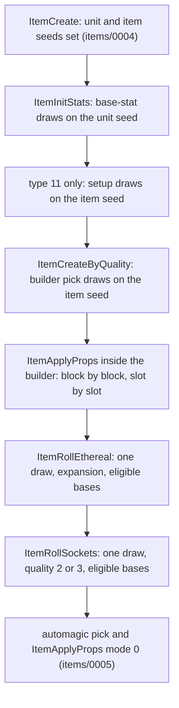

# 0006 — Base stats and the property roll

> **Subsystem:** items/properties
> **Question:** Once an item's base, quality and rows are chosen, which base stats and property stats does it get, and which draws on the unit seed and the item seed produce them?
> **Date:** 2026-10-14   **Plan:** 0024 (Phase 1, Phase 1b, Phase 2)   **Status:** open (Phase 1 read from the decompile and the disassembly; Phase 1b cross-check done 2026-10-14: five contradictions with `src:d2dfg-blizzard`, none with the other three sources; Phase 2 reproduction done 2026-10-14, [run:2026-10-14-props](experiments.md#run2026-10-14-props) and [run:2026-10-14-props-forced](experiments.md#run2026-10-14-props-forced), 2 281 creations with 0 mismatches, § 9; review requested)

Names of structs and fields are ours. As in [items/0004](0004-uniques-sets.md) and [items/0005](0005-affixes.md):
"record" is the 0x84-byte creation record (`struct:ItemCreateRec`), "item seed" is the item-data seed at
`ItemData+0x04`, "unit seed" is the item unit's own seed at `Unit+0x20` (two different seed objects,
[rng/0002](../rng/0002-seed-tree.md)), "item version" is `ItemData+0x30` (< 100 classic game, ≥ 100 expansion game,
never 0 for a created item). Every draw below is one LCG step ([rng/0001](../rng/0001-rng-core.md)):

- `RNG_Range(s, n)` and `RNG_RangeB(s, n)` return `low % n` after one step, or 0 with **no step** when `n < 1`
  (signed test);
- `RNG_RangeOffset(s, b, n)` returns `b + low % n` after one step, or `b` with no step when `n < 1`
  (fn:RNG_Range@0x0045C390, fn:RNG_RangeB@0x0045C3E0, fn:RNG_RangeOffset@0x00472280).

"Stat *n*" is the `ItemStatCost` row *n* ([ItemStatCost](../../tables/ItemStatCost.md)). Item types are `ItemTypes`
record indices: 3 `tors`, 4 `gold`, 11 `elix`, 37 `helm`, 45 `weap`, 50 `armo`. The handlers' register
arguments were read in the disassembly, because the decompiler shows most of them as `in_ECX`/`in_EDX`.
Phase 1 was written from the code only; no community text had been read when it was written.

## Answer (summary)

- [C] **Base stats draw on the unit seed only.** `sub_00557AB0_ItemInitStats` runs before the quality switch. Every
  draw it makes is on `Unit+0x20`: quantity, current durability, defense and the picture variant. The one exception
  is an item of type 11, whose setup draws on the item seed. Corroboration: items/0004 found the item seed at
  `ItemCreateByQuality` entry equal to `{ItemData+0x10, 666}` in all 1 823 logged creations
  (run:2026-10-14-uniques). The per-category order and ranges are in § 1 and are `[I]`.
  (fn:sub_00557AB0_ItemInitStats@0x00557AB0)
- [C] **Base-stat formulas** (§ 1; 0x00557AB0–0x00557E21):
  - durability: `cur = d/2 + RangeB(d/2)`, so it lies in `[d/2, d/2 + d/2 − 1]`, with max = `d`;
  - defense: `RangeOffset(minac, maxac − minac + 1)`;
  - quantity: `minstack + RangeB(hi − minstack)`, which never reaches `hi`, and `hi` is `spawnstack` for misc;
  - picture: `RangeOffset(0, VarInvGfx)`;
  - per category, armor draws durability then defense, a weapon draws quantity (stackable only) then durability, and
    misc and quivers draw quantity;
  - `nodurability` is not tested by the durability draw.

  Reproduced with 0 mismatches in run:2026-10-14-props and run:2026-10-14-props-forced (§ 9).
- [C] **The property roll** (fn:sub_0065FEC0_ItemApplyProps@0x0065FEC0, § 2–3). It walks a row's 16-byte `(code, par, min, max)`
  blocks in column order:
  - uniques: 12 blocks;
  - set items: `prop1..9`, then `aprop1a..5b`;
  - magic, rare and automagic affixes: 3 blocks;
  - superior (`qualityitems`): 2 blocks.

  Reproduced with 0 mismatches in run:2026-10-14-props and run:2026-10-14-props-forced (§ 9).

  Each block expands its `properties` row's slots 1..7 in order and stops at the first `func` 0. Slot *k* calls
  `g_PropFuncTable[func]`. Slot 1's return value is handed to slots 2..7 as "prev". (fn:PROP_ApplyBlock@0x0065FD70,
  data:g_PropFuncTable@0x007462F8)
- [C] **One value roll.** `PROP_RollValue(min, max)` returns `min` with **no draw** when `min == max`. Otherwise it
  makes one `RNG_RangeB(item seed, |max − min| + 1)` and adds the smaller bound; a reversed pair is swapped. Every
  per-`func` draw except the charged-skill one is this roll. Funcs 11, 15, 16, 18, 20 and 23 never draw, and funcs 3,
  5–8, 10 and 24 draw only when prev is 0. The table is in § 4. (fn:PROP_RollValue@0x0065E9E0)
  Reproduced with 0 mismatches in run:2026-10-14-props and run:2026-10-14-props-forced (§ 9).
- [I] **No func reaches the calc VM.** Every handler and callee was read: the roll, the stat writer, the base-stat
  resets, the skill-record getters, `ITEMS_GetItemLevel`, `sub_00483360_MulDiv` and the stat-list add/set. None
  evaluates a `*code.bin` formula. So no property needs a `data/calc` oracle. (§ 4, § 7; 0x0065EB30–0x0065FD20)
- [C] **`SetItems` `aprop` blocks are rolled at creation**, which contradicts the Phase 0 drop-path split. Set
  mode applies `aprop1a..5b` right after `prop1..9`, with the same item-seed draws. When `add func` ≠ 0, pair *k*
  (`aprop`*k*`a/b`) goes to a stat list with state `165 + k − 1` (`itemset1..5`) and flags `0x2040`. When `add func`
  is 0, it goes to the main property list, like a `prop`. The save writer's set lists use the same five states
  (`0x006E90B8`), which is the second code path. (fn:sub_0065FEC0_ItemApplyProps@0x0065FEC0,
  data:g_SetAPropStates@0x006EDB40)
- [C] **Stat storage** (0x0065EA50). `PROP_WriteStat` writes nothing for a value of 0. Otherwise it stores
  `value << ValShift` with the slot's param in the item's main property list (state 0, flags `0x40`):
  - added when the slot's `set` byte is 0, set otherwise;
  - writing stat 58 also counts stat 326;
  - `op`, `op param`, `op base` and `op stat1..3` are not read at creation.

  Reproduced with 0 mismatches in run:2026-10-14-props and run:2026-10-14-props-forced (§ 9).

  (fn:PROP_WriteStat@0x0065EA50, tbl:ItemStatCost.txt:ValShift)
- [C] **Ethereal and sockets** (§ 6; 0x00556CA0, 0x00556B60). Both run after the quality builder, and each makes one `RNG_Range(item
  seed, 100)`:
  - ethereal: expansion only, for weapons and armour with durability, quality ≠ 1 and 5, not a quest base;
    ethereal when `< 5`;
  - sockets: quality 2 or 3, a `hasinv`, non-stackable base with `ItemMaxSockets` > 0, and not classic body armour;
    socketed when `< 33`;
  - the socket **count is not drawn**: it is `startSeed % cap + 1`, where `cap = min(gemsockets, MaxSock(ilvl))` is
    capped by difficulty at 3 / 4 / 6, and the result is clamped to `invwidth × invheight` and 6.

  Reproduced with 0 mismatches in run:2026-10-14-props and run:2026-10-14-props-forced (§ 9).

  (fn:sub_00556CA0_ItemRollEthereal@0x00556CA0, fn:sub_00556B60_ItemRollSockets@0x00556B60,
  fn:ITEMS_SetSockets@0x0062BCB0)
- [C] **Property codes are looked up case-insensitively.** `EXCEL_AddNameIfAbsent` (the loader of `properties.code`)
  and `EXCEL_FindName` (every `prop`/`mod` cell, type 0x13 on the properties link) both lower-case through
  `STR_ToLowerN`, whose table maps only `A`–`Z`. Data: `setitems` row 122 `Light` stores 73 (`light`). (§ 8,
  fn:EXCEL_FindName@0x006BD3C0, fn:sub_00638630_LoadProperties@0x00638630)
- [C] **Phase 2 boundary, as ruled** (fn:PROP_RollValue@0x0065E9E0). `tools/props.py` models everything in this
  finding with no oracle for the property roll; the run logs the evaluated max durability (EVD), the packing words
  `DataTables+0xC6C` = 6 and `+0xC70` = 63, and the skills rows funcs 11 and 19 read, as value inputs. The staff
  mods and the affix picks stay the seed oracles items/0005 and plan 0021 leave them as. Reproduced with 0
  mismatches in run:2026-10-14-props and run:2026-10-14-props-forced (§ 9).

## Leads used

Phase 1 had no lead. The entry points came from items/0004, items/0005 and the Phase 0 survey
([Properties § Survey](../../tables/Properties.md#survey-the-codes-the-item-tables-use)). The sources below were
fetched and read on 2026-10-14, after Phase 1 was committed, for the plan 0024 Phase 1b cross-check (blind first):
- `src:d2dfg-blizzard`: § Properties.txt, § ItemStatCost.txt, § SetItems.txt, and the base-table and ItemTypes
  columns. It describes Diablo II: Resurrected, as items/0004 notes, so a difference from it may be a version
  difference.
- `src:arreat-summit-item-pages`: Item Basics § Ethereal and § Superior Armor and Weapons.
- `src:pd-sockets` and `src:planetdiablo-socketing-guide`.

None has game code. Agreement promotes nothing. Each `contradicted` verdict is a required Phase 2 case, listed in the
backlog entry 2026-10-14 reverser → architect (plan 0024 Phase 1b contradictions).

**The per-func handlers (`src:d2dfg-blizzard` § Properties.txt)**
- [L] src:d2dfg-blizzard: func 1 rolls between `min` and `max`, and "Sets the stat value to its max value if the item
  is High Quality (Superior)". **contradicted**
  Detail: `PROP_Func01_Roll` always rolls, in every mode (§ 4). In mode 1 (superior) it only adds the base reset,
  which has no case for the superior `att` stat (19). `src:arreat-summit-item-pages` gives the superior to-hit as a
  range, "+1 to +3", which agrees with the code. Required case: superior `att` values over 1..3; settled in Phase 2 (§ 9: 1..3 over 11 items).
- [L] src:d2dfg-blizzard: func 2 "Modify the stat to always be set to its max value". **contradicted**
  Detail: `PROP_Func02_RollAcPercent` rolls the `ac%` value. What goes "to max" is the base defense, reset to
  `maxac + 1` (§ 4). `src:arreat-summit-item-pages` (`Defense = [(maxac + 1) · (100 + ac%)/100]`) agrees with the code.
  Required case: `ac%` values on superior and magic armour. Settled in Phase 2 (§ 9: modes 0, 1, 3 and 4).
- [L] src:d2dfg-blizzard: func 3 as func 1, "consecutive calls of this function will use the same stat value as the
  previous call"; func 4 the same for func 2. **held with refinement**
  Detail: the reused value is the first slot's return value. When that slot wrote nothing (a roll of 0), each later
  slot rolls its own value (§ 3).
- [L] src:d2dfg-blizzard: func 5 sets the minimum damage; func 6 sets the maximum damage "(dependent on its minimum
  value)". **contradicted** (the func 6 part)
  Detail: func 6 never reads the minimum. It clamps each write against its own base column (`b + v ≤ 0` → `−b`),
  and func 5 clamps to `1 − b` (§ 4). Required case: a `dmg-max` with a negative value, if any row has one, else a
  data check. Phase 2: no drop-path row has one; the data check is in § 9.
- [L] src:d2dfg-blizzard: func 7 sets the damage percent from its range. **held with refinement**
  Detail: a weapon whose percentage would add less than 1 max damage gets +1 max damage instead, and the base damage
  is reset first (§ 4). `src:arreat-summit-item-pages` gives the same fallback ("+1 to Maximum Damage", one-hand
  damage on combo weapons, two-hand on two-handed swords). The code takes `max(maxdam, 2handmaxdam)`, which
  matches both of its examples.
- [L] src:d2dfg-blizzard: func 8 rolls; func 9 single skill (param = skill id); func 12 rolls the param; funcs 15, 16
  use `min`/`max` and set the item's damage for the physical damage stats; func 20 adds Indestructible; func 23 adds
  Ethereal "only if the item has Durability"; func 24 reuses the previous value with `par` as param; func 36 swaps
  `val` and the rolled value. **held**
  Detail: as § 4. Func 24 reuses only when the first slot returned non-zero.
- [L] src:d2dfg-blizzard: func 10's param is the tab id 0–20 (class × 3 + tab). **held with refinement**
  Detail: the stored param is `par % 3 + (par / 3) · 8` (class in bits 3+, tab in bits 0–1) (§ 4).
- [L] src:d2dfg-blizzard: func 11: param = skill, `min` = chance (0 → 5), `max` = skill level. **held with
  refinement**
  Detail: `max` 0 and negative compute the level from ilvl and the skill's `reqlevel`/`maxlvl` (§ 4); the param packs
  `skill · 64 + level`. A `min` < 0 also gives 5.
- [L] src:d2dfg-blizzard: func 13 rolls, "Sets the stat value to its max value if the item is High Quality
  (Superior)", and always sets the current durability to the maximum. **contradicted** (the superior part)
  Detail: `PROP_Func13_DurPercent` always rolls; the durability part holds (§ 4). `src:arreat-summit-item-pages`
  gives the superior durability as "10% to 15%", which agrees with the code. Required case: superior `dur%` values; settled in Phase 2 (§ 9: 10..15 over 15 items).
- [L] src:d2dfg-blizzard: func 14: a random socket count from `min`/`max`, else `par`; capped by the inventory size
  and 6. **held with refinement**
  Detail: also capped by `ItemMaxSockets` (ilvl band and `gemsockets`), and the roll happens even when that cap is
  0 (§ 4).
- [L] src:d2dfg-blizzard: func 17 uses `par`, else a roll, else 0. **held with refinement**
  Detail: a 0 result writes nothing (§ 4).
- [L] src:d2dfg-blizzard: func 18 depends on the time of day, `par` 0–3 the period. **held with refinement**
  Detail: at creation it only packs `min`, `max` and `par` into the value, with no draw (§ 4). Not reached on the
  drop path.
- [L] src:d2dfg-blizzard: func 19: `min` 0 → 5 charges; `min` < 0 → `|min| + |min| · [item level] / 8`; at most 255;
  `max` = skill level; spawned charges `Random(0 … max − max/8) + max/8 + 1`. **contradicted** (the negative-`min`
  formula)
  Detail: the multiplier is the skill **level** `L`, not the item level: `c = −min + trunc(−min · L / 8)` (0x0065F7B5).
  `L` comes from ilvl only when `max` ≤ 0 (§ 4), which is the case for all 204 `charged` rows of `magicsuffix`. Those
  have `min` < 0 and `max` < 0, so they are on the drop path. The spawned-charges formula holds, with the draw range
  exclusive: `[c/8 + 1, c]`. Required case: a magic `charged` wand or staff; settled in Phase 2 (§ 9: 13 magic `charged` suffixes).
- [L] src:d2dfg-blizzard: funcs 21, 22 "use the Property val / the stat's parameter value to offset the stat ID".
  **held with refinement**
  Detail: `val` or `par` is the written stat's **param**, not a change of the stat id (§ 4).
- [L] src:d2dfg-blizzard: `set1..7` = 1 sets the stat, 0 adds to it. **held**
  Detail: `STATLIST_SetStat` / `STATLIST_AddStat` (§ 7).

**Stat storage and the set items**
- [L] src:d2dfg-blizzard: `ValShift` shifts the stat's value by that many bits to get the actual value. **held with
  refinement**
  Detail: the property writer stores `value << ValShift` (§ 7). The guide places it in the cost (`Encode`)
  calculation, which is not read here.
- [L] src:d2dfg-blizzard: `op` is applied "when calculating the value of a stat". **held**
  Detail: no creation-time code reads `op` (§ 7).
- [L] src:d2dfg-blizzard: `add func` 0 (or empty): the `aprop`s "function like normal item properties"; 1 and 2 add
  them by which or how many set pieces are equipped. **held with refinement**
  Detail: 0 → the main list. Non-zero → five lists with states 165..169, created and **rolled at creation** (§ 2).
  1 and 2 differ only at equip time.

**The base stats (`src:d2dfg-blizzard` base tables, `src:arreat-summit-item-pages`)**
- [L] src:d2dfg-blizzard: `durability` is "the base durability amount that the item will spawn with". **held with
  refinement**
  Detail: the maximum is `durability`; the current durability is drawn in `[d/2, 2⌊d/2⌋ − 1]` (§ 1).
- [L] src:d2dfg-blizzard: `nodurability` 1 → "the item will not have durability". **held with refinement**
  Detail: such an item never counts as having durability (`sub_00629930_ItemHasDurability`), but `ItemInitStats`
  still draws its durability on the unit seed when `durability` ≥ 2 (§ 1).
- [L] src:d2dfg-blizzard: `minac`/`maxac` are the minimum and maximum defense. **held**
  Detail: an inclusive draw (§ 1).
- [L] src:d2dfg-blizzard: `minstack`, `maxstack`, and `spawnstack` "the stack count … that the item can spawn
  with". **held with refinement**
  Detail: only misc uses `spawnstack`; weapons and quivers use `maxstack` (+ stat 254). The draw never reaches its
  top value (§ 1).
- [L] src:d2dfg-blizzard: `VarInvGfx` is the number of inventory graphics. **held**
  Detail: the picture index is drawn in `[0, VarInvGfx − 1]` (§ 1).
- **Not covered** by any source read: that durability, defense, quantity and picture draw on the unit seed, and
  their order.

**Ethereal and sockets**
- [L] src:arreat-summit-item-pages: ethereal durability is `(normal durability / 2) + 1`, and "Ethereal items spawn
  with full durability". **held**
  Detail: § 6.
- [L] src:arreat-summit-item-pages: superior ethereal with `dur%`: `[[normal / 2] · (100 + dur%)/100] + 1`.
  **not covered**
  Detail: the code sets max = `base/2 + 1` and then reads the evaluated max. How `dur%` is applied (stat 75's `op`)
  was not read, so the order of the `+1` and the percentage is open (*Open questions*). Required case for Phase 2.
- [L] src:arreat-summit-item-pages: ethereal is +50 % base damage or defense; bows and crossbows cannot be ethereal;
  "Items that spawn as indestructible can not be ethereal"; the ethereal defense with `ac%` is
  `[[(maxac + 1) · 3/2] · (100 + ac%)/100]`. **held with refinement**
  Detail: `(x · 3) / 2` on the base stats after the builder's resets (§ 6). Bows and indestructible bases are
  excluded through `ItemHasDurability` (`nodurability`, stat 152). A unique with func 23 can still be made
  ethereal a second time (`Wraithflight`, § 6), which no source mentions.
- [L] src:arreat-summit-item-pages: "Superior items … may spawn with sockets if the base item can have sockets".
  **held**
  Detail: the socket roll runs for qualities 2 and 3 (§ 6).
- [L] src:pd-sockets: naturally spawning sockets are capped at 3 / 4 / 6 by difficulty; the maximum also depends on
  the item type and the ilvl, in the bands 1–25 / 26–40 / 41+; the count "is random for most item types".
  **held with refinement**
  Detail: the count is `startSeed % cap + 1`, not a draw of its own. It is uniform over `1..cap` only as far as the
  start seed is (§ 6).
- [L] src:planetdiablo-socketing-guide: `MaxSock1` applies to ilvl ≤ 25, `MaxSock25` above 25 "but lower than 40",
  `MaxSock40` above 40; `hasinv` and `gemsockets` within the inventory size. **held with refinement**
  Detail: ilvl 40 itself uses `MaxSock25` (`cmp 0x28; jg`, 0x0062BC8C). `src:d2dfg-blizzard`'s `gemsockets` text
  ("limited by the item's size … compares with MaxSock") holds as well.
- **Not covered** by any source read: the socket chance (33 of 100 on the item seed), no socket draw for classic body
  armour, and the ethereal draw's exact test (`< 5` of 100 on the item seed). The 5 % figure appears in a search
  summary of a D2R guide that was not fetched, so it is not used.

## Functions

| Address | Name | Role | Tag |
|---|---|---|---|
| `0x00557AB0` | `sub_00557AB0_ItemInitStats` | base stats (ECX game, EDX &item, stack `rec`, `doQuality`); then `ItemCreateByQuality` | I |
| `0x00556360` | `sub_00556360_ItemRollDefense` | defense draw on the unit seed → stat 31 | I |
| `0x005563D0` | `sub_005563D0_ItemSetBaseDamage` | weapon damage stats 21–24, 159, 160 from the base | I |
| `0x006296F0` | `ITEMS_GetMinStack` | `minstack` (`+0x0E4`) | I |
| `0x006295B0` | `ITEMS_GetMaxStack` | `maxstack` (`+0x0E8`) + stat 254, capped at 511 | I |
| `0x00629660` | `ITEMS_GetSpawnStack` | `spawnstack` (`+0x0EC`) | I |
| `0x0062E740` | `sub_0062E740_ItemTypeQuiver` | the item type's `Quiver` field (`+0x0E`) | I |
| `0x00628420` | `sub_00628420_ItemSetInvGfxVariant` | `ItemData+0x49` | I |
| `0x0065E8E0` | `sub_0065E8E0_ItemType11Setup` | type 11 file index and stat 71 (item seed) | I |
| `0x0065FEC0` | `sub_0065FEC0_ItemApplyProps` | mode switch: which blocks, how many, which list | I |
| `0x0065C730` | `sub_0065C730_PropBlockGet` | block *i* of the row for modes 0, 1, 2, 5, 6, 7 | I |
| `0x0065C660` | `sub_0065C660_AffixPropBlock` | affix record `+0x24 + 16i`, i < 3 | I |
| `0x0065C6D0` | `sub_0065C6D0_PropBlock3x3` | modes 2 and 5: block *i* of group *g* at `+0x30/+0x60/+0x90` | I |
| `0x0065FE10` | `PROP_ApplyBlockByVersion` | item version ≠ 0 → `PROP_ApplyBlock`; version 0 → `g_PropFuncTableV0` | I |
| `0x0065FD70` | `PROP_ApplyBlock` | slot loop over one block | I |
| `0x0065E9E0` | `PROP_RollValue` | the value roll (ECX unit, EDX min, stack max) | I |
| `0x0065EA50` | `PROP_WriteStat` | ValShift, set/add, stat 58 → 326 | I |
| `0x0065CBF0` | `sub_0065CBF0_PropTargetList` | find or create the stat list of (state, flags) | I |
| `0x0065CCC0` | `sub_0065CCC0_PropBaseReset` | base defense / damage reset for stats 16–18, 21, 22, 31 | I |
| `0x0065EB30`–`0x0065FD20` | `PROP_Func01_Roll` … `PROP_Func36_RandClassSkill` | the handlers, § 4 | I |
| `0x0065E4D0` | `ITEMS_MakeEthereal` | flag `0x400000`, base damage or defense × 3 / 2 | I |
| `0x0062A8D0` | `ITEMS_IsEthereal` | `ItemData+0x18 & 0x400000` | I |
| `0x0062BCB0` | `ITEMS_SetSockets` | clamps and stat 194 | I |
| `0x00627DF0` | `ITEMS_GetStartSeed` | `ItemData+0x10` | I |
| `0x00625E00` | `sub_00625E00_ItemMaxDurability` | evaluated stat 73 | I |
| `0x00627030` | `STATLIST_AddStat` | add to the (stat, param) entry; an entry that reaches 0 is removed | I |
| `0x00627150` | `STATLIST_SetStat` | set the entry | I |
| `0x00625790` | `sub_00625790_UnitFindStatList` | list by state, or by flags when the state is 0 | I |
| `0x0045C4B0` | `SKILLS_GetRecord` | `DataTables+0xB98 + 0x23C·id`, bound `+0xBA0` | I |
| `0x00644710` | `SKILLS_GetReqLevel` | skills `reqlevel` (`+0x174`), `0x7FFFFFFF` when invalid | I |
| `0x004AA8B0` | `SKILLS_GetMaxLevel` | skills `maxlvl` (`+0x12C`), < 1 → 20 | I |
| `0x00628590` | `ITEMS_GetCode` | base record `+0x80` | I |
| `0x006286C0` | `sub_006286C0_ItemInvSize` | `invwidth`, `invheight` | I |
| `0x00638630` | `sub_00638630_LoadProperties` | `properties` descriptor and load; link `0x0096BCD8` | C |

Data: `data:g_PropFuncTable@0x007462F8` (37 handler pointers), `data:g_nPropFuncs@0x00745B54` (37),
`data:g_PropFuncTableV0@0x00745B58` (8-byte entries, version-0 items), `data:g_SetAPropStates@0x006EDB40` and
`data:g_SetAPropListFlags@0x006EDB5C` (7 words each), and `data:g_pProperties@0x0096BCD4`,
`data:g_PropertiesLink@0x0096BCD8` and `data:g_nProperties@0x0096BCDC` (`DataTables+0xA4/+0xA8/+0xAC`).

## Walkthrough

### 1. Base stats: `sub_00557AB0_ItemInitStats` (0x00557AB0)

Called by `sub_00558D90_ItemCreate` at 0x00558EBB, with ECX = game, EDX = the address of the item pointer, and stack
`(rec, 1)`. Before the call, `ItemCreate` has seeded the unit and the item (items/0004 § 1). It has not set the quality
yet: `ItemData` is zeroed at allocation (`sub_00627C90_ItemDataAlloc`, `memset 0x74`), and `ItemCreateByQuality`
writes the quality later. The branches go by the item's first type.

```c
// fn:sub_00557AB0_ItemInitStats@0x00557AB0 (trimmed; unit seed = &item->seed /*Unit+0x20*/)
if (type == 4 /*gold*/) {
    n = rec ? rec->ilvl + RNG_Range(unitSeed, rec->ilvl * 5) : 1;   // draw (none when ilvl*5 < 1)
    if (n < 1) n = 1;  if (rec && rec->quantity /*+0x54*/ > 0) n = rec->quantity;
    SetStat(item, 14 /*gold*/, n);                                   // (negative → 0; player cap path not on items)
} else if (ItemType(item).Quiver /*+0x0E*/ == 0) {
    base = ITEMS_GetRecord(item->classId);
    if (IsType(item, 50 /*armo*/)) {
        SetStat(20 /*toblock*/, base->block /*+0x111*/);
        SetStat(67 /*velocitypercent*/, -base->speed /*+0xD8*/);
        d = base->durability /*+0x112 u8*/;
        cur = RNG_RangeB(unitSeed, d >> 1) + (d >> 1);              // draw if d >= 2
        SetStat(72 /*durability*/, min(cur, 255)); SetStat(73 /*maxdurability*/, d);
        sub_00556360_ItemRollDefense();                               // draw: see below
    } else if (IsType(item, 45 /*weap*/)) {
        if (base->stackable /*+0x132*/) {
            lo = minstack; hi = maxstack + stat254 (cap 511);
            q = lo + RNG_RangeB(unitSeed, hi - lo);                  // draw if hi > lo
            if (rec && rec->quantity > 0) q = rec->quantity;
            if (q == 0 || QualityIs4to9(item)) q = 1;               // quality is 0 here on a drop
            SetStat(70 /*quantity*/, q);
        }
        d = base->durability; cur = RNG_RangeB(unitSeed, d >> 1) + (d >> 1);   // draw if d >= 2
        SetStat(72, min(cur, 255)); SetStat(73, d);
        sub_005563D0_ItemSetBaseDamage();   // 21←mindam, 22←maxdam, 23/24←2-hand, 159/160 when maxmisdam ≠ 0
        SetStat(68 /*attackrate*/, -base->speed);
    } else {                                                          // misc
        if (base->stackable) {
            lo = minstack; hi = maxstack + stat254 (cap 511); sp = spawnstack;
            top = (sp >= lo && sp != 0) ? sp : (lo <= hi ? hi : lo);
            q = lo + RNG_RangeB(unitSeed, top - lo);                 // draw if top > lo
            if (rec && rec->quantity > 0) q = rec->quantity;
            if (QualityIs4to9(item) || q == 0) q = 1;
            SetStat(70, q);
        }
        if (type == 11) sub_0065E8E0_ItemType11Setup(item);          // item-seed draws (items/0004)
    }
} else {                                                              // a quiver type (bowq, xboq)
    q = minstack + RNG_RangeB(unitSeed, maxstack' - minstack);       // maxstack' as above
    if (q < 1) q = 1;  if (rec && rec->quantity > 0) q = rec->quantity;
    SetStat(70, q);
}
n = ItemType(item).VarInvGfx /*+0x23*/;
if (n) ItemData->gfx /*+0x49*/ = RNG_RangeOffset(unitSeed, 0, n) & 0xFF;  // draw
if (doQuality && rec) ret = sub_00557450_ItemCreateByQuality(rec);  // builders, ethereal, sockets, automagic
```

- [C] **Category order and draws** (0x00557AB0). The unit seed is drawn, in order:
  - armour (type 50, shields included): durability, then defense;
  - weapon (type 45): quantity when the base is `stackable`, then durability;
  - other bases: quantity when `stackable`;
  - quiver types (`ItemTypes.Quiver` ≠ 0, i.e. `bowq`, `xboq`, `mboq`, `mxbq`): quantity;
  - gold: one `RNG_Range(ilvl × 5)`;
  - every category: then the picture draw when its type's `VarInvGfx` ≠ 0.

  Reproduced with 0 mismatches in run:2026-10-14-props and run:2026-10-14-props-forced (§ 9).

  A range of width < 1 is not drawn: `d < 2`, `hi = lo`, `maxac < minac`, `VarInvGfx = 0`. (0x00557AB0–0x00557E21,
  fn:sub_00556360_ItemRollDefense@0x00556360, fn:sub_0062E740_ItemTypeQuiver@0x0062E740,
  fn:sub_00628420_ItemSetInvGfxVariant@0x00628420, tbl:ItemTypes.txt:VarInvGfx, tbl:ItemTypes.txt:Quiver)
- [C] **Durability.** `cur = (d >> 1) + RangeB(d >> 1)`, an unsigned shift of the base's u8 `durability`, so
  `cur` lies in `[⌊d/2⌋, 2⌊d/2⌋ − 1]` and is never `d` for `d ≥ 2`. `maxdurability` = `d`. It is drawn for every
  armour and weapon base. `nodurability` is not tested here, so the 48 weapon rows with `nodurability` 1 and
  `durability` > 1 still draw. (0x00557C27–0x00557C67, 0x00557CFD–0x00557D3F, tbl:Weapons.txt:durability,
  tbl:Weapons.txt:nodurability, tbl:Armor.txt:durability)
  Reproduced with 0 mismatches in run:2026-10-14-props and run:2026-10-14-props-forced (§ 9).
- [C] **Defense.** `RNG_RangeOffset(unitSeed, minac, maxac − minac + 1)`, so `[minac, maxac]` inclusive, and a value
  above `maxac` is fatal. It runs after the durability draw. (fn:sub_00556360_ItemRollDefense@0x00556360,
  tbl:Armor.txt:minac, tbl:Armor.txt:maxac)
  Reproduced with 0 mismatches in run:2026-10-14-props and run:2026-10-14-props-forced (§ 9).
- [C] **Quantity** (0x00557C8D). The draw is `lo + RangeB(top − lo)`, so `top` itself is never drawn:
  - weapons: `top = maxstack + stat 254` (capped at 511, `ITEMS_GetMaxStack`);
  - misc: `top = spawnstack` when `spawnstack ≥ minstack` and ≠ 0, else `maxstack`;
  - a record `+0x54` > 0 overrides the drawn value;
  - a result of 0 becomes 1, and so does any quantity when the item quality is 4..9, which on a drop is 0 here.

  Reproduced with 0 mismatches in run:2026-10-14-props and run:2026-10-14-props-forced (§ 9).

  (0x00557C8D–0x00557CED, 0x00557D65–0x00557DDA, fn:ITEMS_GetMinStack@0x006296F0, fn:ITEMS_GetMaxStack@0x006295B0,
  fn:ITEMS_GetSpawnStack@0x00629660, tbl:Misc.txt:spawnstack, tbl:Weapons.txt:minstack)
- [C] **Gold.** `ilvl + RNG_Range(unitSeed, 5 × ilvl)`, at least 1, replaced by a record `+0x54` > 0. The gold-find
  path of items/0001 fills `+0x54`. (0x00557AC1–0x00557B4C)
  Reproduced with 0 mismatches in run:2026-10-14-props and run:2026-10-14-props-forced (§ 9).
- [C] **The picture.** `ItemData+0x49 = RNG_RangeOffset(unitSeed, 0, VarInvGfx)`, so `[0, VarInvGfx − 1]`. It is the
  last base-stat draw for every category. (0x00557DF7–0x00557E1C)
  Reproduced with 0 mismatches in run:2026-10-14-props and run:2026-10-14-props-forced (§ 9).
- [C] Defense, damage, block and speed are written as base stats (`sub_00627260_UnitSetStat`), not into the
  property list. (0x00557C06, 0x005563D0)
  Reproduced with 0 mismatches in run:2026-10-14-props and run:2026-10-14-props-forced (§ 9).

### 2. `sub_0065FEC0_ItemApplyProps(mode, a2, item, row, a5, a6)` (0x0065FEC0)

Stdcall, 6 arguments. The drop path calls it as follows; `a2`, `a5` and `a6` are 0 in every call:
- mode 0, `row` = the affix record: from `ITEMS_PickMagicAffix` (0x005C18B3) and `ITEMS_BuildRareAffixes`
  (0x005C1E04, 0x005C1E27), and for automagic from `ItemCreateByQuality` (0x00557A0C);
- mode 1, `row` = the `qualityitems` record: from `ITEMS_BuildSuperiorPick` (0x005C2A9B);
- mode 3, `row` = 0, the row taken from the item's file index: from `ITEMS_BuildUnique` (0x00556865, 0x00556A38);
- mode 4, the same: from `ITEMS_BuildSetPick` (0x005C2729).

Four more callers (0x004C0D20, 0x004E6720, 0x004E67D0, 0x0055C2C0) are outside the creation chain read here.

```c
// fn:sub_0065FEC0_ItemApplyProps@0x0065FEC0 (trimmed); PropBlock = {code, par, min, max}, 16 bytes
switch (mode) {
case 0: case 2: case 5: n = 3; break;
case 1:                n = 2; break;
case 3: if (FileIndex(item) >= 0 && (u = UNIQUEITEMS_GetRecord(..)))
            for (b = u + 0x8C, k = 0; k < 12; k++, b += 16) ApplyBlockByVersion(3, item, b, 0, 0x40);
        return;
case 4: s = SETITEMS_GetRecord(FileIndex(item)); if (!s) return;
        if (Version(item) == 0) { /* 2 blocks from +0x88 */ return; }                       // never on a drop
        for (b = s + 0x88, k = 0; k < 9; k++, b += 16) ApplyBlockByVersion(4, item, b, 0, 0x40);
        for (b = s + 0x118, k = 0; k < 10; k++, b += 16) {                                 // aprop1a,1b,...,5b
            j = (k >> 1) + 2;
            state = s->addFunc /*+0x87*/ ? g_SetAPropStates[j] /*165..169*/ : 0;
            flags = s->addFunc ? g_SetAPropListFlags[j] /*0x2040*/ : 0x40;
            ApplyBlockByVersion(4, item, b, state, flags);
        }
        return;
}
for (i = 0; i < n; i++) {                       // modes 0, 1, 2, 5
    b = sub_0065C730_PropBlockGet(mode, row, i, a5);
    if (!b || b->code < 0) return;              // the first blank block ends the row
    ApplyBlockByVersion(mode, item, b, 0, 0x40);
}
```

- [C] **Block counts and stops** (0x0065FEC0).
  - Uniques: 12 blocks from `UniqueItemsRec+0x8C`.
  - Set items: 9 blocks from `+0x88`, then 10 from `+0x118`.
  - Affixes: 3 blocks from `+0x24` (`sub_0065C660_AffixPropBlock`).
  - `qualityitems`: 2 blocks from `+0x0C`.
  - In modes 3 and 4 a block with `code < 0` is **skipped**: `PROP_ApplyBlock` tests it, and the 13 commented-out
    unique codes compile to −1. In modes 0 and 1 it **ends the row**.
  - The affix tables, `qualityitems` and `uniqueitems` have no gap: no blank code is followed by a used one (checked
    over the `.txt` files). So on stock data the stop and the skip differ only for the −1 blocks of the uniques.

  Reproduced with 0 mismatches in run:2026-10-14-props and run:2026-10-14-props-forced (§ 9).

  (0x0065FF17, 0x0065FF72, 0x0065FFD5, 0x00660039–0x00660079, fn:sub_0065C660_AffixPropBlock@0x0065C660,
  fn:sub_0065C730_PropBlockGet@0x0065C730)
- [C] **`aprop` blocks are applied at creation** (0x0065FFAC), with the same handlers and draws as the `prop` blocks:
  - the block offsets are pinned by `setitems.bin` (`+0x118` for `aprop1a`, 16 bytes per block, blank = −1);
  - when `add func` ≠ 0, the pair `aprop`*k*`a`/`aprop`*k*`b` goes to the list of state `0xA4 + k` (165..169) with
    flags `0x2040`. That state is `itemset`*k* in `states.txt` row order (that the record index equals the row index
    is not checked here);
  - corroboration: the save writer marks a set item's lists by the same five words (`0x006E90B8` =
    `0xA5..0xA9`, save/0001 § 7), and the d2s samples hold set bonus lists ([d2s § set lists](../../formats/d2s.md));
  - on stock data, 82 set rows with `add func` 1 or 2 have `aprop`s. Two rows with `add func` blank also have them:
    `Civerb's Cudgel` (`dmg/lvl`) and `Trang-Oul's Claws` (`extra-pois`). Those go to the main list (state 0) like a
    `prop`.

  (0x0065FFD2–0x00660027, data:g_SetAPropStates@0x006EDB40, data:g_SetAPropListFlags@0x006EDB5C,
  tbl:SetItems.txt:add func)
- [I] The code distinguishes only `add func` 0 from non-zero. What 1 and 2 change is equip-time code
  (`sub_00660120_SetBonusApply`, not read here). (0x0065FFE3)
- [I] **Version 0.** Set mode applies only 2 blocks, and `PROP_ApplyBlockByVersion` sends each block to
  `g_PropFuncTableV0[code]` (8-byte entries indexed by the *property code*, not by `func`). No created item has
  version 0 (items/0004), so neither runs on a drop. (0x0065FE4A–0x0065FEB2, data:g_PropFuncTableV0@0x00745B58)

### 3. One block: `PROP_ApplyBlock` (0x0065FD70)

```c
// fn:PROP_ApplyBlock@0x0065FD70 (stdcall; mode, a2, item, -, -, -, block, state, flags, a9)
p = &g_pProperties[block->code];            // DataTables+0xA4, 0x2E bytes; code must be in [0, nProperties)
prev = 0;
for (k = 0; k < 7; k++) {
    f = p->func[k];                         // +0x18
    if (f >= g_nPropFuncs /*37*/ || !g_PropFuncTable[f]) return;   // func 0 is NULL: the walk ends
    r = g_PropFuncTable[f](/*ECX*/mode, /*EDX*/a2, item, block, p->set[k] /*+0x02*/,
                          p->stat[k] /*+0x20*/, p->val[k] /*+0x0A*/, prev, state, flags, a9);
    if (k == 0) prev = r;
}
```

- [C] Slot *k* passes its `set`, `stat` and `val` and the whole block. The first `func` that is 0 (or ≥ 37) ends the
  walk. Every Properties row fills its slots from slot 1 without a gap
  ([Properties § Interpretation notes](../../tables/Properties.md#interpretation-notes)), so on stock data the walk
  covers exactly the used slots. (0x0065FDB3–0x0065FE03, tbl:Properties.txt:func1, tbl:Properties.txt:stat1)
  Reproduced with 0 mismatches in run:2026-10-14-props and run:2026-10-14-props-forced (§ 9).
- [C] **prev is slot 1's return value**, handed unchanged to slots 2..7. Slot 1 always gets 0. A handler that writes
  nothing returns 0, so a later "reuse" slot then rolls its own value (§ 4). (0x0065FDF7–0x0065FDFB)
  Reproduced with 0 mismatches in run:2026-10-14-props and run:2026-10-14-props-forced (§ 9).
- [C] The table pointer and count are `DataTables+0xA4` and `+0xAC`. The handlers read them there, and
  `sub_00638630_LoadProperties` stores the loaded array and count at `0x0096BCD4` and `0x0096BCDC`, which are
  `0x0096BC30 + 0xA4` and `+ 0xAC`. The loader and the reader agree. (0x00638A72–0x00638A8B,
  data:g_pProperties@0x0096BCD4, data:g_nProperties@0x0096BCDC)

### 4. The handlers, per `func`

The value roll and the writer:

```c
// fn:PROP_RollValue@0x0065E9E0: ECX unit, EDX min, stack max
if (max == min) return min;                                   // no draw
lo = min(min, max); hi = max(min, max);                       // signed compare
s = (unit is an item) ? ITEMS_GetSeed(unit) : &unit->seed;    // item seed for every drop-path call
return lo + RNG_RangeB(s, hi - lo + 1);                       // draw

// fn:PROP_WriteStat@0x0065EA50: ECX item, EDX flags, stack (a2, block, set, stat, param, value, state)
if (!block || value == 0 || stat invalid) return 0;           // value 0 writes nothing
list = sub_0065CBF0_PropTargetList(a2 ? a2 : item, state, flags);   // found or created and attached
if (set) STATLIST_SetStat(list, stat, value << ISC[stat].ValShift, param);
else     STATLIST_AddStat(list, stat, value << ISC[stat].ValShift, param);
if (stat == 58 /*poisonmaxdam*/) set ? (has 326 ? - : SetStat(list, 326, 1)) : AddStat(list, 326, 1);
return value;
```

`Roll` below means `PROP_RollValue(item, block.min, block.max)`; `Write(stat, param, v)` means `PROP_WriteStat`.
"Reset" is `sub_0065CCC0_PropBaseReset(stat)`.
- Stat 16 (`item_armor_percent`) or 31: an armour with `maxac` ≠ 0 gets **base defense = max(defense + 1,
  maxac + 1)**.
- Stats 17 and 22: a weapon's base max-damage stats (22, 24, and 160 if throwable) are reset to the base columns.
- Stats 18 and 21: the same for the min-damage stats (21, 23, 159).
- Other stats: nothing.

| func | handler | draws (item seed) | writes | Tag |
|---:|---|---|---|---|
| 1 | `PROP_Func01_Roll` 0x0065EB30 | `Roll` | Reset when mode = 1; `Write(stat, 0, v)` | C |
| 2 | `PROP_Func02_RollAcPercent` 0x0065EBA0 | `Roll` | Reset (any mode, item); `Write(stat, 0, v)` | C |
| 3 | `PROP_Func03_Reuse` 0x0065EC10 | `Roll` only if prev = 0 | Reset when mode = 1; `Write(stat, 0, prev or v)` | C |
| 4 | `PROP_Func04_ReuseReset` 0x0065EC80 | as 3 | Reset (any mode); as 3 | I |
| 5 | `PROP_Func05_DmgMin` 0x0065ECF0 | `Roll` only if prev = 0 | 21, 23 and 159 by base (below) | C |
| 6 | `PROP_Func06_DmgMax` 0x0065EE80 | `Roll` only if prev = 0 | 22, 24 and 160 by base (below) | C |
| 7 | `PROP_Func07_DmgPercent` 0x0065F010 | `Roll` only if prev = 0 | below | C |
| 8 | `PROP_Func08_Reuse` 0x0065F2B0 | `Roll` only if prev = 0 | `Write(stat, 0, prev or v)` | C |
| 9 | `PROP_Func09_SkillParam` 0x0065F310 | as 8 | `Write(stat, par, v)` if `par` is a skill id; not on the drop path | I |
| 10 | `PROP_Func10_SkillTab` 0x0065F3F0 | `Roll` only if prev = 0 | `Write(stat, par % 3 + (par / 3) · 8, v)`; nothing if v = 0 | C |
| 11 | `PROP_Func11_SkillOnEvent` 0x0065F470 | **none** | `Write(stat, par · 64 + (L & 63), chance)` (below) | C |
| 12 | `PROP_Func12_SkillRand` 0x0065FC40 | `Roll` | `Write(stat, param = v, value = par)` | I |
| 13 | `PROP_Func13_DurPercent` 0x0065FC90 | `Roll` | Reset when mode = 1; `Write(stat, 0, v)`; if written, stat 72 = evaluated max durability | C |
| 14 | `PROP_Func14_Sockets` 0x0065F590 | `Roll` if prev < 1, after the `invwidth × invheight` test | sockets (below) | C |
| 15 | `PROP_Func15_Min` 0x0065F960 | none | v = `min`; stat 21 → as func 5 with prev = v, else `Write(stat, 0, v)` | C |
| 16 | `PROP_Func16_Max` 0x0065F9D0 | none | v = `max`; stat 22 → as func 6, else `Write(stat, 0, v)` | C |
| 17 | `PROP_Func17_Par` 0x0065FA40 | `Roll` only if `par` = 0 | v = `par`; stat 22 → as func 6, else `Write(stat, 0, v)` | C |
| 18 | `PROP_Func18_ByTime` 0x0065F870 | none | below; not reached on the drop path | I |
| 19 | `PROP_Func19_Charged` 0x0065F6A0 | **one** `RNG_RangeB(charges − charges/8)` | below | C |
| 20 | `PROP_Func20_Indestructible` 0x0065FAE0 | none | `STATLIST_AddStat(list, 152, 1, 0)` | C |
| 21 | `PROP_Func21_ValParam` 0x0065FB50 | `Roll` | `Write(stat, val, v)` (class or element from `val1`) | C |
| 22 | `PROP_Func22_SkillParam` 0x0065FBF0 | `Roll` | `Write(stat, (u16) par, v)` | C |
| 23 | `PROP_Func23_Ethereal` 0x0065FD20 | none | if not ethereal and `ItemHasDurability`: `ITEMS_MakeEthereal` | I |
| 24 | `PROP_Func24_ParParam` 0x0065F390 | `Roll` only if prev = 0 | `Write(stat, par, prev or v)` | I |
| 36 | `PROP_Func36_RandClassSkill` 0x0065FBA0 | `Roll` | `Write(stat, param = v, value = val)` | I |

`g_PropFuncTable` slots 0 and 25..35 are NULL. The handler addresses are the table's words at `0x007462F8 + 4·func`
(data:g_PropFuncTable@0x007462F8, fn:PROP_Func01_Roll@0x0065EB30, fn:PROP_Func36_RandClassSkill@0x0065FBA0).

- [C] **Funcs 5 and 6, damage by base column** (0x0065ECF0, 0x0065EE80).
  - Let `b1` = 1-hand `mindam`/`maxdam`, `b2` = 2-hand, `bt` = the throw (`minmisdam`/`maxmisdam`).
  - The 1-hand stat (21/22) is written unless the item is a weapon with `b1` = 0 and `b2` ≠ 0, and symmetrically for
    the 2-hand stat (23/24).
  - The throw stat (159/160) is written unless the item is a non-throwable weapon.
  - Each write is clamped against its base byte: when the byte is `b` ≠ 0 and `b + v ≤ 0`, func 5 writes `1 − b` and
    func 6 writes `−b`.
  - The return value is the unclamped `v`. A non-weapon writes all three stats.

  Reproduced with 0 mismatches in run:2026-10-14-props and run:2026-10-14-props-forced (§ 9). The clamp branch is not reached on stock data: no drop-path `dmg-max` block is negative (data check, § 9).

  (fn:PROP_Func05_DmgMin@0x0065ECF0, fn:PROP_Func06_DmgMax@0x0065EE80, tbl:Weapons.txt:mindam, tbl:Weapons.txt:2handmindam,
  tbl:Weapons.txt:minmisdam)
- [C] **Func 7, `dmg%`** (0x0065F010).
  - `v` = prev, or `Roll`.
  - For a weapon, the base damage stats are first set back to the base columns. This matters only if something
    changed them before, for example a block placed after `ethereal`; on stock data every `ethereal` row has `dmg%`
    first.
  - Then `t = MulDiv(m, v, 100)` with `m = max(maxdam, 2handmaxdam)`. **If `t ≤ 0`, the handler applies func 6 with
    v = 1, which adds +1 max damage, and writes no percent stat.**
  - Otherwise, and for a non-weapon, it writes stat 18 then stat 17 with `v`.

  Reproduced with 0 mismatches in run:2026-10-14-props and run:2026-10-14-props-forced (§ 9). The +1 max damage fallback was not reached (§ 9).

  So a superior or magic low-damage weapon whose roll gives less than one point of max damage gets +1 max damage
  instead of the percentage. (0x0065F200–0x0065F296, fn:PROP_Func07_DmgPercent@0x0065F010,
  fn:sub_00483360_MulDiv@0x00483360)
- [C] **Func 11 and func 19, skill level `L` from the block's `max`** (0x0065F470, 0x0065F6A0).
  - `max` > 0: `L = max`.
  - `max` = 0: `L = min(max(t, 1), cap)` with `t = trunc((ilvl − reqlevel) / 4) + 1` and `cap = maxlvl` (< 1 → 20).
  - `max` < 0: `step = max(1, −trunc(max(99 − reqlevel, 1) / max))`, then `L = trunc((ilvl − reqlevel) / step)`,
    raised to 1 when ≤ 0; there is no cap.
  - The divisions are signed and truncate toward zero; the `/4` is `cdq; and edx,3; add; sar 2`.
  - The skill is `par`, and an invalid skill writes nothing and draws nothing.
  - Func 11: `chance = min`, ≤ 0 → 5; writes param `par·64 + (L & 63)`, value `chance`.

  Reproduced with 0 mismatches in run:2026-10-14-props and run:2026-10-14-props-forced (§ 9).

  (0x0065F4B9–0x0065F54F, fn:SKILLS_GetReqLevel@0x00644710, fn:SKILLS_GetMaxLevel@0x004AA8B0, tbl:Skills.txt:reqlevel,
  tbl:Skills.txt:maxlvl)
- [C] **Func 19, `charged`** (0x0065F6A0).
  - `c = min`; 0 → 5; < 0 → `c = −min + trunc((−min · L) / 8)`; then clamped to `[1, 255]`.
  - The draw is `r = RNG_RangeB(item seed, c − trunc(c/8))`. The width is ≥ 1 for every `c` ≥ 1, so there is always
    one draw.
  - The stat is **set** directly (not through `PROP_WriteStat`): value `((r + 1 + c/8) & 0xFF) + c·256` (current
    charges low, maximum high), param `(skill << DataTables+0xC6C) + (L & DataTables+0xC70)`.

  Reproduced with 0 mismatches in run:2026-10-14-props and run:2026-10-14-props-forced (§ 9).

  (0x0065F7E2–0x0065F853, fn:PROP_Func19_Charged@0x0065F6A0)
- [C] **Func 14, `sock`** (0x0065F590).
  - `cap = min(6, invwidth · invheight)`; 0 → return before any draw.
  - `cap = min(cap, ItemMaxSockets(item))`.
  - `n` = prev if ≥ 1, else `Roll`; if still < 1, `n = par`.
  - The result is `min(max(n, 1), cap)`; nothing is written when `cap` < 1, **after** the draw.
  - Sets item flag `0x800` and stat 194.
  - Unlike the socket roll of § 6, no quality clamp applies. (fn:PROP_Func14_Sockets@0x0065F590,
    fn:sub_0062BC20_ItemMaxSockets@0x0062BC20)

  Reproduced with 0 mismatches in run:2026-10-14-props and run:2026-10-14-props-forced (§ 9). A `sock` block on a base whose `ItemMaxSockets` is 0 was not reached (§ 9).
- [I] **Func 18**, not reached: no draw. The value is `((max + 256)·1024 + (min + 256))·4 + par`, with each `+256`
  term clamped to `[0, 1023]` and `par` to `[0, 3]`. It is set directly with param 0.
  (fn:PROP_Func18_ByTime@0x0065F870)
- [I] **Funcs 12 and 36 put the roll in the param** (0x0065FC40, 0x0065FBA0).
  - `skill-rand` (`Ormus' Robes` `36..60`, par 3) writes `item_singleskill` with a random skill id as param and value
    `par`.
  - `randclassskill` (`Hellfire Torch` `0..6`, `val1` 3) writes `item_addclassskills` with a random class as param and
    value `val`.

  (fn:PROP_Func12_SkillRand@0x0065FC40, fn:PROP_Func36_RandClassSkill@0x0065FBA0, tbl:Properties.txt:val1)
- [C] **Multi-slot codes** (0x0065FD70).
  - `res-all`, `all-stats`, `dmg-elem-min` and `dmg-elem-max`: slot 1 (func 1) draws once and slots 2..4 (func 3)
    reuse the value, unless slot 1 wrote nothing, i.e. rolled 0, in which case each func-3 slot rolls its own value.
  - The damage pairs (funcs 15, 16, 17) never draw, except func 17 with `par` 0.
  - A `dmg-norm` whose `min` is 0 hands prev 0 to func 5, which then rolls. (§ 3, Properties.md)

  Reproduced with 0 mismatches in run:2026-10-14-props and run:2026-10-14-props-forced (§ 9).
- [C] **Reset side effects on the drop path** (0x0065CCC0).
  - Func 2 (`ac%`, stat 16) resets the base defense every time it runs on armour, so an `ac%` armour has defense
    `maxac + 1` after one `ac%` block, and `maxac + 2` after a second one, for example a set item with `ac%` in a `prop`
    and in an `aprop`.
  - Funcs 1, 3 and 13 reset only in mode 1, and `qualityitems` uses them with stats 19 (`att`) and 75 (`dur%`), which
    have no reset case.

  Reproduced with 0 mismatches in run:2026-10-14-props and run:2026-10-14-props-forced (§ 9).

  (fn:sub_0065CCC0_PropBaseReset@0x0065CCC0, 0x0065CCDF–0x0065CD42)
- [C] **Func 13** reads the *evaluated* max durability (`sub_00625E00_ItemMaxDurability`, through stat 73 and its
  list) after writing `dur%`, and sets stat 72 to it, so a `dur%` item starts at full durability. How the evaluation
  applies stat 75 (its `op`) was not read. (fn:PROP_Func13_DurPercent@0x0065FC90,
  fn:sub_00625E00_ItemMaxDurability@0x00625E00)
  Reproduced with 0 mismatches in run:2026-10-14-props and run:2026-10-14-props-forced (§ 9).

### 5. Where the property draws sit



- [C] The item seed is drawn in this order: the builder's pick draws (items/0004, items/0005), each `ItemApplyProps`
  call where those findings place it, then the ethereal draw, then the socket draw, then the automagic pick and its
  properties. Within one `ItemApplyProps` call, the draws follow the block order of § 2 and the slot order of § 3.
  The draw sites per func are those of the table in § 4. (0x00557943–0x00557A0C, fn:sub_00557450_ItemCreateByQuality@0x00557450)
  Reproduced with 0 mismatches in run:2026-10-14-props and run:2026-10-14-props-forced (§ 9).

### 6. Ethereal and sockets, after the switch (0x00557943–0x005579A3)

```c
// fn:sub_00556CA0_ItemRollEthereal@0x00556CA0 (EBX rec, ESI item); called when quality in 1..9 and version >= 100
if (!(rec->flags & 2) && (IsType(item,45) || IsType(item,50)) && ItemHasDurability(item)
    && Quality(item) != 1 && Quality(item) != 5 && !BaseIsQuest(item)) {
    r = RNG_Range(ITEMS_GetSeed(item), 100);                         // draw
    if ((rec->flags & 4) || (rec->flags44 & 0x400000) || r < 5) {
        ITEMS_MakeEthereal(item);           // flag 0x400000; weapon: base 21,22,23,24,159,160 = x*3/2; else base 31 = x*3/2
        if (ItemHasDurability(item)) { SetStat(73, base73 / 2 + 1); SetStat(72, Stat(73)); }
    }
}
// fn:sub_00556B60_ItemRollSockets@0x00556B60 (ECX/arg game, EBX rec, EDI item); called when quality in 1..3
if (Quality(item) < 2 || !base->hasinv || base->stackable || !(cap = ItemMaxSockets(item))) return;
cap = min(cap, diff == 0 ? 3 : diff == 1 ? 4 : 6);                  // game+0x6D
if (Version(item) >= 100 || !IsType(item, 3 /*tors*/)) {
    r = RNG_Range(ITEMS_GetSeed(item), 100);                         // draw
    if (!(rec->flags & 8)) {
        if (rec->flags & 0x10) r = 0;
        if ((rec->flags44 & 0x800) || r < 33) {                      // 'cmp 0x21; jl'
            SetFlag(item, 0x800);
            ITEMS_SetSockets(item, ITEMS_GetStartSeed(item) % cap + 1);   // version != 0 on every drop
        }
    }
}
```

- [C] **Ethereal** (0x00556CA0). The test, the draw and the effect are as above:
  - the multiplication is a signed `(x · 3) / 2` on the base stats;
  - durability becomes `⌊max/2⌋ + 1` and current = the evaluated max.

  Reproduced with 0 mismatches in run:2026-10-14-props and run:2026-10-14-props-forced (§ 9).

  Quality 1 (low) and 5 (set) never draw. The roll runs after the builder, so an `ac%` defense reset comes first,
  and the ×3/2 applies to `maxac + 1`. (fn:ITEMS_MakeEthereal@0x0065E4D0, fn:sub_00629930_ItemHasDurability@0x00629930)
- [I] **An `ethereal` unique can be made ethereal twice** (0x0065FD20, 0x00556CA0).
  - Func 23 calls `ITEMS_MakeEthereal`, which does not change durability, only when the item is not yet ethereal and
    has durability.
  - `ItemRollEthereal` then tests the record bits, not the item's flag. A unique whose `indestruct` follows its
    `ethereal` no longer "has durability" (stat 152), so it does not draw. That is the case for `Ethereal Edge`,
    `Ghostflame` and `Shadowkiller`.
  - **`Wraithflight`** (`7gl`, durability 16, no `indestruct`) does draw. With `r < 5` it gets a second ×3/2 and
    halved durability. With `r ≥ 5` it keeps its full durability. (0x0065FD20, 0x00556CA0)
- [C] **Sockets** (0x00556B60).
  - `ItemMaxSockets = min(gemsockets, MaxSock1 | MaxSock25 | MaxSock40)`, by ilvl: ≤ 25, ≤ 40, else.
  - The difficulty cap is 3, 4 or 6.
  - Low quality never qualifies, despite the 1..3 call range.
  - Classic body armour (`tors`, version < 100) makes no draw.
  - The 33 % test draws once. The count is **not** drawn: it is `ItemData+0x10 % cap + 1`, from the low word the item
    seed was initialised from.
  - `ITEMS_SetSockets` then clamps to `min(6, invwidth · invheight, ItemMaxSockets)` and writes stat 194. Its quality
    clamps (magic ≤ 4, rare ≤ 2, crafted/9 ≤ 3, set/unique special) do not apply to qualities 2 and 3.

  Reproduced with 0 mismatches in run:2026-10-14-props and run:2026-10-14-props-forced (§ 9).

  (0x0062BC61–0x0062BCA6, fn:sub_0062BC20_ItemMaxSockets@0x0062BC20, fn:ITEMS_SetSockets@0x0062BCB0,
  fn:ITEMS_GetStartSeed@0x00627DF0, tbl:ItemTypes.txt:MaxSock1, tbl:Weapons.txt:gemsockets)
- [I] The socket roll draws before it tests the record's skip bit (`+0x80 & 0x08`) and its forced bits; the ethereal
  roll tests its skip bit (`+0x80 & 0x02`) before its draw and the forced bits after it. With stock data the resolver
  never sets those bits (items/0001 § 8). (0x00556C0F, 0x00556CA0, 0x00556D07)

### 7. Stat storage, as far as the save needs it

- [C] **Where the stats go.** Every property write goes through `sub_0065CBF0_PropTargetList` with
  `(state 0, flags 0x40)`, except the set `aprop` lists, which use `(state 165..169, flags 0x2040)`. That is the
  item's "main list" and its set lists, the lists the save writes (save/0001 § 7). The base stats of § 1 and the
  resets are written as unit base stats instead. (0x0065CBF0, fn:sub_00625790_UnitFindStatList@0x00625790)
  Reproduced with 0 mismatches in run:2026-10-14-props and run:2026-10-14-props-forced (§ 9).
- [C] **Add and set.** With `set` = 0 the value is added to the existing (stat, param) entry, and an entry that
  reaches 0 is removed. With `set` ≠ 0 the entry is replaced; the only such row is `color`.
  (fn:STATLIST_AddStat@0x00627030, fn:STATLIST_SetStat@0x00627150, tbl:Properties.txt:set1)
  Reproduced with 0 mismatches in run:2026-10-14-props and run:2026-10-14-props-forced (§ 9).
- [C] **ValShift.** The stored value is `value << ValShift` (8 for `hitpoints`/`mana`-type stats), which the save
  shifts back (save/0001 § 7). Funcs 18, 19 and 20 bypass the shift; their stats have `ValShift` 0.
  (0x0065EAB7–0x0065EB05, tbl:ItemStatCost.txt:ValShift)
  Reproduced with 0 mismatches in run:2026-10-14-props and run:2026-10-14-props-forced (§ 9).
- [C] **`op`, `op param`, `op base` and `op stat1..3`** are not read by any handler or by the writer (0x0065EA50). To predict the
  saved stats only the list entries matter. Whatever `op` adds is an evaluation-time view, and it reaches creation
  only through func 13 and the ethereal durability, both of which read the evaluated stat 73.
  Reproduced with 0 mismatches in run:2026-10-14-props and run:2026-10-14-props-forced (§ 9). On the drop path the lists reproduce with no `op` applied (§ 9).

### 8. The property-code lookup is case-insensitive

- [C] The `properties` loader `sub_00638630_LoadProperties` declares `code` with type 0x11 on the link at
  `0x0096BCD8` (`EXCEL_AddNameIfAbsent`). The `uniqueitems` loader declares `prop1` with type 0x13 on the same link,
  offset `0x8C` (0x006344EB, 0x006345C7–0x006345F1). That is a name lookup through `EXCEL_FindName`. Both copy at most
  32 bytes and call `STR_ToLowerN` (0x004113C0) before they insert or compare. Its table at `0x006CEB98` maps
  `A`–`Z` to `a`–`z` and nothing else (26 entries differ from identity). The comparison itself is an exact byte
  compare in the name tree. Data: `setitems` row 122 `prop3` `Light` stores 73, the row of `light`
  ([Properties § Row identity](../../tables/Properties.md#row-identity)), the only such cell.
  (fn:EXCEL_FindName@0x006BD3C0, fn:EXCEL_AddNameIfAbsent@0x006BD5A0, fn:STR_ToLowerN@0x004113C0,
  data:g_PropertiesLink@0x0096BCD8)

## 9. Phase 2 reproduction (run:2026-10-14-props, run:2026-10-14-props-forced)

`tools/props.py check` models §§ 1–7 and is chained after `tools/uniques.py`, whose `ItemApplyProps` seed oracle it
replaces (`PROPS_MODEL`). The logger `tools/gdb/props.gdb` logs `ItemInitStats` (unit seed, stats, picture),
every `ItemApplyProps` call of a creation (each slot with its func, properties row, set, stat, val, prev and block;
each `PROP_RollValue` call and return; each `PROP_WriteStat` call; the item seed at entry and exit; the unit's base
entries and every attached stat list at entry and exit), the ethereal and socket rolls, and the final lists at the
return of `ItemCreateByQuality`. Records: [items/experiments](experiments.md#run2026-10-14-props).

- [C] **2 281 creations reproduce with 0 mismatches** over expansion Hell, Nightmare and Normal and classic
  Nightmare: 2 281 base-stat blocks, 727 mode-0, 27 mode-1, 60 mode-3 and 65 mode-4 `ItemApplyProps` calls, 375
  ethereal draws, 88 socket draws, and the final lists of 2 264 items (run:2026-10-14-props,
  run:2026-10-14-props-forced; fn:sub_0065FEC0_ItemApplyProps@0x0065FEC0, fn:sub_00557AB0_ItemInitStats@0x00557AB0).
- [C] **Funcs reached:** 1, 2, 3, 5, 6, 7, 8, 10, 11, 13, 14, 15, 16, 17, 19, 20, 21, 22 (2 279 slots). Not reached:
  12, 18 (ruled no case), 23, 24, 36, and func 4, which no drop-path code uses (run:2026-10-14-props-forced,
  data:g_PropFuncTable@0x007462F8).
- [C] **The Phase 1b contradictions hold as the code reads** (run:2026-10-14-props-forced,
  fn:PROP_Func01_Roll@0x0065EB30, fn:PROP_Func02_RollAcPercent@0x0065EBA0, fn:PROP_Func13_DurPercent@0x0065FC90,
  fn:PROP_Func19_Charged@0x0065F6A0):
  - superior `att` (func 1) rolled 1..3 and superior `dur%` (func 13) 10..15 (11 and 15 items), never their max;
  - `ac%` (func 2) rolled its range in modes 0, 1, 3 and 4, and the base defense became `maxac + 1`;
  - `dmg-max` (func 6, 76 slots) wrote its own column only; no drop-path `dmg-max` block is negative in
    uniqueitems, setitems, the three affix tables or qualityitems (data check), so the clamp to `−b` rests on the reading of § 4 alone;
  - `charged` (func 19, 13 magic suffixes and 2 uniques) scales with the skill level `L`: `7ss` with `magicsuffix`
    record 609 (`−20`, `−4`, skill 106, `reqlevel` 12) got L = 3, 27 charges and 23 current.
- [C] **Sockets and ethereal** (run:2026-10-14-props-forced, fn:sub_00556B60_ItemRollSockets@0x00556B60,
  fn:sub_00556CA0_ItemRollEthereal@0x00556CA0): 29 socketed drops, each with `startSeed % cap + 1` sockets, the
  difficulty cap clamping in Normal (3) and classic Nightmare (4); 15 ethereal drops with r < 5 and 360 with r ≥ 5;
  the ethereal durability `⌊max/2⌋ + 1`.
- [C] **`nodurability` weapons draw durability** (80 bows, crossbows and throwing potions) and **quivers** draw
  `minstack + RangeB(maxstack − minstack)` without `spawnstack` (`aqv` 103..348, `cqv` 60..246)
  (run:2026-10-14-props-forced, fn:sub_00557AB0_ItemInitStats@0x00557AB0).
- [C] **An `aprop` on the main list:** three *Civerb's Cudgel* (setitems row 2, `add func` 0) put `aprop1a`
  `dmg/lvl` in the main list (state 0, flags `0x40`); `add func` 1 and 2 rows used the lists of state 165 and up
  (run:2026-10-14-props-forced, data:g_SetAPropStates@0x006EDB40).
- [C] **The saved stats:** the three items picked up and saved by *Save and Exit* in seed 5602 (`7cm` rare, `brs`
  unique, `cqv`) hold the logged main lists (value `>> ValShift`), defense, durability, quantity and flags
  (`tools/props.py saved`; run:2026-10-14-props-forced, fn:PROP_WriteStat@0x0065EA50).
- [C] **The plan 0019 logs:** with the property oracle replaced, run:2026-10-14-uniques (304 creations) and
  run:2026-10-14-uniques-forced (1 519) still reproduce, the item seed after 77 unique and 28 set rolls predicted
  from the tables (`tools/props.py rerun`; fn:sub_0065FEC0_ItemApplyProps@0x0065FEC0).
- [I] **Staff mods run inside the builders, after their last `ItemApplyProps` call.** A rare built after a failed
  unique made its affix calls, then advanced the item seed again before the join and added an `item_singleskill`
  (107) entry to the main list; normal items of staff-mod types show the same entry. This matches items/0005's
  `ITEMS_RollStaffMods` placement; the model takes those entries from the log (fn:ITEMS_RollStaffMods@0x005C1260,
  run:2026-10-14-props-forced).
- [I] **The evaluated max durability** that func 13 reads equals `max + ⌊max · dur% / 100⌋` of the base max in all
  15 cases; it is a logged input, the evaluation is not read (fn:sub_00625E00_ItemMaxDurability@0x00625E00,
  run:2026-10-14-props-forced).

## Answers to the Phase 0 rulings

1. **Drop-path split.**
   - Confirmed in: the superior builder reads `qualityitems` `mod1..2` (mode 1, `ITEMS_BuildSuperiorPick` 0x005C2A9B).
   - **Corrected** for the set items: `setitems` `aprop1a..5b` are rolled at creation (§ 2), so their draws are on the
     drop path. The Phase 0 survey counts them as off the drop path; backlog to the archivist.
   - `Sets` (partial and full bonuses, `sub_00660120_SetBonusApply`, mode 6 through `PROP_ApplyBlock`), `gems` and
     `runes` are not reached from `ItemCreate` [I] (fn:sub_00660120_SetBonusApply@0x00660120, 0x005C2729).
2. **Func 18** is not reached; its handler draws nothing (§ 4), so even a forced row would not move the item seed.
3. **Case-insensitive lookup:** § 8, `[C]` (0x006BD3C0).

## Boundary for Phase 2 (recommendation; the architect rules)

Model everything in `tools/props.py`:
- § 1 on the unit seed;
- the four creation modes of `ItemApplyProps` with all 23 drop-path funcs;
- the resets, ethereal, sockets and `ITEMS_SetSockets`;
- the list writes (ValShift, add/set, state lists).

No func calls the calc VM, and none needs an ADR-0004 oracle: every draw site is a plain `RangeB` on the item seed.
Three values come from outside the model and should be logged, not oracled:
1. the evaluated max durability that funcs 13 and the ethereal roll read; stat 75's `op` was not read, and no draw
   depends on the value;
2. `DataTables+0xC6C` and `+0xC70`, the charged-skill param packing, once per run;
3. the `skills` `reqlevel` and `maxlvl` that funcs 11 and 19 read; these come from the table, not from an oracle.

`ITEMS_RollStaffMods` stays as items/0005's boundary leaves it.

Required Phase 2 cases from Phase 1:
- a set item with `aprop` draws (`add func` 2);
- `Civerb's Cudgel` or `Trang-Oul's Claws` (an `aprop` in the main list);
- a low-damage weapon with `dmg%` (the +1 max damage fallback);
- `Wraithflight`, both ethereal outcomes, if reachable; it is a forced case;
- a socketed normal or superior item (the count from `startSeed`);
- a `nodurability` weapon (durability draw);
- a stackable misc item with `spawnstack`;
- a charged item;
- a `sock` unique on a base with `MaxSock` 0.

## Data touched

- Properties: `func1..7`, `stat1..7`, `set1..7`, `val1..7` (tbl:Properties.txt:func1, tbl:Properties.txt:stat1,
  tbl:Properties.txt:set1, tbl:Properties.txt:val1).
- ItemStatCost: `ValShift` (tbl:ItemStatCost.txt:ValShift). `op` is not read.
- The item bases:
  - armour: tbl:Armor.txt:minac, tbl:Armor.txt:maxac, tbl:Armor.txt:durability, tbl:Armor.txt:block,
    tbl:Armor.txt:speed;
  - weapons: tbl:Weapons.txt:mindam, tbl:Weapons.txt:maxdam, tbl:Weapons.txt:2handmindam,
    tbl:Weapons.txt:2handmaxdam, tbl:Weapons.txt:minmisdam, tbl:Weapons.txt:maxmisdam, tbl:Weapons.txt:minstack,
    tbl:Weapons.txt:maxstack, tbl:Weapons.txt:stackable, tbl:Weapons.txt:gemsockets, tbl:Weapons.txt:invwidth,
    tbl:Weapons.txt:invheight;
  - misc: tbl:Misc.txt:spawnstack, tbl:Misc.txt:hasinv.
- ItemTypes: tbl:ItemTypes.txt:VarInvGfx, tbl:ItemTypes.txt:Quiver, tbl:ItemTypes.txt:MaxSock1,
  tbl:ItemTypes.txt:MaxSock25, tbl:ItemTypes.txt:MaxSock40.
- The row blocks: tbl:UniqueItems.txt:prop1, tbl:SetItems.txt:prop1, tbl:SetItems.txt:aprop1a,
  tbl:SetItems.txt:add func, tbl:MagicPrefix.txt:mod1code, tbl:QualityItems.txt:mod1code.
- Skills: tbl:Skills.txt:reqlevel, tbl:Skills.txt:maxlvl.
- Structs: struct:PropertiesRec+0x018, struct:PropBlock+0x08, struct:ItemsRecStats+0x112,
  struct:ItemStatCostRec+0x018, struct:ItemCreateRec+0x54, struct:ItemData+0x10, struct:DataTables+0xA4.

## Dead ends

- The decompiler's argument lists for the handlers are wrong: it shows `in_ECX` as a unit and `in_EDX` as a base
  record. Both are register arguments, ECX = mode and EDX = `a2`. Read the call at 0x0065FDCB–0x0065FDF5 before
  trusting a handler's parameter names.
- `sub_0062A0F0_ItemQualityMagicPlus` in the quantity code looks like it caps magic throwing weapons at 1. On a drop
  the quality is still 0 when `ItemInitStats` runs, so it never fires there.

## Open questions

- ~~[L] The values of `DataTables+0xC6C` and `+0xC70`.~~ Logged in Phase 2: 6 and 63 (§ 9).
- [L] How the stat-list evaluation applies `dur%` (stat 75, `op`) to the max durability that funcs 13 and the
  ethereal roll read. Phase 2 logged the value as an input: in all 15 func 13 cases it equals
  `max + ⌊max · dur% / 100⌋` (§ 9), but the evaluation code is still unread, and no superior ethereal item with
  `dur%` (the order of the halving and the percentage) was reached.
- [L] What `add func` 1 and 2 change at equip time (`sub_00660120_SetBonusApply`); this is outside the creation scope.
- [L] The four `ItemApplyProps` callers outside the creation chain (0x004C0D20, 0x004E6720, 0x004E67D0, 0x0055C2C0):
  probably socket filling and runewords (`items/sockets-runewords`).
