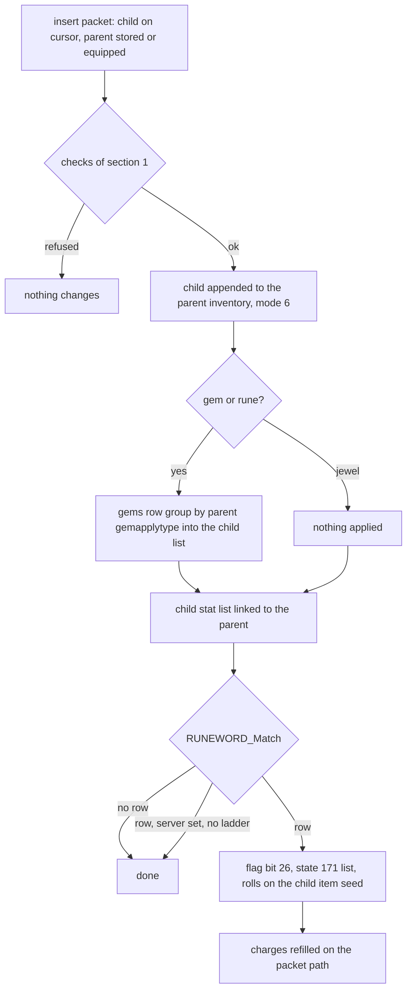

# 0007 — Socket filling, gems, runes and jewels, runeword activation

> **Subsystem:** items/sockets-runewords
> **Question:** When a gem, rune or jewel goes into a socketed item, what does the server check, what does the item gain, and when do the inserted runes make a runeword, with which property rolls on which seed?
> **Date:** 2026-10-15   **Plan:** 0029 (Phase 1, Phase 1b, Phase 2)   **Status:** open (Phase 1 read from the decompile and the disassembly, committed before any lead was read; Phase 1b cross-check 2026-10-15: two contradictions, one reachable on stock data; Phase 2 [run:2026-10-15-sockets](experiments.md#run2026-10-15-sockets): `tools/sockets.py` reproduces 351 inserts, 50 runewords and 357 client tests with 0 mismatches; review requested)

Names of structs and fields are ours. "Parent" is the socketed item, "child" the gem, rune or jewel put into it.
"Item seed" is the item-data seed at `ItemData+0x04` (`ITEMS_GetSeed`), not the unit seed at `Unit+0x20`
([rng/0002](../rng/0002-seed-tree.md)). The property machinery (`sub_0065FEC0_ItemApplyProps`, `PROP_ApplyBlock`, the
`func` handlers, `PROP_RollValue`, `PROP_WriteStat`) is [items/0006](0006-properties.md) § 2–4; this finding adds what
those functions do when the item they get is **not** the item that receives the stats. Item types are `ItemTypes`
record indices (20 `gem`, 45 `weap`, 53 `sock`, 74 `rune`). Item flags are `ItemData+0x18`; bit 4 (`0x10`) is
identified, bit 11 (`0x800`) socketed, bit 26 (`0x4000000`) runeword ([d2s § Flags](../../formats/d2s.md#flags)).
Item unit modes: 0 stored, 1 equipped, 4 on the cursor, 6 socketed. Phase 1 was written from the code only; no
community text had been read when it was written.

## Answer (summary)

- [C] **The server insert is `ITEMS_InsertSocket`** (fn:ITEMS_InsertSocket@0x00562660). The client packet handler
  `SOCK_PacketInsert` (9 bytes: opcode `0x28`, child unit id, parent unit id) calls it with all four option flags set.
  Corroboration: every packet insert of the run arrived as client packet `0x28` and reached the insert with
  `p4..p7` = 1, 1, 1, 1 (run:2026-10-15-sockets; the packet table in § 1). The
  save reader (corroborated: the five pre-filled children of the load session reached it with `p4..p7` = 0, 0, 0,
  0), the golem reader and the item copier call it too, with the flags clear, for each socketed child they
  rebuild. It refuses, in this order:
  - a child that is not an item, or is not **on the cursor** (mode 4);
  - a parent that is not an item or is not identified;
  - (packet path) a parent that is not stored or equipped (mode 0 or 1);
  - a child that is not a `sock` type (gem, rune or jewel);
  - an unidentified child;
  - a parent without the socketed flag, or whose base has `hasinv` 0;
  - a parent whose filled count has reached stat 194 (`item_numsockets`).

  Nothing else is tested: no level requirement, no item class (`gemapplytype`), no quality, no classic/expansion
  check. (fn:SOCK_PacketInsert@0x0054B650, 0x005626B4–0x005627AD)

  Of these refusals the run produced only the unidentified child. The others are read from the code and were seen
  passing, never failing: the client's own test (below) screens them from clicks, so they stay `[I]` as refusals
  until a forged `0x28` packet (ADR-0010) reaches them. (fn:ITEMS_InsertSocket@0x00562660, run:2026-10-15-sockets;
  architect review 2026-10-15)
- [C] **The tests run in that order**, and the run saw the whole chain: 350 inserts passed the tests in order
  (logged at each passing branch; the parent-mode test applies only with option flag p6 set, so the five reader
  inserts pass it untested) and one, an unidentified magic jewel, stopped after `child_sock`, at the identified test,
  with return 0 and nothing changed. Inserts into magic, rare, crafted and low-quality parents, into every item
  class and in a classic game were accepted, so neither quality, class nor game type is tested.
  (run:2026-10-15-sockets)
- [I] **No level-requirement test.** Every rune of the run (up to Zod, level 69) was below the character's level 80, so
  the run does not show it; the code has no such test (§ 1, fn:ITEMS_InsertSocket@0x00562660).
- [C] **The client tests first and sends `0x28` only when its own test passes** (`sub_004843E0_UiCanInsertSocket`,
  `.\UI\inv.cpp`). Its order: the UI state word `0x007BCBF0` not 10 or 11, cursor item a socket filler, target socketed
  (flag bit 11), base `hasinv`, `ItemMaxSockets` ≠ 0, target identified, target flag bit 8 clear, target inventory
  present, children < stat 194. When it fails, a click on an item in a grid sends the ordinary
  place/swap packet (`0x18` or `0x1F`) and the two items change places; a click on a paper-doll item sends nothing.
  It does **not** test the child's identified flag, so an unidentified jewel reaches the server, which refuses it.
  Corroboration: 357 client verdicts reproduced from the logged inputs (ok 346; not a filler 4; full 2; not
  socketed 5). (fn:sub_004843E0_UiCanInsertSocket@0x004843E0, run:2026-10-15-sockets)
- [I] **The client's identified test is not reached for a socketed item.** An unidentified magic cap with two sockets
  showed the client flags `0x00804001`, without bit 11, so the client refused it as not socketed and sent a swap
  instead of `0x28`. The client unit apparently lacks the socketed flag until the item is identified; one case.
  (run:2026-10-15-sockets, session `refuse`)
- [C] **The child joins the parent's inventory at the tail** (fn:sub_0063B210_InvPlaceSocketed@0x0063B210). Its mode
  becomes 6. The socket order is therefore insertion order: `INV_GetFirstItem` → `INV_GetNextItem` walks the children
  in that order. Corroboration: the parent's child list after each of the 350 inserts was its list before plus the
  child at the tail, and the child's mode was 6.
- [I] **Its x is the filled count before the insert and its y is 0** (§ 1, the child's place). Not logged by the run. (fn:sub_0063AF20_InvAppendItem@0x0063AF20,
  0x005627FC, run:2026-10-15-sockets)
- [C] **Gems and runes write into their own stat list, which is linked to the parent.** `ITEMS_AttachToOwner` looks up
  the child's `gems` row (base `+0x0F0`). It applies the row's 3-block group chosen by the **parent's**
  `gemapplytype`: 0 → `weaponMod`, 1 → `helmMod`, 2 → `shieldMod`. The child is the item and the target, in mode 2
  (gem) or mode 5 (rune); the two modes behave the same. A jewel gets nothing applied, because its own rolled list
  is already there. Then the child's stat list is attached to the parent (`sub_00627910_StatListLinkOwner`); the
  parent's own lists are not written. On stock data the transfer makes **no draw**: every gem and rune block has
  `min = max` or a `func` that never draws. Corroboration: the data check over all 69 `gems` rows (§ 3), and the run:
  337 gem and rune transfers (178 gems, each of the 35 gems into each of the three groups; 159 runes) reproduced slot by slot
  with the child's seed unchanged, and the parent's lists after each insert were its lists before plus the child's
  own list (state 0, flags `0x80000000`). (fn:ITEMS_AttachToOwner@0x0055C2C0,
  fn:sub_0065C6D0_PropBlock3x3@0x0065C6D0, run:2026-10-15-sockets)
- [C] **The runeword match runs after every insert, and only a full item can match** (fn:RUNEWORD_Match@0x0062BED0).
  The match fails at once when:
  - the parent's quality is 4..9 (so low, normal and superior qualify);
  - the base's `quest` is non-zero;
  - the number of children differs from stat 194.

  Otherwise it walks `Runes` from record 0 and returns the first row with:
  - `complete` ≠ 0;
  - `Rune1..` equal to the children's base items in socket order;
  - the parent of none of `etype1..3`;
  - the parent of one of `itype1..6` (`ITEMS_UnitIsType`, so equivalences count).

  Corroboration: the model's match agreed with the logged row after all 350 inserts: 50 runewords from 29 rows, a
  low-quality and a superior base matching, and no match for the wrong type, the wrong order, magic, rare and crafted
  bases, *Wirt's Leg* and a 3-socket base holding the first three runes of *Bramble* (run:2026-10-15-sockets). `etype` is
  untested: no stock `complete` row uses it.
- [C] **What a runeword gets** (fn:RUNEWORD_Apply@0x006600A0). The row's `server` byte, when set, makes the runeword
  apply only in a ladder game (`Game+0x74`); otherwise the insert still succeeds, with no runeword. The parent gets
  flag bit 26 and a stat list of state 171 (`0xAB`), flags `0x40`, filled from `T1Code1..7` in column order. A blank
  code ends the list. `+0x82` is the string index of the row's `Name`, set by `RUNES_Load`; the save stores it as the
  16-bit runeword field. Corroboration: the game-written save of a *Steel* sword holds flag 26 and a 171 list
  (§ 6). (fn:RUNES_Load@0x006394A0)
- [C] **The handlers' item is the child just inserted**, not the parent. `RUNEWORD_Apply` passes the last child as the
  handlers' item and the parent as the target of `PROP_WriteStat`. So every handler test of "the item" sees a rune:
  - func 2 (`ac%`) does not reset the parent's base defense;
  - funcs 5 and 6 (`dmg-min`, `dmg-max`) take the non-weapon branch and write all three stats (21/23/159 or
    22/24/160);
  - func 7 (`dmg%`) writes 17 and 18 directly, with no base reset and no "+1 maximum damage" fallback;
  - func 23 (`ethereal`, *Famine*) does nothing, because the rune has no durability.

  Corroboration (second path): *Steel* on a one-handed, non-throwing long sword saved stats 21, 23 and 159 (+3) and
  22, 24 and 160 (+3), which only the non-weapon branch writes (§ 6). The save shows which unit is the item, not which
  seed is stepped. (fn:RUNEWORD_Apply@0x006600A0, fn:PROP_Func05_DmgMin@0x0065ECF0,
  fn:PROP_Func23_Ethereal@0x0065FD20, run:2026-10-11-d2s-samples)
- [C] **The rolls draw on that child's item seed.** Because the child is the handlers' item, every `PROP_RollValue`
  and the func 19 charges draw step `ITEMS_GetSeed(child)`; the parent's seeds are not touched. The draw order per
  line is items/0006 § 3–4. Corroboration: 50 runewords reproduced line by line from the child's seed at its insert
  (an input, ADR-0004), 50 draws among them (ranged lines of *Splendor*, *Sanctuary*, *Gloom*, *Enigma*, *Stone*,
  *Bramble*'s aura, *Call to Arms*'s `oskill`, *Famine*, *Duress*, *Bone*, …, and every func 19 charge), with the
  game seed and the parent's item and unit seeds unchanged. (fn:PROP_RollValue@0x0065E9E0,
  fn:PROP_Func19_Charged@0x0065F6A0, fn:ITEMS_GetSeed@0x00627D90, run:2026-10-15-sockets)
- [C] **That seed, for a rune loaded from a save, is `{startSeed, 666}`** at the insert: 49 of the 50 completing runes
  were loaded, and each one's item seed equalled its own start seed with high word 666. A rune made in the session
  (the cube's 3 Tir → Nef) carried an advanced seed instead, and *Black* completed by it reproduced from that seed.
  (run:2026-10-15-sockets)
- [C] **On the packet path a new runeword's charges are refilled to the maximum** (`sub_0055FE80_ItemRefillCharges`,
  option flag 4). The func 19 draw still happens, so it still moves the child's seed. Corroboration: the parent's
  lists after the refill reproduced for all 50 runewords, 14 of them with a charge raised. (0x00562848, run:2026-10-15-sockets)
- [I] **`ITEMS_SetSockets` clamps, read in full** (§ 7). The request `n` becomes `min(max(n, 1), cap)`, and nothing
  is set when `cap < 1`. `cap` is `min(invwidth · invheight, 6)` and then:
  - magic: at most 4;
  - set and unique: 1 when the item has no sockets yet; otherwise the request is replaced by the current count;
  - rare: at most 2;
  - crafted and quality 9: at most 3;
  - every quality: at most `ItemMaxSockets`.

  The load path uses `ITEMS_SetSocketsOnLoad`, which has no quality clamp. (fn:ITEMS_SetSockets@0x0062BCB0,
  fn:ITEMS_SetSocketsOnLoad@0x0062BE00)
- [C] **The load path keeps a magic, rare or crafted item's socket count above the creation clamps**, and the insert
  fills them all (fn:ITEMS_SetSocketsOnLoad@0x0062BE00). Built states (ADR-0010 forced path, run session `forced`): a magic crystal sword with 6 sockets, a
  magic shield with 4, a rare crystal sword with 5 and a crafted long sword with 4 loaded with those counts (stat
  194) and took that many gems. `ITEMS_SetSockets`' own clamps are not reached by the run and stay inferred (§ 7).
  (run:2026-10-15-sockets)

## Leads used

Phase 1 had no lead. The entry points came from items/0006 (*Open questions*: the four other callers of
`ItemApplyProps`), save/0001 § 7 (`0x0062A900`, `0x0062BE00`, `0x0062BED0`) and data/0001 (the Runes loader). Phase 1b cross-check follows.

Phase 1 was committed (7cd4331) before any source below was read. The sources were fetched and read on 2026-10-15
for the Phase 1b cross-check (ADR-0007; raw HTML in the scratchpad):
- `src:arreat-summit-socketing`: Socketed Items, Gems, Runes, Rune Words and the 1.10 Rune Words page. It describes
  Lord of Destruction, 1.13 or later.
- `src:arreat-summit-magic-items`: § Jewels.
- `src:d2dfg-blizzard`: § Runes.txt, § gems.txt, and the item tables' `gemapplytype`, `gemoffset` and `hasinv`. It
  describes D2R, so a difference from it may be a version difference.
- `src:planetdiablo-socketing-guide`: § II `gemapplytype`.
- `src:d2runewizard-runeword-faq`, which describes D2R.

None has game code. Agreement promotes nothing. The one `contradicted` verdict that stock play can reach is a
required Phase 2 case (backlog 2026-10-15 reverser → architect, plan 0029 Phase 1b contradictions).

**The insert**
- [L] src:arreat-summit-socketing: a gem is inserted by picking it up and left-clicking it onto the socketed item.
  **held**
  Detail: the child must be on the cursor (mode 4), the packet path's first test (§ 1).
- [L] src:arreat-summit-magic-items: a jewel must be identified before it is inserted. **held with refinement**
  Detail: the identified test applies to every child, and to the parent as well (§ 1). The page's "Magic, Rare, or
  Unique" jewels all take the non-set branch of § 3, so the unique jewel is covered too.
- [L] src:arreat-summit-socketing: magic items have up to 4 sockets, rare items 2. **held**
  Detail: `ITEMS_SetSockets` (§ 7).
- [L] src:arreat-summit-socketing: crafted, set and unique items are limited to 1 socket "in most cases", and a few set
  and unique items have more by default. **contradicted** (crafted); **held with refinement** (set, unique)
  Detail: the code caps crafted (8) and quality 9 at **3**, not 1. Set and unique get 1 when they have no sockets yet,
  and an item that already has some keeps its count (§ 7). Required case: a crafted item through `ITEMS_SetSockets`
  with a request above 1, where stock play reaches it (Larzuk's reward, plan 0032), else forced (ADR-0010). Backlog
  2026-10-15.
- **Not covered** by any source read: the full refusal order, the absence of a level, class or expansion test in the
  insert, and the socket order being the insert order with x = 0, 1, 2, ….

**Gem and rune mods per item class**
- [L] src:arreat-summit-socketing: gems give separate effects for weapons, for shields, and for helms and armour; runes
  for weapons and for armour/helms/shields, with shield variants (Tal, Ral, Ort, Thul 35 %, Eld's block). **held**
  Detail: the group is the parent's `gemapplytype`, 0 / 1 / 2. Stock bases: 0 for weapons, 1 for `tors`, `helm`,
  `circ`, `pelt`, `phlm`, 2 for `shie`, `ashd`, `head` (§ 3).
- [L] src:d2dfg-blizzard: `weaponMod*` applies for `gemapplytype` 0, `helmMod*` for 1, `shieldMod*` for 2. **held**
  Detail: `sub_0065C6D0_PropBlock3x3` (§ 3).
- [L] src:planetdiablo-socketing-guide: `gemapplytype` 0 socketed like weapons, 1 like helms, 2 like shields. **held**
- [L] src:arreat-summit-socketing: gem effects stack; three gems of one type give all three bonuses. **held**
  Detail: each child keeps its own list, linked to the parent (§ 3).
- [L] src:d2dfg-blizzard: `gemoffset` is the starting index into `gems.txt` for the item. **contradicted** (1.14d)
  Detail: in 1.14d `GEMS_Load` overwrites `+0x0F0` of each gem's or rune's own base item with its `gems` row, and the
  insert reads the **child's** `+0x0F0`; no parent offset is read (§ 3, data/0004 § 3). Every stock cell is 0, so the
  two readings give the same result on stock data. Not a run case; the spec must not port the D2R reading. Backlog
  2026-10-15.
- **Not covered:** that gem and rune inserts make no draw, that the gem or rune itself is "the item" for the handlers,
  and the first gem's colour (presentation, ADR-0005).

**The runeword match**
- [L] src:arreat-summit-socketing: the item needs exactly the number of sockets the formula has; a 4-socket item does
  not take a 3-rune word. **held**
  Detail: stat 194 must equal the number of children (§ 4). The extra-rune quirk (§ 4) is the other direction and is
  not covered.
- [L] src:arreat-summit-socketing: the item type must match the formula; hammers are not maces; "Weapons" covers
  melee, missile and orbs. **held**
  Detail: `itype1..6` through `ITEMS_UnitIsType` (equivalences); `hamm` and `mace` are both `blun` but neither is
  the other (ItemTypes data).
- [L] src:arreat-summit-socketing: runewords work only in socketed non-magical items; never magic, set, unique or
  rare. **held with refinement**
  Detail: crafted and quality 9 are excluded as well, low quality is **not** excluded, and ethereal is not tested
  (§ 4). Low quality is a required Phase 2 case if a socketed low-quality base can be had on stock data.
- [L] src:d2runewizard-runeword-faq: superior and ethereal bases make runewords. **held**
  Detail: the *Steel* sample is an ethereal base (§ 6).
- [L] src:arreat-summit-socketing: runewords do not work in Wirt's Leg. **held**
  Detail: its base `leg` has `quest` 1, which `RUNEWORD_Match` refuses (§ 4).
- [L] src:arreat-summit-socketing: the runes must go in the formula's order, first Rune1, then Rune2, …; a wrong rune
  gives the runes' own bonuses but no runeword. **held**
  Detail: socket order is insertion order, and the rune lists stay linked whatever the outcome (§ 3, § 4).
- [L] src:arreat-summit-socketing: the runeword item keeps the bonuses of each rune. **held**
  Detail: the runeword's list (state 171) is added beside the children's lists (§ 5).
- [L] src:arreat-summit-socketing: the 1.10 ladder runewords work only for ladder characters on the realms, not
  single player, open or non-ladder. **held**
  Detail: a row with `server` set is applied only when `Game+0x74` (ladder) is set; the insert itself succeeds
  (§ 1). The 23 stock `server` rows are the page's 23 ladder words, matched by rune sequence; the
  `Rune Name` comment column calls two of them *Widowmaker* and *Winter*, which the page lists as *Grief* (Eth Tir Lo
  Mal Ral) and *Voice of Reason* (Lem Ko El Eld).
- [L] src:d2runewizard-runeword-faq: in the original game, ladder runewords are restricted to ladder multiplayer.
  **held**
- [L] src:d2dfg-blizzard: `complete` 1 means the runeword can be made; `firstLadderSeason`/`lastLadderSeason` gate
  ladder rows. **held with refinement**
  Detail: `complete` holds. 1.14d has no season columns; it has the `server` byte (version difference).
- [L] src:d2dfg-blizzard: the order of `Rune1..6` matters; `itype` includes and `etype` excludes. **held**
- [L] src:arreat-summit-socketing: a superior base adds its own bonuses to the runeword. **held**
  Detail: the base's own lists are not touched (§ 5).

**The runeword rolls**
- [L] src:arreat-summit-socketing: some runeword stats "vary" (e.g. *Call to Arms* `+2-6` Battle Command; *Famine*
  `+320-370%` damage, which is the row's 270–320 plus Ohm's 50). **held with refinement**
  Detail: each ranged line is drawn once, when the word is made, on the **last-inserted rune's** item seed (§ 5).
  The seed is not covered by any source.
- [L] src:arreat-summit-socketing: *Fortitude*'s life per level `X` is set at random between 1 and 1.5 when the
  runeword is made. **held**
  Detail: `hp/lvl` 8–12 (in eighths) is one `Roll` (§ 5).
- [L] src:arreat-summit-socketing: the *Famine* listing has no "Ethereal" line, while its `runes` row has
  `ethereal`. **held**
  Detail: func 23 sees the rune, which has no durability, so the line does nothing (§ 5).
- [L] src:d2dfg-blizzard: `T1Param`/`T1Min`/`T1Max` "usage depends on the property function". **held**
- **Not covered** by any source read: the refill of charges on the packet path, `ac%` not resetting the base defense,
  `dmg-min`/`dmg-max`/`dmg%` taking the non-weapon branch, and the extra-rune stale-slot quirk.

## Functions

| Address | Name | Role | Tag |
|---|---|---|---|
| `0x0054B650` | `SOCK_PacketInsert` | client packet (length 9): checks, then `ITEMS_InsertSocket(child, parent, 1, 1, 1, 1)`; table entry `0x006E0E58` | C |
| `0x005490E0` | `sub_005490E0_PktIsCursorItem` | the child is the player's cursor item (mode 4) | I |
| `0x005491B0` | `sub_005491B0_PktIsOwnStoredItem` | a mode-0/1 parent belongs to the player's inventory | I |
| `0x004843E0` | `sub_004843E0_UiCanInsertSocket` | client: may the cursor item go into the target (`.\UI\inv.cpp`); sends `0x28` only when it passes | C |
| `0x00562660` | `ITEMS_InsertSocket` | the server insert (§ 1) | C |
| `0x0055C2C0` | `ITEMS_AttachToOwner` | gem/rune mods, set bonus, stat-list link of a child to its owner (§ 3) | C |
| `0x004C0D20` | `sub_004C0D20_ClientSocketAttach` | the client's copy of the gem/rune transfer (fatal instead of silent on a bad row) | I |
| `0x004E6720` | `sub_004E6720_ClientGemDescMode5` | client: mode-5 apply to a scratch list, for a description, then free | I |
| `0x004E67D0` | `sub_004E67D0_ClientGemDescMode2` | the same in mode 2 | I |
| `0x0062BED0` | `RUNEWORD_Match` | the `Runes` row a parent makes, or NULL (§ 4) | C |
| `0x006600A0` | `RUNEWORD_Apply` | flag bit 26 and the state-171 list (§ 5) | C |
| `0x0055FE80` | `sub_0055FE80_ItemRefillCharges` | every stat 204 entry with current < max gets max | C |
| `0x00558530` | `sub_00558530_ItemReplenishDurTimer` | schedules the stat 252 (`item_replenish_durability`) event | I |
| `0x00558580` | `sub_00558580_ItemReplenishQtyTimer` | the same for stat 253 | I |
| `0x00563470` | `sub_00563470_ItemDiscardInvalid` | removes a loaded item flagged runeword that no longer matches | I |
| `0x00627910` | `sub_00627910_StatListLinkOwner` | attaches a child's stat list (`Unit+0x5C`) to an owner | I |
| `0x006299B0` | `ITEMS_GetSockets` | stat 194 | I |
| `0x00629A40` | `ITEMS_GetGemApplyType` | base `gemapplytype` (`+0x13E`) of an item unit | I |
| `0x00629A00` | `sub_00629A00_GemApplyTypeOfClass` | the same by class id | I |
| `0x0062A900` | `ITEMS_CountFilledSockets` | `n_filled` for the save writer: children in the inventory, when `hasinv` | I |
| `0x0062BE00` | `ITEMS_SetSocketsOnLoad` | the save reader's socket setter (§ 7) | C |
| `0x0062BEB0` | `ITEMS_IsSocketFiller` | `ITEMS_UnitIsType(item, 53)` | I |
| `0x006394A0` | `RUNES_Load` | `runes` descriptor, 0x120 per record; `+0x82` = string index of `Name` | I |
| `0x00639420` | `sub_00639420_ExcelFileProbe` | looks for a file under `DATA\GLOBAL\EXCEL`; `RUNES_Load` stops fatally if `runessrv` is found | I |
| `0x00639CB0` | `RUNES_GetTable` | `&g_nRunes` (count, then pointer) | I |
| `0x00639D60` | `RUNES_GetRecord` | record by index, index 0 refused (fatal) | I |
| `0x0063ABD0` | `INV_Create` | an inventory for a unit (`Unit+0x60`) | I |
| `0x0063B210` | `sub_0063B210_InvPlaceSocketed` | removes the child from where it was, appends it, x = count, y = 0, count + 1 | C |
| `0x0063AF20` | `sub_0063AF20_InvAppendItem` | tail append of the inventory item list (`ItemData+0x64` next) | I |
| `0x0063B2C0` | `INV_GetFirstItem` | inventory `+0x0C` | I |
| `0x0063DFA0` | `INV_GetNextItem` | `ItemData+0x64` | I |
| `0x0063CD60` | `INV_GetItemCount` | inventory `+0x28` | I |

Data: `data:g_nGems@0x0096CA90`, `data:g_pGems@0x0096CA94` (0xC0 per record, `struct:GemsRec`),
`data:g_nRunes@0x0096CA98`, `data:g_pRunes@0x0096CA9C` (0x120 per record, `struct:RunesRec`), in `re/types/sockets.h`.

## Walkthrough

### 1. The insert: `ITEMS_InsertSocket` (0x00562660)

Fastcall-plus-stack: ECX = game, EDX = the player (or NULL), stack `(childId, parentId, &notFound, p4, p5, p6, p7)`,
`ret 0x1C`. The callers pass:

| caller | p4 | p5 | p6 | p7 |
|---|---|---|---|---|
| `SOCK_PacketInsert` 0x0054B6DB | 1 | 1 | 1 | 1 |
| `ITEMS_ReadInventoryList` path (0x00531355), the other inventory readers (0x005311B5, 0x005313F0, 0x00531578), `sub_0055A2A0_ItemCopy` (0x0055A41C), `D2S_ReadGolem`'s reader (0x0056AE18) | 0 | 1 | 0 | 0 |
| 0x00563441 (`0x00563350`, re-inserting copies of a parent's children) | caller's | 0 | 1 | 0 |

The readers and the copier set the rebuilt child to mode 4 first (`UNIT_SetMode(child, 4)`, e.g. 0x0056ADF5), so the
cursor test passes for them too.

```c
// fn:ITEMS_InsertSocket@0x00562660 (trimmed; renamed)
*notFound = 0;
if (player) sub_0055BF50(player);                    // clears flag 0x4 on the player's items (not followed)
child = GameFindUnit(game, 4, childId);
if (!child) goto not_found;  if (child->type != 4) return 0;
if (child->mode != 4) goto not_found;                // on the cursor
parent = GameFindUnit(game, 4, parentId);
if (!parent) goto not_found; if (parent->type != 4) return 0;
if (!ITEMS_CheckFlags(parent, 0x10)) return 0;       // identified
if (p6 && parent->mode != 0 && parent->mode != 1) return 0;
if (!ITEMS_IsSocketFiller(child)) return 0;          // ItemTypes 53 `sock`
if (!ITEMS_CheckFlags(child, 0x10)) return 0;        // identified
if (!ITEMS_CheckFlags(parent, 0x800)) return 0;      // socketed
if (!ItemBaseHasInv(parent)) return 0;               // base +0x137
inv = parent->inventory ? parent->inventory : INV_Create(NULL, parent);
if (!inv) return 0;
if (INV_GetItemCount(inv) >= (ITEMS_GetSockets(parent) & 0xFF)) return 0;   // stat 194
if (!InvPlaceSocketed(inv, child, 1)) Fatal(0x1444);
child->_c4 &= ~2;
if (p5 && player) InvSetCursorItem(player->inventory, NULL);
ITEMS_AttachToOwner(game, child, parent, 0);         // § 3
sub_006276C0(child, parent);                         // its first test needs a player or monster: no effect here
UNIT_SetMode(child, 6);                              // socketed
rw = RUNEWORD_Match(parent);                         // § 4
if (rw && !(rw->server && !game->ladder /*+0x74*/)) {
    RUNEWORD_Apply(parent, child, 0);                // § 5
    sub_00558530_ItemReplenishDurTimer(game, parent);
    sub_00558580_ItemReplenishQtyTimer(game, parent);
    if (p7) sub_0055FE80_ItemRefillCharges(game, player, parent);
} else if (!p4) return 1;
ITEMS_SetFlag(parent, 0x1, 1);
if (ITEMS_CheckFlags(parent, 0x4000)) ITEMS_SetFlag(parent, 0x4000, 0);
if (player) { sub_00621000(player, 1); sub_0063CC70(player->inventory, parent); }   // client update queue
return 1;
not_found: *notFound = 1; return 0;
```

- [I] **The refusal list** is the order of the tests above (C short-circuit). A refusal returns 0. The packet
  handler turns a "not found" (child or parent missing, child not on the cursor) into its error return 3 and ignores
  the other refusals. (0x005626B4–0x005627AD, 0x0054B6DB–0x0054B6F4)
- [I] **Not tested anywhere in the insert:** the child's level requirement (`levelreq`), the parent's
  `gemapplytype` or item class, the parent's quality, ethereal, the item version or the game's expansion flag, and
  whether the child is a gem, a rune or a jewel beyond the `sock` type. So the server accepts a rune in a classic game
  if one is there, and a jewel in any socketed item. (0x00562660–0x005628B1)
- [I] **The packet handler's own checks** (fn:SOCK_PacketInsert@0x0054B650):
  - the packet is exactly 9 bytes, else return 3;
  - the child id must be the player's cursor item (`sub_005490E0_PktIsCursorItem`);
  - a parent in mode 0 or 1 must be in the player's own inventory (`sub_005491B0_PktIsOwnStoredItem`);
  - when the player has an interaction whose target unit is a player (type 0; a trade), the insert is skipped
    silently.

  The handler is the word at `0x006E0E58`, 39 entries after `0x006E0D20` in an 8-byte (handler, flag) table. The run
  logged client packet `0x28` (40) before every packet insert, so the entry is opcode 40 and the table starts at
  opcode 1 (`[I]` for the table start; run:2026-10-15-sockets). (0x0054B656, 0x0054B680–0x0054B6DB)
- [C] **The child's place** (fn:sub_0063B210_InvPlaceSocketed@0x0063B210). The child is removed from wherever it was
  (`0x0063AAF0`, here the cursor) and appended at the tail of the parent's item list (`sub_0063AF20_InvAppendItem`).
  Its x is set to the inventory count before the insert (`0x00620470`) and its y to 0 (`0x006204C0`). Then the
  count (`inventory +0x28`) is incremented and the body location is set to −1 (`0x00629ED0`). The children are
  therefore in insertion order, x = 0, 1, 2, …. `[C]` for the tail append and the count (the child lists and
  inventory counts of run:2026-10-15-sockets, Answer); x, y and the body location stay `[I]` (not logged).
  (fn:sub_0063AF20_InvAppendItem@0x0063AF20, 0x005627B7)
- [I] **`n_filled` in the save** is the length of that list (`ITEMS_CountFilledSockets`, 0x0062A900), counted only
  when the base has `hasinv`. (fn:ITEMS_CountFilledSockets@0x0062A900)

### 2. Option flags

- [I] `p4` = 1: the parent's update (flag bit 0 set, bit 14 cleared, the player's update queue) happens even when no
  runeword was made. With `p4` = 0 (the readers) it happens only for a runeword. (0x0056284F–0x0056289E)
- [I] `p5` = 1 with a player: the player's cursor slot is cleared (`0x0063C180(inv, NULL)`). (0x005627CB–0x005627DE)
- [I] `p6` = 1: the parent must be stored or equipped. (0x00562715–0x00562725)
- [I] `p7` = 1: a new runeword's charged skills are refilled (§ 5). (0x0056283A–0x00562848)

### 3. Gems and runes: `ITEMS_AttachToOwner` (0x0055C2C0)

Called as `ITEMS_AttachToOwner(game, child /*EDX*/, owner, flag)`. The equip code calls it as well, with a player as
the owner; the socket path passes the parent.

```c
// fn:ITEMS_AttachToOwner@0x0055C2C0 (trimmed)
if (!owner || !child || child->type != 4) return;
if (owner->type == 0 && UnitHasState(owner, 7)) return;
if (ITEMS_UnitIsType(child, 20 /*gem*/)) {
    if (owner->type != 4) return;                       // gems only act inside an item
    g = GEMS_GetRecord(ITEMS_GetRecord(child->classId)->gemoffset /*+0x0F0*/);  if (!g) return;
    sub_0065FEC0_ItemApplyProps(2, 0,     child, g, ITEMS_GetGemApplyType(owner), 0);
} else if (ITEMS_UnitIsType(child, 74 /*rune*/)) {
    if (owner->type != 4) return;
    g = GEMS_GetRecord(...as above...);  if (!g) return;
    sub_0065FEC0_ItemApplyProps(5, owner, child, g, ITEMS_GetGemApplyType(owner), 0);
} else if (ITEMS_GetQuality(child) == 5) sub_00663CC0(owner, child, 0, 0);   // set bonus; not reached by a jewel
sub_0055C270(game, child);                              // recalculation hook when the owner is a player
flag1 = 1;                                              // (an equipped weapon's alternate-slot case for players)
if (!ITEMS_CheckFlags(child, 0x100) || flag) sub_00627910_StatListLinkOwner(owner, child, flag1);
```

- [I] **The group comes from the parent** (fn:sub_0065C6D0_PropBlock3x3@0x0065C6D0). `ItemApplyProps` gets the
  parent's `gemapplytype` as its 5th argument, and `sub_0065C730_PropBlockGet` sends modes 2 and 5 to
  `PropBlock3x3(row, group, i)`, which returns `row + {0x30, 0x60, 0x90}[group] + 16·i` for `i` < 3. A group ≥ 3
  or `i` ≥ 3 is fatal. The block loop stops at the first block with `code < 0`. `nummods` (`+0x2E`) is not read.
  On stock bases the group is 0 for every socketable weapon type, 1 for `tors`, `helm`, `circ`, `pelt`, `phlm`, and 2
  for `shie`, `ashd`, `head`; this is a data check over the 384 `hasinv` rows with `gemsockets` > 0.
  (0x0065FEC0–0x0066007B, fn:ITEMS_GetGemApplyType@0x00629A40, tbl:Weapons.txt:gemapplytype,
  tbl:Armor.txt:gemapplytype)
- [I] **Who is "the item".** The block loop calls `PROP_ApplyBlockByVersion` with ESI = the child. Its 2nd stack
  argument is a constant 0, and that argument reaches every handler as EDX. `PROP_WriteStat` uses it as the owner of
  the target list, so 0 means the child itself. `ItemApplyProps`'s own 2nd argument (the parent, for a rune) arrives
  only as the handlers' 9th stack argument. Funcs 7, 15, 16 and 17 pass it on to funcs 5 and 6, and nothing reads
  it. So a gem in mode 2 and a rune in mode 5 both roll on the child's item seed and write into the child's main
  list (state 0, flags `0x40`). The handlers test the mode only for `mode == 1`, so modes 2 and 5 behave the same.
  (0x00660051–0x0066006E, 0x0065FE10–0x0065FE41, 0x0065FD70–0x0065FDF5, 0x0065EB67–0x0065EB8B)
- [C] **No draw on stock data.** Every gem or rune block either has `min = max` (so `PROP_RollValue` returns `min`
  without a step), or uses funcs 15/16 (no draw), or func 17 with a non-zero `par` (Thul 75, Tal 125; no draw). The
  only `min ≠ max` blocks are Ral (`dmg-fire` 5–30), Ort (`dmg-ltng` 1–50) and Thul (`dmg-cold` 3–14) in `weaponMod1`,
  and they are funcs 15/16(/17). Corroboration: data behaviour over all 69 `gems` rows and their 207 block groups.
  (fn:PROP_RollValue@0x0065E9E0, fn:PROP_Func15_Min@0x0065F960, fn:PROP_Func17_Par@0x0065FA40,
  tbl:Properties.txt:func1)
- [I] **The child as the item, for gems and runes.** The handlers that look at the item see the gem or rune:
  - Pul's `ac%` (func 2) resets nothing;
  - Ith's `dmg-max` and Sol's `dmg-min` (funcs 6/5) take the non-weapon branch: stats 22, 24, 160 (or 21, 23, 159),
    clamped against the rune's own base bytes, which are 0;
  - Ohm's `dmg%` (func 7) writes 17 and 18;
  - Zod's `indestruct` (func 20) adds stat 152 to the rune's list.

  The parent is affected only through the linked list. (fn:PROP_Func02_RollAcPercent@0x0065EBA0,
  fn:PROP_Func05_DmgMin@0x0065ECF0, fn:PROP_Func07_DmgPercent@0x0065F010,
  fn:PROP_Func20_Indestructible@0x0065FAE0)
- [I] **The link** (fn:sub_00627910_StatListLinkOwner@0x00627910). The child's stat list (`Unit+0x5C`) is attached
  to the owner with `0x00626E10(owner, list, 1)`, and the list's owner field `+0x04` is set. When the list already
  belongs to the owner, only its enable bit `0x40000000` is toggled. The parent's own lists are never written by a
  gem, rune or jewel insert. Flag `0x100` on the child (meaning not settled) suppresses the link when `flag` is 0,
  which it is on the socket path. (fn:ITEMS_AttachToOwner@0x0055C2C0)
- [I] **Jewels** take the last branch. Their quality is 4 or 6, never 5, so nothing is applied, and their own list,
  rolled at creation (items/0005), is linked as above. (fn:ITEMS_AttachToOwner@0x0055C2C0)
- [I] **The client** runs the same transfer in `sub_004C0D20_ClientSocketAttach` with the same modes and arguments.
  A missing row is fatal there, where the server returns silently. `sub_004E6720` (mode 5) and `sub_004E67D0`
  (mode 2) apply a row to a scratch unit for a description, then free the list. (0x004C0D20, 0x004E6720, 0x004E67D0)

### 4. The match: `RUNEWORD_Match` (0x0062BED0)

```c
// fn:RUNEWORD_Match@0x0062BED0 (trimmed)
if (!item) return NULL;
if (item->type == 4 && item->data && (unsigned)(item->data->quality - 4) < 6) return NULL;   // 4..9
if (ITEMS_GetRecord(item->classId)->quest /*+0x12A*/ || !item->inventory) return NULL;
n = 0;
for (c = INV_GetFirstItem(item->inventory); c; c = INV_GetNextItem(c)) {
    if (!c /*not an item*/) return NULL;
    kids[n++] = c->classId;                               // int kids[6] on the stack
}
s = ITEMS_GetSockets(item) & 0xFF;
if (s != n) return NULL;
for (r = 0; r < g_nRunes; r++) {                          // record 0 included
    R = &g_pRunes[r];                                     // 0x120 bytes
    if (!R->complete /*+0x80*/) continue;
    for (k = 0; k < 6 && R->rune[k] /*+0x98*/ >= 1; k++)
        if (n < k || kids[k] != R->rune[k]) goto next;    // note: k == n reads kids[n]
    if (k < s) continue;                                  // fewer runes than sockets
    for (k = 0; k < 3 && R->etype[k] /*+0x92*/; k++) if (ITEMS_UnitIsType(item, R->etype[k])) goto next;
    for (k = 0; k < 6 && R->itype[k] /*+0x86*/; k++) if (ITEMS_UnitIsType(item, R->itype[k])) return R;
next: ;
}
return NULL;
```

- [I] **Quality.** Qualities 4..9 (magic, set, rare, unique, crafted, 9) never match. Low quality (1) is not
  excluded: an unsigned `quality − 4 ≤ 5` test. Ethereal is not tested. (0x0062BEE7–0x0062BEFD)
- [I] **`quest`.** A base with `quest` ≠ 0 never matches. (0x0062BF08, tbl:Misc.txt:quest)
- [I] **Socket count.** The children must fill every socket: `stat 194 & 0xFF` must equal the number of children.
  Before the last insert the match returns NULL, so it is in effect a last-socket check that runs after every insert.
  (0x0062BF58–0x0062BF60)
- [I] **Rune order.** `Rune1..6` (`+0x98`, item indices through `g_ItemCodeLink`; a value < 1 ends the list) must
  equal the children's class ids in socket order, which is insertion order (§ 1). The row needs at least as many
  runes as sockets (`k < s` → next row). With exactly as many, the match is exact. For a row with **one rune more**
  than the sockets, the loop reaches `k = n` and compares `kids[n]`, a stack slot this call never wrote (the bound
  test is `n < k`, not `n ≤ k`); the row matches only if that stale word equals the extra rune's item index. Two or
  more extra runes never match. This is reachable on stock data: fill an *S*-socket base with the first *S* runes of
  an (*S* + 1)-rune word. No `complete` row's sequence is a one-shorter prefix of another's (data check), so an exact
  match never competes with such a stale match. (0x0062BFA3–0x0062BFCE)
- [I] **Types.** `etype1..3` exclude and `itype1..6` include, both through `ITEMS_UnitIsType`, so `weap` covers every
  weapon. A 0 entry ends each list. No stock `complete` row uses `etype`. (0x0062BFD0–0x0062C023,
  tbl:ItemTypes.txt:Equiv1)
- [I] **Scan order.** The first matching row wins, from record 0 up. No two `complete` rows share a rune sequence on
  stock data (data check), so the order changes nothing there. (0x0062BF6B–0x0062C03B)
- [I] **What is not tested here:** `server` (the insert tests it, § 1), the item version, the game type. (fn:RUNEWORD_Match@0x0062BED0)
- [I] **Other callers** (§ 6):
  - `ITEMS_WriteFull` writes the row's `+0x82`, or `0xFFFF` when there is no row, for an item with flag bit 26;
  - `ITEMS_ReadInventoryList` and the golem reader discard a loaded item that has flag bit 26 but no matching row
    (`sub_00563470_ItemDiscardInvalid`);
  - `RUNEWORD_Apply` matches again.

  (0x0063087E, 0x0053379A, 0x0056AD78)

### 5. The runeword: `RUNEWORD_Apply(parent, child, 0)` (0x006600A0)

```c
// fn:RUNEWORD_Apply@0x006600A0 (stdcall, 3 arguments)
R = RUNEWORD_Match(parent);
if (!R || UnitFindStatList(parent, 171, 0x40)) return 0;    // no row, or already applied
ITEMS_SetFlag(parent, 0x4000000, 1);                        // flag bit 26
for (i = 0; i < 7 && R->t1[i].code >= 0; i++)              // T1Code1..7 at +0xB0, 16 bytes each
    PROP_ApplyBlock(/*mode*/6, /*target*/parent, /*item*/child, 0, i, 0, &R->t1[i], /*state*/171, /*flags*/0x40, 0);
return 1;
```

- [I] **The lines** are `T1Code1..7` in column order. The first `code < 0` ends the list, unlike the unique mode,
  which skips blanks. The stock `runes` rows have no gap and no unknown code (data check over 169 rows). Each line
  expands its `properties` slots exactly as items/0006 § 3 states; mode 6 is not 1, so no handler applies a
  mode-1 reset. (0x006600DD–0x0066010C, fn:PROP_ApplyBlock@0x0065FD70)
- [I] **Already applied.** When the parent already holds a state-171 list, nothing is applied and no flag is set.
  This is the save-load case: the reader rebuilds the parent with its saved lists before it re-inserts the children
  (save/0001 § 6–7), so a loaded runeword is not rolled again. (0x006600BC–0x006600CB)
- [C] **Target and item.** `PROP_ApplyBlock`'s 2nd argument (EDX for the handlers) is the parent, and its 3rd (the
  handlers' item) is the child. `PROP_WriteStat` writes into `sub_0065CBF0_PropTargetList(parent, 171, 0x40)`, a
  list it creates on the parent the first time and attaches with state 171. Every roll and every item test uses the
  child. Second path: the *Steel* save in § 6. (0x006600E8–0x006600FE, 0x0065EA94–0x0065EA9F,
  fn:sub_0065CBF0_PropTargetList@0x0065CBF0)
- [I] **The seed.** `PROP_RollValue(child, min, max)` takes `ITEMS_GetSeed(child)` because the child is an item. So
  does the func 19 charges draw (`0x0065F7F7`). Every draw of a runeword is on the item seed of the socket filler
  whose insert completed it. The parent's seeds are not touched. The Steel save's values are the rows' fixed values
  (min = max), so it does not show which seed is stepped; this stays `[I]` until Phase 2 logs the seed.
  (0x0065EA02–0x0065EA1A, fn:ITEMS_GetSeed@0x00627D90, fn:PROP_Func19_Charged@0x0065F6A0)
- [I] **That seed's state.** A socket filler's item seed starts as `{startSeed, 666}` for every server item unit
  (`sub_00552E90_ItemSeedInit`, rng/0002). A drop's `startSeed` is set by `sub_00558D90_ItemCreate` (items/0004).
  A loaded item is created through the same constructor, and no reader calls `ITEMS_SetStartSeed`
  (its six callers are the constructor, `ItemCreate` and the four creation fallbacks). So a rune loaded from a save
  carries a start seed drawn from the game seed at load time. Gem and rune inserts make no draws (§ 3). The state at
  `RUNEWORD_Apply` is therefore that start state, advanced by whatever the creation path drew on the item seed.
  Phase 2 logs it rather than modelling it (boundary, § 8). (fn:sub_00552E90_ItemSeedInit@0x00552E90,
  fn:ITEMS_SetStartSeed@0x00627E20)
- [I] **Draws per line** follow items/0006 § 4, with these consequences of "the item is a rune":
  - func 1, 3, 8, 10, 21, 22 (`oskill`, `aura`), 24: `Roll` (one draw when `min ≠ max`), with the reuse rules of 3,
    8 and 24;
  - func 2 (`ac%`): one `Roll`; the base reset tests the rune, which is not armour, so the parent's defense is not
    reset to `maxac + 1` (`sub_0065CCC0_PropBaseReset` uses ESI = the child);
  - funcs 5, 6 (`dmg-min`, `dmg-max`): the base record is the **parent's** (EDX is an item), but the
    `ITEMS_UnitIsType(item, 45)` tests see the rune, so all three stats are written, each clamped against the
    parent's base byte;
  - func 7 (`dmg%`): one `Roll`; writes stats 18 and 17 directly; no base reset, no `+1` fallback;
  - func 11 (`hit-skill`, `gethit-skill`, …): no draw; the skill level is `max`. Every stock runeword line has
    `max` > 0, so the ilvl branch (which would read the **rune's** ilvl) is not reached (data check);
  - func 19 (`charged`): one `RNG_RangeB(c − c/8)` on the child's seed, stored as `max << 8 | current`;
  - func 20 (`indestruct`): adds stat 152 to the parent's 171 list, no draw;
  - func 23 (`ethereal`): tests `ITEMS_IsEthereal(child)` and `ItemHasDurability(child)`, so it never makes the
    parent ethereal. *Famine* (`Runeword39`) is the stock row with this line.

  (fn:PROP_Func02_RollAcPercent@0x0065EBA0, fn:sub_0065CCC0_PropBaseReset@0x0065CCC0, fn:PROP_Func06_DmgMax@0x0065EE80,
  fn:PROP_Func07_DmgPercent@0x0065F010, fn:PROP_Func11_SkillOnEvent@0x0065F470, fn:PROP_Func22_SkillParam@0x0065FBF0,
  fn:PROP_Func23_Ethereal@0x0065FD20; `runes` `T1Code1..7`)
- [I] **After the rolls** (in `ITEMS_InsertSocket`): the replenish timers for stats 252/253, and on the packet path
  `sub_0055FE80_ItemRefillCharges`. It reads every stat 204 entry of the parent (`0x006261D0(parent, 204, buf, 0x40)`)
  and, where the current charges (low byte) are below the maximum (`>> 8`), sets them to the maximum
  (`0x0065C940`), with a client update. So a runeword made by a player always shows full charges, while the func 19
  draw has still stepped the child's seed. Readers (`p7` = 0) do not refill. (fn:sub_0055FE80_ItemRefillCharges@0x0055FE80)
- [I] **The name.** Nothing in the insert writes `ItemData+0x38`. The 16-bit runeword field the serialiser writes is
  `R->nameStr` (`+0x82`), the string index `RUNES_Load` sets with `STRTABLE_GetByKey(R->name)`. The reader stores it
  at `+0x38` (save/0001 § 7). A client receives the item through the same serialiser, so its `+0x38` is that string
  index. (0x00639C44–0x00639C7F, 0x00630887)



### 6. Corroboration from a game-written save

The sample `qitbarb` ([run:2026-10-11-d2s-samples](../../formats/experiments.md#run2026-10-11-d2s-samples), step 4)
holds an ethereal normal-quality long sword (`lsd`) with 2 sockets, into which Tir and then El were socketed by hand
in the game. *Steel* is Tir El. `python3 -I tools/d2s.py dump` decodes it as follows:

| field | value |
|---|---|
| flags | `0x04C02810`: bit 4 identified, bit 11 socketed, bit 22 ethereal, bit 26 runeword |
| `n_filled` | 2 |
| quality | 2 |
| runeword field | `0x509F` |
| main list | empty |
| state-171 list | 17/18 = 20, 21 = 3, 22 = 3, 23 = 3, 24 = 3, 93 = 25, 135 = 50, 159 = 3, 160 = 3 |

- [C] **Funcs 5 and 6 on a runeword write all three stats.** The `lsd` base has `mindam` 3, `maxdam` 19, no two-hand
  damage and no throw damage. A func 5 that saw the sword (a weapon with `b1` ≠ 0 and `b2` = 0, not throwable) would
  write stat 21 only (items/0006 § 4). The save holds 21, 23 and 159, and 22, 24 and 160, each +3. That is the
  non-weapon branch, so the handlers' item was the rune. Corroboration of the reading in § 5 by a game-written file.
  (fn:PROP_Func05_DmgMin@0x0065ECF0, fn:PROP_Func06_DmgMax@0x0065EE80, run:2026-10-11-d2s-samples)
- [C] **Flag bit 26, the 171 list, and normal ethereal bases.** The parent got flag 26 and a separate list (the save
  writer's runeword list, save/0001 § 7), while its main list stayed empty. An ethereal base made a runeword. (§ 4, § 5,
  run:2026-10-11-d2s-samples)
- [C] **`dmg%` writes 17 and 18** with the row's value (20) as stats 17/18. Here the `+1` fallback would not have
  fired anyway (`⌊19 · 20/100⌋` = 3), so this does not show the missing fallback. (fn:PROP_Func07_DmgPercent@0x0065F010,
  run:2026-10-11-d2s-samples)

That run used `-direct -txt` with two edited tables for the item recipes ([d2s § Samples](../../formats/d2s.md#samples));
the property code and the `runes`, `gems` and `properties` rows are not among the edits.

### 7. `ITEMS_SetSockets` (0x0062BCB0) and the load setter (0x0062BE00)

```c
// fn:ITEMS_SetSockets@0x0062BCB0 (item, n)
p = invwidth * invheight;                     // u8 * u8 (+0x10F, +0x110)
if (p == 0) return;
cap = min(p, 6);
switch (quality /*ItemData+0x00, 2 without data*/) {
case 4:          cap = min(cap, 4); break;    // magic
case 5: case 7:  cur = GetStat(item, 194);    // set, unique
                 if (cur >= 1) n = cur; else if (cap) cap = 1;
                 break;
case 6:          cap = min(cap, 2); break;    // rare
case 8: case 9:  cap = min(cap, 3); break;    // crafted, quality 9
}
cap = min(cap, ItemMaxSockets(item) & 0xFF);
r = (max(n, 1) < cap) ? max(n, 1) : cap;
if (r < 1) return;
ItemData->flags |= 0x800;  SetStat(item, 194, r);
```

- [I] **Quality clamps.** Magic ≤ 4, rare ≤ 2, crafted and 9 ≤ 3. These are the three of items/0006 § F6, plus
  quality 9 and the set/unique case. A set or unique item with no sockets gets at most 1, and one that already has
  sockets keeps its count: the request is replaced, and the other clamps still apply. Low, normal and superior have no
  quality clamp. (fn:ITEMS_SetSockets@0x0062BCB0)
- [I] **Order of the clamps:** inventory size and 6, then quality, then `ItemMaxSockets` (ilvl band and `gemsockets`,
  items/0006 § 6). Then `max(n, 1)`, then the cap. When the cap is 0 nothing is written, not even the flag.
  (fn:ITEMS_SetSockets@0x0062BCB0, fn:sub_0062BC20_ItemMaxSockets@0x0062BC20)
- [I] **Callers:** `sub_00556B60_ItemRollSockets` (two calls), `sub_00558D90_ItemCreate` (0x00558F60, a creation
  record's forced count), `sub_00565AB0_RecipeOutputCreate` (cube), and 0x0057A3E2 (not followed; plan 0032's quest
  reward). (fn:sub_00556B60_ItemRollSockets@0x00556B60, fn:sub_00565AB0_RecipeOutputCreate@0x00565AB0)
- [I] **`ITEMS_SetSocketsOnLoad`** (from `ITEMS_ReadFull`, 0x0062D82A, and 0x0065D220): the same, with no quality
  switch. So a loaded item's saved socket count is clamped to `invwidth · invheight`, 6 and `ItemMaxSockets` of its
  saved ilvl. A cap of 0 still writes stat 194 = 0 and the flag. (fn:ITEMS_SetSocketsOnLoad@0x0062BE00,
  fn:ITEMS_ReadFull@0x0062CBE0)

### 8. Phase 2 boundary (recommendation)

Recommended for the architect's ruling: `tools/sockets.py` models §§ 1–5 with no oracle:
- the refusal order;
- the gem/rune group, written into the child's list (no draws);
- the link;
- `RUNEWORD_Match`;
- the runeword lines through `tools/props.py`'s handlers, with a "rune as the item" switch for funcs 2, 5, 6, 7 and
  23 as § 5 states, and the refill.

The run logs the child's item seed at `RUNEWORD_Apply` entry, and the model asserts that its draws start there. This
is an input, not an oracle (ADR-0004): no out-of-scope code shares the seed in between. The rune's seed history from
its creation is items/0004's model and is not chained. The parent's stat lists are logged after each insert and
compared in full.

## Data touched

- `struct:RunesRec+0x80` (`complete`), `+0x81` (`server`), `+0x82` (`nameStr`), `+0x86` (`itype`), `+0x92`
  (`etype`), `+0x98` (`rune`), `+0xB0` (`t1`); `struct:GemsRec+0x30` / `+0x60` / `+0x90`, `+0x28`.
- `runes` ([Runes](../../tables/Runes.md)): tbl:Runes.txt:Name, tbl:Runes.txt:complete, tbl:Runes.txt:server,
  tbl:Runes.txt:itype1 (`itype1..6`), tbl:Runes.txt:etype1 (`etype1..3`), tbl:Runes.txt:Rune1 (`Rune1..6`),
  tbl:Runes.txt:T1Code1 / tbl:Runes.txt:T1Param1 / tbl:Runes.txt:T1Min1 / tbl:Runes.txt:T1Max1 (lines 1..7);
  `gems` ([Gems](../../tables/Gems.md)): tbl:Gems.txt:code (the item link `+0x28`), tbl:Gems.txt:nummods (not read),
  tbl:Gems.txt:weaponMod1Code, tbl:Gems.txt:helmMod1Code, tbl:Gems.txt:shieldMod1Code (each group's three blocks).
- tbl:Weapons.txt:gemapplytype, tbl:Armor.txt:gemapplytype (`+0x13E`), tbl:Weapons.txt:gemoffset (`+0x0F0`),
  tbl:Misc.txt:quest (`+0x12A`), `hasinv` (`+0x137`), `invwidth`/`invheight` (`+0x10F`/`+0x110`).
- `struct:Game+0x74` (ladder). Item data `+0x00` quality, `+0x18` flags, `+0x64` next inventory item; unit
  `+0x10` mode, `+0x5C` stat list, `+0x60` inventory.

## Dead ends

- `ItemApplyProps`'s 2nd argument looked like the target unit for runes (mode 5 passes the parent). It is not: it
  only reaches the handlers' unused 9th argument. The target comes from `PROP_ApplyBlock`'s 2nd argument, which
  `ItemApplyProps` always sets to 0 and `RUNEWORD_Apply` sets to the parent.
- `sub_006276C0`, called by the insert with `(child, parent)`, applies stat caps when its first argument is a player
  or a monster. With an item first it does nothing. It was not followed further.

## Open questions

- ~~[L] The opcode of the insert packet.~~ Logged in Phase 2: client packet `0x28` (40) on every packet insert of
  run:2026-10-15-sockets (Answer).
- ~~[L] The client side of the insert~~ read and logged in Phase 2 (`sub_004843E0_UiCanInsertSocket`, Answer): a full
  item is refused by the client; a rune in a classic game is sent and accepted (one rune into a helm, classic
  session). Still open: [L] a child above the player's level; the code has no test for it, and the run had none
  (every rune below level 80).
- ~~[L] The rune seed's state at `RUNEWORD_Apply`~~ logged in Phase 2: `{startSeed, 666}` for a rune loaded from a
  save (49 of 49), an advanced seed for a rune made in the session (the cube's Nef) (Answer).
- ~~[L] `kids[n]` for a row with one rune more than the sockets (§ 4)~~ logged in Phase 2: a 3-socket armour holding
  the first three runes of *Bramble* matched no row; the stale word held 638, not *Bramble*'s fourth rune (614).
  Still open: [L] what the word holds in general (an earlier call's stack contents), so whether it can ever equal
  the extra rune; the one logged case did not.
- [L] Flag bits 0, 2, 8 and 14 (`0x1`, `0x4`, `0x100`, `0x4000`) that the insert path sets, clears or tests: their
  meanings were not followed.
- [L] `0x0065D220`, the other caller of `ITEMS_SetSocketsOnLoad` (no direct xref; called through a pointer).
