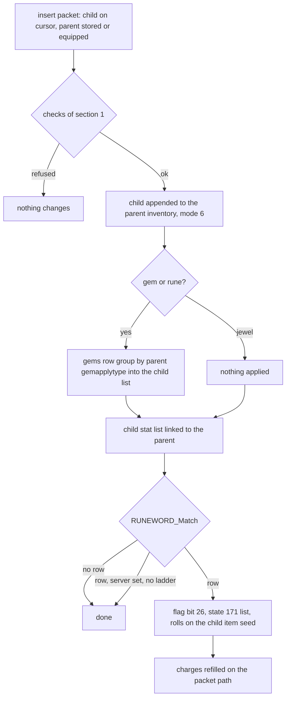

# 0007 — Socket filling, gems, runes and jewels, runeword activation

> **Subsystem:** items/sockets-runewords
> **Question:** When a gem, rune or jewel goes into a socketed item, what does the server check, what does the item gain, and when do the inserted runes make a runeword, with which property rolls on which seed?
> **Date:** 2026-10-15   **Plan:** 0029 (Phase 1, Phase 1b, Phase 2)   **Status:** open (Phase 1 read from the decompile and the disassembly, committed before any lead was read; Phase 1b cross-check 2026-10-15: two contradictions, one reachable on stock data; Phase 2 [run:2026-10-15-sockets](experiments.md#run2026-10-15-sockets): `tools/sockets.py` reproduces 351 inserts, 50 runewords and 357 client tests with 0 mismatches; review requested; follow-ups 2026-10-15: § 1 caller table `p5` corrected from the pushes, § 1 opcode table start from the dispatcher, § 5 per-func coverage of the run; plan 0038 batch S2c, 2026-10-16: 15 statements raised and 8 in part, 4 reclassified, one count corrected, [§ Plan 0038 batch S2c](#plan-0038-batch-s2c-2026-10-16); plan 0038 batch H2b, 2026-10-20: 1 statement raised in part; the S2c piece of sock 44 in part; the clamps reached on the drop path, [§ Plan 0038 batch H2b](#plan-0038-batch-h2b-2026-10-20))

Names of structs and fields are ours. "Parent" is the socketed item, "child" the gem, rune or jewel put into it.
"Item seed" is the item-data seed at `ItemData+0x04` (`ITEMS_GetSeed`), not the unit seed at `Unit+0x20`
([rng/0002](../rng/0002-seed-tree.md)). The property machinery (`sub_0065FEC0_ItemApplyProps`, `PROP_ApplyBlock`, the
`func` handlers, `PROP_RollValue`, `PROP_WriteStat`) is [items/0006](0006-properties.md) § 2–4; this finding adds what
those functions do when the item they get is **not** the item that receives the stats. Item types are `ItemTypes`
record indices (20 `gem`, 45 `weap`, 53 `sock`, 74 `rune`). Item flags are `ItemData+0x18`; bit 4 (`0x10`) is
identified, bit 11 (`0x800`) socketed, bit 26 (`0x4000000`) runeword ([d2s § Flags](../../formats/d2s.md#flags)).
Item unit modes: 0 stored, 1 equipped, 4 on the cursor, 6 socketed. Phase 1 was written from the code only; no
community text had been read when it was written.

## Answer (summary)

- [C] **The server insert is `ITEMS_InsertSocket`** (fn:ITEMS_InsertSocket@0x00562660). The client packet handler
  `SOCK_PacketInsert` (9 bytes: opcode `0x28`, child unit id, parent unit id) calls it with all four option flags set.
  Corroboration: every packet insert of the run arrived as client packet `0x28` and reached the insert with
  `p4..p7` = 1, 1, 1, 1 (run:2026-10-15-sockets; the packet table in § 1). The
  save reader (corroborated: the five pre-filled children of the load session reached it from the call 0x00531355
  with `p4..p7` = 0, 0, 0, 0, which the code pushes), the golem reader and the item copier call it too, for each
  socketed child they rebuild, with `p4`, `p6` and `p7` clear; the other reader sites, the copier and the golem
  reader set `p5` (§ 1 caller table, `[I]`, not run). It refuses, in this order:
  *2026-10-27, plan 0038 batch H6b:* the copier now ran (Anya's personalize: `p` = 0, 1, 0, 0 at 0x0055A41C, the copy
  itself as the player argument); the golem reader and the other reader sites still did not, [§ Plan 0038 batch H6b](#plan-0038-batch-h6b-run2026-10-27-sweep-sockets).
  - a child that is not an item, or is not **on the cursor** (mode 4);
  - a parent that is not an item or is not identified;
  - (packet path) a parent that is not stored or equipped (mode 0 or 1);
  - a child that is not a `sock` type (gem, rune or jewel);
  - an unidentified child;
  - a parent without the socketed flag, or whose base has `hasinv` 0;
  - a parent whose filled count has reached stat 194 (`item_numsockets`).

  Nothing else is tested: no level requirement, no item class (`gemapplytype`), no quality, no classic/expansion
  check. (fn:SOCK_PacketInsert@0x0054B650, 0x005626B4–0x005627AD)

  Of these refusals the run produced only the unidentified child. The others are read from the code and were seen
  passing, never failing: the client's own test (below) screens them from clicks, so they stay `[I]` as refusals
  until a forged `0x28` packet (ADR-0010) reaches them. (fn:ITEMS_InsertSocket@0x00562660, run:2026-10-15-sockets;
  architect review 2026-10-15)
- [C] **The tests run in that order**, and the run saw the whole chain: 350 inserts passed the tests in order
  (logged at each passing branch; the parent-mode test applies only with option flag p6 set, so the five reader
  inserts pass it untested) and one, an unidentified magic jewel, stopped after `child_sock`, at the identified test,
  with return 0 and nothing changed. Inserts into magic, rare, crafted and low-quality parents, into every item
  class and in a classic game were accepted, so neither quality, class nor game type is tested.
  (run:2026-10-15-sockets)
- [I] **No level-requirement test.** Every rune of the run (up to Zod, level 69) was below the character's level 80, so
  the run does not show it; the code has no such test (§ 1, fn:ITEMS_InsertSocket@0x00562660).
  *2026-10-27, plan 0038 batch H6b:* **raised**: a level-1 character inserted 24 runes up to `levelreq` 65, each
  accepted by the client and the server, [§ Plan 0038 batch H6b](#plan-0038-batch-h6b-run2026-10-27-sweep-sockets).
- [C] **The client tests first and sends `0x28` only when its own test passes** (`sub_004843E0_UiCanInsertSocket`,
  `.\UI\inv.cpp`). Its order: the UI state word `0x007BCBF0` not 10 or 11, cursor item a socket filler, target socketed
  (flag bit 11), base `hasinv`, `ItemMaxSockets` ≠ 0, target identified, target flag bit 8 clear, target inventory
  present, children < stat 194. When it fails, a click on an item in a grid sends the ordinary
  place/swap packet (`0x18` or `0x1F`) and the two items change places; a click on a paper-doll item sends nothing.
  It does **not** test the child's identified flag, so an unidentified jewel reaches the server, which refuses it.
  Corroboration: 357 client verdicts reproduced from the logged inputs (ok 346; not a filler 4; full 2; not
  socketed 5). (fn:sub_004843E0_UiCanInsertSocket@0x004843E0, run:2026-10-15-sockets)
- [I] **The client's identified test is not reached for a socketed item.** An unidentified magic cap with two sockets
  showed the client flags `0x00804001`, without bit 11, so the client refused it as not socketed and sent a swap
  instead of `0x28`. The client unit apparently lacks the socketed flag until the item is identified; one case.
  (run:2026-10-15-sockets, session `refuse`)
  *2026-10-27, plan 0038 batch H6b:* met: the same insert, tried before and after a Scroll of Identify, failed at the
  socketed test (client flags `0x00800000`, stat 194 0) and then passed (`0x00800811`, stat 194 2), [§ Plan 0038 batch H6b](#plan-0038-batch-h6b-run2026-10-27-sweep-sockets).
- [C] **The child joins the parent's inventory at the tail** (fn:sub_0063B210_InvPlaceSocketed@0x0063B210). Its mode
  becomes 6. The socket order is therefore insertion order: `INV_GetFirstItem` → `INV_GetNextItem` walks the children
  in that order. Corroboration: the parent's child list after each of the 350 inserts was its list before plus the
  child at the tail, and the child's mode was 6.
- [I] **Its x is the filled count before the insert and its y is 0** (§ 1, the child's place). Not logged by the run. (fn:sub_0063AF20_InvAppendItem@0x0063AF20,
  0x005627FC, run:2026-10-15-sockets)
  *2026-10-27, plan 0038 batch H6b:* **raised**: logged at the setter calls in all 35 inserts (x > 0 in 20; y 0, body
  location −1), [§ Plan 0038 batch H6b](#plan-0038-batch-h6b-run2026-10-27-sweep-sockets).
- [C] **Gems and runes write into their own stat list, which is linked to the parent.** `ITEMS_AttachToOwner` looks up
  the child's `gems` row (base `+0x0F0`). It applies the row's 3-block group chosen by the **parent's**
  `gemapplytype`: 0 → `weaponMod`, 1 → `helmMod`, 2 → `shieldMod`. The child is the item and the target, in mode 2
  (gem) or mode 5 (rune); the two modes behave the same. A jewel gets nothing applied, because its own rolled list
  is already there. Then the child's stat list is attached to the parent (`sub_00627910_StatListLinkOwner`); the
  parent's own lists are not written. On stock data the transfer makes **no draw**: every gem and rune block has
  `min = max` or a `func` that never draws. Corroboration: the data check over all 69 `gems` rows (§ 3), and the run:
  337 gem and rune transfers (178 gems, each of the 35 gems into each of the three groups; 159 runes) reproduced slot by slot
  with the child's seed unchanged, and the parent's lists after each insert were its lists before plus the child's
  own list (state 0, flags `0x80000000`). (fn:ITEMS_AttachToOwner@0x0055C2C0,
  fn:sub_0065C6D0_PropBlock3x3@0x0065C6D0, run:2026-10-15-sockets)
- [C] **The runeword match runs after every insert, and only a full item can match** (fn:RUNEWORD_Match@0x0062BED0).
  The match fails at once when:
  - the parent's quality is 4..9 (so low, normal and superior qualify);
  - the base's `quest` is non-zero;
  - the number of children differs from stat 194.

  Otherwise it walks `Runes` from record 0 and returns the first row with:
  - `complete` ≠ 0;
  - `Rune1..` equal to the children's base items in socket order;
  - the parent of none of `etype1..3`;
  - the parent of one of `itype1..6` (`ITEMS_UnitIsType`, so equivalences count).

  Corroboration: the model's match agreed with the logged row after all 350 inserts: 50 runewords from 29 rows, a
  low-quality and a superior base matching, and no match for the wrong type, the wrong order, magic, rare and crafted
  bases, *Wirt's Leg* and a 3-socket base holding the first three runes of *Bramble* (run:2026-10-15-sockets). `etype` is
  untested: no stock `complete` row uses it.
- [C] **What a runeword gets** (fn:RUNEWORD_Apply@0x006600A0). The row's `server` byte, when set, makes the runeword
  apply only in a ladder game (`Game+0x74`); otherwise the insert still succeeds, with no runeword. The parent gets
  flag bit 26 and a stat list of state 171 (`0xAB`), flags `0x40`, filled from `T1Code1..7` in column order. A blank
  code ends the list. `+0x82` is the string index of the row's `Name`, set by `RUNES_Load`; the save stores it as the
  16-bit runeword field. Corroboration: the game-written save of a *Steel* sword holds flag 26 and a 171 list
  (§ 6). (fn:RUNES_Load@0x006394A0)
- [C] **The handlers' item is the child just inserted**, not the parent. `RUNEWORD_Apply` passes the last child as the
  handlers' item and the parent as the target of `PROP_WriteStat`. So every handler test of "the item" sees a rune
  (fn:RUNEWORD_Apply@0x006600A0, 0x006600E8–0x006600FE):
  - func 2 (`ac%`) does not reset the parent's base defense;
  - funcs 5 and 6 (`dmg-min`, `dmg-max`) take the non-weapon branch and write all three stats (21/23/159 or
    22/24/160);
  - func 7 (`dmg%`) writes 17 and 18 directly, with no base reset and no "+1 maximum damage" fallback;
  - func 23 (`ethereal`, *Famine*) does nothing, because the rune has no durability.

  Corroboration (second path): *Steel* on a one-handed, non-throwing long sword saved stats 21, 23 and 159 (+3) and
  22, 24 and 160 (+3), which only the non-weapon branch writes (§ 6). The save shows which unit is the item, not which
  seed is stepped. (fn:RUNEWORD_Apply@0x006600A0, fn:PROP_Func05_DmgMin@0x0065ECF0,
  fn:PROP_Func23_Ethereal@0x0065FD20, run:2026-10-11-d2s-samples)
- [C] **The rolls draw on that child's item seed.** Because the child is the handlers' item, every `PROP_RollValue`
  and the func 19 charges draw step `ITEMS_GetSeed(child)`; the parent's seeds are not touched. The draw order per
  line is items/0006 § 3–4. Corroboration: 50 runewords reproduced line by line from the child's seed at its insert
  (an input, ADR-0004), 50 draws among them (ranged lines of *Splendor*, *Sanctuary*, *Gloom*, *Enigma*, *Stone*,
  *Bramble*'s aura, *Call to Arms*'s `oskill`, *Famine*, *Duress*, *Bone*, …, and every func 19 charge), with the
  game seed and the parent's item and unit seeds unchanged. The run reached funcs 1, 2, 3, 5, 6, 7, 8, 10, 11, 15, 16,
  17, 19, 21, 22 and 23, not 20 or 24; the per-func counts and tags are in § 5.
  *2026-10-27, plan 0038 batch H6b:* func 20 is now reached (*Eternity*), and func 17's `par`-0 branch with min = max
  (*Leaf*); func 24 and the ranged `par`-0 roll are reached only by `server` rows, [§ Plan 0038 batch H6b](#plan-0038-batch-h6b-run2026-10-27-sweep-sockets). (fn:PROP_RollValue@0x0065E9E0,
  fn:PROP_Func19_Charged@0x0065F6A0, fn:ITEMS_GetSeed@0x00627D90, run:2026-10-15-sockets)
- [C] **That seed, for a rune loaded from a save, is `{startSeed, 666}`** at the insert: 49 of the 50 completing runes
  were loaded, and each one's item seed equalled its own start seed with high word 666. A rune made in the session
  (the cube's 3 Tir → Nef) carried an advanced seed instead, and *Black* completed by it reproduced from that seed.
  (run:2026-10-15-sockets)
- [C] **On the packet path a new runeword's charges are refilled to the maximum** (`sub_0055FE80_ItemRefillCharges`,
  option flag 4). The func 19 draw still happens, so it still moves the child's seed. Corroboration: the parent's
  lists after the refill reproduced for all 50 runewords, 14 of them with a charge raised. (0x00562848, run:2026-10-15-sockets)
- [I] **`ITEMS_SetSockets` clamps, read in full** (§ 7). The request `n` becomes `min(max(n, 1), cap)`, and nothing
  is set when `cap < 1`. `cap` is `min(invwidth · invheight, 6)` and then (fn:ITEMS_SetSockets@0x0062BCB0):
  - magic: at most 4;
  - set and unique: 1 when the item has no sockets yet; otherwise the request is replaced by the current count;
  - rare: at most 2;
  - crafted and quality 9: at most 3;
  - every quality: at most `ItemMaxSockets`.

  The load path uses `ITEMS_SetSocketsOnLoad`, which has no quality clamp. (fn:ITEMS_SetSockets@0x0062BCB0,
  fn:ITEMS_SetSocketsOnLoad@0x0062BE00)
- [C] **The load path keeps a magic, rare or crafted item's socket count above the creation clamps**, and the insert
  fills them all (fn:ITEMS_SetSocketsOnLoad@0x0062BE00). Built states (ADR-0010 forced path, run session `forced`): a magic crystal sword with 6 sockets, a
  magic shield with 4, a rare crystal sword with 5 and a crafted long sword with 4 loaded with those counts (stat
  194) and took that many gems. `ITEMS_SetSockets`' own clamps are not reached by the run and stay inferred (§ 7).
  (run:2026-10-15-sockets)
  *2026-10-20, plan 0038 batch H2b:* the size, 6 and `ItemMaxSockets` clamps and their order are now reached on the
  drop path (34 calls, sock 42 raised in part), as steps of the cap: no request exceeded the cap; the quality clamps are not, [§ Plan 0038 batch H2b](#plan-0038-batch-h2b-2026-10-20).

## Leads used

Phase 1 had no lead. The entry points came from items/0006 (*Open questions*: the four other callers of
`ItemApplyProps`), save/0001 § 7 (`0x0062A900`, `0x0062BE00`, `0x0062BED0`) and data/0001 (the Runes loader). Phase 1b cross-check follows.

Phase 1 was committed (7cd4331) before any source below was read. The sources were fetched and read on 2026-10-15
for the Phase 1b cross-check (ADR-0007; raw HTML in the scratchpad):
- `src:arreat-summit-socketing`: Socketed Items, Gems, Runes, Rune Words and the 1.10 Rune Words page. It describes
  Lord of Destruction, 1.13 or later.
- `src:arreat-summit-magic-items`: § Jewels.
- `src:d2dfg-blizzard`: § Runes.txt, § gems.txt, and the item tables' `gemapplytype`, `gemoffset` and `hasinv`. It
  describes D2R, so a difference from it may be a version difference.
- `src:planetdiablo-socketing-guide`: § II `gemapplytype`.
- `src:d2runewizard-runeword-faq`, which describes D2R.

None has game code. Agreement promotes nothing. The one `contradicted` verdict that stock play can reach is a
required Phase 2 case (backlog 2026-10-15 reverser → architect, plan 0029 Phase 1b contradictions).

**The insert**
- [L] src:arreat-summit-socketing: a gem is inserted by picking it up and left-clicking it onto the socketed item.
  **held**
  Detail: the child must be on the cursor (mode 4), the packet path's first test (§ 1).
- [L] src:arreat-summit-magic-items: a jewel must be identified before it is inserted. **held with refinement**
  Detail: the identified test applies to every child, and to the parent as well (§ 1). The page's "Magic, Rare, or
  Unique" jewels all take the non-set branch of § 3, so the unique jewel is covered too.
- [L] src:arreat-summit-socketing: magic items have up to 4 sockets, rare items 2. **held**
  Detail: `ITEMS_SetSockets` (§ 7).
- [L] src:arreat-summit-socketing: crafted, set and unique items are limited to 1 socket "in most cases", and a few set
  and unique items have more by default. **contradicted** (crafted); **held with refinement** (set, unique)
  Detail: the code caps crafted (8) and quality 9 at **3**, not 1. Set and unique get 1 when they have no sockets yet,
  and an item that already has some keeps its count (§ 7). Required case: a crafted item through `ITEMS_SetSockets`
  with a request above 1, where stock play reaches it (Larzuk's reward, plan 0032), else forced (ADR-0010). Backlog
  2026-10-15.
- **Not covered** by any source read: the full refusal order, the absence of a level, class or expansion test in the
  insert, and the socket order being the insert order with x = 0, 1, 2, ….

**Gem and rune mods per item class**
- [L] src:arreat-summit-socketing: gems give separate effects for weapons, for shields, and for helms and armour; runes
  for weapons and for armour/helms/shields, with shield variants (Tal, Ral, Ort, Thul 35 %, Eld's block). **held**
  Detail: the group is the parent's `gemapplytype`, 0 / 1 / 2. Stock bases: 0 for weapons, 1 for `tors`, `helm`,
  `circ`, `pelt`, `phlm`, 2 for `shie`, `ashd`, `head` (§ 3).
- [L] src:d2dfg-blizzard: `weaponMod*` applies for `gemapplytype` 0, `helmMod*` for 1, `shieldMod*` for 2. **held**
  Detail: `sub_0065C6D0_PropBlock3x3` (§ 3).
- [L] src:planetdiablo-socketing-guide: `gemapplytype` 0 socketed like weapons, 1 like helms, 2 like shields. **held**
- [L] src:arreat-summit-socketing: gem effects stack; three gems of one type give all three bonuses. **held**
  Detail: each child keeps its own list, linked to the parent (§ 3).
- [L] src:d2dfg-blizzard: `gemoffset` is the starting index into `gems.txt` for the item. **contradicted** (1.14d)
  Detail: in 1.14d `GEMS_Load` overwrites `+0x0F0` of each gem's or rune's own base item with its `gems` row, and the
  insert reads the **child's** `+0x0F0`; no parent offset is read (§ 3, data/0004 § 3). Every stock cell is 0, so the
  two readings give the same result on stock data. Not a run case; the spec must not port the D2R reading. Backlog
  2026-10-15.
- **Not covered:** that gem and rune inserts make no draw, that the gem or rune itself is "the item" for the handlers,
  and the first gem's colour (presentation, ADR-0005).

**The runeword match**
- [L] src:arreat-summit-socketing: the item needs exactly the number of sockets the formula has; a 4-socket item does
  not take a 3-rune word. **held**
  Detail: stat 194 must equal the number of children (§ 4). The extra-rune quirk (§ 4) is the other direction and is
  not covered.
- [L] src:arreat-summit-socketing: the item type must match the formula; hammers are not maces; "Weapons" covers
  melee, missile and orbs. **held**
  Detail: `itype1..6` through `ITEMS_UnitIsType` (equivalences); `hamm` and `mace` are both `blun` but neither is
  the other (ItemTypes data).
- [L] src:arreat-summit-socketing: runewords work only in socketed non-magical items; never magic, set, unique or
  rare. **held with refinement**
  Detail: crafted and quality 9 are excluded as well, low quality is **not** excluded, and ethereal is not tested
  (§ 4). Low quality is a required Phase 2 case if a socketed low-quality base can be had on stock data.
- [L] src:d2runewizard-runeword-faq: superior and ethereal bases make runewords. **held**
  Detail: the *Steel* sample is an ethereal base (§ 6).
- [L] src:arreat-summit-socketing: runewords do not work in Wirt's Leg. **held**
  Detail: its base `leg` has `quest` 1, which `RUNEWORD_Match` refuses (§ 4).
- [L] src:arreat-summit-socketing: the runes must go in the formula's order, first Rune1, then Rune2, …; a wrong rune
  gives the runes' own bonuses but no runeword. **held**
  Detail: socket order is insertion order, and the rune lists stay linked whatever the outcome (§ 3, § 4).
- [L] src:arreat-summit-socketing: the runeword item keeps the bonuses of each rune. **held**
  Detail: the runeword's list (state 171) is added beside the children's lists (§ 5).
- [L] src:arreat-summit-socketing: the 1.10 ladder runewords work only for ladder characters on the realms, not
  single player, open or non-ladder. **held**
  Detail: a row with `server` set is applied only when `Game+0x74` (ladder) is set; the insert itself succeeds
  (§ 1). The 23 stock `server` rows are the page's 23 ladder words, matched by rune sequence; the
  `Rune Name` comment column calls two of them *Widowmaker* and *Winter*, which the page lists as *Grief* (Eth Tir Lo
  Mal Ral) and *Voice of Reason* (Lem Ko El Eld).
- [L] src:d2runewizard-runeword-faq: in the original game, ladder runewords are restricted to ladder multiplayer.
  **held**
- [L] src:d2dfg-blizzard: `complete` 1 means the runeword can be made; `firstLadderSeason`/`lastLadderSeason` gate
  ladder rows. **held with refinement**
  Detail: `complete` holds. 1.14d has no season columns; it has the `server` byte (version difference).
- [L] src:d2dfg-blizzard: the order of `Rune1..6` matters; `itype` includes and `etype` excludes. **held**
- [L] src:arreat-summit-socketing: a superior base adds its own bonuses to the runeword. **held**
  Detail: the base's own lists are not touched (§ 5).

**The runeword rolls**
- [L] src:arreat-summit-socketing: some runeword stats "vary" (e.g. *Call to Arms* `+2-6` Battle Command; *Famine*
  `+320-370%` damage, which is the row's 270–320 plus Ohm's 50). **held with refinement**
  Detail: each ranged line is drawn once, when the word is made, on the **last-inserted rune's** item seed (§ 5).
  The seed is not covered by any source.
- [L] src:arreat-summit-socketing: *Fortitude*'s life per level `X` is set at random between 1 and 1.5 when the
  runeword is made. **held**
  Detail: `hp/lvl` 8–12 (in eighths) is one `Roll` (§ 5).
- [L] src:arreat-summit-socketing: the *Famine* listing has no "Ethereal" line, while its `runes` row has
  `ethereal`. **held**
  Detail: func 23 sees the rune, which has no durability, so the line does nothing (§ 5).
- [L] src:d2dfg-blizzard: `T1Param`/`T1Min`/`T1Max` "usage depends on the property function". **held**
- **Not covered** by any source read: the refill of charges on the packet path, `ac%` not resetting the base defense,
  `dmg-min`/`dmg-max`/`dmg%` taking the non-weapon branch, and the extra-rune stale-slot quirk.

## Functions

| Address | Name | Role | Tag |
|---|---|---|---|
| `0x0054B650` | `SOCK_PacketInsert` | client packet (length 9): checks, then `ITEMS_InsertSocket(child, parent, 1, 1, 1, 1)`; table entry `0x006E0E58` | C |
| `0x005490E0` | `sub_005490E0_PktIsCursorItem` | the child is the player's cursor item (mode 4) | I |
| `0x005491B0` | `sub_005491B0_PktIsOwnStoredItem` | a mode-0/1 parent belongs to the player's inventory | I |
| `0x004843E0` | `sub_004843E0_UiCanInsertSocket` | client: may the cursor item go into the target (`.\UI\inv.cpp`); sends `0x28` only when it passes | C |
| `0x00629900` | `sub_00629900_ItemBaseHasInv` | base `hasinv` (`+0x137`); its value at the client test equals the table's in 39 calls (H6b) | C |
| `0x00562660` | `ITEMS_InsertSocket` | the server insert (§ 1) | C |
| `0x0055C2C0` | `ITEMS_AttachToOwner` | gem/rune mods, set bonus, stat-list link of a child to its owner (§ 3) | C |
| `0x004C0D20` | `sub_004C0D20_ClientSocketAttach` | the client's copy of the gem/rune transfer (fatal instead of silent on a bad row) | I |
| `0x004E6720` | `sub_004E6720_ClientGemDescMode5` | client: mode-5 apply to a scratch list, for a description, then free | I |
| `0x004E67D0` | `sub_004E67D0_ClientGemDescMode2` | the same in mode 2 | I |
| `0x0062BED0` | `RUNEWORD_Match` | the `Runes` row a parent makes, or NULL (§ 4) | C |
| `0x006600A0` | `RUNEWORD_Apply` | flag bit 26 and the state-171 list (§ 5) | C |
| `0x0055FE80` | `sub_0055FE80_ItemRefillCharges` | every stat 204 entry with current < max gets max | C |
| `0x00558530` | `sub_00558530_ItemReplenishDurTimer` | schedules the stat 252 (`item_replenish_durability`) event at the frame + 2500 / v + 1 (H6b; the truncation is the `idiv` at 0x00558561, read: the logged case divides exactly) | C |
| `0x00558580` | `sub_00558580_ItemReplenishQtyTimer` | the same for stat 253 | I |
| `0x00563470` | `sub_00563470_ItemDiscardInvalid` | removes a loaded item flagged runeword that no longer matches | I |
| `0x00627910` | `sub_00627910_StatListLinkOwner` | attaches a child's stat list (`Unit+0x5C`) to an owner | I |
| `0x006299B0` | `ITEMS_GetSockets` | stat 194 | I |
| `0x00629A40` | `ITEMS_GetGemApplyType` | base `gemapplytype` (`+0x13E`) of an item unit | I |
| `0x00629A00` | `sub_00629A00_GemApplyTypeOfClass` | the same by class id | I |
| `0x0062A900` | `ITEMS_CountFilledSockets` | `n_filled` for the save writer: children in the inventory, when `hasinv` | I |
| `0x0062BE00` | `ITEMS_SetSocketsOnLoad` | the save reader's socket setter (§ 7) | C |
| `0x0062BEB0` | `ITEMS_IsSocketFiller` | `ITEMS_UnitIsType(item, 53)` | I |
| `0x006394A0` | `RUNES_Load` | `runes` descriptor, 0x120 per record; `+0x82` = string index of `Name` | I |
| `0x00639420` | `sub_00639420_ExcelFileProbe` | looks for a file under `DATA\GLOBAL\EXCEL`; `RUNES_Load` stops fatally if `runessrv` is found | I |
| `0x00639CB0` | `RUNES_GetTable` | `&g_nRunes` (count, then pointer) | I |
| `0x00639D60` | `RUNES_GetRecord` | record by index, index 0 refused (fatal) | I |
| `0x0063ABD0` | `INV_Create` | an inventory for a unit (`Unit+0x60`) | I |
| `0x0063B210` | `sub_0063B210_InvPlaceSocketed` | removes the child from where it was, appends it, x = count, y = 0, count + 1 | C |
| `0x0063AF20` | `sub_0063AF20_InvAppendItem` | tail append of the inventory item list (`ItemData+0x64` next) | I |
| `0x0063B2C0` | `INV_GetFirstItem` | inventory `+0x0C` | I |
| `0x0063DFA0` | `INV_GetNextItem` | `ItemData+0x64` | I |
| `0x0063CD60` | `INV_GetItemCount` | inventory `+0x28` | I |

Data: `data:g_nGems@0x0096CA90`, `data:g_pGems@0x0096CA94` (0xC0 per record, `struct:GemsRec`),
`data:g_nRunes@0x0096CA98`, `data:g_pRunes@0x0096CA9C` (0x120 per record, `struct:RunesRec`), in `re/types/sockets.h`.

## Walkthrough

### 1. The insert: `ITEMS_InsertSocket` (0x00562660)

Fastcall-plus-stack: ECX = game, EDX = the player (or NULL), stack `(childId, parentId, &notFound, p4, p5, p6, p7)`,
`ret 0x1C`. The callers pass:

| caller | p4 | p5 | p6 | p7 |
|---|---|---|---|---|
| `SOCK_PacketInsert` 0x0054B6DB | 1 | 1 | 1 | 1 |
| `ITEMS_ReadInventoryList`'s socketed-child reader `0x00531210` (call 0x00531355) | 0 | 0 | 0 | 0 |
| the other inventory readers: `0x00531520` (0x00531578), `0x00531040` (0x005311B5), `0x00531390` (0x005313F0); `sub_0055A2A0_ItemCopy` (0x0055A41C); `D2S_ReadGolem`'s reader `0x0056ACE0` (0x0056AE18) | 0 | 1 | 0 | 0 |
| 0x00563441 (`0x00563350`, re-inserting copies of a parent's children) | caller's | 0 | 1 | 0 |

- [C] **The reader call 0x00531355 passes 0, 0, 0, 0.** The four pushes before it are all `push 0`
  (0x00531343–0x00531349); the load session of the run logged the same values at that call, 5 of 5 (return address
  0x0053135A). The table's earlier row grouped it with the sibling readers and gave it `p5` = 1; corrected 2026-10-15
  (spec-writer backlog entry). (0x00531343–0x00531355, run:2026-10-15-sockets)
- [I] **The other readers, the copier and the golem reader pass `p5` = 1.** Their pushes, last argument first, are
  `push 0` (`p7`), `push 0` (`p6`), `push 1` (`p5`), `push 0` (`p4`): 0x005311A2–0x005311A8, 0x005313DD–0x005313E3,
  0x00531567–0x0053156D, 0x0055A3F9–0x0055A3FF, 0x0056AE00–0x0056AE06. None ran in the run. `0x00563350`'s call
  pushes `push 0` (`p7`), `push 1` (`p6`), `push 0` (`p5`) and `p4` from its own third stack argument
  (`[ebp+0x10]`, 0x00563424–0x00563430). The packet handler pushes four `push 1` (0x0054B6C2–0x0054B6C8).
  *2026-10-27, plan 0038 batch H6b:* the copier's call 0x0055A41C logged `p` = 0, 1, 0, 0 (2 inserts); the other
  readers, the golem reader and 0x00563441 did not run. Which reader runs: the corpse reader `0x00533850` passes 1 as
  the fourth argument (0x0053397D), so corpse items take `0x00531520`; `0x00533350` is the version-71 list reader
  (`sub_005337F0_ItemListReadByVersion`, 0x005337F6), [§ Plan 0038 batch H6b](#plan-0038-batch-h6b-run2026-10-27-sweep-sockets).
- [I] **Which inventory reader runs.** `ITEMS_ReadInventoryList` reads each socketed child through `0x00531520`
  when its fourth stack argument (`[ebp+0x14]`) is non-zero and through `0x00531210` when it is zero (0x00533688,
  0x0053374A, both child loops). The character load of the run took the zero branch. What that argument means and
  which callers pass non-zero is not followed; `0x00533350`, the routine beside it, reads children through
  `0x00531040` and `0x00531390`, both with `p5` = 1. (fn:ITEMS_ReadInventoryList@0x005335E0)

The readers and the copier set the rebuilt child to mode 4 first (`UNIT_SetMode(child, 4)`, e.g. 0x0056ADF5), so the
cursor test passes for them too.

```c
// fn:ITEMS_InsertSocket@0x00562660 (trimmed; renamed)
*notFound = 0;
if (player) sub_0055BF50(player);                    // clears flag 0x4 on the player's items (not followed)
child = GameFindUnit(game, 4, childId);
if (!child) goto not_found;  if (child->type != 4) return 0;
if (child->mode != 4) goto not_found;                // on the cursor
parent = GameFindUnit(game, 4, parentId);
if (!parent) goto not_found; if (parent->type != 4) return 0;
if (!ITEMS_CheckFlags(parent, 0x10)) return 0;       // identified
if (p6 && parent->mode != 0 && parent->mode != 1) return 0;
if (!ITEMS_IsSocketFiller(child)) return 0;          // ItemTypes 53 `sock`
if (!ITEMS_CheckFlags(child, 0x10)) return 0;        // identified
if (!ITEMS_CheckFlags(parent, 0x800)) return 0;      // socketed
if (!ItemBaseHasInv(parent)) return 0;               // base +0x137
inv = parent->inventory ? parent->inventory : INV_Create(NULL, parent);
if (!inv) return 0;
if (INV_GetItemCount(inv) >= (ITEMS_GetSockets(parent) & 0xFF)) return 0;   // stat 194
if (!InvPlaceSocketed(inv, child, 1)) Fatal(0x1444);
child->_c4 &= ~2;
if (p5 && player) InvSetCursorItem(player->inventory, NULL);
ITEMS_AttachToOwner(game, child, parent, 0);         // § 3
sub_006276C0(child, parent);                         // its first test needs a player or monster: no effect here
UNIT_SetMode(child, 6);                              // socketed
rw = RUNEWORD_Match(parent);                         // § 4
if (rw && !(rw->server && !game->ladder /*+0x74*/)) {
    RUNEWORD_Apply(parent, child, 0);                // § 5
    sub_00558530_ItemReplenishDurTimer(game, parent);
    sub_00558580_ItemReplenishQtyTimer(game, parent);
    if (p7) sub_0055FE80_ItemRefillCharges(game, player, parent);
} else if (!p4) return 1;
ITEMS_SetFlag(parent, 0x1, 1);
if (ITEMS_CheckFlags(parent, 0x4000)) ITEMS_SetFlag(parent, 0x4000, 0);
if (player) { sub_00621000(player, 1); sub_0063CC70(player->inventory, parent); }   // client update queue
return 1;
not_found: *notFound = 1; return 0;
```

- [I] **The refusal list** is the order of the tests above (C short-circuit). A refusal returns 0. The packet
  handler turns a "not found" (child or parent missing, child not on the cursor) into its error return 3 and ignores
  the other refusals. (0x005626B4–0x005627AD, 0x0054B6DB–0x0054B6F4)
- [I] **Not tested anywhere in the insert:** the child's level requirement (`levelreq`), the parent's
  `gemapplytype` or item class, the parent's quality, ethereal, the item version or the game's expansion flag, and
  whether the child is a gem, a rune or a jewel beyond the `sock` type. So the server accepts a rune in a classic game
  if one is there, and a jewel in any socketed item. (0x00562660–0x005628B1)
- [I] **The packet handler's own checks** (fn:SOCK_PacketInsert@0x0054B650):
  - the packet is exactly 9 bytes, else return 3;
  - the child id must be the player's cursor item (`sub_005490E0_PktIsCursorItem`);
  - a parent in mode 0 or 1 must be in the player's own inventory (`sub_005491B0_PktIsOwnStoredItem`);
  - when the player has an interaction whose target unit is a player (type 0; a trade), the insert is skipped
    silently.

  The handler is the word at `0x006E0E58` in `g_SrvPacketTable`. The dispatcher indexes that table by the opcode
  byte, `[opcode · 8 + 0x006E0D18]` (`movzx ebx, al` at 0x0054D76F, the test at 0x0054D772), so the entry is opcode
  `(0x006E0E58 − 0x006E0D18) / 8` = `0x28`, and the run logged client packet `0x28` before every packet insert: the
  opcode is `[C]` (second path, [items/0008](0008-cube.md)'s dispatcher reading, 2026-10-15). (0x0054B656,
  0x0054B680–0x0054B6DB, fn:sub_0054D750_SrvPacketDispatch@0x0054D750, data:g_SrvPacketTable@0x006E0D18,
  run:2026-10-15-sockets)
- [C] **The child's place** (fn:sub_0063B210_InvPlaceSocketed@0x0063B210). The child is removed from wherever it was
  (`0x0063AAF0`, here the cursor) and appended at the tail of the parent's item list (`sub_0063AF20_InvAppendItem`).
  Its x is set to the inventory count before the insert (`0x00620470`) and its y to 0 (`0x006204C0`). Then the
  count (`inventory +0x28`) is incremented and the body location is set to −1 (`0x00629ED0`). The children are
  therefore in insertion order, x = 0, 1, 2, …. `[C]` for the tail append and the count (the child lists and
  inventory counts of run:2026-10-15-sockets, Answer); x, y and the body location stay `[I]` (not logged).
  (fn:sub_0063AF20_InvAppendItem@0x0063AF20, 0x005627B7)
- [I] **`n_filled` in the save** is the length of that list (`ITEMS_CountFilledSockets`, 0x0062A900), counted only
  when the base has `hasinv`. (fn:ITEMS_CountFilledSockets@0x0062A900)

### 2. Option flags

- [I] `p4` = 1: the parent's update (flag bit 0 set, bit 14 cleared, the player's update queue) happens even when no
  runeword was made. With `p4` = 0 (the readers) it happens only for a runeword. (0x0056284F–0x0056289E)
- [I] `p5` = 1 with a player: the player's cursor slot is cleared (`0x0063C180(inv, NULL)`). (0x005627CB–0x005627DE)
  *2026-10-27, plan 0038 batch H6b:* the slot was already empty at this test in all 35 logged inserts (packet, reader
  and copier): `InvPlaceSocketed` removes the child from the cursor first (0x0063B26E). The clear has no observable
  effect there; `p4`, `p6` and `p7` are now each separated by a logged case, [§ Plan 0038 batch H6b](#plan-0038-batch-h6b-run2026-10-27-sweep-sockets).
- [I] `p6` = 1: the parent must be stored or equipped. (0x00562715–0x00562725)
- [I] `p7` = 1: a new runeword's charged skills are refilled (§ 5). (0x0056283A–0x00562848)

### 3. Gems and runes: `ITEMS_AttachToOwner` (0x0055C2C0)

Called as `ITEMS_AttachToOwner(game, child /*EDX*/, owner, flag)`. The equip code calls it as well, with a player as
the owner; the socket path passes the parent.

```c
// fn:ITEMS_AttachToOwner@0x0055C2C0 (trimmed)
if (!owner || !child || child->type != 4) return;
if (owner->type == 0 && UnitHasState(owner, 7)) return;
if (ITEMS_UnitIsType(child, 20 /*gem*/)) {
    if (owner->type != 4) return;                       // gems only act inside an item
    g = GEMS_GetRecord(ITEMS_GetRecord(child->classId)->gemoffset /*+0x0F0*/);  if (!g) return;
    sub_0065FEC0_ItemApplyProps(2, 0,     child, g, ITEMS_GetGemApplyType(owner), 0);
} else if (ITEMS_UnitIsType(child, 74 /*rune*/)) {
    if (owner->type != 4) return;
    g = GEMS_GetRecord(...as above...);  if (!g) return;
    sub_0065FEC0_ItemApplyProps(5, owner, child, g, ITEMS_GetGemApplyType(owner), 0);
} else if (ITEMS_GetQuality(child) == 5) sub_00663CC0(owner, child, 0, 0);   // set bonus; not reached by a jewel
sub_0055C270(game, child);                              // recalculation hook when the owner is a player
flag1 = 1;                                              // (an equipped weapon's alternate-slot case for players)
if (!ITEMS_CheckFlags(child, 0x100) || flag) sub_00627910_StatListLinkOwner(owner, child, flag1);
```

- [I] **The group comes from the parent** (fn:sub_0065C6D0_PropBlock3x3@0x0065C6D0). `ItemApplyProps` gets the
  parent's `gemapplytype` as its 5th argument, and `sub_0065C730_PropBlockGet` sends modes 2 and 5 to
  `PropBlock3x3(row, group, i)`, which returns `row + {0x30, 0x60, 0x90}[group] + 16·i` for `i` < 3. A group ≥ 3
  or `i` ≥ 3 is fatal. The block loop stops at the first block with `code < 0`. `nummods` (`+0x2E`) is not read.
  On stock bases the group is 0 for every socketable weapon type, 1 for `tors`, `helm`, `circ`, `pelt`, `phlm`, and 2
  for `shie`, `ashd`, `head`; this is a data check over the 384 `hasinv` rows with `gemsockets` > 0.
  (0x0065FEC0–0x0066007B, fn:ITEMS_GetGemApplyType@0x00629A40, tbl:Weapons.txt:gemapplytype,
  tbl:Armor.txt:gemapplytype)
- [I] **Who is "the item".** The block loop calls `PROP_ApplyBlockByVersion` with ESI = the child. Its 2nd stack
  argument is a constant 0, and that argument reaches every handler as EDX. `PROP_WriteStat` uses it as the owner of
  the target list, so 0 means the child itself. `ItemApplyProps`'s own 2nd argument (the parent, for a rune) arrives
  only as the handlers' 9th stack argument. Funcs 7, 15, 16 and 17 pass it on to funcs 5 and 6, and nothing reads
  it. So a gem in mode 2 and a rune in mode 5 both roll on the child's item seed and write into the child's main
  list (state 0, flags `0x40`). The handlers test the mode only for `mode == 1`, so modes 2 and 5 behave the same.
  (0x00660051–0x0066006E, 0x0065FE10–0x0065FE41, 0x0065FD70–0x0065FDF5, 0x0065EB67–0x0065EB8B)
- [C] **No draw on stock data.** Every gem or rune block either has `min = max` (so `PROP_RollValue` returns `min`
  without a step), or uses funcs 15/16 (no draw), or func 17 with a non-zero `par` (Thul 75, Tal 125; no draw). The
  only `min ≠ max` blocks are Ral (`dmg-fire` 5–30), Ort (`dmg-ltng` 1–50) and Thul (`dmg-cold` 3–14) in `weaponMod1`,
  and they are funcs 15/16(/17). Corroboration: data behaviour over all 69 `gems` rows and their 207 block groups.
  (fn:PROP_RollValue@0x0065E9E0, fn:PROP_Func15_Min@0x0065F960, fn:PROP_Func17_Par@0x0065FA40,
  tbl:Properties.txt:func1)
- [I] **The child as the item, for gems and runes.** The handlers that look at the item see the gem or rune
  (0x00660051–0x0066006E, 0x0065FE10–0x0065FE41):
  - Pul's `ac%` (func 2) resets nothing;
  - Ith's `dmg-max` and Sol's `dmg-min` (funcs 6/5) take the non-weapon branch: stats 22, 24, 160 (or 21, 23, 159),
    clamped against the rune's own base bytes, which are 0;
  - Ohm's `dmg%` (func 7) writes 17 and 18;
  - Zod's `indestruct` (func 20) adds stat 152 to the rune's list.

  The parent is affected only through the linked list. (fn:PROP_Func02_RollAcPercent@0x0065EBA0,
  fn:PROP_Func05_DmgMin@0x0065ECF0, fn:PROP_Func07_DmgPercent@0x0065F010,
  fn:PROP_Func20_Indestructible@0x0065FAE0)
- [I] **The link** (fn:sub_00627910_StatListLinkOwner@0x00627910). The child's stat list (`Unit+0x5C`) is attached
  to the owner with `0x00626E10(owner, list, 1)`, and the list's owner field `+0x04` is set. When the list already
  belongs to the owner, only its enable bit `0x40000000` is toggled. The parent's own lists are never written by a
  gem, rune or jewel insert. Flag `0x100` on the child (meaning not settled) suppresses the link when `flag` is 0,
  which it is on the socket path. (fn:ITEMS_AttachToOwner@0x0055C2C0)
  *2026-10-27, plan 0038 batch H6b:* the link branch (0x00627984) was taken in all 35 inserts, the child's list
  owned by nobody before, stored, equipped and cursor parents alike; no stock socket filler has durability, so none
  can be broken, [§ Plan 0038 batch H6b](#plan-0038-batch-h6b-run2026-10-27-sweep-sockets).
- [I] **Jewels** take the last branch. Their quality is 4 or 6, never 5, so nothing is applied, and their own list,
  rolled at creation (items/0005), is linked as above. (fn:ITEMS_AttachToOwner@0x0055C2C0)
- [I] **The client** runs the same transfer in `sub_004C0D20_ClientSocketAttach` with the same modes and arguments.
  A missing row is fatal there, where the server returns silently. `sub_004E6720` (mode 5) and `sub_004E67D0`
  (mode 2) apply a row to a scratch unit for a description, then free the list. (0x004C0D20, 0x004E6720, 0x004E67D0)

### 4. The match: `RUNEWORD_Match` (0x0062BED0)

```c
// fn:RUNEWORD_Match@0x0062BED0 (trimmed)
if (!item) return NULL;
if (item->type == 4 && item->data && (unsigned)(item->data->quality - 4) < 6) return NULL;   // 4..9
if (ITEMS_GetRecord(item->classId)->quest /*+0x12A*/ || !item->inventory) return NULL;
n = 0;
for (c = INV_GetFirstItem(item->inventory); c; c = INV_GetNextItem(c)) {
    if (!c /*not an item*/) return NULL;
    kids[n++] = c->classId;                               // int kids[6] on the stack
}
s = ITEMS_GetSockets(item) & 0xFF;
if (s != n) return NULL;
for (r = 0; r < g_nRunes; r++) {                          // record 0 included
    R = &g_pRunes[r];                                     // 0x120 bytes
    if (!R->complete /*+0x80*/) continue;
    for (k = 0; k < 6 && R->rune[k] /*+0x98*/ >= 1; k++)
        if (n < k || kids[k] != R->rune[k]) goto next;    // note: k == n reads kids[n]
    if (k < s) continue;                                  // fewer runes than sockets
    for (k = 0; k < 3 && R->etype[k] /*+0x92*/; k++) if (ITEMS_UnitIsType(item, R->etype[k])) goto next;
    for (k = 0; k < 6 && R->itype[k] /*+0x86*/; k++) if (ITEMS_UnitIsType(item, R->itype[k])) return R;
next: ;
}
return NULL;
```

- [I] **Quality.** Qualities 4..9 (magic, set, rare, unique, crafted, 9) never match. Low quality (1) is not
  excluded: an unsigned `quality − 4 ≤ 5` test. Ethereal is not tested. (0x0062BEE7–0x0062BEFD)
- [I] **`quest`.** A base with `quest` ≠ 0 never matches. (0x0062BF08, tbl:Misc.txt:quest)
- [I] **Socket count.** The children must fill every socket: `stat 194 & 0xFF` must equal the number of children.
  Before the last insert the match returns NULL, so it is in effect a last-socket check that runs after every insert.
  (0x0062BF58–0x0062BF60)
- [I] **Rune order.** `Rune1..6` (`+0x98`, item indices through `g_ItemCodeLink`; a value < 1 ends the list) must
  equal the children's class ids in socket order, which is insertion order (§ 1). The row needs at least as many
  runes as sockets (`k < s` → next row). With exactly as many, the match is exact. For a row with **one rune more**
  than the sockets, the loop reaches `k = n` and compares `kids[n]`, a stack slot this call never wrote (the bound
  test is `n < k`, not `n ≤ k`); the row matches only if that stale word equals the extra rune's item index. Two or
  more extra runes never match. This is reachable on stock data: fill an *S*-socket base with the first *S* runes of
  an (*S* + 1)-rune word. No `complete` row's sequence is a one-shorter prefix of another's (data check), so an exact
  match never competes with such a stale match. (0x0062BFA3–0x0062BFCE)
- [I] **Types.** `etype1..3` exclude and `itype1..6` include, both through `ITEMS_UnitIsType`, so `weap` covers every
  weapon. A 0 entry ends each list. No stock `complete` row uses `etype`. (0x0062BFD0–0x0062C023,
  tbl:ItemTypes.txt:Equiv1)
- [I] **Scan order.** The first matching row wins, from record 0 up. No two `complete` rows share a rune sequence on
  stock data (data check), so the order changes nothing there. (0x0062BF6B–0x0062C03B)
- [I] **What is not tested here:** `server` (the insert tests it, § 1), the item version, the game type. (fn:RUNEWORD_Match@0x0062BED0)
- [I] **Other callers** (§ 6; 0x0063087E, 0x0053379A, 0x0056AD78):
  - `ITEMS_WriteFull` writes the row's `+0x82`, or `0xFFFF` when there is no row, for an item with flag bit 26;
  - `ITEMS_ReadInventoryList` and the golem reader discard a loaded item that has flag bit 26 but no matching row
    (`sub_00563470_ItemDiscardInvalid`);
  - `RUNEWORD_Apply` matches again.

  (0x0063087E, 0x0053379A, 0x0056AD78)

### 5. The runeword: `RUNEWORD_Apply(parent, child, 0)` (0x006600A0)

```c
// fn:RUNEWORD_Apply@0x006600A0 (stdcall, 3 arguments)
R = RUNEWORD_Match(parent);
if (!R || UnitFindStatList(parent, 171, 0x40)) return 0;    // no row, or already applied
ITEMS_SetFlag(parent, 0x4000000, 1);                        // flag bit 26
for (i = 0; i < 7 && R->t1[i].code >= 0; i++)              // T1Code1..7 at +0xB0, 16 bytes each
    PROP_ApplyBlock(/*mode*/6, /*target*/parent, /*item*/child, 0, i, 0, &R->t1[i], /*state*/171, /*flags*/0x40, 0);
return 1;
```

- [I] **The lines** are `T1Code1..7` in column order. The first `code < 0` ends the list, unlike the unique mode,
  which skips blanks. The stock `runes` rows have no gap and no unknown code (data check over 169 rows). Each line
  expands its `properties` slots exactly as items/0006 § 3 states; mode 6 is not 1, so no handler applies a
  mode-1 reset. (0x006600DD–0x0066010C, fn:PROP_ApplyBlock@0x0065FD70)
- [I] **Already applied.** When the parent already holds a state-171 list, nothing is applied and no flag is set.
  This is the save-load case: the reader rebuilds the parent with its saved lists before it re-inserts the children
  (save/0001 § 6–7), so a loaded runeword is not rolled again. (0x006600BC–0x006600CB)
  *2026-10-27, plan 0038 batch H6b:* **raised**: the *Steel* sample's reader re-insert matched row 18, and `Apply`
  returned 0 with no slot applied and the 171 list unchanged, [§ Plan 0038 batch H6b](#plan-0038-batch-h6b-run2026-10-27-sweep-sockets).
  *`lane/h6b` review:* the pushed `0x40` is not a test. `sub_00625790_UnitFindStatList` goes to `0x00625650` when its
  state argument is non-zero (0x006257AC–0x006257B5), and that walk compares the state (`+0x14`) of each list on the
  parent's two chains (`+0x3C`, `+0x40`) and nothing else (0x00625680, 0x00625697); a parent whose own list lacks bit
  `0x80000000` returns 0 first (0x006257A3). So any state-171 list stops the runeword. `[I]` (read): the run's only
  171 list had flags `0x40`, so it cannot separate the two readings.
- [C] **Target and item.** `PROP_ApplyBlock`'s 2nd argument (EDX for the handlers) is the parent, and its 3rd (the
  handlers' item) is the child. `PROP_WriteStat` writes into `sub_0065CBF0_PropTargetList(parent, 171, 0x40)`, a
  list it creates on the parent the first time and attaches with state 171. Every roll and every item test uses the
  child. Second path: the *Steel* save in § 6. (0x006600E8–0x006600FE, 0x0065EA94–0x0065EA9F,
  fn:sub_0065CBF0_PropTargetList@0x0065CBF0)
- [I] **The seed.** `PROP_RollValue(child, min, max)` takes `ITEMS_GetSeed(child)` because the child is an item. So
  does the func 19 charges draw (`0x0065F7F7`). Every draw of a runeword is on the item seed of the socket filler
  whose insert completed it. The parent's seeds are not touched. The Steel save's values are the rows' fixed values
  (min = max), so it does not show which seed is stepped; this stays `[I]` until Phase 2 logs the seed.
  (0x0065EA02–0x0065EA1A, fn:ITEMS_GetSeed@0x00627D90, fn:PROP_Func19_Charged@0x0065F6A0)
- [I] **That seed's state.** A socket filler's item seed starts as `{startSeed, 666}` for every server item unit
  (`sub_00552E90_ItemSeedInit`, rng/0002). A drop's `startSeed` is set by `sub_00558D90_ItemCreate` (items/0004).
  A loaded item is created through the same constructor, and no reader calls `ITEMS_SetStartSeed`
  (its six callers are the constructor, `ItemCreate` and the four creation fallbacks). So a rune loaded from a save
  carries a start seed drawn from the game seed at load time. Gem and rune inserts make no draws (§ 3). The state at
  `RUNEWORD_Apply` is therefore that start state, advanced by whatever the creation path drew on the item seed.
  Phase 2 logs it rather than modelling it (boundary, § 8). (fn:sub_00552E90_ItemSeedInit@0x00552E90,
  fn:ITEMS_SetStartSeed@0x00627E20)
- **Draws per line** follow items/0006 § 4, with these consequences of "the item is a rune". The handler reading is
  Phase 1's; each item's tag is set by the run's per-func coverage (next bullet), which corroborates the items whose
  branch the run reached:
  - [C] func 1, 3, 8, 10, 21, 22 (`oskill`, `aura`): `Roll` (one draw when `min ≠ max`), with the reuse rule of 3.
    Ranged lines drew for funcs 1 and 22; every func 3 slot reused the preceding slot's value with no draw, 15 of
    them on ranged lines (`res-all` 30–40, 50–70). Funcs 8, 10 and 21 met only fixed lines (`min` = `max`) in the
    run, so their one-draw case rests on the shared `PROP_RollValue`, which the ranged lines of funcs 1, 2 and 22
    corroborate (architect review 2026-10-15, recounted from the raw `SLOT` lines) (fn:PROP_Func01_Roll@0x0065EB30,
    fn:PROP_Func03_Reuse@0x0065EC10, fn:PROP_RollValue@0x0065E9E0, run:2026-10-15-sockets);
  - [I] func 8's reuse branch (`prev` ≠ 0): func 8 is the first slot of every `properties` row a stock runeword line
    uses, so `prev` is 0 there and the branch is not reachable on stock data (data check); the run's 50 func 8 slots
    all had `prev` 0 (fn:PROP_Func08_Reuse@0x0065F2B0, tbl:Properties.txt:func1, run:2026-10-15-sockets);
  - [I] func 24 (`v ← prev or Roll`): one stock row uses it; the run did not reach it (fn:PROP_Func24_ParParam@0x0065F390);
    *2026-10-27, H6b:* that row, *Faith*, has `server` 1: never made in single player, [§ Plan 0038 batch H6b](#plan-0038-batch-h6b-run2026-10-27-sweep-sockets);
  - [C] func 2 (`ac%`): one `Roll`; the base reset tests the rune, which is not armour, so the parent's defense is not
    reset to `maxac + 1` (`sub_0065CCC0_PropBaseReset` uses ESI = the child) (fn:PROP_Func02_RollAcPercent@0x0065EBA0,
    fn:sub_0065CCC0_PropBaseReset@0x0065CCC0, run:2026-10-15-sockets);
  - [C] funcs 5, 6 (`dmg-min`, `dmg-max`): the base record is the **parent's** (EDX is an item), but the
    `ITEMS_UnitIsType(item, 45)` tests see the rune, so all three stats are written, each clamped against the
    parent's base byte (fn:PROP_Func05_DmgMin@0x0065ECF0, fn:PROP_Func06_DmgMax@0x0065EE80, run:2026-10-15-sockets);
  - [C] func 7 (`dmg%`): one `Roll`; writes stats 18 and 17 directly; no base reset. [I] no `+1` fallback: the
    fallback sits on the weapon branch, which a rune never takes, so no run can show it firing
    (fn:PROP_Func07_DmgPercent@0x0065F010, run:2026-10-15-sockets);
  - [C] funcs 15, 16, 17 (the elemental damage pairs): no draw where `par` ≠ 0 or `min` = `max`. [I] func 17's `Roll`
    with `par` 0 on a ranged line: four stock rows have such a line (*Harmony*, *Fortitude*, *Lawbringer*,
    *Winter*; data check), none was made in the run (fn:PROP_Func15_Min@0x0065F960, fn:PROP_Func16_Max@0x0065F9D0,
    fn:PROP_Func17_Par@0x0065FA40, run:2026-10-15-sockets);
    *2026-10-27, H6b:* all four have `server` 1; *Leaf*'s `ac/lvl` (`par` 0, min = max) took the `par`-0 branch
    without a draw, [§ Plan 0038 batch H6b](#plan-0038-batch-h6b-run2026-10-27-sweep-sockets);
  - [C] func 11 (`hit-skill`, `gethit-skill`, …): no draw; the skill level is `max`. [I] Every stock runeword line has
    `max` > 0, so the ilvl branch (which would read the **rune's** ilvl) is not reached (data check)
    (fn:PROP_Func11_SkillOnEvent@0x0065F470, run:2026-10-15-sockets);
  - [C] func 19 (`charged`): one `RNG_RangeB(c − c/8)` on the child's seed, stored as `max << 8 | current`
    (fn:PROP_Func19_Charged@0x0065F6A0, run:2026-10-15-sockets);
  - [I] func 20 (`indestruct`): adds stat 152 to the parent's 171 list, no draw; three stock rows use it, the run
    reached none (fn:PROP_Func20_Indestructible@0x0065FAE0);
    *2026-10-27, H6b:* **raised**: *Eternity* (the one of the three rows with `server` 0) added stat 152, reproduced,
    [§ Plan 0038 batch H6b](#plan-0038-batch-h6b-run2026-10-27-sweep-sockets);
  - [C] func 23 (`ethereal`): tests `ITEMS_IsEthereal(child)` and `ItemHasDurability(child)`, so it never makes the
    parent ethereal. *Famine* (`Runeword39`) is the stock row with this line. (fn:PROP_Func23_Ethereal@0x0065FD20,
    run:2026-10-15-sockets)

  (fn:PROP_ApplyBlock@0x0065FD70, fn:PROP_Func01_Roll@0x0065EB30, fn:PROP_Func03_Reuse@0x0065EC10,
  fn:PROP_Func08_Reuse@0x0065F2B0, fn:PROP_Func10_SkillTab@0x0065F3F0, fn:PROP_Func15_Min@0x0065F960,
  fn:PROP_Func16_Max@0x0065F9D0, fn:PROP_Func17_Par@0x0065FA40, fn:PROP_Func21_ValParam@0x0065FB50,
  fn:PROP_Func02_RollAcPercent@0x0065EBA0, fn:sub_0065CCC0_PropBaseReset@0x0065CCC0, fn:PROP_Func06_DmgMax@0x0065EE80,
  fn:PROP_Func07_DmgPercent@0x0065F010, fn:PROP_Func11_SkillOnEvent@0x0065F470, fn:PROP_Func22_SkillParam@0x0065FBF0,
  fn:PROP_Func19_Charged@0x0065F6A0, fn:PROP_Func23_Ethereal@0x0065FD20; `runes` `T1Code1..7`; run:2026-10-15-sockets)
- [C] **Per-func coverage of the run** (2026-10-15 follow-up, architect request of the plan 0029 Phase 3 review). The
  50 runewords that `tools/sockets.py check` reproduces (Answer) reached these property funcs. The counts come from
  the logged `SLOT` lines between `RWA` and `RWX`, not from the model, and the check prints them under "runeword
  property funcs reached" (the command is in the run record). "Drew" counts the slots whose child seed moved between
  `SLOT` and `SLOTR`; "stock rows" counts the complete `runes` rows with a line that reaches the func (data check
  over the `properties` rows of `T1Code1..7`). Every slot reproduced draw for draw and write for write, and the
  parent's lists matched at `RWX`: that bit-exact reproduction is the corroboration of the `[C]` items above.
  (run:2026-10-15-sockets, fn:RUNEWORD_Apply@0x006600A0, `runes` `T1Code1..7`)

  | func | slots | drew | runewords | rows made | stock rows |
  |---:|---:|---:|---:|---:|---:|
  | 1 | 159 | 9 | 50 | 29 | 75 |
  | 2 | 18 | 13 | 18 | 9 | 14 |
  | 3 | 36 | 0 | 12 | 6 | 19 |
  | 5 | 4 | 0 | 4 | 1 | 1 |
  | 6 | 5 | 0 | 5 | 2 | 2 |
  | 7 | 16 | 4 | 16 | 11 | 38 |
  | 8 | 50 | 0 | 36 | 19 | 40 |
  | 10 | 2 | 0 | 2 | 2 | 3 |
  | 11 | 11 | 0 | 6 | 6 | 35 |
  | 15 | 6 | 0 | 3 | 3 | 13 |
  | 16 | 6 | 0 | 3 | 3 | 13 |
  | 17 | 6 | 0 | 5 | 5 | 19 |
  | 19 | 18 | 18 | 16 | 9 | 20 |
  | 20 | 0 | — | 0 | 0 | 3 |
  | 21 | 2 | 0 | 2 | 2 | 9 |
  | 22 | 15 | 6 | 9 | 8 | 30 |
  | 23 | 1 | 0 | 1 | 1 | 1 |
  | 24 | 0 | — | 0 | 0 | 1 |

  No line of a complete stock row reaches funcs 4, 9, 12, 13, 14 or 18.
- [I] **After the rolls** (in `ITEMS_InsertSocket`): the replenish timers for stats 252/253, and on the packet path
  `sub_0055FE80_ItemRefillCharges`. It reads every stat 204 entry of the parent (`0x006261D0(parent, 204, buf, 0x40)`)
  and, where the current charges (low byte) are below the maximum (`>> 8`), sets them to the maximum
  (`0x0065C940`), with a client update. So a runeword made by a player always shows full charges, while the func 19
  draw has still stepped the child's seed. Readers (`p7` = 0) do not refill. (fn:sub_0055FE80_ItemRefillCharges@0x0055FE80)
  *2026-10-27, plan 0038 batch H6b:* the timers run after `Apply` exactly when the gate passes (4 inserts, the *Steel*
  re-insert among them), read the parent's stat, and *Prudence*'s `rep-dur` 25 scheduled event type 3 at the frame +
  trunc(2500 / 25) + 1; no runeword parent carries stat 253, [§ Plan 0038 batch H6b](#plan-0038-batch-h6b-run2026-10-27-sweep-sockets).
- [I] **The name.** Nothing in the insert writes `ItemData+0x38`. The 16-bit runeword field the serialiser writes is
  `R->nameStr` (`+0x82`), the string index `RUNES_Load` sets with `STRTABLE_GetByKey(R->name)`. The reader stores it
  at `+0x38` (save/0001 § 7). A client receives the item through the same serialiser, so its `+0x38` is that string
  index. (0x00639C44–0x00639C7F, 0x00630887)
  *2026-10-27, plan 0038 batch H6b:* the reader's store (0x0062D1EA) logged `0x509F` on the server's *Steel*, and the
  client copies of four runewords held the Name index of their row, [§ Plan 0038 batch H6b](#plan-0038-batch-h6b-run2026-10-27-sweep-sockets).



### 6. Corroboration from a game-written save

The sample `qitbarb` ([run:2026-10-11-d2s-samples](../../formats/experiments.md#run2026-10-11-d2s-samples), step 4)
holds an ethereal normal-quality long sword (`lsd`) with 2 sockets, into which Tir and then El were socketed by hand
in the game. *Steel* is Tir El. `python3 -I tools/d2s.py dump` decodes it as follows:

| field | value |
|---|---|
| flags | `0x04C02810`: bit 4 identified, bit 11 socketed, bit 22 ethereal, bit 26 runeword |
| `n_filled` | 2 |
| quality | 2 |
| runeword field | `0x509F` |
| main list | empty |
| state-171 list | 17/18 = 20, 21 = 3, 22 = 3, 23 = 3, 24 = 3, 93 = 25, 135 = 50, 159 = 3, 160 = 3 |

- [C] **Funcs 5 and 6 on a runeword write all three stats.** The `lsd` base has `mindam` 3, `maxdam` 19, no two-hand
  damage and no throw damage. A func 5 that saw the sword (a weapon with `b1` ≠ 0 and `b2` = 0, not throwable) would
  write stat 21 only (items/0006 § 4). The save holds 21, 23 and 159, and 22, 24 and 160, each +3. That is the
  non-weapon branch, so the handlers' item was the rune. Corroboration of the reading in § 5 by a game-written file.
  (fn:PROP_Func05_DmgMin@0x0065ECF0, fn:PROP_Func06_DmgMax@0x0065EE80, run:2026-10-11-d2s-samples)
- [C] **Flag bit 26, the 171 list, and normal ethereal bases.** The parent got flag 26 and a separate list (the save
  writer's runeword list, save/0001 § 7), while its main list stayed empty. An ethereal base made a runeword. (§ 4, § 5,
  run:2026-10-11-d2s-samples)
- [C] **`dmg%` writes 17 and 18** with the row's value (20) as stats 17/18. Here the `+1` fallback would not have
  fired anyway (`⌊19 · 20/100⌋` = 3), so this does not show the missing fallback. (fn:PROP_Func07_DmgPercent@0x0065F010,
  run:2026-10-11-d2s-samples)

That run used `-direct -txt` with two edited tables for the item recipes ([d2s § Samples](../../formats/d2s.md#samples));
the property code and the `runes`, `gems` and `properties` rows are not among the edits.

### 7. `ITEMS_SetSockets` (0x0062BCB0) and the load setter (0x0062BE00)

```c
// fn:ITEMS_SetSockets@0x0062BCB0 (item, n)
p = invwidth * invheight;                     // u8 * u8 (+0x10F, +0x110)
if (p == 0) return;
cap = min(p, 6);
switch (quality /*ItemData+0x00, 2 without data*/) {
case 4:          cap = min(cap, 4); break;    // magic
case 5: case 7:  cur = GetStat(item, 194);    // set, unique
                 if (cur >= 1) n = cur; else if (cap) cap = 1;
                 break;
case 6:          cap = min(cap, 2); break;    // rare
case 8: case 9:  cap = min(cap, 3); break;    // crafted, quality 9
}
cap = min(cap, ItemMaxSockets(item) & 0xFF);
r = (max(n, 1) < cap) ? max(n, 1) : cap;
if (r < 1) return;
ItemData->flags |= 0x800;  SetStat(item, 194, r);
```

- [I] **Quality clamps.** Magic ≤ 4, rare ≤ 2, crafted and 9 ≤ 3. These are the three of items/0006 § F6, plus
  quality 9 and the set/unique case. A set or unique item with no sockets gets at most 1, and one that already has
  sockets keeps its count: the request is replaced, and the other clamps still apply. Low, normal and superior have no
  quality clamp. (fn:ITEMS_SetSockets@0x0062BCB0) *2026-10-20, plan 0038 batch H2b:* no quality clamp for
  normal and superior `[C]` (34 drop calls, 21 with a cap above 3); the clamps of qualities 4–9 stay `[I]`, [§ Plan 0038 batch H2b](#plan-0038-batch-h2b-2026-10-20).
- [I] **Order of the clamps:** inventory size and 6, then quality, then `ItemMaxSockets` (ilvl band and `gemsockets`,
  items/0006 § 6). Then `max(n, 1)`, then the cap. When the cap is 0 nothing is written, not even the flag.
  (fn:ITEMS_SetSockets@0x0062BCB0, fn:sub_0062BC20_ItemMaxSockets@0x0062BC20) *2026-10-20, plan 0038 batch H2b:* this
  order `[C]` on the drop path for the cap's steps (size and 6, quality, `ItemMaxSockets`, each logged); `max(n, 1)`,
  the final clamp of the request and the `cap < 1` return were not reached (every request lay in `1..cap`; scoped at
  the `lane/h2b` review), [§ Plan 0038 batch H2b](#plan-0038-batch-h2b-2026-10-20).
- [I] **Callers:** `sub_00556B60_ItemRollSockets` (two calls), `sub_00558D90_ItemCreate` (0x00558F60, a creation
  record's forced count), `sub_00565AB0_RecipeOutputCreate` (cube), and 0x0057A3E2 (not followed; plan 0032's quest
  reward). (fn:sub_00556B60_ItemRollSockets@0x00556B60, fn:sub_00565AB0_RecipeOutputCreate@0x00565AB0)
- [I] **`ITEMS_SetSocketsOnLoad`** (from `ITEMS_ReadFull`, 0x0062D82A, and 0x0065D220): the same, with no quality
  switch. So a loaded item's saved socket count is clamped to `invwidth · invheight`, 6 and `ItemMaxSockets` of its
  saved ilvl. A cap of 0 still writes stat 194 = 0 and the flag. (fn:ITEMS_SetSocketsOnLoad@0x0062BE00,
  fn:ITEMS_ReadFull@0x0062CBE0)

### 8. Phase 2 boundary (recommendation)

Recommended for the architect's ruling: `tools/sockets.py` models §§ 1–5 with no oracle:
- the refusal order;
- the gem/rune group, written into the child's list (no draws);
- the link;
- `RUNEWORD_Match`;
- the runeword lines through `tools/props.py`'s handlers, with a "rune as the item" switch for funcs 2, 5, 6, 7 and
  23 as § 5 states, and the refill.

The run logs the child's item seed at `RUNEWORD_Apply` entry, and the model asserts that its draws start there. This
is an input, not an oracle (ADR-0004): no out-of-scope code shares the seed in between. The rune's seed history from
its creation is items/0004's model and is not chained. The parent's stat lists are logged after each insert and
compared in full.

### 9. Table fields the socket path does not use (backlog 2026-10-15, static)

- [I] **`runes` `+0x084`** is not written by `RUNES_Load`: its only store into the record after the table load is
  the u16 `+0x82` (`STRTABLE_GetByKey(Name)`, 0x00639C63–0x00639C6E). `Name` keys are looked up one row at a time, so
  the two rows named `Runeword95` (*Passion*, *Patience*) get the same string index; the save reader maps it back to
  no row, and only *Passion* can match ([§ Plan 0039 batch P1b](#plan-0039-batch-p1b-2026-10-17) B9). (fn:RUNES_Load@0x006394A0, fn:STRTABLE_GetByKey@0x00524D30, tbl:Runes.txt:Name)
- [I] **`itype1..6` and `etype1..3` slots.** `RUNEWORD_Match` reads six i16 from `+0x86` and three from `+0x92`
  (§ 4), so `itype4..6` are `+0x8C`, `+0x8E`, `+0x90` and `etype1..3` `+0x92`, `+0x94`, `+0x96`, the stride
  placement of [Runes](../../tables/Runes.md). (0x0062BFD0–0x0062C023, tbl:Runes.txt:itype1, tbl:Runes.txt:etype1)
- [I] **`T1Param` cells** are compiled by the descriptor callback `sub_006336A0_PropParamCell` (type `0x19`, field
  `+0xB4 + 16·k`): a cell starting with `-` or a digit is `atol`; otherwise the name is looked up, first match wins,
  in the `skills` name link (`DataTables+0xB9C`), then the `montype` link (`0x0096C868`), then the `states` link
  (`0x0096BCF0`), each with `EXCEL_FindName` (lower-cased, [data/0004](../data/0004-cell-converters.md)); an empty cell
  or a name in none of them stores 0. So a skill name gives its `skills` row, case-insensitively, which is what the
  109 stock cells hold. Whether the other property-parameter columns share this callback is not checked.
  (fn:sub_006336A0_PropParamCell@0x006336A0, RUNES_Load descriptor 0x006396E8–0x00639807, fn:EXCEL_FindName@0x006BD3C0,
  tbl:Runes.txt:T1Param1)
- [I] **A reversed `T1Min`/`T1Max`** is the property handlers' business: a ranged roll swaps the pair
  ([items/0006](0006-properties.md) § 3), and funcs that read `min`/`max` as something else (19 charges, 11 chance and
  level) take them as written; § 5 lists the funcs the runewords reach. (fn:PROP_RollValue@0x0065E9E0)
- [I] **Gems `letter`** (`+0x020`, 8 bytes) is read by the client's item-description builder `sub_00486670_ItemDescRuneLetters`: for an item
  whose socketed children include runes (`ITEMS_UnitIsType(child, 74)`), it writes string 0x501A once and then each
  rune's `letter` through `UNICODE_Utf8ToUtf16(dst, letter, 6)`, i.e. at most **5** UTF-16 units of the field.
  (fn:sub_00486670_ItemDescRuneLetters@0x00486670 0x004866C0–0x0048672A, fn:UNICODE_Utf8ToUtf16@0x00526320, fn:ITEMS_UnitIsType@0x00629BB0, tbl:Gems.txt:letter)
- [I] **Gems `+0x02C`** is written by `GEMS_Load` with `STRTABLE_GetByKey` of a key built from bytes `+0x28..+0x2A`
  of the record (a space read as 0, then a NUL). Those bytes are the **item index** that the `code` column compiles
  to (descriptor type `0x0B`), not the code text: indices 557..642 give the two-byte keys `"-\x02"` … `"\x82\x02"`
  that [data/0003](../data/0003-string-tables.md) saw miss, so every gem stores 0. The loop reads `+0x28` as if it still
  held the 4-character code. No reader of `+0x2C` was found next to the eight `GEMS_GetRecord` call sites.
  (fn:GEMS_Load@0x00636B70 0x006371D6–0x00637225, fn:GEMS_GetRecord@0x006372C0)
- [I] **Gems `transform`** (`+0x2F`) is the colour of an item whose first socketed child is a gem: items/0003's
  `ITEMGFX_GetItemShift` reads it after `GEMS_GetRecord` (0x0062C4D7). `nummods` (`+0x2E`) is not read on the socket
  path (§ 3). (fn:ITEMGFX_GetItemShift@0x0062C100)

## Plan 0038 batch S2c (2026-10-16)

Static batch S2c of [plan 0038](../../plans/0038-inferred-claims-sweep.md) took 27 inferred statements of
[items/sockets-runewords](../../specs/items/sockets-runewords.md), rows of [the inventory](../../plans/0038-inventory/items-sockets-runewords.md).
No game, wine or slot was used. The checks are `tools/sweep_s2c.py sockets`, `tables` and `static` (reports
`workspace/logs/sweep-s2c-*.txt`, manifest `sweep-s2c-manifest.txt`, sha256 `5820525c…9280ba`). The logs are the 23 of
run:2026-10-15-sockets (sha256 checked against `sockets-run-manifest.txt`), whose inserts `tools/sockets.py` reproduces
(351, 0 failed); the `ITEMS_SetSockets` calls also come from the stock drop logs (`tools/tc_sweep.py`'s set), the cube
run and the quest run. The second tool next to Ghidra is GNU objdump.

**Ledger.**

- **sock 2** (L52) **raised in part.** [C] Creation sets the count through `ITEMS_SetSockets`: the drop socket roll (5
  `SSET` calls in the stock drop logs), the cube's `sock=` (3 `CSOCK` calls) and Larzuk's socket (15 calls at
  0x0057A3E2, `LZX`/`LZY`), each with the count the model gives. (fn:ITEMS_SetSockets@0x0062BCB0, run:2026-10-14-props,
  run:2026-10-15-items-chain, run:2026-10-15-cube, run:2026-10-16-quest-drops) **Remainder:** the creation record's forced count (0x00558F60), not
  reached.
- **sock 3** (L59) **raised.** [C] The five reader inserts of the load session found the child in mode 4 at the
  lookup, and objdump shows `push 4; push child; call UNIT_SetMode` before each of the six reader and copier calls of
  the insert (0x00531355, 0x00531578, 0x005311B5, 0x005313F0, 0x0055A41C, 0x0056AE18). (fn:UNIT_SetMode@0x00624690,
  fn:ITEMS_InsertSocket@0x00562660, run:2026-10-15-sockets; `sweep_s2c.py static readers`)
- **sock 4** (L90) **raised in part.** [C] The stock `runes.bin` holds `itype1..6` as six u16 from `+0x86` and
  `etype1..3` as three from `+0x92`, equal to the `.txt` columns resolved to ItemTypes rows on all 169 rows; the 50
  matches and the wrong-type refusals reproduce through `itype1..3` at those offsets. (0x0062BFD0–0x0062C023,
  tbl:Runes.txt:itype1, run:2026-10-15-sockets) **Remainder:** no stock row has a value in `itype4..6` or `etype1..3`
  (d-none).
- **sock 5** (L93) **raised.** [C] All 152 non-empty `T1Param` cells (109 named) equal, in `runes.bin`, the value the
  rule gives: `atol` for a number, else the first of the `skills`, `montype`, `states` names, lower-cased. (rule 2,
  fn:sub_006336A0_PropParamCell@0x006336A0, tbl:Runes.txt:T1Param1)
- **sock 6** (L99) **raised in part.** [C] The *Steel* save (game-written, run:2026-10-11-d2s-samples) holds `0x509F`,
  which is `STRTABLE_GetByKey("Runeword134")` = 20639 computed from the shipped tables with `tools/tbl.py`; the two
  rows named `Runeword95` (*Passion*, *Patience*) therefore both get 20600. (fn:RUNES_Load@0x006394A0,
  tbl:Runes.txt:Name) **Remainder:** that `+0x084` is not written (d-none).
- **sock 8** (L128) **raised.** [C] `tools/sockets.py` applies the gem group from `+0x30 + 0x30 · group` and
  reproduces all 337 gem and rune transfers, each gem in each of the three groups (105 of 105).
  (fn:sub_0065C6D0_PropBlock3x3@0x0065C6D0, run:2026-10-15-sockets)
- **sock 14** (L187) **raised in part** (filed as raised; the S2c review split it). [C] The logged case: the
  unidentified socketed cap's client flags (`0x00804001`) lack bit 11, and the client's verdict was "not socketed";
  with bit 11 the identified test would have answered instead. (fn:sub_004843E0_UiCanInsertSocket@0x004843E0,
  run:2026-10-15-sockets) **Remainder → b, H6b:** the general reason, "the client unit lacks the socketed flag until
  the item is identified". One case shows the flag missing on one item; no code that withholds or later sets the
  client's bit 11 was read. Piece: the client flags of an unidentified socketed parent before and after it is
  identified, with an insert tried each time.
- **sock 19** (L245) **raised.** [C] The five reader inserts (options 0, 0, 0, 0, no runeword) left the parent's flag
  bit 0 clear, while every successful packet insert set it (below). (0x0056284F–0x0056289E, run:2026-10-15-sockets)
- **sock 20** (L246) **raised.** [C] All 345 successful packet inserts set the parent's bit 0 (294 without a runeword,
  51 with), and the 18 parents that had bit 14 had it cleared; the refused insert changed nothing.
  (0x0056284F–0x0056289E, run:2026-10-15-sockets)
- **sock 25** (L306) **raised, with a count correction.** [C] Over the weapon and armour rows with `hasinv` and
  `gemsockets` > 0, `gemapplytype` is 0 for every weapon type, 1 for `tors`, `helm`, `circ`, `pelt`, `phlm`, 2 for
  `shie`, `ashd`, `head`; no belt, boot or glove type has such a row. The row count is **422** (265 weapons, 157
  armours; 418 spawnable), not 384. (tbl:Weapons.txt:gemapplytype, tbl:Armor.txt:gemapplytype)
- **sock 26** (L341) **raised in part.** [C] The child lists of Pul (3 inserts), Ith (4), Sol (6) and Ohm (6)
  reproduce with the rune as the handlers' item and target. (fn:PROP_Func02_RollAcPercent@0x0065EBA0,
  fn:PROP_Func05_DmgMin@0x0065ECF0, fn:PROP_Func07_DmgPercent@0x0065F010, run:2026-10-15-sockets) **Remainder:** Zod's
  func 20, not inserted.
- **sock 27** (L343) **raised.** [C] In 160 of the 337 transfers the group's blocks before the first blank differ in
  number from the row's `nummods`, and every transfer reproduces without reading it. (tbl:Gems.txt:nummods,
  run:2026-10-15-sockets)
- **sock 28** (L346, L669; 2) **raised.** [C] No `gems` row names a socketable base, so a parent's `+0x0F0` is 0;
  in 327 of the 337 transfers the child's row is not 0, and each applied the child's row. Reading the parent's would
  have applied row 0. (fn:ITEMS_AttachToOwner@0x0055C2C0, tbl:Weapons.txt:gemoffset, run:2026-10-15-sockets)
- **sock 32** (L422) **raised.** [C] Of the 78 `complete` rows, no two share a rune sequence and none is a
  one-shorter prefix of another. (rule 2, tbl:Runes.txt:Rune1)
- **sock 34** (L430) **raised.** [C] `server`: the *Spirit* insert in a non-ladder game got its row from the match
  (`MX`) and was refused by the insert. Version and game type: `RUNEWORD_Match` takes only the item; its 147
  instructions have no global operand and no operand at the item-data version (`+0x30`), the base's version
  (`+0xF6`) or the game's type and expansion offsets, and its callees are the inventory walk, `ITEMS_GetRecord`,
  `ITEMS_GetSockets`, `ITEMS_UnitIsType`, `RUNES_GetTable` and `0x0063DFD0`. (fn:RUNEWORD_Match@0x0062BED0,
  run:2026-10-15-sockets; `sweep_s2c.py static match`)
- **sock 35** (L438, L470; 2) **reclassified to b, H6b.** No log re-inserts the children of a loaded runeword (the
  load session's five reader inserts completed none). Route: load a save holding a runeword (the *Steel* sample)
  under `sockets.gdb`, with the `RWA`/`RWX` lines.
- **sock 36** (L442, L472; 2) **L472 raised, L442 reclassified to d-none.** [C] The 169 `runes` rows have no gap
  in `T1Code1..7` and no unknown code (rule 2). So "first blank ends" (L442) and "skip blanks" give the same lines on
  stock data: no observable. (0x006600DD–0x0066010C, tbl:Runes.txt:T1Code1)
- **sock 41** (L512) **raised.** [C] Read with objdump: all six reader and copier calls push 0 for `p7`, and the refill
  call 0x00562848 is skipped by `cmp [ebp+0x20], 0; je` at 0x0056283A; the load session's reader inserts made no
  runeword, so no log shows it. (0x0056283A–0x00562848, fn:sub_0055FE80_ItemRefillCharges@0x0055FE80)
- **sock 42** (L521) **reclassified to a-run, H2b.** The 23 logged `ITEMS_SetSockets` calls (5 drops, 3 cube, 15
  Larzuk) all return the request: no clamp bound. Route: H2b's long Hell hunt, where a magic drop can request 5 or 6.
- **sock 43** (L537) **raised in part.** [C] Without the quality switch: the built saves of the `forced` session
  loaded a magic crystal sword with 6, a magic shield with 4, a rare crystal sword with 5 and a crafted long sword with
  4 sockets, and the inserts filled them. (fn:ITEMS_SetSocketsOnLoad@0x0062BE00, run:2026-10-15-sockets) **Remainder:**
  a cap of 0 (d-edit: only an edited or built save reaches it).
- **sock 44** (L544) **raised in part.** [C] Two normal drops got 3 sockets (a rare's clamp would give 2).
  (run:2026-10-15-items-chain) **Remainder:** counts above 3 and 4 → a-run, H2b with sock 42.
- **sock 45** (L547) **raised.** [C] Five call sites, the same with Ghidra and the raw scan: `ItemRollSockets`
  0x00556C5C and 0x00556C8A, `ItemCreate` 0x00558F60, `RecipeOutputCreate` 0x005663B6 and `NPC_MenuAction` 0x0057A3E2,
  which is Larzuk's socket (the `LZX` line of run:2026-10-16-quest-drops sits on it). (fn:ITEMS_SetSockets@0x0062BCB0;
  `sweep_s2c.py static callers`)
- **sock 46** (L556) **raised in part.** [C] The *Steel* save's field is the string index of the row's `Name`
  (sock 6), and nothing in the insert writes `ItemData+0x38`: it stayed 0 on the 50 runewords made by inserts.
  (fn:ITEMS_WriteFull@0x0062FFF0, run:2026-10-11-d2s-samples, run:2026-10-15-sockets) **Remainder:** the reader's
  store at `+0x38` and the client copy (no runeword loaded under the logger).
  *2026-10-27, `lane/h6b` review:* **raised.** Both remainder parts are met with compared lines in
  run:2026-10-27-sweep-sockets: the reader's store `0x509F` at 0x0062D1EA and the Name index in six client copies
  (`sweep_h6b.py`, "reader runeword store"), [§ Plan 0038 batch H6b](#plan-0038-batch-h6b-run2026-10-27-sweep-sockets).
- **sock 47** (L565) **raised in part.** [C] The game-written *Steel* save holds `n_filled` 2 and its two children
  follow it, and the load session re-inserted each parent's saved children through the reader.
  (fn:ITEMS_CountFilledSockets@0x0062A900, run:2026-10-11-d2s-samples, run:2026-10-15-sockets) **Remainder:** the
  `hasinv` condition (d-none on stock data: no weapon or armour row has `gemsockets` > 0 without `hasinv`).

**Tally:** 27 statements: 14 raised (3, 5, 8, 19, 20, 25, 27, 28 ×2, 32, 34, 36 L472, 41, 45), 9 raised in
part (2, 4, 6, 14, 26, 43, 44, 46, 47; 14 split at the S2c review, filed as raised), 4 reclassified (35 ×2 → b H6b, 36 L442 → d-none, 42 → a-run H2b). Correction:
sock 25's count is 422.
*2026-10-27, `lane/h6b` review:* sock 46 is now raised, so the tally is 15 raised and 8 raised in part. sock 14's piece is
met, but its remainder (every unidentified socketed item; what sends the flag at identification) is still `[I]`, so
it stays raised in part (fn:sub_004843E0_UiCanInsertSocket@0x004843E0, run:2026-10-27-sweep-sockets).

## Plan 0039 batch P1b (2026-10-17)

Rows B9 and Q18 of [plan 0039](../../plans/done/0039-backlog-sweep-4.md). Static: objdump and Ghidra on the lane's copy, plus a
survey of the item-flag call sites. No game run.

### B9: which `Runeword95` row a save maps back to

- [I] **No reader maps the index back to a row.** `ITEMS_ReadFull` reads the 16 runeword bits of an item with flag bit
  26 and stores them as they are at `ItemData+0x38` (0x0062D1CB–0x0062D1EA); it looks no row up. `ITEMS_WriteFull` does
  not save `+0x38` either: it calls `RUNEWORD_Match(item)` and writes that row's `+0x82`, or `0xFFFF` with no row
  (0x0063087E–0x00630890). The row of a loaded runeword is always re-derived by `RUNEWORD_Match` from its socketed runes
  (§ 4), and the readers that drop an item with flag bit 26 but no matching row (§ 6) use the same match.
  (fn:ITEMS_ReadFull@0x0062CBE0, fn:ITEMS_WriteFull@0x0062FFF0, fn:RUNEWORD_Match@0x0062BED0)
- [C] **Patience never matches on stock data.** Of the two `Runeword95` rows, *Passion* has `complete` 1 and *Patience*
  has `complete` blank (0), and `RUNEWORD_Match` skips every row with `complete` = 0 (§ 4). So the shared index 20600
  (`Passion` in the English table) only ever comes from *Passion*. (tbl:Runes.txt:complete, tbl:Runes.txt:Name, data
  check)
- [I] `ItemData+0x38` is also the first prefix slot of a rare or crafted item (save/0001 § 7); a runeword's quality is
  never 4–9 (§ 4), so the two uses do not meet. (0x0062D1CB, 0x0063055B–0x0063055F)

### Q18 (a): the stale `kids[n]` word

- **Not determinable statically.** `kids[6]` lies in `RUNEWORD_Match`'s own frame, and `kids[n]` (with `n` the number of
  children, ≤ 5 when a row has one rune more) is a slot this call never writes (§ 4). Its value is what the last code to
  use that stack address left there, which depends on the call chain that reached `RUNEWORD_Match` (the insert, the two
  readers, the cube's socket paths, the client's description code) and on what ran before it at that depth. One
  narrowing [I]: a slot written by an earlier `RUNEWORD_Match` call on a fuller item at the same stack depth would hold
  that item's `n`-th child class, so a stale match needs a matching earlier call, not chance; the logged case held 638.
  A run or an emulation with a declared stack image is needed to say more. (fn:RUNEWORD_Match@0x0062BED0,
  run:2026-10-15-sockets)

### Q18 (b): item flag bits 0, 2, 8 and 14

Call-site survey of `ITEMS_CheckFlags` (0x006280A0) and `ITEMS_SetFlag` (0x006280D0) by the pushed mask (objdump):

| bit | mask | set | cleared | tested |
|---|---|---|---|---|
| 0 | `0x1` | 28 sites | none | 1 site |
| 2 | `0x4` | 3 sites | 4 sites | 6 sites |
| 8 | `0x100` | 1 site, plus a copy in `ItemCreate` | 2 sites (one in the client) | 52 sites |
| 14 | `0x4000` | 2 sites | 26 sites | 32 sites |

- [I] **Bit 0 (`0x1`) is "changed, send an update".** It is set by every server routine that moves an item or changes
  its state: the 26 sites in 0x0055EE32–0x00563F7A (the equip, unequip, inventory, belt, cursor and socket moves,
  `ITEMS_InsertSocket` at 0x0056285D among them), the identify routine 0x005762C0 right after it sets flag `0x10`
  (0x005762FE), and 0x00576C76. It is never cleared through `ITEMS_SetFlag`. Its only test is in `sub_005973F0_ItemFlagUpdateSend`
  (0x005977FE), the routine that also sends bits 8 and 9 to the client through `0x0053D440`. (0x005762C0,
  fn:sub_005973F0_ItemFlagUpdateSend@0x005973F0)
- [I] **Bit 8 (`0x100`) is "broken".** `sub_0055F850_ItemBreak` sets it and then sets the item's durability (stat 72) to 0
  (0x0055F85A–0x0055F8B6); `sub_0055F900_ItemRepairBroken` sets bit 9 and clears bit 8 (0x0055F918–0x0055F92D).
  `ItemCreate` copies it from the creation record's flags (0x00558F91–0x00558FA6). `ITEMS_AttachToOwner` does not link a
  broken child's stats to the parent unless forced (§ 3), and the NPC service tests refuse a broken item
  ([items/0010](../items/0010-quest-drops.md) § 6). (fn:sub_0055F850_ItemBreak@0x0055F850,
  fn:sub_0055F900_ItemRepairBroken@0x0055F900)
- [I] **Bit 14 (`0x4000`) is "equipped but its requirements are not met".** `sub_0055DBC0_EquipReqRefresh` walks the
  owner's equipped items: an item that now passes `sub_0055DB00_ItemUsableBy` gets the bit cleared (0x0055DC5D), one that
  fails it gets the bit set (0x0055DCFA). `ItemUsableBy` is `sub_0062EAF0_ItemReqCheck` (stats 0, 2, 12 against the
  requirements, with stat 91 `item_req_percent`) plus the quiver test against the other hand
  (`sub_0062E740_ItemTypeQuiver`). Every move routine clears the bit with bit 0 (26 sites). `ItemBreak` calls
  `EquipReqRefresh` too (0x0055F898). The client sets and clears it at 0x004C1493/0x004C13F6.
  (fn:sub_0055DBC0_EquipReqRefresh@0x0055DBC0, fn:sub_0055DB00_ItemUsableBy@0x0055DB00,
  fn:sub_0062EAF0_ItemReqCheck@0x0062EAF0)
- [I] **Bit 2 (`0x4`) marks an item whose use is in progress.** `sub_005BF240_ItemUse` skips its pre-check when the item
  has the bit (0x005BF2FC), sets it before calling the item's use function (0x005BF36B), and when the use function
  fails calls `sub_005BE1C0_InvClearUseMark`, which clears the bit on every item of the player's inventory
  (0x005BE1E7–0x005BE1F5). The client tests it before letting the player act on an item (0x0048424F, 0x0049921F).
  The socket insert does not read it: `ITEMS_InsertSocket` tests only `0x10` and `0x800`, sets bit 0 and clears bit 14
  (0x0056270C, 0x00562748, 0x00562765, 0x0056285D, 0x00562883). (fn:sub_005BF240_ItemUse@0x005BF240,
  fn:sub_005BE1C0_InvClearUseMark@0x005BE1C0, fn:ITEMS_InsertSocket@0x00562660)

## Plan 0038 batch H2b (2026-10-20)

Harness batch H2b of [plan 0038](../../plans/0038-inferred-claims-sweep.md)
([run:2026-10-20-sweep-items-chain](experiments.md#run2026-10-20-sweep-items-chain), stock data) took one inferred
statement of [items/sockets-runewords](../../specs/items/sockets-runewords.md), row 42 of
[the inventory](../../plans/0038-inventory/items-sockets-runewords.md) (by
[§ 2.6](../../plans/0038-inventory/README.md#26-moves-made-by-the-batch-reviews), S2c), and the piece the S2c review
routed to it from row 44 (which stays counted as S2c, raised in part). Spec lines are those of the inventory's commit
`c3167c6`.

**The lines** (`tools/gdb/h2b.py`, read with objdump; § 7's reading): `SS0` at the entry of `ITEMS_SetSockets`
0x0062BCB0 (return address, item, request `n`, class, quality), `SSP` at 0x0062BD05 (`p = invwidth × invheight` in
`EAX`, the cap `min(p, 6)` in `ESI`: `lea esi, [eax+2]` gives 6 for an item, kept when `p > 6`), `SSQ` at 0x0062BD79
(after the quality switch through the table at 0x0062BDDC: quality 4 → 0x0062BD60, 5 and 7 → 0x0062BD33, 6 →
0x0062BD54, 8 and 9 → 0x0062BD6C; cap in `ESI`, request in `EBX`), `SSM` at 0x0062BD82 (`ItemMaxSockets` in `EDX`),
`SSN` at 0x0062BD8F (the cap after it), `SSW` at 0x0062BDC4 (the value written, `EBX`) and `SSR` at 0x0062BDD2.
`python3 -I tools/sweep_h2b.py logs` checks each call against § 7: `p` = the record's `invwidth × invheight`, the cap
`min(p, 6)`, the quality step (1–3: none), `ItemMaxSockets` = items/0006 § 6's F5 value from the open creation's ilvl,
the cap `min(cap, ItemMaxSockets)`, and the value `min(max(n, 1), cap)`. Counts from `check/check-sweep_h2b.txt`:

```
SetSockets calls (ret 00556c61)                                            34
SetSockets: the 6 clamp lowered the cap (p > 6)                             3
SetSockets: quality 2, quality clamp none                                  30
SetSockets: quality 2 with a cap above 3 after the quality step            19
SetSockets: quality 3, quality clamp none                                   4
SetSockets: quality 3 with a cap above 3 after the quality step             2
SetSockets: ItemMaxSockets = F5 model                                      34
SetSockets: ItemMaxSockets lowered the cap                                 34
SetSockets: written = min(max(n, 1), cap)                                  34
0 bad
```

- **sock 42** (L521, F1) **raised in part.** [C] 34 calls, all from the drop socket roll (return 0x00556C61), follow
  F1 with 0 mismatches: the product `p` of the record's inventory size, the cap `min(p, 6)`, which the 6 lowered in
  3 calls (`p` > 6), the quality step (none for qualities 2 and 3), `ItemMaxSockets` as F5 gives it, which lowered the
  cap in all 34, and the value written `min(max(n, 1), cap)`. *Scoped at the `lane/h2b` review (2026-10-20):* every
  request lay in `1..cap` (`n` 1–3, the final cap 1–4), so the value written equals the request in all 34 and a
  reading that wrote `n` unclamped matches too: the `[C]` covers the cap's computation, logged at each step, not the
  clamp of the write. **Remainder `[I]`:** `max(n, 1)` and the final `min` acting on the request; the quality branches (4, 5 and
  7, 6, 8 and 9: no caller in the run passes those qualities; the cube rows 17, 18, 65, 149 and the quest reward at
  0x0057A3E2 do, H6a and H6b), a request above the final cap (the drop roll asks `start mod cap + 1` with a cap already
  at most `ItemMaxSockets`, so it never is; the only stock exception is the inventory clamp of twelve sorceress
  orbs (`ob1`–`ob4`, `ob6`–`ob9`, `obb`–`obe`), 1 × 2 with `ItemMaxSockets` 3 above ilvl 25, `check/check-static.txt`, none dropped), and the
  `cap < 1` return. (fn:ITEMS_SetSockets@0x0062BCB0, fn:sub_0062BC20_ItemMaxSockets@0x0062BC20,
  fn:sub_00556B60_ItemRollSockets@0x00556B60, run:2026-10-20-sweep-items-chain)
- **sock 44, the H2b piece** (L544; the row stays S2c's, raised in part): **in part.** [C] Normal and superior get no quality
  clamp: in all 34 calls the cap after the quality switch equals `min(p, 6)` (normal 30, superior 4), including
  21 with a cap above 3 (so neither the crafted clamp 3 nor the magic clamp 4 acted); the written count equals
  `min(max(n, 1), min(p, 6), ItemMaxSockets)`. **Not met:** the piece's "drops requesting more than 3 and 4": no call of the run requests 4 or more (the drop roll's
  request is at most its cap, and `ItemMaxSockets` lowered every cap), and low quality never calls (`ItemRollSockets`
  returns below quality 2); the row stays raised in part as S2c filed it. (fn:ITEMS_SetSockets@0x0062BCB0, run:2026-10-20-sweep-items-chain)

**Correction carried (rule 12):** the Answer's load-path bullet ("`ITEMS_SetSockets`' own clamps are not reached by the
run and stay inferred (§ 7)") and § 7's two `[I]` bullets on the clamps and their order get dated notes pointing here:
the size, 6 and `ItemMaxSockets` clamps and their order are now reached on the drop path, as steps of the cap (no
request exceeded the cap, so the clamp of the write is not; review scope); the quality clamps are not
(fn:ITEMS_SetSockets@0x0062BCB0, run:2026-10-20-sweep-items-chain).

**Tally:** 1 statement: 1 raised in part (sock 42); the S2c piece of sock 44 in part.

## Plan 0038 batch H6b (run:2026-10-27-sweep-sockets)

Harness batch H6b (`sockets`) of [plan 0038](../../plans/0038-inferred-claims-sweep.md) takes 25 inferred statements
of [items/sockets-runewords](../../specs/items/sockets-runewords.md): rows 1, 9, 10, 12, 13, 16–18, 21, 29, 35 (from
S2c) and 38 of [the inventory](../../plans/0038-inventory/items-sockets-runewords.md), and the S2c pieces of rows 14
and 46. Spec lines are those of the inventory's commit `c3167c6`. Run record
[run:2026-10-27-sweep-sockets](experiments.md#run2026-10-27-sweep-sockets): 5 kept sessions on slot 1 (10 launches),
stock data, tool-built saves and the game-written *Steel* sample. Logger `tools/gdb/h6b.gdb` (`pilot.py`, `vendors.py`,
`quests.py`, the unchanged plan 0029 `sockets.py`, and the new `h6b.py`). Checks over the 5 kept logs, all 0
mismatches: `tools/sockets.py check` (`check-sockets.txt` `815bdd9b…`: **35 inserts and 37 client verdicts
reproduced**, 3 runewords made, 1 loaded runeword re-inserted) and `tools/sweep_h6b.py logs` (`check-sweep_h6b.txt`
`64d81481…`: **773 counted checks, 0 bad**); `tools/sweep_h6b.py static` (`check-static.txt` `589f34e3…`) holds the objdump
call sites and the data checks cited below. Regression: `sockets.py check` with this batch's revision still
reproduces run:2026-10-15-sockets (351 inserts, 357 client verdicts, 0 failed; `check-regress-sockets-run.txt`
`7c94a139…`).

### The new lines (`tools/gdb/h6b.py`, addresses read with objdump)

- `XY`/`XYY`/`XYB`: the pushed arguments of the three calls in `sub_0063B210_InvPlaceSocketed` after the append:
  `sub_00620470(child, inv+0x28)` at 0x0063B27F (the x), `sub_006204C0(child, 0)` at 0x0063B287 (the y),
  `sub_00629ED0(child, −1)` at 0x0063B29B (the body location), with the inventory count at the first.
- `CUR`/`CURX`: at the `p5` test 0x005627CB (`cmp [ebp+0x18], 0`) the option word, the player argument (`[ebp−4]`) and
  its inventory's cursor slot (`+0x20`, the word `0x0063C180(inv, NULL)` clears); the same slot at 0x005627E3.
- `SLO`/`SLB`: `sub_00627910_StatListLinkOwner(owner, child, flag)`'s arguments, the child's list (`+0x5C`) owner
  (`+0x04`) and flags (`+0x10`), and the branch: 0x0062793E (a weapon-switch item), 0x00627950 (the list already
  belongs to the owner: the enable-bit branch), 0x00627984 (the link, `0x00626E10`).
- `RPE`/`RPV`/`RPS`: both replenish timers. Each is `v ← UnitGetStat(item, 252 or 253, 0)`; when `v` ≠ 0 and the item
  has no event of type 3 yet (`0x005415A0`), `0x005417D0(game, item, 3, game+0xA8 + trunc(2500 / v) + 1, 0, 0)`
  (0x00558530–0x0055857C, 0x00558580–0x005585CC).
- `RDS`: `ITEMS_ReadFull`'s store `mov [ecx+0x38], ax` at 0x0062D1EA (the 16 bits read at 0x0062D1D5 when flag bit 26
  is set).
- `CPY`: `sub_0055A2A0_ItemCopy`'s entry (return, item, its two stack words, the item's children); `RCP` at
  0x00563350.
- `UIS`/`UIR`: the client test's steps, each value after the call or load its test reads (the UI word 0x004843F8,
  `ITEMS_IsSocketFiller` 0x00484410, flag `0x800` 0x00484429, `sub_00629900_ItemBaseHasInv` 0x00484433,
  `ItemMaxSockets` AL 0x0048443D, flag `0x10` 0x00484453, flag `0x100` 0x0048446C, the inventory `[esi+0x60]`
  0x00484474, count and stat 194 0x0048448A) and its return site; `UIR` the target's runeword field.

### Ledger

- **sock 1** (L51, L283, L284, L288; 4). **L51, L283, L288 raised in part; L284 shortfall.** [C] **The item copier
  rebuilds a socketed item through the insert with `p4..p7` = 0, 1, 0, 0.** Anya's personalize copied the cap
  holding a gem and a rune: `ItemCopy` from 0x0057A533 (`NPC_MenuAction`) with its second stack word 1, then two
  inserts from 0x0055A41C (return 0x0055A421) with `p` = 0, 1, 0, 0, the gem then the rune, each at x 0 and 1, and
  each reproduced by `sockets.py`. The copier passes the **copy itself** as the insert's player argument (`EDX` =
  the new parent unit, `CUR`), and the copy's mode is 4 (the cursor) at the insert, accepted because `p6` is 0.
  (fn:sub_0055A2A0_ItemCopy@0x0055A2A0, 0x0055A3F9–0x0055A41C, fn:ITEMS_InsertSocket@0x00562660,
  run:2026-10-27-sweep-sockets) **Remainder `[I]`:** the golem reader (0x0056AE18, a Necromancer's Iron Golem item
  in a save) and the other inventory readers (0x005311B5 and 0x005313F0 in `0x00533350`, the version-71 list reader;
  0x00531578, the corpse reader's branch: `sub_00533850_ReadCorpseLegacy` passes 1 as `ITEMS_ReadInventoryList`'s
  fourth argument, 0x0053397D) did not run. L284 (0x00563441): its two callers, `sub_005670E0_TradeMoveItems`
  (0x005671B5) and `0x00568770` (0x00568906, unfollowed), did not run; both copy with the second word 0 first
  (0x00567147, 0x005687FB), then re-insert through `0x00563350`. A sale to Malah (client packet `0x33`) made no copy: the
  cap left the inventory (the end screenshot) and no `ItemCopy` call was logged between the packet and the personalize,
  so on this path `NPC_SellItem` takes the branch at 0x00579736 that skips its copy (0x00579747): the sale is not a
  copier case `[I]`.
  *`lane/h6b` review:* the two version-71 sites (0x005311B5, 0x005313F0) are reachable now: `lane/a72`'s builder writes
  version-71 saves (`leg71*`, on `main` since `a30c7245` and merged into this lane before the run). The piece (a
  `leg71` build holding a socketed item with a child, loaded under the `INS` lines) is routed to H1c; the row stays
  counted here.
- **sock 9** (L167; 1). **Shortfall.** The UI word was 0 or 14 at every logged test (45 `UIS` lines; and 0 or 14 in the
  357 `UIC` lines of run:2026-10-15-sockets), never 10 or 11, so the refusal is not reached. The two immediate stores of
  10 and 11 (0x004893F8, 0x004893AD) are in `0x00489360`, whose four callers (0x004B8D83–0x004B8EF0) sit in code
  that tests UI panel 23 and sends packet `0x4F`; read as the player-trade window, `[I]`. Seven stores of the word take
  a register (`check-static.txt` lists 31 stores). *`lane/h6b` review:* five of them store a constant: 0 (0x00487B3B, `xor ebx, ebx`
  at 0x00487B37; 0x0048A6A9, `xor esi, esi` at 0x0048A6A1), 6 (0x00487CB0, 0x00487CA0), 1 (0x00488430, 0x00488409;
  0x0049216B, 0x00492134). The other two copy a word of the 20-byte slot table at 0x007BC9E4 (0x00488C2F from
  `[esi]`, 0x00488FD5 from `[esi+0x7BC9EA]`), unfollowed. **Moved to d-2c at the review**, `[I]` as above.
- **sock 10** (L170, L171; 2). **Raised** (built states). [C] With bit 11 set by the builder on a base that never
  gets it in stock play (`"forced_sockets"`, a test state; a tool-built save on stock tables, ADR-0013 § Neutral), the client stops at the
  `hasinv` test for gloves (`lgl`: `ItemBaseHasInv` 0, return 0x00484496, the steps end there) and at the
  `ItemMaxSockets` test for a ring (`rin`: `hasinv` 1, `ItemMaxSockets` 0); each failing step is the last step logged,
  so the order separates them from the later tests both items also fail. `ItemBaseHasInv` equals the base's `hasinv`
  in all 39 calls (one 0) and `ItemMaxSockets` equals `min(gemsockets, MaxSock by ilvl)` in all 38.
  (fn:sub_004843E0_UiCanInsertSocket@0x004843E0, fn:sub_00629900_ItemBaseHasInv@0x00629900,
  fn:sub_0062BC20_ItemMaxSockets@0x0062BC20, run:2026-10-27-sweep-sockets) The built state backs the code that reads
  it, not how an item reaches it: no stock item has bit 11 on such a base.
  *`lane/h6b` review:* the `[C]` is the client test's order and its refusal at each of the two steps on a target with bit 11.
  No stock item reaches either refusal, and the spec says so. Nothing here is about how an item gets bit 11.
- **sock 12** (L173, L174; 2). **L173 raised; L174 shortfall.** [C] A broken socketed cap (`"broken"`, durability 0,
  a test state; client flags `0x00800910`) passed the socketed, `hasinv`, `ItemMaxSockets` (2) and identified steps and
  stopped at flag `0x100` (return 0x00484496). (fn:sub_004843E0_UiCanInsertSocket@0x004843E0, run:2026-10-27-sweep-sockets)
  L174: the only target logged without a client inventory is the gloves, which stop at `hasinv` first; every
  socketed `hasinv` target had one (the `inventory` step non-zero in all 36 `UIS` lines that reached it).
- **sock 13** (L181; 1). **Raised in part.** [C] Of the tests the note lists, `hasinv`, `ItemMaxSockets` and flag
  `0x100` are now seen failing (sock 10, 12; fn:sub_004843E0_UiCanInsertSocket@0x004843E0, run:2026-10-27-sweep-sockets).
  **Remainder `[I]`:** the UI state (sock 9), identified (an unidentified
  socketed target fails at the socketed test first: sock 14 below) and inventory (L174).
- **sock 14 piece** (L187; the row stays counted as S2c). **Met.** [C] An unidentified magic skull cap with two
  sockets had the client flags `0x00800000`, no bit 4 and no bit 11, and stat 194 0 on the client, and the insert
  was refused at the socketed test (a swap, `0x1F`); after a Scroll of Identify on it the client flags were
  `0x00800811` and stat 194 2, and the same insert passed the client test and the server's
  (`sockets.py`: inserted). So on this item the client copy got the socketed flag and the socket count only once it
  was identified, and the client's identified test was not reached while it was unidentified.
  (fn:sub_004843E0_UiCanInsertSocket@0x004843E0, run:2026-10-27-sweep-sockets) **`[I]`:** that this holds for every
  unidentified socketed item (two items seen without bit 11: this skull cap and the magic cap of
  run:2026-10-15-sockets, `0x00804001`), and what sends the flag at identification (the identify routine sets flag
  `0x10` and bit 0, 0x005762FE; not followed).
- **sock 16** (L236, L274; 2). **Raised.** [C] In all 35 inserts (27 packet, 6 reader, 2 copier) the child's x is the
  inventory count at the call, which equals the parent's children before the insert (x > 0 in 20), y is 0 and the body
  location −1. (fn:sub_0063B210_InvPlaceSocketed@0x0063B210, 0x0063B27F–0x0063B29B, run:2026-10-27-sweep-sockets)
- **sock 17** (L237, L291; 2). **L291 raised in part; L237 shortfall, with a correction.** [C] `p4`: the reader's
  insert that completed *Steel* (`p4` 0, a matched row) made the parent update (bit 0), while the five reader inserts
  of run:2026-10-15-sockets without a row did not (S2c sock 19); `p6`: the copier's parent was in mode 4 and was
  accepted (`p6` 0); `p7`: the charges were refilled on the three packet runewords and not on the reader's (RF0
  present only with `p7`). (0x0056284F–0x0056289E, 0x00562715–0x00562725, 0x0056283A–0x00562848,
  run:2026-10-27-sweep-sockets) L237: **the cursor slot was already empty at the `p5` test** in all 35 inserts
  (packet 27, reader 6, copier 2). The clear can run only in the 29 with `p5` 1 (packet 27, copier 2); the reader's 6
  have `p5` 0. `[I]` (read): the reason is that `InvPlaceSocketed` removes the child first (`0x0063AAF0` at
  0x0063B26E clears `inv+0x20` when it holds the child, 0x0063AB61–0x0063AB66). So the `p5` clear has no observable
  effect on these paths. Whether the call runs is `[I]` (read).
- **sock 18** (L243, L450; 2). **Raised in part.** [C] After `RUNEWORD_Apply` the insert runs the 252 then the 253
  timer exactly when the gate lets the row through (4 inserts: *Prudence*, *Eternity*, *Leaf*, and the *Steel* re-insert,
  whose `Apply` returned 0), and in none of the other 31 (fn:ITEMS_InsertSocket@0x00562660,
  run:2026-10-27-sweep-sockets). Each reads the parent's stat (`RPV` = the parent's stat
  summed over its lists at `RWX`). *Prudence* (`rep-dur` 25) scheduled event type 3 at frame 324 + trunc(2500 / 25)
  + 1 = 425. (fn:sub_00558530_ItemReplenishDurTimer@0x00558530, run:2026-10-27-sweep-sockets) **Remainder:** a 253
  schedule: no stock runeword carries stat 253 and a runeword parent (normal or superior, no affixes) has none of its
  own, so the timer read 0 in all 4 (no route on stock data; proposed d-none). The two timers also run outside the
  inserts (300 `RPE` lines: 186 at the load, frame 1, and 114 at later item creations, the store's among them), which
  the spec does not state. *`lane/h6b` review:* two of those outside calls are the 253 timer scheduling (`RPS`, session
  `6104-svc`, frame 584): `v` 10 at 835 and `v` 5 at 1085, each the frame + 2500 / `v` + 1. `sweep_h6b.py` compares
  `RPS` only inside an insert, so these two are not checked, and `sub_00558580_ItemReplenishQtyTimer` stays I. All
  three logged schedules divide exactly, so the truncation is the `idiv` at 0x00558561 (read, `[I]`). The 253 half at
  the insert is labelled d-none for Phase 3. The row stays counted here, raised in part.
- **sock 21** (L262; 1). **Raised.** [C] A level-1 Barbarian (the *Steel* sample's character without its items)
  inserted 24 runes up to `levelreq` 65 (*Jah*; *Ber* 63, *Sur* 61, *Lo* 59, *Ohm* 57, *Mal* 49; misc.txt,
  `check-static.txt`) into stored and equipped parents: each passed every server test and the client test.
  (fn:ITEMS_InsertSocket@0x00562660, fn:sub_004843E0_UiCanInsertSocket@0x004843E0, run:2026-10-27-sweep-sockets)
- **sock 29** (L352; 1). **Shortfall.** [C] In all 35 inserts the child's list had owner 0 before the link and the
  link branch (0x00627984) was taken, for stored (25), equipped (8) and cursor (2) parents. So the enable-bit branch
  (the list already the owner's) is not reached by the socket path on this run. The `0x100` case: no stock socket
  filler can carry flag `0x100`: all 69 `sock` rows have no durability (`check-static.txt`), and `ItemBreak`, the only
  server setter, sets it with durability 0 on an item that has it. **Moved to d-none at the review**, scoped to the
  socket path. `sub_00627910_StatListLinkOwner`'s owner branch (0x0062794B–0x00627981) calls `0x00627A40` with `flag`
  0 when bit `0x40000000` is clear, and `0x00627860` with `flag` ≠ 0 when the bit is set. The function has 44 direct
  call sites (objdump at the review), and its other callers lie outside this spec.
- **sock 35** (L438, L470; 2). **Raised.** [C] Loading the game-written *Steel* sample re-inserted Tir and El through
  the reader (`p` = 0, 0, 0, 0). After El, `RUNEWORD_Match` gave row 18 (*Steel*), `RUNEWORD_Apply` found the parent's
  state-171 list, applied no slot and returned 0; the 171 list and the child's seed were unchanged (flag bit 26 was
  already set by the reader), and the insert still made the parent update (bit 0). `sockets.py` reproduces it with the 171 branch added.
  *`lane/h6b` review:* L438's "flags 0x40" is a correction, not part of the raise. The callee tests the state only (§ 5
  *Already applied* note), and `sockets.py` now tests the state alone (`af5c8279`, outputs unchanged). (0x006600BC–0x006600CB,
  fn:RUNEWORD_Apply@0x006600A0, run:2026-10-27-sweep-sockets)
- **sock 38** (L481, L482, L490, L505, L507; 5). **L490 raised; L481 and L505 raised in part; L482 and L507
  shortfall.** [C] Func 20: *Eternity* added stat 152 to the parent's 171 list, no draw, reproduced (L490). Func 17
  with `par` 0: *Leaf*'s `ac/lvl` (min = max 16) took the `Roll` branch (`v` 16, no step). (fn:PROP_Func20_Indestructible@0x0065FAE0,
  fn:PROP_Func17_Par@0x0065FA40, run:2026-10-27-sweep-sockets) **Remainder:** the ranged `par`-0 roll (L481) and func
  24 (L482): every complete row that reaches them (*Harmony*, *Fortitude*, *Lawbringer*, *Winter*; *Faith*) has
  `server` 1 (`check-static.txt`), so a non-ladder game inserts the runes and makes no runeword (all four of the
  session's server rows did: *Faith*, *Fortitude*, *Lawbringer*, *Oath*). Single player is never ladder: proposed
  d-none. L505 lists the `[I]` rows, of which 20 is now met and 17 in part; L507, func 7's `+1` fallback, has no
  observable (the rune is never a weapon): proposed d-none. *`lane/h6b` review:* L482 and L507 are **moved to d-none**. L481's ranged
  half is labelled d-none and the statement stays counted here, raised in part.
- **sock 46 piece** (L556; the row stays counted as S2c). **Met.** [C] `ITEMS_ReadFull` stored `0x509F` at
  `ItemData+0x38` of the server's *Steel* sword (the Name index of `Runeword134`), and the parent held it at both
  reader inserts. The client copy: the client's reader stored the Name index of the row in 6 client units (the *Steel*
  sword; *Prudence*, *Eternity* and *Leaf* after they were made), none of them a server insert's unit, and the client
  test read `0x509F` on the client's *Steel* (`UIR`). So the server's field of a runeword made by an insert stays 0
  (S2c) while its client copy holds the index the serialiser writes. (0x0062D1D5–0x0062D1EA, fn:ITEMS_ReadFull@0x0062CBE0,
  fn:ITEMS_WriteFull@0x0062FFF0, run:2026-10-27-sweep-sockets)

| Row (spec line) | Statement | Result |
|---|---|---|
| sock 1 (L51) | golem reader and copier rebuild a socketed item | raised in part (copier) |
| sock 1 (L283) | other readers, copier, golem: 0 1 0 0 | raised in part (copier) |
| sock 1 (L284) | 0x00563441: caller's, 0, 1, 0 | shortfall |
| sock 1 (L288) | the other sites' tag | raised in part (copier) |
| sock 9 (L167) | client refuses UI 10/11 | shortfall; **d-2c** at the review |
| sock 10 (L170, L171) | client refuses `hasinv` 0, `ItemMaxSockets` 0 | raised ×2 (built states) |
| sock 12 (L173) | client refuses flag `0x100` | raised (built state) |
| sock 12 (L174) | client refuses no inventory | shortfall |
| sock 13 (L181) | the tests never seen failing | raised in part |
| sock 16 (L236, L274) | child x = count, y = 0 | raised ×2 |
| sock 17 (L237) | `p5` clears the cursor | shortfall, with a correction (already empty) |
| sock 17 (L291) | `p4`..`p7` meanings | raised in part (`p4`, `p6`, `p7`) |
| sock 18 (L243, L450) | the 252 and 253 replenish events | raised in part ×2 (252) |
| sock 21 (L262) | no child level test | raised |
| sock 29 (L352) | the toggle and the `0x100` child | shortfall; **d-none** at the review |
| sock 35 (L438, L470) | a parent with a 171 list gets nothing | raised ×2 (L438's "flags 0x40" corrected: not tested) |
| sock 38 (L481) | func 17 `par` 0 ranged | raised in part (Leaf, min = max) |
| sock 38 (L482) | func 24 | shortfall (server row only); **d-none** at the review |
| sock 38 (L490) | func 20 | raised |
| sock 38 (L505) | E3's list of inferred rows | raised in part (20, 17) |
| sock 38 (L507) | func 7's `+1` fallback | shortfall (no observable); **d-none** at the review |

**Raised 9, raised in part 9, shortfall 7: 25** as filed. *`lane/h6b` review:* four shortfalls move: sock 9 to d-2c,
and sock 29 and sock 38 L482 and L507 to d-none. That leaves **raised 9, raised in part 9, shortfall 3 (sock 1 L284,
sock 12 L174, sock 17 L237), reclassified 4: 25.** The S2c row sock 46 is now raised (its remainder is met, with
compared lines). As filed: fewer than half are raised: the shortfalls are a two-client UI state,
ladder-only rows, a branch the socket path never takes, a cleared slot already empty, and three callers that need a
Necromancer's golem, a corpse save or a trade. The S2c pieces of sock 14 and sock 46 are met.

**Corrections carried (rule 12):** the Answer's bullets "No level-requirement test", "The client's identified test is
not reached", "Its x is the filled count" and the per-func coverage ("not 20 or 24"), § 1's caller table and
reader bullets, § 2's `p5` bullet, § 3's link bullet, and § 5's "Already applied", func 17, 20 and 24 bullets, the
timers and the name bullet get dated notes pointing here.

### Open questions (H6b)

- What the insert's `p5` clear is for, when `InvPlaceSocketed` has already emptied the cursor slot on every path seen;
  and what the copier's own unit as the player argument does in the insert's player branches (`sub_0055BF50`, the
  update queue at 0x00562883–0x0056289B; not followed).
- `0x00568770`, the other caller of `0x00563350`: what it copies (unfollowed).

## Data touched

- `struct:RunesRec+0x80` (`complete`), `+0x81` (`server`), `+0x82` (`nameStr`), `+0x86` (`itype`), `+0x92`
  (`etype`), `+0x98` (`rune`), `+0xB0` (`t1`); `struct:GemsRec+0x30` / `+0x60` / `+0x90`, `+0x28`.
- `runes` ([Runes](../../tables/Runes.md)): tbl:Runes.txt:Name, tbl:Runes.txt:complete, tbl:Runes.txt:server,
  tbl:Runes.txt:itype1 (`itype1..6`), tbl:Runes.txt:etype1 (`etype1..3`), tbl:Runes.txt:Rune1 (`Rune1..6`),
  tbl:Runes.txt:T1Code1 / tbl:Runes.txt:T1Param1 / tbl:Runes.txt:T1Min1 / tbl:Runes.txt:T1Max1 (lines 1..7);
  `gems` ([Gems](../../tables/Gems.md)): tbl:Gems.txt:code (the item link `+0x28`), tbl:Gems.txt:nummods (not read),
  tbl:Gems.txt:weaponMod1Code, tbl:Gems.txt:helmMod1Code, tbl:Gems.txt:shieldMod1Code (each group's three blocks).
- tbl:Weapons.txt:gemapplytype, tbl:Armor.txt:gemapplytype (`+0x13E`), tbl:Weapons.txt:gemoffset (`+0x0F0`),
  tbl:Misc.txt:quest (`+0x12A`), `hasinv` (`+0x137`), `invwidth`/`invheight` (`+0x10F`/`+0x110`).
- `struct:Game+0x74` (ladder). Item data `+0x00` quality, `+0x18` flags, `+0x64` next inventory item; unit
  `+0x10` mode, `+0x5C` stat list, `+0x60` inventory.

## Dead ends

- `ItemApplyProps`'s 2nd argument looked like the target unit for runes (mode 5 passes the parent). It is not: it
  only reaches the handlers' unused 9th argument. The target comes from `PROP_ApplyBlock`'s 2nd argument, which
  `ItemApplyProps` always sets to 0 and `RUNEWORD_Apply` sets to the parent.
- `sub_006276C0`, called by the insert with `(child, parent)`, applies stat caps when its first argument is a player
  or a monster. With an item first it does nothing. It was not followed further.

## Open questions

- ~~[L] The opcode of the insert packet.~~ Logged in Phase 2: client packet `0x28` (40) on every packet insert of
  run:2026-10-15-sockets (Answer); the table start follows from the dispatcher (§ 1, items/0008).
- ~~[L] The client side of the insert~~ read and logged in Phase 2 (`sub_004843E0_UiCanInsertSocket`, Answer): a full
  item is refused by the client; a rune in a classic game is sent and accepted (one rune into a helm, classic
  session). Still open: [L] a child above the player's level; the code has no test for it, and the run had none
  (every rune below level 80).
- ~~[L] The rune seed's state at `RUNEWORD_Apply`~~ logged in Phase 2: `{startSeed, 666}` for a rune loaded from a
  save (49 of 49), an advanced seed for a rune made in the session (the cube's Nef) (Answer).
- ~~[L] `kids[n]` for a row with one rune more than the sockets (§ 4)~~ logged in Phase 2: a 3-socket armour holding
  the first three runes of *Bramble* matched no row; the stale word held 638, not *Bramble*'s fourth rune (614).
  Still open, **not determinable statically** ([§ Plan 0039 batch P1b](#plan-0039-batch-p1b-2026-10-17)): what the word holds in general (an earlier call's stack
  contents), so whether it can ever equal the extra rune; the one logged case did not.
- ~~[L] Flag bits 0, 2, 8 and 14 (`0x1`, `0x4`, `0x100`, `0x4000`) that the insert path sets, clears or tests: their
  meanings were not followed.~~ Answered in [§ Plan 0039 batch P1b](#plan-0039-batch-p1b-2026-10-17): update pending, use in progress, broken, requirements not met.
- [L] `0x0065D220`, the other caller of `ITEMS_SetSocketsOnLoad` (no direct xref; called through a pointer).
