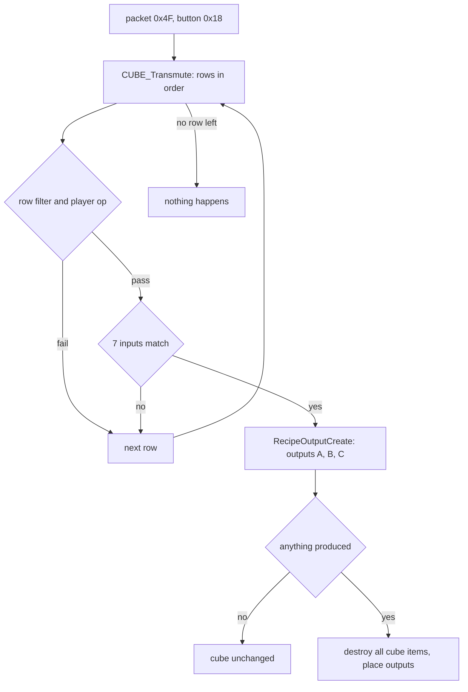

# 0008 — The Horadric Cube: recipe matching, input checks, output construction

> **Subsystem:** items/cube
> **Question:** When the player presses Transmute, which CubeMain row matches the cube's contents, and what comes out (item or portal), with which ilvl, quality, affixes, sockets and seeds?
> **Date:** 2026-10-15   **Plan:** 0030 (Phase 1, Phase 1b, Phase 2)   **Status:** open (Phase 1 read from the decompile and the disassembly, committed before any community source was read; Phase 1b cross-check 2026-10-15: nine contradictions, four reachable on stock data; Phase 2 2026-10-15: run:2026-10-15-cube, 182 transmutes reproduced bit for bit, § 8; 2026-10-16: test vectors § 8.5, a crafted pick of 0 § 4; plan 0038 batch S2c, 2026-10-16: 11 statements raised and 3 in part, 1 contradicted (the spot search draws nothing), 5 reclassified; the output placement modelled, [§ Plan 0038 batch S2c](#plan-0038-batch-s2c-2026-10-16))

Names of structs and fields are ours (`re/types/cube.h`, `struct:CubeMainRec`). "Item seed" is the item-data seed at
`ItemData+0x04` (`ITEMS_GetSeed`), "unit seed" is the item unit's seed at `Unit+0x20`, "game seed" is `Game+0xD0`
([rng/0002](../rng/0002-seed-tree.md)). "Creation record" is the 0x84-byte `struct:ItemCreateRec`
([items/0001 § 8](0001-tc-resolution.md)). Item flags are `ItemData+0x18` (bit 4 `0x10` identified, bit 11 `0x800`
socketed, bit 26 `0x4000000` runeword, bit 22 `0x400000` ethereal; [items/0007](0007-sockets-runewords.md)); the
item's inventory page is `ItemData+0x45`, and page 3 is the cube. Column names are those of the raw `cubemain.txt`
header: Phase 0's `docs/tables/CubeMain.md` had not landed, so this finding gives no CubeMain table anchors yet.
Phase 1 was written from the code only; no community text had been read when it was written.

## Answer (summary)

- [I] **Entry.** The client packet `0x4F` (7 bytes: opcode, u16 button, u16, u16) is dispatched through
  `g_SrvPacketTable` (8-byte entries, handler at `opcode·8 + 0x006E0D18`) to `sub_0054C7C0_Pkt4FButton`, then
  `sub_00568060_PktInteractButton`. Buttons `0x17` and `0x18` need the player's interaction type (`Unit+0x68`) to be 4,
  the type button `0x17` ends; `0x18` calls `CUBE_Transmute(game)` with the player in ESI. (data:g_SrvPacketTable@0x006E0D18,
  fn:sub_0054D750_SrvPacketDispatch@0x0054D750, fn:sub_0054C7C0_Pkt4FButton@0x0054C7C0,
  fn:sub_00568060_PktInteractButton@0x00568060, fn:sub_00566AE0_CubeButton@0x00566AE0, fn:CUBE_Transmute@0x005665F0)
- [C] **The match is a first-fit scan of CubeMain in row order.** For each row: `enabled` (unless the never-written
  `g_CubeAllRows`), `version` < 100 or an expansion game, `ladder` clear or `Game+0x6A` ≠ 0 or a ladder game,
  `min diff` ≤ difficulty, `class` 0xFF or the player's class, `numinputs` = the number of items in the cube, the
  `op` test (ops 1–14 on the player), then the seven inputs. The first row that passes is transmuted and the scan
  stops. A transmute that matches no row does nothing: no draw, no message, no item moved. (§ 1, fn:CUBE_Transmute@0x005665F0,
  run:2026-10-15-cube: every row that reached the matcher, its result and the row matched, in 182 transmutes; no stock
  row has an op 1–14, so the player ops stay `[I]`)
- [C] **Inputs.** Each input claims every unclaimed cube item that passes its test (code, type, `any`, unique or set
  row, quality, `nos`/`sock`, `eth`/`noe`, `bas`/`exc`/`eli`, `upg`, `nru`, ops 15–27 on input 1, op 28 on every
  input) and passes when the number of claimed items equals `qty` (at least `qty` once any claimed item is a stackable
  base). A stack is one item. Because the cube count must equal `numinputs`, an extra item refuses the row. (§ 2,
  fn:CUBE_MatchInput@0x00565010, run:2026-10-15-cube; the tests the run did not reach stay `[I]`: ops 15–27, `eth`,
  `exc`/`eli` inputs, `upg` across more than one tier, and `nru`, which no stock input has, § 8.4)
- [C] **Input 1 feeds every output.** The matcher records, for each of the three output slots, the last item input 1
  claimed, its class (or −1 for `useitem`) and its ilvl, using **output A's** kind and flags for all three slots.
  (§ 2.4, 0x005656EE–0x00565816, run:2026-10-15-cube: the nine slot words of every match)
- [C] **Output ilvl** = `lvl` if non-zero; otherwise `trunc(player level × plvl / 100) + trunc(input-1 ilvl × ilvl /
  100)` (each term only when its column is non-zero); then clamped to [1, `experience` MaxLvl of class 0]. Only
  created items use it; `useitem` and `mod` outputs keep the input's ilvl. (§ 3.1, 0x00565B66–0x00565D12,
  fn:sub_00611830_ExpMaxLevel@0x00611830, run:2026-10-15-cube; the cap was not reached)
- [C] **Outputs, per kind** (`sub_00565AB0_RecipeOutputCreate`, outputs A, B, C in order): a fixed code, a random item
  of a type (two game-seed draws first), or `usetype` (input 1's class, upgraded by `exc`/`eli`) is a new item made
  by `sub_00558D90_ItemCreate` from a creation record (ilvl, forced quality, `pre=`/`suf=` as forced affixes, no
  socket roll and no ethereal roll unless `sock`/`eth`); `useitem` is a copy of input 1 (`sub_0055A2A0_ItemCopy`);
  `mod` copies input 1, changes its class and re-runs its base stats. Then the `mod 1..5` lines, `rep`, `rch`, `qty`
  and `sock=`. If anything was produced, **every item in the cube is destroyed** and the outputs are placed in the
  cube, identified. If nothing was produced, the cube is left as it was. (§ 3, fn:sub_00565AB0_RecipeOutputCreate@0x00565AB0,
  run:2026-10-15-cube; `output b`/`output c`, `uns`, `rem`, `reg` and the mod `chance` are in no stock row and stay `[I]`)
- [C] **Crafted (quality 8)**: `sub_005C21D0_ItemBuildCrafted` draws two rare names, then `n = max(low % 5, tier)`
  affix slots (tier 1, 2, 3, 4 for ilvl ≤ 30, ≤ 50, ≤ 70, above), one side draw per slot, up to 252 redraws against
  the same id or group, then the properties in the order P1, S1, P2, S2, P3, S3, then the staff mods; the recipe's
  `mod` lines come after `ItemCreate` returns. (§ 4, fn:sub_005C21D0_ItemBuildCrafted@0x005C21D0, run:2026-10-15-cube: 51
  crafted items, the four tiers; no redraw occurred, so the 252-redraw bound stays `[I]`; seed-level test vector in
  § 8.5)
- [I] **A crafted pick that returns 0** (no candidate; the crafted picks pass `mustRoll` 1, so 0 means no candidate)
  is stored and its side's counter advanced when that side has no filled slot yet; when the side has a filled slot,
  the duplicate test dereferences the null record of id 0 (`[0 + 0x5C]`, an access violation). (§ 4,
  0x005C2361–0x005C2382, 0x005C2441–0x005C2466, fn:MAGICAFFIX_GetRecord@0x00633EE0; not reached in the run)
- [C] **Special outputs.** `Cow Portal` opens a permanent portal (object 60) to level 39 when the player stands in
  level 1, has quest word 4 bit 10 clear and word 26 bit 0 (classic) or word 40 bit 0 (expansion) set in the
  current difficulty, and the game's own quest word 4 bit 11 is clear; it sets that bit. (§ 5, fn:CUBE_CowPortalOpen@0x00594140, run:2026-10-15-cube: opened in Normal,
  Nightmare and Hell, refused by each expansion gate; the classic word 26 test and the free-spot search stay `[I]`)
- [C] **The Pandemonium portals are stubs; their transmute opens nothing and leaves the keys in the cube.**
  `CUBE_PandemoniumPortalStub` and `CUBE_PandemoniumFinalePortalStub` are `xor eax, eax; ret`, so no output is made,
  `local_a0` stays 0 and the destroy step is skipped (0x00566400), in any game this executable hosts. Observed: session
  k1 of run:2026-10-15-drlg-outdoor (`od-k1-3201-hell.log`: expansion, Hell, the three keys alone in the cube,
  Transmute clicked three times: no portal, the keys stayed). Same claim and anchors as
  [save/0002 § 6](../save/0002-quest-words.md). The row matches: rows 148 and 149 were matched and their handlers
  entered and returned 0 in run:2026-10-15-cube (§ 8). (fn:CUBE_PandemoniumPortalStub@0x00594270,
  fn:CUBE_PandemoniumFinalePortalStub@0x00594280, data:g_CubePortalFns@0x006E11C8)
- [C] **The creation-side quality roll** of a record with quality 0 (the runes, gems, potions and quest items the cube
  makes): `sub_00556F60_ItemRollQualityCreate` walks the codes 7..2 over the item's ItemRatio row with `RNG_RangeB` on
  the item seed, and every fallback helper calls it again after its reseed, before it writes the step's quality to the
  record. Its result is then overridden by the `Normal` item types; its draws are not. (§ 8.1,
  fn:sub_00556F60_ItemRollQualityCreate@0x00556F60, run:2026-10-15-cube: 29 creations)
- [C] **ItemCopy's seeds.** The copy of `useitem` and `mod` takes two game-seed steps (`SUnitCreate`,
  `sub_00552E90_ItemSeedInit`); its start seed and item seed `{start, 666}` are the second step's, and its unit seed is
  re-initialised from the source's `Unit+0x28`. So a copy's later rolls (the `sock` and `levelreq` lines) draw from a
  fresh item seed. (§ 8.2, fn:sub_0055A2A0_ItemCopy@0x0055A2A0, 0x00558D01, 0x0055532A, run:2026-10-15-cube: 18 copies)
- [I] **The made-bit clear** in `RecipeOutputCreate` is reached only by a `usetype` output with `reg` whose input 1 is a
  unique: the unique is rebuilt by row, and its made bit is cleared again when it was clear before, so the rebuild
  leaves the bit as it was. No stock row has `reg`. (§ 3.3, 0x00565F49–0x00565FA9, 0x005660DC–0x005660F2)

## Leads used

Phase 1 read no community documentation of the cube (committed first, `a7f0073`). The code was located from our own
symbols: `sub_00565AB0_RecipeOutputCreate` ([items/0004](0004-uniques-sets.md)), the `cubemain` loader address
([data/0001](../data/0001-excel-loader.md)), and the socket functions of [items/0007](0007-sockets-runewords.md).

Phase 1b (2026-10-15) compared the finished claims with two registered sources: `src:d2dfg-blizzard` § cubemain.txt
(written for the D2R build: ladder seasons, `Red Portal`) and `src:arreat-summit-cube-crafted` (LoD 1.10–1.13 era).
`src:pd-sockets` was not reachable this session (a Cloudflare challenge page, no content) and is not compared.
Agreement promotes nothing; every tag above is unchanged. Each contradicted claim was re-read in the disassembly
(ops 1–4 at 0x005666D8–0x0056673B, the input-1 gate at 0x0056533F) and the reading stands; the contradictions are in
the backlog entry of 2026-10-15 (reverser → architect, plan 0030 Phase 1b).

**Row filter and ops**
- [L] src:d2dfg-blizzard: `enabled` 1 = usable, 0 = not. **held with refinement**
  Detail: also usable when `g_CubeAllRows` ≠ 0, which nothing writes (§ 1).
- [L] src:d2dfg-blizzard: `firstLadderSeason`/`lastLadderSeason` seasons. **contradicted** (later build)
  Detail: 1.14d has one `ladder` byte, which refuses a row only when `Game+0x6A` = 0 and the game is not ladder; single
  player passes (§ 1). Reachable on stock data (21 rows): a required Phase 2 case.
- [L] src:arreat-summit-cube-crafted: the rune upgrades above Ort and the elite unique upgrades work for single
  player, open and ladder characters, not for non-ladder realm characters. **held with refinement**
  Detail: the code's test is the game type byte and the ladder flag (§ 1); the realm values were not read.
- [L] src:d2dfg-blizzard: `min diff` 0/1/2, `version` 0/100, `class` codes, `numinputs` = the number of items in the
  cube. **held with refinement**
  Detail: `numinputs` counts cube items, a stack as one (§ 1, § 2.2); `version` ≥ 100 needs an expansion game.
- [L] src:d2dfg-blizzard: op 1 "day of the month is less than param or greater than value"; op 2 "day of the week
  does not equal value". **contradicted**
  Detail: the row passes when `param` ≤ day ≤ `value` (0x005666D8–0x005666E8) and when `value` = day of week + 1
  (0x005666F3); the guide states the refusal condition. No stock row uses ops 1 or 2: not a required case.
- [L] src:d2dfg-blizzard: ops 3/4 (and 7/8, 11/12, 15/16, 19/20, 23/24) "greater than" / "less than" `value`.
  **contradicted**
  Detail: the code passes on ≥ / ≤ of `value >> ValShift` (0x00566739 `jl` to refuse); ops 5/6 (≠ / =) and the
  base / non-base variants hold. No stock row uses them: not a required case.
- [L] src:d2dfg-blizzard: op 27 "Mod Class is not equal to value". **held with refinement**
  Detail: the code tests `ITEMS_GetFileIndex(item)` ≠ `value` on input 1's items (§ 2.3).
- [L] src:d2dfg-blizzard: op 28 checks `quest` and `questdiffcheck`, then that the quest difficulty is **greater
  than** the game's difficulty. **contradicted**
  Detail: the item passes on stat 356 ≥ difficulty (0x005652FD `jl` to refuse), on every input. Reachable on stock
  (Wirt's Leg, the Staff of Kings, the Khalim parts in Nightmare or Hell with stat 356 = the difficulty): a required
  Phase 2 case.

**Inputs**
- [L] src:d2dfg-blizzard: input qualifiers `qty=`, `low`…`tmp`, `nos`, `noe`, `eth`, `upg` "allows upgrades",
  `bas`, `exc`, `eli`, `nru`. **held with refinement**
  Detail: `upg` is a tier test (the named base or a higher tier of it, § 2.3); `bas`/`exc`/`eli` compare the item's
  own code with its tier codes.
- [L] src:d2dfg-blizzard: input `sock=#` "item with sockets, where # defines the number". **contradicted**
  Detail: the input parser knows `sock` alone (stat 194 ≠ 0); `sock=2` parses `sock` and then stops at the unknown
  token `2` (§ 2.1). No stock input has a count: not a required case.
- [L] src:arreat-summit-cube-crafted: "the ilvl, the quality and the properties of the jewel are completely
  irrelevant". **held** Detail: only input 1 feeds the outputs (§ 2.4).

**Output ilvl**
- [L] src:d2dfg-blizzard: `lvl` overrides `plvl` and `ilvl`; `plvl` is a ratio of the player's level; `ilvl` a ratio of
  input 1's (output A), input 2's (`b ilvl`), input 3's (`c ilvl`) level. **contradicted** (for B and C)
  Detail: all three outputs take input 1's ilvl, and output A's flags (0x0056533F: inputs 2–7 skip the slot fill,
  § 2.4). No stock row has `output b` or `output c`: not a required case. Output A: held.
- [L] src:arreat-summit-cube-crafted: crafted ilvl = int(.5 × clvl) + int(.5 × ilvl), capped at 99. **held**
  Detail: `plvl` 50, `ilvl` 50, two truncating divisions, cap = `experience` MaxLvl (§ 3.1).
- [L] src:arreat-summit-cube-crafted: "if qlvl > ilvl then ilvl = qlvl", then the affix level from ilvl and qlvl.
  **not covered**
  Detail: the cube does not raise the record's ilvl (§ 3.1); the affix level is computed inside
  `ITEMS_PickMagicAffix` ([items/0005 § 2](0005-affixes.md)), not compared here.
- [L] src:arreat-summit-cube-crafted: high-level rare reroll ilvl = int(.66 × clvl) + int(.66 × ilvl); low-level
  int(.4 × clvl) + int(.4 × ilvl); rings ↔ amulets int(.75 × clvl); magic reroll ilvl = the input's; fixed ilvl 30
  (Leech, Spikes, the ring recipes, the gem-and-socketed-weapon recipe), 50 (Prismatic, Savage), 25 (chipped);
  low → normal ilvl 1. **held**
  Detail: the `plvl`/`ilvl`/`lvl` cells and § 3.1; ilvl 0 is raised to 1.
- [L] src:arreat-summit-cube-crafted: the 6-skull reroll "will not work on items larger than 3x2". **not covered**
  Detail: no size test in the match; six skulls fill half of the cube's grid.

**Outputs**
- [L] src:d2dfg-blizzard: `usetype` = input 1's type, `useitem` = input 1 as the output, `mod` = input 1's modifiers on
  the output. **held with refinement**
  Detail: `usetype` is a new item of input 1's class (with `exc`/`eli` upgrades); `mod` copies the item, changes its
  class and re-runs its base stats (§ 3.3).
- [L] src:d2dfg-blizzard: output `qty=`, `pre=`, `suf=`, `low`…`tmp`, `eth`, `sock`, `uns`, `rem`, `reg`, `exc`,
  `eli`, `rep`, `rch`. **held with refinement**
  Detail: `sock=N` and `qty=N` share one byte (§ 3.2); `reg` keeps the made bit as it was (§ 3.3).
- [L] src:d2dfg-blizzard: output `lvl=#` "same as qty"; `Red Portal`. **contradicted** (later build)
  Detail: the 1.14d output parser has neither (§ 3.2); stock data uses neither: not a required case.
- [L] src:d2dfg-blizzard: `mod N chance` "percent chance … if 0, always". **held with refinement**
  Detail: 1..99 make one unit-seed draw and apply when `low % 100` ≤ chance, i.e. (chance + 1) %; ≥ 100 always
  (§ 3.4). Every stock cell is blank: not a required case.
- [L] src:arreat-summit-cube-crafted: the upgrade recipes keep the unique's bonuses and the socketed jewels or runes,
  and an ethereal item stays ethereal. **held with refinement**
  Detail: the copy keeps its lists and children (§ 3.3); the ethereal base bonus is re-applied by
  `sub_00660240_CubeModApply` after each `mod` line, and every upgrade row has one (`levelreq`). Whether
  `ItemInitStats` itself re-applies it was not read (*Open questions*).
- [L] src:arreat-summit-cube-crafted: the magic-weapon socket recipes give 1–2 sockets and rerolled properties; a
  weapon that cannot have sockets gets none. **held**
  Detail: `usetype,mag` with `mod 1` = `sock` 1–2; the cap is `ItemMaxSockets` ([items/0007](0007-sockets-runewords.md)).
- [L] src:arreat-summit-cube-crafted: the rune socket recipes give body armor 1–4, weapon 1–6, helm 1–3, shield 1–4
  sockets before the base's cap. **contradicted** (for body armor, helm and shield)
  Detail: all four stock rows have `mod 1` = `sock` with min 1, max 6 (rows 123–126). The draw itself is the `sock`
  handler's ([items/0006](0006-properties.md), [items/0007](0007-sockets-runewords.md)). Reachable: a required Phase 2
  case (a body armor, a helm and a shield whose cap is ≥ 2).
- [L] src:arreat-summit-cube-crafted: the rare socket recipe adds one socket only to a rare with none that can have
  sockets. **held** Detail: `nos`, the socketable first-input test and the rare cap of 1 (§ 2.3, § 3.4).
- [L] src:arreat-summit-cube-crafted: the Savage recipe gives one of ten polearms at random (normal or exceptional,
  not Bec-de-Corbin or Grim Scythe). **held with refinement**
  Detail: the candidates are `pole` items with `level` ≤ 50 (§ 3.3); the index just below the random start is never
  a candidate in that draw.
- [L] src:arreat-summit-cube-crafted: quivers and throwing weapons come with a random quantity. **held**
  Detail: no `qty=`; the quantity is `ItemInitStats`'s draw ([items/0006](0006-properties.md) § 1).

**Crafted**
- [L] src:arreat-summit-cube-crafted: 1–4 affixes; ilvl 1–30: 40 % 1 and 20 % each 2, 3, 4; 31–50: 60 % 2, 20 % 3, 4;
  51–70: 80 % 3, 20 % 4; 71+: 4. **held**
  Detail: `max(low % 5, tier)` gives exactly these ratios with the tiers at > 30, > 50, > 70 (§ 4).

**Special outputs**
- [L] src:arreat-summit-cube-crafted: the cow portal must be transmuted in the Rogue Encampment, after killing Baal in
  the same difficulty, once per difficulty. **held with refinement**
  Detail: level 1; expansion: player quest word 40 bit 0 (classic: word 26 bit 0); once per game (the game's word 4
  bit 11) and only while the player's word 4 bit 10 is clear (§ 5.1). Which quest events set those bits is not read.
- [L] src:d2dfg-blizzard: `Pandemonium Portal` opens one of the three portals at random, no duplicates; `Pandemonium
  Finale Portal` opens Uber Tristram. **contradicted** (realm-only behaviour)
  Detail: both handlers return 0 in 1.14d (§ 5.2); observed in run:2026-10-15-drlg-outdoor. Reachable on stock: a
  required Phase 2 case (log the row match and the refusal).

## Functions

| Address | Name | Role | Tag |
|---|---|---|---|
| `0x0054D750` | `sub_0054D750_SrvPacketDispatch` | client packet → `g_SrvPacketTable[opcode]` (opcode 1..0x66) | I |
| `0x006E0D18` | `g_SrvPacketTable` (data) | 8-byte entries {handler, flag}; `0x4F` → `0x0054C7C0`, `0x28` → `SOCK_PacketInsert` | I |
| `0x0054C7C0` | `sub_0054C7C0_Pkt4FButton` | length 7; `(button = u16 +1, arg = u16 +3 << 16 | u16 +5)` | I |
| `0x00568060` | `sub_00568060_PktInteractButton` | button switch; 0x17/0x18 need interaction type 4 | I |
| `0x00554100` | `sub_00554100_PlayerGetInteract` | `Unit+0x68` type, `+0x64` unit id, `+0x6C` flag | I |
| `0x00566AE0` | `sub_00566AE0_CubeButton` | 0x17 end interaction, 0x18 `CUBE_Transmute` | I |
| `0x005665F0` | `CUBE_Transmute` | row scan, row filter, player ops, calls the matcher and the builder | C |
| `0x00564FD0` | `sub_00564FD0_CubeCountItems` | items on page 3 in the player's inventory | C |
| `0x005658C0` | `sub_005658C0_CubeMatchInputs` | inputs 0..6 in order, 48-entry claimed array | C |
| `0x00565010` | `CUBE_MatchInput` | one input against every cube item | C |
| `0x00565AB0` | `sub_00565AB0_RecipeOutputCreate` | outputs A, B, C; destroy; place | C |
| `0x00565930` | `sub_00565930_CubePickItemOfType` | random item of a type, ≤ ilvl, two game-seed draws | C |
| `0x006E11C8` | `g_CubePortalFns` (data) | kinds 1..3 → thunks `thunk_CUBE_CowPortalOpen`, `thunk_CUBE_PandemoniumPortalStub`, `thunk_CUBE_PandemoniumFinalePortalStub` (`0x00565A80`/`90`/`A0`) → the three below; named in [save/0002 § 6](../save/0002-quest-words.md) | C |
| `0x00594140` | `CUBE_CowPortalOpen` | the cow portal | C |
| `0x00594270` | `CUBE_PandemoniumPortalStub` | `xor eax, eax; ret` (save/0002 § 6) | C |
| `0x00594280` | `CUBE_PandemoniumFinalePortalStub` | `xor eax, eax; ret` (save/0002 § 6) | C |
| `0x00660240` | `sub_00660240_CubeModApply` | one `mod` line: `PROP_ApplyBlockByVersion(7, …, 0x40)`, then ethereal again | C |
| `0x00564F30` | `sub_00564F30_CubeDestroyContents` | removes every page-3 item | C |
| `0x00560200` | `sub_00560200_InvPlaceItem` | puts a unit in the player's inventory (here page 3) | I |
| `0x00555600` | `sub_00555600_UnitFree` | frees a unit that could not be placed | I |
| `0x00558C50` | `sub_00558C50_ItemRemoveRuneword` | clears flag bit 26, the name, the state-171 list | I |
| `0x0055F900` | `sub_0055F900_ItemRepairBroken` | `rep` on a broken item (flag `0x100`) | I |
| `0x0055FE80` | `sub_0055FE80_ItemRefillCharges` | `rch` ([items/0007](0007-sockets-runewords.md)) | I |
| `0x00553380` | `sub_00553380_UnitSetEvent` | `Unit+0x6E` = event, `+0x70` = arg, unit marked for update | I |
| `0x00544760` | `sub_00544760_GameQuestGet` | `QUESTRECORD_GetState` on the game's own quest record (`Game+0x10F4` → `+0x0C`) | I |
| `0x00544720` | `sub_00544720_GameQuestSet` | same, set | I |
| `0x0059E5C0` | `sub_0059E5C0_QuestStaffMade` | after placing `hst`: the player's quest word 10 bit 11 | I |
| `0x005B86E0` | `sub_005B86E0_QuestKhalimWillMade` | after placing `qf2` | I |
| `0x00669130` | `sub_00669130_CubeMainLoad` | field descriptor; refuses `cubeserver.*` ([data/0001](../data/0001-excel-loader.md)) | I |
| `0x00668600` | `sub_00668600_CubeParseInput` | `input N` cell → `struct:CubeInput+0x0` | I |
| `0x00668A90` | `CUBEMAIN_OutputTypeParse` | `output`, `output b`, `output c` cell → `struct:CubeOutput+0x00` | I |
| `0x0066A1B0` | `CUBEMAIN_GetRecord` | `g_pCubeMain + 0x148·i`, fatal when out of range | I |
| `0x0066A200` | `CUBEMAIN_GetCount` | `g_nCubeMain` | I |
| `0x0096D628` | `g_pCubeMain` (data) | records | I |
| `0x0096D62C` | `g_nCubeMain` (data) | 151 stock | I |
| `0x0088CAC0` | `g_CubeAllRows` (data) | read once (0x00566658); no write found | I |
| `0x00611830` | `sub_00611830_ExpMaxLevel` | `experience` record `[i]`, i in 0..6, else `[0]` | I |
| `0x00451F60` | `sub_00451F60_UnitGetClassId` | `Unit+0x04`, −1 without a unit | I |
| `0x00625560` | `sub_00625560_UnitStatDelta` | difference of two stat-list reads (not followed) | I |
| `0x00628110` | `sub_00628110_ItemGetFlags` | `ItemData+0x18` | I |
| `0x00628250` | `sub_00628250_ItemGetPage` | `ItemData+0x45`, 0xFF without data | I |
| `0x00628280` | `sub_00628280_ItemSetPage` | same, set | I |

## Walkthrough



### 1. The row filter: `CUBE_Transmute` (0x005665F0)

Called with ECX = game (as `[ebp+8]` after the prologue), ESI = player. In row order, from 0 to `g_nCubeMain` − 1:

```c
// fn:CUBE_Transmute@0x005665F0 (trimmed, renamed)
n = sub_00564FD0_CubeCountItems(player->pInventory);     // items with page 3
if (n <= 0) return;
GetLocalTime(&t); dow = t.wDayOfWeek + 1;
for (i = 0; i < CUBEMAIN_GetCount(); i++) {
    r = CUBEMAIN_GetRecord(i);
    if (!r->enabled && !g_CubeAllRows) continue;
    if (!game->expansion && r->version >= 100) continue;
    if (game->gameType == 0 && !game->ladder && r->ladder) continue;
    if (r->minDiff > game->difficulty) continue;            // unsigned bytes
    if (r->classId != 0xFF && r->classId != UnitGetClassId(player)) continue;
    if (r->numInputs != n) continue;
    if (!PlayerOp(r, player, t)) continue;                   // ops 1..14; others pass here
    int slots[9] = {0};                                      // 3 × {unit, classId, ilvl}
    if (CubeMatchInputs(game, r, slots)) { RecipeOutputCreate(game, player, r, slots, 1); return; }
}
```

- [I] The tests above, in that order. `version` is a u16 at `+0x12`; `min diff` is compared with `Game+0x6D`;
  `numinputs` is a byte compared with the count of page-3 items. (0x00566653–0x005666BB, struct:CubeMainRec+0x12,
  struct:Game+0x6D)
- [I] **Ladder rows in single player.** A `ladder` row is skipped only when `Game+0x6A` = 0 and `Game+0x74` = 0.
  Single player has `Game+0x6A` = 3 ([items/0001](0001-tc-resolution.md), run:2026-10-11-tc-drops), so the 21 stock
  ladder rows (the 19 rune upgrades to runes 15–33 and the two elite unique upgrades) are matchable offline, as the unique ladder flag is
  ([items/0004](0004-uniques-sets.md)). No transmute of a ladder row has been logged. (0x00566679–0x00566689,
  struct:Game+0x6A, struct:Game+0x74)
- [I] **Disabled rows** (the four tempered rows and the `+30-50 ar` row, `enabled` blank) are unreachable: the only
  reference to `g_CubeAllRows` is this read, and the image holds 0 there. (data:g_CubeAllRows@0x0088CAC0, 0x00566658)
- [I] **Player ops** (`op` at `+0x04`, `param` at `+0x08`, `value` at `+0x0C`, both int32). Let `v = value >>
  ItemStatCost[param].ValShift` (arithmetic shift). For ops 3–14 the test runs only when 0 ≤ `param` ≤ the stat count
  (`DataTables+0xBD4`); outside that range the row passes; a missing ItemStatCost record refuses the row.
  (0x005666C1, fn:ITEMSTATCOST_GetRecord@0x0045C4F0)

  | op | the row passes when |
  |---|---|
  | 1 | `param` ≤ day of month ≤ `value` (local time) |
  | 2 | `value` = day of week + 1 (Sunday = 1) |
  | 3 / 4 / 5 / 6 | player stat `param` ≥ v / ≤ v / ≠ v / = v (`STATS_GetUnitStat`) |
  | 7 / 8 / 9 / 10 | the same with `STATS_GetUnitBaseStat` |
  | 11 / 12 / 13 / 14 | the same with `sub_00625560_UnitStatDelta` |
  | 0, 15–28, other | no player test (15–28 are input tests, § 2.3) |

  Stock data uses only op 28 (on 5 rows). (0x005666C1–0x00566A39, fn:sub_00625560_UnitStatDelta@0x00625560,
  fn:ITEMSTATCOST_GetRecord@0x0045C4F0, tbl:ItemStatCost.txt:ValShift)
- [I] **No match.** When the loop ends, `CUBE_Transmute` returns. Nothing in it or in the matcher draws from any
  seed. (0x00566A73–0x00566A8A)

### 2. The inputs: `sub_005658C0_CubeMatchInputs` and `CUBE_MatchInput` (0x00565010)

`sub_005658C0_CubeMatchInputs` zeroes a 48-dword claimed array and calls `CUBE_MatchInput(row, k, slots, claimed)`
for k = 0..6, failing at the first input that fails. (fn:sub_005658C0_CubeMatchInputs@0x005658C0)

#### 2.1 Compiled input (`struct:CubeInput+0x0`, 8 bytes at row `+0x14 + 8k`)

- [I] `flags` u16, `index` u16, `rowPlus1` u16, `quality` u8, `qty` u8. The parser
  (`sub_00668600_CubeParseInput`) strips quotes, splits the base at the first comma, and tries, in this order:
  `any` (flag `0x001`, index 0xFFFF); a type code of ≤ 4 characters in `itemtypes` (flag `0x002`); an item code of
  ≤ 4 characters (flag `0x001`); a `uniqueitems` name (flags `0x041`, quality 7, row + 1, index = its base); a
  `setitems` name (flags `0x041`, quality 5, row + 1). A cell that is none of these fails the parse. **Types are tried
  before item codes** (the output parser does the reverse, § 3.2). (fn:sub_00668600_CubeParseInput@0x00668600)
- [I] Qualifiers, each compared as an exact string: `qty=N` (byte `+0x07`, `atol`), `low` 1, `nor` 2, `hiq` 3,
  `mag` 4, `set` 5, `rar` 6, `uni` 7, `crf` 8, `tmp` 9 (byte `+0x06`); `nos` `0x004`, `sock` `0x008`, `noe` `0x020`,
  `eth` `0x010`, `upg` `0x080`, `bas` `0x100`, `exc` `0x200`, `eli` `0x400`, `nru` `0x800`. An unknown qualifier ends
  the parse silently (the cell keeps what it had). (0x00668720 onwards)

#### 2.2 One input against the cube

```c
// fn:CUBE_MatchInput@0x00565010 (trimmed, renamed; ECX game, EDX inventory)
in = &row->inputs[k];
if ((in->flags & 3) == 0) return 1;                      // empty slot
need = in->qty ? in->qty : 1;  got = 0;  allExact = 1;  ord = 0;
for (it = first cube item .. last, in inventory-list order) {      // page 3 only
    ord++;
    base = ITEMS_GetRecord(it->classId);
    if (!ItemTest(in, it, base)) continue;                // § 2.3
    if (k == 0 && !OutputSocketTest(row, it)) continue;   // § 2.3, last bullet
    if (ord <= 48 && claimed[ord-1]) continue;
    if (k == 0) { if (!ItemOp(row, it)) continue; FillSlots(row, it, slots); }   // § 2.3, § 2.4
    if (ord <= 48) claimed[ord-1] = 1;
    got++;
    if (ItemBaseStackable(it)) allExact = 0;
}
return allExact ? got == need : got >= need;
```

- [I] An input claims **every** unclaimed matching item, not only `qty` of them, and the test is `got = qty`
  (or `got ≥ qty` once a claimed item has a stackable base, `sub_006289F0_ItemBaseStackable`). Each cube item counts 1
  whatever its stack quantity. Inputs are taken in column order, so an item that could match two inputs goes to the
  first. (0x0056504A, 0x0056581C–0x0056587C, fn:sub_006289F0_ItemBaseStackable@0x006289F0)
- [I] **Extra items.** The row filter already requires the cube count to equal `numinputs`. On stock data
  `numinputs` is the sum of the `qty`s, so an extra or unmatched item always refuses the row. A row whose
  `numinputs` exceeded the inputs' sum would let an unmatched item through; none exists in the stock table.
  (0x005666B4–0x005666BB)

#### 2.3 The item test, in the code's order

- [I] **Base.** Flag `0x001` with index 0xFFFF: any item. Flag `0x001` without `upg`: `classId` = index. Flag `0x001`
  with `upg` (`0x080`): the item's own code `c` is compared with its base's `normcode` (`+0x84`), `ubercode`
  (`+0x88`), `ultracode` (`+0x8C`), and the input's code `i` (the input record's `+0x80`) must be: `normcode` when
  `c` = `normcode`; `normcode` or `ubercode` when `c` = `ubercode`; any of the three when `c` = `ultracode`. So `upg`
  accepts the named base or a higher tier of it. Flag `0x002`: `ITEMS_UnitIsType(item, index)` (equivalences count).
  (0x005650A0–0x005651AD, 0x00565330–0x00565847, fn:ITEMS_UnitIsType@0x00629BB0, tbl:Weapons.txt:normcode,
  tbl:Weapons.txt:ubercode, tbl:Weapons.txt:ultracode)
- [I] **Quality.** When `quality` ≠ 0 the item's quality must equal it. (A dead call to `0x00625290` on a mismatch with
  quality 9 has no effect.) (0x005651B0–0x005651D8)
- [I] **Unique or set row** (`0x040`): `ITEMS_GetFileIndex(item)` = `rowPlus1` − 1. (fn:ITEMS_GetFileIndex@0x00629DA0)
- [I] **Sockets.** `nos` (`0x004`): stat 194 (`item_numsockets`, `ITEMS_GetSockets`) = 0. `sock` (`0x008`): stat 194 ≠ 0.
  The socket count, not the filled count, is tested. (fn:ITEMS_GetSockets@0x006299B0)
- [I] **Ethereal.** `noe` (`0x020`): not ethereal. `eth` (`0x010`): ethereal. (fn:ITEMS_IsEthereal@0x0062A8D0)
- [I] **Tier.** `bas` (`0x100`): the item's code = its `normcode`; else `exc` (`0x200`): = `ubercode`; else `eli`
  (`0x400`): = `ultracode` (one of the three is tested, in that priority). (0x0056526D–0x005652A8)
- [I] **`nru`** (`0x800`): the item has no runeword flag (bit 26). (fn:sub_00628110_ItemGetFlags@0x00628110)
- [I] **Op 28 (quest-item difficulty), on every input.** When the row's `op` is 28 and the item's base has both
  `quest` (`+0x12A`) and `questdiffcheck` (`+0x12B`) set, the item's stat 356 (`questitemdifficulty`) must be ≥ the
  game's difficulty. Of the five op-28 rows, the test binds Wirt's Leg (`leg`), the Staff of Kings and the Viper Amulet,
  the Khalim Flail and Khalim's organs; the Pandemonium keys and organs have `quest` blank and pass. So in Nightmare
  and Hell a Wirt's Leg needs stat 356 ≥ 1 or 2 for the cow portal row to match. (0x005652C9–0x005652FF,
  tbl:Weapons.txt:quest, tbl:Weapons.txt:questdiffcheck, tbl:Misc.txt:quest)
- [I] **Socketable first input.** For input 1 only, when output A is `useitem` or `usetype` with `sock`, the item
  must have `sub_0062BC20_ItemMaxSockets` ≠ 0. (0x00565307–0x00565330, fn:sub_0062BC20_ItemMaxSockets@0x0062BC20)
- [I] **Ops 15–27, on input 1's items only**, with the same `v`, range rule and missing-record refusal as § 1:
  15 / 16 / 17 / 18: item stat ≥ v / ≤ v / ≠ v / = v; 19–22: the same on the base stat; 23–26: the same with
  `sub_00625560_UnitStatDelta`; 27: `ITEMS_GetFileIndex(item)` ≠ `value`. No stock row uses them.
  (0x00565347–0x005656E8)

#### 2.4 What input 1 hands to the outputs

- [I] For each item input 1 claims, for each of the three output slots s: `slots[s].ilvl` = its ilvl; `slots[s].unit`
  = the item when output A has `mod` or is `useitem`/`usetype`; `slots[s].classId` = its class for `usetype`, −1 for
  `useitem`; then, for `useitem`/`usetype` only, output A's `exc` replaces the class by the item's `ubercode` record,
  else output A's `eli` by its `ultracode` record, when that code is not blank, is found, and (an expansion game or
  that record's `version` < 100). The last claimed item wins, and **outputs B and C get the same values, computed
  from output A's flags**. (0x005656EE–0x00565816, fn:EXCEL_FindCode@0x006BD130, fn:ITEMS_GetItemLevel@0x006281E0)

### 3. The outputs: `sub_00565AB0_RecipeOutputCreate(game, player, row, slots, 1)` (0x00565AB0)

ECX = game, EDX = player. Outputs A, B, C (`row + 0x4C + 0x54·s`) in order.

#### 3.1 The ilvl (0x00565B66–0x00565D12)

```c
// per output s; o = &row->outputs[s]
if (o->lvl) v = o->lvl;
else {
    v = 0;
    if (o->plvl) v  = (STATS_GetUnitStat(player, 12 /*level*/) * o->plvl) / 100;   // signed, truncating
    if (o->ilvl) v += (slots[s].ilvl * o->ilvl) / 100;
}
if (max(v, 1) < ExpMaxLevel(0)) v = max(v, 1); else v = ExpMaxLevel(0);
```

- [I] The two products are exact 32-bit signed divisions by 100 for any value a stock game produces; the code takes a
  64-bit path (`__alldiv`) or divides first only above 0x100000 or 0x10000, which a level or a byte percent never
  reaches. The cap is `experience` record 0's class-0 column, the `MaxLvl` row. (0x00565B9B–0x00565CDB,
  fn:sub_00611830_ExpMaxLevel@0x00611830)
- [I] Stock uses: `lvl` 25, 30, 50 (the old magic recipes); `plvl` 75 (rings to amulet); `plvl`/`ilvl` 40/40,
  66/66 (rare rerolls), 50/50 (crafted); `ilvl` 100 (magic reroll), 60 with `lvl` 30 (where `lvl` wins). (struct:CubeOutput+0x09)

#### 3.2 Compiled output (`struct:CubeOutput+0x00`, 0x54 bytes)

- [I] The parser (`CUBEMAIN_OutputTypeParse`) tries, in this order: `Cow Portal` (kind 1), `Pandemonium Portal`
  (2), `Pandemonium Finale Portal` (3) (case-insensitive); `usetype` (0xFF); `useitem` (0xFE); an item code of ≤ 4
  characters (0xFC, index); a type code of ≤ 4 characters (0xFD, index); a unique name (0xFC, its base, quality 7,
  row + 1, flag `0x008`, and byte `+0x0B` set to the unique's `lvl`); a set item name (the same with quality 5 and
  the set item's `lvl`). Qualifiers: `qty=N` and `sock=N` both write byte `+0x07`; `pre=N` and `suf=N` fill
  `pre[0..2]`/`suf[0..2]` in the order given; `low` … `tmp` set the quality as for inputs; `eth` `0x004`, `sock`
  `0x002`, `mod` `0x001`, `uns` `0x010`, `rem` `0x020`, `reg` `0x040` (and kind 0xFF), `exc` `0x080`, `eli` `0x100`,
  `rep` `0x200`, `rch` `0x400`. (fn:CUBEMAIN_OutputTypeParse@0x00668A90)
- [I] **`qty=N` against `sock=N`** (backlog 2026-10-15, static). The parser splits on `=` and `,`; `qty` writes only
  byte `+0x07` (`atol`), while `sock` sets flag `0x002` **and** writes byte `+0x07` from the number that follows
  (`0x006685C0`), so a later keyword overwrites the byte but the `sock` flag stays once given. The builder (§ 3.4)
  reads the byte as a **socket count when flag `0x002` is set** and as a stack quantity otherwise (`test byte [ebx],
  2` at 0x0056632A). So row 63 `useitem,sock=1` asks for 1 socket, and the repair rows' `qty=255` (no `sock`) refill a
  stackable base to `min(255, max stack)` and never add sockets. (fn:CUBEMAIN_OutputTypeParse@0x00668A90,
  0x0056632A–0x005663E3)
- [C] **`pre=N`/`suf=N` are affix ids, record index + 1.** The values are stored as written (`atol` → u16) and
  copied unchanged into the creation record's forced prefix and suffix slots (0x00566062–0x00566090); the affix
  picker takes forced row `i` of the prefix or suffix block when `i = forcedId − 1` ([items/0005 § 3](0005-affixes.md),
  0x005C16FE–0x005C170A). So `pre=331` is MagicPrefix record 330, which is `.txt` data row 331 when the `Expansion`
  marker is counted ([MagicPrefix § Row identity](../../tables/MagicPrefix.md#row-identity)): `Prismatic`, the name
  the row's description gives; likewise `pre=372` `Garnet`, `pre=191` `Savage`, `suf=162` `of Spikes`, `suf=352`
  `of the Leech`. (fn:ITEMS_PickMagicAffix@0x005C1560, tbl:MagicPrefix.txt:Name, run:2026-10-15-cube: the 12 forced
  picks of § 8.4 took exactly these rows; raised at the plan 0030 Phase 2 review)
- [I] The `mod N` columns compile to {int32 properties row (`g_PropertiesLink`), int16 param, min, max, u8 chance}
  at `+0x18 + 12·m`; `lvl`, `plvl`, `ilvl` to bytes `+0x09..+0x0B`. (fn:sub_00669130_CubeMainLoad@0x00669130,
  data:g_PropertiesLink@0x0096BCD8)

#### 3.3 Building one output

```c
// fn:sub_00565AB0_RecipeOutputCreate@0x00565AB0 (trimmed, renamed), output s
strip = (o->flags & 0x30) != 0;                                 // uns or rem
v = Ilvl(o, s);                                                 // § 3.1
if (o->kind >= 1 && o->kind <= 3 && g_CubePortalFns[o->kind])
    any = g_CubePortalFns[o->kind](game, player);          // § 5
if (!(o->flags & 1)) {                                          // no `mod`
    if (o->kind == 0xFE) {                                      // useitem
        it = ItemCopy(game, slots[s].unit, 0, /*children*/ !strip);
        if (o->quality == 9) {                                  // `tmp`, disabled rows only
            a = PickRareNameByVersion(it, 1); b = PickRareNameByVersion(it, 0);
            if (a && b) { SetQuality(it, 9); SetRareName1(it, a); SetRareName2(it, b); } else mods = 0;
        }
    } else {
        q = o->quality; rowP1 = o->rowPlus1; clearMade = -1;
        if (o->kind == 0xFF) {                                  // usetype
            cls = slots[s].classId;
            if ((o->flags & 0x40) && slots[s].unit) {           // reg
                q = GetQuality(unit); rowP1 = GetFileIndex(unit) + 1; v = GetItemLevel(unit);
                if (q == 7 && !(game->uniqueMade[fi >> 5] & bit(fi))) clearMade = fi;
            }
        } else if (o->kind == 0xFC) cls = o->index;
        else if (o->kind == 0xFD) cls = CubePickItemOfType(game, v, o->index);   // 2 game-seed draws
        else goto done;                                         // kinds 0..3: no item
        rec = {0}; rec.pSource = player; rec.pGame = game; rec.ilvl = v; rec.itemIndex = cls;
        rec.+0x18 = 4; rec.+0x28 = 1; rec.+0x2A = game->itemVersion; rec.quality = q; rec.rowPlus1 = rowP1;
        rec.forcedPrefix[i] = o->pre[i]; rec.forcedSuffix[i] = o->suf[i];       // u16 → int
        rec.flags = ((o->flags & 2) && o->qty == 0 ? 0x10 : 0x08) | ((o->flags & 4) ? 0x04 : 0x02);
        it = ItemCreate(game, &rec, 0);
        if (clearMade >= 0) game->uniqueMade[clearMade >> 5] &= ~bit(clearMade);
    }
} else {                                                        // `mod`: change the base, keep the item
    it = ItemCopy(game, slots[s].unit, 0, !strip);
    cls = kind 0xFE ? max(slots[s].classId, 0) : kind 0xFF ? slots[s].classId
        : kind 0xFC ? o->index : kind 0xFD ? CubePickItemOfType(game, v, o->index) : 0;
    it->classId = cls;  ItemInitStats(game, &it, 0, 0);
}
```

- [I] **Fixed code, item type, `usetype`.** A new item through `sub_00558D90_ItemCreate(game, &rec, 0)`: the record
  as above (the unit's seeds come from the game seed, [items/0001 § 8](0001-tc-resolution.md)). `+0x18` is 4 here
  (3 on a drop; meaning not read). The record's flags disable the socket roll (`0x08`) unless `sock` is given
  without a count (`0x10`, the roll always succeeds), and the ethereal roll (`0x02`) unless `eth` (`0x04`, forced
  ethereal). (0x00565FEE–0x005660C5, struct:ItemCreateRec+0x80, fn:sub_00558D90_ItemCreate@0x00558D90)
- [I] **Forced quality.** The record's quality is the output's (`mag` 4, `rar` 6, `crf` 8, `nor` 2, …), and the
  quality builders of [items/0005](0005-affixes.md) run with `pre=`/`suf=` as the forced affix ids. A quality of 0
  (`rvl`, the runes and gems, `hst`, `qf2`, `toa`, `cqv`, …) leaves the creation-side roll
  `sub_00556F60_ItemRollQualityCreate` to choose: it returns 2 at once for a base with `quest` set, otherwise it walks
  the qualities 7..2 with `RNG_RangeB(item seed, …)` ([items/0002 § 8](0002-quality-roll.md)). (struct:ItemCreateRec+0x30,
  fn:sub_00556F60_ItemRollQualityCreate@0x00556F60)
- [I] **Random item of a type** (kind 0xFD; stock: the `pole,mag,pre=191` row). `sub_00565930_CubePickItemOfType(game,
  ilvl, type)`: draw 1 `start = RNG_RangeB(game seed, nItems)`; scan from `start` upward with wrap-around and stop
  **before** `start − 1` (that index is never examined), collecting up to 256 items that are of the type
  (`ITEMS_IsType`), `spawnable`, of `version` < 100 or in a game with item version ≥ 100, and of `level` ≤ ilvl; draw 2
  `RNG_RangeB(game seed, count)` picks one. With no candidate it returns 0 (item record 0) without the second draw.
  Both draws come before `ItemCreate`. (fn:sub_00565930_CubePickItemOfType@0x00565930, fn:RNG_RangeB@0x0045C3E0,
  fn:ITEMS_IsType@0x00629A90, tbl:Weapons.txt:level, tbl:Weapons.txt:spawnable)
- [I] **`useitem`.** The input item is copied (`sub_0055A2A0_ItemCopy`: serialise, then
  `sub_00558CB0_ItemCreateFromSave`, whose `sub_00555230_SUnitCreate` draws from the game seed; the saved fields come
  back from the stream). Its socketed children are copied with it unless `uns` or `rem`. The copy keeps class,
  quality, affixes and ilvl. (0x00565D76–0x00565DA2, 0x00565E66–0x00565E8C, fn:sub_0055A2A0_ItemCopy@0x0055A2A0,
  fn:sub_00558CB0_ItemCreateFromSave@0x00558CB0, fn:sub_00555230_SUnitCreate@0x00555230)
- [I] **`mod` (the upgrade rows `useitem,mod,exc` / `useitem,mod,eli`).** The copy's class is set to the upgraded class
  from § 2.4, or to **0** when that lookup left −1 (not reachable on stock data: the matching inputs require `bas`
  or `exc` bases, which have the next code). Then `sub_00557AB0_ItemInitStats(game, &copy, 0, 0)` re-runs the base
  stats on the copy's unit seed (defense, durability, quantity, [items/0006](0006-properties.md) § 1) without the
  quality builders, so prefixes, suffixes, unique or set row and their property lists stay. (0x00565DC4–0x00565E3F,
  fn:sub_00557AB0_ItemInitStats@0x00557AB0)
- [I] **`reg`** (no stock row): a `usetype` output rebuilt with input 1's quality, file index + 1 and ilvl (the
  unclamped `ITEMS_GetItemLevel`). For a unique whose made bit was clear, the bit that `ItemCreate`'s unique builder
  sets is cleared again, so the made set is unchanged; a bit already set stays set (and the build may then fall
  back, [items/0004 § 3](0004-uniques-sets.md)). (0x00565F49–0x00565FA9, 0x005660DC–0x005660F2, struct:Game+0x1B24)
- [I] **Named unique or set output** (no stock row): kind 0xFC with quality 7 or 5 and the row + 1; the parser stores
  the row's `lvl` in the `ilvl` byte, which § 3.1 reads as a **percentage** of input 1's ilvl. Whether the `ilvl`
  column, loaded later in the descriptor, overwrites that byte is not settled (*Open questions*).
  (fn:CUBEMAIN_OutputTypeParse@0x00668A90)

#### 3.4 After the item exists, in this order

- [I] **`uns` / `rem`.** `sub_00558C50_ItemRemoveRuneword` on the output: when flag bit 26 is set it clears it, clears
  prefix 0 (the runeword name) and frees the stat list of state 171 (`0xAB`), flags `0x40`. With `rem` each socketed
  child of the **original** input is also copied and kept aside, to be placed in the cube after the outputs (no stock
  row has `rem`; `uns` destroys the children with the original). The socket count (stat 194) is not changed.
  (0x00566105–0x005661C6, fn:sub_00558C50_ItemRemoveRuneword@0x00558C50)
- [I] **The `mod 1..5` lines** (skipped when the `tmp` names failed). For m = 1..5 with `prop` ≥ 0: when `chance` is
  1..99, one LCG step on the **output's unit seed** (`Unit+0x20`), and the line is skipped when `low % 100 > chance`
  (so it applies with probability (chance + 1)/100). Then `sub_00660240_CubeModApply(item, &line, game->expansion)`:
  `PROP_ApplyBlockByVersion(7, …, block, state 0, flags 0x40)`, whose handlers draw on the item seed as in
  [items/0006 § 3–4](0006-properties.md); afterwards, if the item is ethereal, `ITEMS_MakeEthereal` runs again. All
  stock `chance` cells are blank, so stock data makes no chance draw. (0x005661C8–0x00566283, 0x00566204–0x00566239,
  fn:sub_00660240_CubeModApply@0x00660240, fn:PROP_ApplyBlockByVersion@0x0065FE10, fn:ITEMS_MakeEthereal@0x0065E4D0)
- [I] **`rep`** (`0x200`): for a stackable base with `qty` ≠ 0, quantity (stat 70) = min(`qty`, max stack); then a
  broken item (flag `0x100`) goes to `sub_0055F900_ItemRepairBroken`, otherwise base stat 72 (durability) is raised to
  stat 73 (max durability) when lower. (0x00566289–0x0056630C, fn:sub_0055F900_ItemRepairBroken@0x0055F900,
  fn:ITEMS_GetMaxStack@0x006295B0)
- [I] **`rch`** (`0x400`): `sub_0055FE80_ItemRefillCharges`, every stat-204 charge count raised to its maximum.
  (0x00566311–0x00566325, fn:sub_0055FE80_ItemRefillCharges@0x0055FE80)
- [I] **`qty` without `sock`**: for a stackable base, quantity = min(`qty`, max stack). **`sock=N`** (byte `+0x07`
  ≠ 0): only when stat 194 is 0 and the socketed flag is clear: `n = min(ItemMaxSockets, N)`, then magic and quality
  9 at most 3, set, rare, unique and crafted at most 1, and when `n` ≠ 0 the flag `0x800` is set and
  `ITEMS_SetSockets(item, n)` applies its own clamps ([items/0007 § 7](0007-sockets-runewords.md)). No draw.
  (0x0056632A–0x005663E3, fn:ITEMS_SetSockets@0x0062BCB0)
- [I] **The socket recipes' `sock` mod line** (`mod 1` = `sock`, 1–6 or 1–2) is a property line: its handler, and the
  insert and runeword code, are [items/0007](0007-sockets-runewords.md)'s and are not re-derived here. (fn:sub_00660240_CubeModApply@0x00660240)

#### 3.5 Finishing the transmute (0x00566400–0x00566563)

- [I] When at least one output produced an item or a special output returned non-zero:
  `sub_00564F30_CubeDestroyContents` removes every page-3 item of the player (the inputs, including the originals of
  `useitem`/`mod` copies), `sub_00553380_UnitSetEvent(player, 4, …)`, then each output in order A, B, C: page 3,
  `sub_00560200_InvPlaceItem(game, player, id, 0, 0, 1, 1, 0)`; on failure the unit is freed
  (`sub_00555600_UnitFree`), on success it gets flag `0x10` (**identified**). A placed `hst` calls
  `sub_0059E5C0_QuestStaffMade` (player quest word 10 bit 11), a placed `qf2` `sub_005B86E0_QuestKhalimWillMade`. Then
  the `rem` children are placed the same way. (fn:sub_00564F30_CubeDestroyContents@0x00564F30,
  fn:sub_00553380_UnitSetEvent@0x00553380, fn:sub_00560200_InvPlaceItem@0x00560200, fn:sub_00555600_UnitFree@0x00555600,
  fn:sub_0059E5C0_QuestStaffMade@0x0059E5C0, fn:sub_005B86E0_QuestKhalimWillMade@0x005B86E0)
- [I] When nothing was produced the function returns at once: no item is destroyed and nothing is placed.
  (0x00566400–0x00566407)
- [I] A crafted item is created unidentified by its builder (§ 4) and identified here; so is every cube output. (0x00566495–0x0056649A, fn:ITEMS_SetFlag@0x006280D0)

### 4. Crafted: `sub_005C21D0_ItemBuildCrafted` (ECX item, EDX creation record)

Reached from `sub_00557450_ItemCreateByQuality` case 8, which clears both rare names, keeps `RNG_GetLow(item seed)`
for the fallback, calls the builder, and on failure calls `sub_005572A0_ItemFallbackNormal` with that low.
(0x005577B7–0x005577FC, fn:sub_00557450_ItemCreateByQuality@0x00557450, fn:sub_005572A0_ItemFallbackNormal@0x005572A0)

```c
// fn:sub_005C21D0_ItemBuildCrafted@0x005C21D0 (trimmed, renamed); all draws on the item seed
a = version(item) ? ITEMS_PickRareName(1, item) : PickRareNameV0(item);      // draws as items/0005 § 6
b = version(item) ? ITEMS_PickRareName(0, item) : PickRareNameV0(item);
if (!a || !b) return 0;
SetRareName1(item, a); SetRareName2(item, b);
tier = rec->ilvl > 70 ? 4 : rec->ilvl > 50 ? 3 : rec->ilvl > 30 ? 2 : 1;
n = Next(seed) % 5;  if (n < tier) n = tier;                   // unsigned
p = s = 0;
while (n--) {
    lo = Next(seed);                                           // the side draw, every slot
    if (p == 3 || (s != 3 && (lo & 1))) {                      // suffix
        for (t = 0; ; t++) {
            id = PickMagicAffix(item, 1, 1, 0, /*prefix*/ 0, rec->forcedSuffix[s], 0);
            clash = 0;
            for (k = 0; k < 3; k++) {                          // every slot of the side
                rx = MAGICAFFIX_GetRecord(GetSuffix(item, k)); // NULL for id 0 (an empty slot)
                if (!rx) continue;
                if (id == GetSuffix(item, k) || MAGICAFFIX_GetRecord(id)->group == rx->group) { clash = 1; break; }
            }                                                  // id 0: GetRecord(0) is NULL, read at 0x5C
            if (!clash) { SetSuffix(item, id, s); s++; break; }
            if (t > 250) { SetSuffix(item, 0, s); break; }    // 252 picks, slot left 0, s unchanged
        }
    } else { /* the same for prefixes with rec->forcedPrefix[p], SetPrefix, p++ */ }
}
SetFlag(item, 0x10, 0);
for (i = 0; i < 3; i++) { ApplyProps(0, prefix i); ApplyProps(0, suffix i); }  // blank slots skipped
ITEMS_RollStaffMods(item, rec);
return 1;
```

- [I] All of the above, in that order: names, count draw, then per slot one side draw and the pick draws, then the
  properties prefix 1, suffix 1, prefix 2, … (mode 0, the affix rows' own draws), then the staff mods. The count
  is 1..4 with `low % 5` = 0 raised to the tier, so an ilvl-71+ crafted item always has 4 affixes. The duplicate test
  compares the picked id and its `group` (`+0x5C`) with the three slots of that side, empty ones skipped. A slot whose
  252 picks all collide is written 0 and its counter is not advanced, so the next slot of that side reuses it.
  (0x005C2252–0x005C251F, fn:ITEMS_PickMagicAffix@0x005C1560, fn:ITEMS_PickRareName@0x005C1AB0,
  fn:MAGICAFFIX_GetRecord@0x00633EE0, fn:sub_0065FEC0_ItemApplyProps@0x0065FEC0, fn:ITEMS_RollStaffMods@0x005C1260)
- [I] **A pick of 0** (backlog 2026-10-15, static). With `mustRoll` 1 the version ≥ 1 pick
  (`ITEMS_PickMagicAffix`, 0x005C2322 / 0x005C2402) returns 0 only when no row is a candidate. The builder has no test
  for 0: it goes straight to the duplicate loop over the three slots of the side. Each slot whose
  `MAGICAFFIX_GetRecord` is NULL (id 0: the function returns NULL for id ≤ 0 or above the count, 0x00633F0F–0x00633F2C)
  is skipped. For a filled slot, the id is compared with the slot's (`cmp word [ebp-0xC], di`, never equal to a non-zero
  slot id), then `MAGICAFFIX_GetRecord(0)`'s NULL result is dereferenced at `+0x5C` (0x005C237C prefix, 0x005C2460
  suffix): an access violation. So: (a) when the side has **no filled slot** the loop finds no clash and the builder
  stores **0 in slot `p` (or `s`) and advances the counter**, so that slot stays empty, the side counts it towards its
  3, the next slot of that side is the following one, and the property pass skips it (0x005C24B6, 0x005C24D9: no
  record, no `ItemApplyProps`); (b) when the side **has a filled slot** the game reads address `0x5C` and faults; no
  redraw and no 252 bound are reached. The build still returns 1 in (a), even with every slot 0. (0x005C2300–0x005C23A6,
  0x005C23E0–0x005C248B, fn:MAGICAFFIX_GetRecord@0x00633EE0, fn:ITEMS_GetPrefix@0x00627EC0,
  fn:ITEMS_SetPrefix@0x00627EF0, fn:ITEMS_GetSuffix@0x00627F80, fn:ITEMS_SetSuffix@0x00627FB0) Not reached in
  run:2026-10-15-cube (every crafted pick had candidates, § 8.5 shows 68–77 rows per pick at ilvl 60); whether stock
  data can reach either case (a crafted base and ilvl where a later pick of a side has no candidate left) was not
  surveyed. `tools/affixes.py` `Walk.crafted` models (a) and does not model (b): it stores the 0 and advances in both.
- [I] The pick passes `applyProps` = 0, so no property is rolled during the picks; the forced ids are the record's
  `pre=`/`suf=` values per slot (0 on every stock crafted row). (0x005C2300–0x005C2508)
- [I] The recipe's own lines (`mod 1..5`; stock: three per crafted row, two for the family — hit power
  `gethit-skill` param 44 and `thorns`, blood `lifesteal` and `hp`, caster `regen-mana` and `mana`, safety `red-dmg`
  and `red-mag` — and one for the base) are applied after `ItemCreate` returns (§ 3.4), so they draw on the item
  seed after the builder, the ethereal and socket steps (both disabled here) and the automagic step of
  [items/0005 § 12](0005-affixes.md). (0x005661C8, fn:sub_00557450_ItemCreateByQuality@0x00557450)

### 5. The special outputs (kinds 1, 2, 3)

`g_CubePortalFns` holds {0, `0x00565A80`, `0x00565A90`, `0x00565AA0`}, three `jmp` thunks. (data:g_CubePortalFns@0x006E11C8)

#### 5.1 Cow Portal (`CUBE_CowPortalOpen`, ECX game, EDX player)

- [I] In order (quest bits are `QUESTRECORD_GetState(rec, q, s)` = bit 16q + s, [save/0002](../save/0002-quest-words.md)):
  the game's own quest record word 4 bit 11 clear (`sub_00544760_GameQuestGet`); the player's record for the current
  difficulty: word 4 bit 10 clear; classic game: word 26 bit 0 set; expansion game: word 40 bit 0 set (word 26 not
  tested); the player's room in level 1; a free spot found near the player (`0x00545340`); the object made by
  `sub_0056D130_PortalObjectCreate(game, player, …, level 39, 0, class 60, 0)`. On success the game's word 4 bit 11 is set
  (`sub_00544720_GameQuestSet`) and it returns 1. On any failure `sub_00553380_UnitSetEvent(player, 20, …)` and 0, so
  the Wirt's Leg and the tome stay in the cube. One cow portal per game. (0x00594149–0x00594260,
  fn:CUBE_CowPortalOpen@0x00594140, fn:sub_00544760_GameQuestGet@0x00544760,
  fn:sub_00544720_GameQuestSet@0x00544720, fn:QUESTRECORD_GetState@0x0065C310, fn:sub_0061A1B0_RoomGetLevelId@0x0061A1B0,
  tbl:Objects.txt:Name, tbl:Levels.txt:Name)
- [I] The row also has op 28, so the leg must be of the current difficulty (§ 2.3). (0x005652C9)

#### 5.2 The Pandemonium portals

- [C] `CUBE_PandemoniumPortalStub` and `CUBE_PandemoniumFinalePortalStub` are `xor eax, eax; ret`, so the rows
  `Pandemonium key` (`pk1`, `pk2`, `pk3`) and `Pandemonium Finale key` (`dhn`, `bey`, `mbr`) produce nothing, and § 3.5
  leaves the cube untouched, in any game the executable hosts (single player, TCP/IP); the realm servers are not this
  code. Corroboration: session k1 of run:2026-10-15-drlg-outdoor (the three keys in the cube, Transmute three times:
  no portal, the keys stayed). This is the plan 0027 Phase 2 refusal, recorded with the same anchors in
  [save/0002 § 6](../save/0002-quest-words.md). (0x00594270, 0x00594280, 0x00566400, run:2026-10-15-drlg-outdoor)
- [C] The key rows match: version 100 in an expansion game, `min diff` 0, three items, op 28 with no `quest` base
  (§ 1). Rows 148 and 149 were matched (CROW), `CUBE_PandemoniumPortalStub` and `CUBE_PandemoniumFinalePortalStub`
  entered and 0 returned, nothing destroyed (run:2026-10-15-cube, session cowopen). The portal creator for the cow portal,
  `sub_0056D130_PortalObjectCreate`, has no caller in this binary that passes the Pandemonium levels 133–136
  ([save/0002 § 6](../save/0002-quest-words.md)). (fn:sub_0056D130_PortalObjectCreate@0x0056D130)

### 6. Seeds, per output kind (the order of draws)

Within one transmute the outputs run A, B, C, each to the end of § 3.4 before the next; then the placement draws
nothing. The game seed's state at the packet is the only input outside the cube contents.

| Output | Draws, in order |
|---|---|
| fixed code | `ItemCreate`: the game-seed draws of `SUnitCreate` and `sub_00552E90_ItemSeedInit` ([rng/0002](../rng/0002-seed-tree.md)); base stats on the unit seed; the quality builder (or, quality 0, the creation-side roll) on the item seed; then the `mod` lines (unit seed for a `chance`, item seed for values) |
| item type (0xFD) | 2 game-seed draws (`CubePickItemOfType`), then as a fixed code |
| `usetype` | as a fixed code, with input 1's (possibly upgraded) class |
| `useitem` | `ItemCopy`: `SUnitCreate`'s game-seed draws, the rest restored from the copy stream; then the `mod` lines on the copy's seeds |
| `mod` | `ItemCopy`, then `ItemInitStats` base stats on the copy's unit seed, then the `mod` lines |
| Cow Portal | whatever `0x00545340` and `0x0056D130` draw (not read) |
| Pandemonium | none |

- [I] As tabled; the existing item model is entered at `sub_00558D90_ItemCreate` with a creation record that differs
  from a drop's in `+0x18` (4), the source (the player), the ilvl (§ 3.1), the quality (forced or 0), the forced
  affixes and the flags (§ 3.3). (fn:sub_00552E90_ItemSeedInit@0x00552E90, fn:sub_00557AB0_ItemInitStats@0x00557AB0)

### 7. Phase 2 boundary (recommendation; the architect rules)

Recommended: `tools/cube.py` models §§ 1–4 and 6 with no oracle, from the cube contents and the game seed at the
packet:
- the row filter (with the stock op 28), the input claims and counts, the ilvl, the slots from input 1;
- for created outputs, the record handed to `items_chain.py` at `ItemCreate` (the game-seed draws of
  `SUnitCreate`/`ItemSeedInit` already modelled by `tools/rng.py`), with two additions it lacks:
  `sub_005C21D0_ItemBuildCrafted` (new, in `tools/affixes.py`) and `sub_00556F60_ItemRollQualityCreate` for the
  quality-0 outputs (runes, gems, potions, quest items), which no drop reaches;
- `CubePickItemOfType` (two game-seed draws), the `mod` lines through `tools/props.py`'s handlers, `sock=` through
  `tools/sockets.py`'s `ITEMS_SetSockets`, `rep`/`rch`/`qty`.

Named boundary oracles (ADR-0004), each logged at its exit and asserted at its entry:
- `sub_0055A2A0_ItemCopy` for `useitem` and `mod`: the copy's unit seed and item seed after it returns (the copy
  stream is save/0001's; reproducing it is out of scope);
- the cow portal's `0x00545340`/`0x0056D130` (spot search and object creation): the return value only;
- `sub_00560200_InvPlaceItem`: success or failure only.

The Pandemonium rows need no oracle (constant refusal).

Required Phase 2 cases from the Phase 1b contradictions reachable on stock data: a ladder row transmuted in single
player (a rune upgrade above r14 or an elite unique upgrade); an op-28 row in Nightmare or Hell with the quest item's
stat 356 equal to the difficulty (the cow portal with a Nightmare leg, or the Horadric Staff); the three rune socket
recipes on a body armor, a helm and a shield with a socket cap ≥ 2; the Pandemonium key row (match logged, nothing
produced).

## 8. Phase 2: the reproduction (run:2026-10-15-cube)

`tools/cube.py check` reproduces all 182 transmutes of the run (29 sessions) from the cube's contents and the game
seed at `CUBE_Transmute`, chained after `tools/items_chain.py`: the rows reaching the matcher and their results, the
row matched, the nine slot words, each output's creation record, every game-seed draw, the unit and start seeds,
`ItemInitStats`, every builder pick and `ItemApplyProps` roll, the mod lines slot by slot, the destroy, the placed
items and the game seed at the end. No seed oracle lies between the match and an output; the cow portal's spot search
and portal object (`0x00545340`, `0x0056D130`) are the run's only boundary oracles (return value and the game seed
after). What was read anew for it, from the disassembly:

### 8.1 `sub_00556F60_ItemRollQualityCreate` with a record of quality 0

```c
// fn:sub_00556F60_ItemRollQualityCreate@0x00556F60 (ECX-less stdcall (item, rec), ret 8; trimmed)
if (ItemGetVersion(item) >= 1 && rec->quality) return rec->quality;      // every drop, vendor and cube quality > 0
ratio = ITEMRATIO_Select(item->classId, game->difficulty, version >= 1 ? 100 : 0);
if (base->quest) return 2;                                                 // no draw
d = rec->ilvl;                                                             // +0x0C
if (version >= 1) d = ITEMS_IsType(item, 52 /*misc*/) ? 1 : max(rec->ilvl - base->level, 1);
for (code in 7, 6, 5, 4, 3, 2) {                                           // table 0x006E1138
    c = ratio[code].base - d / ratio[code].divisor;                       // signed, truncating; no x128, no MF
    if (c <= 0) return code;                                               // no draw
    if (RNG_RangeB(ITEMS_GetSeed(item), c) == 0) return code;
}
return (rec->flags & 0x40) ? 3 : 1;
```

- [C] As above, for item version ≥ 1 (the version-0 body divides only the codes 4..2 and raises c ≤ 0 to 1; not
  reached). The columns are ItemRatio's Unique, Rare, Set, Magic, HiQuality, Normal with their divisors.
  `sub_00557450_ItemCreateByQuality` keeps the record's quality when it is non-zero, else the roll's, then applies the
  overrides (§ 3.3), so a rune or gem (`Normal` type) ends at 2 whatever the roll gave, after its draws. In the run:
  results 2 (14), 1 (9), 3 (4), 6 (2) over 29 creations. (0x00556F60–0x0055714C, 0x005574CC–0x005574DE,
  fn:ITEMRATIO_Select@0x00637910, fn:RNG_RangeB@0x0045C3E0, tbl:ItemRatio.txt:Unique, run:2026-10-15-cube)
- [C] **The fallback helpers call it again.** `sub_005572A0_ItemFallbackNormal` (and the magic helper `0x00557380`,
  same shape) clears the item (`sub_00557250_ItemClearAffixes`), sets the start seed to S and the item seed to
  `{S, 666}`, calls `sub_00556F60_ItemRollQualityCreate(item, rec)` and only then writes the step's quality to the item
  and the record. On a drop the record's quality is already set and the call draws nothing; on a cube record of
  quality 0 the first fallback step draws as above and discards the result. Seen once: a Token of Absolution rolled
  quality 1, `ITEMS_BuildLow` failed (not a weapon or armour), and the normal fallback drew its roll from `{S, 666}`.
  (0x005572A9–0x005572DB, 0x005573B1–0x005573C0, fn:sub_005572A0_ItemFallbackNormal@0x005572A0,
  fn:ITEMS_SetStartSeed@0x00627E20, run:2026-10-15-cube)

### 8.2 The copy (`useitem`, `mod`)

- [C] `sub_0055A2A0_ItemCopy` draws twice from the game seed, as a created item: `SUnitCreate`'s step, then
  `sub_00552E90_ItemSeedInit`'s, whose low word is the copy's start seed, its item seed being `{start, 666}`. The stream
  then restores the unit seed from the source's `Unit+0x28` (`init(seed28)`) and the class, quality, file index, ilvl,
  affixes, rare names, flags and every stat list. So a copy rolls its `mod` lines on a new item seed. 18 copies.
  The path: `ItemCopy` serialises, then `sub_00558CB0_ItemCreateFromSave` calls `SUnitCreate` (0x00558D01), which
  calls `ItemSeedInit` for an item (0x0055532A); the reader then stores the saved seed at `Unit+0x28` and re-inits
  `Unit+0x20` from it (save/0001, Answer: the item `seed`; 0x006302CF). The unit seed was compared with a logged `seed28` in the logger-r3
  sessions and with the source's un-stepped `{seed, 666}` unit seed in the earlier ones (sock1–3). (fn:sub_0055A2A0_ItemCopy@0x0055A2A0, fn:sub_00558CB0_ItemCreateFromSave@0x00558CB0,
  fn:sub_00555230_SUnitCreate@0x00555230, fn:sub_00552E90_ItemSeedInit@0x00552E90, run:2026-10-15-cube)
- [C] A `mod` output (rows 129, 130, 133) gets the slot's upgraded class (the base's `ubercode` record, § 2.4) and
  `sub_00557AB0_ItemInitStats(game, &copy, 0, 0)` re-runs the base stats on the copy's unit seed: durability, defense
  or damage, speed and the picture are rewritten, the other base entries (sockets, the unique's lists) stay; then the
  `levelreq` line. (0x00565DC4–0x00565E3F, fn:sub_00557AB0_ItemInitStats@0x00557AB0, run:2026-10-15-cube)

### 8.3 `sub_00565930_CubePickItemOfType` (re-read)

- [C] `start = RNG_RangeB(game seed, nItems)`; the scan runs from `start` upward with wrap-around and stops at
  `start − 1` (the last record when start is 0), which is never examined, collecting at most 256 records that are of
  the type, `spawnable`, of `version` < 100 or in a game of item version ≥ 100, and of `level` ≤ ilvl (signed); none:
  record 0 and no second draw; else `RNG_RangeB(game seed, count)`. Row 19 picked a scythe (`scy`, record 59) from
  ten candidates, with the prefix *Savage* forced. (0x00565930–0x00565A71, fn:ITEMS_IsType@0x00629A90,
  tbl:Weapons.txt:level, tbl:Weapons.txt:spawnable, run:2026-10-15-cube: one transmute)
- [I] The parts that one transmute cannot distinguish: the skipped record `start − 1`, the 256-record cap and the
  empty case (record 0, one draw). (0x005659B7, 0x00565A54)

### 8.4 Other results

- [C] **The crafted builder** (§ 4) as written, including the side rule (a full side forces the other) and the count
  `max(low % 5, tier)`: 51 crafted items, counts by tier 1: 2, 3, 4 (1, 2, 2 items); 2: 2, 3, 4 (8, 2, 4); 3: 3, 4
  (11, 4); 4: 4 (17). No redraw against the same id or group occurred (the pick already excludes taken groups).
  (fn:sub_005C21D0_ItemBuildCrafted@0x005C21D0, run:2026-10-15-cube)
- [C] **Forced affix ids are block-relative.** The record's `pre=`/`suf=` reach `ITEMS_PickMagicAffix` as `forcedId`
  and select row `forcedId − 1` of the prefix (suffix) block with no weighted draw: `pre=331` *Prismatic*, 372
  *Garnet*, 353 *Cobalt*, 392 *Coral*, 412 *Jade*, 191 *Savage*; `suf=162` *of Spikes*, 352 *of the Leech*. 12 forced
  picks. The prefix pick has mustRoll 1, the suffix pick then mustRoll 0 (rows 6–10: 6 of 9 items also got a suffix).
  (fn:ITEMS_PickMagicAffix@0x005C1560, fn:ITEMS_BuildMagic@0x005565E0, run:2026-10-15-cube)
- [C] **Ladder rows in single player.** Rows 104, 107, 111 and 122 (`ladder` 1) matched with `Game+0x6A` = 3 and the
  ladder word 0 (§ 1). (run:2026-10-15-cube)
- [C] **Op 28 is stat 356 ≥ difficulty.** Wirt's Leg with stat 356 = 1 matched row 2 in Nightmare, 356 = 2 in Hell;
  356 = 0 in Nightmare and 356 = 1 in Hell matched no row (§ 2.3). (0x005652FD, run:2026-10-15-cube)
- [C] **The socketable first input** (§ 2.3) refused a rare amulet for row 63 (`useitem,sock=1`; `ItemMaxSockets` 0),
  so no row matched; a rare short sword, cap and kite shield got one socket through `ITEMS_SetSockets`. (0x00565307,
  fn:ITEMS_SetSockets@0x0062BCB0, run:2026-10-15-cube)
- [C] **The rune socket rows roll `sock` 1..6 on every class** and the `sock` handler then caps the count by
  `ItemMaxSockets` and the size (items/0007): rolls of 6 on a gothic plate (4 sockets), 5 on a great helm and a kite
  shield (3 each). (rows 123–126, run:2026-10-15-cube: 10 transmutes)
- [C] **No row: nothing changes.** 16 transmutes matched no row (a count off by one, an extra item, a wrong quality, a
  missing gem, a version-100 row in a classic game): the game seed and the cube's items were unchanged. (§ 1,
  run:2026-10-15-cube)
- [C] **The cow portal gates** (§ 5.1), expansion: refused with the game's word 4 bit 11 set (a second transmute in
  the same game), with the player's word 4 bit 10 set, and with word 40 bit 0 clear; opened in level 1 otherwise, in
  each difficulty; refused, the leg and the tome stay in the cube. (fn:CUBE_CowPortalOpen@0x00594140,
  run:2026-10-15-cube)
- [I] Observed, not modelled: `sub_00560200_InvPlaceItem` put a 1 x 1 output at cube cell (2, 3) (70 times), a 2 x 1
  at (1, 3) and every larger one at (0, 0). (run:2026-10-15-cube)
- Not reached, so still inferred: outputs B and C, `uns`, `rem`, `reg`, `tmp`, the mod `chance`, the ops 1–27, `eth` inputs,
  `exc`/`eli` inputs, `nru` inputs (no stock input has `nru`), a crafted pick of 0 (§ 4), `upg` with a higher tier, `rep` on a damaged or broken item, `rch` with charges, `qty=` on a
  stackable output, the classic cow test (word 26), `hst` and `qf2` outputs, the `MaxLvl` cap.

### 8.5 Test vectors (backlog 2026-10-15, from run:2026-10-15-cube)

Two transmutes, printed by `python3 -I tools/cube.py vector <log> <n>` (the n-th transmute of the log, 1-based). The
command first runs `check` on that transmute and the earlier ones of the log, so every value below equals the log;
it then prints every LCG step the model made, in order, with the seed it was drawn from, and checks that each seed
(game, unit, item) is continuous from its creation to CUBX, so no draw is missing or doubled. Seeds are
`low:high` in hex; the unit seed is `init(low)` = `{low, 666}` (`0x29A`) of the first game-seed step, the start seed
the low word of the second, and the item seed `{start, 666}` (§ 6, § 8.2). Affix ids are the merged MagicAffix ids
of `ITEMS_GetPrefix`/`GetSuffix` (prefix id = 747 + the prefix block row + 1); rare-name ids are RareAffix ids.

- [C] **Vector 1: crafted Hit Power amulet, row 70** (`cube-craft1-s1-3011.log`, transmute 2; run:2026-10-15-cube). Expansion, Normal,
  Sorceress (class 1) level 80. Cube, in list order: `amu` magic ilvl 41, `jew` magic ilvl 99, `r10`, `gpb`. Rows
  reaching the matcher: 1, 15, 16, 17, 19, 60, 64–69 (each 0), 70 (match). Slots: input 1's `amu` (class 520, ilvl
  41) in all three. Output A `usetype,crf`, `plvl` 50, `ilvl` 50: ilvl = 80·50/100 + 41·50/100 = 40 + 20 = 60, tier 3.
  Game seed at `CUBE_Transmute` `183d761c:2f3784a0`. (fn:CUBE_Transmute@0x005665F0)

  | # | seed | before | draw | range | result |
  |---|---|---|---|---|---|
  | 1 | game | `183d761c:2f3784a0` | `SUnitCreate` step | – | low `5a9b282c`: unit seed `5a9b282c:0000029a` |
  | 2 | game | `5a9b282c:0a1c4026` | `ItemSeedInit` step | – | low `5422ea02`: start seed, item seed `5422ea02:0000029a`; game seed now `5422ea02:25ca85e0` |
  | 3 | unit | `5a9b282c:0000029a` | `ItemInitStats`: picture | `% 3` | 1; unit seed now `4a06ac76:25ca85e0` |
  | 4 | item | `5422ea02:0000029a` | rare name, prefix side | `% 24` | 12 → id 168 *Shadow* |
  | 5 | item | `340b3624:2317b77a` | rare name, suffix side | `% 14` | 12 → id 138 *gorget* |
  | 6 | item | `4604a12e:15b50285` | crafted count | `% 5`, tier 3 | 0 → n = 3 |
  | 7 | item | `4782eaeb:1d3439ea` | side (0 prefixes, 0 suffixes) | `& 1` | 1 → suffix |
  | 8 | item | `c8d930c1:1dd3acf7` | pick: roll test (`mustRoll` 1) | `& 1` | 0 → rolls anyway |
  | 9 | item | `77a8c17c:53c5b7c0` | pick: suffix, 71 rows | `% (W+1)`, W 200 | 57 → id 228 *of Worth* |
  | 10 | item | `53605c2c:31e8b04e` | side (0, 1) | `& 1` | 0 → prefix |
  | 11 | item | `10f05e2a:22c691d8` | pick: roll test | `& 1` | 0 → rolls |
  | 12 | item | `9932a82a:0710aa7a` | pick: prefix, 77 rows | `% (W+1)`, W 181 | 80 → id 1119 *Garnet* |
  | 13 | item | `de1fb2cc:3fe5cd71` | side (1, 1) | `& 1` | 1 → suffix |
  | 14 | item | `c4a5246d:5ca56a29` | pick: roll test | `& 1` | 0 → rolls |
  | 15 | item | `e285c20a:5204e803` | pick: suffix, 68 rows | `% (W+1)`, W 188 | 180 → id 607 *of Holy Bolts* |
  | 16 | item | `17d4d9b5:5e7b15e6` | P1 *Garnet*: `res-fire` (stat 39) | 21..30 | 21 + 3 = 24 |
  | 17 | item | `c3ba6e2f:09f09e3f` | S1 *of Worth*: `dmg-min` (func 5; stats 21, 23, 159) | 2..3 | 2 + 0 = 2 |
  | 18 | item | `34bbd86a:51a30280` | S2 *of Holy Bolts*: `charged` (func 19), skill 101 level 3, c = 27 | `% (c − c/8)` = `% 24` | 18 → charges 18 + 3 + 1 = 22 of 27 |
  | – | – | – | mod 1 `gethit-skill` 44, 5, 4 (func 11) | – | no draw: stat 201 param 2820 (skill 44, level 4) = 5 |
  | 19 | item | `d5e82c12:15feaeb7` | mod 2 `thorns` (stat 78) | 3..10 | 3 + 1 = 4 |
  | 20 | item | `d45eb891:59380cc8` | mod 3 `howl` (stat 112) | 5..15 | 5 + 10 = 15 |

  The staff mods, the ethereal and socket steps (record flags `0x0A`: both off) and the automagic step draw nothing
  (an amulet has no StaffMods class and no automagic); the property pass runs P1, S1, S2 (P2 empty). Game seed at
  CUBX `5422ea02:25ca85e0` (the two steps only). **Final item:** `amu` crafted (8) ilvl 60, start `5422ea02`, unit
  seed `4a06ac76:25ca85e0`, item seed `d813a45d:5893f1c7`, flags `0x00082010` (identified), prefixes {1119, 0, 0},
  suffixes {228, 607, 0}, rare names {168, 138}; list (state 0, flags `0x40`): 21 = 2, 23 = 2, 39 = 24, 78 = 4,
  112 = 15, 159 = 2, 201/2820 = 5, 204/6467 = 6934 (`27 << 8 | 22`). (fn:sub_005C21D0_ItemBuildCrafted@0x005C21D0,
  fn:ITEMS_PickRareName@0x005C1AB0, fn:ITEMS_PickMagicAffix@0x005C1560, fn:sub_00660240_CubeModApply@0x00660240,
  run:2026-10-15-cube)
- [C] **Vector 2: magic reroll, row 60** (`cube-reroll1-s1-3021.log`, transmute 2). Expansion, Normal, Sorceress
  level 80. Cube: `amu` magic ilvl 25, `gpb`, `gpg`, `gpr`. Rows reaching the matcher: 1, 15, 16, 17, 19 (each 0),
  60 (match). Output A `usetype,mag`, `ilvl` 100: ilvl = 25·100/100 = 25. Game seed at `CUBE_Transmute`
  `50954b25:57330aa9`. (run:2026-10-15-cube, fn:CUBE_Transmute@0x005665F0)

  | # | seed | before | draw | range | result |
  |---|---|---|---|---|---|
  | 1 | game | `50954b25:57330aa9` | `SUnitCreate` step | – | low `c4f8ae22`: unit seed `c4f8ae22:0000029a` |
  | 2 | game | `c4f8ae22:219c5227` | `ItemSeedInit` step | – | low `59397251`: item seed `59397251:0000029a`; game seed now `59397251:5227bfd4` |
  | 3 | unit | `c4f8ae22:0000029a` | `ItemInitStats`: picture | `% 3` | 1; unit seed now `379d22c4:5227bfd4` |
  | 4 | item | `59397251:0000029a` | prefix pick: roll test (`mustRoll` 0) | `& 1` | 1 → rolls |
  | 5 | item | `ee288aef:2536fe38` | prefix pick, 49 rows | `% (W+1)`, W 126 | 34 → id 1052 *Snake's* |
  | 6 | item | `a36a5823:63558390` | *Snake's*: `mana` (stat 9) | 5..10 | 5 + 5 = 10 |
  | 7 | item | `9ed1067f:4428c928` | suffix pick: roll test (`mustRoll` 0) | `& 1` | 1 → rolls |
  | 8 | item | `aae438e3:423dbc2b` | suffix pick, 44 rows | `% (W+1)`, W 131 | 58 → id 278 *of Wealth* |
  | 9 | item | `216f32da:47470cb6` | *of Wealth*: `gold%` (stat 79) | 41..80 | 41 + 0 = 41 |

  The magic builder applies each affix's properties inside its pick (`applyProps` 1), so the rolls interleave with
  the picks, unlike the crafted builder. No mod line. Game seed at CUBX `59397251:5227bfd4`. **Final item:** `amu`
  magic (4) ilvl 25, start `59397251`, unit seed `379d22c4:5227bfd4`, item seed `270fce78:0df1f9f8`, flags
  `0x00082010`, prefix 1052, suffix 278; list (state 0, flags `0x40`): 9 = 2560 (10 << 8, `ValShift` 8), 79 = 41.
  (fn:ITEMS_BuildMagic@0x005565E0, fn:ITEMS_PickMagicAffix@0x005C1560, run:2026-10-15-cube)
- [C] The command prints the other transmutes of the run the same way (all 182 continuous), except one with no
  single order: a quality-0 creation whose low builder failed before the normal fallback (`cube-cowopen-s1-3071.log`
  transmute 5, the Token of Absolution of § 8.1), because `tools/items_chain.py` walks the failed builder after the
  fallback's draws; the command says so. (run:2026-10-15-cube)

## Plan 0038 batch S2c (2026-10-16)

Static batch S2c of [plan 0038](../../plans/0038-inferred-claims-sweep.md) took 20 inferred statements of
[items/cube](../../specs/items/cube.md), rows of [the inventory](../../plans/0038-inventory/items-cube.md) (the § 5 list
of [the inventory README](../../plans/0038-inventory/README.md#5-batch-list)). No game, wine or slot was used. The checks
are in `tools/sweep_s2c.py` (`static`, `tables`, `cube`); its reports and the log manifest are kept in `workspace/logs/`
(`sweep-s2c-manifest.txt`, sha256 `5820525c…9280ba`, and `sweep-s2c-{static,tables,cube,sockets,vendors,quests,props}.txt`).
The logs are the 29 of run:2026-10-15-cube, sha256 checked against `cube-run-manifest.txt`. `tools/cube.py`'s model is
run per transmute inside the check (182 reproduced, 0 failed, as in the run record), so every count below comes from a
transmute the model reproduces. The second tool next to Ghidra is GNU objdump, read by a small evaluator (`emu` in the
tool) that runs a compare-and-jump-table dispatch for one register value through the objdump instructions.

**New check: the output placement.** `sub_00560200_InvPlaceItem(game, player, id, 0, 0, 1, 1, 0)` takes the
`InvPlaceAnywhere` branch (its 6th argument is 1), whose `sub_0063B850_InvSpotFindBySize` sends a one-cell-high item to
`sub_0063B490_InvSpotFindRow` and every other to `sub_0063B620_InvSpotFind` when the inventory's owner is a player. That
is the search tools/player.py models for the start items (`player.Grid`, run:2026-10-16-player). Run on the empty 3 × 4
cube grid (inventory.txt `Transmogrify Box Page 1`, gridX 3, gridY 4) after the destroy, it gives every logged cell: 100
placements (1 × 1 at (2, 3) 70 times, 2 × 1 at (1, 3) once, 1 × 2, 2 × 2, 1 × 3, 2 × 3 and 2 × 4 at (0, 0)), 0
mismatches. The 61 placements of the logger-r1 sessions carry no cell and are not compared.
(fn:sub_00560200_InvPlaceItem@0x00560200, fn:sub_0063B950_InvPlaceAnywhere@0x0063B950,
fn:sub_0063B850_InvSpotFindBySize@0x0063B850, fn:sub_0063B490_InvSpotFindRow@0x0063B490,
fn:sub_0063B620_InvSpotFind@0x0063B620, run:2026-10-15-cube, run:2026-10-16-player)

**Ledger.**

- **cube 6** (L146) **raised.** [C] The cow portal's `PortalObjectCreate` call (0x00594228) is preceded by
  `push 0x27` (level 39) and `push 0x3C` (object class 60), read with objdump; Levels row 39 is `Act 1 - Moo Moo Farm`
  and Objects row 60 is `Portal`. drlg/0008 § Plan 0038 batch S4b row 3 traced the same call with the same level.
  (fn:CUBE_CowPortalOpen@0x00594140, fn:sub_0056D130_PortalObjectCreate@0x0056D130, tbl:Levels.txt:Name,
  tbl:Objects.txt:Name; `sweep_s2c.py static cow`)
- **cube 8** (L162) **raised.** [C] Every chained callee is used as its own spec states: the 182 transmutes reproduce
  through `tools/items_chain.py`, `uniques.py`, `affixes.py` and `props.py` with no oracle between the match and the
  output: 140 `ItemCreate` records, 140 `ItemInitStats` calls, 51 crafted builds, 301 `ItemApplyProps` calls and 3
  `ITEMS_SetSockets` calls (`sock=1`), each predicted. (fn:sub_00558D90_ItemCreate@0x00558D90,
  fn:PROP_ApplyBlockByVersion@0x0065FE10, fn:ITEMS_SetSockets@0x0062BCB0, run:2026-10-15-cube)
- **cube 10** (L192) and **cube 12** (L203) **raised.** [C] `CUBE_Transmute` loads `op` as a byte, subtracts 1 and
  jumps to the matcher at 0x00566A42 when the result is above 13 (unsigned), else through the 14-entry table at
  0x00566AA8. Run for every op 0..255 by the evaluator: op 0 and ops 15..255 reach 0x00566A42 with no test; ops 1..14
  go to the 14 table entries, none of which is 0x00566A42. In the logs 4 081 matcher entries had op 0 and 142 had op 28
  (the cow, Staff of Kings, Khalim and Pandemonium rows), all predicted. (0x005666C1–0x005666D1, fn:CUBE_Transmute@0x005665F0,
  run:2026-10-15-cube; `sweep_s2c.py static dispatch`)
- **cube 13** (L211) **raised.** [C] The raw scan finds one absolute reference to `g_CubeAllRows` (the operand of the
  read at 0x00566658), which Ghidra also lists as its only reference (`READ`); the address lies in `.data` past the
  file's raw data, so it starts zero-filled, and nothing writes it. (data:g_CubeAllRows@0x0088CAC0, 0x00566658;
  `sweep_s2c.py static callers`)
- **cube 17** (L283) **reclassified to a-run, H6a.** The only stock inputs with `exc` are input 1 of rows 131, 132, 135
  and 136 (flags `0x202`). The matcher tested 104 cube items against them, and in no case did the `exc` test decide
  the result (the item failed the type or quality test first, or would fail without the flag). Route: an elite-upgrade
  session in H6a with an exceptional-tier unique or rare and a normal-tier one of the same type.
- **cube 20** (L301) **reclassified to d-none.** No stock row has two stackable inputs (6 rows have one), and
  `numinputs` equals the summed `qty` on every row (cube 21). A stackable input can claim more than its `qty` items
  only when another input of the row is then short, so `got ≥ qty` and `got = qty` decide every stock transmute alike.
- **cube 21** (L305) **raised.** [C] `numinputs` = the summed `qty` (an empty `qty` counted 1) on all 151 rows of the
  stock `cubemain.bin`. (tbl:CubeMain.txt:numinputs; `sweep_s2c.py tables`)
- **cube 22** (L310) **raised.** [C] The five op-28 rows and the inputs the test binds (base `quest` and
  `questdiffcheck` both set): row 0 `msf`, `vip`; row 1 `qf1`, `qhr`, `qey`, `qbr`; row 2 `leg` (not `tbk`); rows 148
  and 149 none (`pk1`–`pk3`, `dhn`, `bey`, `mbr`). (tbl:Misc.txt:questdiffcheck, tbl:CubeMain.txt:op)
- **cube 24** (L317) **reclassified to d-none.** No stock input cell holds `sock=N` (389 cells; two hold `sock`
  alone: `"weap,sock"` row 15 and `"any,sock"` row 141), so how the parser treats the number has no stock observable.
- **cube 29** (L433) **raised.** [C] All 140 logged creation records (`CREC` at 0x005660C0) have `+0x28` = 1 and
  `+0x2A` = the game's item version: 101 in the 132 expansion records, 2 in the 8 classic ones; `+0x18` = 4 in all.
  (0x00565FEE–0x005660C5, struct:ItemCreateRec+0x80, run:2026-10-15-cube)
- **cube 45** (L561) **raised.** [C] The placement above: 100 logged cells predicted, 0 mismatches.
  (fn:sub_00560200_InvPlaceItem@0x00560200, run:2026-10-15-cube)
- **cube 47** (L605) **raised in part.** [C] Case 8 reaches the crafted builder: 51 crafted builds reproduced. The
  normal fallback has no stock observable: the builder fails only when a rare-name pick fails, and every spawnable base
  of every crafted row (161) has at least 24 rare prefixes and 14 rare suffixes that pass `ITEMS_RareNameTypeOk`.
  (fn:sub_005C21D0_ItemBuildCrafted@0x005C21D0, fn:ITEMS_PickRareName@0x005C1AB0, run:2026-10-15-cube)
  **Remainder:** the fallback call (d-none).
- **cube 49** (L681) **raised in part.** [C] The survey the statement asks for: a crafted pick of 0 is reachable on
  stock data. The prefix and suffix groups are disjoint but one (37 and 42 groups, one shared). A side whose
  candidates span *g* ≤ 2 groups gives a pick of 0 at its (*g* + 1)-th affix, and the crafted count reaches it:
  row 72 and row 90 on a short staff (`sst`, suffixes: 1 group at output ilvl 1), row 83 on light boots (`lbt`,
  suffixes: 1 group at ilvl 1–3, 2 at 4–5), row 84 on light gloves (`lgl`, suffixes: 2 groups at ilvl 1–3). Every
  other crafted base and ilvl has 3 or more groups per side. These ilvls need a low-level character (the rows' output
  ilvl is `clvl·50/100 + ilvl·50/100`). (fn:sub_005C21D0_ItemBuildCrafted@0x005C21D0, tbl:MagicSuffix.txt:group;
  `sweep_s2c.py tables`) **Remainder:** what the game does in cases (a) and (b) → **b, H6a** (a crafting session at
  clvl ≤ 10 with one of these bases; case (b) faults the game).
- **cube 51** (L707) **reclassified to a-run, H6a.** The stock kind-0xFD row is row 19 (`pole`, output `lvl` 50): 18
  spawnable items of the type, levels 5–85, so the 256 cap and the empty case have no stock observable (d-none parts).
  The skipped record `start − 1` is reachable whenever it is a candidate; route: more row-19 transmutes in H6a.
- **cube 52** (L725) **raised.** [C] `sub_0055A2A0_ItemCopy` serialises the item (`ITEMS_Serialize`, whose walk reaches
  `ITEMS_WriteFull`) and rebuilds it with `sub_00558CB0_ItemCreateFromSave`, which calls `ITEMS_ReadFull`: the save
  writer and reader of [save/d2s](../../specs/save/d2s.md). The 18 logged copies came back with the source's class,
  quality, affixes and lists. (fn:sub_0055A2A0_ItemCopy@0x0055A2A0, fn:ITEMS_Serialize@0x006313E0,
  fn:ITEMS_WriteFull@0x0062FFF0, fn:ITEMS_ReadFull@0x0062CBE0, run:2026-10-15-cube; `sweep_s2c.py static copy`)
- **cube 55** (L776, L829; 2) **one contradicted, one raised in part.**
  - L776 **contradicted (correction for Phase 3).** The spot search does not draw: in all three openings the game
    seed at the `spot` test equals the one at `CUBE_CowPortalOpen`'s entry (0 steps), and the objdump walk under
    0x00545340 (429 functions, 532 indirect call sites not followed) reaches no LCG site and no RNG call. The portal
    object draws: 171, 173 and 171 game-seed steps in the three openings. (0x00545340,
    fn:sub_0056D130_PortalObjectCreate@0x0056D130, run:2026-10-15-cube; `sweep_s2c.py cube`, `static rngwalk`)
  - L829 **raised in part.** [C] The cow portal's game-seed draws are the portal object's (above), and the count varies
    with the opening. (fn:sub_0056D130_PortalObjectCreate@0x0056D130, run:2026-10-15-cube) **Remainder:** what the
    portal object draws on stays the boundary oracle.
- **cube 56** (L785) **raised.** [C] The 12 call sites of `PortalObjectCreate` and the levels they pass were traced
  by drlg/0008 § Plan 0038 batch S4b row 3 (none in 133–136); this batch reran the caller lists (Ghidra and the raw
  scan agree, 12 sites). (fn:sub_0056D130_PortalObjectCreate@0x0056D130)
- **cube 58** (L968) **reclassified to a-run, H6a.** The 12 forced picks of the run were checked against their rows'
  level windows: all 12 lie inside (alvl 28–50 against levels 6–42), so they do not decide. Stock data does reach the
  case: row 17 (`shld,mag` → `suf=162` *of Spikes*, level 21, output `lvl` 30) on a magic tower shield (`tow`, alvl
  19 at ilvl 30), and only there. Route: that transmute in H6a.

**Tally:** 20 statements: 11 raised (6, 8, 10, 12, 13, 21, 22, 29, 45, 52, 56), 3 raised in part (47, 49, 55 L829), 1
contradicted (55 L776), 5 reclassified (17, 51, 58 → a-run H6a; 20, 24 → d-none).

## Data touched

- `struct:CubeMainRec+0x00` `enabled`, `+0x01` `ladder`, `+0x02` `min diff`, `+0x03` `class`, `+0x04` `op`, `+0x08`
  `param`, `+0x0C` `value`, `+0x10` `numinputs`, `+0x12` `version`, `+0x14` inputs, `+0x4C` outputs
  (`struct:CubeInput+0x0`, `struct:CubeOutput+0x00`, `struct:CubeMod+0x0`).
- `struct:Game+0x6A`, `+0x6D`, `+0x70`, `+0x74`, `+0x78`, `+0xD0`, `+0x1B24`; `Game+0x10F4` (game quest record, not in
  `game.h`).
- Item base record `+0x80` code, `+0x84`/`+0x88`/`+0x8C` tier codes, `+0xF6` version, `+0xFD` level, `+0x12A` quest,
  `+0x12B` questdiffcheck, `+0x133` spawnable (tbl:Weapons.txt:code, tbl:Weapons.txt:version, tbl:Misc.txt:questdiffcheck).
- Stats 12 (player level), 70, 72, 73, 194, 204, 356 (tbl:ItemStatCost.txt:ValShift for the op values).
- `experience` record 0 (the cap); `uniqueitems` `+0x28` code and `+0x34` lvl, `setitems` `+0x28` and `+0x30`
  (struct:UniqueItemsRec+0x034, struct:SetItemsRec+0x030) for named outputs.

## Dead ends

- `0x00594270`/`0x00594280` have no Ghidra function and no decompile; they are two-instruction stubs, read in the
  disassembly.
- `sub_00568060_PktInteractButton` is also called from `0x005351C0` with button 6, not a cube path.

## Open questions

- Whether the `ilvl` column overwrites the byte the output parser sets for a named unique or set output (loader
  column order; no stock row). Phase 0's `.bin` diff can settle it with a modified row, or the descriptor walk in
  `DATATBLS_LoadTable` (fn:DATATBLS_LoadTable@0x006122F0).
- What the interaction type 4 is set by (the cube's own "use" path), and the client's view of a refused transmute:
  not read; no effect on the server outcome.
- Whether `sub_00557AB0_ItemInitStats`, re-run on an upgraded ethereal copy, applies the ethereal base bonus itself, or
  only the following `mod` line's `ITEMS_MakeEthereal` does (§ 3.4). Phase 2 upgraded no ethereal item (`d2s.py
  build` writes none), so this stays open.
- `0x00545340` and `0x0056D130` (spot search, portal object) draw from the game seed (it moved across each of them in
  the three openings of run:2026-10-15-cube); how many draws and on what is not read: they are Phase 2's oracles.
- Which cube cell `sub_00560200_InvPlaceItem` gives an output: run:2026-10-15-cube saw a 1 x 1 output at (2, 3), a
  2 x 1 at (1, 3) and larger ones at (0, 0) (§ 8.4); the search order is not read.
- `sub_00625560_UnitStatDelta`'s two stat-list reads (`0x00625420`, `0x00625350`) are not identified; no stock row
  uses ops 11–14 or 23–26.
- Opcode `0x28` for `SOCK_PacketInsert` follows from the same table (`(0x006E0E58 − 0x006E0D18) / 8`); this answers
  items/0007's open question on the insert opcode and is left for that finding's owner to record.
