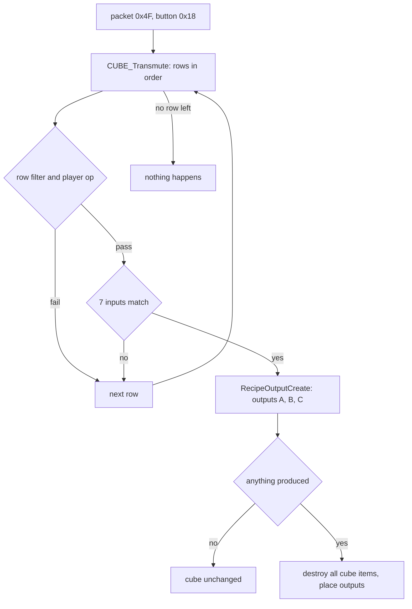

# 0008 — The Horadric Cube: recipe matching, input checks, output construction

> **Subsystem:** items/cube
> **Question:** When the player presses Transmute, which CubeMain row matches the cube's contents, and what comes out (item or portal), with which ilvl, quality, affixes, sockets and seeds?
> **Date:** 2026-10-15   **Plan:** 0030 (Phase 1, Phase 1b)   **Status:** open (Phase 1 read from the decompile and the disassembly, committed before any community source was read; Phase 1b cross-check 2026-10-15: nine contradictions, four reachable on stock data)

Names of structs and fields are ours (`re/types/cube.h`, `struct:CubeMainRec`). "Item seed" is the item-data seed at
`ItemData+0x04` (`ITEMS_GetSeed`), "unit seed" is the item unit's seed at `Unit+0x20`, "game seed" is `Game+0xD0`
([rng/0002](../rng/0002-seed-tree.md)). "Creation record" is the 0x84-byte `struct:ItemCreateRec`
([items/0001 § 8](0001-tc-resolution.md)). Item flags are `ItemData+0x18` (bit 4 `0x10` identified, bit 11 `0x800`
socketed, bit 26 `0x4000000` runeword, bit 22 `0x400000` ethereal; [items/0007](0007-sockets-runewords.md)); the
item's inventory page is `ItemData+0x45`, and page 3 is the cube. Column names are those of the raw `cubemain.txt`
header: Phase 0's `docs/tables/CubeMain.md` had not landed, so this finding gives no CubeMain table anchors yet.
Phase 1 was written from the code only; no community text had been read when it was written.

## Answer (summary)

- [I] **Entry.** The client packet `0x4F` (7 bytes: opcode, u16 button, u16, u16) is dispatched through
  `g_SrvPacketTable` (8-byte entries, handler at `opcode·8 + 0x006E0D18`) to `sub_0054C7C0_Pkt4FButton`, then
  `sub_00568060_PktInteractButton`. Buttons `0x17` and `0x18` need the player's interaction type (`Unit+0x68`) to be 4,
  the type button `0x17` ends; `0x18` calls `CUBE_Transmute(game)` with the player in ESI. (data:g_SrvPacketTable@0x006E0D18,
  fn:sub_0054D750_SrvPacketDispatch@0x0054D750, fn:sub_0054C7C0_Pkt4FButton@0x0054C7C0,
  fn:sub_00568060_PktInteractButton@0x00568060, fn:sub_00566AE0_CubeButton@0x00566AE0, fn:CUBE_Transmute@0x005665F0)
- [I] **The match is a first-fit scan of CubeMain in row order.** For each row: `enabled` (unless the never-written
  `g_CubeAllRows`), `version` < 100 or an expansion game, `ladder` clear or `Game+0x6A` ≠ 0 or a ladder game,
  `min diff` ≤ difficulty, `class` 0xFF or the player's class, `numinputs` = the number of items in the cube, the
  `op` test (ops 1–14 on the player), then the seven inputs. The first row that passes is transmuted and the scan
  stops. A transmute that matches no row does nothing: no draw, no message, no item moved. (§ 1, fn:CUBE_Transmute@0x005665F0)
- [I] **Inputs.** Each input claims every unclaimed cube item that passes its test (code, type, `any`, unique or set
  row, quality, `nos`/`sock`, `eth`/`noe`, `bas`/`exc`/`eli`, `upg`, `nru`, ops 15–27 on input 1, op 28 on every
  input) and passes when the number of claimed items equals `qty` (at least `qty` once any claimed item is a stackable
  base). A stack is one item. Because the cube count must equal `numinputs`, an extra item refuses the row. (§ 2,
  fn:CUBE_MatchInput@0x00565010)
- [I] **Input 1 feeds every output.** The matcher records, for each of the three output slots, the last item input 1
  claimed, its class (or −1 for `useitem`) and its ilvl, using **output A's** kind and flags for all three slots.
  (§ 2.4, 0x005656EE–0x00565816)
- [I] **Output ilvl** = `lvl` if non-zero; otherwise `trunc(player level × plvl / 100) + trunc(input-1 ilvl × ilvl /
  100)` (each term only when its column is non-zero); then clamped to [1, `experience` MaxLvl of class 0]. Only
  created items use it; `useitem` and `mod` outputs keep the input's ilvl. (§ 3.1, 0x00565B66–0x00565D12,
  fn:sub_00611830_ExpMaxLevel@0x00611830)
- [I] **Outputs, per kind** (`sub_00565AB0_RecipeOutputCreate`, outputs A, B, C in order): a fixed code, a random item
  of a type (two game-seed draws first), or `usetype` (input 1's class, upgraded by `exc`/`eli`) is a new item made
  by `sub_00558D90_ItemCreate` from a creation record (ilvl, forced quality, `pre=`/`suf=` as forced affixes, no
  socket roll and no ethereal roll unless `sock`/`eth`); `useitem` is a copy of input 1 (`sub_0055A2A0_ItemCopy`);
  `mod` copies input 1, changes its class and re-runs its base stats. Then the `mod 1..5` lines, `rep`, `rch`, `qty`
  and `sock=`. If anything was produced, **every item in the cube is destroyed** and the outputs are placed in the
  cube, identified. If nothing was produced, the cube is left as it was. (§ 3, fn:sub_00565AB0_RecipeOutputCreate@0x00565AB0)
- [I] **Crafted (quality 8)**: `sub_005C21D0_ItemBuildCrafted` draws two rare names, then `n = max(low % 5, tier)`
  affix slots (tier 1, 2, 3, 4 for ilvl ≤ 30, ≤ 50, ≤ 70, above), one side draw per slot, up to 252 redraws against
  the same id or group, then the properties in the order P1, S1, P2, S2, P3, S3, then the staff mods; the recipe's
  `mod` lines come after `ItemCreate` returns. (§ 4, fn:sub_005C21D0_ItemBuildCrafted@0x005C21D0)
- [I] **Special outputs.** `Cow Portal` opens a permanent portal (object 60) to level 39 when the player stands in
  level 1, has quest word 4 bit 10 clear and word 26 bit 0 (classic) or word 40 bit 0 (expansion) set in the
  current difficulty, and the game's own quest word 4 bit 11 is clear; it sets that bit. `Pandemonium Portal` and
  `Pandemonium Finale Portal` are stubs that return 0 in 1.14d (`xor eax, eax; ret`), so those rows produce nothing
  in any game this executable hosts. (§ 5, fn:sub_00594140_CubeCowPortal@0x00594140,
  fn:sub_00594270_CubePandPortalStub@0x00594270, fn:sub_00594280_CubePandFinaleStub@0x00594280)
- [C] **The Pandemonium key transmute in a single-player game opens nothing and leaves the keys in the cube.** Code:
  the portal stub returns 0 and no item is created, so `local_a0` stays 0 and the destroy step is skipped
  (0x00566400). Observed: log `od-k1-3201-hell.log` of run:2026-10-15-drlg-outdoor (expansion, Hell, the three keys
  alone in the cube, Transmute clicked three times: no portal, the keys stayed). The run shows the outcome only; that
  the row matched and the stub refused (rather than no row matching) is `[I]` (§ 5.2).
- [I] **The made-bit clear** in `RecipeOutputCreate` is reached only by a `usetype` output with `reg` whose input 1 is a
  unique: the unique is rebuilt by row, and its made bit is cleared again when it was clear before, so the rebuild
  leaves the bit as it was. No stock row has `reg`. (§ 3.3, 0x00565F49–0x00565FA9, 0x005660DC–0x005660F2)

## Leads used

Phase 1 read no community documentation of the cube (committed first, `a7f0073`). The code was located from our own
symbols: `sub_00565AB0_RecipeOutputCreate` ([items/0004](0004-uniques-sets.md)), the `cubemain` loader address
([data/0001](../data/0001-excel-loader.md)), and the socket functions of [items/0007](0007-sockets-runewords.md).

Phase 1b (2026-10-15) compared the finished claims with two registered sources: `src:d2dfg-blizzard` § cubemain.txt
(written for the D2R build: ladder seasons, `Red Portal`) and `src:arreat-summit-cube-crafted` (LoD 1.10–1.13 era).
`src:pd-sockets` was not reachable this session (a Cloudflare challenge page, no content) and is not compared.
Agreement promotes nothing; every tag above is unchanged. Each contradicted claim was re-read in the disassembly
(ops 1–4 at 0x005666D8–0x0056673B, the input-1 gate at 0x0056533F) and the reading stands; the contradictions are in
the backlog entry of 2026-10-15 (reverser → architect, plan 0030 Phase 1b).

**Row filter and ops**
- [L] src:d2dfg-blizzard: `enabled` 1 = usable, 0 = not. **held with refinement**
  Detail: also usable when `g_CubeAllRows` ≠ 0, which nothing writes (§ 1).
- [L] src:d2dfg-blizzard: `firstLadderSeason`/`lastLadderSeason` seasons. **contradicted** (later build)
  Detail: 1.14d has one `ladder` byte, which refuses a row only when `Game+0x6A` = 0 and the game is not ladder; single
  player passes (§ 1). Reachable on stock data (21 rows): a required Phase 2 case.
- [L] src:arreat-summit-cube-crafted: the rune upgrades above Ort and the elite unique upgrades work for single
  player, open and ladder characters, not for non-ladder realm characters. **held with refinement**
  Detail: the code's test is the game type byte and the ladder flag (§ 1); the realm values were not read.
- [L] src:d2dfg-blizzard: `min diff` 0/1/2, `version` 0/100, `class` codes, `numinputs` = the number of items in the
  cube. **held with refinement**
  Detail: `numinputs` counts cube items, a stack as one (§ 1, § 2.2); `version` ≥ 100 needs an expansion game.
- [L] src:d2dfg-blizzard: op 1 "day of the month is less than param or greater than value"; op 2 "day of the week
  does not equal value". **contradicted**
  Detail: the row passes when `param` ≤ day ≤ `value` (0x005666D8–0x005666E8) and when `value` = day of week + 1
  (0x005666F3); the guide states the refusal condition. No stock row uses ops 1 or 2: not a required case.
- [L] src:d2dfg-blizzard: ops 3/4 (and 7/8, 11/12, 15/16, 19/20, 23/24) "greater than" / "less than" `value`.
  **contradicted**
  Detail: the code passes on ≥ / ≤ of `value >> ValShift` (0x00566739 `jl` to refuse); ops 5/6 (≠ / =) and the
  base / non-base variants hold. No stock row uses them: not a required case.
- [L] src:d2dfg-blizzard: op 27 "Mod Class is not equal to value". **held with refinement**
  Detail: the code tests `ITEMS_GetFileIndex(item)` ≠ `value` on input 1's items (§ 2.3).
- [L] src:d2dfg-blizzard: op 28 checks `quest` and `questdiffcheck`, then that the quest difficulty is **greater
  than** the game's difficulty. **contradicted**
  Detail: the item passes on stat 356 ≥ difficulty (0x005652FD `jl` to refuse), on every input. Reachable on stock
  (Wirt's Leg, the Staff of Kings, the Khalim parts in Nightmare or Hell with stat 356 = the difficulty): a required
  Phase 2 case.

**Inputs**
- [L] src:d2dfg-blizzard: input qualifiers `qty=`, `low`…`tmp`, `nos`, `noe`, `eth`, `upg` "allows upgrades",
  `bas`, `exc`, `eli`, `nru`. **held with refinement**
  Detail: `upg` is a tier test (the named base or a higher tier of it, § 2.3); `bas`/`exc`/`eli` compare the item's
  own code with its tier codes.
- [L] src:d2dfg-blizzard: input `sock=#` "item with sockets, where # defines the number". **contradicted**
  Detail: the input parser knows `sock` alone (stat 194 ≠ 0); `sock=2` parses `sock` and then stops at the unknown
  token `2` (§ 2.1). No stock input has a count: not a required case.
- [L] src:arreat-summit-cube-crafted: "the ilvl, the quality and the properties of the jewel are completely
  irrelevant". **held** Detail: only input 1 feeds the outputs (§ 2.4).

**Output ilvl**
- [L] src:d2dfg-blizzard: `lvl` overrides `plvl` and `ilvl`; `plvl` is a ratio of the player's level; `ilvl` a ratio of
  input 1's (output A), input 2's (`b ilvl`), input 3's (`c ilvl`) level. **contradicted** (for B and C)
  Detail: all three outputs take input 1's ilvl, and output A's flags (0x0056533F: inputs 2–7 skip the slot fill,
  § 2.4). No stock row has `output b` or `output c`: not a required case. Output A: held.
- [L] src:arreat-summit-cube-crafted: crafted ilvl = int(.5 × clvl) + int(.5 × ilvl), capped at 99. **held**
  Detail: `plvl` 50, `ilvl` 50, two truncating divisions, cap = `experience` MaxLvl (§ 3.1).
- [L] src:arreat-summit-cube-crafted: "if qlvl > ilvl then ilvl = qlvl", then the affix level from ilvl and qlvl.
  **not covered**
  Detail: the cube does not raise the record's ilvl (§ 3.1); the affix level is computed inside
  `ITEMS_PickMagicAffix` ([items/0005 § 2](0005-affixes.md)), not compared here.
- [L] src:arreat-summit-cube-crafted: high-level rare reroll ilvl = int(.66 × clvl) + int(.66 × ilvl); low-level
  int(.4 × clvl) + int(.4 × ilvl); rings ↔ amulets int(.75 × clvl); magic reroll ilvl = the input's; fixed ilvl 30
  (Leech, Spikes, the ring recipes, the gem-and-socketed-weapon recipe), 50 (Prismatic, Savage), 25 (chipped);
  low → normal ilvl 1. **held**
  Detail: the `plvl`/`ilvl`/`lvl` cells and § 3.1; ilvl 0 is raised to 1.
- [L] src:arreat-summit-cube-crafted: the 6-skull reroll "will not work on items larger than 3x2". **not covered**
  Detail: no size test in the match; six skulls fill half of the cube's grid.

**Outputs**
- [L] src:d2dfg-blizzard: `usetype` = input 1's type, `useitem` = input 1 as the output, `mod` = input 1's modifiers on
  the output. **held with refinement**
  Detail: `usetype` is a new item of input 1's class (with `exc`/`eli` upgrades); `mod` copies the item, changes its
  class and re-runs its base stats (§ 3.3).
- [L] src:d2dfg-blizzard: output `qty=`, `pre=`, `suf=`, `low`…`tmp`, `eth`, `sock`, `uns`, `rem`, `reg`, `exc`,
  `eli`, `rep`, `rch`. **held with refinement**
  Detail: `sock=N` and `qty=N` share one byte (§ 3.2); `reg` keeps the made bit as it was (§ 3.3).
- [L] src:d2dfg-blizzard: output `lvl=#` "same as qty"; `Red Portal`. **contradicted** (later build)
  Detail: the 1.14d output parser has neither (§ 3.2); stock data uses neither: not a required case.
- [L] src:d2dfg-blizzard: `mod N chance` "percent chance … if 0, always". **held with refinement**
  Detail: 1..99 make one unit-seed draw and apply when `low % 100` ≤ chance, i.e. (chance + 1) %; ≥ 100 always
  (§ 3.4). Every stock cell is blank: not a required case.
- [L] src:arreat-summit-cube-crafted: the upgrade recipes keep the unique's bonuses and the socketed jewels or runes,
  and an ethereal item stays ethereal. **held with refinement**
  Detail: the copy keeps its lists and children (§ 3.3); the ethereal base bonus is re-applied by
  `sub_00660240_CubeModApply` after each `mod` line, and every upgrade row has one (`levelreq`). Whether
  `ItemInitStats` itself re-applies it was not read (*Open questions*).
- [L] src:arreat-summit-cube-crafted: the magic-weapon socket recipes give 1–2 sockets and rerolled properties; a
  weapon that cannot have sockets gets none. **held**
  Detail: `usetype,mag` with `mod 1` = `sock` 1–2; the cap is `ItemMaxSockets` ([items/0007](0007-sockets-runewords.md)).
- [L] src:arreat-summit-cube-crafted: the rune socket recipes give body armor 1–4, weapon 1–6, helm 1–3, shield 1–4
  sockets before the base's cap. **contradicted** (for body armor, helm and shield)
  Detail: all four stock rows have `mod 1` = `sock` with min 1, max 6 (rows 123–126). The draw itself is the `sock`
  handler's ([items/0006](0006-properties.md), [items/0007](0007-sockets-runewords.md)). Reachable: a required Phase 2
  case (a body armor, a helm and a shield whose cap is ≥ 2).
- [L] src:arreat-summit-cube-crafted: the rare socket recipe adds one socket only to a rare with none that can have
  sockets. **held** Detail: `nos`, the socketable first-input test and the rare cap of 1 (§ 2.3, § 3.4).
- [L] src:arreat-summit-cube-crafted: the Savage recipe gives one of ten polearms at random (normal or exceptional,
  not Bec-de-Corbin or Grim Scythe). **held with refinement**
  Detail: the candidates are `pole` items with `level` ≤ 50 (§ 3.3); the index just below the random start is never
  a candidate in that draw.
- [L] src:arreat-summit-cube-crafted: quivers and throwing weapons come with a random quantity. **held**
  Detail: no `qty=`; the quantity is `ItemInitStats`'s draw ([items/0006](0006-properties.md) § 1).

**Crafted**
- [L] src:arreat-summit-cube-crafted: 1–4 affixes; ilvl 1–30: 40 % 1 and 20 % each 2, 3, 4; 31–50: 60 % 2, 20 % 3, 4;
  51–70: 80 % 3, 20 % 4; 71+: 4. **held**
  Detail: `max(low % 5, tier)` gives exactly these ratios with the tiers at > 30, > 50, > 70 (§ 4).

**Special outputs**
- [L] src:arreat-summit-cube-crafted: the cow portal must be transmuted in the Rogue Encampment, after killing Baal in
  the same difficulty, once per difficulty. **held with refinement**
  Detail: level 1; expansion: player quest word 40 bit 0 (classic: word 26 bit 0); once per game (the game's word 4
  bit 11) and only while the player's word 4 bit 10 is clear (§ 5.1). Which quest events set those bits is not read.
- [L] src:d2dfg-blizzard: `Pandemonium Portal` opens one of the three portals at random, no duplicates; `Pandemonium
  Finale Portal` opens Uber Tristram. **contradicted** (realm-only behaviour)
  Detail: both handlers return 0 in 1.14d (§ 5.2); observed in run:2026-10-15-drlg-outdoor. Reachable on stock: a
  required Phase 2 case (log the row match and the refusal).

## Functions

| Address | Name | Role | Tag |
|---|---|---|---|
| `0x0054D750` | `sub_0054D750_SrvPacketDispatch` | client packet → `g_SrvPacketTable[opcode]` (opcode 1..0x66) | I |
| `0x006E0D18` | `g_SrvPacketTable` (data) | 8-byte entries {handler, flag}; `0x4F` → `0x0054C7C0`, `0x28` → `SOCK_PacketInsert` | I |
| `0x0054C7C0` | `sub_0054C7C0_Pkt4FButton` | length 7; `(button = u16 +1, arg = u16 +3 << 16 | u16 +5)` | I |
| `0x00568060` | `sub_00568060_PktInteractButton` | button switch; 0x17/0x18 need interaction type 4 | I |
| `0x00554100` | `sub_00554100_PlayerGetInteract` | `Unit+0x68` type, `+0x64` unit id, `+0x6C` flag | I |
| `0x00566AE0` | `sub_00566AE0_CubeButton` | 0x17 end interaction, 0x18 `CUBE_Transmute` | I |
| `0x005665F0` | `CUBE_Transmute` | row scan, row filter, player ops, calls the matcher and the builder | I |
| `0x00564FD0` | `sub_00564FD0_CubeCountItems` | items on page 3 in the player's inventory | I |
| `0x005658C0` | `sub_005658C0_CubeMatchInputs` | inputs 0..6 in order, 48-entry claimed array | I |
| `0x00565010` | `CUBE_MatchInput` | one input against every cube item | I |
| `0x00565AB0` | `sub_00565AB0_RecipeOutputCreate` | outputs A, B, C; destroy; place | I |
| `0x00565930` | `sub_00565930_CubePickItemOfType` | random item of a type, ≤ ilvl, two game-seed draws | I |
| `0x006E11C8` | `g_CubeSpecialOutputs` (data) | kinds 1..3 → thunks `0x00565A80`/`90`/`A0` → the three below | I |
| `0x00594140` | `sub_00594140_CubeCowPortal` | the cow portal | I |
| `0x00594270` | `sub_00594270_CubePandPortalStub` | `xor eax, eax; ret` | I |
| `0x00594280` | `sub_00594280_CubePandFinaleStub` | `xor eax, eax; ret` | I |
| `0x00660240` | `sub_00660240_CubeModApply` | one `mod` line: `PROP_ApplyBlockByVersion(7, …, 0x40)`, then ethereal again | I |
| `0x00564F30` | `sub_00564F30_CubeDestroyContents` | removes every page-3 item | I |
| `0x00560200` | `sub_00560200_InvPlaceItem` | puts a unit in the player's inventory (here page 3) | I |
| `0x00555600` | `sub_00555600_UnitFree` | frees a unit that could not be placed | I |
| `0x00558C50` | `sub_00558C50_ItemRemoveRuneword` | clears flag bit 26, the name, the state-171 list | I |
| `0x0055F900` | `sub_0055F900_ItemRepairBroken` | `rep` on a broken item (flag `0x100`) | I |
| `0x0055FE80` | `sub_0055FE80_ItemRefillCharges` | `rch` ([items/0007](0007-sockets-runewords.md)) | I |
| `0x00553380` | `sub_00553380_UnitSetEvent` | `Unit+0x6E` = event, `+0x70` = arg, unit marked for update | I |
| `0x00544760` | `sub_00544760_GameQuestGet` | `QUESTRECORD_GetState` on the game's own quest record (`Game+0x10F4` → `+0x0C`) | I |
| `0x00544720` | `sub_00544720_GameQuestSet` | same, set | I |
| `0x0059E5C0` | `sub_0059E5C0_QuestStaffMade` | after placing `hst`: the player's quest word 10 bit 11 | I |
| `0x005B86E0` | `sub_005B86E0_QuestKhalimWillMade` | after placing `qf2` | I |
| `0x00669130` | `sub_00669130_CubeMainLoad` | field descriptor; refuses `cubeserver.*` ([data/0001](../data/0001-excel-loader.md)) | I |
| `0x00668600` | `sub_00668600_CubeParseInput` | `input N` cell → `struct:CubeInput+0x0` | I |
| `0x00668A90` | `sub_00668A90_CubeParseOutput` | `output`, `output b`, `output c` cell → `struct:CubeOutput+0x00` | I |
| `0x0066A1B0` | `CUBEMAIN_GetRecord` | `g_pCubeMain + 0x148·i`, fatal when out of range | I |
| `0x0066A200` | `CUBEMAIN_GetCount` | `g_nCubeMain` | I |
| `0x0096D628` | `g_pCubeMain` (data) | records | I |
| `0x0096D62C` | `g_nCubeMain` (data) | 151 stock | I |
| `0x0088CAC0` | `g_CubeAllRows` (data) | read once (0x00566658); no write found | I |
| `0x00611830` | `sub_00611830_ExpMaxLevel` | `experience` record `[i]`, i in 0..6, else `[0]` | I |
| `0x00451F60` | `sub_00451F60_UnitGetClassId` | `Unit+0x04`, −1 without a unit | I |
| `0x00625560` | `sub_00625560_UnitStatDelta` | difference of two stat-list reads (not followed) | I |
| `0x00628110` | `sub_00628110_ItemGetFlags` | `ItemData+0x18` | I |
| `0x00628250` | `sub_00628250_ItemGetPage` | `ItemData+0x45`, 0xFF without data | I |
| `0x00628280` | `sub_00628280_ItemSetPage` | same, set | I |

## Walkthrough



### 1. The row filter: `CUBE_Transmute` (0x005665F0)

Called with ECX = game (as `[ebp+8]` after the prologue), ESI = player. In row order, from 0 to `g_nCubeMain` − 1:

```c
// fn:CUBE_Transmute@0x005665F0 (trimmed, renamed)
n = sub_00564FD0_CubeCountItems(player->pInventory);     // items with page 3
if (n <= 0) return;
GetLocalTime(&t); dow = t.wDayOfWeek + 1;
for (i = 0; i < CUBEMAIN_GetCount(); i++) {
    r = CUBEMAIN_GetRecord(i);
    if (!r->enabled && !g_CubeAllRows) continue;
    if (!game->expansion && r->version >= 100) continue;
    if (game->gameType == 0 && !game->ladder && r->ladder) continue;
    if (r->minDiff > game->difficulty) continue;            // unsigned bytes
    if (r->classId != 0xFF && r->classId != UnitGetClassId(player)) continue;
    if (r->numInputs != n) continue;
    if (!PlayerOp(r, player, t)) continue;                   // ops 1..14; others pass here
    int slots[9] = {0};                                      // 3 × {unit, classId, ilvl}
    if (CubeMatchInputs(game, r, slots)) { RecipeOutputCreate(game, player, r, slots, 1); return; }
}
```

- [I] The tests above, in that order. `version` is a u16 at `+0x12`; `min diff` is compared with `Game+0x6D`;
  `numinputs` is a byte compared with the count of page-3 items. (0x00566653–0x005666BB, struct:CubeMainRec+0x12,
  struct:Game+0x6D)
- [I] **Ladder rows in single player.** A `ladder` row is skipped only when `Game+0x6A` = 0 and `Game+0x74` = 0.
  Single player has `Game+0x6A` = 3 ([items/0001](0001-tc-resolution.md), run:2026-10-11-tc-drops), so the 21 stock
  ladder rows (the 19 rune upgrades to runes 15–33 and the two elite unique upgrades) are matchable offline, as the unique ladder flag is
  ([items/0004](0004-uniques-sets.md)). No transmute of a ladder row has been logged. (0x00566679–0x00566689,
  struct:Game+0x6A, struct:Game+0x74)
- [I] **Disabled rows** (the four tempered rows and the `+30-50 ar` row, `enabled` blank) are unreachable: the only
  reference to `g_CubeAllRows` is this read, and the image holds 0 there. (data:g_CubeAllRows@0x0088CAC0, 0x00566658)
- [I] **Player ops** (`op` at `+0x04`, `param` at `+0x08`, `value` at `+0x0C`, both int32). Let `v = value >>
  ItemStatCost[param].ValShift` (arithmetic shift). For ops 3–14 the test runs only when 0 ≤ `param` ≤ the stat count
  (`DataTables+0xBD4`); outside that range the row passes; a missing ItemStatCost record refuses the row.
  (0x005666C1, fn:ITEMSTATCOST_GetRecord@0x0045C4F0)

  | op | the row passes when |
  |---|---|
  | 1 | `param` ≤ day of month ≤ `value` (local time) |
  | 2 | `value` = day of week + 1 (Sunday = 1) |
  | 3 / 4 / 5 / 6 | player stat `param` ≥ v / ≤ v / ≠ v / = v (`STATS_GetUnitStat`) |
  | 7 / 8 / 9 / 10 | the same with `STATS_GetUnitBaseStat` |
  | 11 / 12 / 13 / 14 | the same with `sub_00625560_UnitStatDelta` |
  | 0, 15–28, other | no player test (15–28 are input tests, § 2.3) |

  Stock data uses only op 28 (on 5 rows). (0x005666C1–0x00566A39, fn:sub_00625560_UnitStatDelta@0x00625560,
  fn:ITEMSTATCOST_GetRecord@0x0045C4F0, tbl:ItemStatCost.txt:ValShift)
- [I] **No match.** When the loop ends, `CUBE_Transmute` returns. Nothing in it or in the matcher draws from any
  seed. (0x00566A73–0x00566A8A)

### 2. The inputs: `sub_005658C0_CubeMatchInputs` and `CUBE_MatchInput` (0x00565010)

`sub_005658C0_CubeMatchInputs` zeroes a 48-dword claimed array and calls `CUBE_MatchInput(row, k, slots, claimed)`
for k = 0..6, failing at the first input that fails. (fn:sub_005658C0_CubeMatchInputs@0x005658C0)

#### 2.1 Compiled input (`struct:CubeInput+0x0`, 8 bytes at row `+0x14 + 8k`)

- [I] `flags` u16, `index` u16, `rowPlus1` u16, `quality` u8, `qty` u8. The parser
  (`sub_00668600_CubeParseInput`) strips quotes, splits the base at the first comma, and tries, in this order:
  `any` (flag `0x001`, index 0xFFFF); a type code of ≤ 4 characters in `itemtypes` (flag `0x002`); an item code of
  ≤ 4 characters (flag `0x001`); a `uniqueitems` name (flags `0x041`, quality 7, row + 1, index = its base); a
  `setitems` name (flags `0x041`, quality 5, row + 1). A cell that is none of these fails the parse. **Types are tried
  before item codes** (the output parser does the reverse, § 3.2). (fn:sub_00668600_CubeParseInput@0x00668600)
- [I] Qualifiers, each compared as an exact string: `qty=N` (byte `+0x07`, `atol`), `low` 1, `nor` 2, `hiq` 3,
  `mag` 4, `set` 5, `rar` 6, `uni` 7, `crf` 8, `tmp` 9 (byte `+0x06`); `nos` `0x004`, `sock` `0x008`, `noe` `0x020`,
  `eth` `0x010`, `upg` `0x080`, `bas` `0x100`, `exc` `0x200`, `eli` `0x400`, `nru` `0x800`. An unknown qualifier ends
  the parse silently (the cell keeps what it had). (0x00668720 onwards)

#### 2.2 One input against the cube

```c
// fn:CUBE_MatchInput@0x00565010 (trimmed, renamed; ECX game, EDX inventory)
in = &row->inputs[k];
if ((in->flags & 3) == 0) return 1;                      // empty slot
need = in->qty ? in->qty : 1;  got = 0;  allExact = 1;  ord = 0;
for (it = first cube item .. last, in inventory-list order) {      // page 3 only
    ord++;
    base = ITEMS_GetRecord(it->classId);
    if (!ItemTest(in, it, base)) continue;                // § 2.3
    if (k == 0 && !OutputSocketTest(row, it)) continue;   // § 2.3, last bullet
    if (ord <= 48 && claimed[ord-1]) continue;
    if (k == 0) { if (!ItemOp(row, it)) continue; FillSlots(row, it, slots); }   // § 2.3, § 2.4
    if (ord <= 48) claimed[ord-1] = 1;
    got++;
    if (ItemBaseStackable(it)) allExact = 0;
}
return allExact ? got == need : got >= need;
```

- [I] An input claims **every** unclaimed matching item, not only `qty` of them, and the test is `got = qty`
  (or `got ≥ qty` once a claimed item has a stackable base, `sub_006289F0_ItemBaseStackable`). Each cube item counts 1
  whatever its stack quantity. Inputs are taken in column order, so an item that could match two inputs goes to the
  first. (0x0056504A, 0x0056581C–0x0056587C, fn:sub_006289F0_ItemBaseStackable@0x006289F0)
- [I] **Extra items.** The row filter already requires the cube count to equal `numinputs`. On stock data
  `numinputs` is the sum of the `qty`s, so an extra or unmatched item always refuses the row. A row whose
  `numinputs` exceeded the inputs' sum would let an unmatched item through; none exists in the stock table.
  (0x005666B4–0x005666BB)

#### 2.3 The item test, in the code's order

- [I] **Base.** Flag `0x001` with index 0xFFFF: any item. Flag `0x001` without `upg`: `classId` = index. Flag `0x001`
  with `upg` (`0x080`): the item's own code `c` is compared with its base's `normcode` (`+0x84`), `ubercode`
  (`+0x88`), `ultracode` (`+0x8C`), and the input's code `i` (the input record's `+0x80`) must be: `normcode` when
  `c` = `normcode`; `normcode` or `ubercode` when `c` = `ubercode`; any of the three when `c` = `ultracode`. So `upg`
  accepts the named base or a higher tier of it. Flag `0x002`: `ITEMS_UnitIsType(item, index)` (equivalences count).
  (0x005650A0–0x005651AD, 0x00565330–0x00565847, fn:ITEMS_UnitIsType@0x00629BB0, tbl:Weapons.txt:normcode,
  tbl:Weapons.txt:ubercode, tbl:Weapons.txt:ultracode)
- [I] **Quality.** When `quality` ≠ 0 the item's quality must equal it. (A dead call to `0x00625290` on a mismatch with
  quality 9 has no effect.) (0x005651B0–0x005651D8)
- [I] **Unique or set row** (`0x040`): `ITEMS_GetFileIndex(item)` = `rowPlus1` − 1. (fn:ITEMS_GetFileIndex@0x00629DA0)
- [I] **Sockets.** `nos` (`0x004`): stat 194 (`item_numsockets`, `ITEMS_GetSockets`) = 0. `sock` (`0x008`): stat 194 ≠ 0.
  The socket count, not the filled count, is tested. (fn:ITEMS_GetSockets@0x006299B0)
- [I] **Ethereal.** `noe` (`0x020`): not ethereal. `eth` (`0x010`): ethereal. (fn:ITEMS_IsEthereal@0x0062A8D0)
- [I] **Tier.** `bas` (`0x100`): the item's code = its `normcode`; else `exc` (`0x200`): = `ubercode`; else `eli`
  (`0x400`): = `ultracode` (one of the three is tested, in that priority). (0x0056526D–0x005652A8)
- [I] **`nru`** (`0x800`): the item has no runeword flag (bit 26). (fn:sub_00628110_ItemGetFlags@0x00628110)
- [I] **Op 28 (quest-item difficulty), on every input.** When the row's `op` is 28 and the item's base has both
  `quest` (`+0x12A`) and `questdiffcheck` (`+0x12B`) set, the item's stat 356 (`questitemdifficulty`) must be ≥ the
  game's difficulty. Of the five op-28 rows, the test binds Wirt's Leg (`leg`), the Staff of Kings and the Viper Amulet,
  the Khalim Flail and Khalim's organs; the Pandemonium keys and organs have `quest` blank and pass. So in Nightmare
  and Hell a Wirt's Leg needs stat 356 ≥ 1 or 2 for the cow portal row to match. (0x005652C9–0x005652FF,
  tbl:Weapons.txt:quest, tbl:Weapons.txt:questdiffcheck, tbl:Misc.txt:quest)
- [I] **Socketable first input.** For input 1 only, when output A is `useitem` or `usetype` with `sock`, the item
  must have `sub_0062BC20_ItemMaxSockets` ≠ 0. (0x00565307–0x00565330, fn:sub_0062BC20_ItemMaxSockets@0x0062BC20)
- [I] **Ops 15–27, on input 1's items only**, with the same `v`, range rule and missing-record refusal as § 1:
  15 / 16 / 17 / 18: item stat ≥ v / ≤ v / ≠ v / = v; 19–22: the same on the base stat; 23–26: the same with
  `sub_00625560_UnitStatDelta`; 27: `ITEMS_GetFileIndex(item)` ≠ `value`. No stock row uses them.
  (0x00565347–0x005656E8)

#### 2.4 What input 1 hands to the outputs

- [I] For each item input 1 claims, for each of the three output slots s: `slots[s].ilvl` = its ilvl; `slots[s].unit`
  = the item when output A has `mod` or is `useitem`/`usetype`; `slots[s].classId` = its class for `usetype`, −1 for
  `useitem`; then, for `useitem`/`usetype` only, output A's `exc` replaces the class by the item's `ubercode` record,
  else output A's `eli` by its `ultracode` record, when that code is not blank, is found, and (an expansion game or
  that record's `version` < 100). The last claimed item wins, and **outputs B and C get the same values, computed
  from output A's flags**. (0x005656EE–0x00565816, fn:EXCEL_FindCode@0x006BD130, fn:ITEMS_GetItemLevel@0x006281E0)

### 3. The outputs: `sub_00565AB0_RecipeOutputCreate(game, player, row, slots, 1)` (0x00565AB0)

ECX = game, EDX = player. Outputs A, B, C (`row + 0x4C + 0x54·s`) in order.

#### 3.1 The ilvl (0x00565B66–0x00565D12)

```c
// per output s; o = &row->outputs[s]
if (o->lvl) v = o->lvl;
else {
    v = 0;
    if (o->plvl) v  = (STATS_GetUnitStat(player, 12 /*level*/) * o->plvl) / 100;   // signed, truncating
    if (o->ilvl) v += (slots[s].ilvl * o->ilvl) / 100;
}
if (max(v, 1) < ExpMaxLevel(0)) v = max(v, 1); else v = ExpMaxLevel(0);
```

- [I] The two products are exact 32-bit signed divisions by 100 for any value a stock game produces; the code takes a
  64-bit path (`__alldiv`) or divides first only above 0x100000 or 0x10000, which a level or a byte percent never
  reaches. The cap is `experience` record 0's class-0 column, the `MaxLvl` row. (0x00565B9B–0x00565CDB,
  fn:sub_00611830_ExpMaxLevel@0x00611830)
- [I] Stock uses: `lvl` 25, 30, 50 (the old magic recipes); `plvl` 75 (rings to amulet); `plvl`/`ilvl` 40/40,
  66/66 (rare rerolls), 50/50 (crafted); `ilvl` 100 (magic reroll), 60 with `lvl` 30 (where `lvl` wins). (struct:CubeOutput+0x09)

#### 3.2 Compiled output (`struct:CubeOutput+0x00`, 0x54 bytes)

- [I] The parser (`sub_00668A90_CubeParseOutput`) tries, in this order: `Cow Portal` (kind 1), `Pandemonium Portal`
  (2), `Pandemonium Finale Portal` (3) (case-insensitive); `usetype` (0xFF); `useitem` (0xFE); an item code of ≤ 4
  characters (0xFC, index); a type code of ≤ 4 characters (0xFD, index); a unique name (0xFC, its base, quality 7,
  row + 1, flag `0x008`, and byte `+0x0B` set to the unique's `lvl`); a set item name (the same with quality 5 and
  the set item's `lvl`). Qualifiers: `qty=N` and `sock=N` both write byte `+0x07`; `pre=N` and `suf=N` fill
  `pre[0..2]`/`suf[0..2]` in the order given; `low` … `tmp` set the quality as for inputs; `eth` `0x004`, `sock`
  `0x002`, `mod` `0x001`, `uns` `0x010`, `rem` `0x020`, `reg` `0x040` (and kind 0xFF), `exc` `0x080`, `eli` `0x100`,
  `rep` `0x200`, `rch` `0x400`. (fn:sub_00668A90_CubeParseOutput@0x00668A90)
- [I] The `mod N` columns compile to {int32 properties row (`g_PropertiesLink`), int16 param, min, max, u8 chance}
  at `+0x18 + 12·m`; `lvl`, `plvl`, `ilvl` to bytes `+0x09..+0x0B`. (fn:sub_00669130_CubeMainLoad@0x00669130,
  data:g_PropertiesLink@0x0096BCD8)

#### 3.3 Building one output

```c
// fn:sub_00565AB0_RecipeOutputCreate@0x00565AB0 (trimmed, renamed), output s
strip = (o->flags & 0x30) != 0;                                 // uns or rem
v = Ilvl(o, s);                                                 // § 3.1
if (o->kind >= 1 && o->kind <= 3 && g_CubeSpecialOutputs[o->kind])
    any = g_CubeSpecialOutputs[o->kind](game, player);          // § 5
if (!(o->flags & 1)) {                                          // no `mod`
    if (o->kind == 0xFE) {                                      // useitem
        it = ItemCopy(game, slots[s].unit, 0, /*children*/ !strip);
        if (o->quality == 9) {                                  // `tmp`, disabled rows only
            a = PickRareNameByVersion(it, 1); b = PickRareNameByVersion(it, 0);
            if (a && b) { SetQuality(it, 9); SetRareName1(it, a); SetRareName2(it, b); } else mods = 0;
        }
    } else {
        q = o->quality; rowP1 = o->rowPlus1; clearMade = -1;
        if (o->kind == 0xFF) {                                  // usetype
            cls = slots[s].classId;
            if ((o->flags & 0x40) && slots[s].unit) {           // reg
                q = GetQuality(unit); rowP1 = GetFileIndex(unit) + 1; v = GetItemLevel(unit);
                if (q == 7 && !(game->uniqueMade[fi >> 5] & bit(fi))) clearMade = fi;
            }
        } else if (o->kind == 0xFC) cls = o->index;
        else if (o->kind == 0xFD) cls = CubePickItemOfType(game, v, o->index);   // 2 game-seed draws
        else goto done;                                         // kinds 0..3: no item
        rec = {0}; rec.pSource = player; rec.pGame = game; rec.ilvl = v; rec.itemIndex = cls;
        rec.+0x18 = 4; rec.+0x28 = 1; rec.+0x2A = game->itemVersion; rec.quality = q; rec.rowPlus1 = rowP1;
        rec.forcedPrefix[i] = o->pre[i]; rec.forcedSuffix[i] = o->suf[i];       // u16 → int
        rec.flags = ((o->flags & 2) && o->qty == 0 ? 0x10 : 0x08) | ((o->flags & 4) ? 0x04 : 0x02);
        it = ItemCreate(game, &rec, 0);
        if (clearMade >= 0) game->uniqueMade[clearMade >> 5] &= ~bit(clearMade);
    }
} else {                                                        // `mod`: change the base, keep the item
    it = ItemCopy(game, slots[s].unit, 0, !strip);
    cls = kind 0xFE ? max(slots[s].classId, 0) : kind 0xFF ? slots[s].classId
        : kind 0xFC ? o->index : kind 0xFD ? CubePickItemOfType(game, v, o->index) : 0;
    it->classId = cls;  ItemInitStats(game, &it, 0, 0);
}
```

- [I] **Fixed code, item type, `usetype`.** A new item through `sub_00558D90_ItemCreate(game, &rec, 0)`: the record
  as above (the unit's seeds come from the game seed, [items/0001 § 8](0001-tc-resolution.md)). `+0x18` is 4 here
  (3 on a drop; meaning not read). The record's flags disable the socket roll (`0x08`) unless `sock` is given
  without a count (`0x10`, the roll always succeeds), and the ethereal roll (`0x02`) unless `eth` (`0x04`, forced
  ethereal). (0x00565FEE–0x005660C5, struct:ItemCreateRec+0x80, fn:sub_00558D90_ItemCreate@0x00558D90)
- [I] **Forced quality.** The record's quality is the output's (`mag` 4, `rar` 6, `crf` 8, `nor` 2, …), and the
  quality builders of [items/0005](0005-affixes.md) run with `pre=`/`suf=` as the forced affix ids. A quality of 0
  (`rvl`, the runes and gems, `hst`, `qf2`, `toa`, `cqv`, …) leaves the creation-side roll
  `sub_00556F60_ItemRollQualityCreate` to choose: it returns 2 at once for a base with `quest` set, otherwise it walks
  the qualities 7..2 with `RNG_RangeB(item seed, …)` ([items/0002 § 8](0002-quality-roll.md)). (struct:ItemCreateRec+0x30,
  fn:sub_00556F60_ItemRollQualityCreate@0x00556F60)
- [I] **Random item of a type** (kind 0xFD; stock: the `pole,mag,pre=191` row). `sub_00565930_CubePickItemOfType(game,
  ilvl, type)`: draw 1 `start = RNG_RangeB(game seed, nItems)`; scan from `start` upward with wrap-around and stop
  **before** `start − 1` (that index is never examined), collecting up to 256 items that are of the type
  (`ITEMS_IsType`), `spawnable`, of `version` < 100 or in a game with item version ≥ 100, and of `level` ≤ ilvl; draw 2
  `RNG_RangeB(game seed, count)` picks one. With no candidate it returns 0 (item record 0) without the second draw.
  Both draws come before `ItemCreate`. (fn:sub_00565930_CubePickItemOfType@0x00565930, fn:RNG_RangeB@0x0045C3E0,
  fn:ITEMS_IsType@0x00629A90, tbl:Weapons.txt:level, tbl:Weapons.txt:spawnable)
- [I] **`useitem`.** The input item is copied (`sub_0055A2A0_ItemCopy`: serialise, then
  `sub_00558CB0_ItemCreateFromSave`, whose `sub_00555230_SUnitCreate` draws from the game seed; the saved fields come
  back from the stream). Its socketed children are copied with it unless `uns` or `rem`. The copy keeps class,
  quality, affixes and ilvl. (0x00565D76–0x00565DA2, 0x00565E66–0x00565E8C, fn:sub_0055A2A0_ItemCopy@0x0055A2A0,
  fn:sub_00558CB0_ItemCreateFromSave@0x00558CB0, fn:sub_00555230_SUnitCreate@0x00555230)
- [I] **`mod` (the upgrade rows `useitem,mod,exc` / `useitem,mod,eli`).** The copy's class is set to the upgraded class
  from § 2.4, or to **0** when that lookup left −1 (not reachable on stock data: the matching inputs require `bas`
  or `exc` bases, which have the next code). Then `sub_00557AB0_ItemInitStats(game, &copy, 0, 0)` re-runs the base
  stats on the copy's unit seed (defense, durability, quantity, [items/0006](0006-properties.md) § 1) without the
  quality builders, so prefixes, suffixes, unique or set row and their property lists stay. (0x00565DC4–0x00565E3F,
  fn:sub_00557AB0_ItemInitStats@0x00557AB0)
- [I] **`reg`** (no stock row): a `usetype` output rebuilt with input 1's quality, file index + 1 and ilvl (the
  unclamped `ITEMS_GetItemLevel`). For a unique whose made bit was clear, the bit that `ItemCreate`'s unique builder
  sets is cleared again, so the made set is unchanged; a bit already set stays set (and the build may then fall
  back, [items/0004 § 3](0004-uniques-sets.md)). (0x00565F49–0x00565FA9, 0x005660DC–0x005660F2, struct:Game+0x1B24)
- [I] **Named unique or set output** (no stock row): kind 0xFC with quality 7 or 5 and the row + 1; the parser stores
  the row's `lvl` in the `ilvl` byte, which § 3.1 reads as a **percentage** of input 1's ilvl. Whether the `ilvl`
  column, loaded later in the descriptor, overwrites that byte is not settled (*Open questions*).
  (fn:sub_00668A90_CubeParseOutput@0x00668A90)

#### 3.4 After the item exists, in this order

- [I] **`uns` / `rem`.** `sub_00558C50_ItemRemoveRuneword` on the output: when flag bit 26 is set it clears it, clears
  prefix 0 (the runeword name) and frees the stat list of state 171 (`0xAB`), flags `0x40`. With `rem` each socketed
  child of the **original** input is also copied and kept aside, to be placed in the cube after the outputs (no stock
  row has `rem`; `uns` destroys the children with the original). The socket count (stat 194) is not changed.
  (0x00566105–0x005661C6, fn:sub_00558C50_ItemRemoveRuneword@0x00558C50)
- [I] **The `mod 1..5` lines** (skipped when the `tmp` names failed). For m = 1..5 with `prop` ≥ 0: when `chance` is
  1..99, one LCG step on the **output's unit seed** (`Unit+0x20`), and the line is skipped when `low % 100 > chance`
  (so it applies with probability (chance + 1)/100). Then `sub_00660240_CubeModApply(item, &line, game->expansion)`:
  `PROP_ApplyBlockByVersion(7, …, block, state 0, flags 0x40)`, whose handlers draw on the item seed as in
  [items/0006 § 3–4](0006-properties.md); afterwards, if the item is ethereal, `ITEMS_MakeEthereal` runs again. All
  stock `chance` cells are blank, so stock data makes no chance draw. (0x005661C8–0x00566283, 0x00566204–0x00566239,
  fn:sub_00660240_CubeModApply@0x00660240, fn:PROP_ApplyBlockByVersion@0x0065FE10, fn:ITEMS_MakeEthereal@0x0065E4D0)
- [I] **`rep`** (`0x200`): for a stackable base with `qty` ≠ 0, quantity (stat 70) = min(`qty`, max stack); then a
  broken item (flag `0x100`) goes to `sub_0055F900_ItemRepairBroken`, otherwise base stat 72 (durability) is raised to
  stat 73 (max durability) when lower. (0x00566289–0x0056630C, fn:sub_0055F900_ItemRepairBroken@0x0055F900,
  fn:ITEMS_GetMaxStack@0x006295B0)
- [I] **`rch`** (`0x400`): `sub_0055FE80_ItemRefillCharges`, every stat-204 charge count raised to its maximum.
  (0x00566311–0x00566325, fn:sub_0055FE80_ItemRefillCharges@0x0055FE80)
- [I] **`qty` without `sock`**: for a stackable base, quantity = min(`qty`, max stack). **`sock=N`** (byte `+0x07`
  ≠ 0): only when stat 194 is 0 and the socketed flag is clear: `n = min(ItemMaxSockets, N)`, then magic and quality
  9 at most 3, set, rare, unique and crafted at most 1, and when `n` ≠ 0 the flag `0x800` is set and
  `ITEMS_SetSockets(item, n)` applies its own clamps ([items/0007 § 7](0007-sockets-runewords.md)). No draw.
  (0x0056632A–0x005663E3, fn:ITEMS_SetSockets@0x0062BCB0)
- [I] **The socket recipes' `sock` mod line** (`mod 1` = `sock`, 1–6 or 1–2) is a property line: its handler, and the
  insert and runeword code, are [items/0007](0007-sockets-runewords.md)'s and are not re-derived here. (fn:sub_00660240_CubeModApply@0x00660240)

#### 3.5 Finishing the transmute (0x00566400–0x00566563)

- [I] When at least one output produced an item or a special output returned non-zero:
  `sub_00564F30_CubeDestroyContents` removes every page-3 item of the player (the inputs, including the originals of
  `useitem`/`mod` copies), `sub_00553380_UnitSetEvent(player, 4, …)`, then each output in order A, B, C: page 3,
  `sub_00560200_InvPlaceItem(game, player, id, 0, 0, 1, 1, 0)`; on failure the unit is freed
  (`sub_00555600_UnitFree`), on success it gets flag `0x10` (**identified**). A placed `hst` calls
  `sub_0059E5C0_QuestStaffMade` (player quest word 10 bit 11), a placed `qf2` `sub_005B86E0_QuestKhalimWillMade`. Then
  the `rem` children are placed the same way. (fn:sub_00564F30_CubeDestroyContents@0x00564F30,
  fn:sub_00553380_UnitSetEvent@0x00553380, fn:sub_00560200_InvPlaceItem@0x00560200, fn:sub_00555600_UnitFree@0x00555600,
  fn:sub_0059E5C0_QuestStaffMade@0x0059E5C0, fn:sub_005B86E0_QuestKhalimWillMade@0x005B86E0)
- [I] When nothing was produced the function returns at once: no item is destroyed and nothing is placed.
  (0x00566400–0x00566407)
- [I] A crafted item is created unidentified by its builder (§ 4) and identified here; so is every cube output. (0x00566495–0x0056649A, fn:ITEMS_SetFlag@0x006280D0)

### 4. Crafted: `sub_005C21D0_ItemBuildCrafted` (ECX item, EDX creation record)

Reached from `sub_00557450_ItemCreateByQuality` case 8, which clears both rare names, keeps `RNG_GetLow(item seed)`
for the fallback, calls the builder, and on failure calls `sub_005572A0_ItemFallbackNormal` with that low.
(0x005577B7–0x005577FC, fn:sub_00557450_ItemCreateByQuality@0x00557450, fn:sub_005572A0_ItemFallbackNormal@0x005572A0)

```c
// fn:sub_005C21D0_ItemBuildCrafted@0x005C21D0 (trimmed, renamed); all draws on the item seed
a = version(item) ? ITEMS_PickRareName(1, item) : PickRareNameV0(item);      // draws as items/0005 § 6
b = version(item) ? ITEMS_PickRareName(0, item) : PickRareNameV0(item);
if (!a || !b) return 0;
SetRareName1(item, a); SetRareName2(item, b);
tier = rec->ilvl > 70 ? 4 : rec->ilvl > 50 ? 3 : rec->ilvl > 30 ? 2 : 1;
n = Next(seed) % 5;  if (n < tier) n = tier;                   // unsigned
p = s = 0;
while (n--) {
    lo = Next(seed);                                           // the side draw, every slot
    if (p == 3 || (s != 3 && (lo & 1))) {                      // suffix
        for (t = 0; ; t++) {
            id = PickMagicAffix(item, 1, 1, 0, /*prefix*/ 0, rec->forcedSuffix[s], 0);
            if (!SameIdOrGroup(id, suffixes 0..2)) { SetSuffix(item, id, s); s++; break; }
            if (t > 250) { SetSuffix(item, 0, s); break; }    // 252 picks, slot left 0, s unchanged
        }
    } else { /* the same for prefixes with rec->forcedPrefix[p], SetPrefix, p++ */ }
}
SetFlag(item, 0x10, 0);
for (i = 0; i < 3; i++) { ApplyProps(0, prefix i); ApplyProps(0, suffix i); }  // blank slots skipped
ITEMS_RollStaffMods(item, rec);
return 1;
```

- [I] All of the above, in that order: names, count draw, then per slot one side draw and the pick draws, then the
  properties prefix 1, suffix 1, prefix 2, … (mode 0, the affix rows' own draws), then the staff mods. The count
  is 1..4 with `low % 5` = 0 raised to the tier, so an ilvl-71+ crafted item always has 4 affixes. The duplicate test
  compares the picked id and its `group` (`+0x5C`) with the three slots of that side, empty ones skipped. A slot whose
  252 picks all collide is written 0 and its counter is not advanced, so the next slot of that side reuses it.
  (0x005C2252–0x005C251F, fn:ITEMS_PickMagicAffix@0x005C1560, fn:ITEMS_PickRareName@0x005C1AB0,
  fn:MAGICAFFIX_GetRecord@0x00633EE0, fn:sub_0065FEC0_ItemApplyProps@0x0065FEC0, fn:ITEMS_RollStaffMods@0x005C1260)
- [I] The pick passes `applyProps` = 0, so no property is rolled during the picks; the forced ids are the record's
  `pre=`/`suf=` values per slot (0 on every stock crafted row). (0x005C2300–0x005C2508)
- [I] The recipe's own lines (`mod 1..5`; stock: three per crafted row, two for the family — hit power
  `gethit-skill` param 44 and `thorns`, blood `lifesteal` and `hp`, caster `regen-mana` and `mana`, safety `red-dmg`
  and `red-mag` — and one for the base) are applied after `ItemCreate` returns (§ 3.4), so they draw on the item
  seed after the builder, the ethereal and socket steps (both disabled here) and the automagic step of
  [items/0005 § 12](0005-affixes.md). (0x005661C8, fn:sub_00557450_ItemCreateByQuality@0x00557450)

### 5. The special outputs (kinds 1, 2, 3)

`g_CubeSpecialOutputs` holds {0, `0x00565A80`, `0x00565A90`, `0x00565AA0`}, three `jmp` thunks. (data:g_CubeSpecialOutputs@0x006E11C8)

#### 5.1 Cow Portal (`sub_00594140_CubeCowPortal`, ECX game, EDX player)

- [I] In order (quest bits are `QUESTRECORD_GetState(rec, q, s)` = bit 16q + s, [save/0002](../save/0002-quest-words.md)):
  the game's own quest record word 4 bit 11 clear (`sub_00544760_GameQuestGet`); the player's record for the current
  difficulty: word 4 bit 10 clear; classic game: word 26 bit 0 set; expansion game: word 40 bit 0 set (word 26 not
  tested); the player's room in level 1; a free spot found near the player (`0x00545340`); the object made by
  `0x0056D130(game, player, …, level 39, 0, class 60, 0)`. On success the game's word 4 bit 11 is set
  (`sub_00544720_GameQuestSet`) and it returns 1. On any failure `sub_00553380_UnitSetEvent(player, 20, …)` and 0, so
  the Wirt's Leg and the tome stay in the cube. One cow portal per game. (0x00594149–0x00594260,
  fn:sub_00594140_CubeCowPortal@0x00594140, fn:sub_00544760_GameQuestGet@0x00544760,
  fn:sub_00544720_GameQuestSet@0x00544720, fn:QUESTRECORD_GetState@0x0065C310, fn:sub_0061A1B0_RoomGetLevelId@0x0061A1B0,
  tbl:Objects.txt:Name, tbl:Levels.txt:Name)
- [I] The row also has op 28, so the leg must be of the current difficulty (§ 2.3). (0x005652C9)

#### 5.2 The Pandemonium portals

- [I] `sub_00594270_CubePandPortalStub` and `sub_00594280_CubePandFinaleStub` are `xor eax, eax; ret`. The rows
  `Pandemonium key` (`pk1`, `pk2`, `pk3`) and `Pandemonium Finale key` (`dhn`, `bey`, `mbr`) (expansion, op 28 with no
  quest item among the inputs) therefore match and produce nothing, and § 3.5 leaves the cube untouched. This holds in
  any game the executable hosts (single player, TCP/IP); the realm servers are not this code. This is the refusal
  plan 0027 Phase 2 looks for. (0x00594270, 0x00594280, 0x00566400)
- [C] Observed outcome: run:2026-10-15-drlg-outdoor, log `od-k1-3201-hell.log` (expansion, Hell, the three keys in the
  cube, Transmute three times): no portal, the keys stayed. That the row matched is not logged; it is `[I]` from the
  row filter (§ 1: version 100 in an expansion game, `min diff` 0, three items, op 28 with no `quest` base).

### 6. Seeds, per output kind (the order of draws)

Within one transmute the outputs run A, B, C, each to the end of § 3.4 before the next; then the placement draws
nothing. The game seed's state at the packet is the only input outside the cube contents.

| Output | Draws, in order |
|---|---|
| fixed code | `ItemCreate`: the game-seed draws of `SUnitCreate` and `sub_00552E90_ItemSeedInit` ([rng/0002](../rng/0002-seed-tree.md)); base stats on the unit seed; the quality builder (or, quality 0, the creation-side roll) on the item seed; then the `mod` lines (unit seed for a `chance`, item seed for values) |
| item type (0xFD) | 2 game-seed draws (`CubePickItemOfType`), then as a fixed code |
| `usetype` | as a fixed code, with input 1's (possibly upgraded) class |
| `useitem` | `ItemCopy`: `SUnitCreate`'s game-seed draws, the rest restored from the copy stream; then the `mod` lines on the copy's seeds |
| `mod` | `ItemCopy`, then `ItemInitStats` base stats on the copy's unit seed, then the `mod` lines |
| Cow Portal | whatever `0x00545340` and `0x0056D130` draw (not read) |
| Pandemonium | none |

- [I] As tabled; the existing item model is entered at `sub_00558D90_ItemCreate` with a creation record that differs
  from a drop's in `+0x18` (4), the source (the player), the ilvl (§ 3.1), the quality (forced or 0), the forced
  affixes and the flags (§ 3.3). (fn:sub_00552E90_ItemSeedInit@0x00552E90, fn:sub_00557AB0_ItemInitStats@0x00557AB0)

### 7. Phase 2 boundary (recommendation; the architect rules)

Recommended: `tools/cube.py` models §§ 1–4 and 6 with no oracle, from the cube contents and the game seed at the
packet:
- the row filter (with the stock op 28), the input claims and counts, the ilvl, the slots from input 1;
- for created outputs, the record handed to `items_chain.py` at `ItemCreate` (the game-seed draws of
  `SUnitCreate`/`ItemSeedInit` already modelled by `tools/rng.py`), with two additions it lacks:
  `sub_005C21D0_ItemBuildCrafted` (new, in `tools/affixes.py`) and `sub_00556F60_ItemRollQualityCreate` for the
  quality-0 outputs (runes, gems, potions, quest items), which no drop reaches;
- `CubePickItemOfType` (two game-seed draws), the `mod` lines through `tools/props.py`'s handlers, `sock=` through
  `tools/sockets.py`'s `ITEMS_SetSockets`, `rep`/`rch`/`qty`.

Named boundary oracles (ADR-0004), each logged at its exit and asserted at its entry:
- `sub_0055A2A0_ItemCopy` for `useitem` and `mod`: the copy's unit seed and item seed after it returns (the copy
  stream is save/0001's; reproducing it is out of scope);
- the cow portal's `0x00545340`/`0x0056D130` (spot search and object creation): the return value only;
- `sub_00560200_InvPlaceItem`: success or failure only.

The Pandemonium rows need no oracle (constant refusal).

Required Phase 2 cases from the Phase 1b contradictions reachable on stock data: a ladder row transmuted in single
player (a rune upgrade above r14 or an elite unique upgrade); an op-28 row in Nightmare or Hell with the quest item's
stat 356 equal to the difficulty (the cow portal with a Nightmare leg, or the Horadric Staff); the three rune socket
recipes on a body armor, a helm and a shield with a socket cap ≥ 2; the Pandemonium key row (match logged, nothing
produced).

## Data touched

- `struct:CubeMainRec+0x00` `enabled`, `+0x01` `ladder`, `+0x02` `min diff`, `+0x03` `class`, `+0x04` `op`, `+0x08`
  `param`, `+0x0C` `value`, `+0x10` `numinputs`, `+0x12` `version`, `+0x14` inputs, `+0x4C` outputs
  (`struct:CubeInput+0x0`, `struct:CubeOutput+0x00`, `struct:CubeMod+0x0`).
- `struct:Game+0x6A`, `+0x6D`, `+0x70`, `+0x74`, `+0x78`, `+0xD0`, `+0x1B24`; `Game+0x10F4` (game quest record, not in
  `game.h`).
- Item base record `+0x80` code, `+0x84`/`+0x88`/`+0x8C` tier codes, `+0xF6` version, `+0xFD` level, `+0x12A` quest,
  `+0x12B` questdiffcheck, `+0x133` spawnable (tbl:Weapons.txt:code, tbl:Weapons.txt:version, tbl:Misc.txt:questdiffcheck).
- Stats 12 (player level), 70, 72, 73, 194, 204, 356 (tbl:ItemStatCost.txt:ValShift for the op values).
- `experience` record 0 (the cap); `uniqueitems` `+0x28` code and `+0x34` lvl, `setitems` `+0x28` and `+0x30`
  (struct:UniqueItemsRec+0x034, struct:SetItemsRec+0x030) for named outputs.

## Dead ends

- `0x00594270`/`0x00594280` have no Ghidra function and no decompile; they are two-instruction stubs, read in the
  disassembly.
- `sub_00568060_PktInteractButton` is also called from `0x005351C0` with button 6, not a cube path.

## Open questions

- Whether the `ilvl` column overwrites the byte the output parser sets for a named unique or set output (loader
  column order; no stock row). Phase 0's `.bin` diff can settle it with a modified row, or the descriptor walk in
  `DATATBLS_LoadTable` (fn:DATATBLS_LoadTable@0x006122F0).
- What the interaction type 4 is set by (the cube's own "use" path), and the client's view of a refused transmute:
  not read; no effect on the server outcome.
- The copy's seeds after `sub_0055A2A0_ItemCopy`: which seed fields the copy stream restores. Phase 2 logs them as
  an oracle (§ 7); save/0001 owns the stream.
- Whether `sub_00557AB0_ItemInitStats`, re-run on an upgraded ethereal copy, applies the ethereal base bonus itself, or
  only the following `mod` line's `ITEMS_MakeEthereal` does (§ 3.4). Phase 2 logs an ethereal upgrade.
- `0x00545340` and `0x0056D130` (spot search, portal object): their draws, if any, are not read.
- `sub_00625560_UnitStatDelta`'s two stat-list reads (`0x00625420`, `0x00625350`) are not identified; no stock row
  uses ops 11–14 or 23–26.
- Opcode `0x28` for `SOCK_PacketInsert` follows from the same table (`(0x006E0E58 − 0x006E0D18) / 8`); this answers
  items/0007's open question on the insert opcode and is left for that finding's owner to record.
