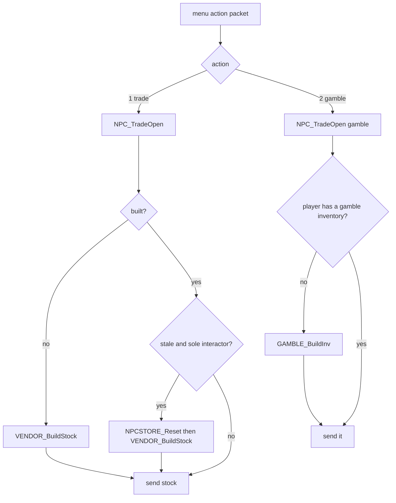

# 0009 — Vendor stock and gambling

> **Subsystem:** items/vendors
> **Question:** When a player opens a vendor's trade or gamble window, which items does the server create, with which ilvl, quality and seed, and when is the stock rebuilt?
> **Date:** 2026-10-15   **Plan:** 0031 (Phase 1, Phase 2)   **Status:** open (Phase 1 read from the decompile and the disassembly, committed before any community text was read; Phase 1b cross-check 2026-10-15: three contradictions, all reachable on stock data and required cases of Phase 2; reviewed and accepted 2026-10-15 by the architect, see [backlog](../../backlog.md); Phase 2 bit-exact run 2026-10-16, [§ Phase 2](#phase-2-runtime-results-run2026-10-15-vendors), awaiting review; plan 0038 batch S2c, 2026-10-16: 8 statements raised and 7 in part, one correction, [§ Plan 0038 batch S2c](#plan-0038-batch-s2c-2026-10-16); plan 0038 batch H6c, 2026-10-27: 7 raised, 2 in part, 2 reclassified to d-2c, 2 shortfalls, one correction, accepted with fixes at the `lane/h6c` review, [§ Plan 0038 batch H6c](#plan-0038-batch-h6c-run2026-10-27-sweep-vendors))

Names of structs and fields are ours (`re/types/vendors.h`). "Store seed" is the seed at `NpcStoreCtl+0x08`
(`Game+0x1D24` → `+0x08`), "game seed" is `Game+0xD0` ([rng/0002](../rng/0002-seed-tree.md)), "item seed" is the
item-data seed ([items/0004](0004-uniques-sets.md)). `R(S, n)` is the guarded range draw of
[rng/0001](../rng/0001-rng-core.md) (`n < 1` → 0 with no step; a power of two → `low & (n−1)`; else `low % n`, all
on the stepped `low`). `RandLoHi(S, lo, hi)` is `lo + R(S, hi − lo)` when `hi > lo` (signed), else `lo` with no draw
(objects/0001, fn:RNG_RandLoHi@0x004BC500). The vendor index `v` is the column group of the item tables in the order of
[Weapons § layout](../../tables/Weapons.md): 0 Akara, 1 Gheed, 2 Charsi, 3 Fara, 4 Lysander, 5 Drognan, 6 Hratli,
7 Alkor, 8 Ormus, 9 Elzix, 10 Asheara, 11 Cain, 12 Halbu, 13 Jamella, 14 Malah, 15 Larzuk, 16 Drehya (Anya). NPC
classes are MonStats rows (`hcIdx`). Column names are those of the table docs ([Npc](../../tables/Npc.md),
[Gamble](../../tables/Gamble.md), [StorePage](../../tables/StorePage.md),
[Weapons § Vendor columns](../../tables/Weapons.md#vendor-columns-plan-0031-phase-0)); the table docs spell group 6
`Hralti`, the item tables' header spelling.

## Answer (summary)

- [I] **One store record per interactable NPC class, per game.** At game creation `NPCSTORE_CtlCreate` allocates 64
  records of 0x44 bytes at `Game+0x1D24` and fills one per MonStats row with the `interact` flag, in row order. A
  43-entry table at 0x00731184 gives each store NPC its act (0–4) and a store flag. For a store NPC it copies one of the
  17 per-vendor candidate lists into the record. **The stock is shared by every player in the game.** Gambling keeps one
  inventory per player. (fn:NPCSTORE_CtlCreate@0x00536070, data:g_NpcStoreTable@0x00731184, fn:NPC_TradeOpen@0x00579430,
  tbl:MonStats.txt:interact)
- [C] **The store seed** is seeded once per game: `NPCSTORE_CtlCreate` steps the game seed once and sets the store seed
  to `{low, 666}` (reproduced in 7 games, and the logged S at every one of the 435 build entries is the model's:
  nothing outside the modelled builds and the hireling oracle draws on it; run:2026-10-15-vendors). It is called from `sub_00530BF0_GameCreate` (0x00530DDE) right after `sub_00547D20_MonRegionsInit` and
  `OBJRGN_Create`, which draw on the game seed too. Every
  stock pick, quality pick, upgrade draw and gamble draw uses this seed. The hireling lists (`HIRE_BuildStock`)
  draw from it too, so they interleave with the stock. Each created item still gets its own unit and item seeds from
  the **game** seed, exactly as a drop does: two game-seed steps per creation, the item's start seed is the second
  one's low word (9206 creations, run:2026-10-15-vendors). (fn:NPCSTORE_GetSeed@0x00536B40, fn:HIRE_BuildStock@0x00576070,
  fn:sub_00558D90_ItemCreate@0x00558D90)
- [C] **When stock is built.** It is built on the first trade open of that NPC in a game (`built` = 0), from the
  opener's character level (94 builds, each predicted from the record's state at the open; run:2026-10-15-vendors). It is rebuilt on a later trade open only after it was reset or marked stale, and ([I], one player
  only in the run) only when the opener is the only player interacting with that NPC. **Reset and stale** happen when a player **leaves a town
  level** (level change, act change, or leaving the game in Acts I–IV). For every built store of that town's act: if
  nobody is left in the town and nobody is interacting with the NPC, the stock is destroyed at once and rebuilt at the
  next open. [I] If nobody is left but someone still interacts, it is marked stale (not reached). If players remain
  in the town (in single player: the act change below), it is marked stale only when more than 240 000 ms
  (`GetTickCount`) have passed since the last build. [C] In single player
  the leaving player still counts in the town when the level change is an **act change** (a waypoint to another
  act: `townEmpty` 0, so only the 240 s stale mark), and no longer counts on a level change **within the act** (a
  waypoint to the act's wilderness: `townEmpty` 1, every built store of the act destroyed at once; a walk out of
  town takes the same `sub_00537340_TownLevelLeave` call, from the per-frame room check, plan 0038 H6c);
  [§ Phase 2](#phase-2-runtime-results-run2026-10-15-vendors), run:2026-10-15-vendors. **None of these
  rebuilds anything**: entering town, a quest event, opening the window again, or a level-up ([C] for a town entry, a
  reopen and a level-up in plan 0038 H6c; [I] for a quest event, not run). A level-up only queues a
  note, and that queue's consumer has no caller. (fn:NPC_OpenStore@0x00578B30, fn:NPCSTORE_ActStale@0x00537230,
  fn:sub_00537340_TownLevelLeave@0x00537340, fn:sub_00537580_TownPlayerRemove@0x00537580, fn:NPCSTORE_Reset@0x00536D10,
  fn:sub_00536850_NpcStoreLevelUpNote@0x00536850)
- [C] **Candidate bases.** Once per process, `VENDOR_BuildList(v)` walks the item records in index order (weapons,
  armor, misc). It keeps those with `spawnable` ≠ 0 and (`<V>Max` ≠ 0 or `<V>MagicMax` ≠ 0). A base with
  `PermStoreItem` ≠ 0 goes to the permanent list (code only). Every other base becomes a 12-byte entry
  `{Min, Max, MagicMin, MagicMax, code, MagicLvl}`. NPC class → `v` comes from two switches, which agree for 16 classes.
  The model's lists from the item tables equal, byte for byte, the record the build reads (all 16 used lists, 94
  builds; run:2026-10-15-vendors). (fn:VENDOR_BuildList@0x00536D50, fn:VENDOR_BuildAllLists@0x00536F80,
  tbl:Weapons.txt:PermStoreItem, tbl:Weapons.txt:spawnable, tbl:Weapons.txt:CharsiMax, tbl:Weapons.txt:CharsiMagicMax)
- [C] **The class → vendor index map**: 148 Akara 0, 147 Gheed 1, 154 Charsi 2, 178 Fara 3, 202 Lysander 4,
  177 Drognan 5, 253 Hratli 6, 254 Alkor 7, 255 Ormus 8, 199 Elzix 9, 252 Asheara 10, 257 Halbu 12, 405 Jamella 13,
  513 Malah 14, 511 Larzuk 15, 512 Drehya 16. It is read from the record filler's switch and agrees with the list
  builder's switch, a second code path. Class 514 (Nihlathak) differs: the record takes list 15 (Larzuk), the builder
  list 16. Nihlathak is not in the trade menu's class list, so the difference is never seen (`[I]`). Index 11 (Cain) is
  never used. The 17 class ids are those of the Npc table's `npc` column, which the code does not read for this map.
  (0x00536271–0x005363EE, 0x00536FC0–0x00537046, fn:NPC_MenuAction@0x00579D60, tbl:Npc.txt:npc)
- [C] **The build** (`VENDOR_BuildStock`, 0x00576980). It reads the opener's level `clvl` (stat 12) and computes the stock level
  `ilvl = VENDOR_StockLevel(clvl + 5)`. In Normal that is `min(clvl + 5, cap[act])`, with caps 12, 20, 28, 36, 45 for
  Acts I–V (each cap seen binding, at clvl 30 and 75; every draw of the 94 builds reproduced, run:2026-10-15-vendors). In Nightmare and Hell it is `clvl + 5` with no cap, up to 104. For each entry, in list order:
  - skip it when the base `level` > `ilvl`;
  - `n = RandLoHi(S, Min, Max + 1)` if `ilvl < 25`, else `n = 0`;
  - skip the rest when the base `version` ≥ 100 in a game whose item version < 100 (classic), after the draw above;
  - for each of `n`: `q = VENDOR_PickNormalQuality(S, ilvl)` (one draw), then create;
  - if the base's `bitfield1` bit 0 is set and `MagicLvl` ≤ `ilvl`: `x = 1`, or `RandLoHi(S, 1, 3) + 1` (one draw) when
    `ilvl ≥ 25`. Then `m = RandLoHi(S, MagicMin, MagicMax + x)`, and each of `m` is created with quality 4.

  After all entries, each permanent code is created once with quality 2. A full-stack quantity is set for `aqv`/`cqv`.
  More than 32 failed creations end the build early. (fn:VENDOR_BuildStock@0x00576980, fn:VENDOR_StockLevel@0x00576890,
  tbl:Weapons.txt:CharsiMin, tbl:Weapons.txt:CharsiMagicLvl, tbl:Weapons.txt:level)
- [C] **Normal-stock quality** (`VENDOR_PickNormalQuality`, run:2026-10-15-vendors): one step of the store seed, then `r = low % 100`.
  `ilvl < 5`: `r > 90` gives 1 (low quality), else 2. `ilvl < 10`: `r > 85` gives 3 (superior), else 2. Otherwise
  `r ≥ 75` gives 3, else 2. Since `ilvl ≥ 6` always, the low-quality branch is unreachable. **Stock is never rare,
  set or unique:** magic entries pass quality 4. `<V>MagicLvl` is only the gate above. The affix level comes from the
  ordinary alvl rule with the item's `ilvl` and its own `magic lvl` (items/0005).
  (fn:VENDOR_PickNormalQuality@0x00576900, fn:ITEMS_BuildMagic@0x005565E0)
- [C] **Each created item** (`VENDOR_CreateStockItem`, 0x00576330; 2721 upgrade draws reproduced, every branch below
  taken, run:2026-10-15-vendors). In Nightmare or Hell with `clvl ≥ 26`, one draw
  `u = RNG_RangeB(S, 100000)` may replace the base:
  - Nightmare: `u < ilvl·64 + 4000` → `ubercode`, else `NightmareUpgrade` if set;
  - Hell: in an expansion game `u < ilvl·16 + 1000` → `ultracode`; else `u < ilvl·128 + 5000` → `ubercode`. Then
    `HellUpgrade`, when set, replaces the result in every case.

  The item is then made by `ITEMS_CreateForStore` with `ilvl` and quality `q`. [I] A low-quality item named `Cracked` is
  destroyed and made again, up to 5 attempts (not reached: stock is never low quality). An item whose code differs from the chosen code is destroyed and made
  once more with quality 2. The item goes to its `StorePage` tab, or to tab 2 when tab 1 is full.
  (fn:VENDOR_CreateStockItem@0x00576330, fn:ITEMS_CreateForStore@0x00559CE0, tbl:Weapons.txt:NightmareUpgrade,
  tbl:Weapons.txt:HellUpgrade, tbl:Weapons.txt:ubercode, tbl:Weapons.txt:ultracode, tbl:ItemTypes.txt:StorePage,
  tbl:StorePage.txt:Code)
- [C] **Gambling** (`GAMBLE_BuildInv`, 0x00578790; 325 windows, 4550 slots, 2292 upgrade tests reproduced,
  run:2026-10-15-vendors). It runs on a gamble open when the player has no gamble inventory at that NPC
  (the six gamblers: classes 147, 199, 254, 405, 512, 514). Fourteen slots; for each:
  1. `lvl = clvl − 5 + (low % 10)` after one step, clamped to 5..99;
  2. `item = list[R(S, countUpTo[lvl])]`, uniform over the Gamble.txt bases with `level` ≤ `lvl` (tbl:Gamble.txt:code);
  3. in a classic game, an expansion base is rejected and the slot drawn again;
  4. slot 0 becomes `rin` and slot 1 `amu`, after their draws;
  5. in an expansion game, `GAMBLE_Upgrade` tests `R(S, 10000) < (lvl − level(ubercode))·GambleUber + 1` → ubercode,
     else the same with `ultracode` and `GambleUltra` → ultracode. A test whose bound is ≤ 0 makes no draw;
  6. `r = low % 100000` after one step: `r < GambleUnique` → 7, `< GambleUnique + GambleSet` → 5,
     `< GambleUnique + GambleSet + GambleRare` → 6, else 4;
  7. the item is created with `ilvl = lvl`.

  With stock DifficultyLevels this gives unique 0.05 %, set 0.1 %, rare 10 % and magic 89.85 %, in every difficulty.
  The fallbacks (7 → 6, 5 → 4) are item creation's (items/0004).
  (fn:GAMBLE_BuildInv@0x00578790, fn:GAMBLE_Upgrade@0x005786A0, data:g_GambleList@0x0096CAB0, tbl:Gamble.txt:code,
  tbl:DifficultyLevels.txt:GambleUnique, tbl:DifficultyLevels.txt:GambleSet, tbl:DifficultyLevels.txt:GambleRare,
  tbl:DifficultyLevels.txt:GambleUber, tbl:DifficultyLevels.txt:GambleUltra, fn:sub_00557450_ItemCreateByQuality@0x00557450)
- [C] **Gamble refresh.** A player's gamble inventory is freed when the interaction with the NPC ends
  (`sub_00555500_PlayerInteractEnd`, run at a player unit's free: plan 0038 H6c, vend 2). It is also freed when the NPC's interaction list empties on a cancel, and on a
  full store reset. The next gamble open builds a new one. A purchase copies the shown item (serialise and recreate)
  and creates no replacement. Closing the gamble window (Escape) sends the cancel: `sub_00572F20_NpcInteractRemove`
  empties the NPC's list and frees the inventory, and the next *Gamble* builds a new window (325 times,
  run:2026-10-15-vendors; the purchase: 2 cases in plan 0038 H6c, [§ Plan 0038 batch H6c](#plan-0038-batch-h6c-run2026-10-27-sweep-vendors)).
  (fn:sub_00536B50_NpcStorePlayerLeave@0x00536B50, fn:sub_00537190_GambleInvFree@0x00537190,
  fn:sub_00576F50_StoreItemSold@0x00576F50)
- [C] **Item creation** (9206 creations; each item reproduces in the item model, run:2026-10-15-vendors).
  `ITEMS_CreateForStore` builds the 0x84-byte creation record with source = the NPC, `+0x18` = 4,
  `+0x2A` = the game's item version, `+0x30` = the quality, and `+0x80` = 0x02, which skips the ethereal roll. It has no
  seed, so `sub_00558D90_ItemCreate` seeds the item from the game seed, as for a drop. The creation-side quality roll
  returns the given quality with no draw (item version ≠ 0, quality ≠ 0). **Vendor and gamble items are never ethereal.**
  Normal and superior stock goes through the socket roll on the item seed. (fn:ITEMS_CreateForStore@0x00559CE0,
  fn:sub_00556F60_ItemRollQualityCreate@0x00556F60, fn:sub_00556CA0_ItemRollEthereal@0x00556CA0, struct:ItemCreateRec+0x80)
- Prices, the buy and sell multipliers of Npc.txt, and repair costs are named only: `sub_0062FDC0_ItemTradePrice`,
  `sub_00578050_NpcRepair`, `sub_0062FE60_RepairCost` (§ 9; tbl:Npc.txt:sell mult, tbl:Npc.txt:buy mult,
  tbl:Npc.txt:rep mult).

## Leads used

Phase 1 read no community vendor or gambling documentation. The code was found from our own symbols and strings: the
callers of `sub_00558D90_ItemCreate`, the readers of `DifficultyLevels` `GambleRare..GambleUltra`, and the
`.\UNIT\SUNITNPC.CPP` and `.\UNIT\sunitproxy.cpp` source paths. Phase 1 was committed before Phase 1b.

Phase 1b (2026-10-15) fetched the sources below in this session (ADR-0007; sections in [sources.md](../../sources.md)).
None contains code. Agreement promotes nothing: every tag above is unchanged. `src:fandom-d2-unique-set` refused every
fetch this session (HTTP 402) and was not compared. Searches also turned up Lurker Lounge thread 11969, PureDiablo
`?p=8935`, `d2wiki/Gambling` and diablowiki "Exceptional"; all refused the fetch (403/409), so none is used.

**Gambling**

- [L] src:arreat-summit-gambling: "Items generated for the gamble stock are -5 through +4 levels of your character's
  level with a minimum item level of 5." **held with refinement**
  Detail: § 7 `lvl = clvl − 5 + (low % 10)`, clamped to 5..99. The same `lvl` also filters the base (Gamble.txt rows
  with `level ≤ lvl`, uniform) and is the upgrade level. Slots 0 and 1 are always a ring and an amulet.
- [L] src:arreat-summit-gambling: "The chance for Uniques is 1 in 2,000 (0.05%) and 1 in 1,000 (0.10%) for Sets. The
  chance for Rares is 1 in 10 (10%). Magic Items are 1/~1.1 (89.85%)." **held**
  Detail: § 7, `low % 100000` against the DifficultyLevels columns 50 / 100 / 10000 (the same in all difficulties); test
  order unique, set, rare.
- [L] src:d2dfg-blizzard (§ difficultylevels.txt): `GambleRare`, `GambleSet`, `GambleUnique` "The game rolls a random
  number between 0 to 100000"; `GambleUber`, `GambleUltra` "between 0 to 10000". **held with refinement**
  Detail: `low % 100000` with cumulative bounds unique, unique + set, unique + set + rare (§ 7); `R(S, 10000)` for the
  upgrades, against `(lvl − qlvl)·Gamble* + 1`, not against the column alone (§ 7, `GAMBLE_Upgrade`).
- [L] src:arreat-summit-gambling: "pV = max{0%, (ilvl − qlvlV) * 0.9% + 1%}" and "pE = max{0%, (ilvl − qlvlE) * 0.33% +
  1%}". **contradicted** ([backlog](../../backlog.md), 2026-10-15 reverser → reverser)
  Detail: re-read 2026-10-15 at 0x0057870B–0x00578729 and 0x00578761–0x0057877D: `esi = (lvl − level(uber)) ·
  GambleUber + 1`, then `RNG_RangeB(S, 0x2710) < esi`. With `GambleUber` 90 that is `(lvl − qlvl)·0.9 % + 0.01 %`. The
  slope agrees, but the constant is 1 in 10 000, not 1 %. A bound ≤ 0 makes no draw, which matches the `max{0, …}`. The
  elite test is made only after a failed exceptional draw, so the elite share is `pE·(1 − pV)`, and it uses the elite
  base's own level. **Settled (run:2026-10-15-vendors):** all 2292 tests reproduced their bound and their
  `R(S, 10000)` draw, 185 of them at `lvl − qlvl ≤ 2` (bound 1 at `lvl = qlvl`), and the 623 elite tests each
  followed a failed exceptional draw of the same slot.
- [L] src:arreat-summit-magic-items (§ Gambling): "the level of the Magical Prefix/Suffix is checked against the randomly
  chosen value in the range of +6 Levels/-3 levels of your character's level". **contradicted**
  ([backlog](../../backlog.md), 2026-10-15 reverser → reverser)
  Detail: the gambled item's `ilvl` is drawn in `clvl − 5 .. clvl + 4` (§ 7), and the affix level then follows the
  general alvl rule from that `ilvl` ([items/0005](0005-affixes.md)); nothing in `GAMBLE_BuildInv` or
  `ITEMS_CreateForStore` adds a `+6/−3` window. The same publisher's gambling page gives `−5..+4`
  (`src:arreat-summit-gambling`, above). **Settled (run:2026-10-15-vendors):** at clvl 30 and 75 every gambled
  `ilvl` lies in `clvl − 5 .. clvl + 4`, and every affix pick of the 4550 gambled items reproduced from that `ilvl`
  by the general rule; the picks' `alvl` ranged from clvl − 34 to clvl + 17.
- [L] src:arreat-summit-magic-items: "Circlets have a Magic Level bonus, which is added to the maximum item level you
  can receive on that item." **held with refinement**
  Detail: no gamble-specific code; the base's `magic lvl` enters through the general alvl rule (items/0005).
- [L] src:arreat-summit-gambling: "Gambling Items appear as Normal Items and can only be revealed as Exceptional or
  Elite Items after you buy them." **held with refinement**
  Detail: the server decides the upgrade when it builds the window: the item it creates already has the exceptional or
  elite base (§ 7), and a purchase copies that item. What the client draws for it was not read. Phase 2 logs the base
  code at the build and at the purchase.
- [L] src:arreat-summit-gambling: "You can reset the Gambling menu by exiting the screen, then by clicking on Gamble
  again." **held with refinement**
  Detail: a new list is built only after the player's gamble inventory is freed, which happens when the interaction
  with the NPC ends, when a cancel empties the NPC's interaction list, or on a store reset (§ 7). Whether closing the
  window ends the interaction is client behaviour (Open questions); Phase 2 logs it.
- [L] src:d2dfg-blizzard (§ Gamble.txt): "This file controls what Item Types will appear as possible items to purchase
  in the Gambling UI"; `code` "is a pointer to 'code' field from weapons.txt/armor.txt/misc.txt". **held with
  refinement**
  Detail: the rows are item codes, not item types (`GAMBLE_LoadTable` resolves each to an item index); a row is offered
  when its base `level ≤ lvl` (tbl:Gamble.txt:code).

**Vendor stock**

- [L] src:arreat-summit-vendors: "The vendor's inventories are tied to the act, difficulty and character's level." and
  "the chance will become greater to find Exceptional and Elite Items". **held**
  Detail: act (Normal cap, § 4), difficulty (the upgrade branch, § 5) and the opener's `clvl` (§ 4); the upgrade
  thresholds grow with `ilvl` (§ 5).
- [L] src:arreat-summit-vendors: "a Vendor's Inventory is reset if you leave town but not the act" and a full reset
  needs "All players have left town". **held with refinement**
  Detail: § 3. Leaving the town level by any route (an act change included) triggers it. With the town empty and
  nobody interacting, the stock is destroyed at once. With players left in town, it is only marked stale, after
  240 000 ms since the last build, and rebuilt at the next trade open by a sole interactor. Leaving the game from
  Harrogath triggers nothing.
- [L] src:d2dfg-blizzard (§ weapons.txt): `[NPC]Min`/`[NPC]Max` "Minimum/Maximum amount of this item type in Normal
  rarity that the NPC can sell at once". **held with refinement**
  Detail: `Min..Max` only while the stock level is below 25; from 25 on, no normal copies (§ 4). A base whose `Max` and
  `MagicMax` are both 0 is never listed.
- [L] src:d2dfg-blizzard: `[NPC]MagicMin`/`[NPC]MagicMax` "amount of this item type in Magical rarity".
  **held with refinement**
  Detail: from stock level 25 the maximum gains 1 or 2 (one draw), and the base's `bitfield1` bit 0 must be set (§ 4).
- [L] src:d2dfg-blizzard: `[NPC]MagicLvl` "Maximum magic level allowed for this item type in Magical rarity".
  **contradicted** ([backlog](../../backlog.md), 2026-10-15 reverser → reverser)
  Detail: re-read 2026-10-15 at 0x00576ADD–0x00576AEA: `movzx edx, byte [entry+8]; cmp edx, ilvl; jg skip`. The value
  is a **minimum stock level** below which the base gets no magic copies. The affix level comes from the item's `ilvl`
  and `magic lvl` and is not capped by it (§ 4). The data fits a minimum: Charsi's values are 1, 3, 5, 10, 15, 20 and
  255 (never). Reachable: Charsi's Normal Act I stock is capped at `ilvl` 12, so the 15, 20 and 255 bases never get
  magic copies there. **Settled (run:2026-10-15-vendors):** Charsi (Normal Act I, `ilvl` 12) gave no magic `hla`
  (15), `stu` (20) or `rng` (255), Gheed none of his 14 `MagicLvl`-20 bases, no 255 base ever got one, and 4097 of
  the 4375 affix picks on magic stock items have `alvl` above their entry's `MagicLvl`.
- [L] src:d2dfg-blizzard: `NightmareUpgrade`/`HellUpgrade` "Used to determine which item will replace this item when
  being generated in the NPC's store while the game is playing in [difficulty]". **held with refinement**
  Detail: only when the opener's `clvl ≥ 26`. In Nightmare it applies only after a failed `ubercode` draw. In Hell it
  replaces the result of the `ultracode`/`ubercode` tests in every case (§ 5).
- [L] src:d2dfg-blizzard: `PermStoreItem` "If equals 1, then this item will always appear on the NPC's store".
  **held with refinement**
  Detail: created once per build with quality 2, when `spawnable` and `Max` or `MagicMax` ≠ 0 for that vendor; not
  removed when bought (§ 8).
- [L] src:d2dfg-blizzard (§ ItemTypes.txt): `StorePage` "Uses a code to determine which UI tab page on the NPC shop UI
  to display this Item Type". **held with refinement**
  Detail: a stock item that does not fit its tab 1 goes to tab 2 (§ 5). The tab is the StorePage row index stored in
  the ItemTypes record (tbl:ItemTypes.txt:StorePage, tbl:StorePage.txt:Code).

**Not covered by the sources:** the store seed and its draw order, the Normal caps 12/20/28/36/45 (no fetched page
gives them), the no-normal-copies rule from stock level 25, the quality pick of normal stock (14 % or 25 % superior),
the ring and amulet slots, the classic redraw, and the 240 000 ms stale timer. The Npc.txt price columns
(src:d2dfg-blizzard § npc.txt; tbl:Npc.txt:sell mult, tbl:Npc.txt:buy mult, tbl:Npc.txt:rep mult,
tbl:Npc.txt:max buy) were read but not compared, because prices are named only.

## Functions

| Address | Name | Role | Tag |
|---|---|---|---|
| `0x00536070` | `NPCSTORE_CtlCreate` | game creation: 64 store records, the store seed (one game-seed draw) | C |
| `0x00535EA0` | `NPCSTORE_FindRec` | record by NPC class (EDX) | I |
| `0x00535FB0` | `sub_00535FB0_NpcStoreCopyList` | EAX vendor index, EDI `&rec+0x2C`: copies the list | I |
| `0x00536580` | `NPCSTORE_ClearRec` | frees the gamble inventories, the stock and the pending list | I |
| `0x00536B40` | `NPCSTORE_GetSeed` | `Game+0x1D24` → `+0x08` | C |
| `0x00536B50` | `sub_00536B50_NpcStorePlayerLeave` | frees one player's gamble inventory and proxy node | I |
| `0x00536C50` | `NPCSTORE_GetGambleInv` | a player's gamble inventory at an NPC | I |
| `0x00536D10` | `NPCSTORE_Reset` | clears a record: `built` = 0, `buildTick` = 0, a new stock inventory | C |
| `0x00536D50` | `VENDOR_BuildList` | one vendor's candidate and permanent lists, once per process | C |
| `0x00536F80` | `VENDOR_BuildAllLists` | class → vendor index, calls the list builder | C |
| `0x00537190` | `sub_00537190_GambleInvFree` | frees one player's gamble inventory | C |
| `0x00537230` | `NPCSTORE_ActStale` | `(game, act, townEmpty)`: reset or mark stale (240 000 ms) | C |
| `0x00537340` | `sub_00537340_TownLevelLeave` | a level change from a town: stale check for its act | C |
| `0x00537580` | `sub_00537580_TownPlayerRemove` | a player leaving the game from town (Acts I–IV) | I |
| `0x00536850` | `sub_00536850_NpcStoreLevelUpNote` | level-up: queues a note per built store (no consumer) | I |
| `0x005368F0` | `sub_005368F0_NpcStorePendingDead` | the queue's consumer; no caller | I |
| `0x00559CE0` | `ITEMS_CreateForStore` | creation record for stock and gamble items, then `ItemCreate` | C |
| `0x00572DA0` | `sub_00572DA0_NpcInteractCount` | non-empty entries of an NPC's interaction list | I |
| `0x00572F20` | `sub_00572F20_NpcInteractRemove` | removes a player; an emptied list frees the gamble inventory | C |
| `0x00555500` | `sub_00555500_PlayerInteractEnd` | a player unit's free (`sub_00555600_UnitFree`, type 0): with an NPC interaction open, `NpcStorePlayerLeave` | I |
| `0x00576070` | `HIRE_BuildStock` | hireling list, a store-seed consumer (named only) | I |
| `0x00576330` | `VENDOR_CreateStockItem` | upgrade draw, creation retries, placement | C |
| `0x00576890` | `VENDOR_StockLevel` | Normal: `min(arg, cap[act])`; else `arg` | C |
| `0x00576900` | `VENDOR_PickNormalQuality` | one draw: quality 1, 2 or 3 | C |
| `0x00576980` | `VENDOR_BuildStock` | the stock build | C |
| `0x00576ED0` | `VENDOR_IsPermanent` | permanent list, or `hp4`/`hp5`/`mp4`/`mp5` outside Normal | C |
| `0x00576F50` | `sub_00576F50_StoreItemSold` | after a buy: a gamble item leaves the player's gamble inventory (0x00576650), a stock item is removed unless permanent (0x005766D0) | C |
| `0x005786A0` | `GAMBLE_Upgrade` | uber then ultra test on the store seed | C |
| `0x00578790` | `GAMBLE_BuildInv` | the gamble window: 14 slots | C |
| `0x00578AE0` | `sub_00578AE0_GambleEnsure` | builds unless the player already has a gamble inventory | C |
| `0x00578B30` | `NPC_OpenStore` | trade: first build; gamble: ensure | C |
| `0x00579090` | `sub_00579090_StockRebuildDead` | rebuild of the last-talked NPC; no caller | I |
| `0x00579430` | `NPC_TradeOpen` | trade and gamble open, the stale rebuild | C |
| `0x00579D60` | `NPC_MenuAction` | NPC menu packet: 1 trade, 2 gamble, 3 hire, quest actions | C |
| `0x00638AE0` | `GAMBLE_LoadTable` | `gamble` table, sorted by base level, `countUpTo` | C |
| `0x00638CC0` | `GAMBLE_GetList` | returns `g_GambleList` | C |
| `0x00629C80` | `sub_00629C80_ItemMagicStockable` | base `bitfield1` bit 0 | C |
| `0x0062E880` | `sub_0062E880_ItemStorePage` | the item type's `StorePage` | C |
| `0x00554120` | `sub_00554120_PlayerSetInteract` | the unit's interaction, only while `+0x6C` is 0: `+0x68` type, `+0x64` id, `+0x6C` = 1 (plan 0038 H6c; a set flag leaves the fields, 0x00554133) | I |
| `0x00554190` | `sub_00554190_PlayerClearInteract` | `+0x64` = −1, `+0x68` = 6, `+0x6C` = 0 (plan 0038 H6c) | I |
| `0x0062FDC0` | `sub_0062FDC0_ItemTradePrice` | price wrapper (named only) | I |
| `0x00578050` | `sub_00578050_NpcRepair` | repair packet (named only) | I |
| `0x0062FE60` | `sub_0062FE60_RepairCost` | repair cost (named only, not read) | L |
| `0x00656620` | `sub_00656620_NpcLoadTable` | `npc` table, 0x4C records, descriptor (§ 9) | I |
| `0x00656900` | `sub_00656900_NpcGetByClass` | Npc record whose `+0x00` is the MonStats class, else NULL (§ 9) | I |

Data: `data:g_NpcStoreTable@0x00731184` (u32 count 43, then 8-byte `NpcStoreSlot`), `data:g_VendorLists@0x00883D78`
(17 × `VendorList`; `[C]`, Phase 2), `data:g_VendorListBuilt@0x00883E88` (17 bytes), `data:g_GambleList@0x0096CAB0` (`[C]`, Phase 2).

## Walkthrough

### 1. Store records and the store seed (game creation)

`NPCSTORE_CtlCreate` (ECX = game) runs once per game from `sub_00530BF0_GameCreate`, between `OBJRGN_Create` and
`0x00545D80` (quests).

- [C] **The store seed is game-seed draw 3** (backlog 2026-10-16). Under `-seed N` the game seed `Init(N)` is stepped
  once by `sub_00547D20_MonRegionsInit` (draw 1), once by `OBJRGN_Create` (draw 2), then once here (draw 3), and
  `QUESTS_InitGame` takes draw 4 ([items/0010 § 1](0010-quest-drops.md#1-quest-objects-events-and-the-quest-seed)).
  In all 7 games of run:2026-10-15-vendors the `VSC0` game seed at this function's entry is two steps past `Init(N)`
  and `VSC1` is `Init` of the low word of the third step (the architect's reading in the plan 0031 Phase 3 review,
  counted again from the 7 logs of `vendors-run.lst` with `tools/rng.py`, 2026-10-16, lane `rbl`), and in all 48 games of run:2026-10-16-hirelings the NPC seed is the same draw. The store seed is the
  object at `NpcControl+0x08` (`Game+0x1D24` → `+0x08`), which `NPCSTORE_GetSeed` returns to the vendor code and to
  the hire code alike: the "NPC seed" of [hirelings/0001](../hirelings/0001-hirelings.md) is this seed, not a second
  one. (fn:NPCSTORE_CtlCreate@0x00536070, fn:NPCSTORE_GetSeed@0x00536B40, fn:sub_00530BF0_GameCreate@0x00530BF0,
  run:2026-10-15-vendors, run:2026-10-16-hirelings)

```c
// fn:NPCSTORE_CtlCreate@0x00536070 (trimmed, our names)
recs = alloc(0x1100); memset(recs, 0, 0x1100);
ctl  = alloc(0x14); ctl->nRecs = 0; ctl->recs = 0; ctl->nInteract = 0;
RNG_SeedInitOne(&ctl->seed);
step(&game->seed);                                  // game seed +0xD0, one draw
RNG_SeedInit(&ctl->seed, game->seed.low);           // store seed = {low, 666}
for (cls = 0; cls < nMonStats; cls++) {
    if (!(monstats[cls].flags0D & 2)) continue;     // `interact`
    r = &recs[ctl->nRecs++];  r->classId = cls;  r->pInventory = INV_Create(..);
    slot = find(g_NpcStoreTable, cls);              // 43 entries, 8 bytes
    if (!slot) continue;
    r->act = slot->act;  r->hasStore = slot->hasStore;  r->flag26 = slot->flag6;
    if (r->hasStore != 1) { r->entries = 0; r->permCodes = 0; continue; }
    v = vendorIndex(cls);                           // switch, § Answer
    copy g_VendorLists[v] into r->entries/nEntries/permCodes/nPerm;
    if (cls in {147, 199, 254, 405, 512, 514}) r->isGambler = 1;
}
game->pNpcStore = ctl;
```

- [I] The record order is MonStats row order of the `interact` rows. The lookup `NPCSTORE_FindRec` compares
  `classId` over all 64 slots. (0x00535EA0, tbl:MonStats.txt:interact)
- [I] The vendor lists come from `g_VendorLists`, which `VENDOR_BuildAllLists` fills when the item tables load. A
  per-index "built" byte at `g_VendorListBuilt` makes each list build once. `0x00537120` frees them at unload.
  (fn:VENDOR_BuildAllLists@0x00536F80 called from 0x005306CF, data:g_VendorListBuilt@0x00883E88)

### 2. The candidate lists (`VENDOR_BuildList`, 0x00536D50)

```c
// fn:VENDOR_BuildList@0x00536D50 (v = vendor index; items stride 0x1A8, weapons + armor + misc)
for (i = 0; i < nItems; i++) {
    it = &items[i];
    if (!it->spawnable /*+0x133*/) continue;
    if (!it->vMax[v] /*+0x157+v*/ && !it->vMagicMax[v] /*+0x179+v*/) continue;
    if (it->PermStoreItem /*+0x1A4*/) perm[nPerm++] = it->code;
    else entries[n++] = { it->vMin[v] /*+0x146+v*/, it->vMax[v], it->vMagicMin[v] /*+0x168+v*/,
                          it->vMagicMax[v], it->code /*+0x80*/, it->vMagicLvl[v] /*+0x18A+v*/ };
}
```

- [I] `Min` plays no part in membership: a base whose `Max` and `MagicMax` are both 0 is never stocked. A permanent
  base is created once per build whatever its counts. The offsets the code reads are the vendor-column offsets of the
  item layout ([Weapons](../../tables/Weapons.md)). (0x00536DC0–0x00536F5A, tbl:Weapons.txt:CharsiMax,
  tbl:Weapons.txt:CharsiMagicMax)
- [I] Applied to the stock tables, this gives entry and permanent counts per vendor (computed with a scratch script from
  the merged `.txt`, not a `tools/` survey). The counts are: Akara 5 + 10 (potions, scrolls, tomes, keys permanent),
  Gheed 39 + 3, Charsi 40 + 2 (`aqv`, `cqv`), Fara 53 + 2, Lysander 0 + 8, Drognan 13 + 8, Hratli 32 + 3,
  Alkor 0 + 3, Ormus 17 + 10, Elzix 40 + 2, Asheara 40 + 2, Halbu 40 + 2, Jamella 37 + 16, Malah 18 + 16,
  Larzuk 32 + 2, Drehya 19 + 2. The healers get the potions and the smiths the arrows, which fits the index map.
  Phase 0's survey replaces these counts; its per-group `bases` totals (`vendor_survey.py summary`) equal the sums
  above. (tbl:Weapons.txt:PermStoreItem, tbl:Weapons.txt:spawnable, tbl:Armor.txt:PermStoreItem, tbl:Misc.txt:PermStoreItem)



### 3. Open and rebuild (`NPC_MenuAction` → `NPC_TradeOpen` → `NPC_OpenStore`)

`NPC_MenuAction(action, npcId, arg)` (ECX game, EDX player) is the handler of a 13-byte client packet
(`0x0054BCA0`). Action 1 is trade, allowed for classes 147, 148, 154, 177, 178, 199, 202, 252–255, 257, 405 and
511–513. Action 2 is gamble, allowed for 147, 199, 254, 405, 512 and 514. Action 3 is the hire list. Other actions run
quest services (Charsi's imbue for class 154, Larzuk's socketing, Anya's personalisation, waypoint and travel hand-offs).

```c
// fn:NPC_TradeOpen@0x00579430 (ECX game, EDX player; npc, soleInteractor, isGamble)
rec = NPCSTORE_FindRec(npc->classId);
rec->opened = 1;  rec->npcUnitId = npc->id;
NPC_OpenStore(npc, isGamble);
if (npc->classId in {150, 515, 198}) return;            // hire-only NPCs
if (soleInteractor && !isGamble && rec->stale) {
    rec->stale = 0;
    NPCSTORE_Reset(rec, npc);                           // destroys the stock, built = 0
    VENDOR_BuildStock(npc, &rec->built);  rec->built = 1;
}
// then the stock (trade) or the player's gamble inventory is sent

// fn:NPC_OpenStore@0x00578B30
if (isGamble) { if (rec->isGambler) { proxy(player)->mode = 1; GambleEnsure(player, rec); } return; }
if (!rec->hasStore) return;
proxy(player)->mode = 0;
if (!rec->built) { VENDOR_BuildStock(npc, &rec->built); rec->built = 1; }
if (!rec->hirelingsBuilt) { if (cls in {150, 515, 198, 252}) HIRE_BuildStock(rec); rec->hirelingsBuilt = 1; }
```

- [I] `soleInteractor` = the NPC's interaction list (`MonsterData+0x30`) has exactly one live entry. It is computed by
  `NPC_MenuAction` before the call (0x00579E08). (fn:sub_00572DA0_NpcInteractCount@0x00572DA0)
- [I] For Asheara (252, store and hirelings), the first trade open builds the stock first and the hireling list
  second. Both draw on the store seed. Opening the hire list first (action 3 → `0x00576770`) builds the hirelings first.
  (0x00578BCB, 0x00578BFF, 0x005767EB) **Corrected by plan 0038 H6c ([C], [§ Plan 0038 batch H6c](#plan-0038-batch-h6c-run2026-10-27-sweep-vendors), vend 14):** the
  stock client never takes the first order. `sub_00572C10_NpcInteractStart` builds the hire table at the first click
  on her (0x00572CFF → `HIRE_SendList` → 0x005767EB), before any menu action, so the hirelings come first whatever is
  chosen, and `NPC_OpenStore`'s call 0x00578BFF finds the table built. [I] (read, the `lane/h6c` review) The flag it
  tests, store `+0x21`, is cleared only at 0x005770C5, which rebuilds the table at once (0x005770C9); `NPCSTORE_Reset`
  writes `+0x20` alone (0x00536D24), so no reset, in single player or with two players, brings the flag back to 0
  before a trade open.

**Stale and reset** (`NPCSTORE_ActStale(game, act, townEmpty)`, 0x00537230). It visits each record with `act` = the
argument, `hasStore` = 1, `opened` = 1 and `built` = 1:

```c
if (!townEmpty) {
    if (now > rec->buildTick + 240000) { rec->stale = 1; rec->buildTick = now; }   // unsigned GetTickCount
} else {
    npc = findUnit(rec->npcUnitId);
    if (!npc || npc->classId != rec->classId) { NPCSTORE_ClearRec(rec); rec->built = 0; rec->buildTick = 0; new inventory; }
    else if (NpcInteractCount(npc) == 0) NPCSTORE_Reset(rec, npc);   // stock destroyed, rebuilt at next open
    else rec->stale = 1;
}
```

- [I] `sub_00537340_TownLevelLeave(old, new)` runs on every level change of a player. It is called from
  `sub_0053AEC0_PlayerChangeLevel` and from the per-frame room check `0x005380D0`, when the old level is a town
  (1, 40, 75, 103, 109 → act 0–4). It counts the players still in that level and calls
  `NPCSTORE_ActStale(game, act, count == 0)`. [C] In single player the count is 0 (the leaving player already
  elsewhere) on a level change within the act, and 1 (the player still counted in the town) on a waypoint to another
  act: 6 and 26 calls, every one so (run:2026-10-15-vendors; why the act change still counts the player: [§ Plan 0039 batch P1b](#plan-0039-batch-p1b-2026-10-17)). `sub_00537580_TownPlayerRemove` (from the client-removal path
  `0x00539DA0`) does the same with `count − 1 == 0`, for levels 1, 40, 75 and 103 only: Harrogath is missing from its
  switch. (0x00537340–0x00537402, 0x00537580–0x005375FB)
- [C] So in single player, leaving the town for a level of the same act by a waypoint of the act (or walking out: plan 0038 H6c) destroys
  every built stock of that act at once: `NPCSTORE_Reset` when the NPC unit is still there with nobody interacting,
  the clear path (`built` = 0, no reset call) when the unit is gone. Leaving it for another act (a waypoint) only marks
  the act's stores stale, and only those built more than 240 000 ms before; a stale store is reset and rebuilt at the
  next trade open (the opener is the sole interactor in single player). The next trade open after a reset builds new
  stock from the current character level. (20 resets and 7 stale marks, 7 stale rebuilds and 6 rebuilds after a
  reset, run:2026-10-15-vendors.) [I] In a multiplayer game with players left in town, the stock is likewise only
  marked stale, after 4 minutes, and rebuilt at the next trade open by a sole interactor (not run).
  **Correction (Phase 2):** the Phase 1 text said any route out of town destroys the stock in single player; the act
  change does not. (fn:NPCSTORE_ActStale@0x00537230)
- [I] `buildTick` is written by `VENDOR_BuildStock` at its start and by the stale mark. A level-up
  (`0x00570880`) calls `sub_00536850_NpcStoreLevelUpNote`, which pushes a `{level, 4, 1}` node onto each built store's
  pending list. The pending list's processor `sub_005368F0_NpcStorePendingDead` and the other producer `0x005367B0`
  have no caller (no `call`, `jmp` or pointer to them anywhere in the image). So a level-up changes nothing until the
  next build. The same goes for `sub_00579090_StockRebuildDead`, a rebuild of the NPC last talked to (healer global
  `0x0088CAC4`): it has no caller.
  (fn:sub_005368F0_NpcStorePendingDead@0x005368F0, fn:sub_00579090_StockRebuildDead@0x00579090)
- [I] No quest code reaches `VENDOR_BuildStock` or `NPCSTORE_Reset`. Their only callers are those above (call sites
  0x00578BCB, 0x005794C2, 0x00579116; 0x005372D8, 0x005794B3).

### 4. The stock build (`VENDOR_BuildStock`, 0x00576980)

ECX game, EDX the opening player, stack `(npc, &rec->built)`. `S` = the store seed.

```c
// fn:VENDOR_BuildStock@0x00576980 (trimmed, our names)
rec->buildTick = GetTickCount();
clvl = STATS_GetUnitStat(player, 12, 0);
ilvl = VENDOR_StockLevel(npc, clvl + 5);
fails = 0;
for (k = 0; k < rec->nEntries; k++) {
    e = &rec->entries[k];  b = ITEMS_GetByCode(e->code);
    if (b->level /*+0xFD*/ > ilvl) continue;
    n = (ilvl < 25) ? RandLoHi(S, e->min, e->max + 1) : 0;          // draw unless max + 1 <= min
    if (b->version /*+0xF6*/ >= 100 && game->itemVersion /*+0x78*/ < 100) continue;
    for (i = 0; i < n; i++) {
        q = VENDOR_PickNormalQuality(S, ilvl);                       // one draw
        if (!VENDOR_CreateStockItem(npc, e->code, game, 1, q, ilvl, clvl)) fails++;
        if (fails > 32) return;
    }
    if ((b->bitfield1 & 1) && e->magicLvl <= ilvl) {
        x = (ilvl >= 25) ? RandLoHi(S, 1, 3) + 1 : 1;                // 2..3 with one draw, else 1
        m = RandLoHi(S, e->magicMin, e->magicMax + x);
        while (m--) if (!VENDOR_CreateStockItem(npc, e->code, game, 1, 4, ilvl, clvl)) fails++;
    }
}
for (k = 0; k < rec->nPerm; k++) {
    it = VENDOR_CreateStockItem(npc, rec->permCodes[k], game, 1, 2, ilvl, clvl);
    if (!it) fails++;
    else if (code(k) == 'cqv ' || code(k) == 'aqv ') setStat(it, 70 /*quantity*/, maxStack(it));
    if (fails > 32) return;
}
```

- [C] **Counts** (run:2026-10-15-vendors). Normal stock of an entry is `Min..Max` (inclusive) while `ilvl < 25`, and none from 25 on. An
  entry with `Max + 1 ≤ Min` gives `Min` items with no draw. An entry with `Max` = 0 (present for its magic columns)
  still draws once when `Min` = 0, giving 0. Magic stock is `MagicMin..MagicMax` while `ilvl < 25`. From 25 on it is
  `MagicMin..MagicMax + 1` or `MagicMin..MagicMax + 2`, after a draw that picks which. (0x005769F3–0x00576B4F,
  fn:RNG_RandLoHi@0x004BC500)
- [C] **`<V>MagicLvl` 255 and 0** (backlog 2026-10-15; run:2026-10-15-vendors, Phase 1b case (a)). The entry's `MagicLvl` is read as an unsigned byte
  (`movzx` of entry `+0x08`, 0x00576AE3) and compared with `ilvl`, which is at most 104, so 255 means **no magic
  stock of that base from that vendor ever**, whatever its magic counts, and 0 means no level gate. Every Hratli
  weapon and armor base has 0 there: the item tables' header `HratliMagicLvl` matches no descriptor entry, so the
  descriptor's own column for that byte is absent from the `.txt` and gets the absent-column default 0
  ([data/0004](../data/0004-cell-converters.md) § 1). (0x00576AE3–0x00576AE8,
  tbl:Weapons.txt:CharsiMagicLvl)
- [C] **Classic** (32 such skips reproduced, run:2026-10-15-vendors). An expansion base is skipped after its normal-count draw and before its quality draws, so a
  classic game consumes the count draw of every expansion entry when `ilvl < 25`. (0x00576A47–0x00576A5C)
- [C] **Draw order per entry** (0x00576A3C–0x00576B99; 7513 draws, run:2026-10-15-vendors), all on `S`: the count, then for each normal item the quality draw, followed by that
  item's upgrade draw (§ 5) and its creation (game seed, then item seed). Next the magic-extra draw (when `ilvl ≥ 25`),
  the magic count, and each magic item's upgrade draw and creation. The permanent items come last, each with its
  upgrade draw. The hireling list (§ 1) is the only other consumer of `S` during a trade open.
- [C] **Stock level** (`VENDOR_StockLevel`, ECX game, EDX npc; every cap binding, run:2026-10-15-vendors): `difficulty == 0` and `act < 5` →
  `min(arg, {12, 20, 28, 36, 45}[act])`; otherwise `arg`. There is no clamp to 99 here. `ITEMS_CreateForStore` only
  raises values below 1 to 1. (0x00576890–0x005768EF)

### 5. One stock item (`VENDOR_CreateStockItem`, 0x00576330)

ECX npc, EDX code, stack `(game, send, q, ilvl, clvl)`.

```c
b = ITEMS_GetByCode(code, &idx);  want = code;
if (game->difficulty > 0 && clvl > 25) {
    u = RNG_RangeB(S, 100000);                                       // one draw
    if (game->difficulty == 1) {
        if (u < ilvl*64 + 4000 && valid(b->ubercode)) { idx = byCode(b->ubercode); want = b->ubercode; }
        else if (b->NightmareUpgrade != 'xxx ')    { idx = byCode(b->NightmareUpgrade); want = ...; }
    } else {
        if (game->expansion && u < ilvl*16 + 1000 && valid(b->ultracode)) { idx/want = ultracode; }
        else if (u < ilvl*128 + 5000 && valid(b->ubercode))               { idx/want = ubercode; }
        if (b->HellUpgrade != 'xxx ') { idx/want = HellUpgrade; }    // overrides either
    }
}
for (pass = 0; pass < 2; pass++) {                                    // second pass only on a code mismatch
    for (t = 0; ; ) {
        it = ITEMS_CreateForStore(npc, idx, game, 4, q, 0, 1, ilvl, 0, 0, 0);
        t++;
        if (ITEMS_GetQuality(it) == 1 && !stricmp(lowQualityName(it), "Cracked")) { destroy(it); it = 0; if (t < 5) continue; return 0; }
        break;
    }
    if (ITEMS_GetCode(it) == want) break;
    destroy(it);  q = 2;  it = 0;
}
page = storePage(it); if (page == -1) { destroy; return 0; }
place in npc inventory on `page`; if that fails and page == 1, try page 2; if that fails, park the item (0x00535F30) and return 0;
```

- [I] (the tab returned and the placement `[C]` in plan 0038 H6c, [§ Plan 0038 batch H6c](#plan-0038-batch-h6c-run2026-10-27-sweep-vendors)) **The tab** is `sub_0062E880_ItemStorePage(item)`: the item type record's byte `+0x22` (ItemTypes
  `StorePage`, compiled to a `storepage` row index: 0 `armo`, 1 `weap`, 2 `mag`, 3 `misc`), or −1 when `0xFF` or the
  type is out of range (the item is then destroyed). Nothing reads `storepage.bin` at run time; the row index in
  `itemtypes.bin` is the tab. No item type names `mag`, so tab 2 receives only the overflow of tab 1 (`weap`).
  (fn:sub_0062E880_ItemStorePage@0x0062E880, 0x00576555–0x0057657A, tbl:ItemTypes.txt:StorePage, tbl:StorePage.txt:Code)
- [I] `valid(c)` is `c ≠ 0` and `c ≠ "    "`. The upgrade columns use `"xxx "` for none. Both thresholds read the
  `ilvl` argument, and the gate reads the opener's level (`clvl ≥ 26`). (0x00576389–0x005764A5,
  tbl:Weapons.txt:ubercode, tbl:Weapons.txt:ultracode)
- [C] (0x005763B8–0x0057649F; run:2026-10-15-vendors) The Nightmare `NightmareUpgrade` replacement applies only when the uber test fails. The Hell `HellUpgrade`
  replacement applies after both tests, whatever they gave. The Nightmare branch does not test the expansion flag.
- [I] `ITEMS_GetQuality(NULL)` returns 2, and `ITEMS_GetCode(NULL)` is a fatal assert (`0x61A`). A creation that
  returns no item therefore reaches the assert. `ItemCreate` returns none in a classic game when the base's `version`
  ≥ 100 (0x00558D99–0x00558DC4), so an upgrade to an expansion code in a classic game would be fatal.
  [C] **No stock data reaches it:** every `ubercode`, `NightmareUpgrade` and `HellUpgrade` of every base a classic
  game can stock (version 0) names a version-0 base (972 cells, data behaviour), and in a classic Nightmare game 28
  stock items took their `ubercode` (`swb` → `8sw`, `chn` → `xhn`, …) and were created and reproduced
  (run:2026-10-15-vendors). The Phase 1 example `hax` → `9ha` is a classic exceptional too; the `ultracode` test is
  expansion-only. (0x0057652B, 0x00628590, fn:sub_00558D90_ItemCreate@0x00558D90)
- [I] The `send` argument (always 1 here) marks the item for the client and adds it to the store inventory's send
  list (`0x005762C0`). `0x005761C0` (called before placement) fills durability, throwable stacks and charges to their
  maximum. It makes no draw that this reading found. Neither is item creation proper.

### 6. The creation record (`ITEMS_CreateForStore`, 0x00559CE0)

ECX source (the NPC), EDX item index, stack `(game, kind, q, noSockets, noEthereal, ilvl, restoreArg, seedU, seedI)`.
Stock and gamble pass `(game, 4, q, 0, 1, ilvl, 0, 0, 0)`.

- [I] (`+0x18`, `+0x28` and `+0x80` `[C]`: 1 646 records in plan 0038 H6c) Record (0x84, zeroed): `+0x00` NPC, `+0x08` game, `+0x0C` `ilvl` (< 1 → 1; −1 would mean "the source's level"),
  `+0x14` item index, `+0x18` = `kind` (4; drops use 3), `+0x28` u16 = 1, `+0x2A` u16 = `game+0x78`, `+0x30` = `q`,
  `+0x48`/`+0x4C` = the seed arguments (0), `+0x80` = `(noSockets ? 0x08 : 0) | (noEthereal ? 0x02 : 0)` = 0x02.
  Then `sub_00558D90_ItemCreate(game, &rec, 0)` and `ITEMS_SetFlag(item, 0x10, 1)` (identified).
  (0x00559D0F–0x00559E0B, struct:ItemCreateRec+0x80)
- [C] (run:2026-10-15-vendors: two game-seed steps, item seed `{start, 666}`, 9206 creations) With `+0x2C` = 0 and argument 0, `ItemCreate` keeps the seeds that `sub_00555230_SUnitCreate` and
  `sub_00552E90_ItemSeedInit` draw from the game seed. These are the same three game-seed draws as a drop
  ([items/0004](0004-uniques-sets.md) summary). `kind` reaches `SUnitCreate` after the seeding.
  (fn:sub_00555230_SUnitCreate@0x00555230, fn:sub_00552E90_ItemSeedInit@0x00552E90)
- [C] (run:2026-10-15-vendors: every creation entered the builder of its quality with no draw) The given quality (1–7) and the item version (101 or 2) are non-zero. `sub_00556F60_ItemRollQualityCreate`
  therefore returns the quality with no draw, and `sub_00557450_ItemCreateByQuality` runs its usual builders and
  fallbacks from the item seed ([items/0004 § 1](0004-uniques-sets.md#1-itemcreatebyqualitygame-ecx-item-edx-rec-0x005574500x00557a27)).
  Bit 0x02 skips `sub_00556CA0_ItemRollEthereal`'s draw. The socket roll still runs for qualities 1–3.
  (fn:sub_00556B60_ItemRollSockets@0x00556B60)

### 7. Gambling (`GAMBLE_BuildInv`, 0x00578790)

ECX game, EDX npc, stack `(player, rec)`. `D` = `DifficultyLevels[game->difficulty]`.

```c
// fn:GAMBLE_BuildInv@0x00578790 (trimmed)
G = GAMBLE_GetList();  total = D->GambleRare + D->GambleSet + D->GambleUnique;
ring = byCode('rin '); amu = byCode('amu ');                         // cached once
node = {INV_Create(), player->id, rec->gambleInvs};  rec->gambleInvs = node;
clvl = STATS_GetUnitStat(player, 12, 0);
for (slot = 0; slot < 14; ) {
    step(S);  lvl = (int)(S.low % 10) + clvl - 5;                    // unsigned % 10
    if (lvl <= 5) lvl = 5; else if (lvl >= 99) lvl = 99;
    item = G->items[R(S, G->countUpTo[lvl])];                        // inline guarded range draw
    if (!game->expansion) { if (!rec(item)) return; if (rec(item)->version >= 100) continue; }   // redraw the slot
    if (slot == 0) item = ring; else if (slot == 1) item = amu;
    item = GAMBLE_Upgrade(game, lvl, item, D->GambleUber, D->GambleUltra);
    q = 4;
    if (total > 0) {
        step(S);  r = S.low % 100000;                                // unsigned
        if (r < total) q = (r < D->GambleUnique) ? 7 : (r >= D->GambleSet + D->GambleUnique) ? 6 : 5;
    }
    slot++;
    it = ITEMS_CreateForStore(npc, item, game, 4, q, 0, 1, lvl, 0, 0, 0);
    if (!it) continue;
    page 0; 0x005761C0; clear flag 0x10;
    if (!place it in node->inv) { destroy(it); return; }
}
```

- [I] **The base list** (`GAMBLE_LoadTable`, 0x00638AE0): one entry per Gamble.txt row, with the code resolved to an
  item index (fatal if unknown) and the base `level` (+0xFD; tbl:Gamble.txt:code, tbl:Weapons.txt:level). It is sorted by `level` with the CRT `qsort` and the
  comparator `0x00638AC0` (unsigned level, ties compare equal). `countUpTo[L]`, for L = 1..99, is the index of the first
  entry with `level > L`, or `nRows` if there is none. `countUpTo[0]` = 2 is never read, because `lvl ≥ 5`. **The order
  of equal-level entries is whatever MSVC `qsort` leaves**, so a reimplementation needs that order. [C] The dumped
  list (`VGL`, the same in every run) holds the 125 rows sorted by base level, and `countUpTo[1..99]` equals the
  count of rows with base level ≤ L computed from the tables (run:2026-10-15-vendors); the order is
  [§ Phase 2](#the-gamble-list-order-stock-data). (fn:GAMBLE_LoadTable@0x00638AE0, data:g_GambleList@0x0096CAB0,
  tbl:Gamble.txt:code)
- [I] **The list is the `gamble` records themselves** (12 bytes; backlog 2026-10-15): after the load each record's
  `+0x04` gets the base `level` (the item record's byte `+0xFD`, as a u32) and `+0x08` the item index of `code`
  (`EXCEL_FindCode(g_ItemCodeLink, code)`); the 8 bytes no column feeds (0 in `gamble.bin`) are these two. The array
  is then sorted in place by `+0x04`, and a separate index array (`g_GambleList+4`) copies each sorted record's `+0x08`.
  (fn:GAMBLE_LoadTable@0x00638AE0, tbl:Gamble.txt:code, tbl:Weapons.txt:level)
- [C] **The gamble ilvl** is `lvl`, drawn per slot from `clvl − 5 .. clvl + 4` and clamped to 5..99 (the clamp: 26 cases below 5 and 232 above 99 in plan 0038 H6c). The base is
  uniform among the Gamble.txt rows with base `level ≤ lvl`. The same `lvl` is the creation `ilvl` and the upgrade
  level. (0x00578877–0x00578916, run:2026-10-15-vendors)
- [C] **Rings and amulets**: slot 0 is always a ring and slot 1 always an amulet. Their `lvl` and pick draws are made
  and discarded. Rings and amulets can also come up in slots 2–13 from the list (`rin`, `amu` are rows of Gamble.txt).
  (0x0057893E–0x00578950, tbl:Gamble.txt:code, run:2026-10-15-vendors)
- [C] **The upgrade** (`GAMBLE_Upgrade`, 0x005786A0, ECX game, EAX `lvl`, stack `(item, uber, ultra)`; 2292 tests and
  1966 no-draw bounds reproduced, run:2026-10-15-vendors): in a classic game it
  returns the item with no draw. Otherwise, with `B` = the base record:
  - no `ubercode` (blank or 0) or an unknown one → `item`, no draw;
  - `c = (lvl − level(uber))·GambleUber + 1`; `c ≤ 0` → `item`, no draw; `R(S, 10000) < c` → the uber base;
  - after a failed uber draw, the same with `B`'s `ultracode`, `level(ultra)` and `GambleUltra` → the ultra base, else
    `item`.

  So an ultra base can come only from a failed uber draw; a base with no uber code, or below its uber level, keeps its
  own code with no draw. Stock values: 90 and 33. (0x005786A0–0x0057878B,
  tbl:DifficultyLevels.txt:GambleUltra)
- [C] **The quality roll** takes one draw per slot (4550 reproduced, run:2026-10-15-vendors). With stock values (`GambleRare` 10000, `GambleSet` 100,
  `GambleUnique` 50, the same in all three difficulties) the shares out of 100 000 are 50 unique, 100 set, 10 000 rare
  and 89 850 magic. The code reads the columns, so other data changes them. A unique or set that item creation cannot
  build falls back as for any item (7 → 6 → 4, 5 → 4). (0x00578976–0x005789DD,
  tbl:DifficultyLevels.txt:GambleRare, tbl:DifficultyLevels.txt:GambleSet)
- [C] **Draws per slot** (0x00578877–0x005789F9; run:2026-10-15-vendors), all on `S`: `lvl` (1), the pick (1, or 0 when `countUpTo[lvl] < 1`), the uber test (0–1),
  the ultra test (0–1, only when the uber test drew and failed), and the quality (1). Then the item's creation, on the game seed and the item seed. A classic redraw repeats the first two
  without advancing the slot.
- [C] **Refresh** (closing the window frees it: 325 windows, run:2026-10-15-vendors; the other two frees `[I]`). A gamble inventory is per player and per NPC (`rec->gambleInvs`, keyed by player unit id; 0x00578AE0).
  `sub_00578AE0_GambleEnsure` builds only when the player has none. It is freed:
  1. by `sub_00555500_PlayerInteractEnd` → `sub_00536B50_NpcStorePlayerLeave` (at the player unit's free, [§ Plan 0038 batch H6c](#plan-0038-batch-h6c-run2026-10-27-sweep-vendors), vend 2), when the player's interaction with
     that NPC ends;
  2. by `sub_00572F20_NpcInteractRemove` (the cancel packet `0x0054BA6B`/`0x0054BA81`), when the removal empties the
     NPC's interaction list;
  3. by `NPCSTORE_ClearRec`, on a full reset of the NPC's record.

  Opening the gamble window twice in one interaction shows the same items. Buying an item copies it to the player
  (`sub_0055A2A0_ItemCopy`, through `0x005776E0`). `sub_00576F50_StoreItemSold` then handles the sold item inside the
  player's gamble inventory (`0x00576650`) and creates no replacement. (fn:sub_00578AE0_GambleEnsure@0x00578AE0, fn:sub_0055A2A0_ItemCopy@0x0055A2A0)

### 8. After a sale (stock)

- [I] ([C] for the purchases and the sales of plan 0038 H6c, [§ Plan 0038 batch H6c](#plan-0038-batch-h6c-run2026-10-27-sweep-vendors), vend 34) A bought stock item is removed from the store unless `VENDOR_IsPermanent` holds. That is the case for a code in
  the record's permanent list, and outside Normal also for `hp4`, `hp5`, `mp4` and `mp5`. A sold player item is copied
  into the store unless one of these holds: it is a `Cracked` low-quality item, it has item flag `0x100`, `0x1000000`
  or `0x400000` (ethereal), its base type is 7, `0x0055F590`/`0x00575FA0` refuse it, the player is in the gamble view,
  or it is permanent stock. (fn:VENDOR_IsPermanent@0x00576ED0, fn:sub_00576F50_StoreItemSold@0x00576F50, 0x00579510)

### 9. Named only: prices and repair

- [I] `sub_0062FDC0_ItemTradePrice(player, item, difficulty, questWord, npcClass, mode)` wraps `0x0062EFB0`. Buy (mode
  0) and gamble (2) compare its result with the player's gold, stats 14 + 15. The sell path prices with it too. The Npc.txt multipliers and
  quest flags are its inputs. Not read. (fn:sub_0062FDC0_ItemTradePrice@0x0062FDC0, tbl:Npc.txt:sell mult,
  tbl:Npc.txt:buy mult, tbl:Npc.txt:questflag A, tbl:Npc.txt:questsellmult A)
- [C] **The Npc record layout** is the loader's descriptor (`sub_00656620_NpcLoadTable`, `npc.bin`, 0x4C bytes):
  `npc` `+0x00` (a MonStats row through the monstats name link), `sell mult` `+0x04`, `buy mult` `+0x08`, `rep mult`
  `+0x0C`, `questflag A..C` `+0x10/+0x14/+0x18`, `questsellmult A..C` `+0x1C/+0x20/+0x24`, **`questbuymult A..C`
  `+0x28/+0x2C/+0x30`, `questrepmult A..C` `+0x34/+0x38/+0x3C`**, `max buy`, `(N)`, `(H)` `+0x40/+0x44/+0x48`.
  Corroboration (second code path): `0x0062EFB0` applies `+0x28 + 4k` to the same running value as `buy mult`
  (`+0x08`) and `+0x34 + 4k` to the one `rep mult` (`+0x0C`) scales (below). (0x006567B0–0x00656866,
  fn:sub_00656620_NpcLoadTable@0x00656620, tbl:Npc.txt:questbuymult A, tbl:Npc.txt:questrepmult A)
- [I] **The Npc row** is found by `sub_00656900_NpcGetByClass(npcClass)`: a linear scan of the records for `+0x00` =
  the NPC's MonStats class, first match, NULL when none (so `nihlathak` has a row; a class with no row gets no
  multiplier). The vendor's stock column group is not read from this table (§ summary, the class → index switch).
  (fn:sub_00656900_NpcGetByClass@0x00656900, call at 0x0062FA94)
- [I] **The quest overrides.** With a row, `0x0062EFB0` scales three running values by `sell mult`, `buy mult` and
  `rep mult`, then for k = A, B, C in order: when `questflag k` ≠ 0 and the quest record passed in (the `questWord`
  argument) has bit 0 **or** bit 1 of word `questflag k` set (`QUESTRECORD_GetState(rec, questflag, 0/1) = 1`), it
  scales them again by `questsellmult k`, `questbuymult k`, `questrepmult k`. So `questflag` is a quest **record
  word** (4, 9, 17, 35, 41), tested for "done" (bit 0) or "done, reward pending" (bit 1). Each scaling is
  `v · m / 1024` truncated toward zero, or `(v / 1024) · m` when `v ≥ 0x10000` and `m ≠ 0`. What the three values
  are before the scaling (the item's base price formula) and `max buy` are not read; prices stay named only.
  (fn:QUESTRECORD_GetState@0x0065C310, tbl:Npc.txt:questflag A, tbl:Npc.txt:questsellmult A)
- [I] `sub_00578050_NpcRepair` accepts classes 154, 178, 253, 257 and 511. The repair-all form (packet bit 31) prices
  through `sub_0062FE60_RepairCost`. Not read. (fn:sub_00578050_NpcRepair@0x00578050, tbl:Npc.txt:rep mult)

### 10. Phase 2 boundary (recommendation)

**Recommended boundary: model the store seed end to end, and treat item creation as the existing chained model.**
`tools/vendors.py` should model `VENDOR_BuildStock`, `VENDOR_PickNormalQuality`, the upgrade draw, and `GAMBLE_BuildInv`
with `GAMBLE_Upgrade`, from the store seed. For each created item it hands `(item index, quality, ilvl)` and the item's
game-seed state to the `tools/items_chain.py` model. Two logged boundary oracles (ADR-0004):
- `HIRE_BuildStock`: the seed on entry and exit, because the hireling generator is out of scope;
- the gamble base order: dump `g_GambleList` (`+0x04` array, `+0x08` counts) once per run, rather than modelling MSVC
  `qsort`.

What to log (`tools/gdb/vendors.gdb`):
- the trigger: `NPC_TradeOpen` (action, class, sole interactor, `built`, `stale`), `NPCSTORE_ActStale` (act,
  `townEmpty`, records marked or reset), `NPCSTORE_Reset`, `sub_00536B50_NpcStorePlayerLeave`,
  `sub_00537190_GambleInvFree`;
- `VENDOR_BuildStock` entry: the store seed, `clvl`, `ilvl`, the game seed;
- every store-seed draw with its call site: `RNG_RandLoHi` (lo, hi, result), `VENDOR_PickNormalQuality` (result),
  the upgrade draw at 0x005763A5 / 0x00576415 (`u`, the chosen code), the gamble `lvl`, pick, upgrade and quality draws
  (0x00578877, 0x005788D8, 0x0057871D, 0x00578771, 0x00578980);
- `ITEMS_CreateForStore` arguments and return, the game seed at its entry, and the creation lines of `affixes.gdb` and
  `props.gdb`;
- the `Cracked` retries and code-mismatch retries (0x00576505, 0x00576536), and placement failures.

Required cases: a Normal build below and above `ilvl` 25 (`clvl` 20 or more); a Nightmare and a Hell build at
`clvl ≥ 26`, which exercises the upgrade draw; a single-player leave-town rebuild; a classic session (expansion
entries' count draws; the Nightmare fatal path of § 5 is logged only if it can be reached without crashing the slot);
gambles at two levels with ring and amulet slots; an expansion gamble with an uber or ultra upgrade if one occurs.

## Phase 2: runtime results (run:2026-10-15-vendors)

`tools/vendors.py` models the store seed end to end, as § 10 recommended and the review ruled: the candidate lists
from the item tables, `VENDOR_BuildStock` with `VENDOR_StockLevel`, `VENDOR_PickNormalQuality` and the
`VENDOR_CreateStockItem` upgrade draw, `GAMBLE_BuildInv` with `GAMBLE_Upgrade`, and the triggers (the record's
`built` and `stale` bytes at each trade open, the resets of `NPCSTORE_ActStale`). Each created item goes to the item
model: the game seed at `ITEMS_CreateForStore` is stepped twice (the unit seed, then `sub_00552E90_ItemSeedInit`), the
item seed is `{low, 666}` of the second step, and the creation block then reproduces in `tools/uniques.py` →
`tools/affixes.py` → `tools/props.py` (`tools/items_chain.py`'s chain). Boundary oracles: `HIRE_BuildStock` (S
asserted at its entry, taken at its exit, 16 calls) and the `g_GambleList` order (dumped once per run as `VGL`). The
placement of a stock item on its tab is not modelled: its success (`VENDOR_CreateStockItem`'s result, which only
counts failures) is read from the log; 348 items found no room and no build reached 33 failures.

Over 7 games (expansion Normal, Nightmare, Hell at clvl 30 and 75, classic Normal and Nightmare): 94 stock builds of
all 16 expansion store NPCs (the 12 classic ones in the classic games), 4656 stock items, 325 gamble windows with
4550 items, 23 643 store-seed draws and 9206 creations reproduce with 0 mismatches; 8787 creations reproduce through
the affix chain and the 419 of the property session through `items_chain.py props`
([experiments](experiments.md#run2026-10-15-vendors)). The tags above are promoted where this run is the second
corroboration; what it did not reach stays inferred: a level-up between builds, a multiplayer game, a purchase, the
`Cracked` and code-mismatch retries, the gamble `lvl` clamp, `HIRE_BuildStock` itself. (run:2026-10-15-vendors,
fn:VENDOR_BuildStock@0x00576980, fn:GAMBLE_BuildInv@0x00578790)

- [C] **Triggers in single player** (§ 3): see the corrected bullets. All 94 trade opens built: 81 first opens, 6
  opens after a reset and 7 opens of a stale store (sole interactor: `NPCSTORE_Reset`, then the build). No open of a
  built, non-stale store happened in the run, so "opening again keeps the stock" stays `[I]`. All 325 gamble opens
  built a window, each after the previous window's close had freed the inventory. (run:2026-10-15-vendors,
  fn:NPC_TradeOpen@0x00579430, fn:NPCSTORE_ActStale@0x00537230, fn:sub_00572F20_NpcInteractRemove@0x00572F20)
- [C] **The stock upgrade** (§ 5): Nightmare: `uber` 78, `NightmareUpgrade` 851, none 603; Hell (expansion): `ultra`
  25 (11 then replaced by `HellUpgrade`), `uber` 128 (61 replaced), `HellUpgrade` alone 452, none 584; the gate
  `clvl ≥ 26` and the tests on the stock `ilvl`. (run:2026-10-15-vendors, fn:VENDOR_CreateStockItem@0x00576330,
  tbl:Weapons.txt:NightmareUpgrade, tbl:Weapons.txt:HellUpgrade)
- [C] **The gamble window** (§ 7): qualities over 4550 slots: magic 4116, rare 430, set 3, unique 1; the classic
  redraw of an expansion base (94 redraws). (run:2026-10-15-vendors, fn:GAMBLE_BuildInv@0x00578790,
  tbl:DifficultyLevels.txt:GambleRare)

### The gamble list order (stock data)

`g_GambleList` after `GAMBLE_LoadTable`, base `level` and the rows of that level in list order (the same in all 7
runs; Gamble.txt's own order is not kept). `countUpTo[L]` is the number of rows up to and including level L.

| level | codes | level | codes |
|---:|---|---:|---|
| 1 | amu rin ssd ktr jav sbw cap qui clb buc | 18 | clw sbb brs |
| 2 | tkf | 19 | msk bsh mpi fla |
| 3 | lgl hax lbl lea lbt dgr | 20 | spt spl tgl lsd tbl tbt |
| 4 | spc | 21 | mau btl gis pax |
| 5 | hbw hla scm bar spr sml skp | 22 | tow bhm |
| 6 | lxb lax | 23 | lbb ghm bld glv gax |
| 7 | tax vbl vbt vgl axe | 24 | hxb pik skr ci0 plt bsw |
| 8 | mac stu sbr lbw | 25 | whm wax |
| 9 | tri dir wrb | 27 | wsd hbt swb hgl flb gix hbl |
| 10 | pil 2hs | 28 | fld |
| 11 | spk crs vou rng hlm lrg flc | 29 | crn tsp hal |
| 12 | mbt mbl bax axf cbw mgl | 30 | gts |
| 13 | bkf mst 2ax scl | 31 | lwb |
| 15 | mxb ces scy chn kit ssp fhl bsd | 32–35 | gma gth (32), gsd rxb (33), wsc (34), ltp (35) |
| 16 | brn bal | 37, 40 | ful (37), aar (40) |
| 17 | clm btx kri | 52 | ci1 |

## Plan 0038 batch S2c (2026-10-16)

Static batch S2c of [plan 0038](../../plans/0038-inferred-claims-sweep.md) took 15 inferred statements of
[items/vendors](../../specs/items/vendors.md), rows of [the inventory](../../plans/0038-inventory/items-vendors.md). No
game, wine or slot was used. The checks are `tools/sweep_s2c.py vendors`, `static` and `tables` (reports
`workspace/logs/sweep-s2c-*.txt`, manifest `sweep-s2c-manifest.txt`, sha256 `5820525c…9280ba`). The logs are the 7 of
run:2026-10-15-vendors (sha256 checked against `vendors-run-manifest.txt`), which `tools/vendors.py` reproduces with 0
mismatches. The second tool next to Ghidra is GNU objdump, with the dispatch evaluator `emu` of the tool: it runs a
compare-and-jump-table switch for one register value through the objdump instructions.

**Ledger.**

- **vend 3** (L68) **raised.** [C] Run for every class 0..799 through `NPC_MenuAction`'s two class tests: action 1
  accepts exactly 147, 148, 154, 177, 178, 199, 202, 252–255, 257, 405, 511–513, and action 2 exactly 147, 199, 254,
  405, 512, 514. Second code paths: the trade list is the slot table's store-flag set (`g_NpcStoreTable`, 17 classes)
  without 514, and the gamble list is the set `NPCSTORE_CtlCreate`'s switch marks as gamblers; all 419 logged trade
  opens carried that gambler flag. (fn:NPC_MenuAction@0x00579D60 0x00579E23–0x00579ED5,
  fn:NPCSTORE_CtlCreate@0x00536070, data:g_NpcStoreTable@0x00731184, run:2026-10-15-vendors;
  `sweep_s2c.py static dispatch`)
- **vend 4** (L73) **raised in part, with a correction.** [C] The call sites, the same with Ghidra and the raw scan:
  `VENDOR_BuildStock` 0x00578BCB, 0x005794C2, 0x00579116 and `NPCSTORE_Reset` 0x005372D8, 0x005794B3. The direct-call
  walk from all 265 callbacks the 37 quest init functions store (2 592 functions, 825 indirect call sites not followed)
  never reaches `VENDOR_BuildStock`. It does reach `NPCSTORE_Reset`, by one chain: Baal's death → `0x0052E2A0` (a save
  of every client, only in game types 1 and 2) → `0x0052E110` → `0x0052CAF0` (a client dropped after three failed
  sends) → `0x00539DA0` → `sub_00537580_TownPlayerRemove` → `NPCSTORE_ActStale`. **Correction for Phase 3:** quest code
  reaches `NPCSTORE_Reset` only through that client drop, never in single player. (fn:VENDOR_BuildStock@0x00576980,
  fn:NPCSTORE_Reset@0x00536D10, fn:sub_0058DF20_A5Q6_BaalDeath@0x0058DF20; `sweep_s2c.py static callers`)
- **vend 7** (L126) **raised.** [C] `NPCSTORE_FindRec` walks `i` = 0..0x3F and addresses record `i` at `recs +
  4·(16i + i)` = `recs + 0x44·i`; `NPCSTORE_CtlCreate` allocates 0x1100 = 64 × 0x44 bytes. (fn:NPCSTORE_FindRec@0x00535EA0,
  fn:NPCSTORE_CtlCreate@0x00536070; `sweep_s2c.py static store`)
- **vend 8** (L127) **raised.** [C] The image holds 43 at `0x00731184` and 43 eight-byte entries after it (acts 0–4:
  8, 14, 8, 6, 7 entries; 17 with the store flag); the only stride-8 readers are the four operands of
  `NPCSTORE_CtlCreate`'s lookup (`+0x0` class, `+0x4` store flag, `+0x5` act, `+0x6` flag).
  (data:g_NpcStoreTable@0x00731184, 0x005361FA–0x0053623A)
- **vend 9** (L136) **raised.** [C] All 419 logged trade opens show the record's act and store flag equal to the slot
  table's for that class, and the 32 `NPCSTORE_ActStale` record lists (record-array order) are in ascending class
  order, which is MonStats row order. (fn:NPCSTORE_CtlCreate@0x00536070, tbl:MonStats.txt:interact,
  run:2026-10-15-vendors)
- **vend 11** (L181) **raised in part.** [C] The two switches run by the evaluator: the record filler gives class 514
  list 15 and the gambler mark, the list builder gives 514 list 16; they agree on the 16 trade classes; no class gets
  index 11 from either. 514 is not in action 1's list (vend 3), so his record's list is never built into stock.
  (0x00536252–0x005363F8, fn:VENDOR_BuildAllLists@0x00536F80) **Remainder:** that the Npc table's `npc` column is not
  read for this map.
- **vend 19** (L312) **raised.** [C] The `buildTick` each of 83 builds left (read at the next trade open or stale test)
  is ordered as the builds are in the log and lies between the `GetTickCount` values of the stale marks before and
  after it (7 marks, 0 out of order); the 240 000 ms test of the 7 marks counts from it. (fn:VENDOR_BuildStock@0x00576980,
  run:2026-10-15-vendors)
- **vend 20** (L370) **raised.** [C] The 4 656 logged stock items: quality 2 ×848, 3 ×131, 4 ×3 677, none other.
  (0x00576900, run:2026-10-15-vendors)
- **vend 21** (L412) **raised in part.** [C] The first pass returned the chosen code for all 4 656 stock items (no
  `CRK`, no `CMM`). (fn:VENDOR_CreateStockItem@0x00576330, run:2026-10-15-vendors) **Remainder:** the `Cracked` retry
  and the second pass.
- **vend 22** (L420) **raised in part.** [C] The tab's source: byte `+0x22` of every `itemtypes.bin` record is the
  StorePage row index of its `StorePage` code (`armo` 0, `weap` 1, `misc` 3; 0xFF for the 28 blank cells), as
  `sub_0062E880_ItemStorePage` reads it. (tbl:ItemTypes.txt:StorePage) **Remainder → b, H6c:** the placement itself;
  the logs hold each item's result (348 not placed) but not its tab, and the store grid's spot search is not modelled.
  *(H6c piece met in part, the `lane/h6c` review: the tab and the placement `[C]`, [§ Plan 0038 batch H6c](#the-s2c-pieces);
  the remainder is now the cell search alone. The row stays raised in part.)*
- **vend 24** (L446) **raised in part.** [C] No item type has `StorePage` `mag` (blank 28, `armo` 12, `misc` 45,
  `weap` 18), and the compiled byte is the row index (vend 22). (tbl:ItemTypes.txt:StorePage, tbl:StorePage.txt:Code)
  **Remainder:** that nothing reads `storepage.bin` at run time.
- **vend 25** (L452) **raised.** [C] The objdump walk under `sub_005761C0_ItemRepairAll` (487 functions), with its
  broken-item branch `sub_0055F900_ItemRepairBroken` left out (a new stock item is never broken), reaches no LCG site
  and no RNG call; and the store seed and the game seed continue unchanged across every stock item of the 94 builds.
  (fn:sub_005761C0_ItemRepairAll@0x005761C0, run:2026-10-15-vendors; `sweep_s2c.py static rngwalk`)
- **vend 26** (L458) **raised in part.** [C] At `ItemCreate` (the `IC0` line after each `CF0`), all 9 206 stock and
  gamble records have `+0x80` = 2, row 0, no restore, the quality and `max(1, ilvl)` passed, and the game's item
  version. (fn:ITEMS_CreateForStore@0x00559CE0, struct:ItemCreateRec+0x80, run:2026-10-15-vendors) **Remainder:**
  `+0x18` = 4 and `+0x28` = 1, not logged here. *(H6c piece met, the `lane/h6c` review: 1 646 records with `+0x18` = 4
  and `+0x28` = 1, run:2026-10-27-sweep-vendors, [§ Plan 0038 batch H6c](#the-s2c-pieces). The row is now **raised**.)*
- **vend 27** (L466) **raised.** [C] All 4 656 stock and 4 550 gamble items have the identified flag `0x10` when
  `ITEMS_CreateForStore` returns (`CFX`). (fn:ITEMS_CreateForStore@0x00559CE0, run:2026-10-15-vendors)
- **vend 28** (L487) **raised in part.** [C] The dumped list (`VGL`, the same in all 7 games) is the 125 rows' item
  indices sorted by base level, and `countUpTo[1..99]` equals the count of rows with level ≤ L
  ([§ Phase 2](#the-gamble-list-order-stock-data)); 325 gamble windows reproduce from it. (fn:GAMBLE_LoadTable@0x00638AE0,
  data:g_GambleList@0x0096CAB0, run:2026-10-15-vendors) **Remainder:** the in-place
  `+0x04`/`+0x08` fields and the order `qsort` leaves among equal levels (taken from the dump).

**Tally:** 15 statements: 8 raised (3, 7, 8, 9, 19, 20, 25, 27), 7 raised in part (4, 11, 21, 22, 24, 26, 28). One
correction (vend 4). *(After the `lane/h6c` review: 9 raised (vend 26 added), 6 raised in part.)* Symbol `NPCSTORE_FindRec` I → C (vend 7).

## Plan 0039 batch P1b (2026-10-17)

Row Q23 of [plan 0039](../../plans/done/0039-backlog-sweep-4.md). Static (objdump, Ghidra on the lane's copy). No game run.

- [I] **Why an act change counts the leaving player: the call comes before the player leaves the town's room.**
  `sub_00537340_TownLevelLeave(game, unit, old, new)` counts, with `sub_005538D0` and the callback
  `sub_00536820_CountPlayersInLevelCb`, the players whose current room's level (`UNIT_GetRoom` →
  `sub_0061A1B0_RoomGetLevelId`) equals `old` (0x00536820–0x0053683F). Its two callers differ in when they call:
  - `sub_0053AEC0_PlayerChangeLevel`, for a target in another act, calls it (0x0053AF40) and then
    `sub_0053ACC0_PlayerChangeAct` (0x0053AF4F): the player's unit is still in its town room, so it is counted and
    `townEmpty` is 0;
  - a change within the act goes through 0x00554EA0 (0x0053AF97), and the per-frame room check calls `TownLevelLeave`
    (0x00538191) only after it has found the player's room in a new level (`RoomGetLevelId` of the new and the old room
    compared at 0x00538163–0x00538179), so the player is no longer counted.

  A walk out of town takes the per-frame path, so it behaves like the in-act waypoint. This is what the run logged
  (count 0 on 6 in-act changes, 1 on 26 act changes, § 3). (fn:sub_00537340_TownLevelLeave@0x00537340,
  fn:sub_00536820_CountPlayersInLevelCb@0x00536820, fn:sub_0053AEC0_PlayerChangeLevel@0x0053AEC0,
  fn:sub_0053ACC0_PlayerChangeAct@0x0053ACC0)
- [I] **A gambled unique enters the made-uniques set** when the gamble window is built, bought or not
  ([items/0004 § Plan 0039 batch P1b](0004-uniques-sets.md#plan-0039-batch-p1b-2026-10-17)). (fn:GAMBLE_BuildInv@0x00578790,
  fn:ITEMS_BuildUnique@0x005566B0)
- **`NpcStoreRec` `+0x24`..`+0x26` (writers read; reader search moved to plan 0043).** [I] `NPCSTORE_CtlCreate` sets
  `+0x26` from byte 6 of the NPC's `g_NpcStoreTable` slot (0x00536242) and `+0x24` = `+0x25` = 1 for classes 147
  `gheed`, 154 `charsi`, 178 `fara`, 252 `asheara`, 253 `hratli`, 257 `halbu`, 405 `jamella`, 511 `larzuk` and 512
  `drehya` (0x0053628E–0x005363BF, written through `ESI` = record + 0x14); the gambler dword `+0x0C` is set for 147,
  199, 254, 405, 512 and 514. No reader was found: no byte read at those offsets in the 27 functions that call
  `NPCSTORE_FindRec` or its unit wrapper `0x00535F10` or read the store control `Game+0x1D24` (both the record-base and
  the record + 0x14 forms were looked for). A record pointer kept elsewhere is not excluded, so the
  meaning stays open; the store's trade rules are plan 0043 Phase 1's subject, and the search goes there with this
  writer table. (fn:NPCSTORE_CtlCreate@0x00536070, fn:NPCSTORE_FindRec@0x00535EA0)

## Plan 0038 batch H6c (run:2026-10-27-sweep-vendors)

Harness batch H6c (`vendors`) of [plan 0038](../../plans/0038-inferred-claims-sweep.md) takes 13 inferred statements
of [items/vendors](../../specs/items/vendors.md): rows 2, 5 (2), 12, 14, 15, 18, 29, 30, 32, 33, 34 and 36 of
[the inventory](../../plans/0038-inventory/items-vendors.md), and the S2c pieces of rows 22 and 26. Spec lines are
those of the inventory's commit `ac0f5c2`. Run record [run:2026-10-27-sweep-vendors](experiments.md#run2026-10-27-sweep-vendors):
6 kept sessions on slot 1 (8 launches), stock data, tool-built saves (ADR-0013 § Neutral). Logger `tools/gdb/h6c.gdb`
(`tools/gdb/vendors.gdb`'s files and the new `tools/gdb/h6c.py`). Checks over the 6 kept logs, all 0 mismatches:
`tools/vendors.py check` (`check-vendors.txt`: **17 stock builds, 40 gamble windows, 1 646 creations reproduced through
the item chain**, 7 trade opens with the stock kept, 2 stale rebuilds, 9 resets by a town leave) and `tools/sweep_h6c.py
logs` (`check-sweep_h6c.txt`: **9 616 counted checks, 0 bad**). `tools/sweep_h6c.py static` (`check-static.txt`) holds
the objdump excerpts cited below; `sweep_h6c.py pairs` and `hb` rescan the kept logs of run:2026-10-20-two-clients and
run:2026-10-15-vendors (`check-pairs.txt`, `check-hb.txt`). Regression: `tools/vendors.py check` with this batch's
revision (one branch added: an `ITEMS_CreateForStore` call from `sub_0055A090_DropGoldAmount`, return 0x0055A18D,
a gold pile of class 523, is counted and skipped; at the `lane/h6c` review the branch was narrowed to that return
address, a call from any other site outside a build staying a mismatch) reproduces run:2026-10-15-vendors with 0
mismatches, and no such call occurs there (`regress/check-regress-vendors-run.txt`). Of this run's 4 such piles, one
came at the `larz` session's arrival in the Frigid Highlands, where the character died, two after a refused sale and
one after a copied sale; why they drop is not part of this batch.

### The new lines (`tools/gdb/h6c.py`, addresses read with objdump)

- `TLL`: `sub_00537340_TownLevelLeave`'s entry with its return address: 0x00538196 is the per-frame room check's call
  (0x00538191), 0x0053AF45 `sub_0053AEC0_PlayerChangeLevel`'s (0x0053AF40).
- `LUN`: `sub_00536850_NpcStoreLevelUpNote`'s entry (the level-up's call 0x005709E0, return 0x005709E5) with the pushed
  level.
- `ISET`/`ICLR`: the player's interaction set (0x00554120, called by `sub_00572C10_NpcInteractStart` at 0x00572D0B with
  type 1 and the NPC's id) and cleared (0x00554190), with the unit's `+0x64` (id), `+0x68` (type) and `+0x6C` (the
  flag) before; `NIR`: `sub_00572F20_NpcInteractRemove`'s entry; `HSL`/`HBR`: `HIRE_SendList`'s and `HIRE_BuildStock`'s
  entries with their return addresses.
- `VPG`/`VPA`/`VPR`/`VPK`/`VOK`: `VENDOR_CreateStockItem`'s tab (AL after `sub_0062E880_ItemStorePage`, 0x00576571), the
  two `sub_00560200_InvPlaceItem` calls (0x005765C8 on the tab, 0x0057660B on tab 2) and their results, the park call
  (0x00576623) and the tab-1 success (0x00576633); `INVB`/`INVT`/`INVG`: the store's stock inventory (record `+0x04`,
  item list `+0x0C`, next ItemData `+0x64`) after each build and at each trade open, and the player's gamble inventory
  after each window, each item with its id, class, page (ItemData `+0x45`) and cell (path `+0x0C`/`+0x10`).
- `ICR`: the creation record at `sub_00557450_ItemCreateByQuality`'s entry (the IC0 address, `[esp+4]`): `+0x18`,
  `+0x28`, `+0x2A`, `+0x80` and the other fields IC0 does not print.
- `NB0`/`NB1`, `SIS`/`SISP`/`SISR`/`SISG`, `CPY0`/`CPY1`, `NS0`/`NS1`, `NSX`: `NPC_BuyItem` (its first stack word is the
  NPC unit) with the stock and gamble inventories before and after, `sub_00576F50_StoreItemSold` with
  `VENDOR_IsPermanent`'s result (0x00576FD9) and the branch taken (the removal call 0x00576FE4, the gamble call
  0x00576FFF), `sub_0055A2A0_ItemCopy` from the purchase (returns 0x005776EE, 0x00577C7F) and the sale (0x0057974C), and
  `NPC_SellItem` with plan 0043 Phase 2b's `NSX` decision points.

### Ledger

- **vend 2** (L66, the entry `sub_00555500_PlayerInteractEnd` → `sub_00536B50_NpcStorePlayerLeave`) **raised, with a
  refinement.** [C] `PlayerInteractEnd` is entered from its one call site (raw scan, `check-xref.txt`), 0x005555C6 in
  `sub_00555600_UnitFree` (every one of the 8 logged entries returns to 0x005555CB), and it calls
  `NpcStorePlayerLeave` when the player is still interacting with an NPC: 2 of the 7 host-side entries of run:2026-10-20-two-clients's
  kept logs (`p44h-vend-1-host.log`: two of the joiner's leaves, its NPC unit Kashya's, class 150 by that unit's
  `MLV` line, and Akara's, by her `BS0`) are followed by `PLEAVE` returning to 0x00555562 (the call at 0x0055555D). In this run's single-player *Save and Exit* the entry came after the trade
  window's cancel had cleared the interaction (`NIR`, then `ICLR` with `+0x6C` = 1 before it, and no `ISET` after)
  and no `PLEAVE` followed. (fn:sub_00555500_PlayerInteractEnd@0x00555500,
  fn:sub_00555600_UnitFree@0x00555600, run:2026-10-20-two-clients, run:2026-10-27-sweep-vendors; `sweep_h6c.py pairs`)
  [I] The call site is `UnitFree`'s case for unit type 0 (the jump table at 0x005555EC, read), and the test between
  the two outcomes is the flag `+0x6C` and the interaction type 1 (0x00555500–0x00555544, read): the two logged sides
  fit it, and no log shows the flag set at an entry without a `PLEAVE`. **Refinement for Phase 3:** the
  row is "a player unit is freed while interacting with an NPC", not the end of an interaction: in single player every
  window close and menu Escape sends the cancel first (`NIR` and `ICLR` at each of the run's closes), so the path is
  reached only when a client leaves with an interaction open.
- **vend 5** (L123, L368: `MAX_FAILS` 32, never reached) **shortfall (2).** [C] No build passed 32 failed creations:
  the most were 27 (Larzuk, Hell, ilvl 104, in three games: 26, 12, 13, 27, 17), Fara in Nightmare at ilvl 24 (the most
  normal copies, six builds) 9 to 20, Asheara at 104 8, Anya and Malah at 104 none; nor did any of
  run:2026-10-15-vendors's 94 builds (most 20, `check-fails-vendors-run.txt`). `tools/vendors.py check` reproduced every build with the limit modelled.
  [I] **Refinement for Phase 3** (read, objdump in `check-static.txt`): the count is tested after each normal copy
  (`cmp [ebp-4], 0x20; jg`, 0x00576AA3) and after each permanent item (0x00576BE5), never in the magic loop
  (0x00576B3C–0x00576B4D), so from stock level 25 (no normal copies) the limit can end a build only in the permanent
  loop, after its first item. Both `jg` go to 0x00576B74, the function's epilogue (`ret 8` at 0x00576B7A), so a 33rd
  failure ends the whole build at once (read at the `lane/h6c` review). The row stays `[I]`.
- **vend 12** (L256, the same player reopening a built, non-stale store) **raised.** [C] 7 trade opens with `built` 1
  and `stale` 0 (Charsi 1, Drognan 3, Larzuk 3): no build before the next open, and the stock's item ids at the open
  (`INVT`) are those after the build (`INVB`), less the items bought since (one, Charsi's `lax`); `vendors.py`
  predicts each from the record. (fn:NPC_TradeOpen@0x00579430, fn:NPC_OpenStore@0x00578B30, run:2026-10-27-sweep-vendors)
- **vend 14** (L261, Asheara: the hire list first builds the hirelings first) **raised, with a correction.** [C]
  Asheara's hire table is built once, by `HIRE_SendList` (`HBR` returns to 0x005767F0) called from
  `sub_00572C10_NpcInteractStart` (`HSL` returns to 0x00572D04), at the first click on her and before her first menu
  action (four hire-list actions, then the trade open, with `hirelingsBuilt` 1 and `built` 0: the stock build that
  follows calls no `HIRE_BuildStock`). In run:2026-10-15-vendors's 5 games with Asheara, her first trade open likewise found the
  record's `hirelingsBuilt` at 1, with the game's `HB0` before her first menu action (`sweep_h6c.py hb`, 6 of 6 with
  this run's). So the hirelings come first
  whatever the menu choice. **Correction for Phase 3:** "the first trade open builds the stock first and the hireling
  list second" is never taken by the stock client: `NPC_OpenStore`'s call 0x00578BFF finds the table built by the
  interaction start (hirelings/0001 § When, `[C]`). (fn:HIRE_SendList@0x00576770, fn:HIRE_BuildStock@0x00576070,
  fn:sub_00572C10_NpcInteractStart@0x00572C10, fn:NPC_OpenStore@0x00578B30, run:2026-10-15-vendors, run:2026-10-27-sweep-vendors)
  [I] "Never" for every case the runs did not hold rests on the read of the flag's writes: `+0x21` = 0 only at
  0x005770C5, followed at once by `HIRE_BuildStock` (0x005770C9); `NPCSTORE_Reset` writes `+0x20` alone (0x00536D24),
  so a store reset, including the two-player stale branch (vend 17), leaves the table built (the `lane/h6c` review).
- **vend 15** (L272, a walk out of a town calls `TownLevelLeave` as a waypoint within the act does) **raised.** [C]
  The walk from the Rogue Encampment into the Blood Moor called it from the per-frame room check (return 0x00538196),
  levels 1 → 2, and `NPCSTORE_ActStale` got `townEmpty` 1 and reset Akara's and Charsi's stores at once. The waypoints
  within an act took the same call site with `townEmpty` 1 (Harrogath → the Frigid Highlands 1 time, Lut Gholein →
  the Sewers Level 2 6 times: Larzuk and Fara reset), and every act change came from `PlayerChangeLevel` (return
  0x0053AF45; the 14 from a town all with `townEmpty` 0). (fn:sub_00537340_TownLevelLeave@0x00537340, 0x00538191, 0x0053AF40,
  fn:NPCSTORE_ActStale@0x00537230, run:2026-10-27-sweep-vendors)
- **vend 18** (L284, a town entry, a quest event, a reopen and a level-up rebuild nothing) **raised in part.** [C]
  Drognan's store built at clvl 30 in Lut Gholein was opened again, then the player took the waypoint to the Frigid
  Highlands (an act change, `townEmpty` 0, the store kept), levelled up there (`LUN` from 0x005709E5, level 32: the
  built save holds clvl 30 with 6 397 854 experience, one point under clvl 32's threshold and over clvl 31's, so the
  kill gave one level-up event of two levels; the note's queue (0x00536850–0x005368DF) does not read the level gained),
  returned by waypoint (a town entry: no `NPCSTORE_ActStale` call) and opened the store twice more: no build at any of
  the three later opens, the same 57 item ids at each, and `vendors.py` predicted the record's state (built, not
  stale) each time. (fn:sub_00536850_NpcStoreLevelUpNote@0x00536850, fn:NPC_TradeOpen@0x00579430,
  run:2026-10-27-sweep-vendors) **Remainder (`[I]`):** a quest event (none in the run), and why the level-up's note
  changes nothing (its consumer has no caller, § 3, read; fn:sub_005368F0_NpcStorePendingDead@0x005368F0).
- **vend 29** (L598, a gamble open builds only without an existing inventory) **shortfall; d-2c (the `lane/h6c` review).** [C] All
  40 gamble opens built a window, each after the previous window's close had freed the inventory (`vendors.py`;
  fn:sub_00578AE0_GambleEnsure@0x00578AE0, run:2026-10-27-sweep-vendors). [I]
  The other branch needs a gamble open while the player still has an inventory there: `sub_00572F20_NpcInteractRemove`
  frees it only when its removal empties the NPC's interaction list (`cmp [edx], 0; jne` at 0x00572FAF skips
  `sub_00537190_GambleInvFree`), which with one player is every close, and the client sends the gamble action only
  from the NPC menu. A second interactor keeps the list non-empty.
- **vend 30** (L607, the gamble `lvl` clamped to 5..99) **raised.** [C] Of 560 `lvl` draws, 26 at clvl 1 fell below 5
  (−4 to 4: 1, 3, 3, 3, 1, 6, 6, 2, 1) and were clamped to 5, and 232 at clvl 99 rose above 99 (100 to 103: 65, 55,
  53, 59) and were clamped to 99; every window reproduces from the clamped value (the pick's bound `countUpTo[lvl]`,
  the upgrade level and the creation `ilvl`). (0x005788A3–0x005788D6, fn:GAMBLE_BuildInv@0x00578790,
  run:2026-10-27-sweep-vendors)
- **vend 32** (L642, the gamble inventory freed at the interaction's end; the same items within one) **shortfall;
  d-2c (the `lane/h6c` review).** [C] The interaction's end that frees (vend 2's path) was met only at the joiner's leaves at Kashya
  and Akara (neither a gambler), and the 77 `sub_00537190_GambleInvFree` calls logged here all return into `NpcInteractRemove`
  (0x00572FBF: the cancel, § 7 free 2). [I] A free by `NpcStorePlayerLeave` needs a client leaving with a gamble
  window open, and "the same items within one interaction" is vend 29's branch: both need a second player.
  (fn:sub_00536B50_NpcStorePlayerLeave@0x00536B50, 0x00572FAF)
- **vend 33** (L647, a purchase copies the item and creates no replacement) **raised.** [C] Two gamble purchases
  (Gheed's `sml` at clvl 1, Anya's `cap` at clvl 99): `NPC_BuyItem` → `sub_0055A2A0_ItemCopy` of the shown item (a new
  unit with the same class, quality and file index), `StoreItemSold`'s gamble branch (0x00576FFF → 0x00576650), no
  `ITEMS_CreateForStore`, `GAMBLE_BuildInv` or `VENDOR_BuildStock` call inside the purchase, and the player's gamble
  inventory afterwards = before less the bought item (13 left). (fn:NPC_BuyItem@0x00577830, fn:sub_0055A2A0_ItemCopy@0x0055A2A0,
  fn:sub_00576F50_StoreItemSold@0x00576F50, run:2026-10-27-sweep-vendors)
- **vend 34** (L650, a bought stock item removed unless permanent; a sold item added unless excluded) **raised in
  part.** [C] Purchases: Akara's `tsc` (`VENDOR_IsPermanent` 1: no removal call, the stock unchanged), Akara's `wnd`,
  Charsi's `lax` and Malah's `bwn` (0: the removal call 0x005766D0, the stock = before less the item). Sales
  (`NPC_SellItem`'s decision): a `hp5` to Akara in Normal and a `cap` to Malah in Hell copied and placed; a `tsc` to
  Akara refused by the permanent test (her permanent list); a `hp5` to Malah in Hell refused by the permanent test,
  where `hp5` is in no vendor's permanent list (`vendors.py lists`), so the clause outside Normal (`hp4`, `hp5`, `mp4`,
  `mp5` when `difficulty` > 0, 0x00576EF0–0x00576F10) is what refused it, against the Normal `hp5` copied; a `cap` sold
  in Gheed's gamble window refused by the gamble view (0x00579714) with no copy. The refused items are named by their
  ids (`NS0`) and the cells sold from: in both copied sales the copy's source is the `NS0` id (`CPY0`), so id 1 is the
  Normal save's `hp5`; its ids 3 and 2 were sold from the cells (2, 0) and (1, 0), which hold the built save's `cap`
  and `tsc`; the Hell save's inventory holds only the `hp5` (id 9, refused) and the `cap` (id 10, copied). With run:2026-10-19-economy2's
  refusals by the flags `0x400000` and `0x100` and by `carry1` (items/0011 § Phase 2b, item 8). (fn:VENDOR_IsPermanent@0x00576ED0,
  fn:sub_00576F50_StoreItemSold@0x00576F50, fn:NPC_SellItem@0x00579510, run:2026-10-19-economy2, run:2026-10-27-sweep-vendors)
  **Remainder (`[I]`):** the refusals by `Cracked`, base type 7, flag `0x1000000` and `0x0055F590` (not reached;
  0x00579653, 0x00579681, 0x005796A1, 0x005796DD), and `hp4`, `mp4`, `mp5` of the clause (0x00576EF6–0x00576F10).
- **vend 36** (L762, the stock level not clamped to 99 in Nightmare and Hell) **raised.** [C] 8 Hell builds at clvl 99
  (Larzuk 5, Anya, Malah, Asheara) took `ilvl` 104 from `VENDOR_StockLevel` (`BSL`), and each reproduces from it in
  `vendors.py` (the level gate, the upgrade bounds `104·16 + 1000` and `104·128 + 5000`, the creations' `ilvl`), while
  the same games' gamble `lvl` was clamped to 99 (vend 30). (fn:VENDOR_StockLevel@0x00576890, run:2026-10-27-sweep-vendors)

### The S2c pieces

- **vend 22** (the stock item's tab and cell) **met in part.** [C] For all 1 086 stock items `sub_0062E880_ItemStorePage`
  returned the StorePage byte of the item's type (itemtypes `+0x22`, the type at items `+0x11E`). Placed: tab 0 277,
  tab 1 314, tab 2 171, tab 3 139; parked 185. Each placed item lies on the tab it was placed on, inside the 10 × 10 grid,
  overlapping no other (901 cells from `INVB`). Tab 2 received only items whose tab-1 try had failed (171), and a
  tab-1 item that also failed on tab 2, or an item of another tab that failed once, was parked (185, the build's
  failures). [I] The cell search itself is not modelled: a first fit in column-major order (x outer, y inner) over the
  tab, in creation order, gives 841 of the 901 cells, and row-major 384, so the search is close to column-major but is
  not that alone. The row stays counted as S2c, raised in part, with this narrower remainder. (fn:sub_0062E880_ItemStorePage@0x0062E880,
  fn:sub_00560200_InvPlaceItem@0x00560200, 0x005765C8, 0x0057660B, tbl:ItemTypes.txt:StorePage, run:2026-10-27-sweep-vendors)
- **vend 26** (`+0x18` and `+0x28` of the store creation record) **met.** [C] All 1 646 stock and gamble creation
  records (`ITEMS_CreateForStore` from 0x005764DB and 0x005789FE) have `+0x18` = 4, `+0x28` = 1 and `+0x80` = 2 at
  `ItemCreateByQuality`'s entry. The row stays counted as S2c; it is now raised. (fn:ITEMS_CreateForStore@0x00559CE0,
  struct:ItemCreateRec+0x80, run:2026-10-27-sweep-vendors)

**Tally:** 13 statements: raised 7 (2, 12, 14, 15, 30, 33, 36), raised in part 2 (18, 34), shortfall 4 (5 ×2, 29, 32;
29 and 32 proposed d-2c). *(The `lane/h6c` review, accept with fixes: 29 and 32 moved to d-2c; raised 7, raised in
part 2, reclassified 2, shortfall 2: 13. Vendors 26 (S2c) raised, 22 (S2c) stays raised in part.)* Corrections and refinements for Phase 3: vend 14 (the order), vend 2 (the row's meaning),
vend 5 (the limit's test sites). Symbols I → C (rule 14): `VENDOR_IsPermanent` (8 logged results, 4 purchases and 4
sales, from its calls 0x00576FD4 and 0x0057972F, against the permanent lists and the difficulty clause, the two `hp5`
cases separating; its third call, 0x005779D7 in `NPC_BuyItem`, is not logged), `sub_00576F50_StoreItemSold` (its branch
against the inventories after), `sub_0062E880_ItemStorePage` (1 086 returns against the table). New, `[I]`:
`sub_00554120_PlayerSetInteract`, `sub_00554190_PlayerClearInteract`.

## Data touched

- `tbl:Weapons.txt:CharsiMin`, `CharsiMax`, `CharsiMagicMin`, `CharsiMagicMax`, `CharsiMagicLvl` and the other
  vendors' groups (`+0x146 + v`, `+0x157 + v`, `+0x168 + v`, `+0x179 + v`, `+0x18A + v`); `tbl:Weapons.txt:PermStoreItem`
  (`+0x1A4`), `tbl:Weapons.txt:spawnable` (`+0x133`), `tbl:Weapons.txt:level` (`+0xFD`), `tbl:Weapons.txt:version`
  (`+0xF6`), `tbl:Weapons.txt:code` (`+0x80`), `tbl:Weapons.txt:ubercode` (`+0x88`), `tbl:Weapons.txt:ultracode`
  (`+0x8C`), `tbl:Weapons.txt:NightmareUpgrade` (`+0x19C`), `tbl:Weapons.txt:HellUpgrade` (`+0x1A0`),
  `tbl:Weapons.txt:bitfield1` bit 0 (`+0xDC`). The same columns of Armor and Misc (one layout).
- `tbl:ItemTypes.txt:StorePage` (`+0x22`), a row index of `tbl:StorePage.txt:Code` (`armo` 0, `weap` 1, `mag` 2, `misc` 3).
- `tbl:DifficultyLevels.txt:GambleRare` (`+0x44`), `GambleSet` (`+0x48`), `GambleUnique` (`+0x4C`), `GambleUber`
  (`+0x50`), `GambleUltra` (`+0x54`): `GAMBLE_BuildInv` is their only reader found (`DifficultyRec` call at 0x005787B7).
- `tbl:Gamble.txt:code` (`+0x00`), through `GAMBLE_LoadTable`. Npc.txt (`tbl:Npc.txt:npc`, the multiplier, quest and
  `max buy` columns) is not read on the creation path (§ 9: the price inputs, named only).
- `tbl:MonStats.txt:interact` (`+0x0D` bit 1).
- `struct:Game+0x1D24` (store control), `+0x6D`, `+0x70`, `+0x78`, `+0xD0`; `struct:NpcStoreRec+0x27` (stale) and the
  rest of `re/types/vendors.h`; `struct:ItemCreateRec+0x80`.

## Dead ends

- `sub_00579090_StockRebuildDead` looked like a rebuild trigger, but no call, jump or pointer reaches it. The same is
  true of the pending-list functions `0x005367B0` and `0x005368F0`.
- `NPCSTORE_ActStale`'s `stale` byte (`+0x27`) has no direct `mov [reg+0x27]` writer. It is written through a pointer
  walk that starts at `recs + 0x27` (0x00537261).

## Open questions

- ~~Classic Nightmare/Hell stock picking an expansion `ubercode`~~: settled (Phase 2, § 5): no classic stock entry
  has an expansion upgrade target.
- ~~Whether closing the gamble window ends the NPC interaction~~: settled (Phase 2, § 7): the close removes the player
  from the NPC's interaction list, which frees the gamble inventory.
- ~~[L] Why an act change still counts the leaving player in the town at `sub_00537340_TownLevelLeave` (§ 3) was not
  read.~~ The act change calls it before the player leaves the town room ([§ Plan 0039 batch P1b](#plan-0039-batch-p1b-2026-10-17)).
- [L] `NpcStoreRec` bytes `+0x24`..`+0x26` (set for smiths and some gamblers, and from the slot table; writers read and no
  reader found in [§ Plan 0039 batch P1b](#plan-0039-batch-p1b-2026-10-17), the search moved to plan 0043) and the `HIRE_BuildStock` draw count are not followed.
- The equal-level order of the gamble list: dumped (Phase 2, [§ Phase 2](#the-gamble-list-order-stock-data)); a
  model of MSVC `qsort` would derive it, not needed.
