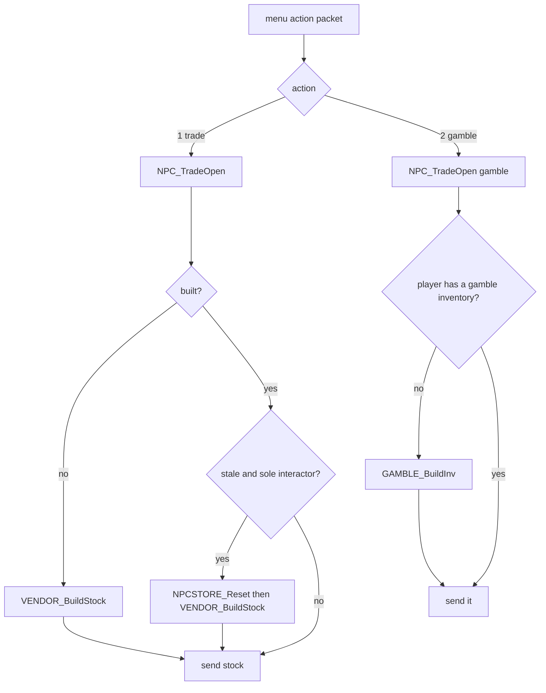

# 0009 — Vendor stock and gambling

> **Subsystem:** items/vendors
> **Question:** When a player opens a vendor's trade or gamble window, which items does the server create, with which ilvl, quality and seed, and when is the stock rebuilt?
> **Date:** 2026-10-15   **Plan:** 0031 (Phase 1)   **Status:** open (Phase 1 read from the decompile and the disassembly, committed before any community text was read; Phase 1b cross-check 2026-10-15: three contradictions, all reachable on stock data and required cases of Phase 2; review requested)

Names of structs and fields are ours (`re/types/vendors.h`). "Store seed" is the seed at `NpcStoreCtl+0x08`
(`Game+0x1D24` → `+0x08`), "game seed" is `Game+0xD0` ([rng/0002](../rng/0002-seed-tree.md)), "item seed" is the
item-data seed ([items/0004](0004-uniques-sets.md)). `R(S, n)` is the guarded range draw of
[rng/0001](../rng/0001-rng-core.md) (`n < 1` → 0 with no step; a power of two → `low & (n−1)`; else `low % n`, all
on the stepped `low`). `RandLoHi(S, lo, hi)` is `lo + R(S, hi − lo)` when `hi > lo` (signed), else `lo` with no draw
(objects/0001, fn:RNG_RandLoHi@0x004BC500). The vendor index `v` is the column group of the item tables in the order of
[Weapons § layout](../../tables/Weapons.md): 0 Akara, 1 Gheed, 2 Charsi, 3 Fara, 4 Lysander, 5 Drognan, 6 Hratli,
7 Alkor, 8 Ormus, 9 Elzix, 10 Asheara, 11 Cain, 12 Halbu, 13 Jamella, 14 Malah, 15 Larzuk, 16 Drehya (Anya). NPC
classes are MonStats rows (`hcIdx`). Phase 0 (the `Npc`, `Gamble` and `StorePage` table docs) has not landed; column
names below are the raw `.txt` headers.

## Answer (summary)

- [I] **One store record per interactable NPC class, per game.** At game creation `NPCSTORE_CtlCreate` allocates 64
  records of 0x44 bytes at `Game+0x1D24` and fills one per MonStats row with the `interact` flag, in row order. A
  43-entry table at 0x00731184 gives each store NPC its act (0–4) and a store flag. For a store NPC it copies one of the
  17 per-vendor candidate lists into the record. **The stock is shared by every player in the game.** Gambling keeps one
  inventory per player. (fn:NPCSTORE_CtlCreate@0x00536070, data:g_NpcStoreTable@0x00731184, fn:NPC_TradeOpen@0x00579430)
- [I] **The store seed** is seeded once per game: `NPCSTORE_CtlCreate` steps the game seed once and sets the store seed
  to `{low, 666}`. It is called from `sub_00530BF0_GameCreate` (0x00530DDE) right after `sub_00547D20_MonRegionsInit` and
  `OBJRGN_Create`, which draw on the game seed too. Every
  stock pick, quality pick, upgrade draw and gamble draw uses this seed. The hireling lists (`NPC_HirelingListBuild`)
  draw from it too, so they interleave with the stock. Each created item still gets its own unit and item seeds from
  the **game** seed, exactly as a drop does. (fn:NPCSTORE_GetSeed@0x00536B40, fn:NPC_HirelingListBuild@0x00576070,
  fn:sub_00558D90_ItemCreate@0x00558D90)
- [I] **When stock is built.** It is built on the first trade open of that NPC in a game (`built` = 0), from the
  opener's character level. It is rebuilt on a later trade open only after it was reset or marked stale, and only when
  the opener is the only player interacting with that NPC. **Reset and stale** happen when a player **leaves a town
  level** (level change, act change, or leaving the game in Acts I–IV). For every built store of that town's act: if
  nobody is left in the town and nobody is interacting with the NPC, the stock is destroyed at once and rebuilt at the
  next open. If nobody is left but someone still interacts, it is marked stale. If players remain in the town, it is
  marked stale only when more than 240 000 ms (`GetTickCount`) have passed since the last build. **None of these
  rebuilds anything:** entering town, a quest event, opening the window again, or a level-up. A level-up only queues a
  note, and that queue's consumer has no caller. (fn:NPC_OpenStore@0x00578B30, fn:NPCSTORE_ActStale@0x00537230,
  fn:sub_00537340_TownLevelLeave@0x00537340, fn:sub_00537580_TownPlayerRemove@0x00537580, fn:NPCSTORE_Reset@0x00536D10,
  fn:sub_00536850_NpcStoreLevelUpNote@0x00536850)
- [I] **Candidate bases.** Once per process, `VENDOR_BuildList(v)` walks the item records in index order (weapons,
  armor, misc). It keeps those with `spawnable` ≠ 0 and (`<V>Max` ≠ 0 or `<V>MagicMax` ≠ 0). A base with
  `PermStoreItem` ≠ 0 goes to the permanent list (code only). Every other base becomes a 12-byte entry
  `{Min, Max, MagicMin, MagicMax, code, MagicLvl}`. NPC class → `v` comes from two switches, which agree for 16 classes.
  (fn:VENDOR_BuildList@0x00536D50, fn:VENDOR_BuildAllLists@0x00536F80, tbl:Weapons.txt:PermStoreItem,
  tbl:Weapons.txt:spawnable)
- [C] **The class → vendor index map**: 148 Akara 0, 147 Gheed 1, 154 Charsi 2, 178 Fara 3, 202 Lysander 4,
  177 Drognan 5, 253 Hratli 6, 254 Alkor 7, 255 Ormus 8, 199 Elzix 9, 252 Asheara 10, 257 Halbu 12, 405 Jamella 13,
  513 Malah 14, 511 Larzuk 15, 512 Drehya 16. It is read from the record filler's switch and agrees with the list
  builder's switch, a second code path. Class 514 (Nihlathak) differs: the record takes list 15 (Larzuk), the builder
  list 16. Nihlathak is not in the trade menu's class list, so the difference is never seen (`[I]`). Index 11 (Cain) is
  never used. (0x00536271–0x005363EE, 0x00536FC0–0x00537046, fn:NPC_MenuAction@0x00579D60)
- [I] **The build** (`VENDOR_BuildStock`, 0x00576980). It reads the opener's level `clvl` (stat 12) and computes the stock level
  `ilvl = VENDOR_StockLevel(clvl + 5)`. In Normal that is `min(clvl + 5, cap[act])`, with caps 12, 20, 28, 36, 45 for
  Acts I–V. In Nightmare and Hell it is `clvl + 5` with no cap, up to 104. For each entry, in list order:
  - skip it when the base `level` > `ilvl`;
  - `n = RandLoHi(S, Min, Max + 1)` if `ilvl < 25`, else `n = 0`;
  - skip the rest when the base `version` ≥ 100 in a game whose item version < 100 (classic), after the draw above;
  - for each of `n`: `q = VENDOR_PickNormalQuality(S, ilvl)` (one draw), then create;
  - if the base's `bitfield1` bit 0 is set and `MagicLvl` ≤ `ilvl`: `x = 1`, or `RandLoHi(S, 1, 3) + 1` (one draw) when
    `ilvl ≥ 25`. Then `m = RandLoHi(S, MagicMin, MagicMax + x)`, and each of `m` is created with quality 4.

  After all entries, each permanent code is created once with quality 2. A full-stack quantity is set for `aqv`/`cqv`.
  More than 32 failed creations end the build early. (fn:VENDOR_BuildStock@0x00576980, fn:VENDOR_StockLevel@0x00576890,
  tbl:Weapons.txt:CharsiMin, tbl:Weapons.txt:CharsiMagicLvl, tbl:Weapons.txt:level)
- [I] **Normal-stock quality** (`VENDOR_PickNormalQuality`): one step of the store seed, then `r = low % 100`.
  `ilvl < 5`: `r > 90` gives 1 (low quality), else 2. `ilvl < 10`: `r > 85` gives 3 (superior), else 2. Otherwise
  `r ≥ 75` gives 3, else 2. Since `ilvl ≥ 6` always, the low-quality branch is unreachable. **Stock is never rare,
  set or unique:** magic entries pass quality 4. `<V>MagicLvl` is only the gate above. The affix level comes from the
  ordinary alvl rule with the item's `ilvl` and its own `magic lvl` (items/0005).
  (fn:VENDOR_PickNormalQuality@0x00576900, fn:ITEMS_BuildMagic@0x005565E0)
- [I] **Each created item** (`VENDOR_CreateStockItem`, 0x00576330). In Nightmare or Hell with `clvl ≥ 26`, one draw
  `u = RNG_RangeB(S, 100000)` may replace the base:
  - Nightmare: `u < ilvl·64 + 4000` → `ubercode`, else `NightmareUpgrade` if set;
  - Hell: in an expansion game `u < ilvl·16 + 1000` → `ultracode`; else `u < ilvl·128 + 5000` → `ubercode`. Then
    `HellUpgrade`, when set, replaces the result in every case.

  The item is then made by `ITEMS_CreateForStore` with `ilvl` and quality `q`. A low-quality item named `Cracked` is
  destroyed and made again, up to 5 attempts. An item whose code differs from the chosen code is destroyed and made
  once more with quality 2. The item goes to its `StorePage` tab, or to tab 2 when tab 1 is full.
  (fn:VENDOR_CreateStockItem@0x00576330, fn:ITEMS_CreateForStore@0x00559CE0, tbl:Weapons.txt:NightmareUpgrade,
  tbl:Weapons.txt:HellUpgrade, tbl:ItemTypes.txt:StorePage)
- [I] **Gambling** (`GAMBLE_BuildInv`, 0x00578790). It runs on a gamble open when the player has no gamble inventory at that NPC
  (the six gamblers: classes 147, 199, 254, 405, 512, 514). Fourteen slots; for each:
  1. `lvl = clvl − 5 + (low % 10)` after one step, clamped to 5..99;
  2. `item = list[R(S, countUpTo[lvl])]`, uniform over the Gamble.txt bases with `level` ≤ `lvl`;
  3. in a classic game, an expansion base is rejected and the slot drawn again;
  4. slot 0 becomes `rin` and slot 1 `amu`, after their draws;
  5. in an expansion game, `GAMBLE_Upgrade` tests `R(S, 10000) < (lvl − level(ubercode))·GambleUber + 1` → ubercode,
     else the same with `ultracode` and `GambleUltra` → ultracode. A test whose bound is ≤ 0 makes no draw;
  6. `r = low % 100000` after one step: `r < GambleUnique` → 7, `< GambleUnique + GambleSet` → 5,
     `< GambleUnique + GambleSet + GambleRare` → 6, else 4;
  7. the item is created with `ilvl = lvl`.

  With stock DifficultyLevels this gives unique 0.05 %, set 0.1 %, rare 10 % and magic 89.85 %, in every difficulty.
  The fallbacks (7 → 6, 5 → 4) are item creation's (items/0004).
  (fn:GAMBLE_BuildInv@0x00578790, fn:GAMBLE_Upgrade@0x005786A0, data:g_GambleList@0x0096CAB0,
  tbl:DifficultyLevels.txt:GambleUnique, tbl:DifficultyLevels.txt:GambleUber, fn:sub_00557450_ItemCreateByQuality@0x00557450)
- [I] **Gamble refresh.** A player's gamble inventory is freed when the interaction with the NPC ends
  (`sub_00555500_PlayerInteractEnd`). It is also freed when the NPC's interaction list empties on a cancel, and on a
  full store reset. The next gamble open builds a new one. A purchase copies the shown item (serialise and recreate)
  and creates no replacement. (fn:sub_00536B50_NpcStorePlayerLeave@0x00536B50, fn:sub_00537190_GambleInvFree@0x00537190,
  fn:sub_00576F50_StoreItemSold@0x00576F50)
- [I] **Item creation.** `ITEMS_CreateForStore` builds the 0x84-byte creation record with source = the NPC, `+0x18` = 4,
  `+0x2A` = the game's item version, `+0x30` = the quality, and `+0x80` = 0x02, which skips the ethereal roll. It has no
  seed, so `sub_00558D90_ItemCreate` seeds the item from the game seed, as for a drop. The creation-side quality roll
  returns the given quality with no draw (item version ≠ 0, quality ≠ 0). **Vendor and gamble items are never ethereal.**
  Normal and superior stock goes through the socket roll on the item seed. (fn:ITEMS_CreateForStore@0x00559CE0,
  fn:sub_00556F60_ItemRollQualityCreate@0x00556F60, fn:sub_00556CA0_ItemRollEthereal@0x00556CA0, struct:ItemCreateRec+0x80)
- Prices, the buy and sell multipliers of Npc.txt, and repair costs are named only: `sub_0062FDC0_ItemTradePrice`,
  `sub_00578050_NpcRepair`, `sub_0062FE60_RepairCost` (§ 9).

## Leads used

Phase 1 read no community vendor or gambling documentation. The code was found from our own symbols and strings: the
callers of `sub_00558D90_ItemCreate`, the readers of `DifficultyLevels` `GambleRare..GambleUltra`, and the
`.\UNIT\SUNITNPC.CPP` and `.\UNIT\sunitproxy.cpp` source paths. Phase 1 was committed before Phase 1b.

Phase 1b (2026-10-15) fetched the sources below in this session (ADR-0007; sections in [sources.md](../../sources.md)).
None contains code. Agreement promotes nothing: every tag above is unchanged. `src:fandom-d2-unique-set` refused every
fetch this session (HTTP 402) and was not compared. Searches also turned up Lurker Lounge thread 11969, PureDiablo
`?p=8935`, `d2wiki/Gambling` and diablowiki "Exceptional"; all refused the fetch (403/409), so none is used.

**Gambling**

- [L] src:arreat-summit-gambling: "Items generated for the gamble stock are -5 through +4 levels of your character's
  level with a minimum item level of 5." **held with refinement**
  Detail: § 7 `lvl = clvl − 5 + (low % 10)`, clamped to 5..99. The same `lvl` also filters the base (Gamble.txt rows
  with `level ≤ lvl`, uniform) and is the upgrade level. Slots 0 and 1 are always a ring and an amulet.
- [L] src:arreat-summit-gambling: "The chance for Uniques is 1 in 2,000 (0.05%) and 1 in 1,000 (0.10%) for Sets. The
  chance for Rares is 1 in 10 (10%). Magic Items are 1/~1.1 (89.85%)." **held**
  Detail: § 7, `low % 100000` against the DifficultyLevels columns 50 / 100 / 10000 (the same in all difficulties); test
  order unique, set, rare.
- [L] src:d2dfg-blizzard (§ difficultylevels.txt): `GambleRare`, `GambleSet`, `GambleUnique` "The game rolls a random
  number between 0 to 100000"; `GambleUber`, `GambleUltra` "between 0 to 10000". **held with refinement**
  Detail: `low % 100000` with cumulative bounds unique, unique + set, unique + set + rare (§ 7); `R(S, 10000)` for the
  upgrades, against `(lvl − qlvl)·Gamble* + 1`, not against the column alone (§ 7, `GAMBLE_Upgrade`).
- [L] src:arreat-summit-gambling: "pV = max{0%, (ilvl − qlvlV) * 0.9% + 1%}" and "pE = max{0%, (ilvl − qlvlE) * 0.33% +
  1%}". **contradicted** ([backlog](../../backlog.md), 2026-10-15 reverser → reverser)
  Detail: re-read 2026-10-15 at 0x0057870B–0x00578729 and 0x00578761–0x0057877D: `esi = (lvl − level(uber)) ·
  GambleUber + 1`, then `RNG_RangeB(S, 0x2710) < esi`. With `GambleUber` 90 that is `(lvl − qlvl)·0.9 % + 0.01 %`. The
  slope agrees, but the constant is 1 in 10 000, not 1 %. A bound ≤ 0 makes no draw, which matches the `max{0, …}`. The
  elite test is made only after a failed exceptional draw, so the elite share is `pE·(1 − pV)`, and it uses the elite
  base's own level. The reading stands; Phase 2 settles it from the logged `R(S, 10000)` values at levels near `qlvl`.
- [L] src:arreat-summit-magic-items (§ Gambling): "the level of the Magical Prefix/Suffix is checked against the randomly
  chosen value in the range of +6 Levels/-3 levels of your character's level". **contradicted**
  ([backlog](../../backlog.md), 2026-10-15 reverser → reverser)
  Detail: the gambled item's `ilvl` is drawn in `clvl − 5 .. clvl + 4` (§ 7), and the affix level then follows the
  general alvl rule from that `ilvl` ([items/0005](0005-affixes.md)); nothing in `GAMBLE_BuildInv` or
  `ITEMS_CreateForStore` adds a `+6/−3` window. The same publisher's gambling page gives `−5..+4`
  (`src:arreat-summit-gambling`, above). Phase 2 settles it: gambled magic items at a known `clvl`, with the affix
  lines of `affixes.gdb`.
- [L] src:arreat-summit-magic-items: "Circlets have a Magic Level bonus, which is added to the maximum item level you
  can receive on that item." **held with refinement**
  Detail: no gamble-specific code; the base's `magic lvl` enters through the general alvl rule (items/0005).
- [L] src:arreat-summit-gambling: "Gambling Items appear as Normal Items and can only be revealed as Exceptional or
  Elite Items after you buy them." **held with refinement**
  Detail: the server decides the upgrade when it builds the window: the item it creates already has the exceptional or
  elite base (§ 7), and a purchase copies that item. What the client draws for it was not read. Phase 2 logs the base
  code at the build and at the purchase.
- [L] src:arreat-summit-gambling: "You can reset the Gambling menu by exiting the screen, then by clicking on Gamble
  again." **held with refinement**
  Detail: a new list is built only after the player's gamble inventory is freed, which happens when the interaction
  with the NPC ends, when a cancel empties the NPC's interaction list, or on a store reset (§ 7). Whether closing the
  window ends the interaction is client behaviour (Open questions); Phase 2 logs it.
- [L] src:d2dfg-blizzard (§ Gamble.txt): "This file controls what Item Types will appear as possible items to purchase
  in the Gambling UI"; `code` "is a pointer to 'code' field from weapons.txt/armor.txt/misc.txt". **held with
  refinement**
  Detail: the rows are item codes, not item types (`GAMBLE_LoadTable` resolves each to an item index); a row is offered
  when its base `level ≤ lvl`.

**Vendor stock**

- [L] src:arreat-summit-vendors: "The vendor's inventories are tied to the act, difficulty and character's level." and
  "the chance will become greater to find Exceptional and Elite Items". **held**
  Detail: act (Normal cap, § 4), difficulty (the upgrade branch, § 5) and the opener's `clvl` (§ 4); the upgrade
  thresholds grow with `ilvl` (§ 5).
- [L] src:arreat-summit-vendors: "a Vendor's Inventory is reset if you leave town but not the act" and a full reset
  needs "All players have left town". **held with refinement**
  Detail: § 3. Leaving the town level by any route (an act change included) triggers it. With the town empty and
  nobody interacting, the stock is destroyed at once. With players left in town, it is only marked stale, after
  240 000 ms since the last build, and rebuilt at the next trade open by a sole interactor. Leaving the game from
  Harrogath triggers nothing.
- [L] src:d2dfg-blizzard (§ weapons.txt): `[NPC]Min`/`[NPC]Max` "Minimum/Maximum amount of this item type in Normal
  rarity that the NPC can sell at once". **held with refinement**
  Detail: `Min..Max` only while the stock level is below 25; from 25 on, no normal copies (§ 4). A base whose `Max` and
  `MagicMax` are both 0 is never listed.
- [L] src:d2dfg-blizzard: `[NPC]MagicMin`/`[NPC]MagicMax` "amount of this item type in Magical rarity".
  **held with refinement**
  Detail: from stock level 25 the maximum gains 1 or 2 (one draw), and the base's `bitfield1` bit 0 must be set (§ 4).
- [L] src:d2dfg-blizzard: `[NPC]MagicLvl` "Maximum magic level allowed for this item type in Magical rarity".
  **contradicted** ([backlog](../../backlog.md), 2026-10-15 reverser → reverser)
  Detail: re-read 2026-10-15 at 0x00576ADD–0x00576AEA: `movzx edx, byte [entry+8]; cmp edx, ilvl; jg skip`. The value
  is a **minimum stock level** below which the base gets no magic copies. The affix level comes from the item's `ilvl`
  and `magic lvl` and is not capped by it (§ 4). The data fits a minimum: Charsi's values are 1, 3, 5, 10, 15, 20 and
  255 (never). Reachable: Charsi's Normal Act I stock is capped at `ilvl` 12, so the 15, 20 and 255 bases never get
  magic copies there. Phase 2 required case.
- [L] src:d2dfg-blizzard: `NightmareUpgrade`/`HellUpgrade` "Used to determine which item will replace this item when
  being generated in the NPC's store while the game is playing in [difficulty]". **held with refinement**
  Detail: only when the opener's `clvl ≥ 26`. In Nightmare it applies only after a failed `ubercode` draw. In Hell it
  replaces the result of the `ultracode`/`ubercode` tests in every case (§ 5).
- [L] src:d2dfg-blizzard: `PermStoreItem` "If equals 1, then this item will always appear on the NPC's store".
  **held with refinement**
  Detail: created once per build with quality 2, when `spawnable` and `Max` or `MagicMax` ≠ 0 for that vendor; not
  removed when bought (§ 8).
- [L] src:d2dfg-blizzard (§ ItemTypes.txt): `StorePage` "Uses a code to determine which UI tab page on the NPC shop UI
  to display this Item Type". **held with refinement**
  Detail: a stock item that does not fit its tab 1 goes to tab 2 (§ 5).

**Not covered by the sources:** the store seed and its draw order, the Normal caps 12/20/28/36/45 (no fetched page
gives them), the no-normal-copies rule from stock level 25, the quality pick of normal stock (14 % or 25 % superior),
the ring and amulet slots, the classic redraw, and the 240 000 ms stale timer. The Npc.txt price columns
(src:d2dfg-blizzard § npc.txt) were read but not compared, because prices are named only.

## Functions

| Address | Name | Role | Tag |
|---|---|---|---|
| `0x00536070` | `NPCSTORE_CtlCreate` | game creation: 64 store records, the store seed (one game-seed draw) | I |
| `0x00535EA0` | `NPCSTORE_FindRec` | record by NPC class (EDX) | I |
| `0x00535FB0` | `sub_00535FB0_NpcStoreCopyList` | EAX vendor index, EDI `&rec+0x2C`: copies the list | I |
| `0x00536580` | `NPCSTORE_ClearRec` | frees the gamble inventories, the stock and the pending list | I |
| `0x00536B40` | `NPCSTORE_GetSeed` | `Game+0x1D24` → `+0x08` | I |
| `0x00536B50` | `sub_00536B50_NpcStorePlayerLeave` | frees one player's gamble inventory and proxy node | I |
| `0x00536C50` | `NPCSTORE_GetGambleInv` | a player's gamble inventory at an NPC | I |
| `0x00536D10` | `NPCSTORE_Reset` | clears a record: `built` = 0, `buildTick` = 0, a new stock inventory | I |
| `0x00536D50` | `VENDOR_BuildList` | one vendor's candidate and permanent lists, once per process | I |
| `0x00536F80` | `VENDOR_BuildAllLists` | class → vendor index, calls the list builder | C |
| `0x00537190` | `sub_00537190_GambleInvFree` | frees one player's gamble inventory | I |
| `0x00537230` | `NPCSTORE_ActStale` | `(game, act, townEmpty)`: reset or mark stale (240 000 ms) | I |
| `0x00537340` | `sub_00537340_TownLevelLeave` | a level change from a town: stale check for its act | I |
| `0x00537580` | `sub_00537580_TownPlayerRemove` | a player leaving the game from town (Acts I–IV) | I |
| `0x00536850` | `sub_00536850_NpcStoreLevelUpNote` | level-up: queues a note per built store (no consumer) | I |
| `0x005368F0` | `sub_005368F0_NpcStorePendingDead` | the queue's consumer; no caller | I |
| `0x00559CE0` | `ITEMS_CreateForStore` | creation record for stock and gamble items, then `ItemCreate` | I |
| `0x00572DA0` | `sub_00572DA0_NpcInteractCount` | non-empty entries of an NPC's interaction list | I |
| `0x00572F20` | `sub_00572F20_NpcInteractRemove` | removes a player; an emptied list frees the gamble inventory | I |
| `0x00555500` | `sub_00555500_PlayerInteractEnd` | the player stops interacting: frees the gamble inventory | I |
| `0x00576070` | `NPC_HirelingListBuild` | hireling list, a store-seed consumer (named only) | I |
| `0x00576330` | `VENDOR_CreateStockItem` | upgrade draw, creation retries, placement | I |
| `0x00576890` | `VENDOR_StockLevel` | Normal: `min(arg, cap[act])`; else `arg` | I |
| `0x00576900` | `VENDOR_PickNormalQuality` | one draw: quality 1, 2 or 3 | I |
| `0x00576980` | `VENDOR_BuildStock` | the stock build | I |
| `0x00576ED0` | `VENDOR_IsPermanent` | permanent list, or `hp4`/`hp5`/`mp4`/`mp5` outside Normal | I |
| `0x00576F50` | `sub_00576F50_StoreItemSold` | after a buy: gamble item kept as sold, a stock item removed unless permanent | I |
| `0x005786A0` | `GAMBLE_Upgrade` | uber then ultra test on the store seed | I |
| `0x00578790` | `GAMBLE_BuildInv` | the gamble window: 14 slots | I |
| `0x00578AE0` | `sub_00578AE0_GambleEnsure` | builds unless the player already has a gamble inventory | I |
| `0x00578B30` | `NPC_OpenStore` | trade: first build; gamble: ensure | I |
| `0x00579090` | `sub_00579090_StockRebuildDead` | rebuild of the last-talked NPC; no caller | I |
| `0x00579430` | `NPC_TradeOpen` | trade and gamble open, the stale rebuild | I |
| `0x00579D60` | `NPC_MenuAction` | NPC menu packet: 1 trade, 2 gamble, 3 hire, quest actions | I |
| `0x00638AE0` | `GAMBLE_LoadTable` | `gamble` table, sorted by base level, `countUpTo` | I |
| `0x00638CC0` | `GAMBLE_GetList` | returns `g_GambleList` | I |
| `0x00629C80` | `sub_00629C80_ItemMagicStockable` | base `bitfield1` bit 0 | I |
| `0x0062E880` | `sub_0062E880_ItemStorePage` | the item type's `StorePage` | I |
| `0x0062FDC0` | `sub_0062FDC0_ItemTradePrice` | price wrapper (named only) | I |
| `0x00578050` | `sub_00578050_NpcRepair` | repair packet (named only) | I |
| `0x0062FE60` | `sub_0062FE60_RepairCost` | repair cost (named only, not read) | L |

Data: `data:g_NpcStoreTable@0x00731184` (u32 count 43, then 8-byte `NpcStoreSlot`), `data:g_VendorLists@0x00883D78`
(17 × `VendorList`), `data:g_VendorListBuilt@0x00883E88` (17 bytes), `data:g_GambleList@0x0096CAB0`.

## Walkthrough

### 1. Store records and the store seed (game creation)

`NPCSTORE_CtlCreate` (ECX = game) runs once per game from `sub_00530BF0_GameCreate`, between `OBJRGN_Create` and
`0x00545D80` (quests).

```c
// fn:NPCSTORE_CtlCreate@0x00536070 (trimmed, our names)
recs = alloc(0x1100); memset(recs, 0, 0x1100);
ctl  = alloc(0x14); ctl->nRecs = 0; ctl->recs = 0; ctl->nInteract = 0;
RNG_SeedInitOne(&ctl->seed);
step(&game->seed);                                  // game seed +0xD0, one draw
RNG_SeedInit(&ctl->seed, game->seed.low);           // store seed = {low, 666}
for (cls = 0; cls < nMonStats; cls++) {
    if (!(monstats[cls].flags0D & 2)) continue;     // `interact`
    r = &recs[ctl->nRecs++];  r->classId = cls;  r->pInventory = INV_Create(..);
    slot = find(g_NpcStoreTable, cls);              // 43 entries, 8 bytes
    if (!slot) continue;
    r->act = slot->act;  r->hasStore = slot->hasStore;  r->flag26 = slot->flag6;
    if (r->hasStore != 1) { r->entries = 0; r->permCodes = 0; continue; }
    v = vendorIndex(cls);                           // switch, § Answer
    copy g_VendorLists[v] into r->entries/nEntries/permCodes/nPerm;
    if (cls in {147, 199, 254, 405, 512, 514}) r->isGambler = 1;
}
game->pNpcStore = ctl;
```

- [I] The record order is MonStats row order of the `interact` rows. The lookup `NPCSTORE_FindRec` compares
  `classId` over all 64 slots. (0x00535EA0, tbl:MonStats.txt:interact)
- [I] The vendor lists come from `g_VendorLists`, which `VENDOR_BuildAllLists` fills when the item tables load. A
  per-index "built" byte at `g_VendorListBuilt` makes each list build once. `0x00537120` frees them at unload.
  (fn:VENDOR_BuildAllLists@0x00536F80 called from 0x005306CF, data:g_VendorListBuilt@0x00883E88)

### 2. The candidate lists (`VENDOR_BuildList`, 0x00536D50)

```c
// fn:VENDOR_BuildList@0x00536D50 (v = vendor index; items stride 0x1A8, weapons + armor + misc)
for (i = 0; i < nItems; i++) {
    it = &items[i];
    if (!it->spawnable /*+0x133*/) continue;
    if (!it->vMax[v] /*+0x157+v*/ && !it->vMagicMax[v] /*+0x179+v*/) continue;
    if (it->PermStoreItem /*+0x1A4*/) perm[nPerm++] = it->code;
    else entries[n++] = { it->vMin[v] /*+0x146+v*/, it->vMax[v], it->vMagicMin[v] /*+0x168+v*/,
                          it->vMagicMax[v], it->code /*+0x80*/, it->vMagicLvl[v] /*+0x18A+v*/ };
}
```

- [I] `Min` plays no part in membership: a base whose `Max` and `MagicMax` are both 0 is never stocked. A permanent
  base is created once per build whatever its counts. The offsets the code reads are the vendor-column offsets of the
  item layout ([Weapons](../../tables/Weapons.md)). (0x00536DC0–0x00536F5A, tbl:Weapons.txt:CharsiMax,
  tbl:Weapons.txt:CharsiMagicMax)
- [I] Applied to the stock tables, this gives entry and permanent counts per vendor (computed with a scratch script from
  the merged `.txt`, not a `tools/` survey). The counts are: Akara 5 + 10 (potions, scrolls, tomes, keys permanent),
  Gheed 39 + 3, Charsi 40 + 2 (`aqv`, `cqv`), Fara 53 + 2, Lysander 0 + 8, Drognan 13 + 8, Hratli 32 + 3,
  Alkor 0 + 3, Ormus 17 + 10, Elzix 40 + 2, Asheara 40 + 2, Halbu 40 + 2, Jamella 37 + 16, Malah 18 + 16,
  Larzuk 32 + 2, Drehya 19 + 2. The healers get the potions and the smiths the arrows, which fits the index map.
  Phase 0's survey replaces these counts. (tbl:Weapons.txt:PermStoreItem)



### 3. Open and rebuild (`NPC_MenuAction` → `NPC_TradeOpen` → `NPC_OpenStore`)

`NPC_MenuAction(action, npcId, arg)` (ECX game, EDX player) is the handler of a 13-byte client packet
(`0x0054BCA0`). Action 1 is trade, allowed for classes 147, 148, 154, 177, 178, 199, 202, 252–255, 257, 405 and
511–513. Action 2 is gamble, allowed for 147, 199, 254, 405, 512 and 514. Action 3 is the hire list. Other actions run
quest services (Charsi's imbue for class 154, Larzuk's socketing, Anya's personalisation, waypoint and travel hand-offs).

```c
// fn:NPC_TradeOpen@0x00579430 (ECX game, EDX player; npc, soleInteractor, isGamble)
rec = NPCSTORE_FindRec(npc->classId);
rec->opened = 1;  rec->npcUnitId = npc->id;
NPC_OpenStore(npc, isGamble);
if (npc->classId in {150, 515, 198}) return;            // hire-only NPCs
if (soleInteractor && !isGamble && rec->stale) {
    rec->stale = 0;
    NPCSTORE_Reset(rec, npc);                           // destroys the stock, built = 0
    VENDOR_BuildStock(npc, &rec->built);  rec->built = 1;
}
// then the stock (trade) or the player's gamble inventory is sent

// fn:NPC_OpenStore@0x00578B30
if (isGamble) { if (rec->isGambler) { proxy(player)->mode = 1; GambleEnsure(player, rec); } return; }
if (!rec->hasStore) return;
proxy(player)->mode = 0;
if (!rec->built) { VENDOR_BuildStock(npc, &rec->built); rec->built = 1; }
if (!rec->hirelingsBuilt) { if (cls in {150, 515, 198, 252}) NPC_HirelingListBuild(rec); rec->hirelingsBuilt = 1; }
```

- [I] `soleInteractor` = the NPC's interaction list (`MonsterData+0x30`) has exactly one live entry. It is computed by
  `NPC_MenuAction` before the call (0x00579E08). (fn:sub_00572DA0_NpcInteractCount@0x00572DA0)
- [I] For Asheara (252, store and hirelings), the first trade open builds the stock first and the hireling list
  second. Both draw on the store seed. Opening the hire list first (action 3 → `0x00576770`) builds the hirelings first.
  (0x00578BCB, 0x00578BFF, 0x005767EB)

**Stale and reset** (`NPCSTORE_ActStale(game, act, townEmpty)`, 0x00537230). It visits each record with `act` = the
argument, `hasStore` = 1, `opened` = 1 and `built` = 1:

```c
if (!townEmpty) {
    if (now > rec->buildTick + 240000) { rec->stale = 1; rec->buildTick = now; }   // unsigned GetTickCount
} else {
    npc = findUnit(rec->npcUnitId);
    if (!npc || npc->classId != rec->classId) { NPCSTORE_ClearRec(rec); rec->built = 0; rec->buildTick = 0; new inventory; }
    else if (NpcInteractCount(npc) == 0) NPCSTORE_Reset(rec, npc);   // stock destroyed, rebuilt at next open
    else rec->stale = 1;
}
```

- [I] `sub_00537340_TownLevelLeave(old, new)` runs on every level change of a player. It is called from
  `sub_0053AEC0_PlayerChangeLevel` and from the per-frame room check `0x005380D0`, when the old level is a town
  (1, 40, 75, 103, 109 → act 0–4). It counts the players still in that level (the leaving player is already elsewhere)
  and calls `NPCSTORE_ActStale(game, act, count == 0)`. `sub_00537580_TownPlayerRemove` (from the client-removal path
  `0x00539DA0`) does the same with `count − 1 == 0`, for levels 1, 40, 75 and 103 only: Harrogath is missing from its
  switch. (0x00537340–0x00537402, 0x00537580–0x005375FB)
- [I] So in single player, leaving town by any route (walking out, a waypoint, a portal) destroys every built stock of
  that act, because the town is empty and nobody interacts. The next trade open builds new stock from the current
  character level. In a multiplayer game with players left in town, the stock is only marked stale, and only after
  4 minutes. It is rebuilt at the next trade open by a sole interactor. (fn:NPCSTORE_ActStale@0x00537230)
- [I] `buildTick` is written by `VENDOR_BuildStock` at its start and by the stale mark. A level-up
  (`0x00570880`) calls `sub_00536850_NpcStoreLevelUpNote`, which pushes a `{level, 4, 1}` node onto each built store's
  pending list. The pending list's processor `sub_005368F0_NpcStorePendingDead` and the other producer `0x005367B0`
  have no caller (no `call`, `jmp` or pointer to them anywhere in the image). So a level-up changes nothing until the
  next build. The same goes for `sub_00579090_StockRebuildDead`, a rebuild of the NPC last talked to (healer global
  `0x0088CAC4`): it has no caller.
  (fn:sub_005368F0_NpcStorePendingDead@0x005368F0, fn:sub_00579090_StockRebuildDead@0x00579090)
- [I] No quest code reaches `VENDOR_BuildStock` or `NPCSTORE_Reset`. Their only callers are those above (call sites
  0x00578BCB, 0x005794C2, 0x00579116; 0x005372D8, 0x005794B3).

### 4. The stock build (`VENDOR_BuildStock`, 0x00576980)

ECX game, EDX the opening player, stack `(npc, &rec->built)`. `S` = the store seed.

```c
// fn:VENDOR_BuildStock@0x00576980 (trimmed, our names)
rec->buildTick = GetTickCount();
clvl = STATS_GetUnitStat(player, 12, 0);
ilvl = VENDOR_StockLevel(npc, clvl + 5);
fails = 0;
for (k = 0; k < rec->nEntries; k++) {
    e = &rec->entries[k];  b = ITEMS_GetByCode(e->code);
    if (b->level /*+0xFD*/ > ilvl) continue;
    n = (ilvl < 25) ? RandLoHi(S, e->min, e->max + 1) : 0;          // draw unless max + 1 <= min
    if (b->version /*+0xF6*/ >= 100 && game->itemVersion /*+0x78*/ < 100) continue;
    for (i = 0; i < n; i++) {
        q = VENDOR_PickNormalQuality(S, ilvl);                       // one draw
        if (!VENDOR_CreateStockItem(npc, e->code, game, 1, q, ilvl, clvl)) fails++;
        if (fails > 32) return;
    }
    if ((b->bitfield1 & 1) && e->magicLvl <= ilvl) {
        x = (ilvl >= 25) ? RandLoHi(S, 1, 3) + 1 : 1;                // 2..3 with one draw, else 1
        m = RandLoHi(S, e->magicMin, e->magicMax + x);
        while (m--) if (!VENDOR_CreateStockItem(npc, e->code, game, 1, 4, ilvl, clvl)) fails++;
    }
}
for (k = 0; k < rec->nPerm; k++) {
    it = VENDOR_CreateStockItem(npc, rec->permCodes[k], game, 1, 2, ilvl, clvl);
    if (!it) fails++;
    else if (code(k) == 'cqv ' || code(k) == 'aqv ') setStat(it, 70 /*quantity*/, maxStack(it));
    if (fails > 32) return;
}
```

- [I] **Counts.** Normal stock of an entry is `Min..Max` (inclusive) while `ilvl < 25`, and none from 25 on. An
  entry with `Max + 1 ≤ Min` gives `Min` items with no draw. An entry with `Max` = 0 (present for its magic columns)
  still draws once when `Min` = 0, giving 0. Magic stock is `MagicMin..MagicMax` while `ilvl < 25`. From 25 on it is
  `MagicMin..MagicMax + 1` or `MagicMin..MagicMax + 2`, after a draw that picks which. (0x005769F3–0x00576B4F,
  fn:RNG_RandLoHi@0x004BC500)
- [I] **Classic.** An expansion base is skipped after its normal-count draw and before its quality draws, so a
  classic game consumes the count draw of every expansion entry when `ilvl < 25`. (0x00576A47–0x00576A5C)
- [I] **Draw order per entry** (0x00576A3C–0x00576B99), all on `S`: the count, then for each normal item the quality draw, followed by that
  item's upgrade draw (§ 5) and its creation (game seed, then item seed). Next the magic-extra draw (when `ilvl ≥ 25`),
  the magic count, and each magic item's upgrade draw and creation. The permanent items come last, each with its
  upgrade draw. The hireling list (§ 1) is the only other consumer of `S` during a trade open.
- [I] **Stock level** (`VENDOR_StockLevel`, ECX game, EDX npc): `difficulty == 0` and `act < 5` →
  `min(arg, {12, 20, 28, 36, 45}[act])`; otherwise `arg`. There is no clamp to 99 here. `ITEMS_CreateForStore` only
  raises values below 1 to 1. (0x00576890–0x005768EF)

### 5. One stock item (`VENDOR_CreateStockItem`, 0x00576330)

ECX npc, EDX code, stack `(game, send, q, ilvl, clvl)`.

```c
b = ITEMS_GetByCode(code, &idx);  want = code;
if (game->difficulty > 0 && clvl > 25) {
    u = RNG_RangeB(S, 100000);                                       // one draw
    if (game->difficulty == 1) {
        if (u < ilvl*64 + 4000 && valid(b->ubercode)) { idx = byCode(b->ubercode); want = b->ubercode; }
        else if (b->NightmareUpgrade != 'xxx ')    { idx = byCode(b->NightmareUpgrade); want = ...; }
    } else {
        if (game->expansion && u < ilvl*16 + 1000 && valid(b->ultracode)) { idx/want = ultracode; }
        else if (u < ilvl*128 + 5000 && valid(b->ubercode))               { idx/want = ubercode; }
        if (b->HellUpgrade != 'xxx ') { idx/want = HellUpgrade; }    // overrides either
    }
}
for (pass = 0; pass < 2; pass++) {                                    // second pass only on a code mismatch
    for (t = 0; ; ) {
        it = ITEMS_CreateForStore(npc, idx, game, 4, q, 0, 1, ilvl, 0, 0, 0);
        t++;
        if (ITEMS_GetQuality(it) == 1 && !stricmp(lowQualityName(it), "Cracked")) { destroy(it); it = 0; if (t < 5) continue; return 0; }
        break;
    }
    if (ITEMS_GetCode(it) == want) break;
    destroy(it);  q = 2;  it = 0;
}
page = storePage(it); if (page == -1) { destroy; return 0; }
place in npc inventory on `page`; if that fails and page == 1, try page 2; if that fails, park the item (0x00535F30) and return 0;
```

- [I] `valid(c)` is `c ≠ 0` and `c ≠ "    "`. The upgrade columns use `"xxx "` for none. Both thresholds read the
  `ilvl` argument, and the gate reads the opener's level (`clvl ≥ 26`). (0x00576389–0x005764A5,
  tbl:Weapons.txt:ubercode, tbl:Weapons.txt:ultracode)
- [I] (0x005763B8–0x0057649F) The Nightmare `NightmareUpgrade` replacement applies only when the uber test fails. The Hell `HellUpgrade`
  replacement applies after both tests, whatever they gave. The Nightmare branch does not test the expansion flag.
- [I] `ITEMS_GetQuality(NULL)` returns 2, and `ITEMS_GetCode(NULL)` is a fatal assert (`0x61A`). A creation that
  returns no item therefore reaches the assert. `ItemCreate` returns none in a classic game when the base's `version`
  ≥ 100, so an upgrade to an expansion code in a classic Nightmare game is fatal. Not observed (Open questions).
  (0x0057652B, 0x00628590, fn:sub_00558D90_ItemCreate@0x00558D90)
- [I] The `send` argument (always 1 here) marks the item for the client and adds it to the store inventory's send
  list (`0x005762C0`). `0x005761C0` (called before placement) fills durability, throwable stacks and charges to their
  maximum. It makes no draw that this reading found. Neither is item creation proper.

### 6. The creation record (`ITEMS_CreateForStore`, 0x00559CE0)

ECX source (the NPC), EDX item index, stack `(game, kind, q, noSockets, noEthereal, ilvl, restoreArg, seedU, seedI)`.
Stock and gamble pass `(game, 4, q, 0, 1, ilvl, 0, 0, 0)`.

- [I] Record (0x84, zeroed): `+0x00` NPC, `+0x08` game, `+0x0C` `ilvl` (< 1 → 1; −1 would mean "the source's level"),
  `+0x14` item index, `+0x18` = `kind` (4; drops use 3), `+0x28` u16 = 1, `+0x2A` u16 = `game+0x78`, `+0x30` = `q`,
  `+0x48`/`+0x4C` = the seed arguments (0), `+0x80` = `(noSockets ? 0x08 : 0) | (noEthereal ? 0x02 : 0)` = 0x02.
  Then `sub_00558D90_ItemCreate(game, &rec, 0)` and `ITEMS_SetFlag(item, 0x10, 1)` (identified).
  (0x00559D0F–0x00559E0B, struct:ItemCreateRec+0x80)
- [I] With `+0x2C` = 0 and argument 0, `ItemCreate` keeps the seeds that `sub_00555230_SUnitCreate` and
  `sub_00552E90_ItemSeedInit` draw from the game seed. These are the same three game-seed draws as a drop
  ([items/0004](0004-uniques-sets.md) summary). `kind` reaches `SUnitCreate` after the seeding.
  (fn:sub_00555230_SUnitCreate@0x00555230, fn:sub_00552E90_ItemSeedInit@0x00552E90)
- [I] The given quality (1–7) and the item version (101 or 2) are non-zero. `sub_00556F60_ItemRollQualityCreate`
  therefore returns the quality with no draw, and `sub_00557450_ItemCreateByQuality` runs its usual builders and
  fallbacks from the item seed ([items/0004 § 1](0004-uniques-sets.md#1-itemcreatebyqualitygame-ecx-item-edx-rec-0x005574500x00557a27)).
  Bit 0x02 skips `sub_00556CA0_ItemRollEthereal`'s draw. The socket roll still runs for qualities 1–3.
  (fn:sub_00556B60_ItemRollSockets@0x00556B60)

### 7. Gambling (`GAMBLE_BuildInv`, 0x00578790)

ECX game, EDX npc, stack `(player, rec)`. `D` = `DifficultyLevels[game->difficulty]`.

```c
// fn:GAMBLE_BuildInv@0x00578790 (trimmed)
G = GAMBLE_GetList();  total = D->GambleRare + D->GambleSet + D->GambleUnique;
ring = byCode('rin '); amu = byCode('amu ');                         // cached once
node = {INV_Create(), player->id, rec->gambleInvs};  rec->gambleInvs = node;
clvl = STATS_GetUnitStat(player, 12, 0);
for (slot = 0; slot < 14; ) {
    step(S);  lvl = (int)(S.low % 10) + clvl - 5;                    // unsigned % 10
    if (lvl <= 5) lvl = 5; else if (lvl >= 99) lvl = 99;
    item = G->items[R(S, G->countUpTo[lvl])];                        // inline guarded range draw
    if (!game->expansion) { if (!rec(item)) return; if (rec(item)->version >= 100) continue; }   // redraw the slot
    if (slot == 0) item = ring; else if (slot == 1) item = amu;
    item = GAMBLE_Upgrade(game, lvl, item, D->GambleUber, D->GambleUltra);
    q = 4;
    if (total > 0) {
        step(S);  r = S.low % 100000;                                // unsigned
        if (r < total) q = (r < D->GambleUnique) ? 7 : (r >= D->GambleSet + D->GambleUnique) ? 6 : 5;
    }
    slot++;
    it = ITEMS_CreateForStore(npc, item, game, 4, q, 0, 1, lvl, 0, 0, 0);
    if (!it) continue;
    page 0; 0x005761C0; clear flag 0x10;
    if (!place it in node->inv) { destroy(it); return; }
}
```

- [I] **The base list** (`GAMBLE_LoadTable`, 0x00638AE0): one entry per Gamble.txt row, with the code resolved to an
  item index (fatal if unknown) and the base `level` (+0xFD). It is sorted by `level` with the CRT `qsort` and the
  comparator `0x00638AC0` (unsigned level, ties compare equal). `countUpTo[L]`, for L = 1..99, is the index of the first
  entry with `level > L`, or `nRows` if there is none. `countUpTo[0]` = 2 is never read, because `lvl ≥ 5`. **The order
  of equal-level entries is whatever MSVC `qsort` leaves**, so a reimplementation needs that order (Phase 2 dumps it).
  (fn:GAMBLE_LoadTable@0x00638AE0, data:g_GambleList@0x0096CAB0)
- [I] **The gamble ilvl** is `lvl`, drawn per slot from `clvl − 5 .. clvl + 4` and clamped to 5..99. The base is
  uniform among the Gamble.txt rows with base `level ≤ lvl`. The same `lvl` is the creation `ilvl` and the upgrade
  level. (0x00578877–0x00578916)
- [I] **Rings and amulets**: slot 0 is always a ring and slot 1 always an amulet. Their `lvl` and pick draws are made
  and discarded. Rings and amulets can also come up in slots 2–13 from the list (`rin`, `amu` are rows of Gamble.txt).
  (0x0057893E–0x00578950)
- [I] **The upgrade** (`GAMBLE_Upgrade`, 0x005786A0, ECX game, EAX `lvl`, stack `(item, uber, ultra)`): in a classic game it
  returns the item with no draw. Otherwise, with `B` = the base record:
  - no `ubercode` (blank or 0) or an unknown one → `item`, no draw;
  - `c = (lvl − level(uber))·GambleUber + 1`; `c ≤ 0` → `item`, no draw; `R(S, 10000) < c` → the uber base;
  - after a failed uber draw, the same with `B`'s `ultracode`, `level(ultra)` and `GambleUltra` → the ultra base, else
    `item`.

  So an ultra base can come only from a failed uber draw; a base with no uber code, or below its uber level, keeps its
  own code with no draw. Stock values: 90 and 33. (0x005786A0–0x0057878B,
  tbl:DifficultyLevels.txt:GambleUltra)
- [I] **The quality roll** takes one draw per slot. With stock values (`GambleRare` 10000, `GambleSet` 100,
  `GambleUnique` 50, the same in all three difficulties) the shares out of 100 000 are 50 unique, 100 set, 10 000 rare
  and 89 850 magic. The code reads the columns, so other data changes them. A unique or set that item creation cannot
  build falls back as for any item (7 → 6 → 4, 5 → 4). (0x00578976–0x005789DD,
  tbl:DifficultyLevels.txt:GambleRare, tbl:DifficultyLevels.txt:GambleSet)
- [I] **Draws per slot** (0x00578877–0x005789F9), all on `S`: `lvl` (1), the pick (1, or 0 when `countUpTo[lvl] < 1`), the uber test (0–1),
  the ultra test (0–1, only when the uber test drew and failed), and the quality (1). Then the item's creation, on the game seed and the item seed. A classic redraw repeats the first two
  without advancing the slot.
- [I] **Refresh.** A gamble inventory is per player and per NPC (`rec->gambleInvs`, keyed by player unit id; 0x00578AE0).
  `sub_00578AE0_GambleEnsure` builds only when the player has none. It is freed:
  1. by `sub_00555500_PlayerInteractEnd` → `sub_00536B50_NpcStorePlayerLeave`, when the player's interaction with
     that NPC ends;
  2. by `sub_00572F20_NpcInteractRemove` (the cancel packet `0x0054BA6B`/`0x0054BA81`), when the removal empties the
     NPC's interaction list;
  3. by `NPCSTORE_ClearRec`, on a full reset of the NPC's record.

  Opening the gamble window twice in one interaction shows the same items. Buying an item copies it to the player
  (`sub_0055A2A0_ItemCopy`, through `0x005776E0`). `sub_00576F50_StoreItemSold` then handles the sold item inside the
  player's gamble inventory (`0x00576650`) and creates no replacement. (fn:sub_00578AE0_GambleEnsure@0x00578AE0, fn:sub_0055A2A0_ItemCopy@0x0055A2A0)

### 8. After a sale (stock)

- [I] A bought stock item is removed from the store unless `VENDOR_IsPermanent` holds. That is the case for a code in
  the record's permanent list, and outside Normal also for `hp4`, `hp5`, `mp4` and `mp5`. A sold player item is copied
  into the store unless one of these holds: it is a `Cracked` low-quality item, it has item flag `0x100`, `0x1000000`
  or `0x400000` (ethereal), its base type is 7, `0x0055F590`/`0x00575FA0` refuse it, the player is in the gamble view,
  or it is permanent stock. (fn:VENDOR_IsPermanent@0x00576ED0, fn:sub_00576F50_StoreItemSold@0x00576F50, 0x00579510)

### 9. Named only: prices and repair

- [I] `sub_0062FDC0_ItemTradePrice(player, item, difficulty, questWord, npcClass, mode)` wraps `0x0062EFB0`. Buy (mode
  0) and gamble (2) compare its result with the player's gold, stats 14 + 15. The sell path prices with it too. The Npc.txt multipliers and
  quest flags are its inputs. Not read. (fn:sub_0062FDC0_ItemTradePrice@0x0062FDC0)
- [I] `sub_00578050_NpcRepair` accepts classes 154, 178, 253, 257 and 511. The repair-all form (packet bit 31) prices
  through `sub_0062FE60_RepairCost`. Not read. (fn:sub_00578050_NpcRepair@0x00578050)

### 10. Phase 2 boundary (recommendation)

**Recommended boundary: model the store seed end to end, and treat item creation as the existing chained model.**
`tools/vendors.py` should model `VENDOR_BuildStock`, `VENDOR_PickNormalQuality`, the upgrade draw, and `GAMBLE_BuildInv`
with `GAMBLE_Upgrade`, from the store seed. For each created item it hands `(item index, quality, ilvl)` and the item's
game-seed state to the `tools/items_chain.py` model. Two logged boundary oracles (ADR-0004):
- `NPC_HirelingListBuild`: the seed on entry and exit, because the hireling generator is out of scope;
- the gamble base order: dump `g_GambleList` (`+0x04` array, `+0x08` counts) once per run, rather than modelling MSVC
  `qsort`.

What to log (`tools/gdb/vendors.gdb`):
- the trigger: `NPC_TradeOpen` (action, class, sole interactor, `built`, `stale`), `NPCSTORE_ActStale` (act,
  `townEmpty`, records marked or reset), `NPCSTORE_Reset`, `sub_00536B50_NpcStorePlayerLeave`,
  `sub_00537190_GambleInvFree`;
- `VENDOR_BuildStock` entry: the store seed, `clvl`, `ilvl`, the game seed;
- every store-seed draw with its call site: `RNG_RandLoHi` (lo, hi, result), `VENDOR_PickNormalQuality` (result),
  the upgrade draw at 0x005763A5 / 0x00576415 (`u`, the chosen code), the gamble `lvl`, pick, upgrade and quality draws
  (0x00578877, 0x005788D8, 0x0057871D, 0x00578771, 0x00578980);
- `ITEMS_CreateForStore` arguments and return, the game seed at its entry, and the creation lines of `affixes.gdb` and
  `props.gdb`;
- the `Cracked` retries and code-mismatch retries (0x00576505, 0x00576536), and placement failures.

Required cases: a Normal build below and above `ilvl` 25 (`clvl` 20 or more); a Nightmare and a Hell build at
`clvl ≥ 26`, which exercises the upgrade draw; a single-player leave-town rebuild; a classic session (expansion
entries' count draws; the Nightmare fatal path of § 5 is logged only if it can be reached without crashing the slot);
gambles at two levels with ring and amulet slots; an expansion gamble with an uber or ultra upgrade if one occurs.

## Data touched

- `tbl:Weapons.txt:CharsiMin`, `CharsiMax`, `CharsiMagicMin`, `CharsiMagicMax`, `CharsiMagicLvl` and the other
  vendors' groups (`+0x146 + v`, `+0x157 + v`, `+0x168 + v`, `+0x179 + v`, `+0x18A + v`); `tbl:Weapons.txt:PermStoreItem`
  (`+0x1A4`), `tbl:Weapons.txt:spawnable` (`+0x133`), `tbl:Weapons.txt:level` (`+0xFD`), `tbl:Weapons.txt:version`
  (`+0xF6`), `tbl:Weapons.txt:code` (`+0x80`), `tbl:Weapons.txt:ubercode` (`+0x88`), `tbl:Weapons.txt:ultracode`
  (`+0x8C`), `tbl:Weapons.txt:NightmareUpgrade` (`+0x19C`), `tbl:Weapons.txt:HellUpgrade` (`+0x1A0`),
  `tbl:Weapons.txt:bitfield1` bit 0 (`+0xDC`). The same columns of Armor and Misc (one layout).
- `tbl:ItemTypes.txt:StorePage` (`+0x22`).
- `tbl:DifficultyLevels.txt:GambleRare` (`+0x44`), `GambleSet` (`+0x48`), `GambleUnique` (`+0x4C`), `GambleUber`
  (`+0x50`), `GambleUltra` (`+0x54`): `GAMBLE_BuildInv` is their only reader found (`DifficultyRec` call at 0x005787B7).
- Gamble.txt `code`, through `GAMBLE_LoadTable`. Npc.txt is not read on the creation path.
- `tbl:MonStats.txt:interact` (`+0x0D` bit 1).
- `struct:Game+0x1D24` (store control), `+0x6D`, `+0x70`, `+0x78`, `+0xD0`; `struct:NpcStoreRec+0x27` (stale) and the
  rest of `re/types/vendors.h`; `struct:ItemCreateRec+0x80`.

## Dead ends

- `sub_00579090_StockRebuildDead` looked like a rebuild trigger, but no call, jump or pointer reaches it. The same is
  true of the pending-list functions `0x005367B0` and `0x005368F0`.
- `NPCSTORE_ActStale`'s `stale` byte (`+0x27`) has no direct `mov [reg+0x27]` writer. It is written through a pointer
  walk that starts at `recs + 0x27` (0x00537261).

## Open questions

- [L] Classic Nightmare/Hell stock with `clvl ≥ 26` can pick an expansion `ubercode` (for example `hax` → `9ha`).
  `ItemCreate` then refuses the item, and `ITEMS_GetCode(NULL)` asserts. Either a classic game never reaches it (data
  or a gate this reading missed) or it is a real crash. A Phase 2 classic Nightmare session at `clvl ≥ 26` with a
  logger on 0x00576531 settles it.
- [L] Whether closing the gamble window ends the NPC interaction (which would refresh the list on every reopen) is a
  client question. Phase 2 logs `sub_00555500_PlayerInteractEnd`.
- [L] `NpcStoreRec` bytes `+0x24`..`+0x26` (set for smiths and some gamblers, and from the slot table) and the
  `NPC_HirelingListBuild` draw count are not followed.
- [L] The equal-level order of the gamble list depends on MSVC `qsort`. Phase 2 dumps it.
