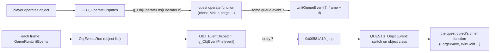

# 0010 — Quest drops, quest rewards and special drops

> **Subsystem:** items/quest-drops
> **Question:** How does quest state change what a kill drops (the MonStats quest TC), which items do the quest
> scripts create outside the treasure-class path (quest items, special drops, NPC rewards), with which draws, and does
> an act boss keep its MonStats level in an expansion Nightmare or Hell game?
> **Date:** 2026-10-15 (Phase 2: 2026-10-16)   **Plan:** 0032 (Phase 1, Phase 1b, Phase 2)   **Status:** open (Phase 1 read from the decompile and the
> disassembly of the pinned `Game.exe`. Phase 1b cross-check in *Leads used*: 17 verdict lines, 1 contradicted,
> the Act I `TCQuestId` labels of src:d2dfg-blizzard, settled by Phase 2. Phase 2 runtime results in
> § Phase 2, run:2026-10-16-quest-drops, and its owner-played addendum (7 sessions, 2026-10-16); review requested;
> plan 0038 batch S2c, 2026-10-16: 10 statements raised and 5 in part, 1 reclassified, one correction,
> [§ Plan 0038 batch S2c](#plan-0038-batch-s2c-2026-10-16))

Names are ours. "Record" of a player is the player's quest record for the game's difficulty (`PlayerData+0x10 +
4·Game+0x6D`, [save/0002](../save/0002-quest-words.md)); "word *q*, bit *s*" is bit `16q + s` of it. Word numbers are
the quest ids of `data:g_QuestDescs@0x00731510`; the source file each quest's code names (`…\Quests\a1q6.cpp`) gives
the act and the quest's place in it. NPC, monster and object ids are `monstats`, `objects` rows; the names given for
them come from the row names of the `.txt` tables and are not used as evidence. "Quest seed" is the 8-byte seed at
`QuestControl+0x18` (§ 1). "Creation record" is the 0x84-byte `struct:ItemCreateRec` ([items/0001 § 8](0001-tc-resolution.md)).
Item flags are `ItemData+0x18` (`0x10` identified, `0x800` socketed, `0x400000` ethereal, `0x1000000` personalized).
Phase 0 (the archivist's quest bits in saves) had not landed, so no `tbl:` anchor below rests on a Phase 0 survey.
Phase 1 was written from the code only; no community text had been read when it was written.

## Answer (summary)

- [C] **B6, the quest TC switch** (run:2026-10-16-quest-drops, single player; the pet, hireling and `exp`-state resolution and "no other party member's record is read" stay `[I]`: no party was run). `MONSTER_DropItems` replaces the chosen TC with `TreasureClass4` of the difficulty
  when the class's `TCQuestId` (`+0x9E`) is non-zero, that column is set, the kill context has a killer, the killer
  resolves to a **player** (§ 2), and that player's own record has **bit 15, bit 1 and bit `TCQuestCP` of word
  `TCQuestId` all clear**. No other party member's record is read. (fn:MONSTER_DropItems@0x005A6600 0x005A6705–0x005A67F1,
  fn:QUESTS_PlayerRecord@0x00543520, fn:QUESTRECORD_GetState@0x0065C310, tbl:MonStats.txt:TCQuestId, tbl:MonStats.txt:TCQuestCP)
- [C] **The drop runs before the quest scripts see the death** (run:2026-10-16-quest-drops). The kill handler sets the monster's death mode
  (`sub_005A7C20_MonSetMode`, call at 0x0057CDC4), whose start function `sub_005A6FF0_MonDeathEvent` drops the items
  at once (0x005A7D67), and only then dispatches the quest death event (0x0057CDD9). So the three tests read the
  killer's bits **before** the boss's own quest script sets them for this kill. (fn:sub_0057CCB0_UnitKilled@0x0057CCB0,
  fn:sub_005A7C20_MonSetMode@0x005A7C20, fn:QUESTS_MonsterDeathEvent@0x00543A30)
- [C] **What the three bits mean per boss** (`[C]` for the states run:2026-10-16-quest-drops tested: Andariel with the word clear or bit 0 only, taken, and bits 1 and 15, not taken; Duriel clear or bit 0 only, taken, and bit 5, not taken; Mephisto clear, taken, and bit 0 set, not taken (owner-played addendum); and the kill-time writes of Andariel's bit 1 and Duriel's bit 5. Warriv's turn of bit 1 into bit 0, "never cleared", Mephisto's own kill-time bit 0, and Diablo and Baal done stay `[I]`) (the five classes with a `TCQuestId`, `TCQuestCP` from the data):
  bit 1 is "done in a game, reward not yet taken", bit 15 is set by the save loader when bit 1 was saved
  ([save/0002 § 1](../save/0002-quest-words.md)) and never cleared, and bit `TCQuestCP` is each script's own marker.
  Andariel (word 6, CP 1): her script sets bit 1 at the kill and Warriv's talk turns bit 1 into bit 0, so the quest TC
  is used again in every later game **once the quest is reported in the game it was done in**, and never again if the
  game was saved before the report. Duriel (14, CP 5): bit 5 is set at the kill and never cleared, so the quest TC is
  used until the first kill. Mephisto (22), Diablo (26) and Baal (40) (CP 0): the kill sets bit 0, so the quest TC is
  used until the first kill. (§ 3; fn:sub_00596210_A1Q6_SetKilled@0x00596210, fn:sub_00595C60_A1Q6_NpcMessage@0x00595C60,
  fn:sub_0059D050_A2Q6_DurielDeath@0x0059D050, fn:sub_005BC140_A3Q6_SetDone@0x005BC140, fn:QUESTRECORD_LoadBytes@0x0065C4D0)
- [I] **Killer resolution.** A non-player killer becomes the player that owns it: a monster's owner (summons,
  hirelings: `sub_0058F0D0_MonsterOwner`), overridden by the caster of a state whose `States.txt` `exp` column is set
  (conversion, attract, confuse in the shipped data) when the killer carries one. A killer that still is not a player
  (a wild monster, a missile with no owner) keeps the normal TC. (fn:sub_0063A690_UnitHasExpState@0x0063A690,
  fn:sub_00625760_StatListFindFlag@0x00625760, `states.txt` column `exp`)
- [C] **Special drops are scripted, with their own draws on the quest seed** (run:2026-10-16-quest-drops and its
  owner-played addendum: Andariel's gems; the Hellforge's waves and rune in Normal, Nightmare and Hell; the Cow King's
  eight `vps` for a qualifying killer, which take no draw; the Countess killed in four states, quest done or not, Normal
  and Nightmare, for the last sentence. Baal's gold, the classic forge without a rune, the Cow King's two refusals and the Countess in Hell stay `[I]`).
  Andariel's death drops two chipped gems
  or skulls and one standard gem or skull for a killer with bits 0 and 1 clear; the Cow King's death drops eight
  stamina potions (`vps`); the Hellforge drops four waves of gems (perfect, flawless, flawless, standard) and, in an
  expansion game, one rune of `r01`–`r11` / `r12`–`r22` / `r15`–`r25` by difficulty (`Range(11)`); Baal's first kill
  drops a gold pile per qualifying player. Each draw is one step of the quest seed (the Cow King's potions take none). The Countess has **no quest
  dependence** in her drop: her class has no `TCQuestId`, and her quest script creates no item. (§ 4;
  fn:sub_005965A0_A1Q6_AndarielDeath@0x005965A0, fn:sub_00593E70_A1Q4_CowKingDeath@0x00593E70,
  fn:sub_005B6710_A4Q3_ForgeWave@0x005B6710, fn:sub_0058DF20_A5Q6_BaalDeath@0x0058DF20, fn:QUESTS_GetSeed@0x005438B0)
- [I] **Quest items** come from the quest scripts through two creators: `sub_00559A30_DropItemAtUnit` (the code in
  the source unit's `+0xB8`, normal or unique quality, ilvl from the source unit) and `QUESTS_GiveItem` (into the
  inventory, or dropped when it is full). A script counts the players that still need the item and creates that many
  copies. "Needs" is `sub_00558110_PlayerFindItemByCode`, which ignores a quest item with `questdiffcheck` whose stat
  356 (set to the game difficulty when the item is created) is below the current difficulty. (§ 5, tbl:Misc.txt:questdiffcheck)
- [I] **Rewards.** All three NPC item services live in `NPC_MenuAction`: Charsi's imbue creates a
  **new** rare (quality 6) of the same base with **ilvl = clvl, +4 when clvl > 5**, on fresh seeds; Larzuk's socket
  copies the item and requests `max` sockets (low, normal, superior), `1 + RangeB(item seed, min(max, 2))` (magic) or 1
  (set, rare, unique, crafted, 9); Anya copies the item and writes the player's name (flag `0x1000000`); all three repair and recharge the result.
  Akara, Ormus, Malah, Anya (Prison of Ice) and Qual-Kehk give fixed or difficulty-tiered items; the Ancients and Nihlathak
  create none. (§ 6; fn:NPC_MenuAction@0x00579D60, fn:QUESTS_GiveItem@0x005466B0)
- [C] **The `boss` exception of monsters/pool E4** (run:2026-10-16-quest-drops: Andariel in Nightmare and Hell) is the byte test `MonStats+0x00C & 0x40` next to `& 0x04`
  (`noRatio`) at 0x00573E32–0x00573E40: a `boss` class keeps `Level(N)`/`Level(H)` in an expansion Nightmare or Hell
  game. The 25 `boss` classes and the Phase 2 case set are in § 7. (fn:sub_00573CB0_MonStatsInit@0x00573CB0, tbl:MonStats.txt:boss)

## Leads used

The lead pages were fetched and read **after** the walkthrough below was written (Phase 1 was committed first). One
verdict per compared claim.

- [L] src:pd-item-generation: a quest boss drops from `TreasureClass4` the first time it is killed in a difficulty and
  from `TreasureClass3` after that. **held with refinement**
  Detail: true for Duriel, Mephisto, Diablo and Baal (§ 3); Andariel differs, next line. The switch also replaces a
  champion or superunique TC, whichever was chosen ([items/0001](0001-tc-resolution.md) § 3).
- [L] src:pd-item-generation: after Andariel is killed and the player talks to an NPC, she drops from her quest TC
  after every following kill. **held**
  Detail: `TCQuestCP` = 1 makes the test "bits 1 and 15 clear"; Warriv's message turns bit 1 into bit 0 (§ 3).
- [L] src:almars-andariel-farming: kill Andariel, take the town portal, talk to Warriv and Go East, save and exit at once:
  the quest drop stays; "any improper action" spoils it. **held with refinement**
  Detail: by the code the report alone does it (bit 0 set, bit 1 cleared); what spoils it is a save while bit 1 is
  still set (bit 15 for good). The first kill gives the quest TC in any case (§ 2, order).
- [L] src:d2dfg-blizzard: `TCQuestId`: `TreasureClass4` is used when the player does not have the quest progress;
  `TCQuestCP` names the checkpoint. **held with refinement**
  Detail: three fixed tests, bits 15 and 1 always and `TCQuestCP`; the record is the resolved killer's (§ 2).
- [L] src:d2dfg-blizzard: checkpoint codes 0 "History Success", 1 "History Earned Reward", 13 "Current Game Success",
  14 "Current Game Failure", 15 "Previous Game". **held with refinement**
  Detail: bit 15 is the loader's copy of a saved bit 1 (§ 3); bits 13 and 14 are cleared on load.
- [L] src:d2dfg-blizzard: the `TCQuestId` value list: 6 "The Forgotten Tower", 7 "Sisters to the Slaughter", 13 "The
  Summoner", 14 "The Seven Tombs". **contradicted** (Act I)
  Detail: word 6 is `a1q6.cpp` (Andariel's level 37, Warriv's report), word 5 `a1q5.cpp` (the Countess's hook 5), and
  the data gives `andariel` `TCQuestId` 6. The guide's Act I labels are one higher, like Misc `quest` (quest object id + 1,
  which equals word + 1 only in Act I, § 5 "What Misc/Weapons `quest` indexes"); its Act II labels match. Backlog 2026-10-15; settled by the Andariel B6 case of Phase 2.
- [L] src:d2dfg-blizzard: `questdiffcheck` ties a quest item to the current difficulty. **held**
  Detail: stat 356 = difficulty at creation, compared in `sub_00558110_PlayerFindItemByCode` (§ 5).
- [L] src:arreat-summit-quest-pages: imbue makes a new rare from the base; the character level decides its properties.
  **held** Detail: `rec.ilvl` from clvl, fresh seeds (§ 6).
- [L] src:wikiwiki-d2r-imbue: the affix level is "clvl+4 or qlvl, whichever is higher". **held with refinement**
  Detail: the imbue sets ilvl = clvl + 4 only when clvl > 5 (else clvl); the "qlvl" part is the rare build's affix
  level ([items/0005](0005-affixes.md)), not this function. clvl ≤ 5 cannot reach the imbue on stock data (the Malus
  needs clvl ≥ 8, § 5). The page describes D2R.
- [L] src:wikiwiki-d2r-imbue: only normal items, never socketed ones; ethereal is kept. **held with refinement**
  Detail: low and superior bases pass too (qualities 1–3); ethereal is forced by record flag `0x04` and flag word `+0x44`.
- [L] src:arreat-summit-quest-pages: Larzuk gives regular items their maximum sockets, magic items 1 or 2, set, rare,
  unique and crafted items 1. **held**
  Detail: `1 + RangeB(item seed, min(max, 2))` for magic, then `ITEMS_SetSockets`' caps (§ 6).
- [L] src:arreat-summit-quest-pages: personalization adds the name, and the item is also repaired and recharged; only
  armor and weapons, not quest items or throwing potions. **held**
  Detail: Phase 1 had written "nothing else"; re-reading the shared tail of the three services shows
  `sub_005761C0_ItemRepairAll` (stack, charges, durability, broken flag) and `sub_0055FE00_ItemIdentifyAttach` on the
  result of all three. Corrected in § 6. Bases 5–7 and `Nameable` 0 are refused.
- [L] src:arreat-summit-quest-pages, src:gamebanshee-d2-quests: the Hellforge gives four random gems from normal to
  perfect and, in the expansion, one rune: El–Amn, Sol–Um, Hel–Gul. **held with refinement**
  Detail: one perfect, two flawless and one standard **per counted player**, then one rune per game (§ 4).
- [L] src:arreat-summit-quest-pages: the cow portal needs Eve of Destruction on the same difficulty; a cow-quester who
  kills the King loses the recipe; the King "always drops 8 x Stamina Potion" for the quest. **held with refinement**
  Detail: a classic game tests Terror's End (word 26) instead; the potions drop only when the killer qualifies (§ 4).
- [L] src:gamebanshee-d2-quests: Qual-Kehk gives three runes, Ral, Ort and Tal. **held with refinement**
  Detail: `r07 r08 r09`, but only the first 1 or 2 when word 36 bit 7 or bit 6 is set (§ 6).
- [L] src:gamebanshee-d2-quests: a ring from Akara; a rare ring from Ormus; a class-specific item from Anya. **held with
  refinement** Detail: Akara's ring is magic in Normal; both rings have a fixed ilvl per difficulty; Anya's item is rare
  at clvl from a per-class table (§ 6).
- [L] src:pd-item-generation: the Countess drops from `Countess Item` and `Countess Rune`. **not covered**
  Detail: the TC walk is items/0001's; this finding claims only that no quest state enters her drop, which the page
  does not contradict.
- **Not covered** by any source read: Andariel's three gems, Baal's first-kill gold, the quest chests' gold, the
  killer resolution through `exp` states, and the drop-before-script order.

## Functions

| Address | Name | Role | Tag |
|---|---|---|---|
| `0x005A6600` | `MONSTER_DropItems` | TC column choice; B6 quest switch (existing row) | I |
| `0x00543520` | `QUESTS_PlayerRecord` | `(game, player)` → `PlayerData+0x10 + 4·Game+0x6D` | C (H6d) |
| `0x006221A0` | `UNIT_GetPlayerData` | `Unit+0x14` of a player unit (asserts type 0) (existing row, player/0001) | I |
| `0x0063A690` | `sub_0063A690_UnitHasExpState` | unit carries a state of the `exp` state mask (`DataTables+0x144`) | I |
| `0x0063A130` | `sub_0063A130_UnitHasStateInMask` | any bit of the unit's state mask in a state bit-set (EAX unit, EBX set) | I |
| `0x00611D60` | `sub_00611D60_StatesMaskBuild` | states loader: bit-set *i* = states whose flag bit *i* is set | I |
| `0x00625760` | `sub_00625760_StatListFindFlag` | the unit's first stat list with a flag (`0x800` here) | I |
| `0x00625250` | `sub_00625250_StatListOwnerType` | stat list `+0x08` (6 if none) | I |
| `0x006252B0` | `sub_006252B0_StatListOwnerGuid` | stat list `+0x0C` | I |
| `0x0057CCB0` | `sub_0057CCB0_UnitKilled` | kill: death mode (drop) first, then the quest death event | C |
| `0x005A7C20` | `sub_005A7C20_MonSetMode` | sets a monster mode and calls the mode's start function | I |
| `0x005A78A0` | `sub_005A78A0_MonModeRecord` | the mode's function record (table `0x006E2260`) | C (H6d) |
| `0x00545D80` | `QUESTS_InitGame` | one quest object per `g_QuestDescs` row, the quest seed, the game record | C |
| `0x005438B0` | `QUESTS_GetSeed` | `QuestControl+0x18` (run:2026-10-16-quest-drops: all 28 fetches) | C |
| `0x00543640` | `QUESTS_FindById` | quest object by id (`Quest+0x00`) | I |
| `0x005436B0` | `QUESTS_HookMonster` | the "quest hook" of special monsters: registers a monster with a quest | I |
| `0x005438E0` | `QUESTS_DispatchEvent` | calls `Quest+0xA0 + 4·event` of every quest object | I |
| `0x005439A0` | `QUESTS_DispatchUnitEvent` | same, for the quests registered on a unit (`Unit+0x74`) | I |
| `0x00543A30` | `QUESTS_MonsterDeathEvent` | event 8 for a dying monster, killer resolved to a player | C (H6d) |
| `0x0058F090` | `sub_0058F090_MonsterOwnerRef` | a monster's owner as (type, GUID) from MonsterData `+0x28`: `+0x2C`, `+0x30` (−1 for none); the death event finds the unit by it | C (H6d) |
| `0x00543BD0` | `sub_00543BD0_QuestsInvItemEvent` | each inventory item with `quest` ≠ 0: event 9 (`Quest+0xC4`) of quest object `quest − 1`; then event 1 (§ 5) | I |
| `0x00555D20` | `sub_00555D20_ItemQuestHook` | sets identified; an item with `quest` ≠ 0 is registered with quest object `quest − 1` (`QUESTS_HookMonster`) (§ 5) | I |
| `0x0055CC90` | `sub_0055CC90_ItemQuestGate` | per-code and per-`quest` refusals of a quest item for a player, four item-move callers (§ 5) | I |
| `0x005449E0` | `QUESTS_ObjectEvent` | object **event 7** of the quest objects, by object class (§ 9; `QUESTS_ObjectOperate` until 2026-10-16) | I |
| `0x00581A10` | `sub_00581A10_ObjEvent7Thunk` | entry 7 of `g_ObjEventFns`: `jmp QUESTS_ObjectEvent` (§ 9) | I |
| `0x00586AD0` | `OBJ_EventDispatch` | `g_ObjEventFns[event](game, object)` for an object event without its own callback (§ 9) | I |
| `0x00541160` | `sub_00541160_ObjEventsRun` | runs the object event list (list 3) of the current frame (§ 9) | I |
| `0x005414D0` | `sub_005414D0_GameRunUnitEvents` | per frame: the five unit-type event lists (§ 9) | I |
| `0x005417D0` | `sub_005417D0_UnitQueueEvent` | queues event `e` on a unit at a frame, no callback (§ 9) | I |
| `0x005537D0` | `sub_005537D0_GameForEachUnit` | calls a function on each unit of a type in the game (skips state 7 `playerbody`) | I |
| `0x00540510` | `sub_00540510_PartyForEach` | calls a function on each member of a party | I |
| `0x00559A30` | `sub_00559A30_DropItemAtUnit` | creates the item coded at `source+0xB8` (or a random base) at the source, quality given | I |
| `0x00559CE0` | `ITEMS_CreateForStore` | creation record for an item index, quality, ilvl; ItemCreate (existing row, items/0009) | I |
| `0x005466B0` | `QUESTS_GiveItem` | item by code into the player's inventory, or dropped at the player | I |
| `0x00558110` | `sub_00558110_PlayerFindItemByCode` | cursor or inventory item with a code; quest items with `questdiffcheck` count only at stat 356 ≥ difficulty | I |
| `0x00544160` | `sub_00544160_PlayerRemoveItemByCode` | removes that item | I |
| `0x00585970` | `sub_00585970_DropItemCodeAt` | creates an item by code at a unit (used for `gld`) | I |
| `0x0055A090` | `sub_0055A090_DropGoldAmount` | gold piles of a given amount at a unit | C (H6d) |
| `0x0055B030` | `sub_0055B030_DropGold` | `DropGoldAmount(amount, max 32 piles)` | C (H6d) |
| `0x00579D60` | `NPC_MenuAction` | NPC menu actions: imbue (154), socket (511), personalize (512), act travel (existing row, items/0009) | I |
| `0x00558270` | `sub_00558270_ItemCreateRecFromItem` | fills a creation record from an existing item | I |
| `0x0055EEA0` | `sub_0055EEA0_CursorItemConsume` | removes the item on the player's cursor | I |
| `0x0062C590` | `sub_0062C590_ItemCanImbue` | imbue test | I |
| `0x0062C6A0` | `sub_0062C6A0_ItemCanPersonalize` | personalize test | I |
| `0x0062C770` | `sub_0062C770_ItemCanQuestSocket` | Larzuk test | I |
| `0x00629C80` | `sub_00629C80_ItemMagicStockable` | `bitfield1` (`+0xDC`) bit 0 of the item record (existing row, items/0009) | I |
| `0x00628370` | `sub_00628370_ItemSetPersonalName` | copies a name to `ItemData+0x4A` | C |
| `0x005761C0` | `sub_005761C0_ItemRepairAll` | stack, charges, broken flag, durability to maximum | I |
| `0x0055FE00` | `sub_0055FE00_ItemIdentifyAttach` | identified flag; attach socketed items | I |
| `0x00591790` | `sub_00591790_A1Q3_ImbueDone` | word 3: set bit 0, clear bit 1 | I |
| `0x005877C0` | `sub_005877C0_A5Q1_SocketDone` | word 35: set bit 0, clear bit 1 | I |
| `0x0058BC00` | `sub_0058BC00_A5Q4_PersonalizeDone` | word 38: set bit 0, clear bit 1 | I |
| `0x00591AC0` | `sub_00591AC0_A1Q3_MalusDrop` | Malus (`hdm`) from its object | I |
| `0x005965A0` | `sub_005965A0_A1Q6_AndarielDeath` | Andariel's death: bits, three gems | C |
| `0x00596210` | `sub_00596210_A1Q6_SetKilled` | word 6 bits 13 and 1 | I |
| `0x00595C60` | `sub_00595C60_A1Q6_NpcMessage` | Warriv: word 6 bit 1 → bit 0 | C (H6d) |
| `0x00595710` | `sub_00595710_A1Q5_CountessDeath` | the Countess's death: word 5 bits, no item | I |
| `0x00593E70` | `sub_00593E70_A1Q4_CowKingDeath` | the Cow King's death: word 4 bit 10, eight `vps` | I |
| `0x00593AF0` | `sub_00593AF0_A1Q4_InifussDrop` | Scroll of Inifuss (`bks`) from the tree | I |
| `0x00594630` | `sub_00594630_A1Q4_WirtGold` | Wirt's body: 10–19 gold piles | I |
| `0x00592250` | `sub_00592250_A1Q4_NpcMessage` | Akara's ring, the deciphered scroll | I |
| `0x00583E70` | `sub_00583E70_WirtLegDrop` | `leg` from its object | I |
| `0x00599020` | `sub_00599020_A2Q1_RadamentDeath` | Book of Skill (`ass`) per qualifying player | I |
| `0x00599C10` | `sub_00599C10_A2Q2_ScrollChest` | `tr1` chest | I |
| `0x00599CF0` | `sub_00599CF0_A2Q2_StaffChest` | `msf` chest | I |
| `0x00599DF0` | `sub_00599DF0_A2Q2_CubeChest` | `box` chest | I |
| `0x0059A7E0` | `sub_0059A7E0_A2Q3_ViperChest` | `vip` chest | I |
| `0x0059D050` | `sub_0059D050_A2Q6_DurielDeath` | Duriel's death: word 14 bit 5 | I |
| `0x005B7A60` | `sub_005B7A60_A3Q1_TomeDrop` | `bbb` from its object | I |
| `0x005B8860` | `sub_005B8860_A3Q2_HeartChest` | `qhr` chest | I |
| `0x005B8940` | `sub_005B8940_A3Q2_EyeChest` | `qey` chest | I |
| `0x005B8A20` | `sub_005B8A20_A3Q2_BrainChest` | `qbr` chest | I |
| `0x005B9980` | `sub_005B9980_A3Q3_GidbinnDrop` | `g33` from a dying monster | I |
| `0x005B9240` | `sub_005B9240_A3Q3_NpcMessage` | Ormus's rare ring | I |
| `0x005BAB60` | `sub_005BAB60_A3Q4_FigurineDrop` | `j34` from a dying monster | I |
| `0x005BA320` | `sub_005BA320_A3Q4_NpcMessage` | `g34`, `xyz` | I |
| `0x005BBC00` | `sub_005BBC00_A3Q5_CouncilDeath` | `qf1`, then `box` | I |
| `0x005BC8B0` | `sub_005BC8B0_A3Q6_MephistoDeath` | Mephisto's death: soulstones | I |
| `0x005BC140` | `sub_005BC140_A3Q6_SetDone` | word 22 bits 13, 0, 11 | I |
| `0x005B52E0` | `sub_005B52E0_A4Q2_DiabloDeath` | Diablo's death: bits, no item | I |
| `0x005B5C10` | `sub_005B5C10_A4Q3_ForgeOperate` | Hellforge: soulstone, three hammer strikes | C |
| `0x005B6710` | `sub_005B6710_A4Q3_ForgeWave` | Hellforge: a gem wave per event, then the rune | C |
| `0x005B65D0` | `sub_005B65D0_A4Q3_HammerDrop` | `hfh`, unique | I |
| `0x00587B00` | `sub_00587B00_A5Q2_NpcMessage` | Qual-Kehk's runes | I |
| `0x00589580` | `sub_00589580_A5Q3_NpcMessage` | Malah's `ice`/`tr2`, Anya's class item | I |
| `0x0058DF20` | `sub_0058DF20_A5Q6_BaalDeath` | Baal's death: gold per qualifying player | C (H6d) |
| `0x005E0070` | `sub_005E0070_UberTristramDrop` | after three uber deaths: `cm2` unique and `std` per player | I |

Data: `data:g_AndarielChippedGems@0x007361DC`, `data:g_AndarielStdGems@0x00736444`,
`data:g_ForgeGemsPerfect@0x0073E56C`, `data:g_ForgeGemsFlawless@0x0073E588`, `data:g_ForgeGemsStandard@0x0073E5A4`,
`data:g_ForgeRunesNormal@0x0073E114`, `data:g_ForgeRunesNightmare@0x0073E514`, `data:g_ForgeRunesHell@0x0073E540`,
`data:g_QualKehkRunes@0x00732FEC`, `data:g_AnyaRewardsNormal@0x00735F6C`, `data:g_AnyaRewardsNightmare@0x00735EFC`,
`data:g_AnyaRewardsHell@0x00735F34` (§ 4–6).

## Walkthrough

### 1. Quest objects, events and the quest seed

- [I] `QUESTS_InitGame` (game in ECX) allocates one 0xF8-byte quest object per `g_QuestDescs` row (and per row of a
  second table at `0x0073188C`, count `0x007318AC`): `+0x00` quest object id, `+0x04` game, `+0x08` act, `+0x09`
  active, `+0xF4` next, then calls the row's init function, which fills the callbacks at `+0xA0 + 4·event`, the record
  word at `+0xE0` and private data at `+0x18`. Then the quest control (`Game+0x10F4`): `+0x00` list head, `+0x0C` the
  game-wide record (`QUESTRECORD_Alloc`), `+0x18` the **quest seed**, seeded by `RNG_SeedInit(seed, low dword of one
  LCG step of the game seed Game+0xD0)` (the game seed is advanced). (fn:QUESTS_InitGame@0x00545D80 0x00545F10–0x00545F5F,
  fn:QUESTS_GetSeed@0x005438B0, struct:Game+0xD0)
- [C] **That step is game-seed draw 4.** Game creation calls `sub_00547D20_MonRegionsInit` (draw 1), `OBJRGN_Create`
  (draw 2), `NPCSTORE_CtlCreate` (draw 3, the store and NPC seed of [items/0009 § 1](0009-vendors.md#1-store-records-and-the-store-seed-game-creation))
  and then `QUESTS_InitGame`, one step each. In all 53 session logs of run:2026-10-16-quest-drops the game seed that
  `QI0` logs at `QUESTS_InitGame`'s entry is exactly three steps past `Init(N)` of the session's `-seed N` (counted
  with `tools/rng.py`'s step from the logs, 2026-10-16, lane `rbl`), so its own step is draw 4, and the player's unit
  seed is draw 5 ([rng/0002](../rng/0002-seed-tree.md#other-seed-sites-seen-not-yet-followed)). (fn:QUESTS_InitGame@0x00545D80,
  fn:NPCSTORE_CtlCreate@0x00536070, fn:sub_00530BF0_GameCreate@0x00530BF0, run:2026-10-16-quest-drops)
- [I] Every quest-seed draw in this finding is the LCG step `s ← lo·0x6AC690C5 + hi` inlined, then `low32(s) mod n`
  (unsigned; the compiler's multiply-shift for 7 and 5) or `RNG_Range`/`RNG_RandLoHi` on the same seed. The quest seed
  is also drawn by quest code that creates no item (0x0058E830, 0x00592E90, 0x0059B1C0, 0x0059EDC0, 0x005BD390), so
  its state at a drop depends on the game's quest history. (fn:QUESTS_GetSeed@0x005438B0, fn:RNG_Range@0x0045C390,
  fn:RNG_RandLoHi@0x004BC500)
- [I] Events: `QUESTS_DispatchEvent` calls `Quest+0xA0 + 4·event` of each quest object (of the event unit's act, when
  asked). Monsters registered with a quest (`QUESTS_HookMonster`, the "quest hook N" of
  [monsters/0003](../monsters/0003-special-monsters.md)) carry a list at `Unit+0x74`, and
  `QUESTS_MonsterDeathEvent` sends **event 8** (`Quest+0xC0`) to those quests with an event block `{game, 8,
  monster, killer player}`; a pet's or hireling's kill is resolved to its owner first (`0x0058F090`). (fn:QUESTS_DispatchEvent@0x005438E0,
  fn:QUESTS_DispatchUnitEvent@0x005439A0, fn:QUESTS_MonsterDeathEvent@0x00543A30 0x00543A6B, fn:QUESTS_HookMonster@0x005436B0)

### 2. B6: the quest TC switch and the killer

```c
// fn:MONSTER_DropItems@0x005A6600, 0x005A6705–0x005A67F1 (trimmed; ECX game, ctx = arg 4)
tc = <TreasureClass1..3 or the superunique TC, items/0001 §3>;
if (mon->TCQuestId /*+0x9E u8*/ && mon->tc[diff][3] /*+0x8C + 8·diff u16*/ && ctx && (k = ctx->killer /*+8*/)) {
    if (k->type != 0) {                                          // not a player
        p = sub_0058F0D0_MonsterOwner(k);                         // monster → its owner unit, else 0
        if (sub_0063A690_UnitHasExpState(k)                       // state of the `exp` mask
            && (sl = sub_00625760_StatListFindFlag(k, 0x800)))
            p = sub_00552F60_GameFindUnit(game, OwnerType(sl) /*+8*/, OwnerGuid(sl) /*+0xC*/);
        if (p) k = p;
    }
    if (k->type == 0 && (r = QUESTS_PlayerRecord(game, k))
        && GetState(r, TCQuestId, 15) != 1 && GetState(r, TCQuestId, 1) != 1
        && GetState(r, TCQuestId, TCQuestCP /*+0x9F u8*/) != 1)
        tc = mon->tc[diff][3];                                    // TreasureClass4 / (N) / (H)
}
TC_DropByIndex(game, mon, ctx->killer, tc, ...);                  // the original killer, not k
```

- [I] The record read is the resolved player's own (`QUESTS_PlayerRecord(game, k)` = `UNIT_GetPlayerData(k) +
  0x10 + 4·Game+0x6D`). The party is not consulted; in a party only the player credited with the kill decides. The
  TC walk itself still receives the **unresolved** killer (`ctx+8`), as before. (fn:QUESTS_PlayerRecord@0x00543520,
  fn:UNIT_GetPlayerData@0x006221A0, fn:MONSTER_DropItems@0x005A6600 0x005A6817)
- [I] The state test: `sub_0063A690_UnitHasExpState` loads the bit-set at `DataTables+0x144` and calls
  `sub_0063A130_UnitHasStateInMask`, which ANDs it with the unit's state mask (`statlist+0x58`) word by word over
  `(nStates + 31) / 32` words. The states loader builds 40 bit-sets at `DataTables+0xCC + 4i`, set *i* holding the
  states whose flag bit *i* is set (`sub_00611D60_StatesMaskBuild`); set 30 (`0x144`) is the flag bit the loader's
  descriptor gives the column `exp`. In the shipped `states.txt` that column is 1 on rows 53 `conversion`, 57
  `attract` and 59 `confuse`. (fn:sub_0063A690_UnitHasExpState@0x0063A690, fn:sub_0063A130_UnitHasStateInMask@0x0063A130,
  fn:sub_00611D60_StatesMaskBuild@0x00611D60, 0x00618B77, `states.txt` column `exp`)
- [I] The owner of the flagged stat list is found by its stored type and GUID (`sub_00625250_StatListOwnerType`,
  `sub_006252B0_StatListOwnerGuid`, then `sub_00552F60_GameFindUnit`); the flag `0x800` is the stat-list flag of
  those states' lists, read here only. (fn:sub_00625250_StatListOwnerType@0x00625250, fn:sub_006252B0_StatListOwnerGuid@0x006252B0,
  fn:sub_00552F60_GameFindUnit@0x00552F60)
- [I] A missile is never resolved here: `sub_0058F0D0_MonsterOwner` answers only for unit type 1 (monsters). Whether
  the kill context's killer is ever a missile rather than its owner is left open. (fn:sub_0058F0D0_MonsterOwner@0x0058F0D0)

**Order of the drop and the quest scripts.**

```text
sub_0057CCB0_UnitKilled (monster):                     [I] (fn:sub_0057CCB0_UnitKilled@0x0057CCB0)
  0x0057CDC4  sub_005A7C20_MonSetMode(game, {mode 0 …}, 1)
                └ 0x005A7D4C sub_005A78A0_MonModeRecord → record of mode 0 (table 0x006E2260: start = sub_005A6FF0_MonDeathEvent)
                └ 0x005A7D67 call start → MonDeathDrop → MONSTER_DropItems (B6 reads the killer's bits)
  0x0057CDD9  QUESTS_MonsterDeathEvent → each registered quest's Quest+0xC0 (the script sets this kill's bits)
```

- [I] So for Andariel and Duriel the bits their scripts set at the kill (bit 1, bit 5) cannot hide the quest TC of the
  kill that sets them. `sub_005A78A0_MonModeRecord` also reads `MonStats+0x1A5` and may pick another table; that the
  five quest-TC classes use the standard table is not checked. (fn:sub_0057CCB0_UnitKilled@0x0057CCB0,
  fn:sub_005A7C20_MonSetMode@0x005A7C20, fn:sub_005A78A0_MonModeRecord@0x005A78A0, fn:sub_005A6FF0_MonDeathEvent@0x005A6FF0)

### 3. The three bits for the five quest-TC classes

`TCQuestId`/`TCQuestCP` in the merged `monstats.txt` (the only non-zero `TCQuestId` rows):

| class | `hcIdx` | `TCQuestId` | `TCQuestCP` | `TreasureClass4` / (N) / (H) |
|---|---|---|---|---|
| `andariel` | 156 | 6 | 1 | `Andarielq` / `Andarielq (N)` / `Andarielq (H)` |
| `duriel` | 211 | 14 | 5 | `Durielq` … |
| `mephisto` | 242 | 22 | 0 | `Mephistoq` … |
| `diablo` | 243 | 26 | 0 | `Diabloq` … |
| `baalcrab` | 544 | 40 | 0 | `Baalq` … |

- [I] **Bit 15.** No code sets bit 15 of a player record except the save loader (`QUESTRECORD_LoadBytes`: bit 1 → bit
  15 for words 0–41) and nothing clears it except one call for word 9 (0x00599293); the setter dump of
  `QUESTRECORD_SetState` with constant arguments shows bit 15 only in `sub_00546270_QuestsPlayerJoin` (the game-wide
  record). So bit 15 means "this character saved the game with bit 1 set". (fn:QUESTRECORD_LoadBytes@0x0065C4D0,
  fn:sub_00546270_QuestsPlayerJoin@0x00546270, fn:QUESTRECORD_SetState@0x0065C360)
- [I] **Andariel (word 6).** Her death callback (`Quest+0xC0` = `sub_005965A0_A1Q6_AndarielDeath`) sets bits 13 and 1
  of the killer when bits 0 and 1 are clear, and later per-player callbacks do the same for players in level 37 with
  bits 0 and 15 clear and for the killer's party in Act I. Warriv (npc 155, message `0xB7`) with bit 1 set clears bit
  1 and sets bit 0. Nothing else writes bits 0, 1 or 15 of word 6. With `TCQuestCP` = 1, the test is "bits 1 and 15
  clear", so: **first kill → quest TC; a later kill in the same game before the report → normal TC; after the report
  (bit 0, bit 1 clear) → quest TC in every later game; a save between the kill and the report → bit 15 → normal TC for
  good.** (fn:sub_005965A0_A1Q6_AndarielDeath@0x005965A0, fn:sub_00596210_A1Q6_SetKilled@0x00596210,
  fn:sub_00595C60_A1Q6_NpcMessage@0x00595C60 0x00595D92, 0x00595D9C)
- [I] **Duriel (word 14).** `sub_0059D050_A2Q6_DurielDeath` sets bit 5 of the killer (and of players in level 73 and of
  the killer's party in Act II) when bits 0, 3, 4 and 5 are clear. The NPC script later sets bits 4, 0, 6–11 and clears
  3 and 4; bit 5 is never cleared and bit 1 is never set. So the quest TC is used until the first Duriel kill in that
  difficulty, then never. (fn:sub_0059D050_A2Q6_DurielDeath@0x0059D050, 0x0059CD2F–0x0059CEA5)
- [I] **Mephisto (22), Diablo (26), Baal (40)** (`TCQuestCP` = 0, the test is bits 0, 1, 15): the death scripts set
  bit 0 (with 13 and others) on the killer and qualifying players: Mephisto `sub_005BC140_A3Q6_SetDone` (bits 13, 0,
  11); Diablo through `0x005B4D20` (13, 0, 6, 7); Baal through `0x0058DC60`/`0x0058DD30` (0, 13). So the quest TC is
  used until the first kill. (fn:sub_005BC8B0_A3Q6_MephistoDeath@0x005BC8B0, fn:sub_005BC140_A3Q6_SetDone@0x005BC140,
  fn:sub_005B52E0_A4Q2_DiabloDeath@0x005B52E0, fn:sub_0058DF20_A5Q6_BaalDeath@0x0058DF20)
- Phase 2 cases (B6 taken and not taken): Andariel fresh (quest TC), Andariel again in the same game (normal), Andariel
  after the report in a new game (quest TC), Andariel with bit 15 (normal); Duriel fresh and with bit 5; Mephisto fresh
  and with bit 0; a kill by a hireling or a Necromancer's golem with the owner fresh (quest TC); a party kill where only
  the non-killer is fresh (normal).

### 4. Special drops

**Andariel's gems** (`sub_005965A0_A1Q6_AndarielDeath`, event 8, quest active, the killer present with word 6 bits 0
and 1 clear):

```text
SetKilled(killer record)                                   ; bits 13, 1
repeat 2: s ← LCG(quest seed); monster+0xB8 ← g_AndarielChippedGems[low32(s) mod 7]   ; gcv gcr gcb gcy gcg gcw skc
          DropItemAtUnit(quality 2, source = Andariel)
s ← LCG(quest seed); monster+0xB8 ← g_AndarielStdGems[low32(s) mod 7]                 ; gsv gsr gsb gsy gsg gsw sku
DropItemAtUnit(quality 2); monster+0xB8 ← 0
```

- [I] Every difficulty, every game type. The ilvl is Andariel's level (stat 12). No gem drops for a killer who already
  has bit 0 or bit 1. (0x00596639–0x00596730, data:g_AndarielChippedGems@0x007361DC, data:g_AndarielStdGems@0x00736444,
  fn:sub_00559A30_DropItemAtUnit@0x00559A30)

**The Countess** (quest hook 5): her death callback `sub_00595710_A1Q5_CountessDeath` sets word 5 bits for the
players and arms a timer; it creates no item.

- [C] (owner-played addendum of run:2026-10-16-quest-drops: one kill in each of the four states, quest done or not,
  Normal and Nightmare; Hell's `Countess (H)` not run and `[I]`) Her drop is her superunique TC (`Countess`,
  `Countess (N)`, `Countess (H)`); her class `corruptrogue3` has
  `TCQuestId` 0, so B6 never applies and her drop has no quest dependence in this binary. The rune picks are inside
  that TC tree ([TreasureClassEx](../../tables/TreasureClassEx.md)). (fn:sub_00595710_A1Q5_CountessDeath@0x00595710,
  fn:MONSTER_DropItems@0x005A6600, tbl:SuperUniques.txt:TC, tbl:MonStats.txt:TCQuestId)

**The Cow King** (quest hook 4, `sub_00593E70_A1Q4_CowKingDeath`):

```text
if killer: if killer word 4 bit 10: return                                  ; already credited: nothing at all
           if not (classic ? word 26 bit 0 : word 40 bit 0): return         ; Diablo (classic) / Baal (expansion) not done
           set killer word 4 bit 10
for each player: 0x00593E30 ; then
monster+0xB8 ← 'vps '; repeat 8: DropItemAtUnit(quality 0, source = Cow King)
```

- [C] for a qualifying killer (owner-played addendum of run:2026-10-16-quest-drops: TC, bit 10, eight `vps`, no draw;
  a killer with bit 10 already set or without Baal done, the no-killer case and the classic word 26 test stay `[I]`)
  The Cow King's own TC (`Cow King`, superunique) drops as usual before this (§ 2). The eight stamina potions drop
  when the kill has no killer or the killer qualifies; a killer that already has bit 10, or has not finished
  Diablo/Baal, gets none (the function returns before the drop). Bit 10 is what `CUBE_CowPortalOpen` refuses on. The
  hellbovine set-29 flag of cow drops is [items/0004](0004-uniques-sets.md)'s. (fn:sub_00593E70_A1Q4_CowKingDeath@0x00593E70,
  fn:CUBE_CowPortalOpen@0x00594140)

**The Hellforge** (word 27; object operate `sub_005B5C10_A4Q3_ForgeOperate`, timer `sub_005B6710_A4Q3_ForgeWave`):

```text
operate, word 27 bits 0 and 1 clear:
  forge state 0 and the player has 'mss ' : place it (remove the soulstone), state 2
  forge state 2, the player holds 'hfh ' : strikes += 1; at the 3rd strike:
      remove 'hfh'; player word 27 bits 13, 1; waves ← 4; per wave n ← 1
      each other player in Act IV with bits 0 and 1 clear: bits 13, 1, n += 1
      timer 7 after Objects+0xE4 >> 8 frames
timer (ForgeWave), forge active:
  repeat n: s ← LCG(quest seed); table ← waves = 4: g_ForgeGemsPerfect, 3 or 2: g_ForgeGemsFlawless, 1: g_ForgeGemsStandard
            forge+0xB8 ← table[low32(s) mod 7]; DropItemAtUnit(quality 2, source = the forge)
  if any created: waves -= 1
     if waves < 1: forge inactive; if expansion:
         r ← RNG_Range(quest seed, 11); forge+0xB8 ← runes[difficulty][r]; DropItemAtUnit(quality 2)
     else timer 7 after 20 frames
```

- [C] for the table choice by difficulty, the Hell rune table included (run:2026-10-16-quest-drops Normal and
  Nightmare, owner-played addendum Hell: `r19`, entry 4 of the Hell table; the classic game without a rune stays `[I]`)
  Gem tables (7 entries each): perfect `gpv gpr gpb gpy gpg gpw skz`, flawless `gzv glr glb gly glg glw skl`,
  standard `gsv gsr gsb gsy gsg gsw sku`. Rune tables (11 each): Normal `r01`–`r11`, Nightmare `r12`–`r22`, Hell
  `r15`–`r25`. A classic game gets no rune. The gems' ilvl is the forge's area level (`sub_00559A30` for an object:
  `Levels` monster level of its level, difficulty and expansion). (fn:sub_005B5C10_A4Q3_ForgeOperate@0x005B5C10,
  fn:sub_005B6710_A4Q3_ForgeWave@0x005B6710, data:g_ForgeGemsPerfect@0x0073E56C, data:g_ForgeGemsFlawless@0x0073E588,
  data:g_ForgeGemsStandard@0x0073E5A4, data:g_ForgeRunesNormal@0x0073E114, data:g_ForgeRunesNightmare@0x0073E514,
  data:g_ForgeRunesHell@0x0073E540)
- [I] The hammer itself: `sub_005B65D0_A4Q3_HammerDrop` (a death callback, quest active) drops `hfh` with quality 7
  (unique). (fn:sub_005B65D0_A4Q3_HammerDrop@0x005B65D0)

**Baal's first kill** (`sub_0058DF20_A5Q6_BaalDeath`, killer present, killer word 40 bit 0 clear):

- [I] For each qualifying player counted by the per-player callbacks (`+0x88`): `amount = RandLoHi(quest seed, 6000·d +
  1500, min(6000·d + 3000, 0xFFFF))` and `sub_0055B030_DropGold(amount)` at Baal. *d* = difficulty.
  (0x0058E002–0x0058E079, fn:sub_0058DF20_A5Q6_BaalDeath@0x0058DF20, fn:sub_0055A090_DropGoldAmount@0x0055A090)

**Diablo, Nihlathak, the Ancients.**

- [I] Diablo's death script (`sub_005B52E0_A4Q2_DiabloDeath`) and the Nihlathak and Ancients scripts (a5q4, a5q5)
  create no item: no call of `sub_00559A30_DropItemAtUnit`, `QUESTS_GiveItem` or the item creators lies in them. Their
  drops are their TCs (Diablo's B6 above; Nihlathak's class `nihlathakboss` has `TCQuestId` 0).
  (fn:sub_005B52E0_A4Q2_DiabloDeath@0x005B52E0)

**Uber Tristram** (`sub_005E0070_UberTristramDrop`, reached from the death handlers of classes 704 `ubermephisto`, 705 `uberdiablo` and 709 `uberbaal`):

- [I] When all three have died: `cm2` with quality 7 (charges refilled), then `Game+0x8C` copies of `std` with
  quality 2. The portals to these levels cannot open in this `Game.exe` ([save/0002 § 6](../save/0002-quest-words.md)), so
  stock play cannot reach it. (fn:sub_005E0070_UberTristramDrop@0x005E0070)

### 5. Quest items

`sub_00559A30_DropItemAtUnit(game, source, quality, &ilvl, …)`: ilvl = monster stat 12, player base stat 12, or the
area level of an object's level (minimum 1); the item index is `source+0xB8`'s code (`ITEMS_GetByCode`), or a random
base when `+0xB8` is 0; a free cell near the source; creation record `+0x0C` ilvl, `+0x14` index, `+0x30` quality;
`sub_00558D90_ItemCreate`. `QUESTS_GiveItem(game, player, code, ilvl, quality, dropIfFull)`: ilvl 0 → the player's
level; `ITEMS_CreateForStore`; durability set to max; into the inventory, or dropped at the player.
(fn:sub_00559A30_DropItemAtUnit@0x00559A30, fn:QUESTS_GiveItem@0x005466B0, fn:ITEMS_CreateForStore@0x00559CE0)

| item | source | gate | count | quality | anchor |
|---|---|---|---|---|---|
| `leg` | its object's operate | object not yet used | 1 | 2 | 0x00583E70 |
| gold | Wirt's body (object 268) | first operate | `RandLoHi(quest seed, 10, 20)` piles, one per timer | 2 | 0x00594630 |
| `bks` | Inifuss tree | word 4 bits 0, 1 clear, no `bks`/`bkd` | 1 | 2 | 0x00593AF0 |
| `bkd` | Akara (npc 148), for `bks` | — | 1 (`GiveItem`) | 2 | 0x00592313 |
| `hdm` | Malus object | word 3 bits 0, 1 clear, clvl ≥ 8 | 1 | 2 | 0x00591AC0 |
| `ass` | Radament's death | per player with word 9 bit 5 and no `ass` | per player | 2 | 0x00599020 |
| `tr1` | its chest | per player with word 10 bits 0, 3 clear | per player (identified) | 7 | 0x00599C10 |
| `msf` | its chest | per player with word 10 bit 0 clear, no `msf`/`hst` | per player (identified) | 7 | 0x00599CF0 |
| `box` | its chest | per player without `box` | per player | 2 | 0x00599DF0 |
| `vip` | the altar (object 149 `taintedsunaltar`, `OperateFn` 24; § 9) | not (word 11 done and (word 10 done or `vip`/`hst` held)) | per player (identified) | 7 | 0x0059A7E0 |
| `bbb` | its object | word 17 bit 0 clear | 1 | 2 | 0x005B7A60 |
| `qhr`, `qey`, `qbr` | their chests | per player | per player | 2 | 0x005B8860, 0x005B8940, 0x005B8A20 |
| `g33` | a dying monster (unique or flagged) | quest flag armed | 1 | 2 | 0x005B9980 |
| `j34` | a dying monster | killer word 19 bit 0 clear | 1 | 2 | 0x005BAB60 |
| `qf1`, then `box` | council deaths | counted players | per player | 7, 2 | 0x005BBC00 |
| `mss` | Mephisto's death | killer word 22 bit 0 clear (+ counted players) | per player | 2 | 0x005BC8B0 |
| `hfh` | its death callback | quest active | 1 | 7 | 0x005B65D0 |
| `ice`, `tr2` | Malah (messages) | word 37 states; no `ice` held | 1 each | 2 | 0x0058964F, 0x005896DF |

- [I] The chest functions (`tr1`, `msf`, `box`, `vip`, the Khalim chests) also run the chest's normal TC drop
  (`sub_00585B90_ObjectChestDrop`) and then `5 + low32(LCG(quest seed)) mod 5` gold piles (`sub_00585970_DropItemCodeAt`
  with `gld`, quality 2). (fn:sub_00599C10_A2Q2_ScrollChest@0x00599C10, fn:sub_00599CF0_A2Q2_StaffChest@0x00599CF0,
  fn:sub_00599DF0_A2Q2_CubeChest@0x00599DF0, fn:sub_0059A7E0_A2Q3_ViperChest@0x0059A7E0,
  fn:sub_005B8860_A3Q2_HeartChest@0x005B8860, fn:sub_005B8940_A3Q2_EyeChest@0x005B8940,
  fn:sub_005B8A20_A3Q2_BrainChest@0x005B8A20, fn:sub_00585B90_ObjectChestDrop@0x00585B90, fn:sub_00585970_DropItemCodeAt@0x00585970)
- [I] **Duplicates.** A script refuses a duplicate only through its own test: the quest bits, or "the player already
  has the item". `sub_00558110_PlayerFindItemByCode` looks at the cursor item and the inventory (not page 1); a quest
  item (`quest` ≠ 0) whose record has `questdiffcheck` counts only when its stat 356 is ≥ the game's difficulty.
  `sub_00557AB0_ItemInitStats` gives every created item with `quest` ≠ 0 and `questdiffcheck` ≠ 0 stat 356 = the game
  difficulty. So a Normal-difficulty staff does not stop a Nightmare chest from making a new one; the cube (`box`,
  `questdiffcheck` blank) does. (fn:sub_00558110_PlayerFindItemByCode@0x00558110 0x0055815E,
  fn:sub_00557AB0_ItemInitStats@0x00557AB0 0x00557E61–0x00557EC3, tbl:Misc.txt:quest, tbl:Misc.txt:questdiffcheck)
- [I] Per-player loops (`sub_005537D0_GameForEachUnit`) visit every player unit in the game except those in state 7
  (`playerbody`), wherever they are; the party loops (`sub_00540510_PartyForEach`) visit the members of one party.
  (fn:sub_005537D0_GameForEachUnit@0x005537D0, fn:sub_00540510_PartyForEach@0x00540510)

**What Misc/Weapons `quest` indexes** (backlog 2026-10-15, static; replaces the earlier "quest word + 1"):

- [C] **`quest` − 1 is a quest object id** (`g_QuestDescs` `+0x10`, copied to `Quest+0x00` by `QUESTS_InitGame`),
  **not a record word**. Every reader that uses the value subtracts 1 and either looks the object up by id or keys a
  table with it: `sub_00543BD0_QuestsInvItemEvent` walks the quest list for `Quest+0x00 = quest − 1` and calls that
  object's event 9 (`Quest+0xC4`); `sub_00555D20_ItemQuestHook` registers the item with quest object `quest − 1`
  through `QUESTS_HookMonster` (the same hook the special monsters use, whose `QUESTS_FindById` compares `Quest+0x00`).
  Corroboration (second code path): the gate `sub_0055CC90_ItemQuestGate` carries its own pair table
  `{word, quest}` at `0x00731FEC` (4 pairs: 3 ↔ 4, 18 ↔ 17, 19 ↔ 18, 27 ↔ 25), and every pair is the record word
  that `g_QuestDescs` gives object `quest − 1`; "word + 1" fits only the first. (0x00543C26–0x00543C5C,
  0x00555D6D–0x00555D82, 0x0055CE90–0x0055CEC6, 0x00545DC7–0x00545DED, fn:QUESTS_FindById@0x00543640,
  fn:QUESTS_HookMonster@0x005436B0, data:g_QuestDescs@0x00731510, data:g_QuestItemWordGate@0x00731FEC,
  tbl:Misc.txt:quest, tbl:Weapons.txt:quest)
- [I] `g_QuestDescs` maps object id to record word as id = word for objects 0–6 (Act I) and then 7 → 8 … 13 → 14,
  14 → 16 … 20 → 22, 21 → 24 … 24 → 27, 25 → 29, 26 → 30, 27 → 31, 28 → 32, 29 → 33, 30 → 41, 31 → 35 … 36 → 40.
  So the stock values point at: `leg` 1 → object 0 (word 0); `hdm` 4 → 3 (word 3); `bks`/`bkd` 5 → 4 (word 4); `vip`,
  `box`, `tr1`, `hst`, `msf` 10 → 9 (word 10); `ass` 15 → 14 (word 16); `bbb` 16 → 15 (word 17); `qey`, `qhr`, `qbr`,
  `qf1`, `qf2` 17 → 16 (word 18); `d33`, `g33` 18 → 17 (word 19); `xyz`, `j34`, `g34` 19 → 18 (word 20); `luv` 20 → 19
  (word 21); `mss` 23 → 22 (word 25); `hfh` 25 → 24 (word 27); `ice`, `tr2` 32 → 31 (word 35). Three of these are not
  the object of the script that creates the item (§ 5 table): `ass` (Radament's death, word 9), `mss` (Mephisto's
  death, word 22) and `ice`/`tr2` (Malah, word 37); the code uses the value as written. (data:g_QuestDescs@0x00731510)
- [I] **`sub_0055CC90_ItemQuestGate`** returns 0 (refuse) for: a unique quest item whose unique row has `+0x2C` bit 2
  for which `0x0055CA40` (not read) returns non-zero; `ass` while word 9 bit 5 is clear; `j34` once word 20 bit 0 is set;
  `xyz` while word 20 bit 5 is clear; `g33` once word 19 bit 7 or bit 8 is set; `tr2` while word 37 bit 8 is clear or
  once bit 7 is set. Then by `quest − 1`: object 9 (word 10 bit 0 set, unless the code is `box`); object 4 (word 4 bit 0
  set, unless the code is `leg`, which has object 0 and so never reaches this branch); otherwise the pair table above
  (word bit 0 set). Finally it refuses when `0x0055CA40` returns non-zero for the player, or for any other player of the game
  (by its use, a holder test; not read). All tests read the player's record for the game's difficulty. Its callers (0x0055D011, 0x005631DE,
  0x00563631, 0x00567304) are item-move paths not read here. (fn:sub_0055CC90_ItemQuestGate@0x0055CC90,
  fn:QUESTRECORD_GetState@0x0065C310)

### 6. NPC rewards

`NPC_MenuAction(game, action, npcGuid, itemGuid)`, player in EDX; the item is the player's cursor item
(`0x00578610`), consumed by `sub_0055EEA0_CursorItemConsume`.

**Charsi's imbue** (npc 154 `charsi`, word 3 bit 1 set):

```text
if not ItemCanImbue(item): refuse (message 7), item back
rec ← ItemCreateRecFromItem(item)                 ; game, index (same base), quality, flags +0x44, seeds, durability, …
rec.flags80 |= 0x20 | (ethereal(item) ? 0x04 : 0x02)   ; force ethereal / no ethereal roll; staff-mod bonus = ilvl
keep the personalized name if flag 0x1000000
CursorItemConsume(item)
rec.quality ← 6; rec.ilvl ← clvl (base stat 12, min 1); if rec.ilvl > 5: rec.ilvl += 4
new ← ItemCreate(rec)                             ; restore = 0: fresh seeds from the game seed
place in the inventory or drop; ImbueDone (word 3: set bit 0, clear bit 1)
```

- [I] `sub_0062C590_ItemCanImbue` refuses: an item whose `ITEMS_GetType` is 4, item flag `0x1000` in `ItemData+0x18`,
  a record without `bitfield1` bit 0, a throwable (unless the unit flag bit 25 at `Unit+0xC8`), a quest item other
  than `leg`, an item holding socketed items, a socketed item (`0x800`), and qualities 4–9. So low, normal and
  superior bases only. (fn:sub_0062C590_ItemCanImbue@0x0062C590, fn:sub_00629C80_ItemMagicStockable@0x00629C80,
  tbl:Weapons.txt:bitfield1)
- [I] The new item is a fresh creation (`restore` `+0x2C` = 0), so its seeds come from the game seed through
  `sub_00555230_SUnitCreate`, and the rare build is `items/affixes`' ordinary rare path with that ilvl; the old item's
  seeds copied into the record (`+0x48`, `+0x4C`) are not used. (fn:NPC_MenuAction@0x00579D60 0x0057A020–0x0057A0CB,
  fn:sub_00558270_ItemCreateRecFromItem@0x00558270, fn:sub_00591790_A1Q3_ImbueDone@0x00591790, fn:sub_00558D90_ItemCreate@0x00558D90)

**Larzuk's socket** (npc 511 `larzuk`, word 35 bit 1 set):

```text
if not ItemCanQuestSocket(item): refuse
copy ← ItemCopy(item); CursorItemConsume(item); set flag 0x800 on the copy
max ← ItemMaxSockets(copy)            ; items/0007
q ← quality(copy)
n ← q = 4      ? 1 + RangeB(ItemSeed(copy), min(max, 2))    ; one draw even when the bound is 1
  : 5 ≤ q ≤ 9  ? 1                                          ; set, rare, unique, crafted, 9 (when max > 0)
  :              max                                        ; low, normal, superior
ITEMS_SetSockets(copy, n); place; SocketDone (word 35: set bit 0, clear bit 1)
```

- [I] `sub_0062C770_ItemCanQuestSocket` needs: no item flag `0x1000` or `0x100`, a non-quest item (or `leg`), nothing
  socketed in it, flag `0x800` clear, `ItemMaxSockets` ≠ 0 and 0 sockets now. `ITEMS_SetSockets` applies its own caps
  ([items/0007 § 7](0007-sockets-runewords.md)). The draw is on the copy's item seed. A crafted item asks for 1 here,
  so Larzuk does **not** reach items/0007's crafted-above-1 case. (fn:NPC_MenuAction@0x00579D60
  0x0057A3A0–0x0057A3E0, fn:sub_0062C770_ItemCanQuestSocket@0x0062C770, fn:RNG_RangeB@0x0045C3E0,
  fn:sub_0062BC20_ItemMaxSockets@0x0062BC20, fn:ITEMS_SetSockets@0x0062BCB0, fn:sub_005877C0_A5Q1_SocketDone@0x005877C0)

**Anya's personalization** (npc 512 `drehya`, word 38 bit 1 set):

- [I] `sub_0062C6A0_ItemCanPersonalize` needs: not flag `0x1000`; base type not 5, 6 or 7; flag `0x100` clear; not
  already personalized; record `compactsave` (`+0x143`) 0 and `Nameable` (`+0x145`) ≠ 0. The item is copied
  (`sub_0055A2A0_ItemCopy`), the original consumed, flag `0x1000000` set and the player's name copied to
  `ItemData+0x4A`; no affix or seed is touched. Then `PersonalizeDone` (word 38: set bit 0, clear bit 1).
  (fn:sub_0062C6A0_ItemCanPersonalize@0x0062C6A0, fn:sub_00628370_ItemSetPersonalName@0x00628370,
  fn:sub_0055A2A0_ItemCopy@0x0055A2A0, fn:sub_0058BC00_A5Q4_PersonalizeDone@0x0058BC00, tbl:Armor.txt:nameable)
  The order here is corrected by Phase 2: the repair and attach run first, the copy is placed, and only then are the flag
  and the name written ([§ Phase 2](#phase-2-runtime-results-run2026-10-16-quest-drops), 0x0057A610–0x0057A625).

- [I] **The shared tail of the three services.** Before the result is placed, each path calls
  `sub_005761C0_ItemRepairAll` (refills a throwable stack to its maximum, refills charges, repairs a broken item, sets
  durability to its maximum) and `sub_0055FE00_ItemIdentifyAttach` (sets identified, attaches socketed items). So an
  imbued, socketed or personalized item comes back repaired and recharged. Re-read for Phase 1b.
  (fn:sub_005761C0_ItemRepairAll@0x005761C0, fn:sub_0055FE00_ItemIdentifyAttach@0x0055FE00, 0x0057A0F9, 0x0057A3ED, 0x0057A581)

**Other given items** (`QUESTS_GiveItem`):

| NPC (quest) | item | ilvl | quality | draws | anchor |
|---|---|---|---|---|---|
| Akara (npc 148, word 4) | `rin` | 7 / 30 / 60 | 4 / 6 / 6 (Normal / NM / Hell) | — | 0x005923E5–0x00592412 |
| Ormus (npc 255, word 19) | `rin` | 21 / 35 / 75 | 6 | — | 0x005B93F3–0x005B941F |
| npc 264 (word 20), for `j34` | `g34` | clvl | 2 | — | 0x005BA661 |
| Alkor (npc 254, word 20), for `g34` | `xyz` | clvl | 2 | — | 0x005BA587 |
| Qual-Kehk (npc 515, word 36) | `r07`, `r08`, `r09`: the first *n* | clvl | 2 | — | 0x00587C30–0x00587C83 |
| Malah (npc 513, word 37) | `ice`, `tr2` | clvl | 2 | — | 0x0058964F, 0x005896DF |
| Anya (npc 512, word 37) | a class item | clvl | 6 | `RNG_Range(quest seed, count)` | 0x00589580 |

- [I] Qual-Kehk: *n* = 2 when word 36 bit 6 is set, else 1 when bit 7 is set, else 3; given once word 36 bit 1 is set
  (then bit 0 set, bit 1 cleared). (fn:sub_00587B00_A5Q2_NpcMessage@0x00587B00, data:g_QualKehkRunes@0x00732FEC)
- [I] Anya's Prison-of-Ice item: word 37 bit 1 set, bit 0 clear, bit 10 clear. Table = Normal unless (Nightmare and
  (`Game+0x6A` = 3 or clvl > 45)) → Nightmare, or (Hell and (`Game+0x6A` = 3 or clvl > 65)) → Hell; the row is the
  player's class (0–6); the item code is `row[RNG_Range(quest seed, count)]`; quality 6 at clvl. Rows: Normal
  `am1`–`am5`, `ob1`–`ob5`, `ne1`–`ne5`, `pa1`–`pa5`, `ba1`–`ba5`, `dr1`–`dr5`, `ktr wrb axf ces clw btl skr`;
  Nightmare `…6`–`…a` and the `9…` katars; Hell `…b`–`…f` and the `7…` katars. `Game+0x6A` is 3 in every logged
  single-player game ([items/0001](0001-tc-resolution.md)), so single player always takes the difficulty's table.
  (fn:sub_00589580_A5Q3_NpcMessage@0x00589580, data:g_AnyaRewardsNormal@0x00735F6C, data:g_AnyaRewardsNightmare@0x00735EFC,
  data:g_AnyaRewardsHell@0x00735F34, fn:RNG_Range@0x0045C390)
- [I] Akara's ring for word 4 and Ormus's ring are created with a fixed ilvl per difficulty, not the player's level.
  (fn:sub_00592250_A1Q4_NpcMessage@0x00592250, fn:sub_005B9240_A3Q3_NpcMessage@0x005B9240, fn:sub_005BA320_A3Q4_NpcMessage@0x005BA320)

### 7. The `boss` exception of monsters/pool E4

```text
0x00573E18  level ← MonStats.Level[d]                     ; i16 +0xAA + 2d, d = 0..2 after the hireling reset
0x00573E20  if Game+0x70 ≠ 0 and d > 0
0x00573E2E     and not (MonStats+0x00C & [0x006CE270] = 0x04)   ; noRatio
0x00573E3A     and not (MonStats+0x00C & [0x006CE280] = 0x40)   ; boss
0x00573E4E        level ← LevelMonLvl(levelId, d, expansion)    ; MonLvlEx
```

- [I] Read again: the two tests are the masks `g_BitMask32[2]` and `[6]` on the same byte, so a `boss` class keeps
  `Level(N)`/`Level(H)` exactly like `noRatio`. No other caller sets the level of these classes on creation in the
  paths read (the quest hooks register them only). (fn:sub_00573CB0_MonStatsInit@0x00573CB0 0x00573E2E–0x00573E40,
  tbl:MonStats.txt:boss, tbl:MonStats.txt:noRatio)
- Phase 2 case set (expansion; MonStats N/H vs `MonLvl2Ex`/`MonLvl3Ex` of the boss's level, from the merged tables):
  `andariel` in 37: 49/75 vs 43/73; `duriel` in 73: 55/88 vs 49/80; `mephisto` in 102: 59/87 vs 55/83; `diablo` in
  108: 62/94 vs 58/85; `bloodraven` in 17: 43/88 vs 36/80; `griswold` in 38: 39/84 vs 39/76 (Hell only). Any one of
  them created in Nightmare and in Hell, logged at `MonStatsInit`, closes the question; the act bosses are reached
  anyway by the B6 runs.

### 8. Boundary for Phase 2 (recommendation)

- Model (bit-exact, in `tools/`): the B6 test and the killer resolution (inputs: the killer chain and the resolved
  player's word bits, logged at `MONSTER_DropItems`); the scripted drops' draws on the quest seed (Andariel's gems, the
  Hellforge waves and rune, the quest chests' gold count, Wirt's gold count, Anya's class item, Baal's gold); the item
  chain of the imbue (record → `ItemCreate`), Larzuk's socket count and the personalization.
- Inputs, not modelled (ADR-0002, game simulation): when a quest bit is set (dialogue, timers, who is in which level),
  the per-player counts the scripts compute, and the quest-seed state on entry, which non-item quest code also draws.
  The quest seed's start value can be checked once (`QUESTS_InitGame`: one game-seed step), but each scripted drop
  should **assert** the quest seed on entry, like a boundary oracle (ADR-0004).

### 9. How an object reaches the quest scripts: the operate slot, and object event 7 (backlog 2026-10-16, static)

Two separate routes. A player's click on a quest object goes through `OBJ_OperateDispatch` to the object's
`OperateFn` slot of `g_ObjOperateFns` like any object ([objects/0001](../objects/0001-object-population.md)); the
quest script **is** that slot's function. `QUESTS_ObjectEvent` is not on that route: it is the handler of **object
event 7**, a timer that some of those operate functions (and some quest scripts) queue on the object.



- [I] **The operate route.** The object's `OperateFn` (`objects.txt`) indexes `g_ObjOperateFns`; the slots that
  hold quest scripts, read from the table in the pinned binary and matched to the `OperateFn` column of the stock
  `objects.txt` (data:g_ObjOperateFns@0x00732D18):

  | slot | function | object class(es) | creates |
  |---|---|---|---|
  | 12 | `sub_00593AF0_A1Q4_InifussDrop` | 30 `Inifuss` | `bks` |
  | 21 | `sub_00591AC0_A1Q3_MalusDrop` | 108 `Malus` | `hdm` |
  | 24 | `sub_0059A7E0_A2Q3_ViperChest` | 149 `taintedsunaltar` | `vip` |
  | 25 | `sub_0059DC70_A2Q6_OrificeOperate` | 152 `orifice` | (opens the staff box) |
  | 28 | `sub_005B7A60_A3Q1_TomeDrop` | 193 `LamTome` | `bbb` |
  | 33 | `sub_00583E70_WirtLegDrop` | 268 `wirt's body` | `leg`, then queues event 7 |
  | 39, 40, 41 | `sub_00599DF0_A2Q2_CubeChest`, `sub_00599C10_A2Q2_ScrollChest`, `sub_00599CF0_A2Q2_StaffChest` | 354, 355, 356 `chest` | `box`, `tr1`, `msf` |
  | 49 | `sub_005B5C10_A4Q3_ForgeOperate` | 376 `Hellforge` | (soulstone, strikes), then queues event 7 |
  | 57, 58, 59 | `sub_005B8860_A3Q2_HeartChest`, `sub_005B8940_A3Q2_EyeChest`, `sub_005B8A20_A3Q2_BrainChest` | 405, 407, 406 `chest` | `qhr`, `qey`, `qbr` |

  (data:g_ObjOperateFns@0x00732D18 entries `+4·slot`, fn:OBJ_OperateDispatch@0x00584420, `objects.txt` column
  `OperateFn`.)
- [C] **The Hellforge's click is slot 49.** run:2026-10-16-quest-drops logged `FOP` at
  `sub_005B5C10_A4Q3_ForgeOperate` on each strike click of sessions 3323 and 3324 (§ Phase 2), and the slot's entry
  (`0x00732DDC`) is the only reference to that function in the image: no other absolute pointer to it and no direct
  `call`/`jmp` (architect's r2 byte scan of the pinned `game.exe`, 2026-10-16, review of `lane/rbl`). So the logged
  entries can only have come through `OBJ_OperateDispatch` and slot 49. (fn:sub_005B5C10_A4Q3_ForgeOperate@0x005B5C10,
  data:g_ObjOperateFns@0x00732D18, fn:OBJ_OperateDispatch@0x00584420, run:2026-10-16-quest-drops)
- [I] **Object events.** `sub_005417D0_UnitQueueEvent(game ECX, unit EDX, event, frame, a, b)` queues an event
  record (`+0x00` event byte < 15, `+0x04` frame, `+0x08` unit, `+0x14`/`+0x18` a, b, `+0x2C` callback = 0) on the
  game's event lists, one list per unit type (`0x006E0B9C`: player 0, monster 1, object 3, missile 2, item 4).
  `sub_005414D0_GameRunUnitEvents` runs the five lists each frame; `sub_00541160_ObjEventsRun` runs the object
  list (`+0xA10`, `+0x304`) and, for a record without a callback, calls `OBJ_EventDispatch`, the only caller of
  `g_ObjEventFns`: `g_ObjEventFns[event](ECX game, EDX object)` (an `IsBadCodePtr` test first). Entry 7 is
  `0x00581A10`, a `jmp QUESTS_ObjectEvent`, the only reference to it. (0x005416B0–0x005417BD, 0x005414D0–0x00541590,
  0x005411BF, 0x00541216, 0x00586AD7–0x00586B19, data:g_ObjEventFns@0x006E19B0 `+0x1C`)
- [I] **`QUESTS_ObjectEvent(game ECX, object EDX)`** (fn:QUESTS_ObjectEvent@0x005449E0) switches on the object's
  class (`Unit+0x04`) and, for most classes, finds the quest object by id in the quest list (`Game+0x10F4` → `+0x00`, `Quest+0x00`, next `+0xF4`) and
  calls that quest's timer function only if the quest object exists:

  | class | quest object id | target | queued by (event 7) |
  |---|---|---|---|
  | 26 `Gibbet` | none | `0x00593290` | operate slot 10 (`0x00593480`, `0x0059356C`) |
  | 122 `jerhyn` | 11 | `0x0059B710` | not read |
  | 131 (seal-created object) | none | level 76: `sub_005B23C0_SpawnNearUnitNoBox(301, …)`; level 108: `0x005B5750` (after mode 1 → 2) | `0x005B5750` itself (`0x005B57FA`) |
  | 189 (dummy) | 4 if its level is in Act I; else 33 for level 109 or ≥ 113, 32 otherwise | `0x005942C0` / `0x0058A730` / `0x00588CA0` | `0x00594290`, the targets themselves |
  | 268 `wirt's body` | 4 | `sub_00594630_A1Q4_WirtGold` | operate slot 33 (`0x00583EF5`, frame + 10), then itself (`0x005946C3`) |
  | 341 (dummy) | 20 | `0x005BCAC0` | `0x005BCB90` (`0x005BCBE6`), itself |
  | 367 `sewer lever` | 16 | `0x005B85E0` | operate slot 45 (`0x005B8530`, `0x005B85C4`) |
  | 371 `chest` | 5 | `0x005956C0` | itself (`0x005956FA`); the first queue is likely `0x00595A50` (quest 5 code, event 7 on its block's unit `+4`, not read further) |
  | 376 `Hellforge` | 24 | `sub_005B6710_A4Q3_ForgeWave` | operate slot 49 (`0x005B5DE1`, frame + `Objects+0xE4 >> 8`), then itself (`0x005B6910`, frame + 20) |
  | 459, 460, 461 (dummies) | none | `0x0058B940`, `0x0058A500`, `0x00589540` | not read |
  | 474, 475, 476 `Ancient Statue` | 35 | `0x0058C0E0` | itself and the Ancients' code (not read) |

  Any other class: nothing. (fn:QUESTS_ObjectEvent@0x005449E0 0x00544A00–0x00544D91, fn:sub_00583E70_WirtLegDrop@0x00583E70,
  fn:sub_005B5C10_A4Q3_ForgeOperate@0x005B5C10, fn:sub_005B6710_A4Q3_ForgeWave@0x005B6710, fn:sub_00594630_A1Q4_WirtGold@0x00594630)
- [I] **So for the four groups the review asked about:** the Hellforge's click is slot 49 (`ForgeOperate`), and its gem
  waves and rune are event 7 → `QUESTS_ObjectEvent` → `ForgeWave`; Wirt's body's click is slot 33 (the leg), and its
  10–19 gold piles are event 7 → `WirtGold`, one pile per event; the quest chests (`box`, `tr1`, `msf`, `vip`, the
  Khalim chests) and the quest-item objects (Inifuss, Malus, the Lam Esen tome) create their items inside their
  operate slot and queue no event 7 (no `UnitQueueEvent(7, …)` call lies in them). `ForgeWave`, `WirtGold`,
  `0x005956C0`, `0x005B85E0`, `0x0058C0E0`, `0x005BCAC0` and `0x0059B710` have no caller other than
  `QUESTS_ObjectEvent`. No breakpoint sat on the thunk or the dispatch, so the route of the other groups stays `[I]`.
- [C] **The Hellforge's waves come through object event 7.** The run's 20 Hellforge waves (§ Phase 2) ran `ForgeWave`,
  and the references in the image force the path back: `ForgeWave`'s only reference is the direct call at `0x00544CE9`
  inside `QUESTS_ObjectEvent` (no absolute pointer to it), `QUESTS_ObjectEvent`'s only reference is the thunk's `jmp`
  at `0x00581A10` (no pointer, no other call), and the thunk's only reference is entry 7 of `g_ObjEventFns`
  (`0x006E19CC`) (architect's r2 byte scan of the pinned `game.exe`, 2026-10-16, review of `lane/rbl`). How the
  table entry is reached (`OBJ_EventDispatch`, the event lists) stays `[I]` as read above.
  (fn:sub_005B6710_A4Q3_ForgeWave@0x005B6710, fn:QUESTS_ObjectEvent@0x005449E0,
  fn:sub_00581A10_ObjEvent7Thunk@0x00581A10, data:g_ObjEventFns@0x006E19B0, run:2026-10-16-quest-drops)
- The Phase 1 name `QUESTS_ObjectOperate` was a misnomer; renamed `QUESTS_ObjectEvent` (the quest objects' event-7
  handler) in the architect's review of `lane/rbl`, 2026-10-16.

## Phase 2: runtime results (run:2026-10-16-quest-drops)

Logger `tools/gdb/quests.gdb` (`tools/gdb/quests.py` beside the pilot, item, vendor and monster-pool loggers and
`tools/gdb/tc-drops.gdb`); checks `tools/questdrops.py check` (quest seed, quest-bit writes, the scripted draws, the
three services), `tools/tc.py replay` (B6 through `b6_model`, tied to the `DROP` base of the same kill),
`tools/items_chain.py affixes` (every created item, the imbued rares among them) and `tools/monpool.py check` (every
monster level). Boundary as ruled: quest bits and per-player counts are inputs; each scripted drop takes the quest
seed it finds (`QGS`), and the start value is checked at `QUESTS_InitGame`. Agent-driven sessions on slots 3 and 4,
stock data, no forced path. Counts, sessions and shortfalls: [experiments](experiments.md#run2026-10-16-quest-drops).

- [C] **The quest seed** (§ 1): in every game `QUESTS_InitGame` stepped the game seed once and seeded the quest seed
  with `{low, 666}` of that step; every scripted drop of the run found the quest seed where the model left it (no
  non-item quest code drew in between in these games). (run:2026-10-16-quest-drops, fn:QUESTS_InitGame@0x00545D80)
- [C] **B6** (§ 2–3), 8 boss kills, each with the logged killer chain and the resolved player's word: Andariel (word 6,
  CP 1) taken with the word clear, taken again with bit 0 set and bit 1 clear (the "reported" state, Normal and Hell),
  not taken with bits 1 and 15 set (the test stops at bit 15); Duriel (word 14, CP 5) taken with the word clear, taken
  with only bit 0 set (a `quests: all` save: bit 0 is not one of the three tested bits), not taken with bit 5 set;
  Mephisto (word 22, CP 0) taken with the word clear. The `GetState` calls are made in the order 15, 1, `TCQuestCP`
  and stop at the first set bit; the TC passed to `TC_DropByIndex` is the model's in every case and is the `DROP` base.
  So `TCQuestId` 6 is record word 6 (the Act I label of src:d2dfg-blizzard is one off, as Phase 1b said).
  (run:2026-10-16-quest-drops, fn:MONSTER_DropItems@0x005A6600, tbl:MonStats.txt:TCQuestId, tbl:MonStats.txt:TCQuestCP)
- [C] **The drop runs before the quest scripts** (§ 2): in every boss kill the `B6X`/`DROP`/`TCR` lines come before
  the death script's quest-bit writes (Andariel `SetKilled` at 0x0059621D, Duriel bit 5 at 0x0059D0F5). (run:2026-10-16-quest-drops, fn:sub_0057CCB0_UnitKilled@0x0057CCB0)
- [I] **A Nova kill's killer is the player**: in all 8 kills (and every other monster kill of the run) the kill
  context's killer was the player unit, not a missile, so no resolution step ran. The pet, hireling and `exp`-state
  paths were not exercised and stay `[I]`. (run:2026-10-16-quest-drops, fn:MONSTER_DropItems@0x005A6600)
- [C] **Andariel's gems** (§ 4): one kill with bits 0 and 1 clear drew two chipped picks and one standard pick, one
  LCG step each, `low mod 7` into the two tables (`gcy`, `skc`, `gsg`); the kills with bit 0 or bit 1 set drew nothing. (run:2026-10-16-quest-drops, fn:sub_005965A0_A1Q6_AndarielDeath@0x005965A0)
- [C] **The Hellforge** (§ 4), 5 operations (3 Normal, 2 Nightmare, one player): 20 gem waves (perfect, flawless,
  flawless, standard, one LCG step and `low mod 7` each) and 5 runes (`RNG_Range(quest seed, 11)` into the
  difficulty's table: `r03 r07 r10` Normal, `r13 r19` Nightmare), quality 2, the gems' ilvl the forge's area level.
  Hell is a shortfall (three scripted attempts died on the way). Hephasto's death dropped `hfh` (quality 7, no draw) 11
  times. (run:2026-10-16-quest-drops, fn:sub_005B6710_A4Q3_ForgeWave@0x005B6710, data:g_ForgeRunesNormal@0x0073E114,
  data:g_ForgeRunesNightmare@0x0073E514)
- [C] **The forge's operate tests** (§ 4, read again at runtime): the first click needs the soulstone (`mss` held,
  `questdiffcheck` rule) and sets the object to mode 1, a timer brings it to mode 2, and each later click counts a
  strike only when `PlayerFindItemByCode('hfh ')` finds a hammer **and** the equipped right-hand weapon is `hfh`
  (`0x0063BEF0`). `hfh` has `questdiffcheck` 1, so a hammer without stat 356 ≥ the difficulty is not found: in the
  Nightmare games with a stat-356-0 hammer equipped no strike counted (3321–3324; in 3323 and 3324, which have the `FOP`
  line, every strike click reached the function with mode 2 and left the count at 0); with stat 356 = 2 it counted. At the
  boundary (356 equal to the difficulty) the owner-played Hell session 3507 found both the soulstone and the hammer
  with stat 356 = 2 (difficulty 2): the soulstone was placed and three strikes counted. With the two Nightmare cases
  this fixes the compare as `≥`: 356 = 2 at difficulty 1 found rules out `=`, 356 = 0 at difficulty 1 not found rules
  out no test, 356 = 2 at difficulty 2 found rules out `>`. It is the code's `cmp edx, eax; jle` (difficulty ≤ stat,
  signed) at 0x005581D6 on the inventory walk; the cursor branch has the same compare at 0x0055816D. (run:2026-10-16-quest-drops, fn:sub_005B5C10_A4Q3_ForgeOperate@0x005B5C10,
  fn:sub_00558110_PlayerFindItemByCode@0x00558110, tbl:Weapons.txt:questdiffcheck)
- [C] **Charsi's imbue** (§ 6), 17 imbues (Normal 8, Nightmare 6, Hell 3) of a normal `cap` at clvl 80: the record has
  the same item index, quality 6, ilvl 84 (clvl + 4), flags `0x22` (no ethereal roll); the new item takes fresh seeds
  from the game seed and its rare build reproduces in the item chain. Only clvl 80 was run, so the `clvl ≤ 5` branch
  stays `[I]`. (run:2026-10-16-quest-drops, fn:NPC_MenuAction@0x00579D60)
- [C] **Larzuk's socket** (§ 6), 15 sockets of magic caps (max 2): one `RNG_RangeB(item seed, 2)` each on the copy's
  seed `{start seed, 666}`, `n = 1 + r` (1 ×8, 2 ×7), the stat 194 count after `ITEMS_SetSockets` equal to `n`. The
  other quality branches (low/normal/superior: max; 5–9: 1) were not run and stay `[I]`. (run:2026-10-16-quest-drops, fn:RNG_RangeB@0x0045C3E0, fn:ITEMS_SetSockets@0x0062BCB0)
- [C] **Anya's personalization** (§ 6), 15 times: the copy gets flag `0x1000000` and the player's name. Correction to
  § 6 order: the repair (`sub_005761C0_ItemRepairAll`, 0x0057A581) and the attach run before the copy is placed, and
  the flag and the name are written after the placement (0x0057A610–0x0057A625). (run:2026-10-16-quest-drops, fn:sub_00628370_ItemSetPersonalName@0x00628370)
- [C] **The `boss` exception** (§ 7): Andariel created in an expansion Nightmare game at level 49 (`Level(N)`, not
  `MonLvl2Ex` 43 of level 37) and in Hell at 75 (`Level(H)`, not 73); `tools/monpool.py` reproduces both with every
  other monster level of those games. (run:2026-10-16-quest-drops, fn:sub_00573CB0_MonStatsInit@0x00573CB0,
  tbl:MonStats.txt:boss)
- [C] **The cow level**: the cube opened the portal in the Rogue Encampment and 565 hell bovines were killed with
  their drops reproduced by `tc.py`; the Cow King was not met in that session (he was in the owner-played addendum, below). (run:2026-10-16-quest-drops, fn:CUBE_CowPortalOpen@0x00594140)
- Shortfalls of the scripted sessions: Mephisto with his quest done (4 attempts), the Countess in any state (10 attempts; the
  scripted route through the five tower cellars stalled, or reached her room without reaching her), the Hell Hellforge (3 attempts, deaths),
  the Cow King. All four were then played by the owner (§ Owner-played addendum below). (run:2026-10-16-quest-drops)
- Join-time bits seen in the logs: `sub_0058E430_A5Q6_PlayerJoin` sets word 40 bit 10 when word 40 bit 0 or 15 is set
  (every `quests: all` save loaded in its played difficulty got it, the `0x1AA` byte of earlier runs); the orifice
  operate `sub_0059DC70_A2Q6_OrificeOperate` opens the one-item box when the player holds `hst`, and
  `sub_0059DD80_A2Q6_StaffPlaced` sets word 10 bits 0 and 13 (and calls `sub_0059DBD0_A2Q6_StaffPartyCredit` for the
  party). Placing the staff worked in a game whose word 14 bit 0 was already set. `[I]` (read once, seen once each). (run:2026-10-16-quest-drops, fn:sub_0058E430_A5Q6_PlayerJoin@0x0058E430, fn:sub_0059DC70_A2Q6_OrificeOperate@0x0059DC70, fn:sub_0059DD80_A2Q6_StaffPlaced@0x0059DD80, fn:sub_0059DBD0_A2Q6_StaffPartyCredit@0x0059DBD0)

### Owner-played addendum (run:2026-10-16-quest-drops, 2026-10-16)

Seven owner-played sessions (slot 0, no steps, no *Save and Exit*, logger as above), one per item of the run record's
addendum list; `questdrops.py check`, `tc.py replay`, `items_chain.py affixes` and `monpool.py check` re-run on each:
195 quest-bit writes and 14 scripted creations with 0 mismatches, 221 `TC_ResolveDrops` calls, 355 creations and
4737 monster levels with 0 failures. Counts per log and the values: [experiments](experiments.md#owner-played-addendum-same-run-id-2026-10-16-result).

- [C] **Mephisto with his quest done** (§ 3): word 22 = `0x0001`, `GetState` 15 → 0, 1 → 0, `TCQuestCP` 0 → 1, so
  `TreasureClass` 848 `Mephisto`, not `Mephistoq` 851; the `DROP` base is the model's. No `mss` was created (the § 5
  gate: the killer's word 22 bit 0 is set). Mephisto's own kill-time bit 0 (a fresh killer) was not logged and stays
  `[I]`. (run:2026-10-16-quest-drops, fn:MONSTER_DropItems@0x005A6600, fn:sub_005BC8B0_A3Q6_MephistoDeath@0x005BC8B0)
- [C] **The Countess has no quest dependence** (§ 4): one kill in each of the four states, word 5 clear or bit 0 set,
  Normal and Nightmare; the TC was `Countess` (1004) in both Normal games and `Countess (N)` (1005) in both Nightmare
  games, no `B60` line (class 45 has `TCQuestId` 0: the quest-TC test is not reached), no quest-seed fetch and no
  scripted creation; every drop, the runes among them, reproduced by `tc.py`. In the not-done games word 5 got bits 13
  and 0 and a clear of bit 1 **after** the drop, from the per-player code at 0x00594F2A–0x00594F6B, which tests word 5
  bit 0 and the player's level (25); in the done games word 5 was not written. Hell (`Countess (H)`) was not run and
  stays `[I]`. (run:2026-10-16-quest-drops, fn:sub_00595710_A1Q5_CountessDeath@0x00595710, tbl:SuperUniques.txt:TC,
  tbl:MonStats.txt:TCQuestId)
- [C] **The Cow King's eight stamina potions** (§ 4), killer the player with word 40 bit 0 set and word 4 bit 10 clear:
  his `Cow King` TC first, then killer word 4 bit 10 set (0x00593EFB), the per-player code setting it again
  (0x00593E63), then eight `DropItemAtUnit` calls with code `vps ` and quality 0 on an unchanged quest seed (no draw).
  The items came out with **quality 2** and ilvl 31, the Cow King's level. The two refusals (bit 10 already set; Baal
  not done) and the classic word 26 test were not run and stay `[I]`. (run:2026-10-16-quest-drops,
  fn:sub_00593E70_A1Q4_CowKingDeath@0x00593E70, fn:sub_00559A30_DropItemAtUnit@0x00559A30)
- [C] **The Hellforge in Hell** (§ 4): soulstone, three strikes (word 27 bits 13 and 1 at the third), four waves on
  the quest seed as `QUESTS_InitGame` left it (perfect `gpg`, flawless `glr` `glb`, standard `gsb`), then
  `RNG_Range(quest seed, 11)` = 4 → `r19`, the fifth entry of the Hell table `r15`…`r25`; all quality 2 at ilvl 85,
  `MonLvl3Ex` of level 107. With Normal and Nightmare from the scripted sessions, the rune table is chosen by the
  difficulty in all three. Hephasto's `hfh` (Hell) dropped with quality 7 and no draw. (run:2026-10-16-quest-drops,
  fn:sub_005B6710_A4Q3_ForgeWave@0x005B6710, data:g_ForgeRunesHell@0x0073E540, fn:sub_005B65D0_A4Q3_HammerDrop@0x005B65D0)
- [C] **The `questdiffcheck` boundary** (§ 5): with stat 356 = 2 in a Hell game (difficulty 2) `PlayerFindItemByCode`
  found the soulstone and the equipped hammer, so a quest item counts when stat 356 = the difficulty. This equality
  case rules out `>`; the scripted Nightmare sessions (356 = 2 counted, 356 = 0 refused) rule out `=` and no test, so
  the compare is `≥`, as the code's `jle` at 0x005581D8 reads (§ Phase 2, the forge's operate tests).
  (run:2026-10-16-quest-drops, fn:sub_00558110_PlayerFindItemByCode@0x00558110, tbl:Misc.txt:questdiffcheck,
  tbl:Weapons.txt:questdiffcheck)
- [C] The quest seed is game-seed draw 4 in these seven games too (`QI0` three steps past `Init(N)`, 7 of 7).
  (run:2026-10-16-quest-drops, fn:QUESTS_InitGame@0x00545D80)
- Nothing here contradicts the sections above or items/quest-drops. Refinement: the Cow King's quality-0 request
  yields a quality-2 item (which `ItemCreateByQuality` case maps it is still not read, *Open questions*).
- Still inferred after the addendum, with the reason: the kill by a pet, hireling or `exp`-state caster and the party
  (not played); Diablo's and Baal's kills and Baal's gold (not played); Mephisto's kill-time bit 0 for a fresh killer
  (the done save already had it); the Countess in Hell; the Cow King's refusals; a classic game (the forge's missing
  rune, the Cow King's word 26 test); the imbue below clvl 6, Larzuk on a non-magic item; the other quest items of § 5
  and the given items of § 6.

### Test vectors (the worked examples of items/quest-drops)

The four worked examples of [items/quest-drops](../../specs/items/quest-drops.md#worked-example) were read from the raw
logs. Their entry and exit values are copied here from those logs (read with `python3 -I`, 2026-10-16, lane `rbl`) so
that they survive without `workspace/`, and `tools/test_questdrops.py` recomputes each one with `tools/rng.py` and
`tools/tc.py`'s `b6_model` (6 tests, no game data needed). Seeds are `low:high`.

| # | session, log line | inputs (logged) | draw | logged result |
|---|---|---|---|---|
| T1 | all, `QI0`/`QI1` | game seed at `QUESTS_InitGame` 3344 `42d5289c:02eff907`, 3315 `990e7bfc:2b3308f2`, 3311 `adc6f16a:55926933` | one game-seed step; quest seed `{low, 666}` | quest seed `5877f913:0000029a`, `55fe31de:0000029a`, `9371cfc5:0000029a`; game seed `5877f913:1be01979`, `55fe31de:3fd6b718`, `9371cfc5:487b2a1a` |
| T2 | 3344 `B60`…`B6X` (3974–3979) | Andariel (class 156), `TCQuestId` 6, `TCQuestCP` 1, `tc` 830, `tc4` 833, killer the player `[0,1,1]`, word 6 = `0x0018` | `GetState` 15, 1, 1 → 0, 0, 0 | tc 833 (`TreasureClass4`) |
| T3 | 3344 `QGS`/`QDI`/`QDX` (4092–4136) | quest seed `5877f913:0000029a` | chipped, chipped, standard: one step and `low mod 7` each | `gcy` `131f5e39:24e64bf4`, `skc` `fb1fddd1:07f9d216`, `gsg` `4deb13eb:68bdfa81`; quality 2, ilvl 12; each `QDX` seed = its `QDI` seed |
| T4 | 3315 (6387–6472) | quest seed `55fe31de:0000029a` (the hammer drop at 5410 drew nothing) | waves 4, 3, 2, 1 (`low mod 7`), then `RNG_Range(·, 11)` | `gpv` `a65d4270:23ddf3e1`, `glw` `61a11411:4563a7b8`, `glw` `90c7a8cd:28b86c1a`, `gsb` `51dea1db:3c62f831`, `r07` (6) `5522b5b8:2225af82`; ilvl 27 |
| T5 | 3311 `IMB0`/`IMBL`/`IMB1`/`IC0`/`IMBX` (927–976) | `cap` 306, quality 2, ilvl 30, flags `0x00880010`, start `7103e9b3`; clvl 80; game seed `c4763324:169bee5b` | record; two game-seed steps (unit seed, item start seed) | index 306, quality 6, ilvl 84, flags80 `0x22`; `382d890f:51f153b2`, then `61ae3c3d:176e6dbd`; item seed `61ae3c3d:0000029a` |
| T6 | 3311 `LZ0`…`LZY` (2097–2101) | magic `cap`, max 2, item seed `a02949bd:0000029a` | `RNG_RangeB(seed, 2)` | r 1, seed `c36e110b:42cd5309`; n 2, stat 194 = 2 |

The imbue's rare build (T5's name, affix and property draws) is `tools/items_chain.py`'s and needs the tables; the
spec's Example 2 table gives its picks.

## Plan 0038 batch S2c (2026-10-16)

Static batch S2c of [plan 0038](../../plans/0038-inferred-claims-sweep.md) took 16 inferred statements of
[items/quest-drops](../../specs/items/quest-drops.md), rows of [the inventory](../../plans/0038-inventory/items-quest-drops.md)
(row 1 left the batch for H6e2 before it started, inventory § 2.2). No game, wine or slot was used. The checks are
`tools/sweep_s2c.py quests`, `static` and `tables` (reports `workspace/logs/sweep-s2c-*.txt`, manifest
`sweep-s2c-manifest.txt`, sha256 `5820525c…9280ba`). The logs are the 53 session logs of run:2026-10-16-quest-drops and
the 7 of its owner-played addendum, sha256 checked against `quests-run-manifest.txt` and `quests-owner-manifest.txt`;
`tools/questdrops.py` reproduces them with 0 mismatches. The second tool next to Ghidra is GNU objdump.

**Ledger.**

- **qd 7** (L125) **raised.** [C] Each of the 17 logged `GetState(rec, TCQuestId, 15)` and `(…, 1)` results equals
  bit 15 or bit 1 of the record's u16 at word `TCQuestId` that `B6P` logs, so the state is bit `16·q + s`; the 1 626
  quest-bit writes' "old" words agree with the same layout (`questdrops.py`). (fn:QUESTRECORD_GetState@0x0065C310,
  run:2026-10-16-quest-drops)
- **qd 8** (L134) **raised in part, with a correction.** [C] `g_QuestDescs` read from the image: 37 records, object
  `+0x10` → word `+0x14` exactly as listed. Second reader: `sub_00546270_QuestsPlayerJoin` walks the records with
  `esi` = the record's `+0x14` and uses `[esi]` as the record word of its `GetState(…, 0)`, `GetState(…, 15)` and the
  game record's `SetState(…, 15)` (0x005462DF–0x00546339). Second code path for the objects' own word: each init
  function stores a word at `Quest+0xE0` (traced with objdump), and it equals `+0x14` for 35 of the 37 objects.
  **Correction for Phase 3:** object 28 (Act III, `g_QuestDescs` word 32) stores **16**, and object 30 (Act I, word 41)
  shares its init function with object 25 and stores **29**: their scripts' word is not the table's. (data:g_QuestDescs@0x00731510,
  fn:sub_00546270_QuestsPlayerJoin@0x00546270, fn:QUESTS_InitGame@0x00545D80; `sweep_s2c.py static questinit`)
  **Remainder:** what words 32 and 41 hold for objects 28 and 30 beyond the join path.
- **qd 9** (L137) **raised.** [C] The run's 28 scripted draws (Andariel's three `mod 7`, the forge's 20 `mod 7` waves
  and 5 `RNG_Range(·, 11)` runes) reproduce as `Step` then `low mod n`. The other inline forms use exact divisions:
  every quest-seed function's multiply-shift constant is `0xCCCCCCCD` (8 sites, `>> 34`: exact `/ 5`) or
  `0x24924925` (5 sites, the add form `(2³² + m) >> 35`: exact `/ 7`), checked by the Granlund–Montgomery bound; Wirt's
  gold and Baal's death call `RNG_RandLoHi`, whose `lo + Range(hi − lo)` reproduces the 7 513 store-seed draws of
  run:2026-10-15-vendors. (fn:RNG_Range@0x0045C390, fn:RNG_RandLoHi@0x004BC500, run:2026-10-16-quest-drops,
  run:2026-10-15-vendors; `sweep_s2c.py static inline`)
- **qd 10** (L141) **raised in part.** [C] Among the 378 `QUESTRECORD_SetState`/`ClearState` calls, the only constant
  bit-15 set is `QuestsPlayerJoin`'s (0x00546339, on the game record), and the only constant bit-15 clear is word 9's
  (0x00599293); the 1 626 logged writes set bit 15 only on the game record (913) and never on a player's record. The
  loader's copy was seen in the run's five saves. (fn:QUESTRECORD_LoadBytes@0x0065C4D0, fn:QUESTRECORD_SetState@0x0065C360,
  run:2026-10-16-quest-drops; `sweep_s2c.py static setstate`) **Remainder:** 45 call sites take the word or the bit
  from a register (the scripts' own `Quest+0xE0` words, and ten with a computed bit), and the range clear `0x0065C3E0`
  (bits 2–11) has 12 callers; these were not traced.
- **qd 14** (L222) **raised.** [C] The fresh Mephisto kill (3356) wrote the killer's word 22 bits 13, 0 and 11 from
  `sub_005BC140_A3Q6_SetDone` (returns 0x005BC14D, 0x005BC157, 0x005BC161), the constant set sites 0x005BC148,
  0x005BC152, 0x005BC15C. (fn:sub_005BC140_A3Q6_SetDone@0x005BC140, run:2026-10-16-quest-drops)
- **qd 19** (L244) **raised in part.** [C] "The others set bit 0": the constant set sites of word 22 bit 0
  (0x005BC152, Mephisto), word 26 bit 0 (0x005B4D32 in `0x005B4D20`, Diablo) and word 40 bit 0 (0x0058DCB6 in
  `0x0058DC60`, 0x0058DD42 in `0x0058DD30`, Baal), the functions the statement names; no constant site clears word 14
  bit 5 or sets word 14 bit 1. **Remainder:** the 45 register-word sites and the range clear (qd 10), so "never" for
  Duriel's bits stays inferred.
- **qd 20** (L248) **raised.** [C] MonStats has exactly five rows with a `TCQuestId`: `andariel` 6, `duriel` 14,
  `mephisto` 22, `diablo` 26, `baalcrab` 40 (rule 2); the owner-played Countess and Cow King kills logged no `B60` line.
  (tbl:MonStats.txt:TCQuestId, run:2026-10-16-quest-drops)
- **qd 21** (L255) **raised in part.** [C] The ilvl from the source: 25 creations from a monster (Andariel's gems,
  the hammer, the Cow King's eight `vps`, `j34`, `mss`) have the ilvl of that monster's own TC drop in the same log,
  and 30 forge creations from the object have Levels row 107's `MonLvl1Ex`/`MonLvl2Ex`/`MonLvl3Ex` (27, 57, 85) of
  the difficulty. (fn:sub_00559A30_DropItemAtUnit@0x00559A30, tbl:Levels.txt:MonLvl1Ex, run:2026-10-16-quest-drops)
  **Remainder:** a player source, the random base, the free cell.
- **qd 28** (L413) **raised, with a refinement.** [C] The direct-call walk from Diablo's death function and from every
  callback of the a5q4 and a5q5 objects (word 38 and 39 init functions), stopped at the engine entries they call
  (`MonSetMode`, `PortalObjectCreate`, `SUnitCreate`, `UnitKilled`, `PLAYER_LevelUp`), reaches no item creator
  (`ItemCreate`, `ItemCreateFromSave`, `ItemCopy`, `DropItemAtUnit`, `QUESTS_GiveItem`, `ITEMS_CreateForStore`,
  `DropItemCodeAt`, `TC_DropByIndex`, `ObjectChestDrop`). Through those engine entries the walk does reach creators
  (a new monster's equipment, room restores, a level-up's items), which are not the scripts' drops.
  (fn:sub_005B52E0_A4Q2_DiabloDeath@0x005B52E0; `sweep_s2c.py static qgraph`)
- **qd 31** (L440) **raised.** [C] The fresh kill (3356, word 22 bit 0 clear) created `mss`, quality 2 (`QDI` return
  0x005BCA86); the owner-played kill with the quest done (3501) created none. (fn:sub_005BC8B0_A3Q6_MephistoDeath@0x005BC8B0,
  run:2026-10-16-quest-drops)
- **qd 37** (L476) **raised.** [C] The staff placement wrote the player's word 10 bits 0 and 13 from
  `sub_0059DD80_A2Q6_StaffPlaced` (returns 0x0059DDA1, 0x0059DDB9), the constant sites 0x0059DD9C and 0x0059DDB4.
  (fn:sub_0059DD80_A2Q6_StaffPlaced@0x0059DD80, run:2026-10-16-quest-drops)
- **qd 38** (L484) **raised in part.** [C] `NPC_MenuAction` calls `sub_0055EEA0_CursorItemConsume` once in each
  service branch (0x0057A093 imbue, 0x0057A364 socket, 0x0057A56E personalize; raw scan and objdump), and the imbued
  item is the action's item argument (17 imbues: `MA` arg = the `IMB0` item id). (fn:sub_0055EEA0_CursorItemConsume@0x0055EEA0)
  **Remainder:** that the consumed item is the cursor item (no cursor line) → b, H6e1.
- **qd 41** (L532) **raised.** [C] The imbue branch makes one quest test, `GetState(rec, 3, 1)` at 0x00579FB1 (objdump,
  the pushed word and bit); the reward saves had bit 15 set beside bit 1 and were served 17 times.
  (fn:NPC_MenuAction@0x00579D60, run:2026-10-16-quest-drops; `sweep_s2c.py static imbue`)
- **qd 47** (L612) **raised.** [C] The three arrays read from the image (seven `{codes, count}` entries each): Normal
  `am1`–`am5`, …, `dr1`–`dr5`, `ktr wrb axf ces clw btl skr`; Nightmare the `…6`–`…a` codes and `9ar 9wb 9xf 9cs 9lw
  9tw 9qr`; Hell `…b`–`…f` and the `7…` katars. Their reader `sub_00589580_A5Q3_NpcMessage` takes Normal, then
  Nightmare when the difficulty is 1 and (`game+0x6A` = 3 or the player's level > 45), Hell when it is 2 and
  (`game+0x6A` = 3 or level > 65), and draws the entry with `RNG_Range(quest seed, count)`. (data:g_AnyaRewardsNormal@0x00735F6C,
  data:g_AnyaRewardsNightmare@0x00735EFC, data:g_AnyaRewardsHell@0x00735F34, 0x005898C4–0x00589942)
- **qd 48** (L625) **reclassified to a-run, H4a.** No kept log creates a `boss` class other than Andariel in an
  expansion Nightmare or Hell game (`MLV` lines of all 125 logs that have them). Route: H4a's Blood Raven, Izual or
  Radament in Nightmare or Hell.
- **qd 49** (L649) **raised, with a refinement.** [C] `QUESTS_GetSeed` has 22 call sites in 17 functions (Ghidra and
  the raw scan agree); each of the five named functions (0x0058E830, 0x00592E90, 0x0059B1C0, 0x0059EDC0, 0x005BD390)
  draws after it (an LCG site or an RNG call) and calls no item creator. **Refinement:** Baal's death (0x0058DF20)
  also draws the quest seed (`RNG_RandLoHi`, 0x0058E05C) and creates no item. (fn:QUESTS_GetSeed@0x005438B0;
  `sweep_s2c.py static qseed`)

**Tally:** 16 statements: 10 raised (7, 9, 14, 20, 28, 31, 37, 41, 47, 49), 5 raised in part (8, 10, 19, 21, 38), 1
reclassified (48 → a-run H4a). One correction (qd 8) and two refinements (qd 28, 49).

## Plan 0038 batch H6d (2026-10-17)

Harness batch H6d of [plan 0038](../../plans/0038-inferred-claims-sweep.md) took 14 inferred statements of
[items/quest-drops](../../specs/items/quest-drops.md) (rows 11, 13, 16, 18, 22, 25, 27 of
[the inventory](../../plans/0038-inventory/items-quest-drops.md)); its tc rows are in
[items/0001](0001-tc-resolution.md#plan-0038-batch-h6d-2026-10-17) and its uniques-sets row in
[items/0004](0004-uniques-sets.md#plan-0038-batch-h6d-2026-10-17). Run **run:2026-10-17-sweep-quest-b6**
([experiments](experiments.md#run2026-10-17-sweep-quest-b6)): 19 agent-driven sessions on slot 2, stock data, map seed
3811 (3815 once), logger `tools/gdb/quests.gdb` with five new `quests.py` lines (tags only): `QME` (the death event's
killer and player, 0x00543AB5), `MMR` (the death-mode record of the five `TCQuestId` classes, 0x005A7D51), `BG0`/`BGR`
(Baal's gold loop and each draw, 0x0058E02E, 0x0058E061), `GLD` (each pile at 0x0055A1BD) and, from session 5 on, `OOP`
(each object operate, for the pilot). Checker `tools/sweep_h6d.py logs` (0 bad over the 19 logs) next to
`tools/questdrops.py` (0 mismatches), `tools/tc.py replay` (1 322 + 66 classic calls, 0 failed, every B6 group tied to
its `DROP`), `tools/items_chain.py affixes` (1 153 creations, 0 failed) and `tools/monpool.py check` (8 607/8 607).
Tool-built saves on stock tables (ADR-0013 § Neutral): a mercenary and Hydra on the `questfresh` character, the
Baal-fresh and all-done states, a classic copy with hotkeys, and `questservices` with stat 356 = 1 on the hammer.

**Ledger.**

- **qd 11** (L174, L180, L187, L203: B6a/B6b, the killer resolved to its owner, the unresolved killer passed on)
  **raised in part.** [C] A hireling and a summon killed Andariel in Normal. Session 6: killer `[1, 271, 1]` (the
  Rogue Scout), `B6O` owner `[0, 1, 1]` (the player), `B6E` 0, `B6P` the owner's record (word 6 = `0x0018`), `GetState`
  15, 1, 1 → 0, 0, 0, so `Andarielq` (833). Session 9: killer `[1, 352, 259]` (`hydra2`, the player's Hydra), owner the
  player, word 6 = `0x0019` (bit 0 from Warriv's report, below), quest TC again. In both, `B6X` passes the **unresolved**
  killer to `TC_DropByIndex`, and the `TCR` line of the drop carries `ktype=1 kclass=271` (and 352): step B7.
  `tools/tc.py` reproduces both drops. `sweep_h6d.py` checks that the owner is the unit whose record `B6P` reads, and
  that `B6X`'s killer is `B60`'s. **Remainder** (shortfall, stays `[I]`): the `exp`-state branch (`B6E` was 0 in both,
  so no `B6F`), and B6b's return for a non-player killer that no step resolves (every non-player killer had an owner).
  Route: a Necromancer's Attract or Confuse, or a Paladin's Conversion, on a monster that then kills a quest boss. (fn:sub_0058F0D0_MonsterOwner@0x0058F0D0,
  fn:MONSTER_DropItems@0x005A6600 0x005A6817, run:2026-10-17-sweep-quest-b6)
- The death event resolves the same way. [C] `QUESTS_MonsterDeathEvent` gives its event the player behind a monster
  killer. `sub_0058F090_MonsterOwnerRef` returns the owner's type and GUID from MonsterData `+0x28` (`+0x2C`, `+0x30`;
  −1 when there is none), and `GameFindUnit` finds the player (0x00543A8C–0x00543AB2). In session 6 the `QME` line has
  the merc as the killer and the player as the event's player. Andariel's script then set the player's word 6 bits 13
  and 1 (0x0059621D, 0x00596227) and dropped the three gems: a pet or hireling kill credits the owner and pays the
  owner's gems. (fn:QUESTS_MonsterDeathEvent@0x00543A30, fn:sub_0058F090_MonsterOwnerRef@0x0058F090,
  fn:sub_005965A0_A1Q6_AndarielDeath@0x005965A0, run:2026-10-17-sweep-quest-b6)
- **qd 13** (L211: the death-mode record; Diablo's and Baal's kill order) **raised in part.** [C] In every boss kill of the
  run (Andariel ×7, Baal ×2) the `MMR` line shows mode 0's record `0x006E2260`, whose start is `sub_005A6FF0_MonDeathEvent`.
  `sweep_h6d.py` checks that it comes before the B6 test, that no write of the class's word lies between, and that the
  `QME` dispatch follows the drop. For Baal's fresh kill (session 17) the drop (`Baalq`, 884) comes first, then the
  `QME`, then word 40 bits 13 and 0 from `0x0058DD30` (returns 0x0058DD3D, 0x0058DD47). [C] (static) No class gets a
  special mode-0 record. `sub_005A78A0_MonModeRecord` tests `MonStats+0x1A5` (0x005A78EF), then switches on the class
  in two jump tables (classes 243–418 at 0x005A79C4/0x005A79B4, 544–709 at 0x005A7A80/0x005A7A74, and 543 directly).
  The five case blocks return a special record only for modes 4, 5, 8, 9 (one class), 11 (two), 10 and 11 (three, Diablo
  243 among them) and 10 (four, Baal 544 among them); every other case falls to `0x006E2260 + 16·mode`. `sweep_h6d.py
  static` reads both tables from the image and checks the six blocks' first instructions. **Remainder** (shortfall):
  Diablo was not killed (below), so his order rests on the static read and the shared code path.
  (fn:sub_005A78A0_MonModeRecord@0x005A78A0, fn:sub_005A7C20_MonSetMode@0x005A7C20, fn:sub_0057CCB0_UnitKilled@0x0057CCB0,
  run:2026-10-17-sweep-quest-b6)
- **qd 16** (L223, L224, L238: Diablo's and Baal's quest TC, clear word → quest TC, bit 0 → normal TC) **raised in
  part.** [C] Baal (class 544, `TCQuestId` 40, `TCQuestCP` 0). Fresh (session 17, word 40 = `0x0004`): `GetState` 15,
  1, 0 → 0, 0, 0, so `Baalq` (884), base of the `DROP`. Done (session 18, `quests: all`, word 40 = `0x0401`: bit 0 and
  the join's bit 10): 15 → 0, 1 → 0, 0 → 1, so `TreasureClass` (881), with no write of word 40 at the kill. **Remainder**
  (shortfall): Diablo, both states. One scripted session (19) reached the Chaos Sanctuary through the River of Flame,
  but operated none of its five seals: the pilot found a seal only once its room was active, and could not reach the
  one it saw. (fn:sub_0058DF20_A5Q6_BaalDeath@0x0058DF20, tbl:MonStats.txt:TCQuestId, run:2026-10-17-sweep-quest-b6)
- **qd 18** (L240: Warriv's report clears bit 1; the quest TC comes back) **raised.** [C] In sessions 5 and 6, after
  the kill (word 6 `0x201A`: bits 1, 3, 4, 13), talking to Warriv (npc 155) made `sub_00595C60_A1Q6_NpcMessage` clear
  bit 1 (return 0x00595D97, the call at 0x00595D92) and set bit 0 (return 0x00595DA1, call 0x00595D9C): `0x201A` →
  `0x2018` → `0x2019`. Session 6 then saved. The written save holds word 6 = `0x2019` in Normal (`d2s.py questbits`:
  bits 0, 3, 4, 13 against the built save). In the next game from that save (session 9), the loaded word read `0x0019`
  (bit 15 not set, since bit 1 was clear at the save; bit 13 not loaded), and B6 gave `Andarielq` again.
  `sweep_h6d.py` checks each Warriv write against the word before it. Seen at the load, not part of the claim: bit 13
  of word 6 was not restored. (fn:sub_00595C60_A1Q6_NpcMessage@0x00595C60, fn:QUESTRECORD_LoadBytes@0x0065C4D0,
  run:2026-10-17-sweep-quest-b6)
- **qd 22** (L311: Andariel's gems in every difficulty and game type) **raised.** [C] Each fresh kill drew two chipped
  picks and one standard pick on the quest seed, one LCG step and `low mod 7` each, reproduced by `questdrops.py`. That
  held in expansion Normal (sessions 2, 5, 6: the third by the merc), Nightmare (10), Hell (11) and classic Normal (12,
  `QuestFreshCT`, status byte bit `0x20` clear). Every game started from map seed 3811 and so the same quest seed, so all
  six drew `gcr`, `gcy`, `gsb`. The ilvl is Andariel's level of the difficulty (12, 49, 75). The hydra kill on a
  reported word (session 9, bit 0 set) drew none. (fn:sub_005965A0_A1Q6_AndarielDeath@0x005965A0, data:g_AndarielChippedGems@0x007361DC,
  data:g_AndarielStdGems@0x00736444, run:2026-10-17-sweep-quest-b6)
- **qd 25** (L386, L762: the forge hammer at the stat-356 boundary; `n` > 1 gems) **shortfall.** Three Nightmare
  sessions with `QuestSvcOne` (hammer stat 356 = 1) did not reach the Hellforge from the River of Flame waypoint on map
  seed 3811. The pilot stopped at the same lava edge (about x 7765) every time, 370 sub-tiles from the forge's preset
  rooms (LvlPrest 853/854). No `FOP` line was logged. The boundary itself is already `[C]` from the owner-played Hell
  session (356 = 2 at difficulty 2, § Owner-played addendum). This Nightmare case would have been a second equality.
  `n` > 1 stays d-2c.
- **qd 27** (L402, L408: Baal's first-kill gold) **raised.** [C] Session 17: `BG0` bounds 1 500 and 3 000 (`6000·0 +
  1500`, `min(6000·0 + 3000, 0xFFFF)`), one qualifying player. The `QGS` at 0x0058E057 found the quest seed as
  `QUESTS_InitGame` left it (`91fdb5f0:0000029a`). `RNG_RandLoHi` gave 2 178, which is `1500 + low(step) mod 1500`; the
  seed after the draw is the model's. One pile (`gld`, `[4, 523, 145]`) was created with stat 14 = 2 178. Session 18
  (bit 0 set at the kill) logged no `BG0`: the loop is skipped when word 40 bit 0 was set before the kill (the flag at
  0x0058DFA6 is taken before the script sets the bits). `sweep_h6d.py` reproduces the draw and the pile. [I] (static) How
  `sub_0055A090_DropGoldAmount` splits an amount: piles of at most 2 000 000 000 (`0x77359400`, 0x0055A0F3), up to the
  count argument (32 from `DropGold`). Any Baal amount (at most 15 000) is therefore one pile, as seen. **Correction to
  S2c's qd 49 refinement:** Baal's death does create items. The gold piles are item units, made by `ITEMS_CreateForStore`
  (0x0055A188) inside `DropGoldAmount`. (fn:sub_0058DF20_A5Q6_BaalDeath@0x0058DF20 0x0058E002–0x0058E079,
  fn:RNG_RandLoHi@0x004BC500, fn:sub_0055B030_DropGold@0x0055B030, fn:sub_0055A090_DropGoldAmount@0x0055A090,
  run:2026-10-17-sweep-quest-b6)

**Tally (quest-drops):** 14 statements: 4 raised (qd 18, 22, 27 ×2), 8 raised in part (qd 11 ×4, 13, 16 ×3), 2
shortfall (qd 25 ×2). With the tc and uniques-sets rows, the batch's 17 statements are 5 raised, 9 raised in part,
2 shortfall and 1 reclassified. Fewer than half are raised outright, because two targets were out of reach for the scripted
pilot. The Chaos Sanctuary seals (Diablo) and the River of Flame crossing to the forge both need routes the pilot does not
have. A proposed owner-played addendum (same run id) is in the run record.

**Backlog leftover (static, 2026-10-16 architect entry): the two branches of `sub_00558110_PlayerFindItemByCode`.**
[I] The function first looks at the **cursor** item (`sub_0063C1E0`). It matches when the code is the asked one
(`sub_00628590`), and then accepts it at once unless the base has `quest` (`+0x12A`, 0x0055814F). For a quest item it
compares the stat 356 (`STATS_GetUnitStat(item, 0x164, 0)`) with the difficulty: `difficulty ≤ stat` (signed `jle`,
0x0055816D) accepts. The cursor branch does **not** test `questdiffcheck`. Then the **inventory walk**
(`sub_0063B2C0` / `sub_0063DFD0` / `sub_0063DFA0`) skips an item whose page test (`sub_00628250_ItemGetPage`) is 1.
For a matching code it accepts unless the base has both `quest` (0x005581B3) and `questdiffcheck` (`+0x12B`,
0x005581BC); only then does it make the same compare (0x005581D6). A missing stat reads as 0
(`sub_00624F60_StatListGetValue` returns 0 when the stat is not in the list, 0x00624F81–0x00624F8C). So a cursor-held
quest item without stat 356, such as `box` (`questdiffcheck` 0), is found on the cursor in Normal only, and in the
inventory in every difficulty. (fn:sub_00558110_PlayerFindItemByCode@0x00558110, fn:STATS_GetUnitStat@0x00625480,
fn:sub_00624F60_StatListGetValue@0x00624F60, tbl:Misc.txt:quest, tbl:Misc.txt:questdiffcheck)

## Data touched

- `tbl:MonStats.txt:TCQuestId` (`+0x9E` u8), `tbl:MonStats.txt:TCQuestCP` (`+0x9F` u8), `tbl:MonStats.txt:TreasureClass4`
  (`+0x8C + 8·diff`), `tbl:MonStats.txt:boss` (`+0x00C` bit 6), `tbl:MonStats.txt:noRatio` (bit 2).
- `states.txt` column `exp` (flag bit 30 → `DataTables+0x144`).
- `tbl:Misc.txt:quest` (`+0x12A`), `tbl:Misc.txt:questdiffcheck` (`+0x12B`), `tbl:Weapons.txt:bitfield1` (`+0xDC`),
  `tbl:Weapons.txt:compactsave` (`+0x143`), `tbl:Armor.txt:nameable` (`+0x145`).
- `tbl:SuperUniques.txt:TC`; `tbl:Levels.txt:MonLvl2Ex`, `tbl:Levels.txt:MonLvl3Ex`.
- `struct:Game+0x10F4` quest control, `+0x6A` game type, `+0x6D` difficulty, `+0x70` expansion, `+0x8C`, `+0xD0`
  game seed; `struct:Unit+0x74` registered quests, `+0xB8` the code a scripted drop creates.

## Dead ends

- `0x00585E00` (three chest drops, then two items each of two codes from `0x00558450`/`0x005584C0`) and
  `OBJOP_Bookshelf` (`tsc`/`isc`/`tbk`/`ibk` on the object's seed) look like quest drops but are object operates with no
  quest test; they belong to `objects`. (fn:OBJOP_Bookshelf@0x00584060)
- The 400 quest-record calls Ghidra listed outside any function are the quest scripts, reached only through the
  callback tables; functions were created at their entries in the lane's Ghidra project for the call-argument dump.

## Open questions

- ~~Whether `sub_005A78A0_MonModeRecord` gives any of the five quest-TC classes a mode table other than
  `0x006E2260`.~~ Answered by run:2026-10-16-quest-drops (§ Phase 2): for Andariel, Duriel and Mephisto the drop came
  before the death scripts' bit writes in every kill. Diablo and Baal were not killed.
- ~~Whether the kill context's killer can be a missile.~~ Answered for Nova (§ Phase 2): the killer of every Nova kill
  was the player unit. Other missile skills were not run.
- [L] The meaning of `ITEMS_GetType` = 4 and item flag `0x1000` in the imbue, socket and personalize tests. Flag
  `0x100` is the broken flag (`sub_005761C0_ItemRepairAll` repairs on it), so Larzuk and Anya refuse a broken item.
- [L] The ilvl that `DropItemAtUnit` gives a scripted drop from an object in a level without a `Levels` record, and
  quality 0 in the Cow King's call: which `ItemCreateByQuality` case takes it. At run time the eight `vps` came out
  with quality 2 (owner-played addendum, § Phase 2); the code path is not read.
- [L] The record's `+0x40` (`ITEMS_GetFileIndex` of the old item) in the imbue: whether a non-zero value can reach the
  rare build.
- [I] The § 9 route at run time: the Hellforge's waves are `[C]` (the run plus the reference scan, § 9); for the other
  groups no breakpoint sat on `0x00581A10` or `QUESTS_ObjectEvent`, and a run that reaches `sub_00594630_A1Q4_WirtGold`
  (Wirt's body clicked) or another event-7 target would make theirs `[C]` the same way. The first event-7 queue of classes 122, 371 and 459–461 is not read. (fn:QUESTS_ObjectEvent@0x005449E0)
