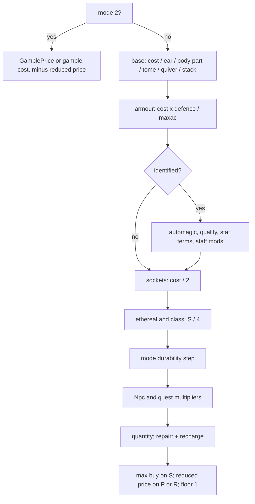

# 0011 — Item economy: prices, repair, gold, costs and durability wear

> **Subsystem:** items/economy
> **Question:** what does an item cost to buy, sell, gamble and repair, what do hiring, resurrecting and identifying
> cost, how much gold drops and is lost on death, what caps hold gold, and how do items lose and regain durability,
> quantity and charges?
> **Date:** 2026-10-17 (Phase 2: 2026-10-19)   **Plan:** 0043 (Phases 1, 1b and 2)   **Status:** Phase 2 done; review
> pending

All addresses are in the pinned `Game.exe`. Every claim below is a static reading (objdump on the image, the lane's
Ghidra copy `ghidra-p43r`), so the behavioural claims are tagged I; data counts are tagged C from `tools/economy_survey.py`
(gate survey `economy`). The call-site, reader, pointer and draw scans are `tools/economy_scan.py` (output
`workspace/logs/economy-scan/economy-scan.out`, sha256 in `workspace/logs/economy-scan-manifest.txt`); its `reach`
section, added at the architect's review, walks the direct callees (output `workspace/logs/economy-scan/economy-reach.out`,
same manifest).

## Answer (summary)

- [I] **One function prices everything an NPC trades.** `sub_0062FDC0_ItemTradePrice(player, item, difficulty,
  questRecord, npcClass, mode)` forwards to `ITEMS_TradePriceCore` (ECX = player, EDX = item). Mode 0 is the price the
  player **pays** (buy), 1 what the NPC **pays** (sell), 2 the gamble price, 3 the repair cost; any other mode returns
  the buy value. The core keeps three running values, `P` (buy), `S` (sell) and `R` (repair), through every term, and
  returns one of them. No draw (§ 8). (fn:sub_0062FDC0_ItemTradePrice@0x0062FDC0, fn:ITEMS_TradePriceCore@0x0062EFB0)
- [I] **The terms, in order** (0x0062F0BE–0x0062FD8B)**:** base (`cost`, or a per-kind base: ear, body part, tome, quiver, stack), the armour
  scaling by defence, then for an identified item the automagic affix, the quality term (low quality halves; magic,
  rare and crafted add their affixes' `multiply`/`add`; set and unique add the row's `cost mult`/`cost add`), the
  per-stat ItemStatCost terms (superior, magic, rare, crafted, tempered only), the staff-mod skill term, socketed
  items at half their `cost`, ethereal and class-item quartering of `S`, the mode's durability or charge step, the
  Npc row's `sell`/`buy`/`rep mult` and quest multipliers, the quantity, `max buy` (sell only) and
  `item_reducedprices` (stat 87, buy, gamble and repair only). Every scaling is `v·m/1024` truncated, or `(v/1024)·m`
  when `v > 0xFFFF` and `m ≠ 0`. (§ 1–§ 3)
- [I] **The price path does not read the table divisors.** ItemStatCost `Divide` (`+0x0C`) and MagicPrefix/MagicSuffix
  `divide` (`+0x84`) have no read in the functions of § 1–§ 4 (no image-wide reader scan was made); every divisor is the constant 1024 (or 4096 for `S` in the skill-based
  terms). So MagicPrefix `divide` 0 needs no guard. (0x00628E70–0x006292D7, 0x0062F1AB–0x0062F213)
- [I] **The gamble price is computed** for every item of version ≥ 1 except rings and amulets: from the character
  level, the base's `cost`, `level`, `minstack`/`maxstack`, and the `cost` and `level` of its `ubercode`/`ultracode`
  bases weighted by the same upgrade chances as the gamble roll. `gamble cost` is read only for `rin`, `amu` and
  version-0 items. (fn:sub_00629370_GamblePrice@0x00629370)
- [I] **Repair** is `R` of mode 3; repair-all sums the 13 equipped slots. A paid repair restores durability to
  maximum, a repairable stack to `maxstack`, every charged skill's charges, and clears "broken". When the player
  cannot pay a single repair, all carried and stashed gold buys a proportional part of the durability, unless the
  item is broken. The test "can be repaired" reads the item's **own** ItemTypes row (`Repair`), never the `Equiv`
  closure. (fn:sub_00578050_NpcRepair@0x00578050, fn:sub_0062FE60_RepairCost@0x0062FE60,
  fn:sub_0062E660_ItemCanRepair@0x0062E660)
- [I] **Gold sinks and caps.** `PayGold` takes from carried gold, then the stash. Carried gold is capped at
  `level × 10 000`, the stash at 2 500 000 (constant, not by level). Other costs: hire (hirelings/0001), resurrect
  `min(50 000, (L²/2)·15)` with *L* the mercenary's level, Cain's identify 100 per unidentified item until quest word 4
  is done. (fn:PLAYER_GoldCap@0x00622E70, fn:PLAYER_StashGoldCap@0x00623460, fn:MERC_ResurrectCost@0x006637B0,
  fn:NPC_CainIdentify@0x00578460)
- [I] **Death.** The gold loss is `min(L, 20)·(gold + stash)/100` for every death; in game type 3 (single player) at
  least `500·L` of the total is kept and only carried gold is taken. The carried gold not lost is dropped as piles; a
  player killer's loss drops the loss itself instead. Stat 175 `goldlost` records it. (fn:PLAYER_DeathGoldLoss@0x005357D0)
- [I] **Wear.** A melee hit that lands rolls the attacker's weapon (4 %, 10 % for an expansion throwing weapon, none
  for a classic one) on the attacker's seed and one armour piece of the defender (`RangeB(7)`, `RangeB(weights)`,
  then 10 %) on the defender's seed. Armour at 0 breaks; a throwing stack loses one and refills. Ammunition and thrown
  weapons lose one per use (no draw). Charges lose one per cast. `item_replenish_durability`/`_quantity` add one every
  `max(125, 2500/r + 1)` frames. (fn:COMBAT_DurabilityLoss@0x0057D3D0, fn:ITEMS_DurabilityLossRoll@0x00559E30,
  fn:PLAYER_UseAmmo@0x0056C3F0, fn:ITEMEVENT_Replenish@0x00562D30)

## Leads used

Blind first: § 1–§ 7 were read from the code before the pages below were fetched (2026-10-17, this session).

- [L] src:arreat-summit-vendors: a vendor pays at most 5 000 / 10 000 / 15 000 / 20 000 / 25 000 gold in the five
  Normal acts, 30 000 in Nightmare, 35 000 in Hell. **held with refinement**
  Detail: `max buy` of the NPC's Npc row, column by difficulty (`+0x40 + 4·d`), caps `S` after the Npc and quest
  multipliers and the quantity; "by act" is the NPC's row, not the act (0x0062FCF4–0x0062FD07).
- [L] src:arreat-summit-vendors: repairing before selling earns no more gold. **held with refinement**
  Detail: `S` has no durability term for an ordinary item; for a repairable stack `S = M·S − R·(M − q)` depends on
  the quantity, and the sell takes the lower of the item's price and its repaired store copy's (§ 4).
- [L] src:arreat-summit-gambling: the gamble price rises with character level. **held**
  Detail: `sub_00629370_GamblePrice` (§ 2) multiplies by `(2L′+1)/3 + 20` and adds `250·L′/3`.
- [L] src:arreat-summit-character-basics: the death loss is the character level in percent, at most 20 %, of carried
  and stashed gold; the rest of the carried gold falls in a pile; the remainder of the penalty comes from the stash.
  **held** Detail: § 6, 0x005357FB–0x00535835.
- [L] src:arreat-summit-character-basics: in single player no gold is lost from the stash and 500 gold per level is
  exempt. **held with refinement** Detail: the code tests game type 3 (`game+0x6A`; 3 in every logged single-player
  run, monsters/0001 § 5), keeps `500·L` of the total, and caps the loss at the carried gold (0x00535882–0x0053589C).
- [L] src:arreat-summit-character-basics: a player has up to 16 corpses; beyond that the items fall to the ground.
  **held** Detail: `PLAYER_CorpseCreate` drops instead when the corpse count is above 15 (`cmp eax, 0xF; jbe`, 0x0057F72D).
- [L] src:maxroll-d2r-items ("Durability & Quantity", D2R): a melee attack has a 4 % chance to cost a non-missile
  weapon 1 durability. **held** Detail: § 7, 0x00559E72.
- [L] src:maxroll-d2r-items: missile (throwing) weapons lose durability 10 % of the time in melee. **held with
  refinement** Detail: only in an expansion game (`game+0x70`); a classic game makes no roll for a throwable
  (0x00559E7B–0x00559E8B).
- [L] src:maxroll-d2r-items: a melee hit taken gives a 10 % chance that one armour piece loses 1 durability.
  **held** Detail: § 7.
- [L] src:maxroll-d2r-items: slot weights head 2, body 3, shield 2, waist 1, feet 1, hands 1. **contradicted**
  Detail: the table `g_ArmorWearSlots` (`0x00732B90`, 7 pairs) is head 3, torso 5, right hand 4, left hand 4, belt 2,
  feet 2, gloves 2, and only an item of type `armo` in the slot counts (§ 7). Settled by the P2 required case: the
  logged `W` and all 963 slot picks reproduce with 3/5/4/4/2/2/2 (§ Phase 2).
- [L] src:maxroll-d2r-items: an ethereal item sells for 25 % less. **contradicted** Detail: an ethereal item's `S` is
  divided by 4 (`sar 2`, 0x0062F88E), so it sells for a quarter; a class item is quartered again (0x0062F99C). P2
  required case (backlog).
- [L] src:maxroll-d2r-items: a broken ethereal item sells for 1 gold. **held** Detail: mode 1 sets `S = 0` for an
  ethereal item with durability ≤ 0, and the floor returns 1 (0x0062FA60–0x0062FA8E, 0x0062FD75).
- [L] src:maxroll-d2r-items: an ethereal throwing weapon is always worth 1 gold. **contradicted** Detail: as read, it
  takes the ordinary path (`S·q/4`, not repairable), unless its durability is ≤ 0. P2 required case (backlog).
- [L] src:maxroll-d2r-items: replenishing restores 1 quantity per 20 s (aLVL 5) or 10 s; self-repair 1 durability per
  33 s, 20 s for the faster suffix. **held** Detail: the stat values are `of Self-Repair` 3, `of Fast Repair` 5,
  `of Replenishing` 5, `of Propogation` 10 (MagicSuffix `mod1param`); `2500/r + 1` frames gives 834, 501, 501, 251.
  The frames-to-seconds factor (25 per second) is not read here.
- [L] src:maxroll-d2r-items: a broken item needs the full repair cost; otherwise a short purse repairs as far as it
  goes. **held with refinement** Detail: the partial repair takes all carried and stashed gold and is refused for a
  broken item (0x005782C3–0x00578325).
- [L] src:maxroll-d2r-items: Impale costs quantity instead of durability. **not covered** Detail: a skill function
  (`sub_005DAA40_SkillWeaponWear`, its calcs at `+0x13C`/`+0x140`) rolls a chance and a durability amount, or one
  stack unit; which skill reaches it was not read.
- [L] src:d2dfg-blizzard: an affix `multiply` is in "1024ths for buy cost and 4096ths for sell cost". **contradicted**
  Detail: the affix, set and unique terms divide `P`, `S` and `R` alike by 1024 (0x0062F1AB–0x0062F213); 4096 is used
  for `S` only in the skill-based terms (§ 3). Reachable (the 21 all-resistance prefixes): a P2 required case
  (backlog).
- [L] src:d2dfg-blizzard: ItemStatCost `Multiply`/`Add` modify the buy, sell and repair costs. **held** Detail: § 3.
- [L] src:d2dfg-blizzard: Books `BaseCost` is the starting cost of a tome. **contradicted** Detail: `BaseCost`
  (`+0x10`) has no reader; the tome's base is its Misc `cost`. The two are equal on stock data (Books § Interpretation
  notes), so no stock case separates them; not a P2 case (backlog entry for the spec).
- [L] src:d2dfg-blizzard: `CostPerCharge` is added per charge. **held** Detail: `P = S = CostPerCharge·q + cost`
  (0x0062F2A2–0x0062F2A9).
- [L] src:d2dfg-blizzard: Npc `sell mult` prices what the NPC sells, `buy mult` what it buys, `rep mult` repairs;
  `max buy` is the most an NPC pays. **held** Detail: § 3.
- [L] src:d2dfg-blizzard: `gamble cost` is the gambling price. **contradicted** Detail: read only for `rin`/`amu`
  and version-0 items; every other gamble price is computed (§ 2). P2 required case (backlog).

## Functions

| Address | Name | Role | Tag |
|---|---|---|---|
| `0x0062FDC0` | `sub_0062FDC0_ItemTradePrice` | wrapper: stack args → ECX/EDX + 4 args | I |
| `0x0062EFB0` | `ITEMS_TradePriceCore` | the price function (modes 0–3) | I |
| `0x0062EDD0` | `sub_0062EDD0_PriceStaffModTerm` | stat 107 skill term | I |
| `0x00628E70` | `sub_00628E70_PriceStatTerms` | per-stat ItemStatCost / skill terms | I |
| `0x006292F0` | `sub_006292F0_PriceSocketTerm` | socketed items: `cost/2` each | I |
| `0x00628D30` | `sub_00628D30_RechargeCost` | the missing charges' cost (repair) | I |
| `0x00629370` | `sub_00629370_GamblePrice` | computed gamble price | I |
| `0x0062C060` | `sub_0062C060_ItemIsClassItem` | ItemTypes `Class` < 7 | I |
| `0x0062E660` | `sub_0062E660_ItemCanRepair` | the repair test | I |
| `0x0062E5D0` | `sub_0062E5D0_ItemIsRepairableStack` | throwable, stackable, not ethereal, `Repair` type | I |
| `0x0062A840` | `sub_0062A840_ItemHasCharges` | stat 204 present; out: all full | I |
| `0x006283A0` | `sub_006283A0_ItemEarLevel` | `ItemData+0x48` | I |
| `0x006287D0` | `sub_006287D0_ItemNormCode` | base `normcode`, else `code` | I |
| `0x00633680` | `sub_00633680_ItemIndexByCode` | code → item index | I |
| `0x00627F20` | `sub_00627F20_ItemGetAutoAffix` | `ItemData+0x36` | I |
| `0x006374B0` | `BOOKS_GetRecord` | Books row (0x20 stride) | I |
| `0x00555C90` | `ITEMTYPES_GetRecord` | ItemTypes row (0xE4 stride) | I |
| `0x0063BDE0` | `sub_0063BDE0_InvGetBodyLocItem` | equipped item in body slot 0..12 | I |
| `0x00625C30` | `sub_00625C30_StatListCopyFull` | copies the extended list's `+0x48` cache | I |
| `0x006261D0` | `sub_006261D0_StatListGetEntries` | entries of one stat id | I |
| `0x00577830` | `NPC_BuyItem` | buy and gamble purchase | I |
| `0x00579510` | `NPC_SellItem` | sell to an NPC | I |
| `0x00578460` | `NPC_CainIdentify` | identify all, 100 per item | I |
| `0x00578ED0` | `sub_00578ED0_NpcHealDead` | heal for gold; no caller | I |
| `0x00622DE0` | `sub_00622DE0_HealCost` | `L·(missing HP + mana)/256/4` | I |
| `0x0062A530` | `sub_0062A530_CountUnidentified` | unidentified items in inventory | I |
| `0x00622E70` | `PLAYER_GoldCap` | `level × 10 000` | I |
| `0x00623460` | `PLAYER_StashGoldCap` | 2 500 000 | I |
| `0x0053FF00` | `sub_0053FF00_UnitAddGoldStat` | add to stat 14/15, zero on overflow | I |
| `0x0055B060` | `sub_0055B060_PlayerGiveGold` | add to carried gold, drop the overflow | I |
| `0x005357D0` | `PLAYER_DeathGoldLoss` | the death loss | I |
| `0x00535510` | `sub_00535510_PlayerDropGold` | drop an amount as piles at the player | I |
| `0x0055C850` | `sub_0055C850_GoldPickup` | pick up a pile | I |
| `0x00540900` | `sub_00540900_PartyGoldShare` | party split of a pickup | I |
| `0x00564D50` | `sub_00564D50_StashGoldMove` | deposit / withdraw | I |
| `0x0057F390` | `sub_0057F390_CorpseDropGold` | the corpse's gold as piles | I |
| `0x0057F540` | `sub_0057F540_CorpseOverflowDrop` | 16 corpses: drop items and gold | I |
| `0x00562D30` | `ITEMEVENT_Replenish` | item event 3 | I |
| `0x00562C40` | `sub_00562C40_ReplenishStep` | +1 and requeue | I |
| `0x0056C310` | `sub_0056C310_ItemConsumeOne` | quantity −1 | I |
| `0x0056C3F0` | `PLAYER_UseAmmo` | finds the ammunition or thrown stack | I |
| `0x0056BEC0` | `sub_0056BEC0_UseCharge` | charges −1 | I |
| `0x005DAA40` | `sub_005DAA40_SkillWeaponWear` | a skill's chance of wear | I |
| `0x0065C940` | `sub_0065C940_ItemSetCharges` | set a charged entry's current charges | I |
| `0x00580310` | `sub_00580310_HandsRefresh` | after an empty stack: refill the hands | I |
| `0x006E117C` | `g_ItemEventFuncs` | item event table (3 → replenish) | I |
| `0x00732B90` | `g_ArmorWearSlots` | 7 × {bodyloc, weight}; count `0x00732BC8` | I |

Existing names used: `sub_00578050_NpcRepair`, `sub_0062FE60_RepairCost`, `sub_005761C0_ItemRepairAll` (it repairs
**one** item; the reviewed name is kept), `sub_0055F900_ItemRepairBroken`, `sub_0055FE80_ItemRefillCharges`,
`sub_00576D90_PayGold`, `MERC_Resurrect`, `MERC_ResurrectCost`, `sub_0055A090_DropGoldAmount`,
`sub_0055B030_DropGold`, `sub_005589A0_DropGoldFind`, `sub_00559300_DropGoldPile`, `OBJINIT_GoldPiles`,
`sub_00594630_A1Q4_WirtGold`, `COMBAT_DurabilityLoss`, `ITEMS_DurabilityLossRoll`,
`sub_00558530_ItemReplenishDurTimer`, `sub_00558580_ItemReplenishQtyTimer`, `sub_00656900_NpcGetByClass`.

## Walkthrough

### 1. The price core: inputs and the base

`ITEMS_TradePriceCore` (ECX = player, EDX = item; stack: `difficulty`, `questRecord`, `npcClass`, `mode`; `ret 0x10`).
The wrapper loads the six stack arguments in that order (0x0062FDC3–0x0062FDD9). Server callers pass the game's
difficulty `game+0x6D`, the player's quest record of that difficulty and the NPC unit's class.

- [I] **Early returns.** No player, no item or not an item: `0x7FFFFFFF`. Mode 3 on an item that fails
  `ItemCanRepair`: 0. Item flag `0x20000` (bit 17, the starting-item bit, player/0001): 1, in every mode.
  (0x0062EFBA–0x0062F01F)
- [I] **Inputs.** `q = max(1, stat 70 quantity)`; `r = min(99, stat 87 item_reducedprices of the player)`; `L` = the
  player's stat 12. (0x0062F02C–0x0062F062)
- [I] **Mode 2 returns early** (§ 2, 0x0062F062). Other modes set the stack divisor `n = 1`, then the base:

```c
// fn:ITEMS_TradePriceCore@0x0062EFB0, 0x0062F0BE–0x0062F339 (renamed)
R = 0;  n = 1;
if (item.flags & 0x10000 /*ear*/)        P = S = ItemData.earLevel * base.cost;
else if (IsType(item, 40 /*body*/))      P = S = base.cost + 8 * MonStats[fileIndex].Level[d];  // s16, d = difficulty arg; no record: cost
else if (IsType(item, 18 /*book*/))      P = S = Books[suffix0].CostPerCharge * q + base.cost;   // no Books row: fatal
else if (ItemTypeQuiver(item)) {         P = S = (base.cost * q) / 1024;  R = (MaxStack(item) * base.cost) / 1024; }
else { P = S = R = base.cost;  if (BaseStackable(item) && MaxStack(item) >= 2) n = MaxStack(item); }
if (IsType(item, 50 /*armo*/) && base.maxac - base.minac != -1 && base.maxac != 0)
    P = S = R = base.cost * BaseStat(item, 31 /*armorclass*/) / base.maxac;   // imul, cdq, idiv: signed truncation
```

  `/ 1024` is `cdq; and edx,0x3FF; add; sar 10`, a signed division truncating toward zero, here and in every term
  below. `base` is the item's Weapons/Armor/Misc row; `IsType` walks the `Equiv` closure
  (`ITEMS_UnitIsType`). Note that the ear, body-part and book bases leave `R` at 0, and the armour step resets all
  three values to the scaled `cost`, replacing an ear, body-part or book base for an item that is also armour (none
  on stock data). (tbl:Weapons.txt:cost, tbl:Armor.txt:maxac, tbl:Misc.txt:cost, tbl:Books.txt:CostPerCharge,
  tbl:MonStats.txt:Level)

### 2. The gamble price (mode 2)

- [I] For an item of version 0 (`ItemData+0x30`, an old-format item): the `gamble cost` (`+0xD4`) of the base named by
  its `normcode` (`code` when `normcode` is 0). Otherwise `G = GamblePrice(item, L)`, then `G − MulDiv(G, r, 100)` when
  `r ≠ 0`. No Npc multiplier, no quest multiplier, no floor. (0x0062F062–0x0062F0BB)
- [I] `sub_00629370_GamblePrice` (EAX = item, arg = `L`), on the `normcode` base `b`
  (fn:sub_00629370_GamblePrice@0x00629370):

```c
// fn:sub_00629370_GamblePrice@0x00629370 (0x006293B2–0x00629552); all signed 32-bit, divisions truncate
if (b.code == 'rin ' || b.code == 'amu ') return b.gambleCost;
avgStack = max(1, (b.minstack + b.maxstack) / 2);
x = e = xc = ec = 0;
if (b.ubercode  && b.ubercode  != '0   ' && (u = ByCode(b.ubercode)))  { x = max(0, (L - u.level) * 100 / 2 + 1); xc = u.cost; }
if (b.ultracode && b.ultracode != '0   ' && (t = ByCode(b.ultracode))) { e = max(0, (L - t.level) * 100 / 4 + 1); ec = t.cost; }
avgCost = ((10000 - e - x) * b.cost * avgStack + ec * e + xc * x) / 10000;
L2 = max(L, 5);                                   // the upgrade weights above use L, not L2
lv = (b.level >= 45 ? b.level - 45 : 0) - b.level / 2 + L2;
return ((lv * 250 / 3 + avgCost) * ((2 * L2 + 1) / 3 + 20)) / 15;
```

  The `+1` and the floor at 0 apply after the division (`sar 1` / `sar 2`, then `add 1`, `jns`). `x + e` is not capped,
  so `10000 − e − x` can be negative at high `L` (an elite base reached). `/ 10000` and `/ 15` are the magic-number
  forms (`0x68DB8BAD` `sar 12`, `0x88888889` `sar 3`). (tbl:Weapons.txt:gamble cost, tbl:Weapons.txt:ubercode,
  tbl:Weapons.txt:level, tbl:Weapons.txt:minstack)

### 3. The value terms

After the base, for every mode except 2, in this order (0x0062F13C–0x0062F871):

1. [I] **Staff mods for a non-magic item.** When the quality is not 4..9 (`sub_0062A0F0_ItemQualityMagicPlus` = 0),
   `PriceStaffModTerm` runs now, before the identified test. (0x0062F161–0x0062F17A)
2. [I] **Unidentified** (flag `0x10` clear): skip to step 7. (0x0062F182)
3. [I] **Automagic affix** (`ItemData+0x36`, any quality): with its MagicPrefix/Suffix/AutoMagic record `a`,
   `dP = P·a.multiply/1024 + a.add`, the same for `dS`, `dR` — or `(v/1024)·multiply + add` for all three when
   `P > 0xFFFF` and `multiply ≠ 0` (the test is on `P` for all three). These **initialise** the three accumulators.
   (0x0062F18A–0x0062F38E)
4. [I] **Quality** (jump table `0x0062FD9C`, quality − 1):
   - 1 low: the accumulators are **replaced** by `−(P/2)`, `−(S/2)`, `−(R/2)` (signed halving);
   - 2 normal: nothing;
   - 3 superior, 9 tempered: the stat terms (step 5) only;
   - 4 magic: prefix 0 and suffix 0 added like step 3, then the stat terms;
   - 6 rare, 8 crafted: prefixes 0–2 and suffixes 0–2 added, then the stat terms;
   - 5 set: SetItems `cost mult` (`+0x38`) and `cost add` (`+0x3C`) added like step 3, no stat terms;
   - 7 unique: UniqueItems `cost mult` (`+0x7C`) and `cost add` (`+0x80`) likewise, no stat terms; with no file index
     or no record, the magic branch instead.

   The quality enters only through these branches: QualityItems and the rare names carry no price field, and none is
   read. (0x0062F391–0x0062F994, tbl:SetItems.txt:cost mult, tbl:UniqueItems.txt:cost add)
5. [I] **Per-stat terms** (fn:sub_00628E70_PriceStatTerms@0x00628E70, ECX = item, EDX = &P, args &S, &R, `n`). For each entry of the item's
   full-stat cache (`+0x48` of its extended list, at most 511): `v = full − base` of that stat and param
   (`sub_00625560_UnitStatDelta`); skip when `v = 0`. Then `v >>= ValShift` (`sar`, so a `ValShift` 8 stat — 7, 9,
   11 — is priced in whole points). By `Encode` (`+0x30`, byte):
   - 0 (and 5+): ISC `Multiply` `m` (`+0x10`), `Add` `a` (`+0x14`): `dP += m·P·v/1024 + a`, `dS += m·S·v/1024 + a`,
     `dR += m·R·v/1024 + a`; or `((X·v)/1024)·m + a` for each when `P·v > 0xFFFF` and `m ≠ 0`;
   - 1 (param = a skill): the Skills row's `cost mult` (`+0x234`) and `cost add` (`+0x238`) instead, and **`S` over
     4096**: `dS += m·S·v/4096 + a` (large form `((S·v)/4096)·m + a`);
   - 2, 3 (skill-on-event, charged; param = skill `<<` shift | level): `v` is replaced by the **level** from the
     param; Skills `cost mult`/`add`; `S` over 4096 as in Encode 1. The charge count does not enter;
   - 4 (by time): `v = (min + max)/2` of `STAT_ByTimeValue`; ISC `Multiply`/`Add`, all over 1024.

   Each `a` is added once per entry. The three sums are added as `P += dP/n` etc. with an **unsigned** `div`.
   (0x00628E9F–0x006292D7, jump table `0x006292DC`, tbl:ItemStatCost.txt:Multiply, tbl:ItemStatCost.txt:ValShift,
   tbl:ItemStatCost.txt:Encode, tbl:Skills.txt:cost mult)
6. [I] **Accumulators in.** `P += accP / n`, `S += accS / n`, `R += accR / n` (signed `idiv`); then for a magic+ item
   `PriceStaffModTerm`. (0x0062F822–0x0062F856)
7. [I] **Sockets.** For every item in the item's own inventory (its socketed gems, runes and jewels):
   `P, S, R += child.base.cost / 2` (signed). (fn:sub_006292F0_PriceSocketTerm@0x006292F0)
8. [I] **Ethereal and class items.** Flag `0x400000` (ethereal): `S /= 4`. ItemTypes `Class` < 7 (a class-only type):
   `S /= 4` again. Neither touches `P` or `R`. (0x0062F871–0x0062F9B3)

`PriceStaffModTerm` (EAX = item; skipped when its type's `StaffMods` byte is 7, which no stock type has: the bytes are
1..6 or 255): for each stat 107 (`item_singleskill`) entry, skill row `k`, value `v`: `dP += (k.cost mult·P/1024 +
k.cost add)·(2v − 1)`, `dS` with `/4096`, `dR` with `/1024`; when `P > 0xFFFF` and `cost mult ≠ 0` the large form
divides the **multiplier**: `((cost mult/1024)·P + cost add)·(2v − 1)` (`/4096` for `S`), which is `cost add·(2v − 1)`
for every stock skill (`cost mult` ≤ 896). Sums over `n`, unsigned. [I] (fn:sub_0062EDD0_PriceStaffModTerm@0x0062EDD0,
0x0062EE24–0x0062EFAD, tbl:ItemTypes.txt:StaffMods)

### 4. Mode steps, the Npc row, quantity and the result

- [I] **Mode 1 (sell):** an ethereal item with durability (`ItemHasDurability`), a non-zero maximum and stat 72 ≤ 0
  gets `S = 0`. **Mode 3 (repair):** for an item that is neither a quiver nor throwable but has durability, with `D` =
  stat 72 and `M` = `ItemMaxDurability`: `R = 0` when `M = 0` or `D ≥ M`; with stat 252 (`item_replenish_durability`)
  set, `R = (M − 1)·R/M` when `D < M − 1`, else 0; otherwise `R = (M − D)·R/M` (signed). (0x0062F9B6–0x0062FA8E)
- [I] **The Npc row** (`NpcGetByClass(npcClass)`; none: fatal error `0xCDC`): `P ×= sell mult`, `S ×= buy mult`,
  `R ×= rep mult`, then the quest groups A, B, C as in items/0009 § 9. One quirk: `S`'s large form tests `sell mult ≠
  0`, not `buy mult` (0x0062FAEE–0x0062FAF2); every stock row has both non-zero. (tbl:Npc.txt:sell mult,
  tbl:Npc.txt:questbuymult A)
- [I] **Quantity** (not a book, not a quiver): `P ×= q`. For `S`: when the item is stackable and `ItemCanRepair`,
  with `M` = max stack: if `q < M` and stat 253 (`item_replenish_quantity`) is 0, `R ×= (M − q)` and `S = M·S − R`;
  else `S ×= M` and `R = 0`. Otherwise `S ×= q`. (0x0062FC59–0x0062FCD3)
- [I] **Mode 3, not ethereal:** `R += RechargeCost(item)` — after the Npc multipliers, so `rep mult` and the quest
  groups do not scale it. For each stat 204 (`item_charged_skill`) entry with current `c` < max `x` (value low byte /
  high byte), skill row `k`: `K = level + 2·(k.reqlevel/6) + 2`, `T = K·10000`; `t = k.cost mult·T/1024` (or
  `(T/1024)·cost mult` when `T > 0xFFFF` and `cost mult ≠ 0`); add `(x − c)·(t + k.cost add)/x` (signed).
  (0x0062FCD6–0x0062FCF2, fn:sub_00628D30_RechargeCost@0x00628D30, tbl:Skills.txt:reqlevel)
- [I] **`max buy`** (`+0x40 + 4·difficulty`): `S′ = min(S, max buy)`. (0x0062FCF4–0x0062FD07)
- [I] **Result.** Mode 1: `S′`, or 1 when `S′ < 1`. Mode 3: `R − MulDiv(R, r, 100)` when `r ≠ 0`, or 1 when below 1.
  Other modes: `P − MulDiv(P, r, 100)` when `r ≠ 0`, or 1 when below 1. All signed 32-bit; `MulDiv` as in
  monsters/0004 § 4. (0x0062FD07–0x0062FD8B, fn:sub_00483360_MulDiv@0x00483360)



### 5. Callers: buy, sell, repair, the client copy

- [I] **Buy and gamble** (`NPC_BuyItem`, modes 0 and 2 from the packet): refused when gold + stash < price. A
  permanent stackable store item is priced at quantity 1 (stat 70 forced to 1 around the call) and bought
  `min(gold total / unit price, room)` at a time; otherwise one copy at the price. Paid with `PayGold`.
  (fn:NPC_BuyItem@0x00577830, 0x00577944, 0x00577B03)
- [I] **Sell** (`NPC_SellItem`): the price is mode 1; when the item is copied into the store (the rules of
  items/0009 § 8), the copy is repaired (durability and quantity to maximum) and priced again, and the player gets the
  **lower** of the two; then `PlayerGiveGold` adds it to carried gold and drops what exceeds the cap as piles.
  (fn:NPC_SellItem@0x00579510, 0x0057961B, 0x005798CD, fn:sub_0055B060_PlayerGiveGold@0x0055B060)
- [I] **Repair** (`NpcRepair`, classes 154, 178, 253, 257, 511). Repair all (packet bit 31): `RepairCost` sums, over
  the 13 body slots, mode 3 of each item that has durability below a non-zero maximum and `ItemCanRepair`, or is a
  repairable stack below `maxstack`, or has a charged skill with missing charges; it pays the sum, then walks again
  with the repair callback. One item: refused unless `ItemCanRepair` and one of: a throwable, stackable, non-ethereal item below
  `maxstack`; missing charges; `M ≠ 0` and `D < M`. It is priced with mode 3 and paid. When `PayGold` fails and
  `D < M`: `k = (cost << 10)/(M − D)` (unsigned); if gold > 0, `0 < k < gold·1024` and the item is not broken, all
  carried gold is paid and `D = min(M, D + gold·1024/k)`. Note `gold` here is stat 14 only, while `PayGold` takes it
  out first. (fn:sub_00578050_NpcRepair@0x00578050, 0x0057822C–0x00578325)
- [I] **Repairing one item** (`sub_005761C0_ItemRepairAll`, ECX = game, EDX = item, arg = player): when
  `ItemCanRepair`: a throwable stackable item gets quantity = max stack; every charged skill is refilled
  (`ItemRefillCharges`); a broken item goes through `ItemRepairBroken` (clears `0x100`, durability = maximum,
  re-links its stats); otherwise durability = maximum when the maximum is > 0. (fn:sub_005761C0_ItemRepairAll@0x005761C0,
  fn:sub_0055F900_ItemRepairBroken@0x0055F900)
- [I] **`ItemCanRepair`**: identified, not ethereal; when the item has charges with some missing → yes. Otherwise its
  **own type's** ItemTypes row (`ITEMS_GetBaseType`, then `ITEMTYPES_GetRecord`; no `Equiv` walk) must have
  `Repair`; then yes for a repairable stack (`sub_0062E5D0`: throwable, stackable, not ethereal, own type `Repair`),
  else `ItemHasDurability`. So the 13 `nodurability` crossbows of a `Repair` type are refused unless they have
  charges, and bows and `tpot` (no `Repair` type) likewise. (0x0062E660–0x0062E6E5, tbl:ItemTypes.txt:Repair,
  tbl:Weapons.txt:nodurability)
- [I] **The client copy.** Six client call sites (`0x0049024C`, `0x004B2C7C`–`0x004B3AB6`) and two of `RepairCost`
  (`0x004887F0`, `0x004B38FA`) call the same functions with the client's difficulty (`0x0044DCD0`) and quest record
  (`0x00463DE0`): the displayed prices are the same arithmetic on the client's copies of the units; the server's
  call decides what is paid. (economy-scan `CALLS`)
- [I] **Other callers.** `D2S_WriteCorpses` sums mode 0 prices with difficulty **3** and class 513 (*Malah*) to pick
  the most valuable corpse (0x005698B4); difficulty 3 indexes past `Level(H)` for a body part and past `max buy (H)`,
  neither of which mode 0 returns.

### 6. Gold: costs, caps, drops, death

- [I] **`PayGold(n)`** (EDX = player): refused when gold + stash < `n`; takes from gold, then the rest from the stash.
  (fn:sub_00576D90_PayGold@0x00576D90)
- [I] **Caps.** `PLAYER_GoldCap` = stat 12 × 10 000; `PLAYER_StashGoldCap` = 2 500 000. `UnitAddGoldStat` on a
  player writes 0 (not the cap) when an add would exceed the cap or go negative; `PlayerGiveGold` and the pickup clip
  to the cap first and drop or re-drop the rest. Deposit moves at most `cap − stash`; withdraw needs the room.
  (fn:PLAYER_GoldCap@0x00622E70, fn:PLAYER_StashGoldCap@0x00623460, fn:sub_0053FF00_UnitAddGoldStat@0x0053FF00,
  fn:sub_00564D50_StashGoldMove@0x00564D50)
- [I] **Pickup.** `GoldPickup` takes `min(pile, cap − gold)` and drops the remainder (`DropGold`); in a party with
  another member in the level the amount goes through `PartyGoldShare` (a split by `PartyCount`; plan 0044's two-client
  case). (fn:sub_0055C850_GoldPickup@0x0055C850, fn:sub_00540900_PartyGoldShare@0x00540900)
- [I] **Pile amounts.** A gold item's amount is set at creation (`ilvl + RNG_Range(item seed, 5·ilvl)`, at least 1,
  items/0006 § gold, 0x00557AC1–0x00557B4C); a monster drop is then scaled by `mul=` and gold find (items/0001,
  `sub_005589A0_DropGoldFind`: `gold·(100 + GF(killer) + GF(killer's owner))/100`). The ilvl of an object's gold
  differs by creator: `DropGoldPile` (`OBJINIT_GoldPiles`) uses the level's monster level minus 1 when above 1
  (`LevelMonLvl`, MonLvl or MonLvlEx by the expansion flag); `DropItemAtUnit` (Wirt's 10–19 piles) the level's
  monster level; `DropItemCodeAt` (the quest chests' piles) `UnitDropLevel`. (fn:sub_00559300_DropGoldPile@0x00559300,
  fn:sub_00559A30_DropItemAtUnit@0x00559A30, fn:sub_0061DCA0_LevelMonLvl@0x0061DCA0)
- [I] **`DropGoldAmount(amount, out, count, max 32)`** splits an amount into piles of at most 2 000 000 000, each a
  gold item created at the unit (an item creation, so its draws) whose stat 14 is then **set** to the share. Baal's
  gold (items/0010) and every overflow drop use it. (fn:sub_0055A090_DropGoldAmount@0x0055A090)
- [I] **Death** (fn:PLAYER_DeathGoldLoss@0x005357D0, from `sub_00535AB0` for every death, before the experience loss):

```c
// fn:PLAYER_DeathGoldLoss@0x005357D0 (0x005357D8–0x005359E7), signed 32-bit
T = gold + stash;  loss = min(L, 20) * T / 100;
pvp = killer is a player, or a monster owned by a player;
if (game->type /*+0x6A*/ == 3) {                    // single player
    if (T - loss < 500 * L) loss = max(0, T - 500 * L);
    loss = min(loss, gold);
}
if (!pvp) { if (gold < loss) stash -= loss - gold; else DropGold(gold - loss); gold = 0; }
else      { if (gold < loss) { stash -= loss - gold; gold = loss; }  DropGold(loss); }   // the rest stays carried
stat175_goldlost = max(loss, 0);
```

  "Stash −=" clamps at 0, and every stat write goes through the cap test (a value above `PLAYER_StashGoldCap` or
  `PLAYER_GoldCap` is written as 0, so the PvP `gold = loss` writes 0 when the loss is above `L × 10 000`).
  `DropGold` here is `sub_00535510_PlayerDropGold`: it does nothing (returns 0) when the amount is above the carried
  gold or the carried cap, else splits `min(amount, 2 000 000 000)` with `DropGoldAmount` (at most 32 piles) and takes
  each pile's stat 14 from the carried gold (0x00535538–0x005355F8). So a PvP loss whose `gold = loss` write was zeroed
  drops nothing. [I] (review, 2026-10-17)
  Hardcore is not tested. When the corpse is made, the player's remaining carried gold (0 after a non-PvP death) is
  dropped as piles by `CorpseDropGold`; with 16 corpses the items and gold are dropped instead (`CorpseOverflowDrop`).
  (fn:PLAYER_CorpseCreate@0x0057F700, fn:sub_0057F390_CorpseDropGold@0x0057F390,
  fn:sub_0057F540_CorpseOverflowDrop@0x0057F540)
- [I] **Hire and resurrect.** The hire price is `HIRELING_RollEntry`'s (hirelings/0001 § 5, tagged C there). Resurrection at
  classes 150, 198, 252, 367, 515 costs `MERC_ResurrectCost(merc)`: `L` = the **mercenary's** stat 12, `(L·L)/2`
  (signed) `·15`, then `min(·, 50 000)` by an unsigned compare; paid with `PayGold`; the same value is sent to the
  client when the mercenary dies. (fn:MERC_Resurrect@0x00579C00, fn:MERC_ResurrectCost@0x006637B0,
  fn:PETS_OnDeath@0x005751A0)
- [I] **Cain** (classes 244–246, 265, 520): `100 × CountUnidentified(player)` unless quest word 4 has bit 0 or 1 in
  the player's record for the difficulty; then every unidentified item on page 0 or 3 is identified.
  (fn:NPC_CainIdentify@0x00578460)
- [I] **Dead code.** `sub_00578ED0_NpcHealDead` (fn:sub_00578ED0_NpcHealDead@0x00578ED0) would charge `L·((ΔHP >> 8) + (Δmana >> 8)) >> 2` for a heal; no call,
  jump or 4-byte pointer reaches it (economy-scan `CALLS`, `PTR`), so 1.14d heals for free elsewhere.

### 7. Wear: durability, quantity, charges, replenish

- [I] **When.** `COMBAT_DurabilityLoss` runs only from `COMBAT_DeliverQueued` on a delivered melee hit
  (combat/0001 § 6; economy-scan: one call site). Its first half (attacker a player): `ITEMS_DurabilityLossRoll(game,
  attacker, weapon)` on the attacker's seed. Second half (defender a player with an inventory): over the 7 pairs of
  `g_ArmorWearSlots` (bodyloc, weight) = (1, 3), (3, 5), (4, 4), (5, 4), (8, 2), (9, 2), (10, 2), sum the weights of the
  slots holding an `armo` item; if the sum `W > 0`: `u = RangeB(seed, 7)`, `w = RangeB(seed, W)` on the defender's seed,
  then from slot `u` cyclically over occupied slots `w −= weight` until `w < weight`, and roll that item.
  (0x0057D3D7–0x0057D4DF, data:g_ArmorWearSlots@0x00732B90)
- [I] **`ITEMS_DurabilityLossRoll`** (ECX = game, EDX = seed owner, arg = item): needs type `armo` or `weap` and
  `ItemHasDurability` (`nodurability` 0, `durability` ≠ 0, a non-zero maximum and stat 152 `item_indesctructible` < 1),
  so an indestructible item makes **no draw**. Chance 10 for `armo`; for
  a weapon 4, or 10 when throwable — but a throwable in a classic game (`game+0x70 = 0`) returns before the draw.
  Draw: one inline LCG step of the seed owner's `+0x20/+0x24`, `roll = low32 mod 100` (unsigned); loss when `roll <
  chance`. Then `D′ = D − 1`: if `D′ ≥ 1`, `D = min(D′, M)` and the replenish timer is armed; else an `armo` item that is
  not broken is broken (`ItemBreak`); a weapon of version ≠ 0 with quantity ≥ 2 loses one quantity and gets `D = M`, one
  with quantity < 2 gets `D = 0` and quantity 0 and the hands are refreshed; a version-0 item gets `D = 0`. Ethereal
  items take the same path (no ethereal test). (0x00559E38–0x0055A07A)
- [I] **Quantity per use.** `PLAYER_UseAmmo` (a player): for a bow or crossbow the stackable/throwable item in the
  right, else left, hand (the quiver); for any other weapon the weapon itself when stackable or throwable or with stat
  125 `item_throwable`. `ItemConsumeOne`: quantity `max(q − 1, 0)`, the quantity timer armed, durability reset to
  maximum, the hands refreshed. No draw. Five call sites: the missile-launch functions `0x0056ECB0` (twice),
  `0x0056F7F0` (gated by a Skills flag bit at `+0x04`), and two skill functions `0x005DAA40`, `0x005DACD0`; the gates of
  the first three are not followed. (fn:PLAYER_UseAmmo@0x0056C3F0, fn:sub_0056C310_ItemConsumeOne@0x0056C310)
- [I] **A skill's wear** (`SkillWeaponWear`, from `0x005DAB40`): with the skill's two calcs (`+0x13C` chance, `+0x140`
  amount), one LCG step mod 100 on the caster: a non-stackable weapon with durability loses `amount` (breaks when not
  left > 0); a stackable one with quantity > 0 goes through `PLAYER_UseAmmo`. Which skill: not read.
  (fn:sub_005DAA40_SkillWeaponWear@0x005DAA40)
- [I] **Charges.** `UseCharge` (from `0x0056BFE0`, three call sites) finds the item carrying the cast skill and level
  and writes `max(c − 1, 0)`, capped at the max; no draw. (fn:sub_0056BEC0_UseCharge@0x0056BEC0)
- [I] **Replenish ticks.** Timers: unit event 3 on the item at `frame + 2500/r + 1` (64-bit signed division) when none
  is queued, armed by a durability loss, a quantity use, socketing and item copy. The handler (`g_ItemEventFuncs[3]`):
  if not broken and with durability and stat 252 = `r ≠ 0`: `D + 1` when ≤ `M`, requeue at `frame + max(125, 2500/r +
  1)`; at maximum, no requeue. Only when that path does nothing (no stat 252, broken, no durability): a stackable item
  with stat 253 gains one quantity up to max stack, same requeue; and if that item is broken and the owner's client is
  found, `ItemRepairBroken`. No draw. (fn:ITEMEVENT_Replenish@0x00562D30, fn:sub_00562C40_ReplenishStep@0x00562C40,
  fn:sub_00558530_ItemReplenishDurTimer@0x00558530, data:g_ItemEventFuncs@0x006E117C)

### 8. Event kinds, draws and the Phase 2 boundary

`economy_scan.py draws` finds no LCG constant and no RNG call inside any of the 37 functions read except the five
marked. `economy_scan.py reach` (architect review) walks the direct callees to depth 6 (indirect calls not followed):
the price core and its terms, the gamble price, the recharge cost, `RepairCost`, `NpcRepair`, `ItemRepairAll`,
`ItemRefillCharges`, Cain, `PayGold`, `UnitAddGoldStat`, `UseCharge` and `MERC_ResurrectCost` reach no drawing code
within that depth; `ItemRepairBroken`, walked from itself, does (through 0x0055C5C0, six calls deep), so a broken
item's repair is not covered by the walk from `NpcRepair`.
`NPC_BuyItem` and `NPC_SellItem` reach the store copy's `ItemCopy` (0x00577C7A, 0x00579747) → `ItemCreateFromSave` →
`SUnitCreate` → `UnitSeedInit` (one LCG step of the seed it is given, 0x00552E31) and `UNIT_SetMode` → `UNIT_AnimInit`
(`RangeB`, 0x00624563); `MERC_Resurrect` reaches `MercRevive` (0x00579CF0) and `UNIT_SetMode`; `ItemConsumeOne` and
`PLAYER_UseAmmo` reach `UNIT_SetMode` through `HandsRefresh`; the replenish step and timers reach drawing code only
through `UnitQueueEvent`'s dispatch. Reachable is not taken: so the table's "none" holds for the first group, and the
rest are "none in the body; reachable" until Phase 2's seeds decide.

| Event kind | Inputs | Outputs | Draws |
|---|---|---|---|
| price (modes 0–3), gamble price, recharge cost | item stats, base rows, Npc row, quest record, difficulty, player level and stat 87 | an integer | none (one-shot) |
| repair, repair all, Cain | the price, gold, stash | gold, stash, item stats | none (none reachable to depth 6; a broken item's `ItemRepairBroken` reaches drawing code: P2 decides) |
| buy, sell | the price, gold, stash | gold, stash, item stats, the store copy | none in the body; the store copy's unit creation (`UnitSeedInit`) and `UNIT_SetMode` reachable: P2 decides |
| hire | `HIRELING_RollEntry(entry.seed)` | price | from the hireling entry seed (hirelings/0001), not the game seed |
| resurrect | mercenary level | price | none in the price; `MercRevive` and `UNIT_SetMode` reachable: P2 decides |
| gold pile created | ilvl, `mul=`, gold find | stat 14 | the gold item's creation (item seed; `RNG_Range(5·ilvl)`), items/0006 |
| `DropGoldAmount` | amount | piles | one item creation per pile (the amount is overwritten) |
| death loss | level, gold, stash, game type, killer | gold, stash, stat 175, piles | one item creation per dropped pile |
| weapon wear | weapon type, game type | durability, quantity | one LCG step, attacker's seed (none for classic throwables or no durability) |
| armour wear | worn `armo` items | durability, broken | `RangeB(7)`, `RangeB(W)` on the defender's seed, then one LCG step when the item has durability |
| skill wear | skill calcs | durability or quantity | one LCG step, caster's seed |
| charge use | the hand items | charges | none (none reachable to depth 6) |
| ammunition / thrown use | the hand items | quantity | none in the body; `UNIT_SetMode` via `HandsRefresh` reachable: P2 decides |
| replenish tick | stats 252/253 | durability / quantity | none in the body; only `UnitQueueEvent`'s dispatch reaches drawing code: P2 decides |

**Chaining.** The wear kinds that draw do so on a unit seed shared with combat (combat/0001 § 9), so their chained
pairs are the combat chain's: two consecutive melee deliveries on one defender pair armour-wear draws between the
to-hit and get-hit draws. The price, cost and gold-cap kinds are one-shot functions (ADR-0004).

**Boundary recommendation.** One-shot: `ITEMS_TradePriceCore` per call (entry: the item's full-stat cache entries,
base indices, quality and affix ids, flags, stat 70/72/73/87/252/253/204 entries; exit: the value), `GamblePrice`,
`RechargeCost`, `MERC_ResurrectCost`, `PLAYER_DeathGoldLoss` (entry: L, gold, stash, game type, killer type; exit:
gold, stash, stat 175, the drop amount). Per-event with seeds: `ITEMS_DurabilityLossRoll` and `COMBAT_DurabilityLoss`
(the seed on entry and exit). Value oracles: the item's stat cache (stats/0001 rebuilds it, but the price reads the
cache as is), `HIRELING_RollEntry`'s price (already C), the gold pile amounts (items/0006's model, tagged C there; 0x00557AC1).

## Phase 0 surprises and the review's inputs, answered

| Point | Answer | Anchor |
|---|---|---|
| (a) `cost` 0 rows; 5 armours with `cost` > `gamble cost` | `cost` 0 prices at 0 and returns the floor 1; `gamble cost` is read only for `rin`/`amu` and version-0 items, so the five armours' cells are unread on items of version ≥ 1 | 0x0062F09D, 0x006293DA `[I]` |
| (b) the 13 `nodurability` crossbows; bows and `tpot` | the repair test needs the own type's `Repair` and `ItemHasDurability` (or charges, or a repairable stack): all of them refused unless charged | 0x0062E6B2–0x0062E6D7 `[I]` |
| (c) MagicPrefix `divide` 0 | `divide` is not read; the divisor is 1024 | 0x0062F1AB–0x0062F213 `[I]` |
| (d) QualityItems / rare names: no price cell | the quality term is code only (low halves; superior and tempered get the stat terms) | jump table 0x0062FD9C `[I]` |
| (e) priced stats with no term; `ValShift` 8 | a stat with `Multiply` and `Add` 0 adds 0; `ValShift` stats are shifted right first (whole points) | 0x00628F15–0x00628F1C `[I]` |
| (f) UniqueItems `cost mult` 3/5, SetItems `cost add` | read as `P·m/1024 + add` (for stock rows `add` dominates) | 0x0062F8A4–0x0062F96B `[I]` |
| (g) Skills `cost mult`/`add` | read by the staff-mod term, the Encode 1–3 stat terms and the recharge cost | 0x0062EE24, 0x00628F35, 0x00628DD5 `[I]` |
| (h) Npc composition | the scaling rule confirmed; `sell mult` scales the price the player pays | 0x0062FAAC–0x0062FAE2 `[I]` |
| (i) Books | `CostPerCharge` (+0x14, 32-bit `imul`) and the Misc `cost` make the tome price; `BaseCost` (+0x10) has no reader | 0x0062F2A2 `[I]` |
| (j) resurrection constants | § 6 | fn:MERC_ResurrectCost@0x006637B0 `[I]` |
| review (a) own type or `Equiv` | own type | 0x0062E6B2–0x0062E6C2 `[I]` |
| review (b) Books readers and widths | `+0x02` byte (0x0062BBBB), `+0x04` 32-bit signed (`jg`, 0x005BF2AF), `+0x08`/`+0x0C` 32-bit (skills), `+0x14` 32-bit, `+0x18`/`+0x1C` codes (the code match at 0x005C2540 through the table pointer); `+0x10` none: 10 call sites and 6 table references (economy-scan `BOOKS`) | `[I]` |
| review (c) `divide` 0 | not read | 0x0062F1AB–0x0062F213 `[I]` |
| review (d) `ValShift` 8 | shifted | 0x00628F1C `[I]` |
| review (e) `max buy` | caps the sell value per difficulty, after the Npc, quest and quantity steps, before the floor 1 | 0x0062FCF4–0x0062FD07 `[I]` |
| review (f) `MERC_ResurrectCost` | `L` = the mercenary's level; widths and gold in § 6 | 0x006637BB–0x006637D8 `[I]` |
| `NpcStoreRec` `+0x24..+0x26` (from plan 0039 Q23) | no price, buy, sell, repair, Cain or resurrect function reads a store record: they take the Npc.txt row by class or a class list; the 10 functions have no byte read at `+0x24..+0x26` or `+0x10..+0x12` (economy-scan `STOREREC`, 0 hits). The image-wide reader stays open | § 5, open question |

## Data touched

- `tbl:Weapons.txt:cost` (`+0xE0`), `gamble cost` (`+0xD4`), `minac`/`maxac` (`+0xCC`/`+0xD0`), `normcode` (`+0x84`),
  `ubercode` (`+0x88`), `ultracode` (`+0x8C`), `level` (`+0xFD`), `minstack`/`maxstack` (`+0xE4`/`+0xE8`); the same of
  Armor and Misc.
- `tbl:ItemTypes.txt:Repair` (`+0x08`), `StaffMods` (`+0x1F`), `Class` (`+0x21`).
- `tbl:ItemStatCost.txt:Multiply` (`+0x10`), `Add` (`+0x14`), `ValShift` (`+0x18`), `Encode` (`+0x30`).
- `tbl:MagicPrefix.txt:multiply` (`+0x88`), `add` (`+0x8C`) and MagicSuffix/AutoMagic alike;
  `tbl:SetItems.txt:cost mult` (`+0x38`), `cost add` (`+0x3C`); `tbl:UniqueItems.txt:cost mult` (`+0x7C`), `cost add` (`+0x80`).
- `tbl:Skills.txt:cost mult` (`+0x234`), `cost add` (`+0x238`), `reqlevel` (`+0x174`).
- `tbl:Npc.txt:sell mult`, `buy mult`, `rep mult`, the quest groups, `max buy` (`+0x40 + 4·d`).
- `tbl:Books.txt:CostPerCharge` (`+0x14`), `pSpell` (`+0x04`), `SpellIcon` (`+0x02`), the skills and codes.
- `tbl:MonStats.txt:Level` (`+0xAA + 2·d`).
- `struct:ItemData+0x18` flags (`0x10`, `0x100`, `0x10000`, `0x20000`, `0x400000`), `+0x30` version, `+0x36`,
  `+0x48`; `struct:Game+0x6A`, `+0x6D`, `+0x70`; `struct:Unit+0x20` seed.

## Dead ends

- `sub_005761C0_ItemRepairAll` looked like the repair-all; it repairs one item, and repair-all is `RepairCost` with a
  callback.
- `sub_0055A090_DropGoldAmount` is not the monster gold formula: it splits a given amount into piles; the amount of a
  dropped pile comes from the item creation (items/0006).

## The writer of `game+0x6A` (2026-10-17, `lane/rbs2`)

From the plan 0043 P1 review: the byte `PLAYER_DeathGoldLoss` tests against 3 (0x0053587F).

- [I] **One writer, at game creation.** The pattern `grep -E 'mov[bwl]? +[^,]+,0x6a\(%e[a-z]{2}\)$'` over
  `objdump -d --no-show-raw-insn -j .text` gives 5 stores to some `0x6a(%reg)`. One is in `sub_00530BF0_GameCreate`
  (0x00530CFF, `mov %al,0x6a(%edi)`, the new game in `EDI`), from its first stack argument. The other four are in
  client or unrelated code, on other structures: 0x004509CA, 0x004651F1, 0x0064FEE2 and 0x0064FF3E. The other
  creation path, `sub_00530930_GameCreateA`, writes no `+0x6A` and has no caller (monsters/0001). Stores with an
  index register, or through a copy of the whole structure, are outside the pattern. (fn:sub_00530BF0_GameCreate@0x00530BF0)
- [I] **The value comes from the creating client.** `GameCreate` has one direct caller, 0x0053F17A, in
  `sub_0053F100_SrvClientMsgDispatch` (case 0 of its jump table at 0x0053F39C, message type 0x67). That caller
  passes the byte at message `+0x11`, counted from the type byte. The one builder of a type-0x67 message
  (`movb $0x67`, `grep -cE 'movb +\$0x67,'`: 1) is `sub_00477CA0_ClientGameCreateMsg` (called at 0x0044F45E). It
  writes that byte from the client global `g_ClientGameMode` (0x007A0610):

  | `g_ClientGameMode` | `game+0x6A` |
  |---|---|
  | 0 | 3 |
  | 6 | 1 |
  | 8 | 2 |
  | anything else | 0 |

  `g_ClientGameMode` has one store (`grep -E ',0x7a0610$'` less the `cmp` lines: 1), 0x0044D630, which copies the
  dword at `+0x19` of the record in `EBX`.
  (fn:sub_00477CA0_ClientGameCreateMsg@0x00477CA0, fn:sub_0053F100_SrvClientMsgDispatch@0x0053F100,
  data:g_ClientGameMode@0x007A0610, 0x00477CB9–0x00477CDF)
- [I] **What the values do on the server.** Types 1 and 2 make `sub_005345A0_PlayerLoad` take the character from the
  buffer the client sent; the other types read the save file when no host callback is set (`0x00883D50`)
  ([quests/0001 § 3](../quests/0001-progression.md#3-the-join-and-the-game-wide-record)). Type 3 turns on the
  single-player clamp of the death rule (§ 6). Every logged single-player run had 3 (monsters/0001). By this writer,
  that means the single-player client runs with `g_ClientGameMode` = 0. Naming 6 and 8 as the two network modes
  (open Battle.net and TCP/IP) is a `[L]`: a multiplayer log of `+0x6A` (plan 0044) would settle it.
  (0x005345A6–0x005345BD, fn:PLAYER_DeathGoldLoss@0x005357D0)

## Open questions

- ~~`NpcStoreRec` `+0x24..+0x26`: no reader in the economy paths; a Phase 2 watchpoint would find any reader~~: run
  (§ Phase 2, question 9). The image-wide reader of `+0x24..+0x26` outside the events watched stays open.
- Which code sets the broken flag of a melee weapon whose durability reaches 0 (`DurabilityLossRoll` writes `D = 0`
  and quantity 0 without `ItemBreak`; a stat 72 callback is a candidate). P2 boundary case. Read at the review:
  `HandsRefresh` (0x00580310) runs 0x00580030 on each hand item, which calls `ItemBreak` (0x005800CA) only for a
  stackable or throwable `weap` item without stat 125, of quantity ≤ 0, quality magic or better, not already broken
  (with stat 125 it only zeroes the quantity, 0x0058007E); an item that is neither stackable nor throwable and has no
  stat 125 is left untouched (0x00580058 → 0x005801D1). So no static path flags it; P2 logs flag `0x100` and
  stat 72 after the event. P2: one melee weapon reached 0 (session 4381) and had no broken flag at the roll's exit;
  what the client shows afterwards was not followed.
- The gates of `PLAYER_UseAmmo`'s three missile call sites (`0x0056ECB0`, `0x0056F7F0`) and which skill reaches
  `SkillWeaponWear`.
- The party gold split (`PartyGoldShare`) and trading gold between players: plan 0044.
- ~~`game+0x6A` = 3 as "single player" rests on the logged runs, not on its writer~~: the writer is read above
  (`lane/rbs2`). [L] Which network modes `g_ClientGameMode` 6 and 8 are.


## Phase 2 runtime results (run:2026-10-17-economy)

33 claim logs, one checker (`tools/economy.py check`), 0 mismatches; counts, sessions and limits in the run record.
Each raise says what the run separates; what is not listed stays as tagged above.

- **§ 1–§ 4, the price core, raised in part.** [C] Every logged `ITEMS_TradePriceCore` result is reproduced from the
  logged inputs (the item's own and full-stat lists as value oracles): 26 525 calls, 3 762 distinct inputs (mode 0
  2 513, mode 1 852, mode 2 272, mode 3 125). Covered: the bases `cost`, stack (`n = maxstack`), quiver and tome; the
  armour scaling; quality 1 (halving), 2, 3, 4, 5 (the set row's terms, 66 inputs), 6 (the rare item's six affixes,
  18), 7; the automagic, magic and unique terms over 1024; the stat terms of Encode 0–3 with the unsigned division by
  `n`; the staff-mod term; the socket term (`cost/2` per socketed child, 10 inputs); the class-item and ethereal
  quarters of `S` (68 ethereal sale inputs); the mode-1 and mode-3 durability steps; the Npc multipliers of 15 classes;
  quest groups A and B both on and off (A on 1 261 / off 2 229, B on 764 / off 169, from saves with every quest done
  and with the quest words cleared); the quantity step with the repairable stack's `M·S − R`; `max buy`; the floor;
  `item_reducedprices` `r ≠ 0` (Gheed's Fortune, 376 inputs); the gamble price; difficulties 0, 1 and 2 for modes 0–2
  (distinct: 1 818/367/328, 552/79/221, 140/42/90) and 0, 1 for mode 3 (108/17). (fn:ITEMS_TradePriceCore@0x0062EFB0,
  fn:sub_00628E70_PriceStatTerms@0x00628E70, fn:sub_0062EDD0_PriceStaffModTerm@0x0062EDD0,
  fn:sub_00629370_GamblePrice@0x00629370, run:2026-10-17-economy) **Remainder (`[I]`):** crafted items, ears and body
  parts, Encode 4, version-0 items, the recharge cost, the repair price in Hell; quest group C is set by no stock Npc
  row (`npc.txt`), so it is unreachable on stock data.
- **`RepairCost` raised.** [C] 138 repair-all sums equal the sum of the mode-3 price calls made inside them.
  (fn:sub_0062FE60_RepairCost@0x0062FE60, run:2026-10-17-economy)
- **`PayGold` raised.** [C] 54 calls (hires, purchases, resurrections) reproduce: taken from gold first, the rest from
  the stash, refused with both unchanged when gold and stash together are short (the 4 refused resurrections below).
  (fn:sub_00576D90_PayGold@0x00576D90, run:2026-10-17-economy)
- **Buy and sell raised.** [C] In 43 sales checked the gold given (`PlayerGiveGold`) equals the lower of the sale prices
  computed inside `NPC_SellItem`; in 14 purchases checked `PayGold`'s amount is a multiple of the purchase price.
  (fn:NPC_SellItem@0x00579510, fn:NPC_BuyItem@0x00577830, run:2026-10-17-economy)
- **Resurrection raised; one refinement.** [C] `MERC_ResurrectCost` = `min((L·L)/2·15, 50 000)` with `L` the
  mercenary's level: 35 calls, the cap reached at level 99 (save K10, 50 000). `MERC_Resurrect` pays it with `PayGold`
  (10 paid) and, new, returns without reviving when `PayGold` refuses (0x00579CAE → 0x00579D44; 4 refused, nothing paid,
  the cases where gold and stash were below the cost). (fn:MERC_ResurrectCost@0x006637B0, fn:MERC_Resurrect@0x00579C00,
  run:2026-10-17-economy)
- **Death raised in part.** [C] `PLAYER_DeathGoldLoss` reproduces in 20 softcore single-player deaths (gold, stash and
  stat 175 after; 12 with the total above `500 L` after the loss, 8 below, levels 5 to 99). **Remainder (`[I]`):** PvP,
  game types other than 3, hardcore. (fn:PLAYER_DeathGoldLoss@0x005357D0, run:2026-10-17-economy)
- **Gold raised in part.** [C] 545 gold amounts at creation reproduce (`ilvl + RNG_Range(item seed, 5·ilvl)`, seed after);
  433 gold-find scalings of monster drops reproduce `gold·(100 + GF(killer) + GF(owner))/100` (gold find 0: 207, > 0:
  226; Normal 228, Nightmare 140, Hell 65); 102 object piles from `DropGoldPile` take the level's monster level minus 1
  as ilvl (levels whose monster level is above 1); 97 `UnitAddGoldStat` adds reproduce. (fn:sub_005589A0_DropGoldFind@0x005589A0,
  fn:sub_00559300_DropGoldPile@0x00559300, fn:sub_0053FF00_UnitAddGoldStat@0x0053FF00, run:2026-10-17-economy)
  **Remainder (`[I]`):** Wirt's and the quest chests' ilvl, Baal's gold, the caps (no add went over a cap), pickup and
  the stash move.
- **§ 7, armour wear raised.** [C] In all 974 events with the slot list logged, `COMBAT_DurabilityLoss`'s `W` equals the
  sum of the `g_ArmorWearSlots` weights 3/5/4/4/2/2/2 over the slots holding an `armo` item (W 18, W 10, and 11 with
  `W = 0` and no draw); `u = RangeB(7)` and `w = RangeB(W)` on the defender's seed reproduce, and the cyclic pick names
  the slot whose item `ITEMS_DurabilityLossRoll` then rolls in 963 of 963 picks; the roll draws next on the same seed
  (1 878 chained draw pairs). (0x0057D3D7–0x0057D4DF, data:g_ArmorWearSlots@0x00732B90, run:2026-10-17-economy)
- **§ 7, `ITEMS_DurabilityLossRoll` raised in part.** [C] 1 060 rolls reproduce: no draw without durability (50); one
  LCG step of the owner's seed, `roll = low32 mod 100`, loss when below 10 (armour, 913 rolls), 4 (weapon, 90) or 10
  (an expansion throwable, 7); `D′ = D − 1` kept when ≥ 1 (81 losses). (fn:ITEMS_DurabilityLossRoll@0x00559E30,
  run:2026-10-17-economy) **Remainder (`[I]`):** the broken armour (one case, flag `0x100` set) and the weapon taken to 0
  (one case, no broken flag at exit) are single cases; the indestructible item, the classic throwable, the stack refill
  and version-0 items were not reached.
- **§ 7, quantity per use raised in part.** [C] `ItemConsumeOne` writes `q − 1` in 130 thrown uses (throwing axe,
  through `PLAYER_UseAmmo`, 142 calls), no draw. **Remainder (`[I]`):** bows, crossbows and quivers; skill wear; charges
  (no `UseCharge` event). (fn:sub_0056C310_ItemConsumeOne@0x0056C310, fn:PLAYER_UseAmmo@0x0056C3F0, run:2026-10-17-economy)
- **§ 7, replenish raised in part.** [C] 287 `ITEMEVENT_Replenish` ticks leave both seeds unchanged, and every
  consecutive pair of ticks on one item is `2500/r + 1` frames apart (501 at `r = 5`: 131 pairs; 834 at `r = 3`: 76).
  The value written per tick is not compared by the checker and stays `[I]`. (fn:ITEMEVENT_Replenish@0x00562D30,
  run:2026-10-17-economy)
- **§ 8, seeds, raised.** [C] Unchanged game and player seed from entry to exit: the price core (26 525), `RepairCost`
  (138), `ItemRepairAll` (3 115), `NpcRepair` (2), `PayGold` (54), `UnitAddGoldStat` (97), `MERC_ResurrectCost` (35),
  `MERC_Resurrect` (14), Cain (1), the replenish tick (287), `ItemConsumeOne` (130), `PLAYER_UseAmmo` (142). The game
  seed moves 2 LCG steps per created item: `NPC_BuyItem` (15 of 15), `NPC_SellItem` (+2 in 41, +4 in 3, unchanged in 2),
  `PlayerGiveGold` (+2 in 3 of 46: a re-drop over the cap), `DropGoldAmount` (10 of 10), `PLAYER_DeathGoldLoss` (+2 in
  the 7 deaths that dropped a pile, unchanged in 13); the player's seed is unchanged by all of them. The wear kinds draw
  on the player's seed only (above). So the table of § 8 holds with "P2 decides" read as: buy, sell and death draw only
  through their item creations; resurrect, ammunition and replenish draw nothing. (run:2026-10-17-economy)
- **Hires.** [C] for the gold side: the 22 hires' `PayGold` reproduce; the hire price is `HIRELING_RollEntry`'s, which
  `tools/hirelings.py check` reproduces on the same log (0 mismatches besides the broken watch handler's lines).
  (fn:sub_00576D90_PayGold@0x00576D90, run:2026-10-17-economy)
- **Cain** stays `[I]`: one paid identify (100 for one unidentified item, quest word 4 cleared), a single case.
  (fn:NPC_CainIdentify@0x00578460, run:2026-10-17-economy)
- **Question 9, the store record.** [C] for the events watched: a read watchpoint on Charsi's `NpcStoreRec` `+0x24..+0x27`,
  with a control on `+0x00` that fired at `NPCSTORE_FindRec`'s compare (0x00535EC3, 40 lines), saw one read: `NPC_TradeOpen`
  tests the byte `+0x27` (`cmp byte [edi+0x27], 0`, 0x0057949E; watch pc 0x005794A2) and, when it is set and two
  arguments allow, clears it (0x005794AF) and calls 0x00536D10. No read of `+0x24..+0x26` during Charsi's trade, repair
  and repair-all, or during six other NPCs' windows. What clears or calls is read from the code only (`[I]`); the
  image-wide reader of `+0x24..+0x26` stays open. (fn:NPC_TradeOpen@0x00579430, fn:NPCSTORE_FindRec@0x00535EA0,
  run:2026-10-17-economy)
- **Leads used, required cases.** [C] All five reproduced: (1) the armour slot weights as above (the lead's 2/3/2/1/1/1
  would give `W` 10 and 6 for the two worn sets, against the logged 18 and 10); (2) ethereal `S / 4`; (3) the ethereal
  throwing stack sold for 1 040; (4) the all-resistance `S` over 1024; (5) the computed gamble price.
  (data:g_ArmorWearSlots@0x00732B90, fn:ITEMS_TradePriceCore@0x0062EFB0, fn:sub_00629370_GamblePrice@0x00629370,
  run:2026-10-17-economy)
