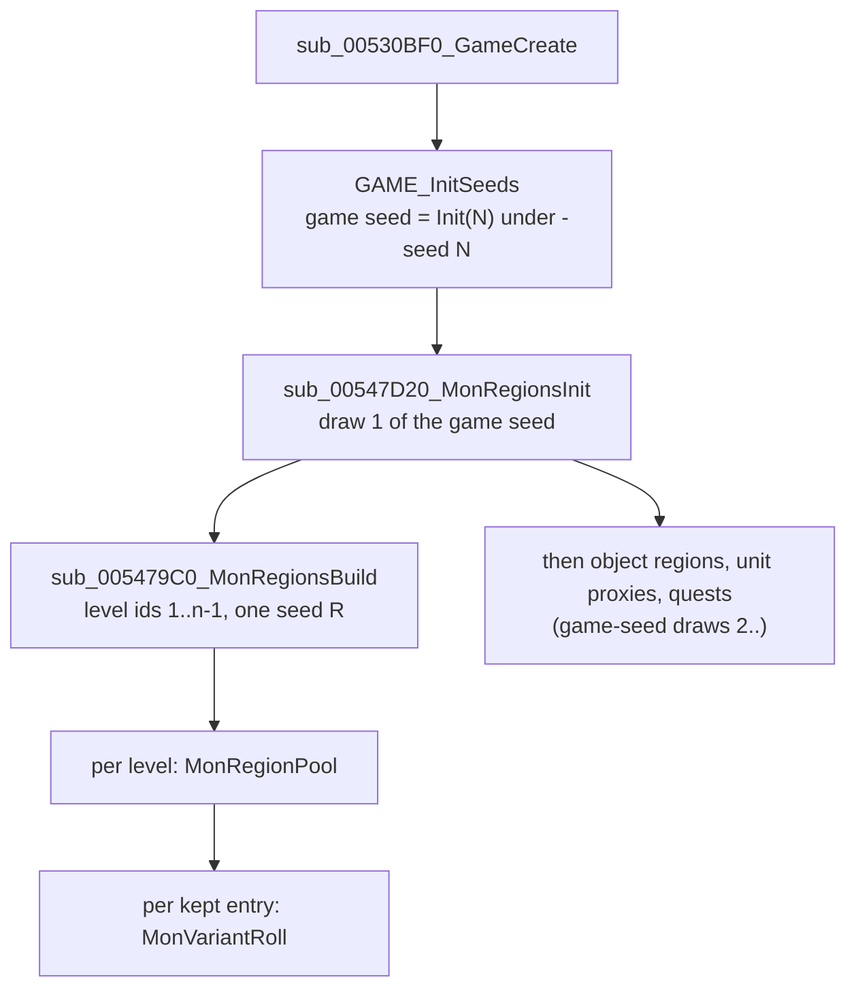

# 0001 — The level monster pool ("monster regions") and the monster level

> **Subsystem:** monsters/pool
> **Question:** when and from which seed is a level's monster pool built, from which columns, how are its classes picked, where does it live, and what level does a spawned monster get?
> **Date:** 2026-10-12 (Phase 2 rest: run:2026-10-12-mon-pool-p2)   **Plan:** 0012   **Status:** answered; plan 0038 batch S3a, 2026-10-16: 4 statements raised, 6 in part (review), 3 reclassified, [§ Plan 0038 batch S3a](#plan-0038-batch-s3a-2026-10-16)

## Answer (summary)

The tags below are those of the plan 0012 record. [§ Plan 0038 batch S3a](#plan-0038-batch-s3a-2026-10-16) raises
further statements; where it lists one, its tag and evidence take precedence over the bullet here.

- [C] **The pools of all levels are built once, at game creation, from the game seed.** `sub_00547D20_MonRegionsInit`
  steps the game seed (`game+0xD0`) once, stores the low word at `game+0xEC`, and seeds a local region seed
  `R = Init(low)`. `sub_005479C0_MonRegionsBuild` then walks level ids 1 … nLevels−1 in id order and builds one
  0x2E4-byte *monster region* per level from `R`, stored at `game+0xF0 + 4·id`. Under `-seed N` this is the **first draw**
  of the game seed `Init(N)`, so every pool is a function of N and the difficulty alone. It needs neither the map seed,
  nor any act, level or room (steps 3–6 of `rng/seeds` come later and don't feed it).
  (fn:sub_00547D20_MonRegionsInit@0x00547D20, fn:sub_005479C0_MonRegionsBuild@0x005479C0, fn:sub_00530BF0_GameCreate@0x00530BF0, run:2026-10-12-mon-pool)
- [C] **Column set:** normal reads `mon1..` (Levels `+0x036`), nightmare and hell read `nmon1..` (`+0x068`). The
  selector is `difficulty != 0` and nothing else. The expansion flag is not read, so classic and expansion games use the
  same set: classic nightmare and hell games build the same regions as expansion ones (classic normal: code only, below). The candidate list is the slots up to the first blank, a count that
  `DRLG_LoadLevels` stores at load in the record's no-column bytes `+0x033` (`mon`), `+0x034` (`nmon`), `+0x035` (`umon`).
  In run:2026-10-12-mon-pool the nightmare/hell games had the difficulty byte forced at `0x00547D63` before the build's read (run record, [§ Deviations](experiments.md#run2026-10-12-mon-pool)); the pool reads difficulty only there. Natural games (no forcing) of [run:2026-10-12-mon-pool-p2](experiments.md#run2026-10-12-mon-pool-p2) reproduce too: nightmare and hell, expansion and classic, seed 1, identical to the forced seed-1 regions.
  (fn:sub_005475E0_MonRegionPool@0x005475E0, fn:DRLG_LoadLevels@0x0061C540, tbl:Levels.txt:mon1, tbl:Levels.txt:nmon1, run:2026-10-12-mon-pool, run:2026-10-12-mon-pool-p2)
- [I] A **classic normal** game reads `mon` like an expansion one: same code path, but no classic normal game was logged. (fn:sub_005475E0_MonRegionPool@0x005475E0)
- [C] **Selection:** `picks = min(NumMon, 13, candidates)`. Each pick draws `i = Range(R, remaining)`, takes
  `list[i]` and removes it from the list (no repeat of a slot; a class named twice can be taken twice). On the
  **first pick only**, if the level's `rangedspawn` is set, the pick is redrawn up to 20 times until the class has
  MonStats `rangedtype`. A picked class is **kept only if MonStats `isSpawn` is set**, but the pick still counts. There
  is no weighting at pick time: `Rarity` is copied into the entry and summed for the later spawn pick.
  (fn:sub_005475E0_MonRegionPool@0x005475E0, tbl:Levels.txt:NumMon, tbl:Levels.txt:rangedspawn, tbl:MonStats.txt:rangedtype, tbl:MonStats.txt:isSpawn, tbl:MonStats.txt:Rarity, run:2026-10-12-mon-pool, run:2026-10-12-mon-pool-p2)
- [C] **Each kept entry then rolls up to three appearance sets** from the same `R`
  (`sub_005BDB20_MonVariantRoll`, MonStats2 component counts). Those draws sit between one level's pool and the next
  level's, so a reimplementation must make them to keep `R` in step. (fn:sub_005BDB20_MonVariantRoll@0x005BDB20, run:2026-10-12-mon-pool, run:2026-10-12-mon-pool-p2)
- [C] **Monster level** (`sub_00573CB0_MonStatsInit`, at every server monster creation):
  `d = min(difficulty, 2)`, forced to 0 for the five hireling classes. `level = MonStats Level/Level(N)/Level(H)[d]`,
  but in an **expansion** game with `d > 0` and neither `noRatio` nor `boss`, `level = Levels MonLvl1Ex/2Ex/3Ex[d]` of the
  monster's level. Classic games (any difficulty) and normal difficulty always use MonStats. `Levels.MonLvl1..3` (classic)
  are not read for the monster level. `MonLvl.txt` is read only afterwards, for stats (`sub_006538A0_MonLvlStats`, `monsters/stats`).
  The `[C]` covers the cases logged outside town in run:2026-10-12-mon-pool-p2, where the two sources differ: expansion
  normal (MonStats), expansion nightmare and hell (`MonLvlEx`), classic nightmare and hell (MonStats), a hireling (271,
  expansion hell: `d` = 0) and a `noRatio` class (289 `claygolem`, expansion hell: MonStats). (fn:sub_00573CB0_MonStatsInit@0x00573CB0, fn:sub_0061DCA0_LevelMonLvl@0x0061DCA0, fn:sub_0063EE90_HirelingType@0x0063EE90, run:2026-10-12-mon-pool, run:2026-10-12-mon-pool-p2)
- [I] The **`boss`** exception, the other four hireling classes and **classic normal** follow the same code (the `boss` bit is
  tested next to `noRatio` at the same branch) but no such creation was logged. (fn:sub_00573CB0_MonStatsInit@0x00573CB0, fn:sub_0063EE90_HirelingType@0x0063EE90)
- [I] **`umon*` feeds champions and uniques in normal difficulty only.** `sub_005BDE80_MonRegionPickClass` with its
  unique flag picks `umon[Range(count)]` (count `+0x035`) when the difficulty is normal, and otherwise picks from the region pool
  like a normal spawn. (fn:sub_005BDE80_MonRegionPickClass@0x005BDE80, tbl:Levels.txt:umon1)
- [C] **Critters are a separate, client-side draw** per client room, from the room seed, not from the pool
  (`sub_0046C460_ClientCritters`: `cmon`/`cpct`/`camt` and the class's `MinGrp`/`MaxGrp`). The `[C]` covers the
  slot/percent/count draws from a given room seed, and that the pool is not used. The run takes each client room's seed
  from the log (`CR0`) and checks up to the first creation, a boundary oracle on the room seed (ADR-0004).
  (fn:sub_0046C460_ClientCritters@0x0046C460, tbl:Levels.txt:cmon1, tbl:Levels.txt:cpct1, run:2026-10-12-mon-pool)
- [C] **Ordinal 723 is used as a record position.** The pool code indexes `g_pMonStats` by the stored value. In every
  run *Pandemonium 3* (level 135) has an entry of class 723, and runtime record 723 is byte-identical to
  `monstats.bin` record 723 (the second `cr_lancer8`). `g_MonStatsLink` is the name link that the table loader
  fills while compiling `.txt` tables, and nothing reads it at game time (below). The hell cases: In run:2026-10-12-mon-pool the nightmare/hell games had the difficulty byte forced at `0x00547D63` before the build's read (run record, [§ Deviations](experiments.md#run2026-10-12-mon-pool)); the pool reads difficulty only there. The natural hell games of run:2026-10-12-mon-pool-p2 (expansion and classic, seed 1) also hold class 723 in level 135. (fn:sub_005475E0_MonRegionPool@0x005475E0, data:g_MonStatsLink@0x0096C6AC, run:2026-10-12-mon-pool, run:2026-10-12-mon-pool-p2)

## Leads used

Blind first: every claim above was written from the code and checked by the run before either source below was
fetched (2026-10-12). Both are registered in [sources.md](../../sources.md). Agreement promotes nothing.

- [L] src:rpgkdh-levels-guide: "`Mon1-Mon10`: Normal only … `Nmon1-10`: Nightmare/Hell only". **held**
  Detail: selector `difficulty != 0` at `0x00547A28`. The guide doesn't separate classic from expansion, and the code reads no game-type flag here.
- [L] src:rpgkdh-levels-guide: "`NumMon`: Number of different Monsters Type that will be present in this area". **held with refinement**
  Detail: `min(NumMon, 13, candidates)` picks, but a pick whose class has `isSpawn` 0 is dropped and still counts (*Mountain Top* builds
  an empty pool), and a class named twice can fill two slots. So "different" is not guaranteed.
- [L] src:rpgkdh-levels-guide: "`Rangedspawn`: (Unknown)". **not covered**
  Detail: first-pick redraw rule (up to 20 redraws until `rangedtype`), `sub_005475E0_MonRegionPool`.
- [L] src:rpgkdh-levels-guide: "`Umon1-10`: Normal only. Champion/Unique Species". **held**
  Detail: `sub_005BDE80_MonRegionPickClass` reads `umon` only when the difficulty is normal; in nightmare and hell champions and uniques come from the region pool.
- [L] src:rpgkdh-levels-guide: "`MonLvl1/2/3` … `MonLvl1Ex/2Ex/3Ex`: Area Level … in D2X (controls the item level of items that drop from chests etc)". **not covered**
  Detail: the guide gives no monster-level rule. The code reads `MonLvl*Ex` for expansion nightmare/hell monsters, and never reads `MonLvl1..3` for a monster level.
- [L] src:pk-monstats-guide: "`Level`: … only used on normal. On nightmare and hell the monsters level is identical with the area level from Levels.txt, **unless** … BOSS … set to 1". **held with refinement**
  Detail: true for expansion games only. In a classic game MonStats `Level(N)`/`Level(H)` are used in every difficulty
  (the `game+0x70` test at `0x00573E20`). `noRatio` also keeps the MonStats level, and the five hireling classes
  always take normal's `Level`. Both branches are now logged outside town (run:2026-10-12-mon-pool-p2, §5).
- [L] src:pk-monstats-guide: "`IsSpawn` … controls whenever this unit can be spawned via Levels.txt"; "`Rarity` … 0 … never be selected by Levels.txt". **held with refinement**
  Detail: `isSpawn` 0 drops the class from the pool after it was picked (the pick counts). `Rarity` is not used by the pool pick at all.
  A `Rarity` 0 entry stays in the pool with weight 0, so the weighted spawn pick (`sub_005BDE80`) never lands on it.
- [L] src:rpgkdh-levels-guide: "`Cmon1-4`: Critter Species 1-4. Use id from monstats2.txt and only monsters with critter column set to 1"; "`cpct`/`camt`: (unknown)". **held with refinement**
  Detail: the stored value is a MonStats record position (`imul 0x1A8` at `0x0046C4EF`). The two logged critter classes (`chicken` 149,
  `bug` 268) have a MonStats2 row of the same name. `sub_0046C460` tests no critter flag. `cpct` is a percent chance per slot per
  client room and `camt` a count multiplier (0 = none); the guide calls both unknown.

## Functions

| Address | Name | Role | Tag |
|---|---|---|---|
| `0x00530BF0` | `sub_00530BF0_GameCreate` | server game creation used by single player (caller of every logged region build, return `0x00530DCF`) | C |
| `0x00530930` | `sub_00530930_GameCreateA` | the other game-creation path, same call order after `GAME_InitSeeds` | I |
| `0x00547D20` | `sub_00547D20_MonRegionsInit` | one game-seed draw, `game+0xEC = low`, `R = Init(low)`, builds the regions into `game+0xF0` | C |
| `0x005479C0` | `sub_005479C0_MonRegionsBuild` | per level id 1..n−1: allocate, copy the Levels fields, pool, variants | C |
| `0x005475E0` | `sub_005475E0_MonRegionPool` | the pool pick | C |
| `0x005BDB20` | `sub_005BDB20_MonVariantRoll` | appearance sets of one entry (MonStats2 components) | C |
| `0x00547B50` | `sub_00547B50_MonRegionsFree` | frees the regions | I |
| `0x00547BB0` | `sub_00547BB0_MonRegionGet` | `regions[levelId]` (`ECX` = `game+0xF0`, `EDX` = id) | I |
| `0x00547BC0` | `sub_00547BC0_MonRegionFindAdd` | entry of a class in its room's region; adds it (up to 13) with variants from the unit seed | C (S3a; the 13-entry bound not met) |
| `0x005BDE80` | `sub_005BDE80_MonRegionPickClass` | spawn-time class pick: `RangeB(raritySum)` weighted walk, `umon` for normal uniques, MonStats `spawn` substitution | I |
| `0x005BE020` | `sub_005BE020_SpawnTypeRoll` | normal / champion / unique roll against `MonUMin`/`MonUMax` (`monsters/special`) | I |
| `0x0054EBC0` | `sub_0054EBC0_RoomPopulateGate` | populate only if the region's `MonDen` ≠ 0 | I |
| `0x005474C0` | `sub_005474C0_RegionActClass` | object-region reader of the pool (act-specific class ranges) | I |
| `0x00574250` | `sub_00574250_MonsterInit` | server monster init: region entry, then `MonStatsInit` | I |
| `0x00573CB0` | `sub_00573CB0_MonStatsInit` | the monster level, then the stats | C |
| `0x0063EE90` | `sub_0063EE90_HirelingType` | 1..4 for classes 271, 338, 359, 560/561, else 0 | C (S3a; 560 never created) |
| `0x0061DB70` | `LEVELS_GetRecord` | `Levels` record by id (`stdcall`), 0 if out of range | I |
| `0x0061DCA0` | `sub_0061DCA0_LevelMonLvl` | `MonLvl[d]` or `MonLvlEx[d]` of a level (1 if no record); its `MonLvlEx` arm is the one logged in run:2026-10-12-mon-pool-p2 | I |
| `0x00451FE0` | `sub_00451FE0_MonStats2Rec` | MonStats2 record of a MonStats class (via `+0x18`) | I |
| `0x00611D30` | `sub_00611D30_DifficultyRec` | difficulty-table record; the build only checks it exists | I |
| `0x006538A0` | `sub_006538A0_MonLvlStats` | reads `monlvl.bin` for HP/AC/TH/DM/XP (`monsters/stats`) | I |
| `0x00483360` | `sub_00483360_MulDiv` | `ECX · EDX / arg`, 64-bit when large | I |
| `0x0046C460` | `sub_0046C460_ClientCritters` | client critters of one room | C |
| `0x0046C1A0` | `sub_0046C1A0_ClientCritterCreate` | creates one critter (draws placement and unit seed from the room seed) | I |

## Walkthrough

### 1. Where and when (game creation)



- [C] `sub_00530BF0_GameCreate` calls, in order, `GAME_InitSeeds`, `0x00541470`, `0x0053F4B0`, `0x005379A0`,
  `0x00539A30`, `0x0052B5E0`, (`0x00539000` if `game+0x6A` = 1), `0x0053FF90`, then `sub_00547D20_MonRegionsInit`.
  Every logged build returns to `0x00530DCF` in this function. `sub_00530930_GameCreateA` has the same sequence
  without the three middle calls `[I]`. (fn:sub_00530BF0_GameCreate@0x00530BF0, run:2026-10-12-mon-pool)
- [C] `MonRegionsInit` (`ECX` = game; fn:sub_00547D20_MonRegionsInit@0x00547D20, run:2026-10-12-mon-pool):
  ```c
  // fn:sub_00547D20_MonRegionsInit@0x00547D20 (from the disassembly, renamed)
  RNG_SeedInitOne(&R);
  game->seed = step(game->seed);            // 64-bit: seed.lo * 0x6AC690C5 + seed.hi
  RNG_SeedInit(&R, game->seed.lo);          // R = {lo, 666}
  game->monRegionSeedLow = game->seed.lo;   // +0xEC
  MonRegionsBuild(/*ECX*/ game+0x1C /*allocator*/, /*EDX*/ &game->pMonRegions /*+0xF0*/,
                  &R, game->seed.lo, game->difficulty /*+0x6D*/, game->expansion /*+0x70*/);
  ```
  In all ten runs the game seed at this point is exactly one step of `Init(N)` (`tools/monpool.py check` finds the
  index), so `-seed N` with no prior draw: pools depend on N and the difficulty only. (run:2026-10-12-mon-pool)
- [I] The next game-creation calls (`0x00546C60` object regions, `0x00536070` unit proxies, `0x00545D80` quests) also
  draw from the game seed. This pins the first of the "draws 1–4 before the player" that `rng/seeds` lists as open.

### 2. The region build (`sub_005479C0_MonRegionsBuild`)

- [C] It re-seeds `R = Init(low)` (the same value) and fails fatally if `sub_00611D30_DifficultyRec(diff)` is null.
  For `id = 1 … nLevels−1` (`g_pDataTables+0xC5C`), in id order:
  allocate and zero 0x2E4 bytes, then copy from `L = LEVELS_GetRecord(id)`:
  `act = L+0x03`, `levelId = id`, `monDen = L+0x1C+4·diff`, `monUMin = L+0x28+diff`, `monUMax = L+0x2B+diff`,
  `monWndr = L+0x2E`, `quest = L+0x30`, `+0x2D4 = +0x0C = −1`, and `monLvl = monLvl2 = (expansion ? L+0x16 : L+0x10)[diff]`
  (s16). It then calls `MonRegionPool(L)` with `ECX = (diff != 0)`, `EDX` = region, `EBX` = `&R`. After that, for each entry
  `i < nPool`, it calls `MonVariantRoll(&R, &entries[i], 3)`, and stores the region at `game+0xF0 + 4·id`. Level 0 (*Null*) gets no region.
  Both arms of the `monLvl` copy are logged: expansion (`+0x16`) in every game, classic (`+0x10`) in the classic games of run:2026-10-12-mon-pool-p2.
  (fn:sub_005479C0_MonRegionsBuild@0x005479C0, struct:MonRegion, struct:Game, run:2026-10-12-mon-pool, run:2026-10-12-mon-pool-p2)
- [I] `monLvl`/`monLvl2` (`+0x2DC`/`+0x2E0`) are written and **never read** (struct:MonRegion, fn:sub_005479C0_MonRegionsBuild@0x005479C0). A byte search of the whole `.text` finds no other
  displacement-`0x2DC`/`0x2E0` access in the whole binary. The monster level comes from section 5, not from here (in the
  classic games of run:2026-10-12-mon-pool-p2 the region holds the classic `MonLvl` while the monsters take MonStats `Level*`).

### 3. The pool (`sub_005475E0_MonRegionPool`)

```c
// fn:sub_005475E0_MonRegionPool@0x005475E0 (trimmed, renamed). ECX = nightmareOrHell, EDX = region, EBX = &R
bound = min(L->NumMon /*+0x32 u8*/, 13);
count = nightmareOrHell ? L->nNmon /*+0x34*/ : L->nMon /*+0x33*/;   // filled by DRLG_LoadLevels
if (count < bound) bound = count;
cand[0..count) = nightmareOrHell ? L->nmon[] /*+0x68*/ : L->mon[] /*+0x36*/;   // s16 each
for (p = 0; p < bound; p++) {
    if (count < 1) break;
    i = Range(R, count);                         // inline: step R, low & (count-1) if pow2, else low % count
    c = cand[i];
    if (p == 0 && L->rangedspawn /*+0x31*/) {
        for (t = 0; t < 20; t++) {               // unrolled 4 x 5 in the binary (0x0054790D: add 5; cmp 0x14)
            if (MonStats(c) && MonStats(c)->flagsF & 0x10 /*rangedtype*/) break;
            i = Range(R, count);  c = cand[i];
        }
    }
    count--;  memmove(&cand[i], &cand[i+1], (count - i) * 2);   // remove slot i
    if (MonStats(c) && MonStats(c)->flagsC & 0x01 /*isSpawn*/) {
        e = &region->entries[region->nPool];
        e->classId = c;  e->rarity = MonStats(c)->Rarity /*+0x2E*/;
        region->raritySum += e->rarity;  region->nEntries++;  region->nPool++;
    }
}
```

- [C] The draws are `Range(R, n)` with the current remaining count. The binary inlines it with the power-of-two
  mask, which gives the same value as `low % n` (`rng` README). A class is valid if `0 ≤ c < nMonStats`; the record is
  `g_pMonStats + 0x1A8·c`, a **record position**. `enabled` is not tested. No pool cell names a disabled class (Levels § survey).
  (fn:sub_005475E0_MonRegionPool@0x005475E0, run:2026-10-12-mon-pool)
- [C] Data consequences seen in the runs: the 10 levels with `NumMon` 0 and *Mountain Top* (three `ancientbarb*`, all
  `isSpawn` 0) have empty pools. 85 (normal) / 104 (nightmare, hell) levels have more candidates than picks. Every
  run has 6–10 regions holding the same class twice. All 20 `rangedspawn` levels are built with the rule. In run:2026-10-12-mon-pool the nightmare/hell games had the difficulty byte forced at `0x00547D63` before the build's read (run record, [§ Deviations](experiments.md#run2026-10-12-mon-pool)); the pool reads difficulty only there. The natural nightmare and hell games (expansion and classic, seed 1) of run:2026-10-12-mon-pool-p2 reproduce as well. (run:2026-10-12-mon-pool, run:2026-10-12-mon-pool-p2)
- [C] The candidate count is computed at load. `DRLG_LoadLevels` counts, for each record, the leading slots of
  `mon`/`nmon`/`umon` (25 each) that are not negative, and stores the counts as bytes at `+0x033`/`+0x034`/`+0x035`. These are the
  "no `.txt` column, 0 in every record" bytes of the Levels doc. Stock data has no blank before a set slot, so the count equals the
  number of set slots. (fn:DRLG_LoadLevels@0x0061C540)

### 4. Variant sets (`sub_005BDB20_MonVariantRoll(R, entry, n = 3)`)

- [C] `m2 = MonStats2(entry.class)` (fn:sub_00451FE0_MonStats2Rec@0x00451FE0: MonStats `+0x18` → `monstats2` record, 0x134 B). If none, it stops.
  `comp[16] = m2+0x15..+0x24` (one count per component: the number of entries in `HDv`, `TRv`, … `S8v` of `monstats2.txt`, by
  data); `cap = (1 << (m2[+0x25] & 31)) − entry.nVariants`; `n = min(n, cap)`; then `n` is clamped so that
  `nVariants + n ≤ 3`.
  1. If `nVariants == 0`: set 0 = `comp[c] < 2 ? 0 : Range(R, comp[c])` for c = 0..15 in order, `nVariants = 1`, `n−1`.
  2. If n > 0: list `K` = the components with `comp > 1`, in order (k of them). If k = 0, stop. If k = 1, `a = b = K[0]`.
     Otherwise `u = Range(R, k)`, `a = K[u]`, `K[u] = K[k−1]`, `b = K[Range(R, k−1)]` (so `b ≠ a`).
  3. n times: new set = copy of set 0. Then `new[a] = Range(R, comp[a])`, and if `a ≠ b`, `new[b] = Range(R, comp[b])`. Each existing
     set equal to `new` costs one of 3 tries; it rerolls a and b while some set was equal and tries ≠ 0. Then the set is
     appended (`nVariants++`).
  (fn:sub_005BDB20_MonVariantRoll@0x005BDB20, run:2026-10-12-mon-pool)
- [I] `m2+0x25` is not a column: the `.txt` compiler stores Σ over the sixteen component lists of `count − 1` (counts ≥ 2), capped at 254
  ([data/0004](../data/0004-cell-converters.md), fn:sub_00657010_MonStats2CompList@0x00657010); `[C]` for the stock values by the archivist's
  diff of all 609 records ([MonStats2](../../tables/MonStats2.md)). The stock values seen in the runs are 0, `0x10`, `0x31`. With 0 the cap is one
  set (461 classes). With 16 or more it never binds.

### 5. The monster level (`sub_00573CB0_MonStatsInit`)

```c
// fn:sub_00573CB0_MonStatsInit@0x00573CB0 (0x00573DC1..0x00573E70, renamed). ESI = unit, [EBP+8] = game, [EBP+0xC] = room
d = game->difficulty;  if (d > 2) d = 2;
if (sub_0063EE90_HirelingType(unit) != 0) d = 0;          // roguehire, act2hire, act3hire, act5hire1/2
level = (s16) ms->Level[d];                               // MonStats +0xAA + 2d
if (game->expansion /*+0x70*/ && d > 0 && !(ms->flagsC & 0x04 /*noRatio*/) && !(ms->flagsC & 0x40 /*boss*/))
    level = sub_0061DCA0_LevelMonLvl(RoomLevelId(room), d, game->expansion);   // Levels MonLvlEx[d], 1 if no level
SetStat(unit, 12 /*level*/, level);
```

- [C] The rule as above, for the cases where the logged level tells the two sources apart
  ([run:2026-10-12-mon-pool-p2](experiments.md#run2026-10-12-mon-pool-p2), every game natural, `-seed 1`; MLV logs the chosen
  level and the `d` actually used, `EDI` at `0x00573E56`):
  - expansion hell and nightmare, *Jail Level 1* (29): classes 384 and 57 get 71 / 41 = `MonLvl3Ex`/`MonLvl2Ex`, not their
    MonStats `Level(H)`/`Level(N)` 70 / 40 (nine creations per game);
  - classic hell and nightmare, same level and classes: 70 / 40 = MonStats `Level(H)`/`Level(N)`, not the area level;
  - expansion normal, *Stony Field* (4): class 6 gets MonStats `Level` 2, not `MonLvl1Ex` 4 (14 creations);
  - hireling: the mercenary (271 `roguehire`) loaded in an expansion hell game is created with `d` = 0 and level 1
    (MonStats `Level`; `Level(H)` is 67);
  - `noRatio`: a Clay Golem (289) cast in *Jail Level 1*, expansion hell, gets MonStats `Level(H)` (blank, 0), not 71.
  The 47 town NPCs of run:2026-10-12-mon-pool and the town NPCs of every -p2 game take 0, which both sources give.
  (fn:sub_00573CB0_MonStatsInit@0x00573CB0, fn:sub_0061DCA0_LevelMonLvl@0x0061DCA0, fn:sub_0063EE90_HirelingType@0x0063EE90, tbl:Levels.txt:MonLvl1Ex, tbl:MonStats.txt:Level, run:2026-10-12-mon-pool, run:2026-10-12-mon-pool-p2)
- [I] Not exercised: the `boss` test (no boss-flag class was created), the hireling classes other than 271, classic normal,
  and a creation with no level record (the `1` fallback of `sub_0061DCA0`). (fn:sub_00573CB0_MonStatsInit@0x00573CB0, fn:sub_0061DCA0_LevelMonLvl@0x0061DCA0)
- [I] Consequences (fn:sub_00573CB0_MonStatsInit@0x00573CB0, tbl:Levels.txt:MonLvl1Ex): in an expansion game, nightmare/hell monsters take the area level, normal monsters keep their
  MonStats `Level` (the Phase 0 survey: `Level` equals `MonLvl1Ex` for only 248 of 540 `mon` entries). Town NPCs in nightmare/hell
  get the town's `MonLvl*Ex`, which is blank (0); the -p2 camp NPCs show 0, which their MonStats `Level*` (0) also gives.
- [I] Then `sub_006538A0_MonLvlStats(class, Lflag, d, level, 7, out)` reads `monlvl.bin` row `min(level, nMonLvl−1)`. It uses the
  `L-` columns when `Lflag = (game+0x6A ≠ 0 || game+0x74 ≠ 0)`, not by the expansion flag `+0x70` (`0x00573F41`; HP column
  offset `0x30 + 0xC·Lflag + 4·d` at `0x0065395C`). That is stats (`monsters/stats`). The pool and the level rule do not read `monlvl.bin`.
  `game+0x6A` was 3 in every single-player run, the classic games of run:2026-10-12-mon-pool-p2 included. (fn:sub_006538A0_MonLvlStats@0x006538A0, tbl:MonLvl.txt:HP)
- Champion, unique and minion level bonuses are applied after this by the special-monster code (`monsters/special`), not read here.

### 6. Who reads the pool (named for `monsters/spawn`)

- [I] `sub_0054EC90_RoomPopulate` → `sub_0054EBC0_RoomPopulateGate` (region `MonDen` ≠ 0) →
  `sub_005BDE80_MonRegionPickClass(room, &rec, 20, 0)`. With `nPool` = 0 nothing spawns. Otherwise
  `RangeB(roomSeed, raritySum) + 1` walks the entries subtracting `rarity`. If the class has MonStats `spawn` and
  `placespawn`, a `% 100 > 20` roll substitutes the `spawn` class. `sub_005BE020_SpawnTypeRoll` decides normal/champion/unique
  from `MonUMin`/`MonUMax` and region counters. With the unique flag and normal difficulty, the class comes from `umon` instead.
  (fn:sub_0054EC90_RoomPopulate@0x0054EC90, fn:sub_005BDE80_MonRegionPickClass@0x005BDE80, fn:sub_005BE020_SpawnTypeRoll@0x005BE020)
- [I] *Mountain Top* (`MonDen` 0) and *Siege 1* in normal (`MonDen` 0) never pass the gate (fn:sub_0054EBC0_RoomPopulateGate@0x0054EBC0, tbl:Levels.txt:MonDen), so they get no random population whatever their pool.
- [I] `sub_00574250_MonsterInit` calls `sub_00547BC0_MonRegionFindAdd` for every server monster (fn:sub_00574250_MonsterInit@0x00574250, fn:sub_00547BC0_MonRegionFindAdd@0x00547BC0). A class not yet in its level's region is
  appended (while `nEntries` < 13 and MonStats2 `+0xEC` > 2) with variants rolled from the **unit** seed, not `R`.

### 7. Critters (`sub_0046C460_ClientCritters`)

- [C] Client side, per client room, seed = the room's `+0x6C`. For each `cmon` slot k (s16 at Levels `+0xCC+2k`) until a
  negative one: step; if `low % 100 < cpct[k]` (`+0xD4`, unsigned compare): `n = RangeB(MaxGrp − MinGrp) + MinGrp` of the
  class's MonStats record (`+0x2F`/`+0x30`; so `MaxGrp` itself is never reached when they differ), `n *= camt[k]` if
  `camt` (`+0xDC`) ≠ 0. Then `n` calls of `sub_0046C1A0_ClientCritterCreate(room, class)`, each of which draws further from the same room seed.
  Nothing here touches the region pool. The run checks every room with no critters to its seed after, and every critter
  room up to its first creation (seed, class, count of the first slot). The room seed comes from the log (`CR0`): a
  boundary oracle (ADR-0004), so the `[C]` is scoped to the slot/percent/count draws from a given room seed and to the pool
  not being used. (fn:sub_0046C460_ClientCritters@0x0046C460, tbl:Levels.txt:cmon1, tbl:Levels.txt:cpct1, tbl:Levels.txt:camt1, run:2026-10-12-mon-pool)

### 8. Ordinal 723 and `g_MonStatsLink` (backlog spec-writer → reverser (a))

- [C] Pool code (`sub_005475E0`), spawn pick, critters and monster init all address MonStats as
  `g_pMonStats + 0x1A8·index`. *Pandemonium 3*'s first slot (723) entered its region in all ten games, and runtime record
  723 equals `monstats.bin` record 723, the **second `cr_lancer8`**, not `overseer6`. So the second `cr_lancer8` is
  the one in the pool. Whether a spawned unit of class 723 is ever seen in play is a `monsters/spawn` matter.
  In run:2026-10-12-mon-pool the nightmare/hell games had the difficulty byte forced at `0x00547D63` before the build's read (run record, [§ Deviations](experiments.md#run2026-10-12-mon-pool)); the pool reads difficulty only there. The natural hell games of run:2026-10-12-mon-pool-p2 (seed 1, expansion and classic) hold 723 in level 135 too.
  (fn:sub_005475E0_MonRegionPool@0x005475E0, run:2026-10-12-mon-pool, run:2026-10-12-mon-pool-p2)
- [I] `g_MonStatsLink` is created by `EXCEL_LinkCreate` in `MONSTATS_Load` right before `DATATBLS_LoadTable("monstats")`, which
  fills it with the key column, and freed with the table (`0x0065A190`). It appears only in table **descriptors**
  (Levels `mon*`/`nmon*`/`umon*`/`cmon*`, MonStats `BaseId`/`NextInClass`/`minion*`/`spawn`, SuperUniques `Class`, and
  two other loaders `0x00656620`, `0x00659E60`), that is, when a `.txt` is compiled. In the decompiled range
  `0x00401000`–`0x006CC000` there is no game-time name lookup through it. (fn:MONSTATS_Load@0x00651210, data:g_MonStatsLink@0x0096C6AC)

## Data touched

- `tbl:Levels.txt:Act`, `tbl:Levels.txt:NumMon`, `tbl:Levels.txt:rangedspawn`, `tbl:Levels.txt:mon1`…, `tbl:Levels.txt:nmon1`…,
  `tbl:Levels.txt:umon1`…, `tbl:Levels.txt:MonDen`, `tbl:Levels.txt:MonUMin`, `tbl:Levels.txt:MonUMax`, `tbl:Levels.txt:MonWndr`,
  `tbl:Levels.txt:Quest`, `tbl:Levels.txt:MonLvl1`, `tbl:Levels.txt:MonLvl1Ex`, `tbl:Levels.txt:cmon1`, `tbl:Levels.txt:cpct1`, `tbl:Levels.txt:camt1`;
  runtime bytes `+0x033`/`+0x034`/`+0x035` (slot counts, written by `DRLG_LoadLevels`).
- `tbl:MonStats.txt:isSpawn` (`+0x0C` bit 0), `tbl:MonStats.txt:noRatio` (bit 2), `tbl:MonStats.txt:boss` (bit 6),
  `tbl:MonStats.txt:rangedtype` (`+0x0F` bit 4), `tbl:MonStats.txt:Rarity` (`+0x2E`), `tbl:MonStats.txt:MinGrp`, `tbl:MonStats.txt:MaxGrp`,
  `tbl:MonStats.txt:Level` (`+0xAA`, `(N)`, `(H)`), `tbl:MonStats.txt:MonStatsEx` (`+0x18`).
- [MonStats2](../../tables/MonStats2.md): `+0x15..+0x24` (16 component counts, `tbl:MonStats2.txt:HDv`…`S8v`), `+0x25` (Σ(count − 1),
  computed by the compiler, [data/0004](../data/0004-cell-converters.md)), `+0xEC` (`tbl:MonStats2.txt:TotalPieces`).
- `tbl:MonLvl.txt:HP` (read by `sub_006538A0_MonLvlStats`, stats only).
- `struct:MonRegion`, `struct:MonRegionEntry`, `struct:Game` (`+0x6A`, `+0x6D`, `+0x70`, `+0x74`, `+0xD0`, `+0xEC`, `+0xF0`).

## Dead ends

- Expected the pool at level creation or room activation (the plan's three options). It is neither: it is built at game creation, for every level at once.
- Looked for a reader of region `+0x2DC`/`+0x2E0` as the monster level. There is none. The level comes from MonStats or straight from `Levels` via `sub_0061DCA0`.
- Forcing nightmare/hell by writing the difficulty byte at `0x00547D63` builds a correct nightmare/hell region set, but the
  game does not go on into the world for a normal-only character. No monster is created, so no nightmare/hell monster level was logged.

## Plan 0038 batch S3a (2026-10-16)

Static batch S3a of [plan 0038](../../plans/0038-inferred-claims-sweep.md) took 13 inferred statements of
[monsters/pool](../../specs/monsters/pool.md), rows of [the inventory](../../plans/0038-inventory/monsters-pool.md) (spec
lines `Lnnn` at `main` `b349849`). No game ran. The checks are `python3 -I tools/mon_sweep.py pool` and `tables`
([tools/mon_sweep.py](../../../tools/mon_sweep.py)) over the kept stock logs of run:2026-10-12-mon-pool, run:2026-10-12-mon-pool-p2,
run:2026-10-13-mon-spawn, run:2026-10-14-mon-special and run:2026-10-15-mon-stats, every sha256 checked against its record
(`mon_sweep.py logs`, batch manifest `workspace/logs/sweep-s3a-manifest.txt`, sha256 `274ed527…f37b`); the addenda are under
those runs in [experiments.md](experiments.md). Each existing checker still reports 0 mismatches on its run's logs
(`tools/monpool.py check` 3040/3040 on the 17 `monpool*` logs, `tools/monstats.py check` 62 991 checks, `tools/monspawn.py
check` 114 363 / 390 144 / 296 910). A counterfactual line (`cf`) is a sensitivity check, not evidence.

**`MonRegionFindAdd`, modelled (new).** Re-read in Ghidra for this batch (`sub_00547BC0_MonRegionFindAdd`, decompile of the
pinned image): classes 0xC3, 0xC4, 0x126 and 0x128 (`act2male`, `act2female`, `act3male`, `act3female`) get no entry; a class
already among the region's `nEntries` (`+0x12`) entries returns that entry; with more than 12 entries it returns none;
otherwise, when the class's MonStats2 `TotalPieces` (`+0xEC`) is above 2, it writes the class into the next slot, raises
`nEntries` (not `nPool` `+0x10`, so the spawn pick never sees the entry) and calls `MonVariantRoll(&unit.seed, entry, 3)`;
with `TotalPieces` ≤ 2 it returns the next slot unwritten (its `nVariants` is 0, so `MonStatsInit` takes the per-component
draws). [I] (fn:sub_00547BC0_MonRegionFindAdd@0x00547BC0, fn:sub_005BDB20_MonVariantRoll@0x005BDB20)
`mon_sweep.py pool` runs this model on the 11 `monstats-s*` logs, starting each region from `tools/monpool.py` and adding
every append in log order, with the unit seed at entry `Init(step(game seed at MU0).low)`:

```
creations (SI0) 4571; with a MonSpawnTry line 4568: FindAdd found 4216, added 39, stale (TotalPieces <= 2) 313
  appended: 20 single-set classes (no draw), 19 with 8 to 18 unit-seed draws, 3 sets each
unit seed at MonStatsInit entry and the new entry's sets reproduced: 4568 of 4568; failed 0
region snapshots (P0, PM0) equal to the modelled region, appends included: 1145
cf no append (FindAdd never draws): 553 creations or snapshots fail
```

The 22 creations of run:2026-10-15-mon-stats "whose entry unit seed is not an Init seed" are these 19 appends with draws
and the 3 creations with no `MonSpawnTry` line.

- **pool 22** (L568) **raised in part** (review 2026-10-16: recounted from "raised"). [C] `MonRegionFindAdd` appends a class not yet in its level's region, while the region
  holds at most 12 entries and the class's `TotalPieces` is above 2, and rolls its sets from the **unit** seed: 39 appends
  (19 drawing 8–18 unit-seed steps, 20 of single-set classes drawing none), 4216 classes found, 313 not appended for
  `TotalPieces` ≤ 2, with the unit seed at `MonStatsInit` entry and every appended set reproduced in 4568 creations and
  the region equal in 1145 snapshots. The region-full and excluded-class returns were not met. (fn:sub_00547BC0_MonRegionFindAdd@0x00547BC0,
  fn:sub_00574250_MonsterInit@0x00574250, tbl:MonStats2.txt:TotalPieces, run:2026-10-15-mon-stats)
  **Remainder `[I]`:** the 13-entry bound (`nEntries` ≥ 13 returns no entry, 0x00547C43): the largest snapshotted
  region held 10 entries, so no logged call met it. The four excluded classes of the reading above are not part of
  the spec statement and stay `[I]` (backlog entry to the spec-writer). Review sensitivity check: a model that appends
  regardless of `TotalPieces` fails 673 creations or snapshots, so the logs decide the `TotalPieces` > 2 condition.
- **pool 3** (L81) **reclassified d-none.** No `mon`, `nmon` or `umon` cell of Levels (831 cells) names a MonStats record
  with `enabled` 0 (`mon_sweep.py tables`), so no run can show that the pool code ignores the column.
- **pool 4** (L109) **raised in part.** [C] Classes 271, 338, 359 and 561 are hireling classes for the level rule: every
  mercenary creation of run:2026-10-16-hirelings, those four classes in Normal, Nightmare and Hell, takes `d` = 0 (`tools/monpool.py
  check` 10 788 of 10 788, `MLV`), as pool § E already states. (fn:sub_0063EE90_HirelingType@0x0063EE90, run:2026-10-16-hirelings)
  **Remainder, d-none:** class 560 has no `Hireling` row, so no stock path creates it as a mercenary.
- **pool 8** (L265) **reclassified a-run, H4b.** The classic Normal logs snapshot the regions of levels 3, 4, 38 and 103
  (`monstats-s7`, `monspecial-s9`); they equal the `mon` model, but the `nmon` model gives the same regions (`cf`): `mon` and
  `nmon` are equal in 116 of 136 levels and in every level before 110 (`tables`), so the region seed takes the same draws
  up to level 110. Route: one classic Normal game start with `tools/gdb/mon-pool.gdb` (its `MPR` lines hold all 136 regions,
  and levels 110–136 separate the columns).
- **pool 10** (L361) **raised in part.** [C] Over the 3040 logged regions of the 17 `monpool*` logs: the 1273 entries whose
  MonStats2 `+0x025` is 16 or more hold 3 sets each (the cap never binds); the 3360 entries with `+0x025` 0 hold set 0 only;
  and the 220 entries with `+0x025` 1 hold 2 sets, the cap `1 << 1` binding. (fn:sub_005BDB20_MonVariantRoll@0x005BDB20,
  run:2026-10-12-mon-pool, run:2026-10-12-mon-pool-p2) **Remainder, d-none:** that the cap and not the `k = 0` stop ends a
  `+0x025` = 0 entry: no stock class has `+0x025` 0 with a component count above 1 (`+0x025` is Σ(count − 1)).
- **pool 11** (L410) **raised.** [C] The classic `Levels.MonLvl1..3` columns give no monster level: in the classic games
  of run:2026-10-15-mon-stats every creation's `SI2` level is MonStats `Level*` (163 Normal, 231 Nightmare, 131 Hell), and the
  classic area level of its level differs from it in 77 Normal, all 231 Nightmare and all 131 Hell creations.
  (fn:sub_00573CB0_MonStatsInit@0x00573CB0, tbl:Levels.txt:MonLvl1, run:2026-10-15-mon-stats)
- **pool 13** (L421) **raised.** [C] A classic Normal game takes MonStats `Level`: 163 of 163 creations of `monstats-s7`
  (Stony Field, Cold Plains), 77 of them where `MonLvl1` and `MonLvl1Ex` differ from `Level`. (fn:sub_00573CB0_MonStatsInit@0x00573CB0,
  tbl:MonStats.txt:Level, run:2026-10-15-mon-stats)
- **pool 16** (L445) **raised in part.** [C] `MonLvl.txt` is read after the level, at row = the level: `MonLvlStats` of all
  4571 creations reproduced at levels 0–85, the level itself from MonStats or Levels alone. (fn:sub_006538A0_MonLvlStats@0x006538A0,
  run:2026-10-15-mon-stats) **Remainder, d-none:** the `min(level, 110)` clamp: no stock MonStats `Level*` exceeds 110 and no
  Levels area level 93.
- **pool 17** (L448) **raised.** [C] The champion, unique and minion level bonuses come after `MonStatsInit`: stat 12 at its
  exit is the rule's level (expansion) or `Level + 25·d` (classic Nightmare and Hell, Align 0), and the handlers then add
  +2 to 92 champions, +3 to 106 uniques and superuniques and +3 to 266 group members (`SIX` against the last `HST`/`TST`).
  (fn:sub_00573CB0_MonStatsInit@0x00573CB0, fn:sub_005A2120_SpecialModsApply@0x005A2120, run:2026-10-15-mon-stats)
- **pool 20** (L560) **raised.** [C] Population runs only when `monDen` ≠ 0: 267 passes on levels whose region `monDen` is 0
  closed the gate, among them *Mountain Top* (120) in run:2026-10-15-mon-stats and Normal *Siege 1* (110) in
  run:2026-10-13-mon-spawn, besides the towns 1, 75 and 103. (fn:sub_0054EBC0_RoomPopulateGate@0x0054EBC0, tbl:Levels.txt:MonDen,
  run:2026-10-13-mon-spawn, run:2026-10-15-mon-stats)
- **pool 21** (L563) **raised in part.** [C] The spawn-time pick: 2229 first picks (`RangeB(roomSeed, raritySum) + 1`, the
  walk) and 205 special picks, 19 from `umon` in Normal and 186 from the pool in Nightmare and Hell, reproduced in the three
  runs. (fn:sub_005BDE80_MonRegionPickClass@0x005BDE80, run:2026-10-13-mon-spawn, run:2026-10-14-mon-special,
  run:2026-10-15-mon-stats) **Remainder, d-none:** a `Rarity` 0 entry inside `nPool` and `nPool` = 0: no stock region has
  either (the only `Rarity` 0 pool cells are *Mountain Top*'s `isSpawn` 0 classes; the `nPool` = 0 guard counted 0).
- **pool 27** (L688) **reclassified c-emu (proposed for S1f).** The duplicate test was met once with two equal sets in
  3040 regions (tries 3 → 1) and never left `tries` below 0, and a `tries ≤ 0` model reproduces the same regions (`cf`), so
  the logs do not decide it. `MonVariantRoll` reads only the entry, its MonStats2 record and the seed: a run of
  `sub_005BDB20` under the emulator on an entry whose first two sets are equal decides it (ADR-0015).
- **pool 28** (L694) **raised in part.** [C] The classic Normal level, as pool 13. (fn:sub_00573CB0_MonStatsInit@0x00573CB0,
  run:2026-10-15-mon-stats) **Remainder, d-none:** the no-record
  fallback of `sub_0061DCA0_LevelMonLvl` (every creation is in a level with a record).

## Plan 0038 batch H4b (run:2026-10-16-sweep-monsters-b)

Harness batch H4b of [plan 0038](../../plans/0038-inferred-claims-sweep.md) took four rows of
[monsters/pool](../../specs/monsters/pool.md) ([inventory](../../plans/0038-inventory/monsters-pool.md); spec lines `Lnnn`
at `main` `e556014`). Record: [experiments.md § run:2026-10-16-sweep-monsters-b](experiments.md#run2026-10-16-sweep-monsters-b).

- **pool 8** (L265) **raised.** [C] A classic normal game builds its regions from the `mon` slots: session 9 (classic
  normal, `-seed 4806`, `tools/gdb/mon-pool.gdb`) logged 136 `MPR` regions and `tools/monpool.py check` matched all 154
  values; 23 of the 27 levels 110–136 hold a pool that the `nmon` slots would have changed.
  (fn:sub_005475E0_MonRegionPool@0x005475E0, tbl:Levels.txt:mon1, run:2026-10-16-sweep-monsters-b)
- **pool 7** (L205) and **pool 19** (L552) **raised.** [C] Nothing reads region `+0x2DC`/`+0x2E0` while monsters of the
  level are created, roam and fight: access watchpoints armed when each region was built, for levels 104 (normal), 107
  (nightmare), 111 (hell), 78, 46, 6 (normal) and 2 (classic normal), hit nothing in seven sessions (2 678 creations).
  (struct:MonRegion+0x2DC, fn:sub_005479C0_MonRegionsBuild@0x005479C0, run:2026-10-16-sweep-monsters-b) The build's own
  write comes before the watch is armed, so the write side stays as read.
- **pool 1** (L29) **reclassified d-none.** `sub_00530930_GameCreateA` has no caller in the image: no rel32 call or jump
  and no absolute pointer to `0x00530930` (`tools/xrefscan.py 0x00530930`: 0 hits; `tools/ghidra.sh xrefs`: none). No
  session can reach it, so the statement stays `[I]` as a reading of dead code.

## Plan 0038 batch S3b (2026-10-16)

Static batch S3b of [plan 0038](../../plans/0038-inferred-claims-sweep.md) took 2 inferred statements of
[monsters/pool](../../specs/monsters/pool.md), rows of [the inventory](../../plans/0038-inventory/monsters-pool.md) (spec lines
`Lnnn` at `main` `7df5039`). No game ran. The check is `python3 -I tools/sweep_s3b.py pool`: the stock `monstats2` table,
the `.bin` the pinned game compiled from the `.txt` in run:2026-10-15-cube-saves, objdump pins of the pinned image (the
second tool), and the 29 kept logs of run:2026-10-15-objects (S4b manifest, sha256 checked; addendum under the run in
[objects/experiments.md](../objects/experiments.md#run2026-10-15-objects)).

```
S3B pool cf_all_counts=13 cf_no_pool_read_ok=0 game_compile_identical=1 pins=18 raw_over_254=0 records=609
         regionactclass_sites=4 spawns=2 sum_matches=609
  +0x025 values: 0 in 461 records, largest 49
  objects-s24-2324-normal.log line 5408: fn 5 object 63, level 29, nPool 3 [39, 22, 384] -> RegionActClass 383 -> variant 384; logged 384
  objects-s24-2324-normal.log line 6861: fn 5 object 43, level 29, nPool 3 [39, 22, 384] -> RegionActClass 383 -> variant 384; logged 384
```

- **pool 9** (L355) **raised in part.** [C] The table compiler stores at `+0x025` the sum over the sixteen component
  lists of `count − 1` for each count ≥ 2, computed when it handles the last list (`S8v`): `MonStats2CompList` takes the
  sum only for list index 15 (`cmp eax, 0xF` at 0x0065712C), skips counts ≤ 1 (0x00657143), adds `count − 1`
  (0x0065714B), caps at 254 (0x00657183–0x0065718B) and stores the byte (0x00657190). Runtime: in
  run:2026-10-15-cube-saves the pinned game compiled `monstats2.txt` under `-direct -txt`, and its `monstats2.bin` is
  byte-identical to the shipped one, so the game's own compiler wrote every `+0x025` byte. Data: the byte equals the sum
  recomputed from the `.bin` counts (`+0x015..+0x024`) in all 609 records, and those counts equal the token counts of the
  `.txt` cells in all 609. A counterfactual without the count ≥ 2 rule (the plain sum of the counts) matches 13 records
  only. (fn:sub_00657010_MonStats2CompList@0x00657010, tbl:MonStats2.txt:HDv, run:2026-10-15-cube-saves)
  **Remainder, d-none:** the cap at 254. The largest uncapped sum is 49.
- **pool 23** (L571) **raised.** [C] The object-region code reads the pool. `sub_005474C0_RegionActClass` takes the
  level's `MonRegion` from `game + 0xF0` (0x0054754C, `sub_00547BB0_MonRegionGet`) and walks its `nPool` entries (byte
  `+0x010`, 0x00547563) by `classId` (`+0x014 + 0x34·i`, 0x00547570–0x005475AA): the fields `MonRegionPool` writes and
  `MonRegionPickClass` reads. Its callers are the object trap `OBJTRAP_MonsterSpawn` and its region test, the casket and
  the barrel (0x00582338, 0x00582568, 0x005864C9, 0x0058696D). Runtime: the two barrel spawns of run:2026-10-15-objects
  (`objects-s24`, level 29, Normal, pool `[39, 22, 384]`) created class 384 (`skmage_fire2`). The reading below gives 383
  for that pool, and `sub_0063EC70_LevelClassVariant` maps it to the level's `mon` class of the same `BaseId`, 384. A
  counterfactual that does not read the pool (the default 0xEA, `flyingscimitar`) gives class 234 and fails both.
  *Review note (S3b review, architect, ruling 3):* one uncached evaluation decides the claim, as the S2c review's ruling 4
  allows (a branch the input decides, read in two tools, reproduced). The review added a second counterfactual: the same
  walk over level 29's whole `mon` list (`[22, 39, 57, 172, 384]`) instead of the region's pool gives base 170 and class
  172, not the logged 384. So the spawn reads the pool, not the level's list. The raise covers "the object-region code
  reads the pool"; the range bases and the cache stay `[I]` as filed.
  (fn:sub_005474C0_RegionActClass@0x005474C0, fn:sub_00547BB0_MonRegionGet@0x00547BB0, struct:MonRegion+0x10,
  fn:OBJOP_Barrel@0x005868A0, fn:sub_0063EC70_LevelClassVariant@0x0063EC70, run:2026-10-15-objects)
- New reading, `[I]` (for `objects` and this spec's consumer list; spec-writer entry in the backlog). The result is cached
  in the object region's level record (`+0x1C`, −1 at creation; returned at once when it is a valid class, 0x005474F1).
  Otherwise the record gets 0xEA (`flyingscimitar`, 0x0054755C), and the walk takes the first pool entry that lies in one
  of the class ranges, testing for each entry first `[base, base + 5)` with `base` 0x60 (`mummy1`) in Act II and 5
  (`zombie1`) elsewhere, then `[b, b + 4)` for `b` in 0, 0xAA, 0x112, 0x17B, 0x17F, 0x183. It stores and returns `base`
  or `b`, the range's first class. In both logged spawns the second call returned the cached value. The `NextInClass`
  walk of `LevelClassVariant` (taken when no `mon` class shares the `BaseId`) is not modelled.
  (fn:sub_005474C0_RegionActClass@0x005474C0, 0x005475BF, 0x005475CF)

## Open questions

- ~~The nightmare/hell monster level and the classic branches are code-read only.~~ Logged in run:2026-10-12-mon-pool-p2
  (natural nightmare/hell, classic nightmare/hell, a hireling, a `noRatio` summon). Still open: a `boss`-flag creation
  (an act boss, which needs play), the other hireling classes (338, 359, 560, 561) and a classic normal game; and more
  seeds and acts for the natural nightmare/hell regions (only seed 1, built for all 136 levels, Act I visited).
- ~~`monstats2` `+0x25` (variant cap exponent) and `+0xEC` (the `> 2` test in `sub_00547BC0`): the meaning of each.~~ `+0x25` = Σ(count − 1) of the
  component lists, computed by the compiler ([data/0004](../data/0004-cell-converters.md)); `+0xEC` = the `TotalPieces` column (descriptor entry
  at `0x006577F5`, [MonStats2](../../tables/MonStats2.md)). Plan 0015 Phase 2.
- The draws of `sub_0046C1A0_ClientCritterCreate` (placement, client unit seed): `monsters/spawn`.
- The spawn-time readers in section 6 are named only; `monsters/spawn` and `monsters/special` read them.
