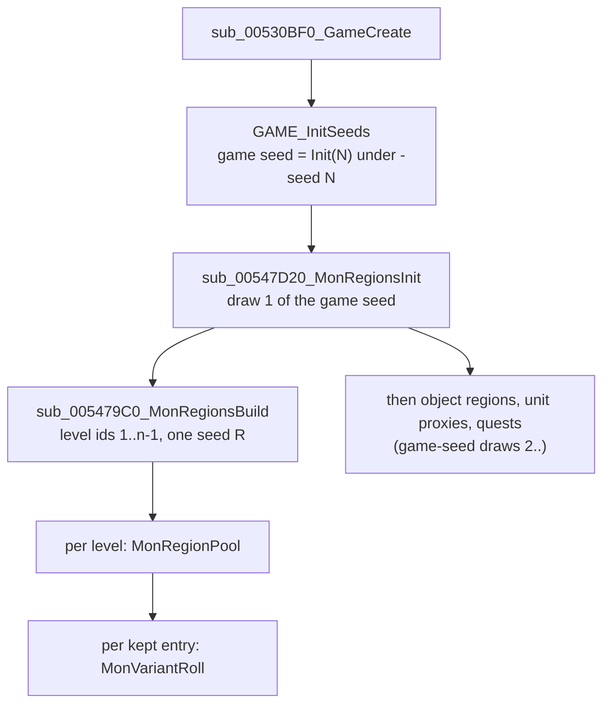

# 0001 — The level monster pool ("monster regions") and the monster level

> **Subsystem:** monsters/pool
> **Question:** when and from which seed is a level's monster pool built, from which columns, how are its classes picked, where does it live, and what level does a spawned monster get?
> **Date:** 2026-10-12   **Plan:** 0012   **Status:** answered

## Answer (summary)

- [C] **The pools of all levels are built once, at game creation, from the game seed.** `sub_00547D20_MonRegionsInit`
  steps the game seed (`game+0xD0`) once, stores the low word at `game+0xEC`, and seeds a local region seed
  `R = Init(low)`. `sub_005479C0_MonRegionsBuild` then walks level ids 1 … nLevels−1 in id order and builds one
  0x2E4-byte *monster region* per level from `R`, stored at `game+0xF0 + 4·id`. Under `-seed N` this is the **first draw**
  of the game seed `Init(N)`, so every pool is a function of N and the difficulty alone. It needs neither the map seed,
  nor any act, level or room (steps 3–6 of `rng/seeds` come later and don't feed it).
  (fn:sub_00547D20_MonRegionsInit@0x00547D20, fn:sub_005479C0_MonRegionsBuild@0x005479C0, fn:sub_00530BF0_GameCreate@0x00530BF0, run:2026-10-12-mon-pool)
- [C] **Column set:** normal reads `mon1..` (Levels `+0x036`), nightmare and hell read `nmon1..` (`+0x068`). The
  selector is `difficulty != 0` and nothing else. The expansion flag is not read, so classic and expansion games use the
  same set (classic by code only, `[I]`). The candidate list is the slots up to the first blank, a count that
  `DRLG_LoadLevels` stores at load in the record's no-column bytes `+0x033` (`mon`), `+0x034` (`nmon`), `+0x035` (`umon`).
  Nightmare/hell: difficulty byte forced at `0x00547D63` before the build's read (run record, [§ Deviations](experiments.md#run2026-10-12-mon-pool)); the pool reads difficulty only there.
  (fn:sub_005475E0_MonRegionPool@0x005475E0, fn:DRLG_LoadLevels@0x0061C540, tbl:Levels.txt:mon1, tbl:Levels.txt:nmon1, run:2026-10-12-mon-pool)
- [C] **Selection:** `picks = min(NumMon, 13, candidates)`. Each pick draws `i = Range(R, remaining)`, takes
  `list[i]` and removes it from the list (no repeat of a slot; a class named twice can be taken twice). On the
  **first pick only**, if the level's `rangedspawn` is set, the pick is redrawn up to 20 times until the class has
  MonStats `rangedtype`. A picked class is **kept only if MonStats `isSpawn` is set**, but the pick still counts. There
  is no weighting at pick time: `Rarity` is copied into the entry and summed for the later spawn pick.
  (fn:sub_005475E0_MonRegionPool@0x005475E0, tbl:Levels.txt:NumMon, tbl:Levels.txt:rangedspawn, tbl:MonStats.txt:rangedtype, tbl:MonStats.txt:isSpawn, tbl:MonStats.txt:Rarity, run:2026-10-12-mon-pool)
- [C] **Each kept entry then rolls up to three appearance sets** from the same `R`
  (`sub_005BDB20_MonVariantRoll`, MonStats2 component counts). Those draws sit between one level's pool and the next
  level's, so a reimplementation must make them to keep `R` in step. (fn:sub_005BDB20_MonVariantRoll@0x005BDB20, run:2026-10-12-mon-pool)
- [I] **Monster level** (`sub_00573CB0_MonStatsInit`, at every server monster creation):
  `d = min(difficulty, 2)`, forced to 0 for the five hireling classes. `level = MonStats Level/Level(N)/Level(H)[d]`,
  but in an **expansion** game with `d > 0` and neither `noRatio` nor `boss`, `level = Levels MonLvl1Ex/2Ex/3Ex[d]` of the
  monster's level. Classic games (any difficulty) and normal difficulty always use MonStats. `Levels.MonLvl1..3` (classic)
  are not read for the monster level. `MonLvl.txt` is read only afterwards, for stats (`sub_006538A0_MonLvlStats`, `monsters/stats`).
  The 47 logged town NPC creations (normal, expansion) match. (fn:sub_00573CB0_MonStatsInit@0x00573CB0, fn:sub_0061DCA0_LevelMonLvl@0x0061DCA0, fn:sub_0063EE90_HirelingType@0x0063EE90, run:2026-10-12-mon-pool)
- [I] **`umon*` feeds champions and uniques in normal difficulty only.** `sub_005BDE80_MonRegionPickClass` with its
  unique flag picks `umon[Range(count)]` (count `+0x035`) when the difficulty is normal, and otherwise picks from the region pool
  like a normal spawn. (fn:sub_005BDE80_MonRegionPickClass@0x005BDE80, tbl:Levels.txt:umon1)
- [C] **Critters are a separate, client-side draw** per client room, from the room seed, not from the pool
  (`sub_0046C460_ClientCritters`: `cmon`/`cpct`/`camt` and the class's `MinGrp`/`MaxGrp`). The `[C]` covers the
  slot/percent/count draws from a given room seed, and that the pool is not used. The run takes each client room's seed
  from the log (`CR0`) and checks up to the first creation, a boundary oracle on the room seed (ADR-0004).
  (fn:sub_0046C460_ClientCritters@0x0046C460, tbl:Levels.txt:cmon1, tbl:Levels.txt:cpct1, run:2026-10-12-mon-pool)
- [C] **Ordinal 723 is used as a record position.** The pool code indexes `g_pMonStats` by the stored value. In every
  run *Pandemonium 3* (level 135) has an entry of class 723, and runtime record 723 is byte-identical to
  `monstats.bin` record 723 (the second `cr_lancer8`). `g_MonStatsLink` is the name link that the table loader
  fills while compiling `.txt` tables, and nothing reads it at game time (below). The hell cases: Nightmare/hell: difficulty byte forced at `0x00547D63` before the build's read (run record, [§ Deviations](experiments.md#run2026-10-12-mon-pool)); the pool reads difficulty only there. (fn:sub_005475E0_MonRegionPool@0x005475E0, data:g_MonStatsLink@0x0096C6AC, run:2026-10-12-mon-pool)

## Leads used

Blind first: every claim above was written from the code and checked by the run before either source below was
fetched (2026-10-12). Both are registered in [sources.md](../../sources.md). Agreement promotes nothing.

- [L] src:rpgkdh-levels-guide: "`Mon1-Mon10`: Normal only … `Nmon1-10`: Nightmare/Hell only". **held**
  Detail: selector `difficulty != 0` at `0x00547A28`. The guide doesn't separate classic from expansion, and the code reads no game-type flag here.
- [L] src:rpgkdh-levels-guide: "`NumMon`: Number of different Monsters Type that will be present in this area". **held with refinement**
  Detail: `min(NumMon, 13, candidates)` picks, but a pick whose class has `isSpawn` 0 is dropped and still counts (*Mountain Top* builds
  an empty pool), and a class named twice can fill two slots. So "different" is not guaranteed.
- [L] src:rpgkdh-levels-guide: "`Rangedspawn`: (Unknown)". **not covered**
  Detail: first-pick redraw rule (up to 20 redraws until `rangedtype`), `sub_005475E0_MonRegionPool`.
- [L] src:rpgkdh-levels-guide: "`Umon1-10`: Normal only. Champion/Unique Species". **held**
  Detail: `sub_005BDE80_MonRegionPickClass` reads `umon` only when the difficulty is normal; in nightmare and hell champions and uniques come from the region pool.
- [L] src:rpgkdh-levels-guide: "`MonLvl1/2/3` … `MonLvl1Ex/2Ex/3Ex`: Area Level … in D2X (controls the item level of items that drop from chests etc)". **not covered**
  Detail: the guide gives no monster-level rule. The code reads `MonLvl*Ex` for expansion nightmare/hell monsters, and never reads `MonLvl1..3` for a monster level.
- [L] src:pk-monstats-guide: "`Level`: … only used on normal. On nightmare and hell the monsters level is identical with the area level from Levels.txt, **unless** … BOSS … set to 1". **held with refinement**
  Detail: true for expansion games only. In a classic game MonStats `Level(N)`/`Level(H)` are used in every difficulty
  (the `game+0x70` test at `0x00573E20`). `noRatio` also keeps the MonStats level, and the five hireling classes
  always take normal's `Level`. Classic and the nightmare/hell branch are `[I]` (no such creation logged).
- [L] src:pk-monstats-guide: "`IsSpawn` … controls whenever this unit can be spawned via Levels.txt"; "`Rarity` … 0 … never be selected by Levels.txt". **held with refinement**
  Detail: `isSpawn` 0 drops the class from the pool after it was picked (the pick counts). `Rarity` is not used by the pool pick at all.
  A `Rarity` 0 entry stays in the pool with weight 0, so the weighted spawn pick (`sub_005BDE80`) never lands on it.
- [L] src:rpgkdh-levels-guide: "`Cmon1-4`: Critter Species 1-4. Use id from monstats2.txt and only monsters with critter column set to 1"; "`cpct`/`camt`: (unknown)". **held with refinement**
  Detail: the stored value is a MonStats record position (`imul 0x1A8` at `0x0046C4EF`). The two logged critter classes (`chicken` 149,
  `bug` 268) have a MonStats2 row of the same name. `sub_0046C460` tests no critter flag. `cpct` is a percent chance per slot per
  client room and `camt` a count multiplier (0 = none); the guide calls both unknown.

## Functions

| Address | Name | Role | Tag |
|---|---|---|---|
| `0x00530BF0` | `sub_00530BF0_GameCreate` | server game creation used by single player (caller of every logged region build, return `0x00530DCF`) | C |
| `0x00530930` | `sub_00530930_GameCreateA` | the other game-creation path, same call order after `GAME_InitSeeds` | I |
| `0x00547D20` | `sub_00547D20_MonRegionsInit` | one game-seed draw, `game+0xEC = low`, `R = Init(low)`, builds the regions into `game+0xF0` | C |
| `0x005479C0` | `sub_005479C0_MonRegionsBuild` | per level id 1..n−1: allocate, copy the Levels fields, pool, variants | C |
| `0x005475E0` | `sub_005475E0_MonRegionPool` | the pool pick | C |
| `0x005BDB20` | `sub_005BDB20_MonVariantRoll` | appearance sets of one entry (MonStats2 components) | C |
| `0x00547B50` | `sub_00547B50_MonRegionsFree` | frees the regions | I |
| `0x00547BB0` | `sub_00547BB0_MonRegionGet` | `regions[levelId]` (`ECX` = `game+0xF0`, `EDX` = id) | I |
| `0x00547BC0` | `sub_00547BC0_MonRegionFindAdd` | entry of a class in its room's region; adds it (up to 13) with variants from the unit seed | I |
| `0x005BDE80` | `sub_005BDE80_MonRegionPickClass` | spawn-time class pick: `RangeB(raritySum)` weighted walk, `umon` for normal uniques, MonStats `spawn` substitution | I |
| `0x005BE020` | `sub_005BE020_SpawnTypeRoll` | normal / champion / unique roll against `MonUMin`/`MonUMax` (`monsters/special`) | I |
| `0x0054EBC0` | `sub_0054EBC0_RoomPopulateGate` | populate only if the region's `MonDen` ≠ 0 | I |
| `0x005474C0` | `sub_005474C0_RegionActClass` | object-region reader of the pool (act-specific class ranges) | I |
| `0x00574250` | `sub_00574250_MonsterInit` | server monster init: region entry, then `MonStatsInit` | I |
| `0x00573CB0` | `sub_00573CB0_MonStatsInit` | the monster level, then the stats | I |
| `0x0063EE90` | `sub_0063EE90_HirelingType` | 1..4 for classes 271, 338, 359, 560/561, else 0 | I |
| `0x0061DB70` | `LEVELS_GetRecord` | `Levels` record by id (`stdcall`), 0 if out of range | I |
| `0x0061DCA0` | `sub_0061DCA0_LevelMonLvl` | `MonLvl[d]` or `MonLvlEx[d]` of a level (1 if no record) | I |
| `0x00451FE0` | `sub_00451FE0_MonStats2Rec` | MonStats2 record of a MonStats class (via `+0x18`) | I |
| `0x00611D30` | `sub_00611D30_DifficultyRec` | difficulty-table record; the build only checks it exists | I |
| `0x006538A0` | `sub_006538A0_MonLvlStats` | reads `monlvl.bin` for HP/AC/TH/DM/XP (`monsters/stats`) | I |
| `0x00483360` | `sub_00483360_MulDiv` | `ECX · EDX / arg`, 64-bit when large | I |
| `0x0046C460` | `sub_0046C460_ClientCritters` | client critters of one room | C |
| `0x0046C1A0` | `sub_0046C1A0_ClientCritterCreate` | creates one critter (draws placement and unit seed from the room seed) | I |

## Walkthrough

### 1. Where and when (game creation)



- [C] `sub_00530BF0_GameCreate` calls, in order, `GAME_InitSeeds`, `0x00541470`, `0x0053F4B0`, `0x005379A0`,
  `0x00539A30`, `0x0052B5E0`, (`0x00539000` if `game+0x6A` = 1), `0x0053FF90`, then `sub_00547D20_MonRegionsInit`.
  Every logged build returns to `0x00530DCF` in this function. `sub_00530930_GameCreateA` has the same sequence
  without the three middle calls `[I]`. (fn:sub_00530BF0_GameCreate@0x00530BF0, run:2026-10-12-mon-pool)
- [C] `MonRegionsInit` (`ECX` = game; fn:sub_00547D20_MonRegionsInit@0x00547D20, run:2026-10-12-mon-pool):
  ```c
  // fn:sub_00547D20_MonRegionsInit@0x00547D20 (from the disassembly, renamed)
  RNG_SeedInitOne(&R);
  game->seed = step(game->seed);            // 64-bit: seed.lo * 0x6AC690C5 + seed.hi
  RNG_SeedInit(&R, game->seed.lo);          // R = {lo, 666}
  game->monRegionSeedLow = game->seed.lo;   // +0xEC
  MonRegionsBuild(/*ECX*/ game+0x1C /*allocator*/, /*EDX*/ &game->pMonRegions /*+0xF0*/,
                  &R, game->seed.lo, game->difficulty /*+0x6D*/, game->expansion /*+0x70*/);
  ```
  In all ten runs the game seed at this point is exactly one step of `Init(N)` (`tools/monpool.py check` finds the
  index), so `-seed N` with no prior draw: pools depend on N and the difficulty only. (run:2026-10-12-mon-pool)
- [I] The next game-creation calls (`0x00546C60` object regions, `0x00536070` unit proxies, `0x00545D80` quests) also
  draw from the game seed. This pins the first of the "draws 1–4 before the player" that `rng/seeds` lists as open.

### 2. The region build (`sub_005479C0_MonRegionsBuild`)

- [C] It re-seeds `R = Init(low)` (the same value) and fails fatally if `sub_00611D30_DifficultyRec(diff)` is null.
  For `id = 1 … nLevels−1` (`g_pDataTables+0xC5C`), in id order:
  allocate and zero 0x2E4 bytes, then copy from `L = LEVELS_GetRecord(id)`:
  `act = L+0x03`, `levelId = id`, `monDen = L+0x1C+4·diff`, `monUMin = L+0x28+diff`, `monUMax = L+0x2B+diff`,
  `monWndr = L+0x2E`, `quest = L+0x30`, `+0x2D4 = +0x0C = −1`, and `monLvl = monLvl2 = (expansion ? L+0x16 : L+0x10)[diff]`
  (s16). It then calls `MonRegionPool(L)` with `ECX = (diff != 0)`, `EDX` = region, `EBX` = `&R`. After that, for each entry
  `i < nPool`, it calls `MonVariantRoll(&R, &entries[i], 3)`, and stores the region at `game+0xF0 + 4·id`. Level 0 (*Null*) gets no region.
  (fn:sub_005479C0_MonRegionsBuild@0x005479C0, struct:MonRegion, struct:Game, run:2026-10-12-mon-pool)
- [I] `monLvl`/`monLvl2` (`+0x2DC`/`+0x2E0`) are written and **never read** (struct:MonRegion, fn:sub_005479C0_MonRegionsBuild@0x005479C0). A byte search of the whole `.text` finds no other
  displacement-`0x2DC`/`0x2E0` access in the whole binary. The monster level comes from section 4, not from here. The runs
  only show the expansion value (all ten games were expansion games).

### 3. The pool (`sub_005475E0_MonRegionPool`)

```c
// fn:sub_005475E0_MonRegionPool@0x005475E0 (trimmed, renamed). ECX = nightmareOrHell, EDX = region, EBX = &R
bound = min(L->NumMon /*+0x32 u8*/, 13);
count = nightmareOrHell ? L->nNmon /*+0x34*/ : L->nMon /*+0x33*/;   // filled by DRLG_LoadLevels
if (count < bound) bound = count;
cand[0..count) = nightmareOrHell ? L->nmon[] /*+0x68*/ : L->mon[] /*+0x36*/;   // s16 each
for (p = 0; p < bound; p++) {
    if (count < 1) break;
    i = Range(R, count);                         // inline: step R, low & (count-1) if pow2, else low % count
    c = cand[i];
    if (p == 0 && L->rangedspawn /*+0x31*/) {
        for (t = 0; t < 20; t++) {               // unrolled 4 x 5 in the binary (0x0054790D: add 5; cmp 0x14)
            if (MonStats(c) && MonStats(c)->flagsF & 0x10 /*rangedtype*/) break;
            i = Range(R, count);  c = cand[i];
        }
    }
    count--;  memmove(&cand[i], &cand[i+1], (count - i) * 2);   // remove slot i
    if (MonStats(c) && MonStats(c)->flagsC & 0x01 /*isSpawn*/) {
        e = &region->entries[region->nPool];
        e->classId = c;  e->rarity = MonStats(c)->Rarity /*+0x2E*/;
        region->raritySum += e->rarity;  region->nEntries++;  region->nPool++;
    }
}
```

- [C] The draws are `Range(R, n)` with the current remaining count. The binary inlines it with the power-of-two
  mask, which gives the same value as `low % n` (`rng` README). A class is valid if `0 ≤ c < nMonStats`; the record is
  `g_pMonStats + 0x1A8·c`, a **record position**. `enabled` is not tested. No pool cell names a disabled class (Levels § survey).
  (fn:sub_005475E0_MonRegionPool@0x005475E0, run:2026-10-12-mon-pool)
- [C] Data consequences seen in the runs: the 10 levels with `NumMon` 0 and *Mountain Top* (three `ancientbarb*`, all
  `isSpawn` 0) have empty pools. 85 (normal) / 104 (nightmare, hell) levels have more candidates than picks. Every
  run has 6–10 regions holding the same class twice. All 20 `rangedspawn` levels are built with the rule. Nightmare/hell: difficulty byte forced at `0x00547D63` before the build's read (run record, [§ Deviations](experiments.md#run2026-10-12-mon-pool)); the pool reads difficulty only there. (run:2026-10-12-mon-pool)
- [C] The candidate count is computed at load. `DRLG_LoadLevels` counts, for each record, the leading slots of
  `mon`/`nmon`/`umon` (25 each) that are not negative, and stores the counts as bytes at `+0x033`/`+0x034`/`+0x035`. These are the
  "no `.txt` column, 0 in every record" bytes of the Levels doc. Stock data has no blank before a set slot, so the count equals the
  number of set slots. (fn:DRLG_LoadLevels@0x0061C540)

### 4. Variant sets (`sub_005BDB20_MonVariantRoll(R, entry, n = 3)`)

- [C] `m2 = MonStats2(entry.class)` (fn:sub_00451FE0_MonStats2Rec@0x00451FE0: MonStats `+0x18` → `monstats2` record, 0x134 B). If none, it stops.
  `comp[16] = m2+0x15..+0x24` (one count per component: the number of entries in `HDv`, `TRv`, … `S8v` of `monstats2.txt`, by
  data); `cap = (1 << (m2[+0x25] & 31)) − entry.nVariants`; `n = min(n, cap)`; then `n` is clamped so that
  `nVariants + n ≤ 3`.
  1. If `nVariants == 0`: set 0 = `comp[c] < 2 ? 0 : Range(R, comp[c])` for c = 0..15 in order, `nVariants = 1`, `n−1`.
  2. If n > 0: list `K` = the components with `comp > 1`, in order (k of them). If k = 0, stop. If k = 1, `a = b = K[0]`.
     Otherwise `u = Range(R, k)`, `a = K[u]`, `K[u] = K[k−1]`, `b = K[Range(R, k−1)]` (so `b ≠ a`).
  3. n times: new set = copy of set 0. Then `new[a] = Range(R, comp[a])`, and if `a ≠ b`, `new[b] = Range(R, comp[b])`. Each existing
     set equal to `new` costs one of 3 tries; it rerolls a and b while some set was equal and tries ≠ 0. Then the set is
     appended (`nVariants++`).
  (fn:sub_005BDB20_MonVariantRoll@0x005BDB20, run:2026-10-12-mon-pool)
- [I] What `m2+0x25` means is open (fn:sub_005BDB20_MonVariantRoll@0x005BDB20); the stock values seen are 0, `0x10`, `0x31`. With 0 the cap is one set. With 16 or more it never binds.

### 5. The monster level (`sub_00573CB0_MonStatsInit`)

```c
// fn:sub_00573CB0_MonStatsInit@0x00573CB0 (0x00573DC1..0x00573E70, renamed). ESI = unit, [EBP+8] = game, [EBP+0xC] = room
d = game->difficulty;  if (d > 2) d = 2;
if (sub_0063EE90_HirelingType(unit) != 0) d = 0;          // roguehire, act2hire, act3hire, act5hire1/2
level = (s16) ms->Level[d];                               // MonStats +0xAA + 2d
if (game->expansion /*+0x70*/ && d > 0 && !(ms->flagsC & 0x04 /*noRatio*/) && !(ms->flagsC & 0x40 /*boss*/))
    level = sub_0061DCA0_LevelMonLvl(RoomLevelId(room), d, game->expansion);   // Levels MonLvlEx[d], 1 if no level
SetStat(unit, 12 /*level*/, level);
```

- [I] The rule as above. The run logged 47 creations, all town NPCs in normal expansion games (acts 1–5), and every one
  gives MonStats `Level` (0 for these classes). Nightmare/hell creation was not reached (see the run's limits), so the `MonLvlEx` branch
  and the classic branch rest on the code. (fn:sub_00573CB0_MonStatsInit@0x00573CB0, run:2026-10-12-mon-pool)
- [I] Consequences (fn:sub_00573CB0_MonStatsInit@0x00573CB0, tbl:Levels.txt:MonLvl1Ex): in an expansion game, nightmare/hell monsters take the area level, normal monsters keep their
  MonStats `Level` (the Phase 0 survey: `Level` equals `MonLvl1Ex` for only 248 of 540 `mon` entries). Town NPCs in nightmare/hell
  get the town's `MonLvl*Ex`, which is blank (0).
- [I] Then `sub_006538A0_MonLvlStats(class, Lflag, d, level, 7, out)` reads `monlvl.bin` row `min(level, nMonLvl−1)`. It uses the
  `L-` columns when `Lflag = (game+0x6A ≠ 0 || game+0x74 ≠ 0)`, not by the expansion flag `+0x70` (`0x00573F41`; HP column
  offset `0x30 + 0xC·Lflag + 4·d` at `0x0065395C`). That is stats (`monsters/stats`). The pool and the level rule do not read `monlvl.bin`.
  `game+0x6A` was 3 in every single-player run. (fn:sub_006538A0_MonLvlStats@0x006538A0, tbl:MonLvl.txt:HP)
- Champion, unique and minion level bonuses are applied after this by the special-monster code (`monsters/special`), not read here.

### 6. Who reads the pool (named for `monsters/spawn`)

- [I] `sub_0054EC90_RoomPopulate` → `sub_0054EBC0_RoomPopulateGate` (region `MonDen` ≠ 0) →
  `sub_005BDE80_MonRegionPickClass(room, &rec, 20, 0)`. With `nPool` = 0 nothing spawns. Otherwise
  `RangeB(roomSeed, raritySum) + 1` walks the entries subtracting `rarity`. If the class has MonStats `spawn` and
  `placespawn`, a `% 100 > 20` roll substitutes the `spawn` class. `sub_005BE020_SpawnTypeRoll` decides normal/champion/unique
  from `MonUMin`/`MonUMax` and region counters. With the unique flag and normal difficulty, the class comes from `umon` instead.
  (fn:sub_0054EC90_RoomPopulate@0x0054EC90, fn:sub_005BDE80_MonRegionPickClass@0x005BDE80, fn:sub_005BE020_SpawnTypeRoll@0x005BE020)
- [I] *Mountain Top* (`MonDen` 0) and *Siege 1* in normal (`MonDen` 0) never pass the gate (fn:sub_0054EBC0_RoomPopulateGate@0x0054EBC0, tbl:Levels.txt:MonDen), so they get no random population whatever their pool.
- [I] `sub_00574250_MonsterInit` calls `sub_00547BC0_MonRegionFindAdd` for every server monster (fn:sub_00574250_MonsterInit@0x00574250, fn:sub_00547BC0_MonRegionFindAdd@0x00547BC0). A class not yet in its level's region is
  appended (while `nEntries` < 13 and MonStats2 `+0xEC` > 2) with variants rolled from the **unit** seed, not `R`.

### 7. Critters (`sub_0046C460_ClientCritters`)

- [C] Client side, per client room, seed = the room's `+0x6C`. For each `cmon` slot k (s16 at Levels `+0xCC+2k`) until a
  negative one: step; if `low % 100 < cpct[k]` (`+0xD4`, unsigned compare): `n = RangeB(MaxGrp − MinGrp) + MinGrp` of the
  class's MonStats record (`+0x2F`/`+0x30`; so `MaxGrp` itself is never reached when they differ), `n *= camt[k]` if
  `camt` (`+0xDC`) ≠ 0. Then `n` calls of `sub_0046C1A0_ClientCritterCreate(room, class)`, each of which draws further from the same room seed.
  Nothing here touches the region pool. The run checks every room with no critters to its seed after, and every critter
  room up to its first creation (seed, class, count of the first slot). The room seed comes from the log (`CR0`): a
  boundary oracle (ADR-0004), so the `[C]` is scoped to the slot/percent/count draws from a given room seed and to the pool
  not being used. (fn:sub_0046C460_ClientCritters@0x0046C460, tbl:Levels.txt:cmon1, tbl:Levels.txt:cpct1, tbl:Levels.txt:camt1, run:2026-10-12-mon-pool)

### 8. Ordinal 723 and `g_MonStatsLink` (backlog spec-writer → reverser (a))

- [C] Pool code (`sub_005475E0`), spawn pick, critters and monster init all address MonStats as
  `g_pMonStats + 0x1A8·index`. *Pandemonium 3*'s first slot (723) entered its region in all ten games, and runtime record
  723 equals `monstats.bin` record 723, the **second `cr_lancer8`**, not `overseer6`. So the second `cr_lancer8` is
  the one in the pool. Whether a spawned unit of class 723 is ever seen in play is a `monsters/spawn` matter.
  Nightmare/hell: difficulty byte forced at `0x00547D63` before the build's read (run record, [§ Deviations](experiments.md#run2026-10-12-mon-pool)); the pool reads difficulty only there.
  (fn:sub_005475E0_MonRegionPool@0x005475E0, run:2026-10-12-mon-pool)
- [I] `g_MonStatsLink` is created by `EXCEL_LinkCreate` in `MONSTATS_Load` right before `DATATBLS_LoadTable("monstats")`, which
  fills it with the key column, and freed with the table (`0x0065A190`). It appears only in table **descriptors**
  (Levels `mon*`/`nmon*`/`umon*`/`cmon*`, MonStats `BaseId`/`NextInClass`/`minion*`/`spawn`, SuperUniques `Class`, and
  two other loaders `0x00656620`, `0x00659E60`), that is, when a `.txt` is compiled. In the decompiled range
  `0x00401000`–`0x006CC000` there is no game-time name lookup through it. (fn:MONSTATS_Load@0x00651210, data:g_MonStatsLink@0x0096C6AC)

## Data touched

- `tbl:Levels.txt:Act`, `tbl:Levels.txt:NumMon`, `tbl:Levels.txt:rangedspawn`, `tbl:Levels.txt:mon1`…, `tbl:Levels.txt:nmon1`…,
  `tbl:Levels.txt:umon1`…, `tbl:Levels.txt:MonDen`, `tbl:Levels.txt:MonUMin`, `tbl:Levels.txt:MonUMax`, `tbl:Levels.txt:MonWndr`,
  `tbl:Levels.txt:Quest`, `tbl:Levels.txt:MonLvl1`, `tbl:Levels.txt:MonLvl1Ex`, `tbl:Levels.txt:cmon1`, `tbl:Levels.txt:cpct1`, `tbl:Levels.txt:camt1`;
  runtime bytes `+0x033`/`+0x034`/`+0x035` (slot counts, written by `DRLG_LoadLevels`).
- `tbl:MonStats.txt:isSpawn` (`+0x0C` bit 0), `tbl:MonStats.txt:noRatio` (bit 2), `tbl:MonStats.txt:boss` (bit 6),
  `tbl:MonStats.txt:rangedtype` (`+0x0F` bit 4), `tbl:MonStats.txt:Rarity` (`+0x2E`), `tbl:MonStats.txt:MinGrp`, `tbl:MonStats.txt:MaxGrp`,
  `tbl:MonStats.txt:Level` (`+0xAA`, `(N)`, `(H)`), `tbl:MonStats.txt:MonStatsEx` (`+0x18`).
- `monstats2.bin` `+0x15..+0x24` (16 component counts) and `+0x25`: no table doc yet (backlog to the archivist).
- `tbl:MonLvl.txt:HP` (read by `sub_006538A0_MonLvlStats`, stats only).
- `struct:MonRegion`, `struct:MonRegionEntry`, `struct:Game` (`+0x6A`, `+0x6D`, `+0x70`, `+0x74`, `+0xD0`, `+0xEC`, `+0xF0`).

## Dead ends

- Expected the pool at level creation or room activation (the plan's three options). It is neither: it is built at game creation, for every level at once.
- Looked for a reader of region `+0x2DC`/`+0x2E0` as the monster level. There is none. The level comes from MonStats or straight from `Levels` via `sub_0061DCA0`.
- Forcing nightmare/hell by writing the difficulty byte at `0x00547D63` builds a correct nightmare/hell region set, but the
  game does not go on into the world for a normal-only character. No monster is created, so no nightmare/hell monster level was logged.

## Open questions

- The nightmare/hell monster level (`MonLvlEx` branch, `noRatio`/`boss` exceptions, hirelings) and the classic branches (pool
  with `game+0x70` = 0, monster level from MonStats in every difficulty) are code-read only. Resolve with a run that loads a
  character allowed into nightmare and hell (a saves-directory swap, which this session was not permitted to do) and a
  classic character, and logs MLV for monsters outside town.
- `monstats2` `+0x25` (variant cap exponent) and `+0xEC` (the `> 2` test in `sub_00547BC0`): the meaning of each. Needs a MonStats2 table doc.
- The draws of `sub_0046C1A0_ClientCritterCreate` (placement, client unit seed): `monsters/spawn`.
- The spawn-time readers in section 6 are named only; `monsters/spawn` and `monsters/special` read them.
