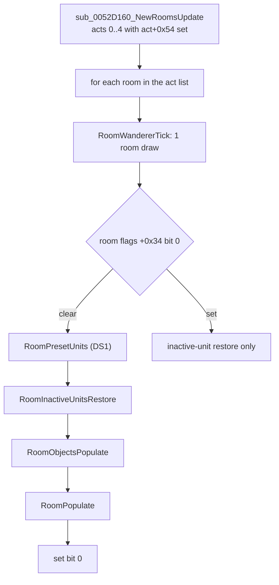
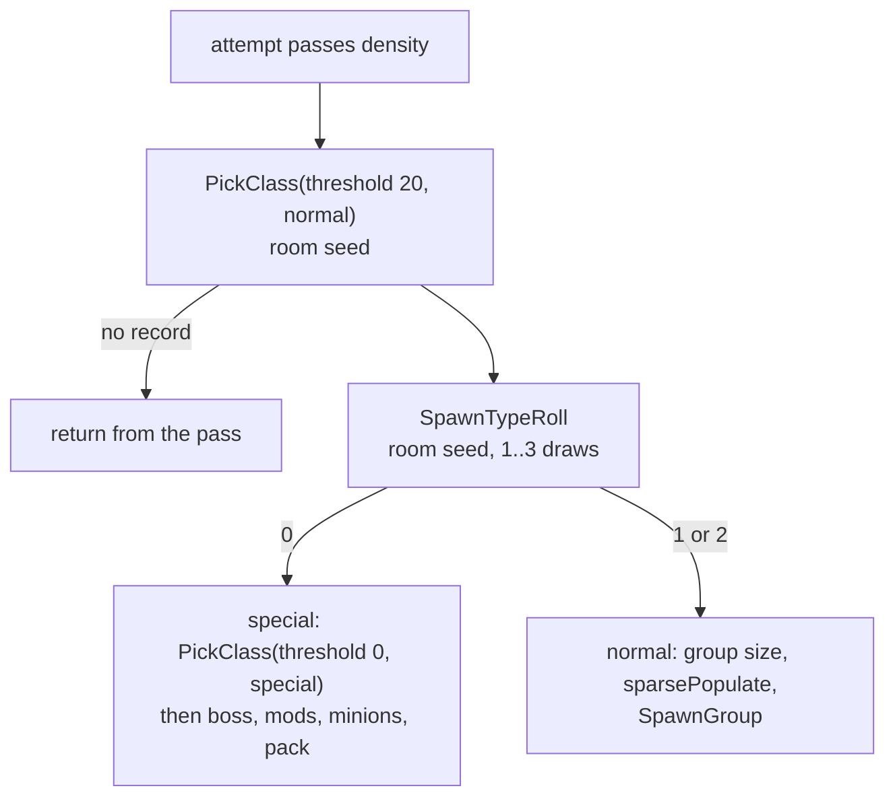

# 0002 — Random population of a room: density, class pick, type roll, groups, minions, placement

> **Subsystem:** monsters/spawn
> **Question:** when a server room is activated, how does the game decide how many monster groups it gets, which class and type (normal, champion, unique) each is, how many monsters and minions it holds, and where they stand?
> **Date:** 2026-10-13   **Plan:** 0014 (Phase 1 static reading; Phase 1b cross-check; Phase 2 reproduction, run:2026-10-13-mon-spawn)   **Status:** reproduced (Phase 2, under the oracles of § 9); plan 0038 batch S3a, 2026-10-16: 7 statements raised, 17 reclassified, [§ Plan 0038 batch S3a](#plan-0038-batch-s3a-2026-10-16)

## Answer (summary)

The tags below are those of the plan 0014 record. [§ Plan 0038 batch S3a](#plan-0038-batch-s3a-2026-10-16) raises
further statements; where it lists one, its tag and evidence take precedence over the bullet here.

- [C] **When.** On the server, `sub_0052D160_NewRoomsUpdate` walks the room list of every act that has new rooms. For each room
  it first runs the wanderer tick (one active-room-seed draw, every time). Then, if bit 0 of the active-room flags
  (`+0x34`) is clear, it runs in this order: DS1 preset units, inactive-unit restore, object population, **the
  population pass `sub_0054EC90_RoomPopulate`**, and finally sets bit 0. A single-room twin, `sub_0052D0F0_RoomUpdateOne`,
  does the same. (fn:sub_0052D160_NewRoomsUpdate@0x0052D160, fn:sub_0052D0F0_RoomUpdateOne@0x0052D0F0, fn:sub_0054F060_RoomWandererTick@0x0054F060)
- [C] **Seeds.** The pass draws from **two** seeds. The **game seed** (`game+0xD0`) gives the density roll of each attempt,
  the `sparsePopulate` roll and, through `SUnitCreate`, one draw per monster created (`rng/seeds` 7a). The **active-room
  seed** (`room+0x6C`, initialised at `rng/seeds` step 6c) gives the class picks, the type roll and every position draw.
  Group size, champion-or-unique, minion counts and pack sizes come from the **leader's or boss's unit seed**. Before the pass, the wanderer tick, the preset units and the object population
  have already stepped the room seed, so its value at pass entry is step 6c plus those draws. (fn:sub_0054EC90_RoomPopulate@0x0054EC90, fn:sub_005B2A00_MonSpawnTry@0x005B2A00, fn:sub_00555230_SUnitCreate@0x00555230)
- [C] **Density.** For every spawn box of the room's DRLG room (a list of tile rectangles; `kind` 0 and region id ≠ 0
  only), `attempts = ((bottom−top)·5 / 3) · ((right−left)·5 / 3)` (subtiles, signed division truncating toward zero). Each attempt
  draws the game seed and goes on iff `low mod 100000 ≤ monDen`, with `monDen` (the region's `MonDen[difficulty]`)
  first clamped to 10000. So one attempt succeeds with probability `(monDen+1)/100000`. (fn:sub_0054EC90_RoomPopulate@0x0054EC90, tbl:Levels.txt:MonDen, struct:MonRegion+0x2B8, struct:LogicBox+0x10)
- [C] **Class and type.** A successful attempt picks a class (`MonRegionPickClass`, threshold 20). It then calls `SpawnTypeRoll`
  (room seed, 1 to 3 draws). That roll returns 0 ("special") when the level is still below `MonUMin` and
  `r < 100·roomsVisited/roomCount`, or, while below `MonUMax`, when `r < 6`. Otherwise it returns 1 or 2, and **the pass
  maps 1 to 2**, so both mean "normal group". The champion branch for return 1 (`0x0054EEE4`) is unreachable. The
  count compared is the region's **special counter** `+0x2C8`. It counts every champion, unique and champion-pack
  member alive in the level, so the per-level count builds up over the game and is not fixed at level creation. (fn:sub_005BE020_SpawnTypeRoll@0x005BE020, fn:sub_005BDE80_MonRegionPickClass@0x005BDE80, struct:MonRegion+0x2C8, tbl:Levels.txt:MonUMin)
- [C] **Normal group.** The group size comes from `MinGrp`/`MaxGrp` (forced to 1/1 when the class's `BaseId` is `fallen1` or `scarab1`), after an optional
  `sparsePopulate` game-seed roll. The leader stands at a random point of the box. The other `min−1 + RangeB(leader seed, max−min+1)`
  members are placed in rings of 3, 6 and 9 subtiles around it. **Every** member then gets its own minions: `RandRangeIncl(unit seed, PartyMin, PartyMax)`
  monsters alternating `minion1`/`minion2`, rings of 3 to 12 subtiles. (fn:sub_0054DF80_SpawnGroup@0x0054DF80, fn:sub_005B2830_MinionsSpawn@0x005B2830, tbl:MonStats.txt:MinGrp, tbl:MonStats.txt:PartyMin, tbl:MonStats.txt:minion1)
- [C] **Special group.** The class is picked again: from `umon` in normal difficulty, otherwise from the pool with substitution threshold 0. One
  boss is placed and marked special. The **boss's unit seed** decides champion (`Range(100) <` the MonUMod record 0
  value at `+0x1C`) or unique. A unique gets `3 + RangeB(4)` minions (`minion1`, else its own class), rings of 3, 6 and 9. A champion gets `seed mod 3 + 1` pack members
  of its own class, rings of 3 to 12, each also counted as special. Mods and names are `monsters/special`. (fn:sub_005A43E0_SpecialMonSpawn@0x005A43E0, fn:sub_005A0760_SpecialModsRoll@0x005A0760, fn:sub_005A0C00_UniqueMinions@0x005A0C00, fn:sub_0054E1E0_ChampionPack@0x0054E1E0)
- [C] **Placement.** Every creation goes through `sub_005B2A00_MonSpawnTry`. With radius −1 it tests the centre (3 room
  draws). With radius n it walks rings 3, 6 … 3n: per ring 3 draws plus one `RangeB`, then up to 8·s cells along the ring. A cell
  is accepted when it lies inside the box (or the room), in the same box region, passes a class-specific cell test, and
  passes **the collision test `sub_0064D9B0_CollisionTest`**: a mask test of the room's u16 collision grid at the
  monster's `SizeX` footprint. (fn:sub_005B2A00_MonSpawnTry@0x005B2A00, fn:sub_0064D9B0_CollisionTest@0x0064D9B0, fn:sub_0054DC40_SpawnPosPick@0x0054DC40)
- [C] **Phase 2 reproduction.** `tools/monspawn.py` replays 516 room activations of three owner-played games (seeds 12345
  and 1, normal and hell, Acts I–V) with 0 mismatches in 110 302 checks. Every room seed is predicted from the `-seed` value through the wanderer tick (516
  of 516); at pass entry it is taken after the presets / inactive-restore / objects window (a seed oracle), and it is
  predicted end to end, with that window drawing nothing, in 176 rooms, 11 of them populated. There are
  169 populated rooms, 916 creations with their positions, 4 champion packs and 20 unique groups. Every claim above
  marked `[C]` depends on the oracles named in § 9: the four position predicates (value oracles), the gate's DRLG parts and
  the logic-box list, and the seed oracles before the pass, inside `SUnitCreate` and in the special mods. The `[I]` bullets
  of the walkthrough are branches the run did not reach (`sparsePopulate`, spawnCol-1 tile placement, tentaclehead minions,
  the evilhut object, the no-record exit, the wanderer roll). (run:2026-10-13-mon-spawn, fn:sub_0054EC90_RoomPopulate@0x0054EC90)
- [I] **Boundary decision: oracle.** The collision *test* is short and is read here. The *grid* it reads is built from DT1 sub-tile flags and
  changes with every unit that is placed, objects and earlier monsters included. That is the
  unread `drlg/collision` subsystem. Phase 2 therefore logs each collision call (arguments and result) as an ADR-0004 value
  oracle, and does the same for the other position predicates whose inputs are DRLG state (§ 9). (fn:sub_0064D9B0_CollisionTest@0x0064D9B0, fn:sub_0061B130_LogicRegionIdAt@0x0061B130)

## Leads used

The finding was written from code (Phase 1). The sources below were fetched and read afterwards, on 2026-10-13, for
the plan 0014 Phase 1b cross-check (blind first): `src:d2dfg-blizzard` and `src:arreat-summit-bonuses` in Phase 1b, and
`src:pk-monstats-guide` (1.10–1.14) and `src:rpgkdh-levels-guide` (no version beyond "D2X") re-fetched and read in the fix
pass at the start of Phase 2 (raw HTML). None of the pages has code. `src:d2dfg-blizzard` names no game version and may
describe a later build, so a contradiction with it may be a version difference. Agreement promotes nothing.

**Density**

- [L] src:d2dfg-blizzard: `MonDen` is "a random value out of 100000, which will determine whether to spawn or not spawn a
  monster pack in the room", and 0 means no random monsters. **held with refinement**
  Detail: the roll is per attempt, not per room. A spawn box gets `(5h/3)·(5w/3)` attempts, each drawing the game seed and
  going on iff `low mod 100000 ≤ min(monDen, 10000)`, so `(monDen+1)/100000` per attempt; 0 closes the gate (§ 2, § 3).
- [L] src:rpgkdh-levels-guide: `MonDen` "Can be set to values above 10000, but should be left well below 3000".
  **held with refinement**
  Detail: a value above 10000 loads, but the pass clamps the region's copy to 10000 and writes it back (`0x0054ECE2`), so
  anything above 10000 behaves as 10000 (every attempt passes with probability 10001/100000). The stock maximum is 2200 (§ 3).

**Class pick**

- [L] src:d2dfg-blizzard: `Rarity` "modifies the chance that this monster will be chosen to spawn in the area level".
  **held with refinement**
  Detail: it is the weight of the `RangeB(raritySum) + 1` walk over the region pool, on the room seed (§ 4).
- [L] src:d2dfg-blizzard: `umon1`–`umon25` define "which monsters can spawn as Unique monsters on this area level for
  Normal Difficulty". **held with refinement**
  Detail: in Normal the class of every random special (champion or unique) comes from `umon`; in Nightmare and Hell it is a
  second pool pick with substitution threshold 0 (§ 4, § 5).
- [L] src:d2dfg-blizzard: `placespawn` marks a "spawner" and `spawn` names "what kind of monster is spawned from this
  monster". **not covered**
  Detail: the page does not describe the pick-time substitution (`% 100 > 20` for a normal pick, `> 0` for a special
  pick, § 4).

**Type roll and the per-level count**

- [L] src:d2dfg-blizzard: `MonUMin` is "the minimum number of Unique Monsters that can spawn in the area level".
  **held with refinement**
  Detail: it is not a guarantee. While the live special count is below `MonUMin`, an attempt is special with probability
  `⌊100·visited/rooms⌋/100`, which reaches 1 in the level's last room to be activated, but only attempts that pass density
  roll at all. Champions count as well as uniques (§ 4).
- [L] src:d2dfg-blizzard: `MonUMax`: "Each room in the area level will attempt to spawn a Unique Monster with a 5/100
  random chance, and this field's value will cap the number of successful attempts for the entire area level".
  **contradicted** ([backlog](../../backlog.md), 2026-10-13 reverser → reverser, Phase 2 required cases; settled by run:2026-10-13-mon-spawn:
  252 logged MonUMax draws, one special at exactly `r = 5`, and the live count checked across every champion pack)
  Detail: on three counts. The roll is made per attempt that passes density, not once per room. The chance is **6/100**:
  `cmp ecx, 5; jle` returns special for `low mod 100 ≤ 5` (re-read at `0x005BE0DB`). The cap is compared with the low byte
  of a **live count of special monsters** (`+0x2C8`), which counts champion-pack members, preset specials and superuniques
  and goes down when one leaves the level, not the number of successful rolls (§ 4).
- [L] src:arreat-summit-bonuses: "When a random Champion or Unique pack spawns there is 20% chance that it will be
  Champion", 80 % unique. **held with refinement**
  Detail: the 20 is data, MonUMod row 0 `constants` (§ 5), and the roll is `Range(boss.seed, 100) < 20` after the boss is
  placed, not part of the room-seed type roll.

- [L] src:rpgkdh-levels-guide: `MonUMin`/`MonUMax`: "Minimum/Maximum Unique and Champion Monsters Spawned in this Level".
  **held with refinement**
  Detail: both champions and uniques count, but as a live count (`+0x2C8`, low byte) that also counts champion-pack members,
  preset specials and superuniques and drops when one leaves the level. `MonUMin` is a catch-up probability, not a
  guarantee, and `MonUMax` caps the flat 6/100 test, not the total (§ 4).

**Group size**

- [L] src:d2dfg-blizzard: `MinGrp`/`MaxGrp`: "The actual number is a random value chosen between the "MinGrp" and "MaxGrp"
  field values". **held with refinement**
  Detail: inclusive and uniform, `min − 1 + RangeB(leader.seed, max − min + 1)` members after the leader; forced to 1/1 for
  `BaseId` `fallen1`/`scarab1`; placement failures make the group smaller (§ 5).
- [L] src:d2dfg-blizzard: `sparsePopulate` "controls the percent chance that this monster does not spawn, and another monster
  will spawn in its place. (Out of 100)". **contradicted** ([backlog](../../backlog.md), 2026-10-13 reverser → reverser)
  Detail: re-read at `0x0054EE4D`–`0x0054EE8C`: the game-seed roll skips the group when `low mod 100 > sparsePopulate`
  (`jg 0x0054EEB2`, the attempt-loop decrement). So the group spawns with probability `(sparsePopulate+1)/100`
  (`evilhut`, 40: 41/100), the opposite sense, and nothing replaces it in that attempt. Stock data never
  reaches this roll (§ 5), so only modified data can show it in a run. Not a Phase 2 case (architect ruling 2026-10-13):
  carried under *Open questions*.
- [L] src:pk-monstats-guide: `sparsePopulate` "controls the overall chance something will spawn in percentages, leaving it
  blank is the same as 100%". **held with refinement**
  Detail: the group spawns iff `low mod 100 ≤ v` on the game seed, so the chance is `(v+1)/100`, not `v/100`; blank (0) skips
  the roll, so 100 % (§ 5). Stock data never reaches the roll.
- [L] src:pk-monstats-guide: on a failed `sparsePopulate` roll "other one may take its place", and with a low value "it will
  only spawn those minions without the "main" unit". **contradicted** (Open question; [backlog](../../backlog.md), 2026-10-13
  reverser → reverser)
  Detail: `jg 0x0054EEB2` goes to the attempt-loop decrement before `SpawnGroup`, so a failed roll creates no leader, no
  members and no minions, and no other class is picked in that attempt (§ 5). Not a Phase 2 case (architect ruling).
- [L] src:arreat-summit-bonuses: "Champions spawn in groups of 2-4". **held**
  Detail: the boss plus `seed mod 3 + 1` pack members (§ 5). Which pack member gets which champion mod is `monsters/special`
  and was not compared.

**Minions**

- [L] src:d2dfg-blizzard: `PartyMin`/`PartyMax`: the number of minions, using `minion1` and `minion2`, "a random value chosen
  between" the two. **held with refinement**
  Detail: every member of a normal group (leader included) gets its own `RandRangeIncl(unit.seed, PartyMin, PartyMax)`
  minions, alternating `minion1`/`minion2` (`minion2` only if valid). A random special boss gets none (§ 6).
- [L] src:pk-monstats-guide: `PartyMin`/`PartyMax`: "how many minions are spawned together with this unit". **held**
  Detail: `RandRangeIncl(unit.seed, PartyMin, PartyMax)` minions per creation without flag `0x40` (§ 6).
- [L] src:pk-monstats-guide: "If the monster spawns as unique or superunique then it will have the unit from MINION1/2 set as its
  minion instead of monsters of its own type". **held with refinement**
  Detail: a random unique takes `minion1` if valid, else its own class; `minion2` is not used on that path
  (`sub_005A0BB0_UniqueMinionClass`, § 5). The superunique path and the page's `minion2` workaround for superuniques are
  `monsters/special` and were not compared.
- [L] src:arreat-summit-bonuses: "Unique spawns with 3-6 minions". **held with refinement**
  Detail: `3 + RangeB(boss.seed, 4)`, of class `minion1` or else the boss's own class, independent of `PartyMin`/`PartyMax` (§ 5).
- [L] src:arreat-summit-bonuses: if Fallen, Fallen Shaman, Scarab Demon, Fetish (and others) "spawn as Champions, any minions
  receive the hit point and level bonuses of minions". **held with refinement**
  Detail: champions of these classes do have minions, but only the pack members (created with flags 0); the boss is created
  with `0x40` and gets none (§ 5). The bonuses are `monsters/special`.

**Player count**

- [L] src:d2dfg-blizzard, src:arreat-summit-bonuses: scaling of density, group size or minions by player count. **not covered**
  Detail: neither page claims any; no read of the player count was found either (§ 6).

**Other columns**

- [L] src:d2dfg-blizzard: `MonWndr` allows wandering monsters "(see wanderingmon.txt)". **contradicted** (version; settled by
  data and code, [backlog](../../backlog.md))
  Detail: 1.14d has no `wanderingmon` table (none in [inventory](../../inventory.md)); the class comes from the table at
  `0x00731B30`/`0x00731B2C`, Act I `rogue2` only (§ 7). The page likely describes a later build.
- [L] src:rpgkdh-levels-guide: `MonWndr` "sets whether unactivated monsters are allowed to roam the area (ala Wilderness),
  or whether they must stand put until activated (ala Den of Evil)". **contradicted** ([backlog](../../backlog.md), 2026-10-13
  reverser → reverser; Phase 2 required case; settled by the static search and run:2026-10-13-mon-spawn)
  Detail: a static search of the whole binary (F5, § 7) finds two readers of Levels `+0x2E`: the region build, which copies
  it to `+0x2BE`, and the wanderer tick, which only gates the 1/32768 wanderer roll. The copy `+0x2BE` is never read. So the
  column has no path to monster AI or activation. Whether Den of Evil monsters stand still for another reason is not covered.
  In the run, access watchpoints on the byte for five played levels (3, 4, 5, 43, 76) and on their regions' copies hit only
  the region-build read, while their monsters were activated, roamed and fought. The page may describe an older build.
- [L] src:d2dfg-blizzard: `MonSpcWalk` is a distance for monster pathing near blockers. **held**
  Detail: read only by the pathing helper `sub_005B13E0_MonSpcWalkCheck` (§ 7).

## Functions

| Address | Name | Role | Tag |
|---|---|---|---|
| `0x0052D160` | `sub_0052D160_NewRoomsUpdate` | per act with new rooms: wanderer tick, then (bit 0 clear) presets, inactive units, objects, population, set bit 0 | C |
| `0x0052D0F0` | `sub_0052D0F0_RoomUpdateOne` | the same sequence for one room (callers `0x00553720`, `0x0056CF40`, `0x0059DFD0`) | I |
| `0x0054F060` | `sub_0054F060_RoomWandererTick` | one room draw; on `low & 0x7FFF = 0`, room `+0x78` = 0 and `MonWndr` ≠ 0 → wanderer roll | I |
| `0x0054EFF0` | `sub_0054EFF0_WandererRoll` | one room draw, `< 3` of 100 and region wanderers < 3 → wanderer spawn | I |
| `0x0054EF50` | `sub_0054EF50_WandererSpawn` | class from the per-act wanderer table, placed in the room | I |
| `0x005559A0` | `sub_005559A0_RoomPresetUnits` | DS1 preset units of the room: non-monsters first, then monsters | I |
| `0x00555910` | `sub_00555910_PresetUnitSpawn` | one preset unit at room origin + offset | I |
| `0x0054E600` | `sub_0054E600_PresetMonSpawn` | MonPreset dispatch: MonStats class, superunique, MonPlace keyword | I |
| `0x005A49B0` | `sub_005A49B0_SuperUniqueSpawn` | superunique placement (named only) | I |
| `0x00542B40` | `sub_00542B40_RoomInactiveUnitsRestore` | restores saved inactive units (`.\UNIT\SUnitInactive.cpp`) | C in part (raised at `lane/rbs4` on run:2026-10-17-lifecycle, drlg/0009 § Functions) |
| `0x00552610` | `sub_00552610_RoomObjectsPopulate` | Levels object groups (`+0xE5`/`+0xED`), room-seed draws (objects plan) | I |
| `0x0054EC90` | `sub_0054EC90_RoomPopulate` | the population pass | C |
| `0x0054EBC0` | `sub_0054EBC0_RoomPopulateGate` | region present, rooms-visited counter, room count, `MonDen` ≠ 0, Chaos Sanctuary quest test | I |
| `0x0061A1F0` | `sub_0061A1F0_RoomPopLevelId` | level id of the room, 0 when DRLG room `+0x28` bit `0x800000` | I |
| `0x0061AD50` | `sub_0061AD50_RoomLogicBoxes` | first spawn box of the room (DRLG room `+0x64` → `+0x30`) | I |
| `0x0066CCB0` | `sub_0066CCB0_LogicBoxSingle` | builds the one-box list covering the whole DRLG room | I |
| `0x0066CE30` | `sub_0066CE30_LogicRegionIdAtTile` | region id of the box at a tile (grid lookup or the single box), −1 if none | I |
| `0x0061B130` | `sub_0061B130_LogicRegionIdAt` | region id at a subtile: room at the point, then `0x0066CE30` | I |
| `0x00463740` | `sub_00463740_RoomAtSubtile` | the room or a neighbour that contains a subtile | I |
| `0x00619730` | `sub_00619730_RoomRectGet` | copies room `+0x4C` (x, y, w, h in subtiles, …) | C |
| `0x005BDE80` | `sub_005BDE80_MonRegionPickClass` | weighted pool pick with `spawn` substitution; `umon` pick for normal-difficulty specials | C |
| `0x005BE020` | `sub_005BE020_SpawnTypeRoll` | special / normal roll from `MonUMin`, `MonUMax` and the region counters | C |
| `0x0054EC40` | `sub_0054EC40_IsFallenScarab` | class `BaseId` is `fallen1` (19) or `scarab1` (91) | C |
| `0x0054DF80` | `sub_0054DF80_SpawnGroup` | normal group: leader, size roll, members | C |
| `0x0054DC40` | `sub_0054DC40_SpawnPosPick` | up to 20 random points in the box, each tested with a probe spawn | C |
| `0x0054DAC0` | `sub_0054DAC0_SpawnBoxBounds` | box (or room) → origin and extent for the random point | C |
| `0x0054DB50` | `sub_0054DB50_NearWarpTest` | point within `WarpDist` of a level point (warp / preset type 11) | I |
| `0x005A43E0` | `sub_005A43E0_SpecialMonSpawn` | special boss: place, mods, minions | C |
| `0x005A09E0` | `sub_005A09E0_SpecialMonPlace` | places the boss and marks it special | C |
| `0x005A0320` | `sub_005A0320_MonMarkSpecial` | monster flag `0x08`, region special counter +1 if not already set | C |
| `0x005A0760` | `sub_005A0760_SpecialModsRoll` | champion-or-unique and mod count from the unit seed (`monsters/special`) | I |
| `0x005A0500` | `sub_005A0500_ChampionModPick` | weighted MonUMod pick per difficulty (`monsters/special`) | I |
| `0x005A2120` | `sub_005A2120_SpecialModsApply` | unique minions, then the mod handlers (`monsters/special`) | I |
| `0x005A0C00` | `sub_005A0C00_UniqueMinions` | `min + Range(max−min+1)` minions of a non-champion special | C |
| `0x005A0BB0` | `sub_005A0BB0_UniqueMinionClass` | `minion1` of the class, else the class itself | C |
| `0x0054E1E0` | `sub_0054E1E0_ChampionPack` | `seed mod 3 + 1` pack members for a champion boss | C |
| `0x005A48C0` | `sub_005A48C0_ChampionMemberMark` | marks a pack member special and champion; under 9 mods, appends the caller's mod (16) and runs `SpecialModsApply` | C |
| `0x0054E190` | `sub_0054E190_FormationGroup` | the unreachable type-1 branch's group spawn | I |
| `0x0054DDC0` | `sub_0054DDC0_FormationPosPick` | its position pick (formation offsets) | I |
| `0x005B2A00` | `sub_005B2A00_MonSpawnTry` | position search, tests, `SUnitCreate`, post-create setup, minions | C |
| `0x005B2F20` | `sub_005B2F20_SpawnAtPos` | request wrapper: room, (x, y), no box | C |
| `0x005B3040` | `sub_005B3040_SpawnInBox` | request wrapper: room, box, (x, y) | C |
| `0x005B2F70` | `sub_005B2F70_SpawnNearUnit` | request wrapper: around a unit, with a box | C |
| `0x005B23C0` | `sub_005B23C0_SpawnNearUnitNoBox` | request wrapper: around a unit, no box | C |
| `0x005B2700` | `sub_005B2700_SpawnPosOnTile` | position for `spawnCol` 1 classes: a random room tile with tile flag 2 | I |
| `0x005FD350` | `sub_005FD350_SpawnClassCellTest` | extra cell test for five `BaseId`s (nests, sarcophagus, evil hut) | I |
| `0x0064D9B0` | `sub_0064D9B0_CollisionTest` | collision-grid mask test by footprint size 0..3 | I |
| `0x005B2830` | `sub_005B2830_MinionsSpawn` | `PartyMin..PartyMax` minions of `minion1`/`minion2` | C |
| `0x004CC790` | `sub_004CC790_RandRangeIncl` | `lo ≥ hi ? lo : lo + RangeB(hi−lo+1)` | C |
| `0x00547ED0` | `sub_00547ED0_MonRegionUnitLeave` | live-monster and special counters −1 when a monster leaves its level | C (S3a) |
| `0x005B13E0` | `sub_005B13E0_MonSpcWalkCheck` | the `MonSpcWalk` reader (monster pathing, not spawning) | I |

## Walkthrough

### 1. When the pass runs, and the room seed before it



- [C] `sub_0052D160_NewRoomsUpdate` (server game in `EDI`) loops over the five act slots `game+0xBC`. For each act whose
  `+0x54` is non-zero it walks the list from `sub_0061A180_ActRoomsHead` (`0x0061A180`; next = room `+0x7C`), then clears `act+0x54`. For each room it
  calls `sub_0054F060_RoomWandererTick` **unconditionally**. If room `+0x34` bit 0 is clear it then calls
  `sub_005559A0_RoomPresetUnits`, `sub_00542B40_RoomInactiveUnitsRestore`, `sub_00552610_RoomObjectsPopulate` and
  `sub_0054EC90_RoomPopulate` (all `ECX` = game, `EDX` = room), sets bit 0 and calls `0x0061A510(room, 1)`. If bit 0 is
  set and `0x0061A4D0(room)` returns 0, it calls only the inactive-unit restore and `0x0061A510`.
  (fn:sub_0052D160_NewRoomsUpdate@0x0052D160, 0x0052D1C4, 0x0052D1C9, 0x0052D1ED, run:2026-10-13-mon-spawn)
- [I] `sub_0052D0F0_RoomUpdateOne` is the same body for a single room (`ECX` game, `EDX` room). It is called from
  `0x00553720`, `0x0056CF40` and `0x0059DFD0`, which are not read. (fn:sub_0052D0F0_RoomUpdateOne@0x0052D0F0)
- [I] The pass runs on the **server only**. Its game argument is the server game. The client's own room content is the critter
  pass of monsters/0001 § 7, and client-act rooms get flags 4 at activation (`rng/seeds` step note 6). (fn:sub_0054EC90_RoomPopulate@0x0054EC90, fn:sub_0046C460_ClientCritters@0x0046C460)
- [C] **Room-seed draws between step 6c and the pass**, in order (fn:sub_0052D160_NewRoomsUpdate@0x0052D160):
  1. the wanderer tick: one draw, plus the wanderer roll's draw and its spawn draws in the rare case (§ 7);
  2. preset units: every DS1 monster goes through `sub_005B2A00_MonSpawnTry` (3 draws for an exact placement, § 6), and objects
     take their own draws;
  3. inactive-unit restore: not read (expected empty on a first activation);
  4. object population: one draw per object-group slot (8 slots), plus one per group that passes its probability, plus
     the object creators' draws.
  Items 2 to 4 are out of scope. Phase 2 takes them as seed oracles (§ 9). (fn:sub_0054F060_RoomWandererTick@0x0054F060, fn:sub_005559A0_RoomPresetUnits@0x005559A0, fn:sub_00552610_RoomObjectsPopulate@0x00552610, tbl:Levels.txt:MonWndr, run:2026-10-13-mon-spawn)
- [I] Because the wanderer tick runs every time a room appears in a new-rooms walk, an already populated room's seed
  keeps moving after its population. This matters only to later consumers of that room's seed. (fn:sub_0052D160_NewRoomsUpdate@0x0052D160, 0x0052D1C4)

### 2. The gate

```c
// fn:sub_0054EBC0_RoomPopulateGate@0x0054EBC0 (EBX = game, EDI = room), trimmed
region = MonRegionGet(game+0xF0, RoomGetLevelId(room));
if (!region) return 0;
region->nPopulateCalls++;                          // +0x04, before any other test
lvl = RoomPopLevelId(room);                        // 0 if DRLG room +0x28 & 0x800000
if (!lvl) return 0;
if (region->nRooms < 0)                            // +0x0C, -1 until the first call
    region->nRooms = LevelRoomCount(act[region->act]+0x48, lvl);
if (region->monDen == 0 || region->nRooms == 0) return 0;
if (RoomGetLevelId(room) == 108 && sub_005B5210(game)) return 0;   // Chaos Sanctuary, quest byte
return 1;
```

- [C] The gate counts **every** call in `+0x04`, so `+0x04` is the number of rooms of the level that have had their
  first activation, the current one included. It is the "rooms visited" of the type roll (§ 4). `+0x0C` is the
  level's DRLG room count, read once. (fn:sub_0054EBC0_RoomPopulateGate@0x0054EBC0, fn:sub_00642BE0_LevelRoomCount@0x00642BE0, struct:MonRegion+0x004, struct:MonRegion+0x00C, run:2026-10-13-mon-spawn)
- [I] A DRLG room with `+0x28` bit `0x800000` has no population level (`sub_0061A1F0_RoomPopLevelId` returns 0). In level
  108 (Chaos Sanctuary) the pass is skipped when `0x005B5210` (a quest-record byte, `+0x18` → `+0x13`) is non-zero. Both are named
  only. (fn:sub_0061A1F0_RoomPopLevelId@0x0061A1F0, 0x0054EC1B)
- [C] Two of the three writers of `0x800000` are confirmed, both in `drlg/preset` ([drlg/0004 § LvlPrest columns](../drlg/0004-preset-units.md)):
  a preset room with `Populate` 0 (241 `RoomPopLevelId` calls on such rooms, all 0), and `DRLG_RoomNoPopNearTown`, which
  flags a room outside a town next to a town room. At `0x0066BD92` the run logged **22 flag sets on 22 distinct preset
  rooms**, and **16 `RoomPopLevelId` calls** on them returned 0: 8 of those rooms reached the population pass, with two
  calls each. (fn:DRLG_RoomNoPopNearTown@0x0066BD50, fn:sub_0061A1F0_RoomPopLevelId@0x0061A1F0, run:2026-10-13-drlg-preset)
- [I] The third writer is `sub_0066E360_HiddenWarpTilesAdd` at `0x0066E37E`, on a room with hidden warp tiles. No run
  has logged it. (fn:sub_0066E360_HiddenWarpTilesAdd@0x0066E360)

### 3. Density: attempts per spawn box

```c
// fn:sub_0054EC90_RoomPopulate@0x0054EC90 (ESI = game, EDI/EBX = room), trimmed
if (!Gate(game, room)) return;
box = RoomLogicBoxes(room);  if (!box) return;     // DRLG room +0x64 -> +0x30
region = regions[RoomPopLevelId(room)];
region->monDen = min(region->monDen, 10000);       // written back
populated = 0;
for (; box; box = box->pNext) {                    // +0x2C
    if (box->regionId == 0 || box->kind != 0) continue;              // +0x28, +0x20
    r = box->rect;                                                   // +0x10, tiles
    if (r.left == 0 && r.right == 0) continue;
    r *= 5;                                                          // subtiles
    n = ((r.bottom - r.top) / 3) * ((r.right - r.left) / 3);         // i32, truncating
    for (; n > 0; n--) {
        Step(game->seed);                                            // game seed draw
        if (game->seed.low % 100000 > region->monDen) continue;      // u32 mod, signed compare
        ... one group (sections 4 and 5)
    }
}
if (populated) region->nPopulatedRooms++;          // +0x08
```

- [C] The two divisions are signed `i32 / 3` (multiply by `0x55555556`, then add the sign bit), so they truncate toward zero.
  `low mod 100000` is unsigned. The comparison `jg` is signed: an attempt goes on when `r ≤ monDen`. The clamp to 10000
  is written back into the region on every call. (0x0054ED55, 0x0054EDB1, 0x0054EDD4, 0x0054ECE2, run:2026-10-13-mon-spawn)
- [I] **The boxes are the DRLG logic regions.** The list at DRLG room `+0x64` → `+0x30` is built in `.\DRLG\DrlgLogic.cpp`,
  and the client's wall cut-away test reads the same boxes (`sub_004DD060_WallCutawayTest`, drlg/0004). The population pass
  is one of their readers, so the types are `LogicRecord`/`LogicBox` and the helpers `…LogicBox…`/`…LogicRegionId…`
  (renamed from `SpawnBox…` on 2026-10-13). This finding still says "spawn box" for a box that the pass reads.
  (struct:LogicRecord+0x00, fn:sub_0066CCB0_LogicBoxSingle@0x0066CCB0, fn:sub_004DD060_WallCutawayTest@0x004DD060)
- [I] Only the second rectangle of a box (`+0x10`) is read. The box is skipped when its region id (`+0x28`) is 0 or its kind
  (`+0x20`) is non-zero. The preset and outdoor tile builders (`0x00666AC0`, `0x0067D710`) call `sub_0066CCB0_LogicBoxSingle` (conditions not
  read), which builds **one box equal to the whole room** (tile rect `+0x34..+0x40`, region id from level `+0x1DC`). Other preset rooms map tiles to boxes through a grid (`sub_0066CE30_LogicRegionIdAtTile`). Region ids
  are merged across rooms of the same level by `0x0066D040`/`0x0066CF60`/`0x0066C770`. The list is DRLG state (`drlg/room-tiles`
  boundary): Phase 2 logs it per room. (fn:sub_0066CCB0_LogicBoxSingle@0x0066CCB0, fn:sub_0066CE30_LogicRegionIdAtTile@0x0066CE30, struct:LogicBox+0x20, struct:LogicBox+0x28, struct:LogicRecord+0x00)
- [I] The pass **returns at once** (no `+0x08` increment) when a class pick returns no record. This happens when the pool is empty
  or the picked class id is out of range. (0x0054EDF9)

### 4. Class pick and type roll (per successful attempt)



```text
PickClass(game, region, room, threshold: u8, special: bool) -> (class: i32, rec):   [C] (run:2026-10-13-mon-spawn, fn:sub_005BDE80_MonRegionPickClass@0x005BDE80)
  seed <- room.seed (+0x6C)
  if special and game.difficulty (+0x6D) = 0:
    L <- Levels[region.levelId (+0x2C0)];  n <- L[+0x035] (umon count, u8: filled at load, the slots up to the first blank; 0 in levels.bin)
    if n = 0: return (0, none)
    class <- L.umon[RangeB(seed, n)]           ; i16, no substitution on this path
  else:
    if region.nPool (+0x10) = 0: return (0, none)
    w <- RangeB(seed, region.raritySum (+0x11)) + 1
    i <- 0
    while i < nPool: w <- w - entry[i].rarity;  if w <= 0: break;  i <- i + 1
    class <- entry[i].classId                  ; i16
    rec <- MonStats[class] if 0 <= class < nMonStats
    if rec and rec.spawn (+0x20, i16) >= 0 and rec.placespawn (+0x0E bit 7):
      Step(seed)
      if seed.low mod 100 > threshold: class <- rec.spawn
  return (class, MonStats[class] if 0 <= class < nMonStats else none)
```

- [C] The `% 100` of the substitution is unsigned and compared with the threshold (20 for a normal pick, 0 for a special
  pick) as signed `jle`. So a normal `crownest` pick turns into `foulcrow` with probability 79/100, and a special one with
  99/100. (0x005BDFB8, tbl:MonStats.txt:spawn, tbl:MonStats.txt:placespawn, run:2026-10-13-mon-spawn)
- [C] The `umon` branch can only return "no record" on a level whose normal `MonDen` is 0. Every level with a non-zero
  normal `MonDen` has `umon1` set (all 137 `levels.bin` records checked), so the stock data never reaches the `n = 0` exit
  through the pass. (0x005BDEB4, tbl:Levels.txt:umon1, tbl:Levels.txt:MonDen)

```text
SpawnTypeRoll(region, room) -> 0 | 1 | 2:                     [C] (run:2026-10-13-mon-spawn, fn:sub_005BE020_SpawnTypeRoll@0x005BE020)
  u   <- low byte of region.nSpecial (+0x2C8)          ; u8 compares (jae)
  if u < region.monUMin (+0x2BC) and region.nRooms (+0x0C) != 0:
    Step(room.seed);  r <- low mod 100                 ; unsigned
    if r < (region.nPopulateCalls (+0x04) * 100) / region.nRooms:   ; i32 idiv, signed compare
      return 0
  if u < region.monUMax (+0x2BD):
    Step(room.seed);  if low mod 100 <= 5: return 0
  Step(room.seed);  return (low mod 100 > 35) ? 2 : 1
```

- [C] The pass turns 1 into 2 (`0x0054EE08`–`0x0054EE0D`) and then switches: 0 → special branch, 1 → `0x0054EEE4`, else
  → normal branch. **Return 1 never reaches `0x0054EEE4`.** That branch (one `sub_005BDFF0_ARoomSeedStep` draw, then
  `sub_0054E190_FormationGroup`) is dead code in 1.14d. The last draw of the roll still happens, and its value is irrelevant.
  (0x0054EE0B, 0x0054EE1E, fn:sub_005BDFF0_ARoomSeedStep@0x005BDFF0, fn:sub_0054E190_FormationGroup@0x0054E190, run:2026-10-13-mon-spawn)
- [C] **MonUMin** makes specials catch up as the level is explored. While the level has fewer specials than
  `MonUMin`, an attempt is special with probability `⌊100·visited/rooms⌋/100`, roughly the explored fraction.
  **MonUMax** caps the flat 6 % chance. With `MonUMin = MonUMax = 0` both tests are skipped, so the level gets **no random champions or uniques**
  (preset and superunique placements are separate, § 7). This answers the (0,0) question of the Phase 0 survey. (0x005BE037, 0x005BE0A3, tbl:Levels.txt:MonUMin, tbl:Levels.txt:MonUMax, run:2026-10-13-mon-spawn)
- [I] `+0x2C8` (`nUniques` in `re/types/monregion.h`) is incremented by `sub_005A0320_MonMarkSpecial` once per monster
  that is not yet flagged `0x08`. That covers the special boss (§ 5), each champion-pack member, a preset special and a superunique
  (both through `0x005A09E0`). It is decremented at `0x00547F15` when a monster whose flags have bit `0x01` leaves its level
  (`sub_00547ED0_MonRegionUnitLeave`). It is never reset. So the "per-level count" is a **live count over the game**,
  compared through its low byte. (fn:sub_005A0320_MonMarkSpecial@0x005A0320, fn:sub_00547ED0_MonRegionUnitLeave@0x00547ED0, 0x005A0362, 0x00547F15)

### 5. The two group branches

**Normal (type 1 or 2).** [C], except the lines tagged `[I]`, which the run never reached (run:2026-10-13-mon-spawn, 0x0054EE24–0x0054EE9F, fn:sub_0054EC40_IsFallenScarab@0x0054EC40, fn:sub_0054DF80_SpawnGroup@0x0054DF80)

```text
(min, max) <- (1, 1) if MonStats[class].BaseId in {19 fallen1, 91 scarab1} else (rec.MinGrp +0x2F, rec.MaxGrp +0x30)   ; u8
if rec.sparsePopulate (+0x31) != 0:                                   ; [I] not reached: no pool class has it (0x0054EE4D)
  Step(game.seed);  if low mod 100 > sparsePopulate: next attempt     ; [I] game seed, unsigned mod (0x0054EE8C)
SpawnGroup(game, room, box, class, min, max):
  if min = 0 or max = 0 or max < min: return none                     ; u8 compares
  (x, y) <- SpawnPosPick(game, room, box, class, avoidWarp = 1)  or return none
  leader <- MonSpawnTry{room, box, class, (x, y), radius -1, flags 0}  or return none
  if MonStats2(class) objCol (+0x06 bit 2) and class = 528 (evilhut):  ; [I] not reached (0x0054E03B)
    create object 562 at the leader                                    ; [I] SUnitCreate type 2 (0x0054E03B)
  k <- (min - 1) + RangeB(leader.seed, max - min + 1)                  ; always one leader-seed draw
  repeat k: MonSpawnTry{near leader, box, class, radius 3, flags 0}    ; failures ignored
  return leader
```

- [C] The group is `1 + k` monsters, so its size is uniform in `[min, max]` before placement failures. The draw is on the
  **leader's unit seed** (`unit+0x20`), which was seeded from the game seed when the leader was created. (0x0054E040–0x0054E053, run:2026-10-13-mon-spawn)
- [I] `sparsePopulate` is set only on `evilhut` (40). Its roll uses the **game** seed and comes after the type roll. The group
  spawns iff `low mod 100 ≤ sparsePopulate`; a failed roll ends the attempt with no leader, no members and no minions. This is one
  reading of `0x0054EE4D`–`0x0054EE8C`; the community describes the opposite sense (see *Open questions*). (0x0054EE4D, 0x0054EE8C, tbl:MonStats.txt:sparsePopulate)
- [C] The stock data never reaches that roll through the pass: `evilhut` is in no `mon`, `nmon` or `umon` column of the 137
  `levels.txt` rows and is no class's `spawn` target. It appears only as a MonPreset entry (Act V), which the preset path
  places without `SpawnGroup`. (tbl:MonStats.txt:sparsePopulate, tbl:Levels.txt:mon1, tbl:MonStats.txt:spawn)
- [C] The pass sets "populated" when `SpawnGroup` returns a leader. (0x0054EEA4, run:2026-10-13-mon-spawn)

**Special (type 0).** [C] (run:2026-10-13-mon-spawn, 0x0054EEFE–0x0054EF3D)

```text
class2 <- PickClass(game, region, room, threshold 0, special = 1)      ; the first pick is discarded; rec not checked
boss <- SpecialMonSpawn(game, room, box, class2, allowChampion = 1, x = 0, y = 0, avoidWarp = 1)
if boss: ChampionPack(boss, box, class2);  populated <- 1

SpecialMonSpawn:                                                        ; fn:sub_005A43E0_SpecialMonSpawn
  SpecialMonPlace:                                                      ; fn:sub_005A09E0_SpecialMonPlace
    (x, y) <- SpawnPosPick(game, room, box, class2, avoidWarp = 1)  or fail
    boss <- MonSpawnTry{room, box, class2, (x, y), radius -1, flags 0x40}   ; 0x40: no MonStats minions
    MonMarkSpecial(boss): flags |= 0x08, region.nSpecial++ ; then flags |= 0x01
  SpecialModsRoll(boss, game, allowChampion = 1):                       ; monsters/special, boss unit seed
    if mods already set < 8:
      c <- MonUMod record 0 u32 at +0x1C (0 if the table is empty)
      if Range(boss.seed, 100) < c: flags |= 0x04 (champion); one champion mod (ChampionModPick)
      else: Range(boss.seed, 1) (one draw, value 0); 1 + difficulty unique mods
  SpecialModsApply(…, minions = 1):
    UniqueMinions(box, 3, 6) unless champion:                            ; fn:sub_005A0C00_UniqueMinions
      m <- minion1 of class2 if valid else class2
      repeat 3 + RangeB(boss.seed, 4): MonSpawnTry{near boss, box, m, radius 3, flags 0x40}; minion flags |= 0x10
    then the mod handlers (monsters/special)
ChampionPack(boss, box, class2):                                         ; fn:sub_0054E1E0_ChampionPack
  if boss flags & 0x04:
    Step(boss.seed);  repeat (low mod 3) + 1:                            ; unsigned mod
      u <- MonSpawnTry{near boss, box, class2, radius 4, flags 0}
      if u: ChampionMemberMark(u, mod = 16)                              ; push 0x10 at 0x0054E246

ChampionMemberMark(u, mod):                                              ; fn:sub_005A48C0_ChampionMemberMark
  if u is a monster with data and not already a champion (flags & 0x04):
    MonMarkSpecial(u);  flags |= 0x05
    if mods(u) < 9:                                                      ; 0x005A4911 cmp eax, 9; jge -> return
      append mod                                                         ; byte [mods + count], the caller's argument
      SpecialModsApply(u, no box, 0, 0, minions = 1)
```

- [C] Champion versus unique is therefore decided **after** placement, from the boss's unit seed, not by the type roll.
  The chance is a data value (MonUMod record 0, `+0x1C`). (fn:sub_005A0760_SpecialModsRoll@0x005A0760, 0x005A0817, 0x005A0825, run:2026-10-13-mon-spawn)
- [C] **By data:** MonUMod `+0x1C` is the `constants` column, and row 0 holds **20**. `monumod.bin` has 43 records of 0x20
  bytes, and the u32 at `+0x1C` equals the `constants` column of `monumod.txt` on all 43 rows; row 0 is `none`, constant 20,
  `*constant desc` "champion chance". The table doc is [MonUMod](../../tables/MonUMod.md). (tbl:MonUMod.txt:constants,
  0x005A0817)
- [C] That value is the champion chance: a random special is a champion when `Range(boss.seed, 100) < 20`, i.e. 20 of 100.
  This is the reading of `0x005A0817` (load, `Range(100)`, `jge`), and the run logged 24 such rolls on 24 specials:
  champion exactly when `r < 20` (4 champions, `r` = 0, 9, 4, 15). (0x005A0817, fn:sub_005A0760_SpecialModsRoll@0x005A0760, run:2026-10-13-mon-spawn)
- [C] **Each pack member gets mods applied.** `sub_005A48C0_ChampionMemberMark` (on a member not yet flagged champion) marks it
  special (`+0x2C8` + 1) and sets flags `0x05`. Then, only if the member has fewer than 9 mods, it appends the mod
  passed by its caller (`ChampionPack` pushes `0x10`, 16, at `0x0054E246`; the callee has no constant) and calls
  `sub_005A2120_SpecialModsApply` with no box and minion range 0..0: the `jge` at `0x005A4914` skips both. The member is a champion by then, so no unique minions
  are made, and only the mod handlers run. In the run they keep the room and game seeds and step the member's unit seed (a
  seed oracle, `monsters/special`). Phase 1 had named only the mark. The `UnitGetRoom` call (`0x00620BB0`) between the
  append and `SpecialModsApply` has its result discarded. (0x005A48F4, 0x005A4905, 0x005A4911, 0x005A492C, 0x0054E246, run:2026-10-13-mon-spawn)
- [C] A champion pack is `1 + (1..3)` monsters. The boss itself gets no MonStats minions (its request has flags `0x40`).
  Pack members are created with flags 0, so a pack member of a class with `minion1` gets MonStats minions (§ 6). (0x0054E233, 0x005A0A31, run:2026-10-13-mon-spawn)
- [C] A unique's minions are `minion1` (or the boss's own class) with **3..6** members, independent of `PartyMin`/`PartyMax`.
  (fn:sub_005A0BB0_UniqueMinionClass@0x005A0BB0, 0x005A0C44–0x005A0C55, run:2026-10-13-mon-spawn)
- [C] In normal difficulty `class2` comes from `umon` (no `spawn` substitution); in nightmare and hell it is a second pool pick with
  substitution threshold 0. (0x005BDE9B, run:2026-10-13-mon-spawn)

### 6. Placement: `MonSpawnTry`

All creations on this path build a 0x28-byte request (`struct:MonSpawnReq`) and call
`sub_005B2A00_MonSpawnTry`. The wrappers fix: `SpawnAtPos` (no box), `SpawnInBox` (box), `SpawnNearUnit` (centre =
the unit's path position, room = the unit's room, box given), `SpawnNearUnitNoBox`. (fn:sub_005B2F20_SpawnAtPos@0x005B2F20, fn:sub_005B3040_SpawnInBox@0x005B3040, fn:sub_005B2F70_SpawnNearUnit@0x005B2F70, fn:sub_005B23C0_SpawnNearUnitNoBox@0x005B23C0, struct:MonSpawnReq+0x20)

```text
MonSpawnTry(R) -> unit | 1 | none:                                     [C] except the [I] lines (run:2026-10-13-mon-spawn, fn:sub_005B2A00_MonSpawnTry@0x005B2A00)
  if R.class < 0 or R.class >= nMonStats: return none              ; [I] 0x005B2A16, 0x005B2A2A (and again 0x005B2A4B, 0x005B2A53)
  rec <- MonStats[R.class];  if rec = null: return none            ; [I] 0x005B2A43
  i2 <- rec +0x18 (s16);  if i2 < 0 or i2 >= nMonStats2: return none   ; [I] 0x005B2A66, 0x005B2A72
  m2 <- MonStats2[i2];  if m2 = null: return none                   ; [I] 0x005B2A8B
  mask <- {0: 0x3C01, 1: 0x01C0, 2: 0x3F11, 3: 0}[m2.spawnCol (+0x0A)], 0x3C01 for others
  box  <- R.box ? R.box.rect x5 : room rect (x, y, x+w, y+h)       ; PtInRect: left <= x < right; a null room gives a 0 rect (0x0061975D)
  if R.room = null (or &R.room.seed = null): return none            ; [I] 0x005B2B50-0x005B2B5D, after the box, before the radius
  if R.radius < 0: s0 <- 0, smax <- 0  else s0 <- 3, smax <- 3 * R.radius
  if m2.spawnCol = 1 and class not in 258..263 and class != 153:     ; [I] not reached (0x005B2BB1)
    (x, y) <- SpawnPosOnTile(room)                              ; [I] RangeB(room.seed, nTiles), then a scan (fn:sub_005B2700_SpawnPosOnTile@0x005B2700)
  else:
    if smax < s0: return none                                    ; radius 0
    for s = s0, s0+3, .. while s <= smax:
      Step(room.seed): if low odd:  dx <- s; dy <- RangeB(room.seed, s); dir <- (0, 1)
                       else:        dx <- RangeB(room.seed, s); dy <- s; dir <- (1, 0)
      Step(room.seed): if low odd: dx <- -dx
      Step(room.seed): if low odd: dy <- -dy
      (x, y) <- (R.x + dx, R.y + dy);  L, T, Rt, B <- R.x - s, R.y - s, R.x + s, R.y + s
      repeat max(8s, 1):
        if (x, y) = (L, T): dir <- (1, 0)
        if x = Rt: if y = T: dir <- (0, 1);  if y = B: dir <- (-1, 0)
        if x = L:  if y = B: dir <- (0, -1); if y = T and x = Rt and y = B: dir <- (0, 0)
        (x, y) <- (x, y) + dir
        if PtInRect(box, x, y)
           and (not R.box or LogicRegionIdAt(room, x, y) = R.box.regionId)
           and SpawnClassCellTest(class, room, x, y, 1)
           and (CollisionTest(room, x, y, m2.SizeX (+0x08, s8), mask) = 0 or R.flags & 0x80):   ; [I] the 0x80 bypass: no pass request sets 0x80 (0x005B2DAD)
          found (x, y); stop both loops
  if not found: return none
  if x = 0 or y = 0: return none                                 ; [I] never taken in the run (fn:sub_005B2A00_MonSpawnTry@0x005B2A00)
  if R.flags & 0x01: return 1                                    ; probe only, nothing created
  unit <- SUnitCreate(type 1, class, x, y, game, room, (R.flags & 0x20) ? 3 : 1, R+0x10, R+0x14)   ; game seed draw
  if unit = null: return none                                    ; [I] 0x005B2E44-0x005B2E46
  post-create (named only): region live count 0x00547D90 (neverCount or R.flags & 8), box of the unit,
    Align (+0x4C: 1 -> 0x005543B0(2) and unit +0xC4 |= 0x20000, 2 -> (1), else (0)),
    unless R.flags & 0x02: 0x005B21B0; then 0x005B1CF0; unless R.flags & 0x40: MinionsSpawn
  return unit
```

- [I] **The early exits** (added 2026-10-15 from the disassembly): every "return none" above jumps to `0x005B2EFB`
  (`xor eax, eax`), except the null-unit exit, which returns the null `EDI`. The class and MonStats2 tests come before
  the mask switch; the null-room test comes **after** the box or room rectangle is built (`sub_00619730_RoomRectGet`
  zero-fills its output for a null room) and before the radius, which is where `tools/monspawn.py` (`spawn_try_body`)
  has it. None is reached on stock play: over the eleven logs of run:2026-10-15-mon-stats the checker counts 0 class or
  MonStats2 exits and 0 null units (guards `H2 class not valid or no MonStats2 record`, `H2 unit = none`); the null-room
  exit has no counter. (fn:sub_005B2A00_MonSpawnTry@0x005B2A00, fn:sub_00619730_RoomRectGet@0x00619730)
- [C] An **exact placement** (radius −1) still costs 3 room draws (the `RangeB(…, 0)` makes none) and tests the centre once,
  because the corner rules give direction (0, 0) when `s = 0`. A ring walk starts at a random non-corner cell of the ring and
  moves before testing, so the start cell is tested last if at all. The start-edge direction runs against the corner turns on
  two of the four edges, so the walk reverses at the first corner and re-tests cells. Positions are subtiles.
  (0x005B2B63–0x005B2DE6, run:2026-10-13-mon-spawn)
- [I] **The collision test** dispatches on the footprint size: 0 and 1 test one cell (`0x0064D450`), 2 tests the cell and its four neighbours
  (`0x0064D100`, falling back to the next room at an edge, `0x0064CA50`), 3 uses `0x0064CEB0`, other sizes return `0xFFFF`. A
  cell outside every room returns `0x27`. Each test is `grid[(y − y0)·w + x − x0] & mask` over the room's u16 grid
  (room `+0x20` → `{x0, y0, w, h, …, +0x20 cells}`). A non-zero result rejects the cell. (fn:sub_0064D9B0_CollisionTest@0x0064D9B0, 0x0064D450, 0x0064D100)
- [I] `sub_005FD350_SpawnClassCellTest` passes every class except five `BaseId`s, which test an offset cell (size 2, mask
  `0x3C01` or `0x1C0`): 206 `crownest1` (y+3), 228 `sarcophagus` (y+2), 298 `vilemother1` (passes on this path, which calls with 1),
  334 `suckernest1` (−2, −2), 528 `evilhut` (+2, +4). (fn:sub_005FD350_SpawnClassCellTest@0x005FD350)
- [C] `sub_0054DC40_SpawnPosPick` makes up to 20 tries. For a box it uses `x ∈ [5·left+1, 5·right−1]` (and the same for y), otherwise
  `[rx+1, rx+rw−1]`. Each try draws `RangeB(room.seed, w)` and then `RangeB(room.seed, h)`. With `avoidWarp` it rejects points within
  `WarpDist` of the level's warp points (`0x0061AC10`, up to 9 entries; per level, not per room: [drlg/0005 § 9](../drlg/0005-collision.md#9-nearwarptestgame-room-x-y-and-the-warp-points)) or of the level's type-11 point
  (`0x006427F0`/`0x00619E50`), squared distance `< WarpDist` in subtiles. Then the box region-id test, then a **probe**
  `MonSpawnTry` with radius −1 and flags `0x01` (3 more room draws). The caller then creates at the returned point
  with a second exact `MonSpawnTry` (3 draws again). (fn:sub_0054DC40_SpawnPosPick@0x0054DC40, fn:sub_0054DAC0_SpawnBoxBounds@0x0054DAC0, fn:sub_0054DB50_NearWarpTest@0x0054DB50, tbl:Levels.txt:WarpDist, run:2026-10-13-mon-spawn)
- [C] **Creation draws** (`sub_00555230_SUnitCreate`, seed oracle): every creation steps the game seed exactly once, and the new
  unit's seed is `Init(step(game).low)` stepped twice more on 914 of 916 creations (6 and 15 steps on one each: a `goatman1` unique boss and a
  `fallen1` minion of a `fallenshaman1`, run record), all inside `SUnitCreate`. [I] Which callee of `SUnitCreate` makes them is not read;
  `MonsterInit` is a guess, not an attribution. The post-create calls up to `0x005B2EE4` change none of the room, game or unit seeds. The group-size,
  champion, unique-minion, pack and `PartyMin..PartyMax` draws are then on that unit seed. (0x005B2E3D, 0x005B2EE4, run:2026-10-13-mon-spawn)
- [C] **MonStats minions** (`sub_005B2830_MinionsSpawn`, run for every creation without flag `0x40`). It does nothing unless `minion1`
  is a valid class. Otherwise `n = RandRangeIncl(unit.seed, PartyMin, PartyMax)` (no draw when `PartyMin ≥ PartyMax`), and each
  minion is `MonSpawnTry{near unit, no box, minion1 or minion2 alternating (minion2 only if valid), radius 4, flags 0x40}`.
  With `SetBoss` the minion is linked to its leader (`0x0058F030`/`0x0058F100`), and `BossXfer` is passed to
  `0x0058F030`. [I] `tentaclehead1` (`BaseId` 261) takes a separate branch (`0x005B2570`), which the run never reached. (fn:sub_005B2830_MinionsSpawn@0x005B2830, fn:sub_004CC790_RandRangeIncl@0x004CC790, tbl:MonStats.txt:PartyMax, tbl:MonStats.txt:minion2, tbl:MonStats.txt:SetBoss, tbl:MonStats.txt:BossXfer, run:2026-10-13-mon-spawn)
- [C] For a fallen or scarab class the group is one monster, and its party (`minion1` = itself on 22 pool classes) comes from
  `PartyMin`/`PartyMax`. For a shaman-type class each group member brings its own party. (fn:sub_0054EC40_IsFallenScarab@0x0054EC40, fn:sub_005B2830_MinionsSpawn@0x005B2830, run:2026-10-13-mon-spawn)
- [I] Player count: no read of the player count, party size or `/players` was found in the code read above. Not read: the mod handlers, `0x00544E80`, `0x0058F030`, the post-create setup `0x005B21B0`/`0x005B1CF0`, `SUnitCreate`. (fn:sub_0054EC90_RoomPopulate@0x0054EC90)

### 7. Wanderers, `MonSpcWalk`, presets and superuniques

- [I] **Every reader of `MonWndr`** (plan 0014 Phase 1b fix F5, static). Levels records are reached only through
  `LEVELS_GetRecord` (`0x0061DB70`, `DataTables+0xC58` + 0x220·id) and four byte getters at `0x0061DBA0`/`0x0061DBE0`/`0x0061DC20`
  (`+0x05`, `+0x07`, `+0x06`) and `0x0061DCA0` (monster level); no other instruction reads `DataTables+0xC58` and no other
  `imul …, 0x220` exists. Of the 26 callers of `0x0061DB70` (all decompiled; none returns the record pointer, one returns
  `+0x1BE` and one `+0x16E`, one passes it to `0x00552560`, which reads no `+0x2E`) exactly two read `+0x2E`: the region build
  (`0x00547A99`, copied to region `+0x2BE`) and the wanderer tick (`0x0054F0AA`). The only instruction with displacement
  `+0x2BE` in the binary is that write (`0x00547A9D`). So `MonWndr` reaches the game only through the wanderer gate.
  (fn:LEVELS_GetRecord@0x0061DB70, fn:sub_005479C0_MonRegionsBuild@0x005479C0, 0x00547A99, 0x00547A9D, 0x0054F0AA, tbl:Levels.txt:MonWndr)
- [C] **At run time** the `MonWndr` byte of five played levels (3, 4, 5, 43, 76) and each region's `+0x2BE` copy were
  watched for every access over three games: the only access was the region-build read at `0x00547A99`. The wanderer roll
  never fired, so the tick's read at `0x0054F0AA` (taken only on `low & 0x7FFF = 0`) was not observed. (run:2026-10-13-mon-spawn)
- [I] **`MonWndr`** is read by the wanderer tick from the Levels record (`+0x2E`), not from the region copy `+0x2BE`. On `low & 0x7FFF = 0`
  (1 in 32768) with room `+0x78` = 0 and `MonWndr` ≠ 0, `sub_0054EFF0_WandererRoll` draws the room seed again and goes on when
  `low mod 100 < 3` and the region's wanderer count (`+0x2C4`) is below 3. `sub_0054EF50_WandererSpawn` then picks
  `Range(room.seed, count)` from a per-act table at `0x00731B30` (start, count bytes) over the class list at `0x00731B2C`. In
  the binary only Act I has an entry (count 1, class 270, `rogue2`). It places that class with `SpawnPosPick` (no box,
  no warp test) and `SpawnAtPos`, then calls `0x005B1990(…, 0, 8)` and increments `+0x2C4`. (fn:sub_0054F060_RoomWandererTick@0x0054F060, fn:sub_0054EFF0_WandererRoll@0x0054EFF0, fn:sub_0054EF50_WandererSpawn@0x0054EF50, struct:MonRegion+0x2C4, tbl:Levels.txt:MonWndr)
- [I] **`MonSpcWalk`** (Levels `+0x2F`) is read only by `sub_005B13E0_MonSpcWalkCheck`, a pathing helper that re-targets a
  monster when the value is non-zero and below a path distance (`+0x14`). It is not part of spawning. (fn:sub_005B13E0_MonSpcWalkCheck@0x005B13E0, tbl:Levels.txt:MonSpcWalk)
- [C] `sub_005559A0_RoomPresetUnits` walks the room's preset-unit list **twice**: first every unit that is not a monster, then
  the monsters (373 of 373 logged walks with spawns, drlg/0004 § Answer). The filters for levels 133–136 are `[I]` there.
  (fn:sub_005559A0_RoomPresetUnits@0x005559A0, run:2026-10-13-drlg-preset)
- [I] **DS1 preset monsters** (named only, boundary `drlg/preset` and `monsters/special`): `sub_005559A0_RoomPresetUnits` walks the room's
  preset-unit list (`+0x14` type, `+0x04` id, `+0x1C` bit 0 done). It spawns non-monster units first, then type-1 units
  (special cases for levels 133–136), each through `sub_00555910_PresetUnitSpawn` at room origin + offset. For monsters the
  dispatcher `sub_0054E600_PresetMonSpawn` takes an id `< nMonStats` as a MonStats class (`0x0054E490`: exact
  `SpawnAtPos`, retry with radius 4), an id in `[nMonStats, nMonStats + nSuperUniques)` as a superunique
  (`sub_005A49B0_SuperUniqueSpawn`), and above that a MonPlace index. The MonPlace cases read are 2: a special from the region
  (`PickClass` special, `SpecialMonSpawn` with champions disallowed, so always unique), 3: a special-pick class placed at the
  preset point, made a champion (`ChampionMemberMark`) and given a champion pack, 4: class 266, 5: class 267, 8: class 284, 10/11: a level-dependent class, and
  `0x11`–`0x20`: a class from `0x0054E2A0` (not read; 0x18 and 0x1A take `0x0054E090` in normal difficulty). (fn:sub_005559A0_RoomPresetUnits@0x005559A0, fn:sub_00555910_PresetUnitSpawn@0x00555910, fn:sub_0054E600_PresetMonSpawn@0x0054E600, fn:sub_005A49B0_SuperUniqueSpawn@0x005A49B0, tbl:MonPreset.txt:Place)
- [I] A superunique is placed by `0x005A09E0` like a random special (so it counts in `+0x2C8`). It is skipped when its
  "placed" bit in `game+0x1D30` is set and its record `+0x26` is 0, and gets flag `0x02`. Its mods, minions and per-class cases belong to `monsters/special`. (fn:sub_005A49B0_SuperUniqueSpawn@0x005A49B0, fn:sub_006556E0_SuperUniqueGet@0x006556E0)

### 8. Classic, expansion and difficulty

- [I] No branch on the expansion flag (`game+0x70`) was found in `RoomPopulate`, its gate, `PickClass`, `SpawnTypeRoll`,
  `SpawnGroup`, `SpawnPosPick`, `MonSpawnTry` or the minion spawners. The expansion flag enters only through the region
  (pool and monster level, monsters/0001) and the champion mod pick `0x005A0500` (`monsters/special`). (fn:sub_005A0500_ChampionModPick@0x005A0500)
- [I] Difficulty enters through the region values (`MonDen`, `MonUMin`, `MonUMax` per difficulty), the `umon`
  branch (normal only), the unique mod count `1 + difficulty` and the champion mod column (`+0x0E + 2·difficulty`), the last two in `monsters/special`. (fn:sub_005BDE80_MonRegionPickClass@0x005BDE80, fn:sub_005A0760_SpecialModsRoll@0x005A0760)

### 9. Boundary decision and the Phase 2 logging plan

**Decision: ADR-0004 oracle for collision.** [I] The test (`sub_0064D9B0_CollisionTest` and its three helpers) is about
60 lines and is read above. Its result depends on the room's collision grid. That grid is filled from DT1 sub-tile flags at room
build and then marked by every unit already standing there: preset objects and monsters, objects of
`RoomObjectsPopulate`, and the earlier members of the same pass. Modelling it means modelling `drlg/collision` and
unit footprints, which is a subsystem of its own. The callee makes no draws, so the oracle is a value oracle: Phase 2 logs
`(room, x, y, size, mask) → result` at every call and the model asserts the arguments. (fn:sub_0064D9B0_CollisionTest@0x0064D9B0, 0x005B2DA8)
`drlg/collision` is the follow-up plan that replaces the oracle.

Breakpoints (all addresses spot-checked in r2):

| What | Where | Log |
|---|---|---|
| pass entry / exit | `0x0054EC90` / `0x0054EEDD` | room id, level id, room seed `+0x6C`, game seed `+0xD0`, region `+0x04`, `+0x08`, `+0x0C`, `+0x2B8`, `+0x2C4`, `+0x2C8` |
| out-of-scope room-seed consumers (seed oracles) | call sites `0x0052D1C4`, `0x0052D1D2`, `0x0052D1DB`, `0x0052D1E4` and the next instruction | room seed in/out (wanderer tick only when it spawns) |
| each box | `0x0054ED17` | box pointer, `+0x10..+0x1C`, `+0x20`, `+0x28`; attempts at `0x0054ED7E` (`ECX`) |
| accepted attempt | `0x0054EDE0` | game seed |
| class picks | `0x0054EDF2`, `0x0054EF10` | `EAX` class, room seed |
| type roll | `0x0054EE08` | `EAX` |
| every request | `0x005B2A00` | the 0x28 bytes at `ECX`, room seed |
| collision oracle | `0x005B2DA8` / `0x005B2DAD` | stack args / `AX` |
| other predicates (oracles) | `0x005B2D6A` (`PtInRect`, `EAX`), `0x005B2D7F` (`LogicRegionIdAt`, `EAX`), `0x005B2D95` (`SpawnClassCellTest`, `EAX`), `0x0054DD34` (`NearWarpTest`, `EAX`), `0x0054DD49` (`LogicRegionIdAt`) | result |
| tile placement (seed oracle) | `0x005B2BB1` / `0x005B2BB6` | room seed in/out, (x, y) |
| creation | `0x005B2E3D` / `0x005B2E42` | (x, y), class, game seed before/after; unit id `+0x0C`, unit seed `+0x20` |
| special mods (seed oracle, `monsters/special`) | `0x005A0760` entry and its `ret` `0x005A0920`; `0x005A213A` and `0x005A2120`'s exit | unit seed in/out, flags `+0x14 → +0x16` |
| dead branch check | `0x0054EEE4` | must never hit |

Draw order to assert inside the pass: game seed (density, `sparsePopulate`, one per `SUnitCreate`); room seed (picks, type roll, all
position draws); unit seeds (group size, `Range(100)`/`Range(1)` in the oracle, unique minion count, champion pack count, `PartyMin..Max`).
Other game-seed consumers inside monster creation (`MonsterInit`, `0x00547BC0` variants use the unit seed) must be
checked against the logged game seed after each creation.

**Phase 2 run (run:2026-10-13-mon-spawn).** [C] The log points actually used are listed in the header of
`tools/gdb/mon-spawn.py` (some differ from the plan above: the out-of-scope room consumers are logged after each call at
`0x0052D1CE`/`0x0052D1D7`/`0x0052D1E0`/`0x0052D1E9`, the creation at `0x005B2E3D`/`0x005B2E44`/`0x005B2EE4`). The oracles every
`[C]` claim of §§ 1–7 depends on:

| Oracle | Kind | What is asserted / taken |
|---|---|---|
| `drlg/overview` chain: maze and outdoor generators, Orient89 | boundary oracles of `tools/drlg.py` | the active-room seed is predicted from the `-seed` value through them and the wanderer tick (516 of 516 rooms); at pass entry it is taken after the presets/objects window, end to end in 176 rooms (11 populated) |
| wanderer tick | modelled (one room draw) | the roll never fired |
| presets, inactive restore, objects (`0x0052D1D2`..`0x0052D1E4`) | seed oracle | room and game seed taken at RW4, asserted equal at the pass entry; the window drew no room-seed value in 176 of 516 rooms |
| gate: `RoomPopLevelId`, level room count, Chaos quest test | value oracle (DRLG state) | a closed `MonDen` gate is predicted; the other gate results are taken |
| logic-box list (DRLG room `+0x64`) | DRLG state | taken; attempts per box predicted |
| `CollisionTest`, `SpawnClassCellTest`, `LogicRegionIdAt` (both callers), `NearWarpTest` | value oracles | arguments asserted; room and game seed asserted unchanged across each call |
| `SUnitCreate` | seed oracle | the game-seed step is predicted; the new unit's seed is taken |
| special mods after the champion roll, the mod handlers (boss and pack members), the unique-minion setup | seed oracles (`monsters/special`) | the champion roll is predicted; the seeds after are taken |

**Oracles replaced by plan 0017 (run:2026-10-14-collision).** [C] In logs written with `tools/gdb/collision.gdb`, `tools/monspawn.py`
predicts `CollisionTest`, `LogicRegionIdAt` (both callers), `SpawnClassCellTest` and `NearWarpTest` with `tools/collision.py`
([drlg/0005](../drlg/0005-collision.md) § 13), and the `spawnCol` 1 tile placement `SpawnPosOnTile` is modelled too (it was a seed
oracle and the checker stopped on it). The logged results stay as checks: 1764, 2665, 1782 and 1645 calls and 195 tile placements,
0 mismatches. What these predicates now take as inputs is DRLG state instead: the grid snapshot at pass entry, the logic-box grids,
the warp points and the type-11 point (drlg/0005 § 13). The plan 0014 logs carry no snapshot, so on them these four stay value
oracles, except `SpawnClassCellTest` for the classes it passes outright (3887 of 3908 calls). New observations for § 6: a frog demon
placed on a near room's tile makes that room the hint and seed room of its group and minions, and every creation ends with the
post-create pattern refresh (drlg/0005 § 5), which turns a wraith's pattern 5 into pattern 1 before the next placement.
(run:2026-10-14-collision, fn:sub_005B2700_SpawnPosOnTile@0x005B2700, fn:sub_00649CA0_PathPatternRefresh@0x00649CA0)

**Oracles replaced by plan 0018 (run:2026-10-14-mon-special).** [C] The last row of the oracle table above, "special mods after
the champion roll, the mod handlers (boss and pack members), the unique-minion setup", is no longer an oracle. `tools/monspawn.py`
predicts that path with `tools/monspecial.py` ([monsters/0003](0003-special-monsters.md)): the champion or unique mod picks and
`Range(1)` from `SMR1` to `SMRX`, the handlers from `SMA1` to `SMAX` (the `rndname` step of the unit seed; every other handler
keeps the unit, room and game seeds, which the checker asserts), each champion-pack member's handlers, and the mods each minion
takes by transfer. Rerun on the logs of this plan's Phase 2: 24 rolls and 30 handler windows predicted, 114 363 checks, 0
mismatches; on the seven logs of run:2026-10-14-collision: 7 rolls and 14 windows, 75 812 checks, 0 mismatches. Those logs carry
no candidate list, handler call, name seed or transfer line, so on them only the exit seeds and mod lists are compared.
In logs written with `tools/gdb/mon-special.gdb` the specials of the presets window (superuniques, MonPlace 2 and 3) are
modelled too, from the room and game seeds at their entry; the rest of that window (`RW1` → `RW4`) stays a seed oracle.
(run:2026-10-14-mon-special, fn:sub_005A0760_SpecialModsRoll@0x005A0760, fn:sub_005A2120_SpecialModsApply@0x005A2120)

**Oracle replaced by plan 0023 (run:2026-10-15-objects).** [C] The row "presets, inactive restore, objects" of the oracle
table above is no longer an oracle in logs written with `tools/gdb/objects.gdb`: `tools/monspawn.py` runs `tools/objects.py`
([objects/0001](../objects/0001-object-population.md) § 12) on the log, and every window it predicts from `RW1` (the room,
object-region and game seeds at `RW4`, so at the pass entry) counts as predicted. On four logs of that run, 338 pass entries
were predicted end to end from the map seed (88, 129, 72 and 49), 0 mismatches in monspawn and collision. Inside the window,
the preset monsters (`PresetUnitDispatch` of type 1) and the monster-spawning object InitFns stay seed oracles. Older logs
(no `os` on the RW lines) keep the oracle. (run:2026-10-15-objects, fn:sub_00552610_RoomObjectsPopulate@0x00552610)

## Data touched

- `tbl:Levels.txt:MonDen`, `tbl:Levels.txt:MonUMin`, `tbl:Levels.txt:MonUMax` (through the region),
  `tbl:Levels.txt:umon1` (+ the count `+0x035`), `tbl:Levels.txt:MonWndr` (`+0x2E`, direct), `tbl:Levels.txt:MonSpcWalk`
  (`+0x2F`, pathing), `tbl:Levels.txt:WarpDist` (`+0x0C`), `tbl:Levels.txt:Act` (`+0x03`, wanderer table).
- `tbl:MonStats.txt:BaseId` (`+0x02`), `tbl:MonStats.txt:SetBoss`/`BossXfer` (`+0x0C` bits 4/5), `tbl:MonStats.txt:neverCount`
  (`+0x0E` bit 2), `tbl:MonStats.txt:placespawn` (`+0x0E` bit 7), `tbl:MonStats.txt:MonStatsEx` (`+0x18`), `tbl:MonStats.txt:spawn` (`+0x20`),
  `tbl:MonStats.txt:minion1`/`minion2` (`+0x26`/`+0x28`), `tbl:MonStats.txt:PartyMin`/`PartyMax` (`+0x2C`/`+0x2D`),
  `tbl:MonStats.txt:Rarity` (`+0x2E`, via the region), `tbl:MonStats.txt:MinGrp`/`MaxGrp` (`+0x2F`/`+0x30`),
  `tbl:MonStats.txt:sparsePopulate` (`+0x31`), `tbl:MonStats.txt:Align` (`+0x4C`).
- `tbl:MonStats2.txt:SizeX` (`+0x08`), `tbl:MonStats2.txt:spawnCol` (`+0x0A`), `tbl:MonStats2.txt:objCol` (`+0x06` bit 2).
- Not read by the functions decompiled for this finding (`SUnitCreate`, `MonsterInit`, the mod handlers and the post-create helpers `0x005B21B0`/`0x005B1CF0` not searched): `spawnx`, `spawny`, `spawnmode` (`+0x22`..`+0x24`), `isMelee` (`+0x0C` bit 1), `genericSpawn`, `zoo` (`+0x0E` bits 5, 6) (fn:sub_005B2A00_MonSpawnTry@0x005B2A00). `threat` was not looked for.
- MonUMod record 0 `+0x1C` (champion chance, `DataTables+0xC50`, `.\DATATBLS\MonsterTbls.cpp` loader code at `0x0065523E`): no table doc yet.
- `struct:MonRegion+0x004`, `struct:MonRegion+0x008`, `struct:MonRegion+0x00C`, `struct:MonRegion+0x010`, `struct:MonRegion+0x2B8`,
  `struct:MonRegion+0x2BC`, `struct:MonRegion+0x2C4`, `struct:MonRegion+0x2C8`; `struct:Game+0x0D0`, `struct:Game+0x06D`;
  `struct:LogicBox+0x10`, `struct:LogicBox+0x20`, `struct:LogicBox+0x28`, `struct:LogicBox+0x2C`; `struct:MonSpawnReq+0x00`…`+0x24`.
- Active room (no type file yet): `+0x10` DRLG room, `+0x20` collision map, `+0x34` flags, `+0x4C` rect (x, y, w, h,
  subtiles), `+0x6C` seed, `+0x78` (must be 0 for wanderers), `+0x7C` next. DRLG room: `+0x28` bit `0x800000`, `+0x64` spawn boxes.

## Dead ends

- The plan expected `SpawnTypeRoll` to give normal / champion / unique. Its 1 is folded into 2 by the caller, and champion
  versus unique is settled later on the boss's unit seed. The champion branch `0x0054EEE4` (the only room-seed step through
  `sub_005BDFF0_ARoomSeedStep` that `rng/seeds` cites) never runs.
- `rng/seeds` step note 6 says "its other rolls draw from the game seed". Only density and `sparsePopulate` do. Picks, the type
  roll and placement draw from the room seed (backlog entry to the spec-writer).

## Plan 0038 batch S3a (2026-10-16)

Static batch S3a of [plan 0038](../../plans/0038-inferred-claims-sweep.md) took 23 inferred statements of
[monsters/spawn](../../specs/monsters/spawn.md) and 1 of [monsters/README](../../specs/monsters/README.md), rows of
[the inventory](../../plans/0038-inventory/monsters-spawn.md) (spec lines `Lnnn` at `main` `b349849`). No game ran. The checks are
`python3 -I tools/mon_sweep.py spawn`, `pool` and `tables`, which run `tools/monspawn.py`'s checker (with `tools/monspecial.py`,
`tools/collision.py`, `tools/drlg.py` and `tools/monpool.py`) on the 26 kept stock logs of run:2026-10-13-mon-spawn,
run:2026-10-14-mon-special and run:2026-10-15-mon-stats (sha256 checked, batch manifest `workspace/logs/sweep-s3a-manifest.txt`)
and count from the same logs; the addenda are under those runs in [experiments.md](experiments.md). The checker still reports
0 mismatches on each run (114 363, 390 144 and 296 910 checks; collision 31 485 and 29 131). The forced
run:2026-10-15-berserk-forced is not used here.

```
passes: populated 1114, empty 1089, gate closed 686 (closed on MonDen 0: 267, levels 1, 75, 103, 110, 120); creations 5516
guards (spec lines): region none 0, nRooms = 0 (read in the call) 0 and no region snapshot with nRooms 0 (of 7910),
  no logic box 0, box left = right = 0: 35, nPool = 0 0, leader none 0, boss none 0, SpawnPosPick region id 0,
  MonSpawnTry class / MonStats2 0, radius 0 (smax < s) 0 and no request with radius 0, null room 0, region id 0,
  x = 0 or y = 0: 0, unit none 0, MinionsSpawn lo >= hi 0
boxes with an LG1 record: +0x00 = +0x10 in 87; +0x00 != +0x10 with another attempt count in 125
flag-0x80 requests 651 (all outside a pass): 115 created on a cell CollisionTest refused; requests without the flag: 0
special count: SCI 459 (pass 213, superunique window 18, MonPlace 2 window 4, MonPlace 3 window 26, other 198),
  SCD 188 (all outside a pass), each "before" = the live count, every SCD unit logged before with flag 0x01,
  7910 region snapshots equal to the count those lines give
passes per /players: 1: 2005, 3: 342, 8: 542; classic passes 399
```

- **README 1** ([README](../../specs/monsters/README.md) L63) **raised.** [C] Each server monster is seeded by one game-seed
  draw: across the 10 782 `SUnitCreate` calls of the three runs (`MU0` → `MU`) the game seed moved exactly one step, and in
  the 4568 creations of run:2026-10-15-mon-stats with a `MonSpawnTry` line the unit seed at `MonStatsInit` entry is
  `Init(low of that step)` plus the `MonRegionFindAdd` draws ([monsters/0001 § Plan 0038 batch S3a](0001-level-pool.md#plan-0038-batch-s3a-2026-10-16)).
  (fn:sub_00555230_SUnitCreate@0x00555230, run:2026-10-13-mon-spawn, run:2026-10-14-mon-special, run:2026-10-15-mon-stats)
- **spawn 15** (L296) **raised.** [C] A box with `left = right = 0` is skipped: 35 such boxes in run:2026-10-15-mon-stats, each
  followed by the next box or the exit and never by the attempts line `PN` (0x0054ED7E, after the test at
  0x0054ED25–0x0054ED2F; r2). (fn:sub_0054EC90_RoomPopulate@0x0054EC90, run:2026-10-15-mon-stats)
- **spawn 17** (L316) **raised.** [C] Only the box's second rectangle (`+0x10`) gives the attempts: in 125 boxes of
  Logicals-1 rooms whose `LG1` box list has `+0x00` ≠ `+0x10`, the first rectangle would give another attempt count, and
  every pass's `PN` is reproduced from `+0x10`. (fn:sub_0054EC90_RoomPopulate@0x0054EC90, struct:LogicBox+0x10,
  run:2026-10-14-mon-special, run:2026-10-15-mon-stats)
- **spawn 21** (L410) **raised.** [C] The decrement and the preset and superunique increments: `MonMarkSpecial` raised the
  live count for the 18 superuniques, the 4 MonPlace 2 bosses and the 26 MonPlace 3 champions and members, each checked by
  the preset model; the 188 decrements (`SCD`, 0x00547F15) all come outside a pass, each lowers the live count by one from
  its logged value, every unit was logged earlier with flag `0x01`, and the 7910 region snapshots equal the count the SCI and
  SCD lines give. (fn:sub_005A0320_MonMarkSpecial@0x005A0320, fn:sub_00547ED0_MonRegionUnitLeave@0x00547ED0,
  run:2026-10-13-mon-spawn, run:2026-10-14-mon-special, run:2026-10-15-mon-stats)
- **spawn 37** (L599) **raised.** [C] The `0x80` collision bypass: of the 651 `MonSpawnTry` requests with flag `0x80`
  (all outside a pass), 115 created their unit on a cell whose `CollisionTest` had returned non-zero; no request without the
  flag did (in the modelled passes and preset windows 17 848 refused cells were skipped). (fn:sub_005B2A00_MonSpawnTry@0x005B2A00, 0x005B2DAD,
  run:2026-10-13-mon-spawn, run:2026-10-14-mon-special, run:2026-10-15-mon-stats)
- **spawn 46** (L688) **raised.** [C] No player term in the pass: the 342 passes at `/players 3` and 542 at `/players 8`
  (expansion Normal, Nightmare and Hell, classic Nightmare and Hell) are reproduced by the same model as the 2005 at 1, group
  sizes, minions and densities included. (fn:sub_0054EC90_RoomPopulate@0x0054EC90, run:2026-10-15-mon-stats)
- **spawn 54** (L890) **raised.** [C] No expansion branch in the pass: the 399 passes of the classic games (Normal,
  Nightmare and Hell, `monspecial-s7`–`s9`, `monstats-s5`–`s7`) are reproduced by the model the expansion passes use; the flag
  enters only through the region and the champion mod pick. (fn:sub_0054EC90_RoomPopulate@0x0054EC90,
  run:2026-10-14-mon-special, run:2026-10-15-mon-stats)
- **spawn 6** (L228) **reclassified b, H4b.** The `RW0` line is written only for rooms whose bit 0 is clear, and `RW1` sits
  after the bit test (0x0052D1C9–0x0052D1CC), so no kept log shows the tick of a populated room. Piece: a logger line at
  the tick call 0x0052D1C4 (and 0x0052D0F6) for every room of the walk, with its seed before and after.
- **spawn 10, 14, 26, 30, 33, 36 (3 statements), 38, 39** (L253, L289, L428, L483, L563, L575/L580/L596, L604, L607)
  **reclassified d-none.** Each guard counted 0 over the 2889 passes and 5516 creations above, and no region snapshot
  had `nRooms` 0, no request a null room or radius 0.
- **spawn 8, 13, 29, 32, 34** (L245, L286, L480, L556, L568) **reclassified d-none.** These are the headers' "except the lines
  tagged" mentions; they make no claim of their own, and the lines they point to are raised or d-none here (the Chaos
  Sanctuary line, H4a, stays). Phase 3 rewords them with their blocks.
- **spawn 45** (L672) **reclassified a-run, H4b.** `lo ≥ hi` never ran in the logs, but it is reachable: pool classes 141
  (level 34), 398 (78, 88, 89, 91), 659 (123), 660 (127) and 661 (130) have a valid `minion1` with `PartyMin` = `PartyMax`
  (`tables`). Route: an H4b seeded hunt in one of those levels.

## Plan 0038 batch H4b (run:2026-10-16-sweep-monsters-b)

Harness batch H4b of [plan 0038](../../plans/0038-inferred-claims-sweep.md) took eight rows of
[monsters/spawn](../../specs/monsters/spawn.md) ([inventory](../../plans/0038-inventory/monsters-spawn.md); spec lines
`Lnnn` at `main` `e556014`). Record: [experiments.md § run:2026-10-16-sweep-monsters-b](experiments.md#run2026-10-16-sweep-monsters-b).
Checks: `tools/sweep_h4b.py` (`tick`, `tentacle`, `masks`, `hwt`) and `tools/monstats.py check` (chaining
`tools/monspawn.py`) on the batch's logs; `tentacle` and `masks` also on the 39 kept logs of the earlier monster runs.

- **spawn 6** (L227) **raised.** [C] The wanderer tick steps the room seed once on every room of a new-rooms walk,
  populated or not: 4 785 ticks logged at the tick call (`RTK0`/`RTK1` at 0x0052D1C4 / 0x0052D0F6), 4 044 of them on a
  room with bit 0 set, each exactly one step; on 3 033 ticks of a populated room the seed was the one the previous tick
  left, on 750 other draws had used the room seed in between. (fn:sub_0054F060_RoomWandererTick@0x0054F060,
  fn:sub_0052D160_NewRoomsUpdate@0x0052D160, run:2026-10-16-sweep-monsters-b)
- **spawn 43** (L667) and **spawn 44** (L670) **raised.** [C] A `tentaclehead` (BaseId 261) takes its own branch,
  `sub_005B2570_TentacleMinionsSpawn`: the count is `RandRangeIncl(PartyMin, PartyMax)` on the head's seed; `o` = 1 when
  the head's request flags have bit 2 clear, else 0; one more step of the head's seed and `j = low mod 6` (unsigned);
  each limb is requested at the head's cell plus the pair at row `o·6 + j` of `0x006E2CF0` (3 × 6 pairs of i32), no box,
  `minion1`, radius −1, flags `0x40`, then `j ← (j + 5) mod 6`. Over the kept logs 16 heads (both values of `o`, 8 each)
  and 81 limb requests are reproduced, and each head's seed at the exit is one step past the count.
  (fn:sub_005B2830_MinionsSpawn@0x005B2830, fn:sub_005B2570_TentacleMinionsSpawn@0x005B2570, 0x005B2903–0x005B290A,
  run:2026-10-14-mon-special, run:2026-10-14-collision) The heads are preset units, so the requests sit in the presets
  window; `tools/monspawn.py` now models the branch for a pass creation too, which no log has met.
- **spawn 45** (L672) **raised.** [C] `PartyMin` = `PartyMax` takes no draw: in session 4 (level 78, `fetishblow3`, 2/2)
  `tools/monspawn.py` passed the guard "lo ≥ hi: no draw" 38 times with the minion count and the leader's seed checked.
  (fn:sub_004CC790_RandRangeIncl@0x004CC790, tbl:MonStats.txt:PartyMin, run:2026-10-16-sweep-monsters-b)
- **spawn 3** (L108) **raised.** [C] The collision mask follows the class's MonStats2 `spawnCol`: 1 → `0x01C0` (157
  `CollisionTest` calls in the kept logs and 2 in the batch: `tentaclehead2`, `tentacle2`, `hellmeteor`), 3 → 0 (438 and
  13: barricade doors, walls and towers, the prison door); 0 → `0x3C01` and 2 → `0x3F11` as before. Every mask logged in
  `MK0` matched. (fn:sub_005B2A00_MonSpawnTry@0x005B2A00, tbl:MonStats2.txt:spawnCol, run:2026-10-14-mon-special,
  run:2026-10-15-mon-stats, run:2026-10-16-sweep-monsters-b)
- **spawn 12** (L263) **raised.** [C] `sub_0066E360_HiddenWarpTilesAdd` writes `0x800000` at `0x0066E37E`: 63 writes in 11
  levels (2, 6, 7, 8, 11, 40, 46, 50, 78, 106, 107), 24 of them on a room that did not have the bit.
  (fn:sub_0066E360_HiddenWarpTilesAdd@0x0066E360, run:2026-10-16-sweep-monsters-b; drlg/0004 has the same from the build side,
  run:2026-10-16-sweep-roomk)
- **spawn 51** (L739) **raised.** [C] Only `sub_005B13E0_MonSpcWalkCheck` reads Levels `MonSpcWalk`: access watchpoints on
  the byte of level 107 (nightmare) and 78 (normal) hit 769 and 449 times, every hit at `0x005B146F` inside that function.
  (fn:sub_005B13E0_MonSpcWalkCheck@0x005B13E0, tbl:Levels.txt:MonSpcWalk, run:2026-10-16-sweep-monsters-b)
- **spawn 42** (L659) **raised in part.** [C] For `evilhut` (528) the offset-cell test is reproduced: its preset units
  call `MonSpawnTry` in the presets window, and `tools/monspawn.py` now predicts those `SpawnClassCellTest` results on the
  activation-model grids: 71 calls in two kept Act V logs, results 0 (48) and 1 (23), 0 mismatches, and 2 (result 1) in
  session 3 (fn:sub_005FD350_SpawnClassCellTest@0x005FD350, run:2026-10-15-mon-stats, run:2026-10-14-mon-special,
  run:2026-10-16-sweep-monsters-b; the session 3 pair found by the review's re-run of `tools/monstats.py check`). **Remainder
  `[I]`:** 228 (`sarcophagus`, the Act II tombs; session 6 found no way into one) and 334 (`suckernest1`, not met).
  Inventory note: 528 was filed "stays d-edit"; it is stock-reachable.

## Plan 0038 batch S3b (2026-10-16)

Static batch S3b of [plan 0038](../../plans/0038-inferred-claims-sweep.md) took 6 inferred statements of
[monsters/spawn](../../specs/monsters/spawn.md), rows of [the inventory](../../plans/0038-inventory/monsters-spawn.md) (spec lines
`Lnnn` at `main` `7df5039`). No game ran. The check is `python3 -I tools/sweep_s3b.py spawn`: objdump (the second tool,
walked by `tools/sweep_s4b.py`'s decoder and a path enumerator), the stock tables and DS1 files, and the `P0` lines of the
55 kept logs of run:2026-10-13-mon-spawn, run:2026-10-14-mon-special, run:2026-10-15-mon-stats and run:2026-10-15-objects
(sha256 checked, batch manifest `workspace/logs/sweep-s3b-manifest.txt`, `ea8e196b…1298`; addenda under the runs in
[experiments.md](experiments.md)).

```
S3B spawn call_paths=3 classes_size01=58 disp_2be=1 getrecord_fns=26 getrecord_sites=30 pass_logs=55 passes=4154 pins=8
          pool_size01=1 refs_NewRoomsUpdate=1 refs_RoomPopulate=3 refs_RoomUpdateOne=3 refs_dead=0 same_call_paths=1
          sizex_other=0
  RoomUpdateOne call paths:          tick -> presets -> inactive -> objects -> RoomPopulate -> 0x0061A510 | tick -> 0x0061A4D0
                                     | tick -> 0x0061A4D0 -> inactive -> 0x0061A510
  NewRoomsUpdate, one room:          the same three
  RoomPopulate: jmp 0x0052D0DF (fn 0x0052D0C0), call 0x0052D120 (RoomUpdateOne), call 0x0052D1ED (NewRoomsUpdate); 0 pointers
  RoomUpdateOne: call 0x0055379D (fn 0x00553720), 0x0056CF7D (fn 0x0056CF40), 0x0059E018 (fn 0x0059DFD0); 0 pointers
  NewRoomsUpdate: call 0x0052D8EB (GameTick 0x0052D870); 0 pointers.   fragment 0x0052D0C0: no reference
  logs with passes by number of distinct game pointers: {1: 55}
  MonStats2 SizeX over 609 records: {0: 45, 1: 12, 2: 356, 3: 196}; pool class 545 baaltaunt SizeX 0 in level 123 umon
  +0x2BE operands: 0x00547A9D (the write); LEVELS_GetRecord callers with a +0x2E operand: 0x005479C0 (0x00547A99), 0x0054F060 (0x0054F0AA)
```

- **spawn 1** (L30) and **spawn 7** (L229–L230) **raised.** [C] `sub_0052D0F0_RoomUpdateOne` runs the same sequence for
  one room as one turn of `NewRoomsUpdate`'s room loop: objdump gives both the same three call paths (bit 0 of room
  `+0x34` clear: tick, presets, inactive-unit restore, objects, `RoomPopulate`, bit 0 set, `0x0061A510(room, 1)`; bit set:
  tick and `0x0061A4D0`, then the restore and `0x0061A510` when that returns 0), with the same arguments (`ECX` game,
  `EDX` room) and the same bit test and set (0x0052D0FB/0x0052D125 against 0x0052D1C9/0x0052D1F2). `NewRoomsUpdate` is
  `[C]` by run:2026-10-13-mon-spawn. (fn:sub_0052D0F0_RoomUpdateOne@0x0052D0F0, fn:sub_0052D160_NewRoomsUpdate@0x0052D160,
  run:2026-10-13-mon-spawn) Its three callers, now read, are `[I]`: 0x00553720 (`ECX` game, `EDX` unit) finds the room
  at the unit's target point (0x00619DA0) and, when there is none, adds it (0x0061A140) and updates it, before it moves
  the unit (the handlers' room change of objects/0001 § 13); 0x0056CF40 takes the room holding a level's type-11 preset
  point (0x0061B060) and updates it before it places a unit there; 0x0059DFD0 does the same for a type-12 point of level 40
  (Lut Gholein) after a test on quest 13's record (0x00543640). No caller passes anything but the server game.
  (0x00553720, 0x0056CF40, 0x0059DFD0)
- **spawn 2** (L42) **raised.** [C] The client never runs the pass. Static, objdump: `RoomPopulate` has three direct
  references and no stored pointer: `RoomUpdateOne`, `NewRoomsUpdate`, and a tail jump in the fragment 0x0052D0C0, which
  nothing references (dead). `NewRoomsUpdate` is called only by `sub_0052D870_GameTick`, `RoomUpdateOne` only by the
  three server functions above, and none of the four has a stored pointer. Runtime: the breakpoint at `RoomPopulate`'s
  entry fires for any caller, and in all 55 logs that hold it (4 154 passes) every pass carried the same game pointer, the
  server game whose `MonRegion`s the pool checkers read. (fn:sub_0054EC90_RoomPopulate@0x0054EC90,
  fn:sub_0052D870_GameTick@0x0052D870, run:2026-10-13-mon-spawn, run:2026-10-14-mon-special, run:2026-10-15-mon-stats,
  run:2026-10-15-objects)
- **spawn 41** (L648–L649) **reclassified a-run, H5d** (proposed in inventory § 2.6). Sizes other than 0–3: **d-none**, no
  MonStats2 record has one (609 records: 45 of size 0, 12 of size 1, 356 of size 2, 196 of size 3). Sizes 0 and 1 are
  reachable. 58 classes have them, and one is in a pool: `baaltaunt` (545, size 0) in the `umon` list of level 123. Others
  come from presets and spawners: `sarcophagus` (228, size 1) in the tombs, the `maggotegg` classes, and `flyingscimitar`
  (234, size 1), the object region's default class (pool 23 in monsters/0001). **Route:** H5d's tomb and Act V sessions
  already carry `collision.gdb`, whose `MK0` lines give the size, cell and result of each test: a `sarcophagus` (size 1)
  and a `baaltaunt` (size 0) creation settle both sizes (drlg/collision row 24 is the same case).
  (fn:sub_0064D9B0_CollisionTest@0x0064D9B0, tbl:MonStats2.txt:SizeX, tbl:Levels.txt:umon1)
- **spawn 50** (L734) and **spawn 52** (L869) **raised.** [C] `MonWndr` reaches the game only through the wanderer
  gate. Second tool, objdump: one instruction in `.text` has the displacement `+0x2BE`, the region build's write
  (0x00547A9D), so the copy has no reader. `LEVELS_GetRecord` has 30 call sites in 26 functions, and only two of those
  functions hold a `+0x2E` operand: the region build (0x00547A99) and the tick (0x0054F0AA). Every `DataTables + 0xC58`
  operand and every `imul …, 0x220` lies in the Levels accessors (0x0061DB70–0x0061DCCF), as Ghidra found. With the
  run's watchpoints (`[C]` already), it is not a roam/stand flag. (fn:LEVELS_GetRecord@0x0061DB70,
  fn:sub_005479C0_MonRegionsBuild@0x005479C0, fn:sub_0054F060_RoomWandererTick@0x0054F060, tbl:Levels.txt:MonWndr,
  run:2026-10-13-mon-spawn)

## Plan 0039 batch P1c (2026-10-17)

Row Q26 of [plan 0039](../../plans/done/0039-backlog-sweep-4.md). Static (Ghidra on the lane's copy, objdump) and a re-read
of the three kept logs of run:2026-10-13-mon-spawn. No game run.

### Q26: the callee behind the 6- and 15-step unit seeds

- [C] **The extra steps are `MonRegionFindAdd` appending the class to its level's region.** `SUnitCreate` reaches
  `MonsterInit` for a type-1 unit through its jump table (case 1 at 0x005553A0, `call 0x00574250`). `MonsterInit` calls
  `MonRegionFindAdd` (0x005742DC) before `MonStatsInit` (0x005742E4). A class not yet in the level's region, with
  `TotalPieces` above 2 (`cmp byte [eax+0xEC], 2` at 0x00547C87), is appended, and `MonVariantRoll(&unit.seed, entry, 3)`
  (0x00547CA1) rolls its sets on the **unit** seed. `MonStatsInit` then makes its two usual steps (the set pick and the
  HP draw). So the step count is the variant roll's draws plus 2. This is the rule that
  [monsters/0001 § Plan 0038 batch S3a](0001-level-pool.md#plan-0038-batch-s3a-2026-10-16) (pool 22) already raised to
  `[C]` on the mon-stats logs. Here it is matched to the two creations the spawn finding left unexplained.
  (fn:sub_00555230_SUnitCreate@0x00555230, fn:sub_00574250_MonsterInit@0x00574250,
  fn:sub_00547BC0_MonRegionFindAdd@0x00547BC0, fn:sub_005BDB20_MonVariantRoll@0x005BDB20,
  fn:sub_00573CB0_MonStatsInit@0x00573CB0, tbl:MonStats2.txt:TotalPieces, run:2026-10-13-mon-spawn)
- [C] **Checked on the three kept logs** (a scratch script, not kept, over `monspawn-s1-12345-normal-a1.log`,
  `monspawn-s2-12345-normal-a2-5.log` and `monspawn-s3-1-hell-a1.log`). Every `MU` line with a preceding `MU0` was
  counted: 1 786 creations (1 785 before the review's re-count), the towns and unwatched levels included, so more than the run's 916. The steps from
  `Init(step(game seed at MU0).low)` to the logged unit seed were compared with three hypotheses
  (run:2026-10-13-mon-spawn):
  - *found*: 2 steps;
  - *appended*: `tools/monpool.py`'s `variant_roll` on a fresh entry, plus 2;
  - *stale*: `TotalPieces` ≤ 2, one draw per component with count ≥ 1, plus the HP draw.

  Every creation fits one of them:

  | steps | creations | hypothesis that fits |
  |---|---:|---|
  | 2 | 1 725 | found (905 also fit an append that makes no draw, 761 of them also a stale entry with one component; review re-count) |
  | 3 | 47 | stale (two components with count ≥ 1) |
  | 6, 10, 11, 13, 14, 15, 16 | 1, 3, 4, 1, 1, 3, 1 | appended, exact step count |

  The run record's two outliers are among the appends: the `goatman1` unique boss at line 4 101 of the s1 log (6 = 4
  variant draws + 2; one component with count 6, so each further set draws once, one retry) and the `fallen1` minion
  at line 10 222 of the s3 log (15 = 13 + 2). No count is left over. The region state was not modelled here, so the
  test shows that each count fits the rule. Which branch a creation took comes from the S3a model on the mon-stats logs.
  (run:2026-10-13-mon-spawn, fn:sub_005BDB20_MonVariantRoll@0x005BDB20)
- **Review re-run (architect, 2026-10-17).** An independent script over the same three logs (`tools/monpool.py`'s
  `Seed` and `variant_roll`, a counting seed, the merged `.bin` tables) gives the same step histogram and the same
  14 appends, each at the step count the variant roll predicts (6, 10 ×3, 11 ×4, 13, 14, 15 ×3, 16), the `goatman1`
  at s1 line 4 101 and the `fallen1` at s3 line 10 222 among them. The table sums to **1 786**, not the 1 785 first
  written; the 2-step overlap is 905 appends with no draw (761 of them also stale), not 45. No creation fails all
  three hypotheses. The confirmation rests on the 14 appends, whose step counts the model predicts exactly from the seed;
  the 2- and 3-step creations fit but do not tell the branches apart.
- The finding's statement "Which callee of `SUnitCreate` makes them is not read" (§ 6, creation draws) is answered by
  this section; the spawn spec's J1 note and *Open questions* entry can name `MonRegionFindAdd` (backlog, P2).

## Plan 0048 Phase 1: the unit seed after `SUnitCreate` predicted (2026-10-20)

Oracle 14 of [chain/0001](../chain/0001-oracles.md): `tools/monspawn.py` took each new monster's unit seed from its `MU`
line and only reported how many steps it lay past `Init(step(game).low)`. It now predicts it. No new reading, no new run.

- [C] **The unit seed `SUnitCreate` leaves is predicted** from three reviewed models in order: `Init(low)` of the
  game-seed step; `sub_00547BC0_MonRegionFindAdd` on the unit seed (an append rolls `MonVariantRoll(unit seed, entry, 3)`;
  `tools/mon_sweep.py findadd`, plan 0038 S3a) on a region the checker now tracks per game (`tools/monpool.py`'s regions
  from `-seed N`, plus every append); then the draws of `sub_00573CB0_MonStatsInit` (`tools/monstats.py`
  `Model.init_seed`: the appearance pick on the entry's set count or one draw per MonStats2 component, the doomknight
  `Range(4)`, the HP `RangeB`, the MonProp slots). Over the 62 kept world logs (§ 2 of
  [chain/0002](../chain/0002-retirements.md)) it predicts **7 953 of 8 075** unit seeds at `MU` with 0 mismatches, the
  odd step counts included (193 of 3 steps and 30 between 5 and 17 on the baseline). FindAdd found the class 7 251 times,
  appended it 32 times and returned the stale slot 792 times (`nvar` 0: per-component draws). The other **122** take
  their seed from the log: their class was appended to the region by a creation the checker does not run (a preset
  monster of the presets window, oracle 16), so the entry's sets are unknown; the 117 appends are counted, the class
  taken from the region snapshot. (fn:sub_00555230_SUnitCreate@0x00555230, fn:sub_00547BC0_MonRegionFindAdd@0x00547BC0,
  fn:sub_005BDB20_MonVariantRoll@0x005BDB20, fn:sub_00573CB0_MonStatsInit@0x00573CB0,
  fn:sub_005739D0_MonComponentsPick@0x005739D0, run:2026-10-13-mon-spawn, run:2026-10-14-mon-special,
  run:2026-10-15-mon-stats, run:2026-10-15-objects)
- [C] **Every region snapshot** (`P0`, `SU0`, `PM0`: 4 555) equals the tracked region's class list, appends applied.
  (fn:sub_00547BC0_MonRegionFindAdd@0x00547BC0, run:2026-10-15-objects)
- [C] Controls (`tools/chain.py check --cf`, on the 11 mon-stats logs and objects sessions 3 and 5): FindAdd replaced by
  "no entry" gives 416 mismatches and MonProp off 26; `L` = 0 changes nothing, because `L` only selects the MonLvl column of the HP range and the draw
  count is 1 for any range of at least one value. (fn:sub_006538A0_MonLvlStats@0x006538A0, run:2026-10-15-mon-stats)
- [I] `MonEquipInit` (oracle 13) is not modelled: a class with an `oninit` MonEquip row raises and its unit seed is taken
  (none was created on these logs). (fn:sub_005D6B60_MonEquipInit@0x005D6B60)

## Plan 0038 batch H4a (run:2026-10-21-sweep-monsters-a)

Harness batch H4a of [plan 0038](../../plans/0038-inferred-claims-sweep.md) took five rows of
[monsters/spawn](../../specs/monsters/spawn.md) ([inventory](../../plans/0038-inventory/monsters-spawn.md); spec lines
`Lnnn` at `main` `1d0262a`). Record: [experiments.md § run:2026-10-21-sweep-monsters-a](experiments.md#run2026-10-21-sweep-monsters-a).
Checks: `tools/sweep_h4a.py` (`gate`, `wander`) on the batch's twelve session logs and the 63 kept logs; the static
reads in `workspace/logs/h4a/check/static-wanderer.txt`, `static-wanderer-tick.txt` and `static-gate.txt`.

- **spawn 5** (L110) and **spawn 49** (L749, "an entry for Act I only: one class, 270 `rogue2`") **raised.** [C] by
  the operand route (S2c ruling 2, under S4b ruling 1): `WandererSpawn` returns for an act ≥ 5 (`cmp al, 5; jae`,
  0x0054EF59), reads the act's `(start, count)` byte pair at `0x00731B30 + 2·act` and the class dword at
  `0x00731B2C + 4·(start + i)`. The image holds class word `0x010E` = 270 and the pairs `(0, 1), (0, 0), (0, 0), (0, 0),
  (0, 0)`, read with objdump and with r2 (`px 16 @ 0x00731B2C`); the only instructions of the code section that name
  these addresses are the three readers at 0x0054EF64, 0x0054EF71 and 0x0054EF92, none a write. A count of 0 returns
  before any spawn (`test edx, edx` at 0x0054EF6E, `je` at 0x0054EF78). (fn:sub_0054EF50_WandererSpawn@0x0054EF50, 0x00731B2C, 0x00731B30)
- **spawn 47** (L736, K1 past the first draw) **raised in part**, and **spawn 48** (L745, the note "the roll never
  fired") **raised in part, with a correction.** [C] The roll fired once in the batch: in session chaos7 (level 108,
  Chaos Sanctuary, `MonWndr` 1) a tick's room-seed step left the low word `0xD17D0000`, and `WandererRoll` was entered
  (`WRL`, 0x0054EFF0) on exactly that seed; it stepped the room seed once more (low `0xC2EF6F3A`, mod 100 = 82), and
  since 82 ≥ 3 nothing further was drawn: the tick's `RTK1` seed is two steps from its `RTK0` seed. `tools/sweep_h4a.py
  wander` models every tick pair: on the twelve session logs 7 184 ticks, 7 183 one step and no roll, 1 roll as above;
  on the 63 kept logs 4 785 ticks, all one step and no roll; no tick whose step left the low 15 bits 0 went without a
  roll, and no roll came on any other tick (bad 0). The code: `test eax, 0x7FFF` on the stepped low (0x0054F089), room
  `+0x78` = 0 (0x0054F096), Levels `+0x2E` ≠ 0 (0x0054F0AA); the roll's `low mod 100` (unsigned, `mul 0x51EB851F; shr
  edx, 5`) against 3 (0x0054F02B) and the region's `+0x2C4` against 3 (0x0054F041) before `WandererSpawn`
  (`static-wanderer-tick.txt`). **Correction** (spawn 48): the note's "never fired" holds for run:2026-10-13-mon-spawn
  only; the roll has now fired once. **Remainder `[I]`:** the mask's width (the low had 16 zero bits, so `0x7FFF` and
  `0xFFFF` are not separated by this case), room `+0x78` (not logged), the spawn branch (a roll below 3, the region
  count, `WandererSpawn`'s draws and placement): no roll below 3 was met. (fn:sub_0054F060_RoomWandererTick@0x0054F060,
  fn:sub_0054EFF0_WandererRoll@0x0054EFF0, tbl:Levels.txt:MonWndr, run:2026-10-21-sweep-monsters-a)
- **spawn 11** (L254, the Chaos Sanctuary quest byte closes the gate) **shortfall.** Every one of the 91 `GQ` lines (all
  in level 108, session chaos7) has byte 0 and is followed by an open gate (`PG` 1), as the line reads (`sweep_h4a.py
  gate`: `gate result as the byte gives (byte 0 -> 1)` 91, bad 0). The closed state needs the three seal bosses dead;
  Lord De Seis was never created (seal 394 not operated, monsters/0003 § H4a special 56), so no `GQ` with a non-zero byte
  was logged. The row stays `[I]`, counted as H4a; route: the owner-played Chaos Sanctuary session of monsters/0003
  § H4a (special 9 and the rows with it). (0x0054EC1B, 0x0054EC27, fn:sub_0054EBC0_RoomPopulateGate@0x0054EBC0,
  run:2026-10-21-sweep-monsters-a)

## Open questions

- [L] What room `+0x78` is (it must be 0 for a wanderer), and when `0x0061A4D0` lets an already populated room restore its inactive units. Code still to read.
- [L] The box list builder for grid preset rooms (`0x00666AC0` → `0x0066C660` path) and the meaning of box `+0x20` and `+0x24`.
  A `drlg/room-tiles` follow-up; Phase 2 logs the boxes.
- ~~[L] Draws inside `SUnitCreate` → `MonsterInit` other than the unit-seed draw.~~ Answered by run:2026-10-13-mon-spawn (§ 6): one game-seed
  step per creation; the unit seed is 2 steps past `Init(step(game).low)` on 914 of 916 creations (6 and 15 on one each).
  Which draws those are is `monsters/stats`.
- [L] Which pool classes have `spawnCol` 1 (and so use the tile placement): an archivist survey of MonStats2 per pool class.
- [L] The MonUMod table doc (archivist, `monsters/special`). The value and its column are settled by data (§ 5): `constants`, row 0, 20.
- [L] **`sparsePopulate`, untested.** The code reading (§ 5, `[I]`) is that the group spawns with probability
  `(sparsePopulate + 1)/100` on the game seed and that nothing replaces it, minions included. src:d2dfg-blizzard says the value
  is the chance that the monster does *not* spawn and another spawns in its place; src:pk-monstats-guide says a failure can
  leave only the minions (both contradicted, *Leads used*). Stock data never reaches the roll (`[C]` by data, § 5), so no
  stock run can settle it, and by the architect's ruling of 2026-10-13 it is not a Phase 2 case. A `-direct -txt` run with
  an edited Levels row (e.g. `evilhut` in a pool) could; such a run is no evidence for any stock-data claim.
- [L] Wanderer class 270 (`rogue2`) is read from initialised data at `0x00731B2C`. Whether anything rewrites that table at run time was not checked.
