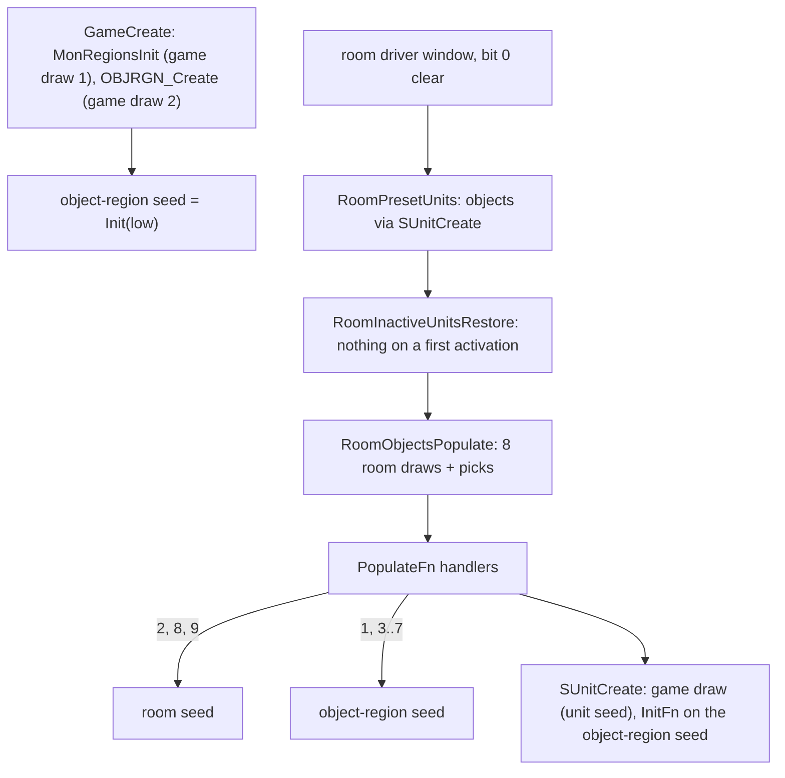
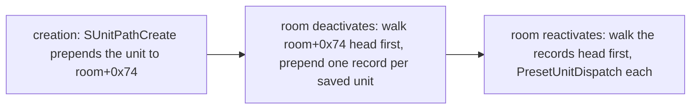

# 0001 — Object population, placement and creation rolls

> **Subsystem:** objects
> **Question:** when a room activates on the server, which objects does it get, where do they stand, which draws do the object creators and the chest operate path make, and on which seed?
> **Date:** 2026-10-14 (Phase 2 and the § 13 details: 2026-10-15; § 14: 2026-10-15, plan 0027 Phase 2)   **Plan:** 0023 (Phase 1, 1b, 2, 3 follow-up), 0027 Phase 2   **Status:** Phase 2 reproduced (run:2026-10-15-objects); § 14 review pending

This is a static reading (decompile, plus disassembly for the register arguments and the inlined draws) of the code
between the start of the room driver's window (`0x0052D1D2`) and the population pass. It covers:
`sub_00552610_RoomObjectsPopulate` and its gate, the ten `PopulateFn` handlers and the four placement helpers, object
creation through `SUnitCreate` and the `InitFn` table, the DS1 preset objects with ids above 573, the operate path of
chests and containers up to `sub_00585B90_ObjectChestDrop`, and the inactive-unit restore. One re-analysis of logged
windows (run:2026-10-14-objects-window) checks the room-seed draw sequence. Phase 2 (§ 12) models the whole window, the
creations and the operate path on the room, object-region, game and unit seeds and reproduces a new run bit for bit
(run:2026-10-15-objects); the claims it exercised are now `[C]` citing that run, the rest stays `[I]`.

## Answer (summary)

- [C] **Two seeds, not one.** The slot loop draws the **active-room seed** (`room+0x6C`): one draw per Levels slot
  (always eight once the gate is open), plus one member-pick draw per slot that passes. The handlers for shrines (2),
  wells (8) and traps (9) also draw the room seed. Every other handler, every `InitFn`, the PreOperate roll and the
  operate handlers draw a third seed, the **object-region seed** at `*(game+0x10F0)`. Each object created also takes
  one game-seed draw for its unit seed. (fn:sub_00552610_RoomObjectsPopulate@0x00552610, fn:OBJRGN_GetSeed@0x00546FA0,
  run:2026-10-14-objects-window)
- [C] **The object-region seed** is built once per game by `OBJRGN_Create`, called from `GameCreate` right after
  `MonRegionsInit`. It steps the game seed once (game-seed draw 2 after `Init(N)`) and sets
  `Init(objrgn, low)`. It is a single game-wide stream, advanced by every room's objects in activation order, by every
  operate and by the object timer events (§ 12). (fn:OBJRGN_Create@0x00546C60, fn:sub_00530BF0_GameCreate@0x00530BF0,
  struct:ObjRgn+0x0, run:2026-10-15-objects)
- [C] **Slot k passes** when `ObjGrp[k] ≠ 0` and `r ≤ ObjPrb[k]`, with `r = low mod 100` of the room seed. A group-0
  slot still costs its draw. The member is then picked with a second draw `r2`: walk `ID0..7` up to the first `ID = 0`,
  summing `PROB`, and take the first member with `r2 < sum`. When the `PROB` sum is at most `r2` nothing is placed
  (259 of 2307 passing slots in the run). `PROB` is therefore a percentage against 100, not a weight over the members'
  sum. (fn:sub_00552610_RoomObjectsPopulate@0x00552610, tbl:Levels.txt:ObjGrp0, tbl:Levels.txt:ObjPrb0,
  tbl:ObjGroup.txt:PROB0, run:2026-10-14-objects-window)
- [C] **DENSITY is a count factor**, used by the handlers that scatter. For a room of `w × h` subtiles the count is
  `((w·h >> 7) · DENSITY) >> 8` (signed shifts). The shrine, stick-corpse and well handlers ignore it, which is why
  `SHRINES` groups carry `DENSITY` 0. The `SHRINES` and `WELLS` flags are not read by the pass.
  (fn:OBJPOP_Scatter@0x00551470, fn:OBJPOP_Clusters@0x00550C20, tbl:ObjGroup.txt:DENSITY0, run:2026-10-15-objects)
- [C] **Placement** draws a random point in the room rectangle. It accepts the point when it lies inside a margin and
  `COLL_WHTest` finds no bit of mask `0x3F11` in a box around it, or of `0xC01` in the padded test. The box is the
  object's `SizeX × SizeY` plus 2, 6 or 7 depending on the helper. There are 5 attempts per call; the handlers call
  them 1 to 30 times. When no spot is found the object is not created, and there is no fallback.
  Since plan 0027 Phase 2 the result of `COLL_WHTest` is predicted too, on the room grids of drlg/collision, with the
  objects' own marks made by the model (§ 14): all 5859 tests of the run, 0 mismatches.
  (fn:OBJ_PlaceRandom@0x00550380, fn:OBJ_PosTestPadded@0x00550220, fn:COLL_WHTest@0x0064D800, run:2026-10-15-objects)
- [C] **Shrines.** The shrine type is picked in `InitFn` 1 from the object's `Parm0`: 1 → effectclass 2 (health),
  2 → effectclass 3 (mana), any other value → class 1 with one chance in 10, else class 4. The pick is uniform within
  the class, up to 8 tries, until `LevelMin ≤` the room's **level id**. `rarity` is not read. Codes 4, 5 and 16 are then
  rewritten to 2, 3 and 18, so Health Exchange, Mana Exchange and Enirhs are never placed by a populate pass. There is
  also a level rule: once more than 75 % of a level's rooms have been gated and no code-2 shrine stands, the next
  shrine slot gets 30 placement tries and is turned into a code-2 shrine. The level rule was reached once, as a forced
  slot; the forced conversion of a placed shrine was not reached and stays `[I]`.
  (fn:OBJINIT_Shrine@0x0054F9D0, fn:OBJ_ShrinePick@0x0054F770, fn:OBJPOP_Shrine@0x00552B50, tbl:Shrines.txt:LevelMin,
  run:2026-10-15-objects)
- [C] (`0x0054FBB0`) **Containers.** `InitFn` 2 (urns, jars, baskets) and 3 (chests) draw a trap type `1..8` with chance
  `(MonLvl1/8 + 5)` %. `InitFn` 3 then locks a `Lockable` chest with chance `(MonLvl1/2 + 8)` % and re-seeds the
  chest's unit seed from the object-region seed. `MonLvl1` is the Levels normal-difficulty column in every difficulty.
  Super chests are the `sparkle` flag (unit `+0x78`), set by `InitFn` 57 (`sparklychest`, 397) and by DS1 pseudo-object
  580. The barrel handler makes an exploding barrel (11) with chance 1/3 for the first of a cluster and 1/4 for each
  follower. `InitFn` 57 (class 397, 455) was not reached and stays `[I]`.
  (fn:OBJINIT_TrapByte@0x0054FBB0, fn:OBJINIT_Chest@0x0054FCB0, fn:OBJ_PresetSuperChest@0x0054F370,
  fn:OBJPOP_Barrels@0x00551850, tbl:Levels.txt:MonLvl1, tbl:Objects.txt:Lockable, run:2026-10-15-objects)
- [C] **Chest operate** (`OperateFn` 4) draws the object-region seed. A sparkly chest first draws its forced quality: rare with chance 5/100, else magic. Then
  one draw `r mod 100`: if `r ≤ 24` and the chest is neither locked nor sparkly, it drops nothing. Otherwise it makes
  `1 + locked` calls to `ObjectChestDrop`, and a sparkly chest without a magic item tries up to 10 more. Class 397 has
  its own table on `r mod 10000` with forced qualities 7, 5, 6 and 4 (`[I]`: no class-397 chest was operated). The TC
  comes from `TC_GetChestTC` with no draw. The trap fires last, as a timed event.
  (fn:OBJOP_Chest@0x00585F60, fn:sub_00585B90_ObjectChestDrop@0x00585B90, fn:TC_GetChestTC@0x00654E80,
  run:2026-10-15-objects)
- [C] **The inactive-unit restore draws nothing on a first activation**: room and game seed unchanged in all 2090
  logged first activations, and the object-region seed too in the Phase 2 run. On a **revisit** it re-creates each saved
  object through `PresetUnitDispatch`, with every creation draw of § 6 and § 7 (game seed, InitFn on the object-region
  seed, PreOperate), in the order of their earlier creation, and then restores the saved interact byte and sparkle
  flag; the saved mode is the creation mode (§ 12, § 13.5).
  (fn:sub_00542B40_RoomInactiveUnitsRestore@0x00542B40, run:2026-10-14-objects-window, run:2026-10-15-objects)
- [C] (`0x00552610`) **The Phase 2 boundary held (§ 11, § 12):** the slot loop, the handlers, the placement, the
  creation draws and the operate draws were modelled on the room, object-region, game and unit seeds, with the
  object-region seed predicted from game creation and carried across every room, operate and timer event. Every
  window RW1 → RW4 of the run was predicted, 0 mismatches; the seed oracles were the monster and quest `InitFn`s, the
  preset monsters, `TC_ResolveDrops`, the gold drop, the operate monster spawns and the occurrence of the object timer
  events. (run:2026-10-15-objects)

## Leads used

The finding was written from code first (Phase 1, committed before any source was read). The sources below were
fetched and read afterwards, on 2026-10-14, for the Phase 1b cross-check (ADR-0007). None has code.
`src:d2dfg-blizzard` describes Diablo II: Resurrected (see `docs/sources.md`), and so does
`src:d2runewizard-lk-superchests`; a contradiction with either may be a version difference. Agreement promotes nothing.

Two fetches failed and nothing from them is used:
- `src:siramy-ds1-any-units` answered HTTP 406 to `curl` and timed out in the fetch tool, so the pseudo-object ids
  574–582 are **not covered** by any fetched lead.
- The sparkly-chest guides on diablowiki.net and purediablo.com and the shrine thread on purediablo.com answered 403.
  `maxroll.gg` and `fextralife` (shrines) were fetched and say nothing about how a shrine is chosen.

**Object groups (§ 3)**

- [L] src:d2dfg-blizzard: `ObjGrp0`–`7`: "The game will go through each of these fields, so there can be more than 1
  Object Group used in an area level". **held**
  Detail: all eight slots are visited, and each one costs a room draw even with group 0 (§ 3).
- [L] src:d2dfg-blizzard: `ObjPrb0`–`7`: "the random chance (out of 100) for each Object Group to spawn". **held with refinement**
  Detail: the slot passes when `low mod 100 ≤ ObjPrb`, so the chance is `(ObjPrb+1)/100`. It is decided per room, not
  per level. After 75 % of a level's rooms, with no code-2 shrine, the slots whose group number names an Objects row
  with `SubClass ≠ 0` are forced to fail (§ 3).
- [L] src:d2dfg-blizzard: `PROB0`–`7`: "calculated in order so the first probability that is successful will be
  chosen … should add up to exactly 100 in total to guarantee that one of the objects spawn". **held**
  Detail: one draw `r2 < cumulative PROB`, so a sum below 100 leaves `100 − sum` % for nothing (259 of 2307 logged
  passes; § 3, run:2026-10-14-objects-window).
- [L] src:d2dfg-blizzard: `DENSITY0`–`7`: "Controls the number of Objects … also affected by the Object's populate
  function … The maximum value allowed is 128". **contradicted** ([backlog](../../backlog.md), 2026-10-14 reverser → reverser)
  Detail: re-read at `0x005527CE`: `cmp bl, 0x80; jae` → fatal error `0xC47`, so 128 itself is rejected and the largest
  value allowed is 127. The count `((w·h >> 7)·DENSITY) >> 8` agrees with "number of objects", and handlers 2, 7 and 8
  ignore it (§ 4). Stock data stops at 125, so this cannot be reached; it goes to *Open questions*, not a Phase 2 case.
- [L] src:d2dfg-blizzard: Levels `Themes`: a bit mask, "a value of 60 means that the area level can have the
  following themes: 32, 16, 8, 4". **held with refinement**
  Detail: the bits map to theme numbers 1–7, but a theme runs only when its number is below the count of bits set.
  With the stock values 8, 48 and 60, no theme with a handler can ever run (§ 2).

**Handlers and placement (§§ 4–5)**

- [L] src:d2dfg-blizzard: `PopulateFn` 1 "Add Clumped Group … only handles specific object classes such as caskets, urns,
  and baskets". **held with refinement**
  Detail: five class lists, the clusters and the ring walk are in § 4. Any other class returns after the probability draw.
- [L] src:d2dfg-blizzard: `PopulateFn` 2 "Add Single Shrine", 3 "Add Simple Objects … randomly in a room, based on the
  object's size", 9 "Add One". **held with refinement**
  Detail: 2 is at most one shrine per call, with a level cap and 50-subtile spacing. 3 places `cnt` objects; 9 places
  the first one that fits (§ 4).
- [L] src:d2dfg-blizzard: `PopulateFn` 4 "Add Barrels … multiple barrel or exploding barrel Class objects". **held with refinement**
  Detail: exploding with chance 1/3 for the first and 1/4 for each follower, at most 8 per call, record 7's size (§ 4).
- [L] src:d2dfg-blizzard: `PopulateFn` 5 "Add Crates … multiple crate or urn Class objects". **held with refinement**
  Detail: for a class other than 46 the object is one of the urns 4, 9, 52, 94, 95 (two draws, § 4).
- [L] src:d2dfg-blizzard: `PopulateFn` 6 "Add Corpse … a random chance to spawn the "Flies" object class" and 7 "Add Staked
  Corpses". **held with refinement**
  Detail: flies with chance 29/100 (`P100 > 70`); the four staked patterns are in § 4.
- [L] src:d2dfg-blizzard: `PopulateFn` 8 "Add Well … A level can have a maximum of 4". **held with refinement**
  Detail: also at most `roomCount/8 + 1`, with 100-subtile spacing on both axes, drawn on the room seed (§ 4).
- [L] src:d2dfg-blizzard: `Xspace & Yspace` "only used by the Populate Function ("PopulateFn") values 3 and 4, for the Add
  Barrels and Add Crates functions". **held with refinement**
  Detail: the readers are the barrel and crate handlers, which are `PopulateFn` **4 and 5**. The column is read as an
  unsigned byte, so the negative `Xspace` of some rows becomes 249..255 (§ 4).
- [L] src:d2dfg-blizzard: `Orientation` "affects the randomization of the coordinates when spawning the object near the
  edge of a room". **held**
  Detail: orientation 1 and 2 shrines are placed one subtile in from the room's top or left edge (§ 5).
- [L] src:d2dfg-blizzard: `Gore` "Objects with a gore value greater than 2 will not be populated". **held**
  Detail: `Gore ≤` the byte at `0x00731BBC` (2, no writer); a member that fails is skipped and the walk goes on (§ 3).
- [L] src:d2dfg-blizzard: `PreOperate`: "a 1/14 chance" to spawn opened. **held**
  Detail: `RNG_Range(objrgn, 14) = 0` → mode 2, unless unit flag `0x80` is set (§ 6).

**Creation rolls (§§ 6–8)**

- [L] src:d2dfg-blizzard: InitFn 1 with `Parm0` "If equals 0, default to health shrine". **contradicted**
  ([backlog](../../backlog.md), 2026-10-14 reverser → reverser)
  Detail: re-read at `0x0054F9F5`: `Parm0` 0 takes the branch that draws `1 + RangeB(N − 1)` over all Shrines codes
  until `LevelMin ≤ level id`. It is not a health shrine. No stock shrine row has `Parm0` 0, so the branch is
  unreachable; it goes to *Open questions*.
- [L] src:d2dfg-blizzard: `Parm0` 1 "Health Shrine", 2 "Mana Shrine", 3 "pick a random stats shrine with a 10% chance to
  spawn a surprise shrine". **held with refinement**
  Detail: these are effect classes 2, 3, and (for any value other than 0–2) class 1 with chance 1/10, else class 4.
  The pick is uniform in the class and retried up to 8 times on `LevelMin` (§ 7).
- [L] src:d2dfg-blizzard: shrines.txt `LevelMin` "the earliest area level where the Shrine can spawn. Area levels are
  determined from levels.txt". **held with refinement**
  Detail: it is compared with the room's Levels **Id** (`RoomGetLevelId`), not a monster level (§ 7).
- [L] src:d2dfg-blizzard: `effectclass` "the Shrine's archetype which is involved with calculating region stats". **held with refinement**
  Detail: the object region groups the codes by `effectclass` (values below 8), and the shrine pick draws from one group (§ 1, § 7).
- [L] src:d2dfg-blizzard: shrines.txt `rarity`. **not covered**
  Detail: the guide has no `rarity` text. The code does not read the column.
- [L] src:d2dfg-blizzard: InitFn 2 "a random chance to give the object 1 of the 9 random traps. This random chance
  depends on the area level's monster level". **held with refinement**
  Detail: chance `(MonLvl1/8 + 5)` % on the Levels normal column, in every difficulty; the type is
  `RandLoHi(1, 9)` = 1..8 (eight types; the table has 10 slots, 0 meaning none) (§ 7).
- [L] src:d2dfg-blizzard: InitFn 3 "Run function 1, and also determine if the object should be Locked … depends on the
  area level's monster level"; `Lockable` "only works when … InitFn … equal to 3". **held with refinement**
  Detail: it runs InitFn **2** (the trap roll), then locks with chance `(MonLvl1/2 + 8)` %, then re-seeds the chest's
  unit seed. InitFn 57 runs InitFn 3 too, so `Lockable` also works there (§ 7).
- [L] src:d2dfg-blizzard: InitFn 27 "a random chance of 333/1000 … poison nova". **held**
  Detail: `low mod 1000 ≤ 332` → interact 3 (§ 7).
- [L] src:d2dfg-blizzard: InitFn 28 "Create a random amount of gold piles (between 1 to 10)". **contradicted**
  ([backlog](../../backlog.md), 2026-10-14 reverser → reverser)
  Detail: re-read at `0x0054F8C0`: the count is `low mod 9 + 1`, so 1 to 9. A pile is dropped only where the 1×1 test at a
  random offset `(low & 3, low & 3)` finds the cell free in the same room. Whether a stock DS1 places object 269 is not
  known; Phase 2 makes it a required case if one does.
  Settled by run:2026-10-15-objects: 14 gold-pile objects (DS1 object 269, ten levels) drew pile counts 2, 5, 5, 6, 6,
  6, 6, 7, 7, 7, 8, 9, 9 and 9, each followed by exactly that many offset pairs and 1×1 tests, draw for draw; the
  count is `low mod 9 + 1` (no count of 10 is possible). The test is always at the object's own cell plus the offset
  (§ 12).

**Operate (§ 9)**

- [L] src:d2dfg-blizzard: OperateFn 3 "Spawn Item Sometimes … Has a 20% chance to spawn a random item. Can also randomly
  trigger a trap". **contradicted** ([backlog](../../backlog.md), 2026-10-14 reverser → reverser)
  Detail: re-read at `0x0058675F`: `P100 < 21` (`cmp 0x15; ja`) → one `ObjectChestDrop`, so the chance is 21/100. The
  trap is the InitFn 2 byte. Urns are common, so this is a **required Phase 2 case**: at least 20 operated urns with the
  draw logged.
  Settled by run:2026-10-15-objects: 37 operated urns, jars and baskets, each draw reproduced. The 9 with `r ≤ 20`
  dropped and the 28 with `r ≥ 26` did not; one urn drew exactly `r = 20` and dropped, which a 20 % rule (`r < 20`)
  would not do. The chance is 21/100.
- [L] src:d2dfg-blizzard: OperateFn 1 "spawn items. Also can randomly spawn a monster and/or trigger a trap", 5 "breaking
  barrel objects and randomly spawning items or possibly a monster". **held with refinement**
  Detail: casket: one drop, then (only if an item was made) `low mod 10000 ≥ 8192` → a monster. Barrel: monster test
  first, then `P100 < 21` → one drop (§ 9).
- [L] src:d2dfg-blizzard: OperateFn 4 "Chest Operate … Handles key interaction functionality if the chest object is
  locked". **held with refinement**
  Detail: a key is consumed, or the operator is player class 6. A locked chest makes 2 drops, and a plain unlocked chest
  is empty with chance 25/100 (§ 9).
- [L] src:d2runewizard-lk-superchests: super chests "have a 5% chance to drop all rare items and 95% chance to drop all
  magic items". **held with refinement**
  Detail: in 1.14d this belongs to the **sparkle flag** (unit `+0x78`): DS1 pseudo-object 580 sets it, and class 397
  sets it before its own table resets it. One object-region draw gives the forced quality 6 (`r < 5`) or 4, applied to
  every drop of that chest (§ 8, § 9). Magic find was not compared.
- [L] src:d2runewizard-lk-superchests: "Super Chests in Lower Kurast have a 19% chance of being locked". **held**
  Detail: Lower Kurast's `MonLvl1` is 22, so `22/2 + 8 = 19` % (InitFn 3, § 7).
- [L] src:d2runewizard-lk-superchests: "A Super Chests does not use the usual Treasure Classes to determine its drops,
  nor does it use the normal quality algorithm". **contradicted** ([backlog](../../backlog.md), 2026-10-14 reverser → reverser)
  Detail: re-read at `0x00585C90`–`0x00585CD2`: every `ObjectChestDrop` picks `Act N Chest A/B/C` with
  `TC_GetChestTC` and calls `TC_ResolveDrops`. Only the quality is forced. The page describes D2R, so this may be a
  version difference. It is a **required Phase 2 case**: an operated sparkle chest whose TC and forced quality are logged.
  Settled by run:2026-10-15-objects: three sparkle chests (DS1 580: two in Lower Kurast, one in the Stony Field) were
  operated. Each passed forced quality 4 (its quality draw was not below 5) to every `ObjectChestDrop`, and each drop
  resolved the act chest TC (`Act 3 Chest B`, `Act 1 Chest A`), repeating until one item was magic or better (4, 4 and
  6 drops). The contradiction holds for 1.14d: the usual chest TC, only the quality forced.

## Functions

| Address | Name | Role | Tag |
|---|---|---|---|
| `0x00552610` | `sub_00552610_RoomObjectsPopulate` | eight Levels slots, member pick, PopulateFn call | C |
| `0x00552560` | `OBJ_PopulateGate` | room skip tests, rooms-visited count, theme roll | C |
| `0x00552400` | `OBJ_RoomThemeRoll` | Levels `Themes` roll on the object-region seed (never fires on stock data) | C |
| `0x00546C60` | `OBJRGN_Create` | object region at game creation: seed, shrine lists, per-level counters | C |
| `0x00546F90` / `0x00546FA0` / `0x00546FB0` | `OBJRGN_GetLevel` / `OBJRGN_GetSeed` / `OBJRGN_GetShrineLists` | accessors of `game+0x10F0` | C |
| `0x00547330` / `0x00547390` | `OBJRGN_HealthShrineDue` / `OBJRGN_HealthShrineInc` | the forced-shrine rule | I |
| `0x00547360` / `0x00547430` / `0x00547490` | `OBJRGN_ShrineCapReached` / `OBJRGN_ShrineDistOk` / `OBJRGN_ShrineAdd` | shrine cap, spacing, record | I |
| `0x00547300` / `0x005473A0` / `0x00547400` | `OBJRGN_WellCapReached` / `OBJRGN_WellDistOk` / `OBJRGN_WellAdd` | well cap, spacing, record | I |
| `0x00550C20` | `OBJPOP_Clusters` | PopulateFn 1: urns, caskets, baskets in clusters | C |
| `0x00552B50` | `OBJPOP_Shrine` | PopulateFn 2: shrines (room seed) | C |
| `0x00551470` | `OBJPOP_Scatter` | PopulateFn 3: DENSITY-count random placements | C |
| `0x00551850` | `OBJPOP_Barrels` | PopulateFn 4: barrel clusters, exploding barrels | C |
| `0x00551C00` | `OBJPOP_Crates` | PopulateFn 5: crate clusters | I |
| `0x00551690` | `OBJPOP_Corpse` | PopulateFn 6: scatter + flies | C |
| `0x00551200` | `OBJPOP_StickCorpses` | PopulateFn 7: rogue-on-a-stick patterns | C |
| `0x005516C0` | `OBJPOP_Well` | PopulateFn 8: wells (room seed) | C |
| `0x00551580` | `OBJPOP_Trap` | PopulateFn 9: one trap (one room draw) | C |
| `0x00551150` | `OBJ_FliesAdd` | 29 % flies (103) on a corpse | C |
| `0x00550220` / `0x005502F0` | `OBJ_PosTestPadded` / `OBJ_PosTestTight` | margin and collision tests of a candidate point | C |
| `0x00550380` / `0x00550540` / `0x00550A30` | `OBJ_PlaceRandom` / `OBJ_PlaceRandomRoomSeed` / `OBJ_PlaceByOrientation` | 5-attempt placers | C |
| `0x00552AC0` | `OBJ_ShrineClassSubst` | forced shrine: class ← `Parm1` (else 84) | I |
| `0x0054F770` | `OBJ_ShrinePick` | uniform pick in an effectclass list, `LevelMin` retry | C |
| `0x0054F5D0` | `OBJ_ServerInit` | object part of `SUnitCreate`: InitFn, Selectable, PreOperate | C |
| `0x0054F8C0` | `OBJINIT_GoldPiles` | InitFn 28: `1 + low mod 9` piles, 1×1 test, gold drop (Phase 2) | C |
| `0x0054F9D0` | `OBJINIT_Shrine` | InitFn 1 | C |
| `0x0054FBB0` / `0x0054FCB0` | `OBJINIT_TrapByte` / `OBJINIT_Chest` | InitFn 2, 3 | C |
| `0x0054FD90` | `OBJINIT_SparklyChest` | InitFn 57 (not reached in Phase 2) | I |
| `0x005506D0` | `OBJINIT_CityDamnedSpawns` | InitFn 46: monster spawns around object 369 | I |
| `0x0054F490` | `OBJ_PresetPseudoDispatch` | DS1 object ids 574..582 | C |
| `0x0054F0D0` / `0x0054F180` / `0x0054F370` / `0x0054F430` | `OBJ_PresetFixedShrine` / `OBJ_PresetRandomChest` / `OBJ_PresetSuperChest` / `OBJ_PresetQuestObject` | ids 574..579, 581, 580, 582 | I |
| `0x00584420` | `OBJ_OperateDispatch` | OperateFn table call | C |
| `0x00585F60` / `0x005866C0` / `0x005868A0` | `OBJOP_Chest` / `OBJOP_Urn` / `OBJOP_Barrel` | OperateFn 4, 3, 5 | C |
| `0x00586410` | `OBJOP_Casket` | OperateFn 1 (only the no-item path reached in Phase 2) | I |
| `0x00582510` | `OBJ_TrapFire` | trap type → `g_ObjTrapFns` | I |
| `0x005540A0` / `0x005540D0` | `UNIT_SetSparkle` / `UNIT_GetSparkle` | unit `+0x78` | C |
| `0x00584060` / `0x005869F0` / `0x00586520` | `OBJOP_Bookshelf` / `OBJOP_TrappedSoul` / `OBJOP_EvilUrn` | OperateFn 26, 48, 68: object-region draws (§ 13.6) | I |
| `0x005817A0` | `OBJ_TrapEvent` | object event 4: runs the trap function | I |
| `0x005822F0` / `0x00582380` | `OBJTRAP_MonsterSpawn` / `OBJTRAP_ObjectCreate` | trap types 8, 9 (one object-region draw) / 5, 7 (two `fire`) | I |
| `0x005B6AD0` | `sub_005B6AD0_SealObjectCreate` | OperateFn 54–56: creates class 131 | I |
| `0x0052D240` | `sub_0052D240_RoomsDeactivate` | room driver: saves the units of idle rooms | C in part (raised at `lane/rbs4` on run:2026-10-17-lifecycle, drlg/0009 § Functions) |
| `0x005433F0` / `0x00542E30` | `sub_005433F0_InactiveUnitSaveTest` / `sub_00542E30_InactiveUnitSave` | which units are saved / the saved record, prepended | I / C |
| `0x005418C0` / `0x005424F0` / `0x00541AC0` | `sub_005418C0_InactiveRecordTake` / `sub_005424F0_InactiveMonstersRestore` / `sub_00541AC0_InactiveItemsRestore` | restore steps 2, 1, 3 (§ 13.5) | I / C in part (`0x005424F0`, raised at `lane/rbs4`, drlg/0009 § Functions) / I |
| `0x0064C2C0` / `0x00621B00` | `sub_0064C2C0_RoomUnitAdd` / `UNIT_IsShrine` | room unit list, newest first / type 2 and `SubClass` bit 0 | I |
| `0x00624690` / `0x00624390` | `UNIT_SetMode` / `UNIT_AnimInit` | mode change; an object's animation start draws its unit seed when `Sync` is 0 | C |
| `0x004BC500` | `RNG_RandLoHi` | `lo + Range(hi − lo)`, `lo` without a draw when `hi ≤ lo` | C |
| `0x00640E90` / `0x006412F0` / `0x006414B0` / `0x00641500` | `OBJECTS_GetRecord` / `OBJGROUP_GetRecord` / `SHRINES_GetRecord` / `SHRINES_GetCount` | table accessors | I |

Data: `g_ObjInitFns` `0x00731BC0` (80), `g_ObjPopulateFns` `0x00731D00` (10), `g_ObjOperateFns` `0x00732D18` (101),
`g_ObjTrapFns` `0x00732CEC` (10), `g_ObjThemeFns` `0x00731E68`, `g_ObjPseudoFns` `0x00731D28` (9),
`g_ObjClusterLists` `0x00731D50`, `g_ObjStickPatterns` `0x00731EB4`, `g_ObjDir8X`/`g_ObjDir8Y` `0x00731B7C`/`0x00731B9C`,
`g_ObjGoreLimit` `0x00731BBC`, `g_PresetShrineRanges` `0x006E1080`, and (Phase 2) `g_ObjEventFns` `0x006E19B0` (12 object
event callbacks, § 12).

## Walkthrough

### 1. The window and the three seeds



- [C] (run:2026-10-15-objects, `0x00546C60`) `OBJRGN_Create` (`.\OBJECTS\objrgn.cpp`) allocates the object region at `game+0x10F0`. It then:
  - steps the game seed once and calls `RNG_SeedInit(objrgn, low)`, returning that `low`;
  - allocates one 0x90-byte level record for each level id ≥ 1, with `act` from Levels `+0x003`, `roomCount`
    `0x7FFFFFFF`, `+0x1C = −1` and everything else 0;
  - builds eight lists of Shrines codes, one per `effectclass` (`+0xB2`, values below 8), each in record order.
  `GameCreate` calls it at `0x00530DD1`, right after `MonRegionsInit` (`0x00530DCA`, game-seed draw 1, `[C]` in
  rng/seeds). No call sits between the two, so the object region takes draw 2.
  (fn:OBJRGN_Create@0x00546C60, fn:sub_00547D20_MonRegionsInit@0x00547D20, struct:ObjRgn+0x48, struct:ObjRgnLevel+0x8)
- [C] (run:2026-10-15-objects) `OBJRGN_GetSeed(game, room)` returns `*(game+0x10F0)`, the region's own seed, and ignores the room. All
  object-region draws in this finding go through it, directly or through the handler context `+0x0C`.
  (fn:OBJRGN_GetSeed@0x00546FA0, struct:ObjCtx+0xC)

### 2. The gate

```c
// fn:OBJ_PopulateGate@0x00552560 (ECX game, stack levelRec, EBX room), trimmed
if (DrlgRoom(room)->flags & 0x30000) return 0;              // 0x0066BB60 via 0x0061A210
pop = RoomPopLevelId(room);  L = objrgn->level[pop];
if (pop == 0 || PresetPopTest(room) || pop >= nLevels || LevelIsTown(room)) return 0;
if (L->roomCount == 0x7FFFFFFF) L->roomCount = LevelRoomCount(game->act[L->act], pop);
L->roomsVisited++;
if (levelRec->Themes && OBJ_RoomThemeRoll(game, room, Themes) == 1) return 0;
return 1;
```

- [I] (`0x00552560`) There are five skip conditions:
  - DRLG room flags `0x30000`, which a waypoint sets on its room (drlg/0007), so a waypoint room gets no random objects;
  - no population level (`Populate` 0 or the near-town rule, room bit `0x800000`, drlg/0004);
  - `PresetPopTest`: DRLG room `+0x48 = 1` and the preset's `+0x20 → +0x54` bit `0x80` (`0x0066BA90`);
  - a level id outside the table;
  - a town.

  `roomsVisited` counts gated rooms of the population level, not populated ones.
  (fn:OBJ_PopulateGate@0x00552560, fn:sub_0061A1F0_RoomPopLevelId@0x0061A1F0, fn:sub_006426A0_LevelIsTown@0x006426A0,
  struct:ObjRgnLevel+0x4)
- [C] Town windows drew nothing in all 222 logged town activations. (run:2026-10-14-objects-window)
- [C] (run:2026-10-15-objects, `0x00552400`) **Themes** (`OBJ_RoomThemeRoll`) runs only when Levels `Themes` is non-zero, and draws only the object-region seed:
  - It returns 0 at once when `roomCount < 10 · L+0x0C`; no writer of `+0x0C` was found, so it stays 0.
  - Otherwise it draws `r = low mod 100`. The threshold is `12`, plus 5 if `visited > count/2`, plus 5 more if
    `visited > count − count/4`.
  - When `r` is below the threshold, it lists the theme numbers `t = 1..7` whose bit `1 << (t−1)` is set, draws
    `i = RangeB(n)`, and runs theme `t = list[i]` only if `t < n` and `g_ObjThemeFns[t]` is enabled.

  The stock values are `Themes` 8, 48 and 60. Each lists only themes ≥ n, except 60, whose theme 3 has no handler.
  So no theme ever fires on stock data, and the roll costs 1 or 2 object-region draws per gated room.
  The handlers are named only: theme 1 returns 1 (an empty room), 2 a barrel grid, 4 an item grid, 5 and 6 bookshelf or
  weapon-rack rows. (fn:OBJ_RoomThemeRoll@0x00552400, data:g_ObjThemeFns@0x00731E68, tbl:Levels.txt:Themes)

### 3. The slot loop

```c
// fn:sub_00552610_RoomObjectsPopulate@0x00552610 (ECX game, EDX room), trimmed
lvl = LEVELS_GetRecord(RoomGetLevelId(room));            // the room's own level id, not the population level
if (!OBJ_PopulateGate(game, lvl)) return;
for (k = 0; k < 8; k++) {
    g = lvl->ObjGrp[k];                                    // u8, movzx
    r = Range100(&room->seed);                             // room draw, every slot
    L = objrgn->level[RoomPopLevelId(room)];
    if (L->roomCount > 0 && (L->roomsVisited << 7) / L->roomCount > 96 && L->healthShrines == 0
        && OBJECTS_GetRecord(g)->SubClass != 0)            // record index = group index (sic)
        r = 100;
    if (g == 0 || r > lvl->ObjPrb[k]) continue;
    G = OBJGROUP_GetRecord(g); if (!G) return;             // only past the 133 records
    r2 = Range100(&room->seed);                            // room draw
    for (i = 0, sum = 0; i < 8 && G->id[i] != 0; i++) {
        sum += G->prob[i];
        O = OBJECTS_GetRecord(G->id[i]);
        if (r2 < sum && O->Gore <= g_ObjGoreLimit) {       // byte 2, no writer
            fn = g_ObjPopulateFns[O->PopulateFn];          // PopulateFn >= 10 or DENSITY >= 0x80: fatal
            if (fn) fn(game, room, G->density[i], G->id[i], 100);
            break;
        }
    }
}
```

- [C] (`0x00552610`) This draw order and these comparisons account for every room-seed draw of the 1405 logged windows that drew. It
  holds together with the handler draws of § 4:
  - one draw per slot, whether or not the group is 0;
  - `r ≤ ObjPrb` passes;
  - one pick draw per passing slot;
  - the member is the first one with `r2 < Σ PROB`;
  - nothing is placed past the sum.

  (fn:sub_00552610_RoomObjectsPopulate@0x00552610, run:2026-10-14-objects-window)
- [C] **The forced slot rule.** `r` is overwritten with 100 when the population level has passed 75 % of its rooms
  (`visited·128/count > 96`, signed division) and holds no code-2 shrine yet. 100 fails every slot, because the
  largest `ObjPrb` is 90. The test reads **the Objects record whose index is the group number**, so the slots it
  suppresses are those whose group index is 1–6, 50–53, 59, 60, 77, 109, 116, 119, 120, 123, 124 or 129. Three logged
  windows (Spider Forest twice, Stony Field) fit only with this rule. Phase 2 logs the counters at every slot (OS) and
  the model tracks them from the gate: they matched in every window, and one slot was forced directly (Sewers level 2,
  slot 2, group 5), so the trigger is `[C]` too. (0x005526CC, fn:OBJRGN_GetLevel@0x00546F90,
  run:2026-10-14-objects-window, run:2026-10-15-objects)
- [I] Group number 0 and a memberless group (30, 72) cost one or two draws and place nothing. A member with `PROB`
  0 can never be picked. Group 69 starts with an empty member slot, so the walk ends at once and it never places. The
  `Gore` test never excludes on stock data: `Gore` is 0 or 1, and the limit byte holds 2. (tbl:Objects.txt:Gore,
  data:g_ObjGoreLimit@0x00731BBC)
- [C] (run:2026-10-15-objects) Every handler is called with the member's `DENSITY`, its class (the Objects **record index**) and the
  probability 100. The handlers redraw the probability against 100, so that draw always passes, but it is still made.
  (data:g_ObjPopulateFns@0x00731D00)

### 4. The PopulateFn handlers

Notation: `R(s, n)` is `RNG_RangeB` on seed `s`: 0 without a draw when `n < 1`, otherwise `low mod n`.
`P100(s)` is one draw, `low mod 100`. `O` is the object-region seed and `S` the room seed. `rect` is the room
`{x, y, w, h}` in subtiles. `cnt = ((w·h >> 7) · DENSITY) >> 8`. Unless noted, sizes are the class's `SizeX`/`SizeY`.
Every creation is `SUnitCreate(2, class, x, y, game, room, flags 1, mode 0)`.

| Fn | Handler | Seed | Draw sequence and count |
|---|---|---|---|
| 1 | `OBJPOP_Clusters` | O | `P100`; class list by class (below); up to `tries` clusters while `cnt > 0` |
| 2 | `OBJPOP_Shrine` | S | `P100`; cap; up to 3 (forced: 30) × `OBJ_PlaceByOrientation` (≤ 5 × 2 draws) |
| 3 | `OBJPOP_Scatter` | O | `P100`; `cnt` × `OBJ_PlaceRandom` (≤ 5 × 2 draws each) |
| 4 | `OBJPOP_Barrels` | O | `P100`; `cnt` clusters, `2·cnt` tries, at most 8 objects |
| 5 | `OBJPOP_Crates` | O | `P100`; like 4, class list of five, at most 8 followers |
| 6 | `OBJPOP_Corpse` | O | handler 3, then `OBJ_FliesAdd` on its last result |
| 7 | `OBJPOP_StickCorpses` | O | `P100`; pattern `R(4)`; ≤ 8 anchor tries; one class draw per pattern cell |
| 8 | `OBJPOP_Well` | S | cap; `P100`; one `OBJ_PlaceRandomRoomSeed` (≤ 5 × 2 draws) |
| 9 | `OBJPOP_Trap` | S then O | `P100` on S; `cnt` × `OBJ_PlaceRandom` on O, stops at the first trap |

- [C] On the room seed, handler 9 draws exactly once. Handler 2 draws `1 + 2a` (`a` = placement attempts made). Handler
  8 draws 0 (cap reached) or `1 + 2a`. Handlers 1 and 3–7 draw nothing on it. (run:2026-10-14-objects-window)

**Handler 1 (urns, caskets, baskets, sarcophagi).** [C] (run:2026-10-15-objects, `0x00550C20`) The class chooses a list, the number of cluster tries, and the
ring step and base used to walk away from the first object.

| Class | List | Tries | Step / base | Follower test |
|---|---|---|---|---|
| 3 | 3, 28 | 18 | 5 / 5 | padded |
| 1, 79 | 79, 53, 1 | 12 | 5 / 5 | padded |
| 4 | 4, 9, 52, 94, 95 | 12 | 0 / 1 | tight |
| 89 | 89, 284 | 12 | 5 / 5 | padded |
| 208, 209 | 208, 209 | 12 | 0 / 1 | tight |
| other | — | — | — | returns 0 after the `P100` |

The first object of every cluster uses the padded test; followers use the test in the last column.

```text
P100(O) > 100 -> return            ; never
cnt <= 0 -> return
while tries > 0:
  cls = list[R(O, n)]; x = rect.x + R(O, w - sizeX - 1); y = rect.y + R(O, h - sizeY - 1)   ; sizes of the member class
  if !PosTestPadded(x, y): tries--; continue
  create(cls, x, y); k = 1; ok = 1
  loop: m = k >> 1; if m > 0 and R(O, m) != 0: break     ; cluster ends with chance 1 - 1/m
        if !ok: break
        ok = 0; i = 0; lim = 3 * max(cnt, 4)
        while !ok and i < lim: d = O.low & 7 after one step; x += (R(O, step) + base) * dx[d] * 2;
                               y += (R(O, step) + base) * dy[d] * 2; ok = test(x, y); i++
        if ok: create(list[R(O, n)], x, y); k++
  cnt--; tries--; if cnt <= 0: return
```

(fn:OBJPOP_Clusters@0x00550C20, data:g_ObjClusterLists@0x00731D50, data:g_ObjDir8X@0x00731B7C, data:g_ObjDir8Y@0x00731B9C)
The eight directions are `dx = −1, 0, 1, −1, 1, −1, 0, 1` and `dy = −1, −1, −1, 0, 0, 1, 1, 1`. The walk is cumulative:
a rejected step still moves the point.

**Handler 4 (barrels).** [C] (run:2026-10-15-objects, `0x00551850`) It ignores the member class and uses the size and `Xspace`/`Yspace` of record 7
(`Barrel`).
- Each try draws, in order: class (`low mod 3 = 0` → 11 `BarrelExploding`, else 7), `x = rect.x + R(O, w)`,
  `y = rect.y + R(O, h)`.
- The tight test decides. On a failure only `tries` (`2·cnt`) goes down.
- On a success it creates the object and walks a cluster as in handler 1. Each step is one draw `d = low & 7`, then
  `x += Xspace·dx[d]`, `y += Yspace·dy[d]` (read as **u8**), with up to 15 steps per follower.
- Each follower draws its class with `low & 3 = 0` → 11.
- The handler returns after 8 objects in total.

(fn:OBJPOP_Barrels@0x00551850, tbl:Objects.txt:Xspace)

**Handler 5 (crates).** [I] (`0x00551C00`) For any class other than 46:
- the try draws `cls = list[R(O, 5)]` from (4, 9, 52, 94, 95), then `x`, `y` as in handler 4;
- on a success it draws the class **again** and creates that class;
- followers take the same class, with up to `max(4, ringLim)` steps of `Xspace`/`Yspace` of the member class;
  `ringLim` starts at `4·cnt` and drops by 4 per cluster;
- the handler stops after 8 followers.

Class 46 (`Crate`) skips both class draws. (fn:OBJPOP_Crates@0x00551C00)

**Handler 6 (corpses), and flies.** [C] (run:2026-10-15-objects) It runs handler 3, then `OBJ_FliesAdd` on the last placement returned. That
draws `P100(O)` and, if it is above 70, creates object 103 (`flies`) at the corpse's position.
(fn:OBJPOP_Corpse@0x00551690, fn:OBJ_FliesAdd@0x00551150)

**Handler 7 (rogue on a stick).** [C] (run:2026-10-15-objects, `0x00551200`) It runs as follows:
1. `P100(O)` must pass, then the pattern is `p = R(O, 4)`.
2. Up to 8 anchor tries: `x = rect.x + R(O, w−sx−1)`, `y = rect.y + R(O, h−sy−1)`, padded test with size 5 × 5.
3. For each offset of pattern `p`: the padded test at `anchor + offset` with the class size; on a pass, the class
   `57 + (low & 1)` (one draw), creation, and `OBJ_FliesAdd`.

The patterns are set by a static initialiser at `0x006CAF30`, as (dx, dy) lists:

| p | Offsets |
|---|---|
| 0 | (−4,0) (0,0) (4,0) (8,0) (0,4) (0,−4) |
| 1 | (−8,0) (−4,0) (0,0) (4,0) (8,0) |
| 2 | (0,−8) (0,−4) (0,0) (0,4) (0,8) |
| 3 | (−7,−5) (−5,−3) (−3,−1) (0,0) (3,−1) (5,−3) (7,−5) |

(fn:OBJPOP_StickCorpses@0x00551200, data:g_ObjStickPatterns@0x00731EB4)

**Handler 2 (shrines).** [C] (run:2026-10-15-objects, `0x00552B50`) It runs as follows:
1. One room draw. If `OBJRGN_HealthShrineDue` holds, the shrine is forced and gets 30 tries. Otherwise the draw
   `> prob` returns (it never does) and there are 3 tries.
2. If `OBJRGN_ShrineCapReached` (`nShrinePos = 10` or `> roomCount/8`), return.
3. Each try is `OBJ_PlaceByOrientation(…, Orientation, popLvl, OBJRGN_ShrineDistOk)` on the room seed.
4. On a placement:
   - If the shrine's code is not 2 and it was forced, `OBJ_ShrineClassSubst` changes the class to `Parm1` (when 1..572,
     else 84). `OBJ_ShrinePick(class 2, level 1)` is drawn and its result **discarded**. The code is set to 2.
   - If the code is 2 or it was forced, `healthShrines++`.
   - Its position goes into the level's shrine list.

(fn:OBJPOP_Shrine@0x00552B50, fn:OBJRGN_HealthShrineDue@0x00547330, fn:OBJRGN_ShrineCapReached@0x00547360,
fn:OBJ_ShrineClassSubst@0x00552AC0, struct:ObjRgnLevel+0x10)

**Handler 8 (wells).** [C] (run:2026-10-15-objects) It returns when `OBJRGN_WellCapReached` (`nWellPos = 4` or `> roomCount/8`). Then it makes
one room draw against `prob`, and one `OBJ_PlaceRandomRoomSeed` with size `(2·sx+1) × (2·sy+1)` and
`OBJRGN_WellDistOk`. A placed well's position is recorded. (fn:OBJPOP_Well@0x005516C0, fn:OBJRGN_WellCapReached@0x00547300)

### 5. Placement and the position tests

- [C] (run:2026-10-15-objects, `0x00550380`) `OBJ_PlaceRandom(game, class, sx, sy, room)` returns 0 when `w < 2` or `h < 2`. It makes up to 5 attempts, each
  `x = rect.x + R(O, w−sx−1)` then `y = rect.y + R(O, h−sy−1)`. An attempt is accepted when `x, y ≠ 0`,
  `rect.x+1 ≤ x < rect.x+w−1` and `rect.y+1 ≤ y < rect.y+h−1` (compared as u16), and
  `COLL_WHTest(room, x, y, sx+6, sy+6, 0x3F11) = 0`. It then creates the object. `OBJ_PlaceRandomRoomSeed` is the same
  on the **room** seed, with the extra test function. `OBJ_PlaceByOrientation` draws by orientation:
  - orientation 1: `x = rect.x + w/4 + R(S, w/2)` and `y = rect.y + RandLoHi(S, 1, 2)`, which is always 1 but makes a draw;
  - orientation 2: the two axes swapped;
  - otherwise: as `PlaceRandom`.

  (fn:OBJ_PlaceRandom@0x00550380, fn:OBJ_PlaceRandomRoomSeed@0x00550540, fn:OBJ_PlaceByOrientation@0x00550A30, fn:RNG_RandLoHi@0x004BC500, tbl:Objects.txt:Orientation)
- [C] (run:2026-10-15-objects, `0x00550220`) `OBJ_PosTestPadded(rect, pos, sx, sy, room)` requires `sx+2 ≤ w`, `sy+2 ≤ h`, `x > rect.x+1`, `y > rect.y+1`,
  `x < rect.x+w−sx−2` and `y < rect.y+h−sy−2`. Then both of these must be 0:
  - `COLL_WHTest(room, x, y, sx+7, sy+7, 0xC01)`;
  - `COLL_WHTest(room, x, y, sx, sy, 0x3F11)`.

  `OBJ_PosTestTight` requires `w, h > 1`, `x > rect.x+2`, `y > rect.y+2`, `x < rect.x+w−sx` and `y < rect.y+h−sy`,
  and `COLL_WHTest(room, x, y, sx+2, sy+2, 0x3F11) = 0`.
  (fn:OBJ_PosTestPadded@0x00550220, fn:OBJ_PosTestTight@0x005502F0)
- [C] `COLL_WHTest(room, x, y, w, h, mask)` uses `COLL_CellTestNb` when `w ≤ 1` and `h ≤ 1`. Otherwise it uses
  `COLL_RectTest` on `{x − w/2, y − h/2, x − w/2 + w − 1, y − h/2 + h − 1}` (unsigned halving), with the drlg/0005
  semantics. Mask `0x3F11` includes `0x400`, so an earlier object's mark rejects the spot. Reproduced on all 5859
  calls of run:2026-10-15-objects (§ 14). (fn:COLL_WHTest@0x0064D800, fn:COLL_RectTest@0x0064CEB0, run:2026-10-15-objects)
- [C] (run:2026-10-15-objects, `0x00547430`) The spacing tests are as follows:
  - `OBJRGN_ShrineDistOk` rejects a point when, for some recorded shrine of the level, `|dx| < 50` **or** `|dy| < 50`.
    So a second shrine needs both axes 50 subtiles away from every earlier one.
  - `OBJRGN_WellDistOk` does the same with 100.

  (fn:OBJRGN_ShrineDistOk@0x00547430, fn:OBJRGN_WellDistOk@0x005473A0)

### 6. Creation: `SUnitCreate` for an object

- [C] (run:2026-10-15-objects, `0x00555230`) For type 2, `SUnitCreate` does the following:
  1. **steps the game seed once** and sets `Init(unit+0x20, low)`, through `UnitSeedInit`, as for every non-player type;
  2. allocates the 0x38-byte object data with `objRec = OBJECTS_GetRecord(class)`, so the class is the **record
     index**;
  3. sets the mode;
  4. calls `OBJ_ServerInit`;
  5. creates the static path and marks `SizeX × SizeY` when `HasCollision[mode]` is set (drlg/0005 § 5).

  The path step makes no draw for an object. (fn:sub_00555230_SUnitCreate@0x00555230,
  fn:sub_00552DF0_UnitSeedInit@0x00552DF0, fn:OBJ_ServerInit@0x0054F5D0, fn:sub_00554850_SUnitPathCreate@0x00554850)
- [C] (run:2026-10-15-objects, `0x0054F5D0`) `OBJ_ServerInit` does the following:
  1. clears the sparkle flag and `interact`;
  2. runs `g_ObjInitFns[InitFn]` with a context `{game, unit, room, objrgn seed, objRec, x, y}`, when `InitFn < 80`;
  3. sets the selectable flag from `Selectable[mode]`;
  4. for a `PreOperate` row (unless unit flag `0x80` is set), draws `RNG_Range(O, 14)`; a result of 0 puts the object
     in mode 2 (opened). That is a 1/14 chance.

  `UNIT_SetMode` → `UNIT_AnimInit` draws `RangeB(unit seed, FrameDelta[mode] >> 3)` when the row's `Sync` is 0. It
  touches only the object's own seed.
  (fn:OBJ_ServerInit@0x0054F5D0, data:g_ObjInitFns@0x00731BC0, fn:UNIT_AnimInit@0x00624390, tbl:Objects.txt:PreOperate)
- [I] `OBJECTS_GetRecord(i)` is `objects.bin` record `i`. The DS1 object ids, the ObjGroup `ID` columns and
  `SUnitCreate` all go through it. Objects `Id` is not used, so records 410–412 are classes 410–412.
  (fn:OBJECTS_GetRecord@0x00640E90)

### 7. The InitFn draws

A recursive callee scan of all 76 distinct `InitFn` handlers looked for inlined steps and calls to the RNG helpers,
`SUnitCreate` and `UNIT_SetMode`, to depth 3. It found draws only in these:

| InitFn | Objects | Draws |
|---|---|---|
| 1 | 92 shrines | `Parm0` 0: up to 8 × `code = 1 + R(O, N−1)` until `LevelMin ≤ levelId`. `Parm0` 1 → class 2, 2 → class 3, other → one draw, `low mod 10 = 0` → class 1 else 4. Then `OBJ_ShrinePick`: up to 8 × `list[R(O, n)]` (0 → 1) until `LevelMin ≤ levelId`. Remap 5→3, 4→2, 16→18 |
| 2 | 37 urns, jars, baskets | `P100(O) < MonLvl1/8 + 5` → trap type `RandLoHi(O, 1, 9)` = 1..8, else 0 |
| 3 | 71 chests | InitFn 2, then (`Lockable`) `P100(O) < MonLvl1/2 + 8` → locked, then one draw: `Init(unit seed, low mod 0xFFFE + 1)` |
| 57 | 397, 455 | InitFn 3, then sparkle |
| 27 | goo pile | `low mod 1000 > 332` → interact 0, else 3 |
| 28 | gold-pile dummy (269) | `1 + low mod 9` piles, two draws each (`& 3`), gold drops |
| 34 | 358, 359 `fire` | odd → mode 1 |
| 58 | fissure | one draw for a timer |
| 79 | Zoo | `RandLoHi` on a quest-held seed |
| 46 | 369 (City of the Damned) | random points and monster spawns 403/404 through `SpawnAtPos` (room and game seed) |
| 47, 54, 55, 62, 66, 68, 69 | quest objects | monster spawns through `SpawnAtPos` or `PresetMonSpawn` |

(fn:OBJINIT_Shrine@0x0054F9D0, fn:OBJ_ShrinePick@0x0054F770, fn:OBJINIT_TrapByte@0x0054FBB0, fn:OBJINIT_Chest@0x0054FCB0,
fn:OBJINIT_SparklyChest@0x0054FD90, fn:OBJINIT_CityDamnedSpawns@0x005506D0, tbl:Shrines.txt:effectclass, tbl:Objects.txt:Parm0)

- [I] (`0x00731BC0`) Every other InitFn draws nothing, apart from the unit-seed animation draw of `UNIT_SetMode`. The waypoint (17)
  and the well (16) are among them.
- [C] (run:2026-10-15-objects, `0x0054F770`) Two details of the shrine pick:
  - `LevelMin` is compared with `RoomGetLevelId(room)`, the Levels **Id** of the room, not its monster level. So
    Resist Cold (26), Lightning (32) and Poison (21) appear only in levels with a higher id.
  - Row 0 (`None`) sits in the class-0 list, which no caller asks for, because class 0 is mapped to 2.

### 8. DS1 preset objects

- [C] (run:2026-10-15-objects) `PresetUnitDispatch` sends a type-2 unit with id < 573 to `SUnitCreate(x, y, game, room, flags 1, mode = DS1
  mode)`. So a preset object makes the draws of § 6 (one game draw, its `InitFn` on the object-region seed, the
  PreOperate roll) and **no room-seed draw**, unless its `InitFn` spawns monsters. Id 573 does nothing. Ids 574..582
  go through `OBJ_PresetPseudoDispatch` (`g_ObjPseudoFns`, 9 entries).
  (fn:sub_005557D0_PresetUnitDispatch@0x005557D0, fn:OBJ_PresetPseudoDispatch@0x0054F490, data:g_ObjPseudoFns@0x00731D28)

| Id | Handler | What it creates |
|---|---|---|
| 574..579 | `OBJ_PresetFixedShrine` | class 136 in the DS1 mode, then `code = lo + R(unit seed, hi − lo)` with (lo, hi) = (2,6), (7,7), (8,11), (12,12), (1,5), (14,14); 4 and 5 → 2. Class 136's InitFn 1 draws first |
| 580 | `OBJ_PresetSuperChest` | a random chest as 581 (level 25: class 371); sparkle, except in Maggot Lair 62–64, where `P100(O) > 50` skips it; level 25 sets trap type 3; unit flag `0x80`; mode 0 |
| 581 | `OBJ_PresetRandomChest` | Act II: level 74 `{387, 389, 390, 391}[low&3]`, else `{87, 88}[low&1]`; Act III: level 83 `{329..332}[low&3]`, else `{181, 183}[low&1]`; other acts `{5, 6, 139, 140, 141, 144, 176, 177, 198, 240, 241, 242, 243}[low mod 13]`; one draw on O, mode 0 |
| 582 | `OBJ_PresetQuestObject` | class from quest 13's state, else 307 |

(fn:OBJ_PresetFixedShrine@0x0054F0D0, fn:OBJ_PresetSuperChest@0x0054F370, fn:OBJ_PresetRandomChest@0x0054F180,
fn:OBJ_PresetQuestObject@0x0054F430, data:g_PresetShrineRanges@0x006E1080)

### 9. Operate: chests and containers up to the drop

- [C] (run:2026-10-15-objects) `OBJ_OperateDispatch` calls `g_ObjOperateFns[OperateFn]` with `{game, object, player, objrgn seed, class}`.
  Classes 121, 122 and 22 are excluded. (fn:OBJ_OperateDispatch@0x00584420, data:g_ObjOperateFns@0x00732D18,
  struct:ObjOpCtx+0xC)
- [C] (run:2026-10-15-objects, `0x00585F60`) **Chest (OperateFn 4, `OBJOP_Chest`):**

```text
if mode != 0: return
locked = interact & 0x80
if locked: need a key (consumed) or an Assassin (player class 6), else return; drops = 2  else drops = 1
sparkle = unit+0x78: if set, one draw r0 = P100(O); q = (r0 < 5) ? 6 : 4   ; forced quality: 5 % rare, 95 % magic
                   else q = 0                                            ; 0 = no forced quality
if class != 397:
   r = P100(O)
   if r > 24 or sparkle or locked: drops x ObjectChestDrop(q); if sparkle and none magic+: up to 10 more (q) until one is
   (else: nothing)                                                ; 25 % of plain chests are empty
else (sparklychest, q and the sparkle flag reset): r = low mod 10000 (O):
   < 200 : ObjectChestDrop(7); not magic+ -> once more (7); still not -> F    ; 7 unique, 5 set, 6 rare, 4 magic
   < 600 : the same with 5
   < 1200: the same with 6
   < 3200: up to 10 drops (4) until 3 magic+; no item at all -> F
   < 6200: up to 10 drops (4) until 2 magic+; n = non-magic items; n = 0 -> one drop (0), n = 1 if it made an item; 7 - n gold
   else  : F
   F     : up to 10 drops (4) until one is magic+, then 4 - n drops (0) where n counts the non-magic ones, then 5 'gld ',
           2 'hp3 ', 2 'mp3 ' (0x00585970)
set mode (1 with an operate animation, else 2); OBJ_TrapFire(interact & 0x7F)
```

  (fn:OBJOP_Chest@0x00585F60, fn:sub_0062A0F0_ItemQualityMagicPlus@0x0062A0F0, fn:UNIT_GetSparkle@0x005540D0)
- [C] (run:2026-10-15-objects) **The drop** (`ObjectChestDrop`) computes the chest tier from the level's monster level against the act's two
  reference levels, picks the TC with `TC_GetChestTC` (difficulty, act, tier), and calls `TC_ResolveDrops` once. It
  makes no draw of its own before the resolver. Its `EDX` argument is passed on as the resolver's forced-quality argument:
  0 from the casket, urn and barrel handlers, the values above from the chest. (fn:sub_00585B90_ObjectChestDrop@0x00585B90,
  fn:TC_GetChestTC@0x00654E80, fn:TC_ResolveDrops@0x0055A6D0, 0x00585CC5)
- [I] (`0x00586410`) **The other containers** draw on O as follows:

| Fn | Objects | Sequence |
|---|---|---|
| 1 | caskets, sarcophagi | one `ObjectChestDrop`; only if it returned an item: `low mod 10000 ≥ 8192` (18.08 %) → a monster spawn (`0x00582280`), then the trap |
| 3 | urns, jars, baskets | `P100 < 21` → one drop, then the trap |
| 5 | barrels | an effect on the operating player (`0x00580A70`, not read), then `low mod 10000 ≥ 8192` → spawn, then `P100 < 21` → one drop |

  Armor stands (19) and weapon racks (20) call other item creators (`0x005594C0`, `0x00559630`), not the chest TC.
  (fn:OBJOP_Casket@0x00586410, fn:OBJOP_Urn@0x005866C0, fn:OBJOP_Barrel@0x005868A0)
- [I] `OBJ_TrapFire(t)` does not call `g_ObjTrapFns[t]` itself (10 entries; 0 = none): it queues object event 4 at
  `frame + 35`, which runs the trap function (§ 13.6, corrected 2026-10-15). Types 8 and 9 spawn monsters after a
  region-class test. The other effects are named only. (fn:OBJ_TrapFire@0x00582510, data:g_ObjTrapFns@0x00732CEC)

### 10. Inactive-unit restore on a first activation

- [C] `RoomInactiveUnitsRestore` re-creates units from lists written when a room went inactive (monsters through
  `0x005424F0`, objects through the saved list of `0x005418C0`). On a first activation there is no record, and in all
  2090 logged first activations the room and game seeds were unchanged across the call. A revisit re-creates saved
  objects through `PresetUnitDispatch` and restores `interact` and sparkle (§ 12; the order and the record in § 13.5).
  (fn:sub_00542B40_RoomInactiveUnitsRestore@0x00542B40, run:2026-10-14-objects-window)

### 11. Boundary decision for Phase 2 (recommendation)

[I] The recommendation has four parts (fn:sub_00552610_RoomObjectsPopulate@0x00552610, fn:OBJRGN_Create@0x00546C60):

1. **Model (`tools/objects.py`):** the gate (skip conditions as DRLG state from the log), the slot loop, the forced
   rule with the level counters tracked across rooms, all ten handlers and the three placers, the position tests
   through `tools/collision.py` on the grid snapshot, and `InitFn` 1, 2, 3, 27, 28, 34, 57 and 58. Also the
   PreOperate roll, the pseudo-objects 574–581, and the operate draws of OperateFn 1, 3, 4 and 5 up to the
   `ObjectChestDrop` call.
2. **The object-region seed is the crux.** It is predicted from `Init(N)` (game draw 2) and carried across every
   room's presets window and objects window in activation order, and across every operate. A new logger must assert
   it, because no current log carries it. Log `*(game+0x10F0)` at `RW1..RW4`, at each handler entry and exit and at
   each operate entry.
3. **Seed oracles:** the monster-spawning InitFns (46, 47, 54, 55, 62, 66, 68, 69), quest-state classes (582, Zoo 79),
   `TC_ResolveDrops` (items/tc), the trap effects and the theme handlers (unreachable on stock data). Each oracle
   asserts the room, game and object-region seed on entry and takes them on exit.
4. **Gate:** the flags `0x30000` and the preset test are DRLG state, value oracles until drlg/preset models them.

### 12. Phase 2: the bit-exact run

[C] `tools/objects.py check` (the model of §§ 1–10 on the room, object-region, game and unit seeds) reproduces the 29
logs of run:2026-10-15-objects with 0 mismatches in 142 540 checks: 1265 windows RW1 → RW4 predicted from RW1 (room,
object-region and game seed at the population pass entry, every object-region draw compared as it happens), 3009
objects created (644 by the populate pass, 2365 by presets, 548 of those re-created on a revisit), 89 operated
containers, 316 rooms populated with objects, in Normal, Nightmare and Hell, classic and expansion, Acts I–V.
`tools/monspawn.py` now takes the window from it: on four of the logs, 338 pass entries were predicted end to end from
the map seed, 0 mismatches in monspawn and collision. (run:2026-10-15-objects)

What the run added to §§ 1–10:

- [C] (`0x00552400`) The theme roll draws inside the gate, so its draws come before the gate returns (20 rolls, 2 of them
  drew a theme index; none ran). (fn:OBJ_RoomThemeRoll@0x00552400, run:2026-10-15-objects)
- [C] (`0x006E19B0`) **Object timer events draw the object-region seed too.** The table of twelve object event callbacks
  at `0x006E19B0` runs from the game's event queue, outside any populate or operate scope. One of them,
  `0x00581700`, draws `low mod 35` for its next event time at every call (3042 draws in the run, all at `0x0058176F`).
  The draws are stepped and compared; when they happen is game simulation (ADR-0002), taken from the log. A
  reimplementation that advances the object-region seed only through §§ 2–9 drifts as soon as such an object (a
  periodic effect, e.g. the act-town fires) has run. What the twelve callbacks do is `[I]`, named only.
  (data:g_ObjEventFns@0x006E19B0, run:2026-10-15-objects)
- [C] (`0x00542B40`) **A revisit re-creates objects with every creation draw.** When a room that went inactive is
  activated again, the inactive-unit restore calls `PresetUnitDispatch` for each saved object: one game-seed draw for
  the new unit seed, the InitFn on the object-region seed, the PreOperate roll. It then restores the saved interact
  byte, mode and sparkle flag (a chest locked at its creation stays locked although its new InitFn 3 roll unlocked it).
  The room driver logs no RW lines for such rooms (bit 0 of the room flags is set), so these creations happen outside
  the window of § 1. 548 re-creations reproduced. (fn:sub_00542B40_RoomInactiveUnitsRestore@0x00542B40,
  fn:sub_005557D0_PresetUnitDispatch@0x005557D0, run:2026-10-15-objects)
- [C] (`0x0054F5D0`) **InitFns without draws can still set the mode or the interact byte** (InitFn 4, 6, 8, 9, 12, 14,
  16, 17, 22 and 26 in the run), and a mode change draws the unit seed as in § 6. The value they set comes from game
  state (a waypoint's activation, a well's charges) and is taken from the log; the unit-seed draw it causes is
  predicted. (data:g_ObjInitFns@0x00731BC0, fn:UNIT_AnimInit@0x00624390, run:2026-10-15-objects)
- [C] (`0x0054F8C0`) **Gold piles (InitFn 28).** The 1×1 test is always at the object's own cell plus the offset; the
  room test before it (`RoomAtSubtile`) is asked at a running position. Corrected at plan 0027 Phase 2 (§ 14): the
  running position starts at the object's cell and becomes each **tested** cell (`0x0054F997`); the gold drop reads it
  and does not write it back (`sub_00559300_DropGoldPile` works on a copy). Now predicted: all 92 offsets of the run
  tested in the object's room, 0 mismatches; the branch where the room test fails was not reached (`[I]`).
  14 objects, counts 2–9, 71 gold drops. (fn:OBJINIT_GoldPiles@0x0054F8C0,
  run:2026-10-15-objects)
- [C] (`0x00585F60`) **After the drops**, a chest goes to mode 1 when its Objects `Mode1` byte (`+0x140`) is set (and its
  next event is queued), else to mode 2; the mode change draws the unit seed (§ 6). `TC_ResolveDrops` draws the
  object's **unit seed** (re-seeded by InitFn 3 for chests), not the object-region seed, which the resolver left alone
  in all 59 resolver calls. (fn:OBJOP_Chest@0x00585F60, tbl:Objects.txt:Mode1, run:2026-10-15-objects)
- [C] (`0x005868A0`) The barrel's monster spawn (`0x00582280`) runs between its two object-region draws and draws none
  itself (2 spawns). (fn:OBJOP_Barrel@0x005868A0, run:2026-10-15-objects)
- [C] (`0x005506D0`) InitFn 46 (City of the Damned) draws the object-region seed inside its monster spawns (584 draws in 16
  calls); it stays a seed oracle, as ruled. (fn:OBJINIT_CityDamnedSpawns@0x005506D0, run:2026-10-15-objects)

Not reached, so these stay inferred: PopulateFn 5 (no stock level names a group with a PopulateFn-5 member), InitFn 57 and 58,
the class-397 table, the casket after an item (one casket operated, its drop made no item), the shrine and well caps,
the forced conversion of a placed shrine, the fixed-shrine pseudo-objects 574–579 (no stock DS1 places them), and the
theme handlers. The run's level slots that were never drawn are listed in the run record.

### 13. Details for the spec (plan 0023 Phase 3 follow-up, 2026-10-15)

Six details the spec-writer asked for ([backlog](../../backlog.md), 2026-10-15 spec-writer → reverser), read from the
disassembly of the pinned binary. The run checks are the re-analysis of run:2026-10-15-objects recorded in its
2026-10-15 addendum (counters printed by `tools/objects.py check`, still 142 540 checks and 0 mismatches).

#### 13.1 Handler 1: the size of every test is the member class's

- [I] (`0x00550C37`) `OBJPOP_Clusters` fetches `OBJECTS_GetRecord(cls)` once, for the class it was called with (the
  ObjGroup member), and keeps the pointer in a local. The argument slot is then reused for the list length, but the
  record pointer is never reloaded. Every size the handler uses comes from that record:
  - the first object's draws `R(O, w − SizeX − 1)`, `R(O, h − SizeY − 1)` (`0x00550DD5`, `0x00550E23`);
  - the first object's padded test (`0x00550E7B`–`0x00550E9B`);
  - every follower test (`0x0055103E`–`0x00551072`): `OBJ_PosTestTight(rect, pos, SizeX, SizeY)` for the lists with
    the tight test, `OBJ_PosTestPadded(rect, pos, SizeX, SizeY)` for the others.

  The class drawn from the list (`list[R(O, n)]`) only goes to `SUnitCreate`. So a follower after a `Casket` (79,
  4 × 6) in a group whose member is class 1 (5 × 3) is still tested with 5 × 3.
  (fn:OBJPOP_Clusters@0x00550C20, fn:OBJECTS_GetRecord@0x00640E90, fn:OBJ_PosTestPadded@0x00550220,
  fn:OBJ_PosTestTight@0x005502F0, tbl:Objects.txt:SizeX)
- [I] The run cannot tell the two readings apart. Its 87 `PopulateFn` 1 calls had members 4 and 208 only, whose
  lists are all 1 × 1 (classes 4, 9, 52, 94, 95, 208, 209). The counter "follower walks after a class whose size
  differs from the member's" stays at 0, so this stays `[I]`. Only the lists of class 1 or 79 (79 is 4 × 6, 53 and 1
  are 5 × 3) can tell. (run:2026-10-15-objects)

#### 13.2 `OBJ_PlaceByOrientation`: draws, margin and tests

[C] (`0x00550A30`) Arguments (stack, in order): game, class, `sx`, `sy`, the room, `orient`, the population level and
a spacing function.
The seed is the room seed `room+0x6C`. All values are s32, `/` is signed division toward zero (`cdq; sub; sar` for
`/2`, `cdq; and 3; add; sar 2` for `/4`), and `R` is `RNG_RangeB`.

```text
rect = RoomRect(room)                                      ; {x, y, w, h}
if sx + 2 > w or sy + 2 > h: return 0                      ; signed (0x00550A4C..0x00550A62)
for a in 0..4:                                             ; 5 attempts (0x00550BA2)
  if orient == 1:   x = rect.x + R(S, w/2) + w/4           ; the R draw first (0x00550AF8)
                    y = rect.y + RandLoHi(S, 1, 2)         ; then one draw, always 1 (0x00550B1A)
  elif orient == 2: x = rect.x + RandLoHi(S, 1, 2)         ; one draw, always 1 (0x00550ABF)
                    y = rect.y + R(S, h/2) + h/4           ; then the R draw (0x00550AD4)
  else:             x = rect.x + R(S, w - sx - 1)
                    y = rect.y + R(S, h - sy - 1)
  ; the margin: one subtile on every side, on the low 16 bits (movzx), compared signed
  if x == 0 or y == 0: continue                            ; the full 32-bit values
  if (x & 0xFFFF) < rect.x + 1 or (y & 0xFFFF) < rect.y + 1: continue
  if (x & 0xFFFF) >= rect.x + w - 1 or (y & 0xFFFF) >= rect.y + h - 1: continue
  if IsBadCodePtr(spacingFn): fatal 0x634
  if COLL_WHTest(room, x, y, sx + 6, sy + 6, 0x3F11) != 0: continue      ; u16 result (0x00550B89)
  if (u8) spacingFn(game, popLvl, x, y) == 0: continue                   ; called only after a clear test
  return SUnitCreate(2, class, x, y, game, room, flags 1, mode 0)
return 0
```

- [C] The margin test is the same for every orientation: the one-subtile margin of `OBJ_PlaceRandom`, then the
  `COLL_WHTest` box `(sx + 6) × (sy + 6)` with mask `0x3F11`, then the spacing test. Orientation 1 always gives
  `y = rect.y + 1`, which passes the margin whenever `h ≥ 3` (always true, since `h ≥ sy + 2`). Its `x` lies in
  `[rect.x + w/4, rect.x + w/4 + w/2 − 1]`, which passes whenever `w ≥ 4`. Orientation 2 is the mirror. All 25
  orientation-1 calls of the run (121 attempts) passed the margin, and each attempt made exactly the predicted
  `COLL_WHTest` call (site, position, box `sx + 6`, mask `0x3F11`). No stock shrine with orientation 2 was placed, so
  orientation 2 is `[I]`. (fn:OBJ_PlaceByOrientation@0x00550A30, fn:RNG_RandLoHi@0x004BC500, fn:COLL_WHTest@0x0064D800,
  fn:OBJRGN_ShrineDistOk@0x00547430, tbl:Objects.txt:Orientation, run:2026-10-15-objects)
- [I] The `a > 4` test before the creation (`0x00550BDE`) can never be true.

#### 13.3 `OBJ_ShrinePick` and `InitFn` 1: the `(0 → 1)` and the eighth failure

```text
OBJ_ShrinePick(game, levelId, room; AL = class)            ; fn:OBJ_ShrinePick@0x0054F770
  if class == 0 or class > 4: class = 2                    ; u8 (0x0054F779)
  L = OBJRGN_GetShrineLists(game)                          ; count[c] at L + 4c (s32), list[c] at L + 0x20 + 4c
  if count[class] == 0: fatal 0x2CC
  tries = 8
  repeat:
    i = R(O, count[class])                                 ; 0 without a draw if count < 1 (not reachable)
    code = list[class][i]
    if code == 0: code = 1                                 ; 0x0054F809
    if levelId >= SHRINES[code].LevelMin: break            ; u32 compare, jae (0x0054F81B)
    tries -= 1
  until tries == 0
  return code                                              ; the last code drawn, even if it failed
```

- [C] (`0x0054F81B`) When all 8 tries fail `LevelMin`, the code of the **eighth** draw is returned and used. There is
  no fallback and no ninth draw. The run reached this once: a class-4 shrine in level 3 (Cold Plains) drew 8 codes
  that all failed, kept code 6 (`LevelMin` 5), and the interact byte and every later draw reproduced.
  (fn:OBJ_ShrinePick@0x0054F770, tbl:Shrines.txt:LevelMin, run:2026-10-15-objects)
- [I] (`0x0054F809`) The `(0 → 1)` maps a list entry of 0 (Shrines row 0, `None`) to code 1. The lists come from
  `OBJRGN_Create`, one per `effectclass` value below 8, in record order. Row 0 sits in the class-0 list only, and
  `ShrinePick` never reads that list (class 0 becomes 2), so on stock data the guard never fires. Only a data change
  that gives row 0 `effectclass` 1 to 4 would reach it. (fn:OBJRGN_Create@0x00546C60, tbl:Shrines.txt:effectclass)
- [I] (`0x0054F9D0`) **`InitFn` 1, `Parm0` 0.** Up to 8 times: `code = 1 + R(O, N − 1)` with `N = SHRINES_GetCount()`,
  accepted when `levelId ≥ LevelMin` (u32). After 8 failures the eighth code is kept, as in `ShrinePick`. There is no
  `(0 → 1)` here: the draw is never 0. Then, for every `Parm0`, comes the remap 5 → 3, 4 → 2, 16 → 18. The code is
  written to the interact byte (object data `+0x4`, u8), and `0x00621BB0` is called with `SHRINES_GetRecord(code)`.
  No stock shrine row has `Parm0` 0. (fn:OBJINIT_Shrine@0x0054F9D0, fn:SHRINES_GetCount@0x00641500,
  fn:SHRINES_GetRecord@0x006414B0, tbl:Objects.txt:Parm0)

#### 13.4 Pseudo-object 580: the draw order

```text
OBJ_PresetSuperChest(id 580, x, y, game, room)             ; fn:OBJ_PresetSuperChest@0x0054F370
  lid = RoomGetLevelId(room)
  u = OBJ_PresetRandomChest(lid == 25 ? 371 : 580, x, y)   ; fn:OBJ_PresetRandomChest@0x0054F180
      ; (1) one O draw for the class (Act II: lid 74 -> {387,389,390,391}[low & 3], else {87,88}[low & 1];
      ;     Act III: lid 83 -> {329..332}[low & 3], else {181,183}[low & 1];
      ;     other acts {5, 6, 139, 140, 141, 144, 176, 177, 198, 240, 241, 242, 243}[low mod 13]);
      ;     the draw is made even when the argument is 371, which then replaces the class (0x0054F312)
      ; (2) SUnitCreate(2, class, x, y, room, flags 1, mode 0): the game-seed draw (unit seed), then
      ;     OBJ_ServerInit: the InitFn on O (InitFn 3: trap, lock, re-seed), then the PreOperate roll if the row has one
  if u == 0: return 0
  if 62 <= lid <= 64:                                      ; Maggot Lair 1-3 (lid - 62 <= 2 unsigned)
      if P100(O) > 50: goto flag                           ; (3) after every creation draw; no sparkle
  UNIT_SetSparkle(u, 1)
  if lid == 25: interact byte = 3                          ; the whole byte: trap 3, the lock bit cleared
flag:
  u.flags(+0xC4) |= 0x80
  UNIT_SetMode(u, 0)                                       ; no change, so no draw (0x0054F413)
```

- [C] (`0x0054F3B8`) The Maggot Lair sparkle draw comes **after** all of the chest's creation draws: the 581 class
  draw, the game-seed draw, the `InitFn` 3 draws and the PreOperate roll (if the row has one). Two of the run's sparkle chests stood in
  Maggot Lair 1 (level 62), and their draws came in exactly this order. (fn:OBJ_PresetSuperChest@0x0054F370,
  fn:UNIT_SetSparkle@0x005540A0, run:2026-10-15-objects)
- [I] (`0x00624690`) The closing `UNIT_SetMode(u, 0)` does nothing when the mode is already 0. It returns before the
  animation start when the mode is unchanged, so it draws nothing. It would set mode 0 back (and draw the unit seed if
  `Sync` is 0) only after a PreOperate roll had opened the chest, and no class that 581 can pick (nor 371) has
  `PreOperate`. The unit flag `0x80` is set after the PreOperate roll, so it does not suppress that roll. Level 25
  (class 371, trap 3) was not reached. (fn:UNIT_SetMode@0x00624690, tbl:Objects.txt:PreOperate)
- **Model.** `tools/objects.py` omitted the closing `UNIT_SetMode(u, 0)`. It now makes the call; the run still
  reproduces (0 mismatches), because the call never changes the mode.

#### 13.5 A revisit re-creates the saved objects in their original creation order



- [I] (`0x0064C2C0`) **The room's unit list is newest first.** `SUnitPathCreate` adds every new unit with
  `sub_0064C2C0_RoomUnitAdd`: `unit+0xE8 = room+0x74; room+0x74 = unit` (the call is at `0x00554996`).
  (fn:sub_0064C2C0_RoomUnitAdd@0x0064C2C0, fn:sub_00554850_SUnitPathCreate@0x00554850)
- [I] (`0x00542E30`) **Saving reverses it.** The room driver's deactivation pass is `sub_0052D240_RoomsDeactivate`
  (the rooms of each act at `game+0xBC`, those whose counter `0x0061A790` is above 10 and that pass `0x0061A3F0`). It
  walks `room+0x74` from the head and passes each unit to `sub_005433F0_InactiveUnitSaveTest`. For an object (type
  2) that test saves it when all of these hold:
  - the level flag (`0x00642820`, level record `+0x94`) or the preset flag `0x2000000` (set by `PresetUnitDispatch`)
    is set;
  - Objects `Restore` is set;
  - the sparkle byte has no bit `0x02`;
  - `RestoreVirgins` is 0, or the object is still in mode 0.

  The portals 59 and 60 are always saved, and their unit is kept and flagged `0x100` (unit `+0xC8`). `sub_00542E30_InactiveUnitSave` finds or inserts the room's record in the act list at `game+0xD8`
  (keyed on the room's x, y) and **prepends** a 0x34-byte unit record to the record's list (`+0x10`, next at `+0x30`).
  The record holds:
  - `+0x0`, `+0x4`: x, y;
  - `+0x8`, `+0xC`: type and class;
  - `+0x10`: mode (mode 1 is saved as 2 when Objects `+0x109` is 0 and `+0x141` is set);
  - `+0x14`: the game frame;
  - `+0x18`, `+0x1C`: unit flags `+0xC4` and `+0xC8`;
  - for a shrine, `+0x20`/`+0x24`: its pending event time; otherwise `+0x24`: the sparkle byte (`+0x20`: unit `+0xC`
    for classes 59, 60 and 100);
  - `+0x28`: the interact byte;
  - `+0x2C`: unit `+0xB8`.

  Items go to a separate list (`+0x8`, `0x00541B10`) and monsters to another (`0x005421A0`).
  (fn:sub_0052D240_RoomsDeactivate@0x0052D240, fn:sub_005433F0_InactiveUnitSaveTest@0x005433F0,
  fn:sub_00542E30_InactiveUnitSave@0x00542E30, tbl:Objects.txt:SubClass)
- [C] (`0x00542B40`) **Restoring walks the records head first**, so the saved objects are re-created in the order of
  their earlier creation, oldest first. `RoomInactiveUnitsRestore(game, room)` runs in this order:
  1. the monsters: `sub_005424F0_InactiveMonstersRestore`;
  2. `sub_005418C0_InactiveRecordTake`, which unlinks the room's record (match on the room's x and y in the act list)
     and returns its unit list;
  3. the items: `sub_00541AC0_InactiveItemsRestore`;
  4. for each unit record, head first, except type 1 and except a unit kept alive (flag `0x100` in `+0x1C`, the
     portals: it is only moved back into the room): `PresetUnitDispatch(type, class, x, y, mode = saved mode)`. That makes every creation draw of § 6
     and § 7: the game-seed draw for the new unit seed, the InitFn on the object-region seed, the PreOperate roll. For
     an object it then restores the saved state, which draws nothing:
     - a shrine (`UNIT_IsShrine`) with a saved frame: the shrine event is re-queued, the interact byte gets the saved
       code, and `0x00621BB0` is called with its Shrines record;
     - a well (`SubClass` bit `0x20`): the charges are recomputed from the frames elapsed and refill events are queued;
     - any other object: the interact byte gets `+0x28`, the sparkle byte `+0x24`, and unit `+0xB8` gets `+0x2C` when
       that is non-zero.

  The saved id is the object's **class**, so a DS1 580/581 chest comes back through the plain `SUnitCreate` path:
  no 581 class draw, no Maggot Lair draw, with its sparkle from the record.
  Corroboration: in the run, every re-creation that followed another one of the same restore (same room, same room
  seed) came after it in the earlier creation order. That held for 362 of 362 pairs, among the 548 re-created
  objects. (fn:sub_00542B40_RoomInactiveUnitsRestore@0x00542B40, fn:sub_005424F0_InactiveMonstersRestore@0x005424F0,
  fn:sub_005418C0_InactiveRecordTake@0x005418C0, fn:sub_00541AC0_InactiveItemsRestore@0x00541AC0,
  fn:sub_005557D0_PresetUnitDispatch@0x005557D0, fn:UNIT_IsShrine@0x00621B00, run:2026-10-15-objects)
- [I] (`0x00542B40`) Room and game seeds at each re-creation stay logged values in the model: the monster and item
  restores run first and are not modelled (the monster restore is monsters/spawn's).

#### 13.6 The `OperateFn` survey: who else draws the object-region seed

`g_ObjOperateFns` has 101 slots. 68 hold a handler; slots 0, 35–38, 60 and 74–100 are null. Objects rows with
`OperateFn` 35–38 (classes 337–340) therefore have no operate. `OBJ_OperateDispatch` calls the handler with ECX
pointing at `{game, object, player, objrgn seed (+0xC), class}`; the seed pointer comes from `OBJRGN_GetSeed` at
`0x005844EC`. The survey, all on the binary:
- every handler's decompile was read for uses of the context's `+0xC`;
- the 25 call sites of `OBJRGN_GetSeed` were listed and placed in their functions;
- a call-graph walk from each handler (Ghidra's direct calls) looked for those functions and for every function that
  creates a type-2 unit, stopping at the event queue `0x005417D0`, item creation and `TC_ResolveDrops`;
- the nine handlers with no Ghidra function were read by hand.

- [I] (`0x005844EC`) **Direct draws on the context seed** occur in seven handlers: 1, 3, 4 and 5 (§ 9) and three more:

| Fn | Handler | Objects | Object-region draws (each only when the object is in mode 0) |
|---|---|---|---|
| 26 | `OBJOP_Bookshelf` `0x00584060` | 179, 180 bookshelves | after `UNIT_SetMode(2)`: `r = low mod 20`; then one draw `low & 1`: `r ≤ 12` → `tsc ` / `isc ` (scrolls) for 0 / 1, else `tbk ` / `ibk ` (books); then the item drop (`0x00559A30`) |
| 48 | `OBJOP_TrappedSoul` `0x005869F0` | 380, 381 | `r = P100`; `r < 90` → `ObjectChestDrop(0)`, then mode 5 if it made an item (nothing more if not); `r ≥ 90` → mode 1 and events 1 and 9 |
| 68 | `OBJOP_EvilUrn` `0x00586520` | 466 `evilurn` | `ObjectChestDrop(0)` first; only if it made an item: mode 1, an event, then `r = low mod 255`, and `r ≤ Parm7` (u32, 255 on the stock row, so always) → a special monster from the region (`SpecialMonSpawn`); then `OBJ_TrapFire` |

  (fn:OBJ_OperateDispatch@0x00584420, data:g_ObjOperateFns@0x00732D18, fn:OBJOP_Bookshelf@0x00584060,
  fn:OBJOP_TrappedSoul@0x005869F0, fn:OBJOP_EvilUrn@0x00586520, fn:sub_00585B90_ObjectChestDrop@0x00585B90,
  tbl:Objects.txt:Parm7)
- [I] **Through an object creation.** A handler that creates a type-2 unit makes that object's creation draws (§ 6,
  § 7). The seals (54, 55, 56; classes 392, 394, 396) create class 131 through `sub_005B6AD0_SealObjectCreate`. Its
  `InitFn` 59 draws nothing and it has no `PreOperate`, so the seals cost one game-seed draw and no object-region
  draw. Handler 73 (566 `Harrogath`) reaches the object creator `0x0056D130` (class an argument, not read).
  (fn:sub_005B6AD0_SealObjectCreate@0x005B6AD0, data:g_ObjInitFns@0x00731BC0)
- [I] **Through the trap, later.** `OBJ_TrapFire` (called by 1, 3, 4, 14, 51 and 68) does not call the trap function.
  It queues object event 4 at `frame + 35` (`0x00582595`). For trap types 8 and 9 it first asks `0x00582250` about
  the region's monster class and queues nothing on a refusal. Event 4 is `OBJ_TrapEvent` (`0x005817A0`, entry 4 of
  `g_ObjEventFns`), which calls the trap function from `g_ObjTrapFns`:
  - `OBJTRAP_MonsterSpawn` (types 8 and 9) draws the object-region seed once, then makes `(low & 1) + 1` monster
    spawns (`0x00582280`);
  - `OBJTRAP_ObjectCreate` (types 5 and 7) creates class 162 (`fire`) at the object, and a second one at `x + 1`
    when that is still in the room, both in mode 1. Its `InitFn` 22 draws nothing and it has no `PreOperate`, so
    this costs one game-seed draw each and the mode-1 animation draw on the fire's own seed, and no object-region
    draw.

  These run as timer events, outside the operate, like those of § 12. No trap of these types fired in the run.
  (fn:OBJ_TrapFire@0x00582510, fn:OBJ_TrapEvent@0x005817A0, data:g_ObjEventFns@0x006E19B0, fn:OBJTRAP_MonsterSpawn@0x005822F0,
  fn:OBJTRAP_ObjectCreate@0x00582380, data:g_ObjTrapFns@0x00732CEC)
- [I] **Through a room activation.** Handlers 15 (portals 59, 60), 16, 27, 34, 43, 46, 47 (and 50, which jumps to
  it), 70 and 72 reach the room update `sub_0052D0F0_RoomUpdateOne` through `0x00553720` (they move a unit to another
  room). A room they activate gets the populate window of § 1 inside the operate. Those draws are the window's, not
  the handler's. (fn:sub_0052D0F0_RoomUpdateOne@0x0052D0F0)
- [C] **No draw** in the other handlers as read. Three of them were operated in the run: 7 (exploding barrel 11,
  `0x00584330`, once), 8 (doors, `0x00581D40`, once) and 23 (waypoints, `sub_00584E30_WaypointOperate`, 23 times). In
  all 25 operates the object-region seed was unchanged from `OO0` to `OOX`. (fn:sub_00584E30_WaypointOperate@0x00584E30,
  run:2026-10-15-objects)
- **Model.** `tools/objects.py` treated an object-region draw at `OBJTRAP_MonsterSpawn`'s pc as a stray mismatch. The
  pc range `0x005822F0`–`0x0058237F` now joins the timer-event draw sites. The run is unchanged (no such draw), and
  the object creations of `OBJTRAP_ObjectCreate` are still not modelled.

### 14. The position tests and the object marks on the grid model (plan 0027 Phase 2, 2026-10-15)

`tools/objects.py` now keeps the room grids of [drlg/0005](../drlg/0005-collision.md) § 14 (the `tools/collision.py`
World, fed with the log's `TL`, `CB`, `TCU` and `RRESEED` lines) and predicts every `COLL_WHTest` of the window on it.
The logged result is only the check. The 2026-10-15 addendum to run:2026-10-15-objects records the re-analysis.

```text
at each object creation, after OBJ_ServerInit (InitFn, PreOperate), SUnitPathCreate:            [C] (fn:sub_00554850_SUnitPathCreate@0x00554850)
  if Objects.HasCollision[mode] and SizeX and SizeY: COLL_RectOrWH(room, x, y, SizeX, SizeY, UNIT_GetCollMask(u))
OBJINIT_Portal (InitFn 12, 0x0054FE70):                                                         [C] (fn:OBJINIT_Portal@0x0054FE70)
  if the unit's mode is 0: UNIT_SetMode(u, 1); UNIT_CollMarkRect(u) (0x0054FEA4); an event (0x005417D0)
  then a switch on the room's level id writes the object data byte +4 (no draw; not read here)
OBJINIT_GoldPiles (InitFn 28): (px, py) = (x, y); per pile dx, dy = draw & 3, draw & 3              [C] (fn:OBJINIT_GoldPiles@0x0054F8C0)
  if RoomAtSubtile(room, px + dx, py + dy) = room:
    (px, py) = (x + dx, y + dy); if COLL_WHTest(room, px, py, 1, 1, 0x3F11) = 0: DropGoldPile(&(px, py))   ; reads only
```

- [C] **Marks.** 1835 object marks inside a window match their logged `CM` line, by mask: `0x400` 1813, `0x404` 13,
  `0x806` 7, `0x8000` 2 (the two portal marks of `OBJINIT_Portal`, class 60). 12 more are objects that a preset monster
  creates under itself (class 571 under the catapults 432–435), compared inside that monster's seed oracle.
  742 creations had `HasCollision` 0 in their mode and no line, as predicted. (run:2026-10-15-objects,
  fn:UNIT_CollMarkRect@0x00620A70, fn:UNIT_GetCollMask@0x006209D0)
- [C] **Tests.** 5859 `COLL_WHTest` results predicted (5767 placement tests and 92 gold-pile tests; 4816 blocked, 1043
  free), 0 mismatches. The marks that stay logged are the monsters' (preset units, the population pass) and the gold
  drop's items (`0x200`, 71). (run:2026-10-15-objects, fn:COLL_WHTest@0x0064D800)
- [I] Not reached: the gold-pile branch where `RoomAtSubtile` leaves the room (no test, the running position kept), and
  the door masks `0x804` and `0x400`. (fn:OBJINIT_GoldPiles@0x0054F8C0, fn:UNIT_GetCollMask@0x006209D0)

## Plan 0038 batch S4a (2026-10-16)

Static batch S4a of [plan 0038](../../plans/0038-inferred-claims-sweep.md) (Phase 1), rows of
[inventory objects-README](../../plans/0038-inventory/objects-README.md). No new session. `python3 -I
tools/sweep_s4a.py objects` reads the 29 logs of run:2026-10-15-objects. It runs `tools/objects.py check` as recorded,
with counters added (0 mismatches, 1265 windows RW1 → RW4 predicted), and reads the lines themselves. The addendum is the
2026-10-16 entry under run:2026-10-15-objects in [experiments](experiments.md#run2026-10-15-objects).

Where a statement above is tagged inferred and this section raises it, the tag and the second source given here
are the current ones; the wording above is unchanged.

- [C] **Row 7 (B4: what the deactivation pass saves).** A restore is a run of re-creations in one room. A re-creation is
  a `SUnitCreate` through `PresetUnitDispatch` (OPU0 → OU0) of an object of the same level, class and position as an
  earlier one, since `RoomInactiveUnitsRestore` dispatches each saved record and the populate pass never uses the
  dispatch. At each of the 190 restores, every object created earlier inside the room's rectangle (CB) was put through
  SaveTest at its last state (OUX, then each operate's OOX): Objects `Restore`, sparkle bit `0x02` clear,
  `RestoreVirgins` 0 or mode 0, and the preset flag (fn:sub_005433F0_InactiveUnitSaveTest@0x005433F0, run:2026-10-15-objects).
  - Preset objects: 484 pass SaveTest and come back; 16 fail it and do not.
  - Objects of the populate pass, with the level flag (`+0x94`) as the remaining input: 98 pass and come back, 14 fail
    and do not.

  The populated ones came back in levels 3, 4, 6, 27, 42, 43, 44, 76, 79, 80, 106, 111 and 113, so the level flag held
  in all of them. No object breaks the rule. `sweep_s4a.py objects`. (fn:sub_0052D240_RoomsDeactivate@0x0052D240,
  fn:sub_005433F0_InactiveUnitSaveTest@0x005433F0, fn:sub_00542E30_InactiveUnitSave@0x00542E30, tbl:Objects.txt:Restore,
  tbl:Objects.txt:RestoreVirgins, run:2026-10-15-objects)
- [C] **Row 8 (B4/B5: saving reverses the newest-first list, so the records are oldest first).** Inside each restore, the
  objects come back in their earlier creation order: 392 consecutive pairs out of 392, counted from the lines alone
  (the run's own counter gave 362 of 362). (fn:sub_0064C2C0_RoomUnitAdd@0x0064C2C0, fn:sub_00542E30_InactiveUnitSave@0x00542E30,
  fn:sub_00542B40_RoomInactiveUnitsRestore@0x00542B40, run:2026-10-15-objects)
- [C] **Row 9 (C1, the gate).** Each OG line logs the gate's tests as the gate ran them; a key is logged only when its
  test runs. In all 1265 windows the keys show the short-circuit order: room flags, then the population level, then the
  preset test, then the town. Each window closes at its first failing test with result 0: room flags 46, no population
  level 315, the preset test 35, a town 110. The other 759 pass. In every window, the room-flag test's result equals the
  DRLG room's flags `& 0x30000` (RRESEED/TINIT), and the 46 closed by it are waypoint rooms. The theme roll after the gate
  is § 3's `[C]`. `sweep_s4a.py objects`. (fn:OBJ_PopulateGate@0x00552560, fn:sub_0061A1F0_RoomPopLevelId@0x0061A1F0,
  fn:sub_006426A0_LevelIsTown@0x006426A0, run:2026-10-15-objects)
- [C] **Row 11 (D3, the slots that place nothing)** (tbl:Objects.txt:Gore, run:2026-10-15-objects).
  - Group 0 was drawn by 2364 slots and never led to a member pick.
  - Groups 30 (124 slots) and 69 (156) were drawn: 23 and 36 member picks, and no handler ran after any of them.
  - Group 72 was not drawn; like group 30, it has no member in `objgroup.bin` (34 groups have none).
  - The one PROB-0 member of `objgroup.bin` was never handled.
  - Every Objects `Gore` is 0 or 1, and the limit byte `g_ObjGoreLimit` is 2.

  `sweep_s4a.py objects`. (tbl:Objects.txt:Gore, data:g_ObjGoreLimit@0x00731BBC, run:2026-10-15-objects)
- [C] **Row 14 (E2, `HealthShrineDue`).** `OBJRGN_HealthShrineDue` (`0x00547330`) returns `roomCount > 0` and
  `(roomsVisited << 7) / roomCount > 96` (signed `idiv`) and `healthShrines = 0`, on the population level's record
  (`+0x08`, `+0x04`, `+0x10`). `RoomObjectsPopulate` inlines the same comparison on the same record fields for its forced
  slot (`0x005526CE`–`0x005526E7`), which is the second code path. That forced-slot test held in 4 slots of the run, and
  the slot draws, `r = 100` and the counters reproduce (§ 3, `[C]`). In the shrine handler itself the rule was false in
  all 190 calls, so the 30-try branch is not reached here. `sweep_s4a.py objects`. (fn:OBJRGN_HealthShrineDue@0x00547330,
  fn:sub_00552610_RoomObjectsPopulate@0x00552610, struct:ObjRgnLevel+0x4, run:2026-10-15-objects)
- [C] **Row 28 (H: every other InitFn makes no draw), for the 14 reached.** After each, the room, object-region and
  game seeds and the unit seed match at OIX with no draw modelled. Calls per InitFn: 4 (1), 5 (6), 6 (5), 8 (499),
  9 (1), 12 (1), 13 (1), 14 (4), 16 (14), 17 (122), 18 (3), 22 (164), 26 (12), 51 (13). The InitFns not reached stay
  `[I]`. `sweep_s4a.py objects`. (data:g_ObjInitFns@0x00731BC0, run:2026-10-15-objects)
- [C] **Row 37 (I1: the closing `SetMode(0)` draws nothing).** The 7 DS1 580 super chests created in these logs
  reproduce their draws with the closing call made as a no-op. (fn:OBJ_PresetSuperChest@0x0054F370, fn:UNIT_SetMode@0x00624690,
  run:2026-10-15-objects)
- [C] **Row 47 (L: quest objects draw the quest seed, not O), for the Hellforge.** The `QGS` recount of lane `rbl`
  (2026-10-16 addendum to run:2026-10-16-quest-drops; items/0010 § 1, § 9) found 25 of its 28 `QUESTS_GetSeed` fetches
  in `sub_005B6710_A4Q3_ForgeWave`, the Hellforge's event-7 waves. Each fetch returned the seed the model held, and
  that run reproduces every gem and rune draw of the waves on that seed. The other quest objects, the chests and Wirt's
  body, go to H6e2 as the inventory routes them. (fn:QUESTS_ObjectEvent@0x005449E0, fn:QUESTS_GetSeed@0x005438B0,
  fn:sub_005B6710_A4Q3_ForgeWave@0x005B6710, run:2026-10-16-quest-drops)

## Plan 0038 batch S4b (2026-10-16)

Static batch S4b of [plan 0038](../../plans/0038-inferred-claims-sweep.md) (Phase 1), rows of [inventory objects-README](../../plans/0038-inventory/objects-README.md). No session was played. The second tool next to Ghidra is GNU objdump 2.47, walked by `tools/sweep_s4b.py` (recursive descent; see its docstring). The checks are rerunnable with `python3 -I tools/sweep_s4b.py <check>`. Where a statement above is tagged inferred and this section raises it, the tag and the second source given here are the current ones, and the wording above is unchanged.

- **Row 1** (spec L76) **raised.** [C] The offsets come from `excel_bin.py probe`: Objects `SpawnMax` `+0xC3`,
  `TrapProb` `+0xCC` and `Act` `+0x170`; Shrines `rarity` `+0x11`; ObjGroup `SHRINES` `+0x30` and `WELLS` `+0x31`. In the
  bodies of the 106 functions the objects spec names (109 after the `lane/swb` spec pass merged; the same 10 operands, review rerun), the objdump scan finds 10 operands at those displacements, and
  none is a table-record read: stack arguments, inactive-unit save records, stores, and a function pointer written at
  `+0xCC` (`sweep_s4b.py scans`). (tbl:Objects.txt:TrapProb, tbl:Shrines.txt:rarity, tbl:ObjGroup.txt:SHRINES)
- **Row 2** (spec L99) **raised.** [C] The address 0x00731BBC occurs once in the whole image, the read at 0x00552791
  (raw scan; objdump lists the same instruction). The image byte is 2, and `Gore` is 0 or 1 in every row.
  (data:g_ObjGoreLimit@0x00731BBC, tbl:Objects.txt:Gore)
- **Row 22** (spec L581) **raised.** [C] Apart from load and unload, the Objects table pointer is read only by
  `OBJECTS_GetRecord`, which computes `base + i · 0x1C0` (0x00640EC8). `Id` differs from the record index only at
  records 410–412 (Ids 408–410), so those records are classes 410–412. (fn:OBJECTS_GetRecord@0x00640E90, tbl:Objects.txt:Id)
- **Row 25** (spec L601) **shortfall, contradicted in part.** The full-depth walk of the 80 `g_ObjInitFns` slots stops
  only at `UNIT_SetMode` (the animation draw stated above), at the queue insert's monster-only call (0x0054170D, behind
  unit type 1) and at the spawn entry points. It finds every listed handler drawing, and nine more that create
  monsters: InitFn 18 and 19 (`jerhyn`, via a tail jump at 0x005448D6 that the stub scan stopped short of), 25
  (`gidbinn`, `SpecialMonSpawn`), 43 (`darkwanderer`, `SpawnAtPos` at 0x005BD23F), 49, 50, 52, 60 (`compellingorb`) and 71
  (`sweep_s4b.py initfn`). [I] Each of these draws as a monster spawn (game and room seeds) when its condition holds.
  run:2026-10-15-objects saw InitFn 18 with no draw in its calls. (data:g_ObjInitFns@0x00731BC0,
  fn:sub_005B2F20_SpawnAtPos@0x005B2F20, fn:sub_005A43E0_SpecialMonSpawn@0x005A43E0)
- **Row 43** (spec L796) **raised in part.** [C] Read from the image: 101 slots and 68 handlers; null slots 0, 35–38,
  60 and 74–100; `OperateFn` 35–38 only on classes 337–340, and no row on slot 60 or above 73. In the handler bodies,
  exactly 1, 3, 4, 5, 26, 48 and 68 step the context seed (a load of `[reg+0xC]`). Seven more step `QUESTS_GetSeed`'s
  seed: 24, 39, 40, 41, 57, 58 and 59 (`sweep_s4b.py operate`). (data:g_ObjOperateFns@0x00732D18,
  fn:QUESTS_GetSeed@0x005438B0, fn:OBJ_OperateDispatch@0x00584420) **Remainder `[I]`:** the three indirect routes.

## Plan 0039 batch P1b (2026-10-17)

Row Q24 of [plan 0039](../../plans/0039-backlog-sweep-4.md): which code reads Objects `TrapProb`, `SpawnMax` and `Act`.
Static: objdump scans of the whole image. No game run.

- [I] **No direct reader of the three columns.** Every function that calls `OBJECTS_GetRecord` or reads the table
  pointer `0x0096D470` itself (89 functions, the loader included) was scanned for operands at `+0xC3` (`SpawnMax`, u8),
  `+0xCC` (`TrapProb`, u32) and `+0x170` (`Act`, u8). The scan finds three, none a record read: a function pointer stored
  at `+0xCC` of another structure in 0x005B52E0 (0x005B5505) and two stack slots of the loader (`[ebp−0x170]`,
  `[ebp−0xCC]`, 0x00640B79, 0x00640C2B). This extends S4b row 1, which scanned the 106 functions of the objects spec.
  (fn:OBJECTS_GetRecord@0x00640E90, tbl:Objects.txt:SpawnMax, tbl:Objects.txt:TrapProb, tbl:Objects.txt:Act)
- [I] **`SpawnMax` and `Act` have no reader anywhere in the image, as far as an operand scan can tell.** No instruction
  of the image has a `+0xC3` displacement at all, and no byte-sized operand has a `+0x170` displacement except
  `[ebp+ecx*1+0x170]` at 0x00694D9E (an indexed stack array, not a record). A reader would have to reach the bytes
  through a computed address or a wider read. `TrapProb`'s `+0xCC` is too common a displacement for the same
  whole-image test; its absence is shown only for the 89 functions above.
- Not covered, for `TrapProb`: a function that keeps an Objects record pointer from elsewhere (an object unit's data)
  and reads `+0xCC` later. The question narrows to that; it stays in § Open questions.

## Data touched

- Levels: `tbl:Levels.txt:ObjGrp0` and `tbl:Levels.txt:ObjPrb0` (`..7`, `+0x0E5`, `+0x0ED`), `tbl:Levels.txt:Themes`
  (`+0x210`), `tbl:Levels.txt:MonLvl1` (`+0x010`, fixed column), `tbl:Levels.txt:Act` (`+0x003`).
- ObjGroup: `tbl:ObjGroup.txt:ID0` (`+0x00`), `tbl:ObjGroup.txt:DENSITY0` (`+0x20`), `tbl:ObjGroup.txt:PROB0` (`+0x28`).
  `SHRINES` and `WELLS` are not read here.
- Objects:
  - `tbl:Objects.txt:SizeX` and `tbl:Objects.txt:SizeY` (`+0xD0`, `+0xD4`);
  - `tbl:Objects.txt:Selectable0` (`+0xC4 + mode`), `tbl:Objects.txt:Gore` (`+0x172`), `tbl:Objects.txt:PopulateFn`
    (`+0x1B2`), `tbl:Objects.txt:InitFn` (`+0x1B1`), `tbl:Objects.txt:OperateFn` (`+0x1B3`);
  - `tbl:Objects.txt:SubClass` (`+0x167`, the forced rule reads it at the group index);
  - `tbl:Objects.txt:Orientation` (`+0x13C`), `tbl:Objects.txt:Xspace` and `tbl:Objects.txt:Yspace` (`+0x162`/`+0x163`,
    read as u8), `tbl:Objects.txt:Lockable` (`+0x171`), `tbl:Objects.txt:PreOperate` (`+0x13D`), `tbl:Objects.txt:Sync`
    (`+0x175`);
  - `tbl:Objects.txt:Parm0` and `tbl:Objects.txt:Parm1` (`+0x178`, `+0x17C`), `tbl:Objects.txt:FrameDelta0` (`+0xF8`),
    `tbl:Objects.txt:IsAttackable0` (`+0x128`).
  - Not read by any function in this finding: `SpawnMax`, `TrapProb`, `Act`, `Flicker`, `ShrineFunction`.
- Shrines: `tbl:Shrines.txt:effectclass` (`+0xB2`), `tbl:Shrines.txt:LevelMin` (`+0xB4`). `rarity` is not read.
- Structures: `struct:ObjRgn+0x0`, `struct:ObjRgn+0x8`, `struct:ObjRgn+0x48`, `struct:ObjRgnLevel+0x4`,
  `struct:ObjRgnLevel+0x8`, `struct:ObjRgnLevel+0x10`, `struct:ObjRgnLevel+0x14`, `struct:ObjRgnLevel+0x18`,
  `struct:ObjectData+0x4`, `struct:ObjCtx+0xC`, `struct:ObjGroupRec+0x28`.

## Dead ends

- Read the forced-slot test first as "the group is a shrine group". It reads `OBJECTS_GetRecord(groupIndex)`, an
  Objects row, and groups 2 and 5 merely happen to coincide. The replay settles it: the Stony Field window fits only
  with group **1** (`Casket`, `SubClass` 8) suppressed.
- The stick-corpse pattern counts are 0 in the file image. They are written at start-up by the initialiser
  `0x006CAF30` (6, 5, 5, 7).
- Six City of the Damned windows failed the first model: object 369's `InitFn` 46 spawns monsters on the room seed.

## Open questions

- [I] (`0x00547330`) The shrine and well caps (`nShrinePos = 10` or `> roomCount/8`, `nWellPos = 4` or `> roomCount/8`) were
  never reached in run:2026-10-15-objects, and neither was the forced conversion of a placed shrine; they stay `[I]`.
  The forced-slot trigger itself is now `[C]` (§ 3).
- Which code, if any, reads Objects `TrapProb`, `SpawnMax`, `Act` and the zero ranges `+0x040`, `+0x16C` and `+0x16F`,
  and ObjMode `+0x024`. None of the functions here does. The loader `0x00640DDE` was not read. Narrowed in [§ Plan 0039 batch P1b](#plan-0039-batch-p1b-2026-10-17):
  no instruction addresses `+0xC3` and none reads a byte at `+0x170`; `TrapProb` has no reader among the 89 functions
  that fetch an Objects record; a reader through a record pointer kept in an object's data stays possible for it.
- `ObjRgnLevel+0x0C`: no writer found, so the theme gate's first test is always true. A whole-binary search for writers
  at that offset of the level record is still to do.
- The InitFn callee scan stopped at depth 3. A handler that draws deeper (through quest helpers) would be missed.
  Phase 2's object-region assertions will expose one.
- (§ 13) Which size handler 1's follower test uses (the member's, `[I]`, `0x00550C37`) and orientation 2 of
  `OBJ_PlaceByOrientation` were not exercised by the run: it reached only the 1 × 1 cluster lists and no orientation-2
  shrine. A run in a level whose casket group (class 1 or 79) and an orientation-2 shrine are drawn would settle both.
- How the resolver applies a forced quality to a TC entry that is gold or a potion (items/tc); the chest passes one on
  every drop of a sparkly chest.
- The two unreachable contradictions of the cross-check stay here (architect ruling precedent: `sparsePopulate`, plan
  0014). First, `DENSITY` 128: the guide allows it, but the code faults at `0x005527D1`. Second, a shrine row with
  `Parm0` 0: the guide says it is a health shrine, but the code makes a uniform pick over all codes. Only modified data
  reaches either.
