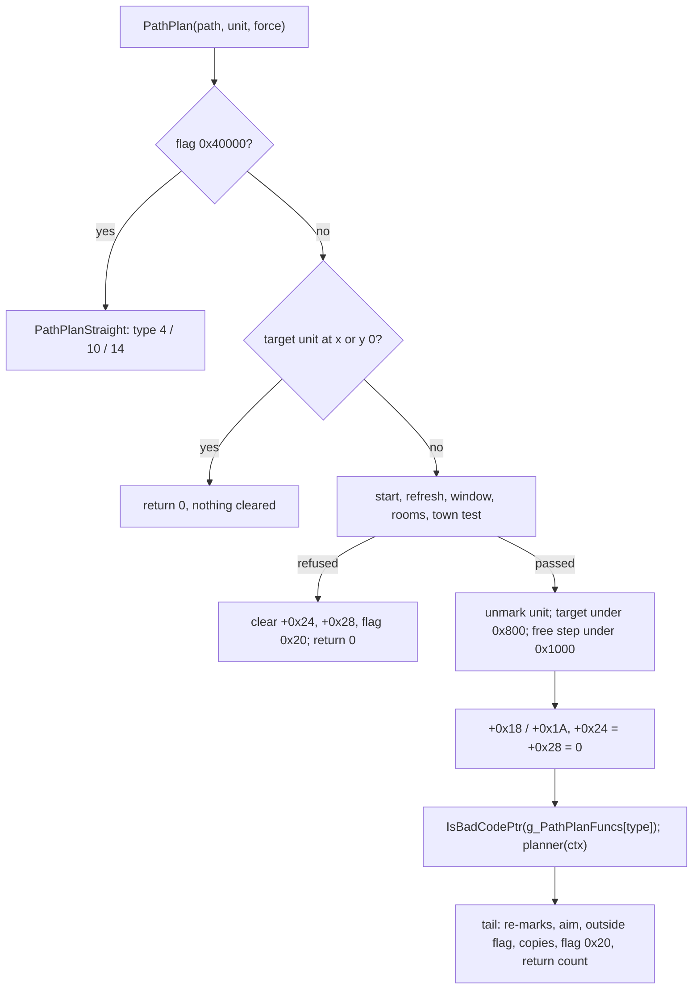

# 0001 — `PathPlan` and the request register: the entry, the request context, the path record's request fields, the straight planner's type 4, the consumers, and all 68 call sites

> **Subsystem:** path/search
> **Question:** given a path request (the path record, its unit, the force argument), what does
> `sub_00649970_PathPlan` check, build and hand to the planner of `g_PathPlanFuncs[type]`, which path fields does the
> request read and write, what do `PathPlanToUnit`, `SUnitPathCreate`, `PATH_DynamicCreate`, `PathSetType`, the
> setters, `PathAimNextPoint` and `PathReplan` do around it, which draws are made on which seed, and who calls
> `PathPlan` with which type?
> **Date:** 2026-11-03   **Plan:** 0054 (Phase 1, batch P1.1)   **Status:** for review (`lane/r54a`)

Static reading of the pinned `Game.exe` with objdump (`p1-pathplan.asm`: `0x00649970`–`0x00649CA0`; `p1-ranges.asm`:
nine ranges around it) and Ghidra decompiles as a reading aid (project copy `workspace/ghidra-r54a`, symbols replayed
from `re/symbols.csv`; `p1-dec-a.c`, `p1-dec-b.c`), the scans of `tools/path_scan.py` (`sites`, `register`, `settypes`,
`tables`, `draws`, `flags`, `writers`), `RngCallGraph` over the request's functions (`p1-rngcg-*.txt`) and emulation of
ten families under ADR-0015/ADR-0021 over declared images built from predicted room grids (§ 12,
run:2026-11-03-path-emu-1). Kept outputs are under `workspace/logs/r54a/` (manifest `manifest.sha256`, one path base:
that directory); the emulation under `emu/` (its own manifest), the development run under `emu/dev-1/` (its own
manifest and tool copy). The emulator scripts are the `lane/r55e` revisions (§ 12).

## Answer (summary)

- [C] **`PathPlan`'s entry, by emulation to its first boundary** (run:2026-11-03-path-emu-1, families `plan` and
  `plannoop`, 1 200 cases, 0 mismatches; a null path's return 0 is read, not run): a path with flag `0x40000` goes to
  `PathPlanStraight` before any other test; otherwise `+0x54 = 0`, a target unit at subtile x or y 0 returns 0 with
  nothing else written, a start of (0, 0), a refreshed target of (0, 0), a target equal to the start, `|dx|` or
  `|dy|` above 100 (100 itself passes), no unit room or no room at the target, and a target room whose level is a
  town for a monster unit that is not `MonIsNpc`, without the force argument, each clear `+0x24`, `+0x28` and flag `0x20` and return 0; then the request
  context is complete and `UNIT_CollUnmark(unit, 0)` is called (the boundary of `plan`); for units whose unmark
  returns at once (`plannoop`), the target's unmark under flag `0x800`, the free-target step under flag `0x1000`, the
  `+0x18/+0x1A` copy and the slot read follow, to the `IsBadCodePtr` call that takes `g_PathPlanFuncs[type]`. (fn:sub_00649970_PathPlan@0x00649970, 0x00649A96–0x00649AB8, 0x00649AEE)
- [I] **The planner's input is a 0x34-byte context** on `PathPlan`'s stack (`struct:PathPlanCtx`): start, target,
  the unit's room, the target's room, the refresh result, path `+0x91`, `+0x92`, the type, `+0x44`, `+0x48`, `+0x50`
  and the path; every field but `+0x10` is written before the call, `[C]` by emulation at the `IsBadCodePtr` boundary
  (241 cases). The planner returns the point count into `+0x28`; the tail after it (the re-marks,
  `PathAimNextPoint`, `sub_00647FB0_PathPointsOutsideRoom`, the `+0x14` copy, the last point into `+0x10` without a target
  unit or flag `0x10`, flag `0x20`, the return of the count) is `[I]`: an import call sits between the slot read and
  the planner, so the emulation cannot pass it. (0x00649B82–0x00649C8F)
- [C] **The helpers, by emulation** (families `free`, `town`, `outside`, `aim`, 1 760 cases, 0 mismatches): the
  target refresh and its object step (2 subtiles toward the start), `PathTargetNotTown` with its midpoint branch
  (rounding toward zero), the free-target walk `sub_00648120_PathTargetFree` and the player extension to 5 subtiles,
  `sub_00647FB0_PathPointsOutsideRoom` (flag bit 0), and `PathAimNextPoint` with `PathDirection` and the facing step
  `sub_006485F0_PathFaceDir`. The collision tests run on the declared grids, interior points only (§ 12).
  (run:2026-11-03-path-emu-1, fn:sub_006498A0_PathTargetRefresh@0x006498A0, fn:sub_00648120_PathTargetFree@0x00648120,
  fn:sub_006483A0_PathTargetNotTown@0x006483A0, fn:sub_0064FE40_PathAimNextPoint@0x0064FE40)
- [C] **Type 4 is `PathPlanToUnit`'s one point**, run to its return through `PathPlanStraight` (47 cases of `plan`
  and `plannoop`: 35 one point, 12 refused): the target unit's position into `+0x10/+0x12`, a refusal at 100 subtiles or more on an axis or a
  target coordinate 0, else one point, `+0x28 = 1`, `+0x38 = 0`, `PathAimNextPoint(path, 1; 1)`, flag bit 0 when the
  point is outside the path's room, flag `0x20`; types 10 and 14 reach `PathPlanRandomWalk` and `PathPlanSpiral`
  with `ECX` the path and `EDX` the unit's seed (100 cases). (fn:sub_006492F0_PathPlanToUnit@0x006492F0,
  fn:sub_00649760_PathPlanStraight@0x00649760)
- [C] **`PathSetType` and the setters, by emulation** (families `settype`, `setters`, 760 cases): `PathSetType`
  replaces bits 8–18 of `+0x34` (`& 0xFFF800FF`) and ORs the whole flags word in (so type 11's bit 2 is set too),
  saves the type into `+0x40` under the word's `0x2000` unless `+0x34` has `0x4000`, the speed into `+0x80` under
  `0x8000` unless `0x10000`, and writes `+0x98 = g_PathTypeParam98[type]` (2, −2, −4 for types 5, 6, 12, else 0);
  `PathSetByte90` caps at 77. (fn:sub_00648CF0_PathSetType@0x00648CF0, data:g_PathTypeParam98@0x006EB648)
- [I] **No function read here draws.** `path_scan.py draws`: 20 ranges, no multiplier, no RNG call;
  `RngCallGraph` under `PathPlan`, `PathReplan`, `PathAimNextPoint`, the setters and the helpers: 80 functions, none
  with an RNG, one indirect call (the slot call 0x00649BAE), the random walk and the spiral stopped (P1.3);
  under `PATH_DynamicCreate`: 52 functions, none. The emulation never read the unit's seed (`+0x20` undeclared, no traced
  access). `SUnitPathCreate`'s own body draws nothing; its mode-init callees reach 118 RNG functions (unfollowed, § 10).
- [I] **The request register** (§ 11, `p1-register.txt`): 68 calls in 58 functions; 34 server and 34 client (out
  of scope, owner decision 5). Server: player 2 (the walk / run / knockback start, type 7 or 8; the packet 0x5F
  position test, type 15), mode machine 5, AI 3 (type-2 test plans), skill 10, missile 10, movement 2
  (`PathReplan`), unreferenced 2 (type 16). 66 calls push force 0; 0x005FBFB7 pushes `EDI` = 0; only the client site
  0x004804C4 can force. No server `PathSetType` call sets 3, 11 or 12 (`p1-settypes.txt`).

## Leads used

No community source was compared (Phase 1b's). Used to locate code only: [ai/0001 § 8](../ai/0001-machinery.md#8-the-path-request)
(the slot table, the AI's types, the 68-call count), [drlg/0009 § 11.1](../drlg/0009-room-lifecycle.md) (the town
refusal), [anim/0003 § 2](../anim/0003-movement-gates.md) (the step, `PathReplan`), [PathTypes](../../tables/PathTypes.md)
(the 17 slots and flags words).

## Functions

| Address | Name | Role | Tag |
|---|---|---|---|
| `0x00649970` | `sub_00649970_PathPlan` | the request: checks, context, unmarks, free target, slot call, tail | I |
| `0x006498A0` | `sub_006498A0_PathTargetRefresh` | (EBX ctx) the target unit's position into `+0x10/+0x12`; 0, 1 or 2 | I |
| `0x006497D0` | `sub_006497D0_PathTargetObjectStep` | (EAX ctx) an object target 2 subtiles toward the start on y (`+0x13C` = 1) or x | I |
| `0x00679190` | `sub_00679190_PathTargetOffsetX87` | (ECX path) `+0x68` offset of a player or monster target (x87; not read) | I |
| `0x006483A0` | `sub_006483A0_PathTargetNotTown` | (ECX unit, ESI ctx) 0 when a hostile pool monster's target room is a town | I |
| `0x00648120` | `sub_00648120_PathTargetFree` | (EAX ctx) the free point nearest the blocked target toward the start | I |
| `0x00648050` | `sub_00648050_PathTargetExtendPlayer` | (ESI ctx) a player's moved target pushed on to 5 subtiles while free | I |
| `0x00678C10` | `sub_00678C10_PathDirCell` | the 5 × 5 direction cell from one point to another | I |
| `0x00678DF0` | `sub_00678DF0_PathDirTriple` | the cell's three directions (`g_PathDirTriples`) | I |
| `0x00647FB0` | `sub_00647FB0_PathPointsOutsideRoom` | (ECX path) flag bit 0 when a point lies outside the path's room | I |
| `0x00649760` | `sub_00649760_PathPlanStraight` | (EAX path, ECX unit) types 4, 10, 14 | I |
| `0x006492F0` | `sub_006492F0_PathPlanToUnit` | (ESI path) type 4: one point at the target | I |
| `0x00648CF0` | `sub_00648CF0_PathSetType` | flags, saved type and speed, `+0x98` | I |
| `0x00648E70` | `sub_00648E70_PathSetByte90` | `+0x90 = +0x91 = min(b, 77)` | I |
| `0x00648E40` | `sub_00648E40_PathSetKnockDist` | `+0x90 = b` | I |
| `0x00648F00` | `sub_00648F00_PathSetByte92` | `+0x92 = b`; asserts an untyped path | I |
| `0x00649070` | `sub_00649070_PathSetStopDist` | `+0x93 = b − 1` for b in 1..19, else 0 | I |
| `0x006490E0` | `sub_006490E0_PathSetByte94` | `+0x94 = v` (v ≤ 255, else assert) | I |
| `0x00649140` | `sub_00649140_PathAddByte94` | `+0x94 += d`, clamped to 0..255 | I |
| `0x00648E30`, `0x00648E60`, `0x00648EA0`, `0x006490A0`, `0x00649120` | `sub_00648E30_PathGetType`, `sub_00648E60_PathGetKnockDist`, `sub_00648EA0_PathGetByte91`, `sub_006490A0_PathGetStopDist`, `sub_00649120_PathGetByte94` | getters (`+0x3C`, `+0x90`, `+0x91`, `+0x93` + 1, `+0x94`) | I |
| `0x0064FE40` | `sub_0064FE40_PathAimNextPoint` | direction and step to the next point; the facing step | I |
| `0x006485F0` | `sub_006485F0_PathFaceDir` | (ECX path, DL dir) `+0x64` or `+0x65/+0x66` by unit type | I |
| `0x00650350` | `sub_00650350_PathReplan` | (unit, flag) a blocked path's re-plan | I |
| `0x00649D00` | `PATH_DynamicCreate` | the 0x200-byte record: size, pattern, masks, type, `+0x91/+0x92` | I |
| `0x00554850` | `sub_00554850_SUnitPathCreate` | per unit type: act, act pointer, the path or static path | I |
| `0x0054CB10` | `sub_0054CB10_PlrReachTest` | a type-15 test plan from the player to a point, the path restored | I |
| `0x0054CD50` | `sub_0054CD50_SrvPkt5FPlayerPos` | client packet 0x5F (position): the reach test at 15–45 subtiles | I |
| `0x005A77C0` | `sub_005A77C0_MonModeStartKnockback` | the monster knockback start (type 8) | I |
| `0x00663E00`, `0x00663ED0` | `sub_00663E00_PathPlanType16A`, `sub_00663ED0_PathPlanType16B` | type-16 plans with no reference | I |
| `0x006EB648` | `g_PathTypeParam98` | 17 dwords: `+0x98` per type | I |
| `0x006EB690` | `g_PathTypeFlags` | 17 dwords: the flags word per type ([PathTypes](../../tables/PathTypes.md)) | I |
| `0x006EB398` | `g_PathDir8` | 8 × (dx, dy) dwords, the free walk's steps | I |
| `0x006EB490` | `g_PathSignTable` | 81 dwords centred here (index `dx + 9 dy`, −40..40): the sign of dx | I |
| `0x006EB548` | `g_PathFaceStep` | 64 entries, 4 bytes apart: the turn step per direction difference | I |
| `0x006F1648` | `g_PathDirTriples` | 25 × 3 bytes: main and two alternate directions (255 = none) | I |

## Walkthrough

### 1. `PathPlan`'s entry

```c
// fn:sub_00649970_PathPlan@0x00649970 (path, unit, force), stdcall ret 0xC; trimmed, our names
if (!path) return 0;
if (path->unit != unit) fatal(0x2E8);
if (path->flags & 0x40000) return PathPlanStraight(EAX path, ECX unit);          // 0x006499AE
path->w54 = 0;
if (t = path->target && (!UnitGetSubX(t) || !UnitGetSubY(t))) return 0;          // nothing else written
if (path->x == 0 && path->y == 0) goto fail;
ctx.start = (x, y); ctx.size = +0x44; ctx.pattern = +0x48; ctx.mask = +0x50;
ctx.limit = (u8)+0x91; ctx.b1C = +0x92; ctx.path = path;
ctx.refresh = PathTargetRefresh(EBX &ctx);                                       // § 3
if (path->tx == 0 && path->ty == 0) goto fail;
ctx.target = (tx, ty);  if (ctx.target == ctx.start) goto fail;
dx = tx - sx; dy = ty - sy;  if (dx > 100 || -dx > 100 || dy > 100 || -dy > 100) goto fail;   // signed, words zero-extended
ctx.room = path->room; ctx.troom = RoomAtSubtile(ECX room, EDX tx; ty);
if (!ctx.room || !ctx.troom) goto fail;
if (!PathTargetNotTown(ECX unit, ESI &ctx) && !force) goto fail;                   // § 4
ctx.type = path->type;
UNIT_CollUnmark(unit, 0);                                                          // the unit's own marks off
tu = 0; if (t && UNIT_GetSizeX(t) && (path->flags & 0x800)) tu = UNIT_CollUnmark(t, 0);
go = 1;
if (path->flags & 0x1000 && COLL_PatternTestBool(ctx.room, tx, ty, ctx.pattern, ctx.mask))
    go = PathTargetFree(EAX &ctx);                                                 // § 5
path->fx = ctx.tx; path->fy = ctx.ty; path->iPoint = 0; path->nPoints = 0;
n = 0;
if (go) { f = g_PathPlanFuncs[ctx.type]; if (IsBadCodePtr(f)) fatal(0x37E); n = f(ECX &ctx); }   // § 6
...
fail: path->iPoint = path->nPoints = 0; path->flags &= ~0x20; return 0;
```

- [C] The order above, to the first boundary, and every write before it, as the emulation compares them (the path
  record's 512 bytes and, past the target refresh, the context's fields on the stack). The window is
  `|d| ≤ 100` on each axis: the `cmp` control (`≥ 100` refuses) fails all 36 cases it separates (15 `plan`, 21
  `plannoop`). The `force` control (the town refusal ignoring the third argument) fails all 13 it separates (5, 8).
  (run:2026-11-03-path-emu-1, 0x00649A96–0x00649AB8, 0x00649AEE)
- [I] The third argument is read once, at the town refusal (`cmp [ebp+0x10],eax`, 0x00649AEE): it lets a refused
  town target through and changes nothing else. (0x00649AEE)
- [C] A target unit whose `UnitGetSubX` or `UnitGetSubY` is 0 returns 0 before the start test and without clearing
  `+0x24`, `+0x28` or flag `0x20` (32 `plan` and 36 `plannoop` cases); the other refusals clear them. Positions are
  `UnitGetSubX/Y`: types 2, 4, 5 the static path's dwords `+0x0C/+0x10`, others the dynamic path's words, 0 without a
  path. (0x006499D3–0x006499F0, fn:sub_0045ADF0_UnitGetSubX@0x0045ADF0)
- [I] The window test is on the request's start and target before the free step: a target moved by § 5 may lie a
  few subtiles further, and the planners see the moved one. The room of the target comes from the unit's room's near
  list (`RoomAtSubtile`), so a target in an inactive room refuses. (0x00649AC5)



### 2. The request context and the path record

- [I] **The context** (`struct:PathPlanCtx`, 0x34 bytes at `EBP − 0x34`; `[EBP + 8]`, the path argument's slot, is
  reused for the start). `+0x10` is never written by `PathPlan`. The planner receives it in `ECX`; `PathPlan`
  asserts after the call that `ctx.start` is unchanged (fatal 0x389), so a planner may move the target (`+0x04`) but
  not the start. (0x00649A0A–0x00649A40, 0x00649BB0–0x00649BC9)
- [I] **The record's request fields** (`struct:PathRequestFields`): the record is 0x200 bytes, zeroed at creation
  (`PATH_DynamicCreate`, 0x00649D17); the points sit at `+0x9C` as `x | y << 16` words, **78 slots** up to `+0x1D3`
  (`+0x1D4` is the crossed-subtile count of anim/0003). `+0x91` is the request limit the planner gets as
  `ctx.limit`: `PathSetByte90` caps it at 77 (0x00648E7D), `PathSetType(4)` asserts it below 78 (0x00648DA7), and
  creation gives a player 73 and a monster 14 (0x00649E86, 0x00649E4D). `+0x92` is 70 for a player (0x00649E8D) and
  is written otherwise in the path module only by `sub_00648F00_PathSetByte92`, which asserts a path of type 0. `+0x93` is the
  stop range (`PathSetStopDist`), `+0x94` the re-plan budget (§ 9), `+0x98` the type parameter. How the planners use
  `ctx.limit`, `ctx.b1C` and `+0x98`: the search reads `b1C` only and not `limit` (path/0002 § 6); greedy reads `limit` and `+0x98`, type 15 and the random walk the byte `+0x91` itself, type 1 neither (path/0003 §§ 1–8, 0x00679D3B, 0x0067C312, 0x0067A27F).
- [I] **Writers** (`p1-writers-9x.txt`, byte stores to `[reg+0x90..0x94]` over `.text`): in the path module only the
  setters, `PATH_DynamicCreate` and `PathStepMove`'s `+0x90` decrement (0x00650724); two client copies (0x004651B6–
  0x004651DC, 0x00447060, 0x0044706F); 14 stores in 0x0058929F–0x00594647 (the range corrected by path/0002 § 10, which also
  follows them): each stores into a quest's private data, none into a path record. (fn:QUESTS_FindById@0x00543640, 0x0058A98F)

### 3. The target refresh

- [C] `sub_006498A0_PathTargetRefresh` (EBX ctx), run in `plan` and `plannoop` over target types 0–5 (405 cases reach it
  with a target unit, `check.txt` `OUTCOMES`): no target unit → 1; else the unit's position into `+0x10/+0x12` (words), 0 when both are 0, then by type
  (jump table 0x00649958): 0 and 1 → 1 when the path's `+0x68` is 0, else a call of `sub_00679190_PathTargetOffsetX87` (an observed
  boundary: 37 cases end there; the 1 returned after it, 0x00649950, is `[I]`); 2 → 2, through the object step when the object record's `+0x13A` is set
  (47 cases); 3 → 1; 4 → 2; 5, above the table (`cmp eax,4; ja`, 0x0064991F), → 1 (49 cases). (fn:sub_006498A0_PathTargetRefresh@0x006498A0, data:0x00649958)
- [C] The object step `sub_006497D0_PathTargetObjectStep`: when the record's `+0x13C` is 1 the target `y` moves 2
  toward the start (`−2` when the start's y is below the object's `+0x10` dword, unsigned compare, else `+2`), else the
  target `x` by the same rule on `+0x0C`. The step never tests the grid. (0x00649836–0x0064988E)

### 4. The town test

- [C] `sub_006483A0_PathTargetNotTown` (family `town`, 400 cases; 494 MonIsNpc mask reads accounted): 1 for a null
  unit, a unit that is not a monster, or `MonIsNpc` (MonStats `npc` or `inTown`: `+0x0D` & 0x01 or & 0x04, the masks
  read from the image words 0x006CE268 and 0x006CE270; or a negative unit `+0xC4`); else `!RoomIsTown(room)` with `room = ctx.troom`, or when that is 0 the room
  of the target found from the room at the midpoint `start + (target − start) / 2` (signed division rounding toward
  zero: the `floor` control fails all 56 cases it separates). `RoomIsTown` is the DRLG room's level id in {1, 40, 75,
  103, 109}. `PathPlan` never takes the midpoint branch (it refuses a zero `ctx.troom` first). The `npc` control
  fails all 5 it separates here and all 43 in `plan`/`plannoop`. (0x006483BF–0x00648414, fn:sub_0063E860_MonIsNpc@0x0063E860,
  tbl:MonStats.txt:npc, tbl:MonStats.txt:inTown)

### 5. The free-target step

```c
// fn:sub_00648120_PathTargetFree@0x00648120 (EAX ctx); the target is blocked under the request's pattern and mask
(d0, d1, d2) = g_PathDirTriples[PathDirCell(target, start)];   // main, two alternates (d2 255 = none)
m = a = b = target;
loop { if (m == start) return 0;                                  // ctx unchanged
       m += g_PathDir8[d0]; if (!blocked(m)) { ctx.target = m; break; }
       a += g_PathDir8[d1]; if (!blocked(a)) { ctx.target = a; break; }
       if (d2 != 255) { b += g_PathDir8[d2]; if (!blocked(b)) { ctx.target = b; break; } }
       d0 = g_PathDirTriples[PathDirCell(m, start)].main; }
if (ctx.target == start) return 0;
if (unit is a player) PathTargetExtendPlayer(ESI ctx);           // § 5, the extension
return 1;
```

- [C] As above (family `free`, 560 cases, and 13 `plannoop` cases where the target moved, 13 where it returned 0 and
  `PathPlan` re-marked the unit at 0x00649BE0): `blocked` is `COLL_PatternTestBool(ctx.room, x, y, ctx.pattern,
  ctx.mask)`; the alternates are fixed for the whole walk, only the main direction is recomputed from the main point;
  coordinates are words (`add di`, `add bx`). The `noalt` control fails all 97 cases it separates. The steps of
  `g_PathDir8` used are rows 0, 2, 4, 6 (axis steps): every entry of `g_PathDirTriples` is 0, 2, 4, 6 or 255
  (`p1-tables.txt` `T1648`). (0x006481B7–0x006482FA, data:g_PathDirTriples@0x006F1648, data:g_PathDir8@0x006EB398)
- [C] `sub_00678C10_PathDirCell(a, b)`: `dx = b.x − a.x`, `dy = b.y − a.y`; when `|dx| ≥ 2|dy|` the y term becomes −1 for a
  negative `dy`, else `dy & 1`; else when `|dy| ≥ 2|dx|` the x term likewise; both are clamped to −2..2; the cell is
  `5 dx + dy + 12`. The `dy & 1` (not a sign) is the code (`and esi,1`, 0x00678C4C): it changes the cell only for
  an even non-zero minor term, whose cell differs from the sign's in its third direction; the `sign` control fails
  all 60 cases written to separate it (`free`'s last 60, kept only when the two walks differ). (0x00678C2A–0x00678CA2)
- [C] `sub_00648050_PathTargetExtendPlayer` (ESI ctx): with `dx, dy` the moved target minus the start, nothing when
  `|dx| ≥ 5`, `|dy| ≥ 5` or both 0; else the step `(g_PathSignTable[dx + 9 dy], g_PathSignTable[dy + 9 dx])` (the signs
  of dx and dy, `p1-tables.txt` `T490`) is added while the new point is free and `max(|dx|, |dy|)` counts up below 5,
  each free point becoming the target. The `ext4` control fails all 33 cases it separates. (0x00648050–0x0064811C)

### 6. The slot call and the tail

- [C] The argument of the `IsBadCodePtr` call (IAT slot 0x006CC34C, observed at its value in the emulator image,
  0x00303946; site 0x00649B93) is `g_PathPlanFuncs[type]`, read at 0x00649B85, for every type 0–16, 0 for the empty
  slots 4, 10, 14 of a path without flag `0x40000` (241 cases, every type 0–16 among them, 3 to 21 each; 241 slot
  and 241 IAT reads accounted).
  (data:g_PathPlanFuncs@0x006EB6D8, 0x00649B82–0x00649B8D)
- [I] After it: `IsBadCodePtr` non-zero is fatal 0x37E; the planner is called with `ECX = &ctx` (0x00649BAE), its
  `EAX` stored in `+0x28` (also 0 when `go` was 0); the start is checked (fatal 0x389); the target is re-marked when
  it was unmarked, then the unit (`UNIT_CollMark`, 0x00649BD7, 0x00649BE0); `+0x28 = 0` clears flag `0x20` and returns
  0; else `PathAimNextPoint(path, 1; 1)`, and when `+0x24 ≥ +0x28` after it (every point at the position) the fail path;
  else `sub_00647FB0_PathPointsOutsideRoom`, `+0x14/+0x16 = +0x10/+0x12`, `+0x38 = 0`, and when flag `0x10` is clear and
  there is no target unit the last point into `+0x10/+0x12`; flag `0x20` set; the count returned. A planner returning
  a count above 78 would overrun the record (no test here). (0x00649BA1–0x00649C6E)

### 7. `PathPlanStraight` and `PathPlanToUnit`

- [C] `PathPlanStraight` (EAX path, ECX unit) by the path type: 4 → `PathPlanToUnit`, flag `0x20` set on a non-zero
  count and cleared on 0, the count returned; 10 → `PathPlanRandomWalk(ECX path, EDX &unit->seed)`; 14 →
  `PathPlanSpiral` with the same registers (boundaries; their flag `0x20` set and `+0x28` returned after, `[I]`); any
  other type is fatal 0x207 (not run). (0x00649763–0x006497C8)
- [C] `PathPlanToUnit` (ESI path): `+0x24 = 0`; a target unit's position into `+0x10/+0x12`; refused (0) when
  `|sx − tx| ≥ 100` or `|sy − ty| ≥ 100` or `tx` or `ty` is 0: a refusal keeps `+0x28` as it was. Else `+0x9C` = the
  target, `+0x28 = 1`, `+0x38 = 0`, `PathAimNextPoint(path, 1; 1)`, and flag bit 0 when the path has no room or the
  point lies outside its rectangle. No collision test: a type-4 path is one straight segment to the target.
  (0x006492F0–0x006493F9)

### 8. Creation, `PathSetType`, the setters and the flags

- [C] `SUnitPathCreate` (ECX unit, EDX x; y, game, room, flag), to its first boundary (family `create`, 300 cases):
  `unit+0x18 = DRLG_ActFromLevelId(RoomGetLevelId(room))` (the act table 0x006EB2F0 {1, 40, 75, 103, 109, 1024}:
  the first `k` with `level < T[k]` gives `k − 1`, none gives 0; a null room gives level 0), `unit+0x1C =
  game+0xBC[act]`; then players, monsters and missiles call `PATH_DynamicCreate(game+0x1C, room, x, y, unit, 0)`
  (sites 0x005548D0, 0x005548F6, 0x005549AF), objects start with `OBJECTS_GetRecord(class)`, items in mode 3 and
  type 5 with `0x00620AE0(unit, room, x, y)`, other items with `0x00553060`. The `act` control (`≤`) fails all 72 it
  separates. (fn:sub_00554850_SUnitPathCreate@0x00554850, fn:DRLG_ActFromLevelId@0x006427F0)
- [I] `PATH_DynamicCreate` (not emulated: it allocates first, § 12): 0x200 bytes zeroed; `+0x30` unit, `+0x44`
  `UNIT_GetSizeX`, `+0x48` `PATH_PatternFromSize`, position `x << 16 | 0x8000`, `+0x7C = 0x800`, `+0x1C` room, `+0x93 =
  0`, `+0x1D4 = 1` with the start; a player: masks 0x80 / 0x1C09, `PathSetType(7)`, `+0x91 = 73`, `+0x92 = 70`; a
  monster: mark 0x100, bits 8–18 cleared and **type 2 written directly** with `+0x98 = 0` (no `PathSetType`),
  `PATH_MonTestMask` (wraith base id 38: pattern 5, mask 0x804), `+0x91 = 14`; a missile: masks 0, `PathSetType(4)`.
  The flag argument (0 from all three `SUnitPathCreate` sites) sets `0x10`. (0x00649D00–0x00649EE2)
- [C] `PathSetType` (family `settype`, 400 cases; 132 end at an assert): as the summary; a player given type 2 is fatal
  0x861 before any write; after the writes, `+0x40` of 11 or 8 is fatal 0x871 / 0x872 and type 4 with `+0x91 ≥ 78`
  0x873. The `mask` control (bits 8–17) fails all 101 it separates. Type 101 (`SkillDo89Jump`, 0x005CBA59, before
  its type-8 and type-9 plans) reads index 101 of both tables, 0 in this image (0x006EB824, 0x006EB7DC), so it clears
  bits 8–18 and sets `+0x98 = 0`. (0x00648D29–0x00648DB5)
- [C] The setters (family `setters`, 360 cases): `PathSetByte90` (null path: nothing), `PathSetKnockDist`,
  `PathSetStopDist` (`b − 1` when `(u8)(b − 1) ≤ 18`, else 0; null path: nothing), `PathSetByte94` (assert 0x965
  above 255, unsigned), `PathAddByte94` (sign of the 32-bit sum: negative → 0, above 255 → 255),
  `PathSetByte92` (assert 0x8E8 on a typed path). The `cap` control fails all 20 it separates.
  (run:2026-11-03-path-emu-1, fn:sub_00648E70_PathSetByte90@0x00648E70, fn:sub_00649070_PathSetStopDist@0x00649070,
  fn:sub_006490E0_PathSetByte94@0x006490E0, fn:sub_00649140_PathAddByte94@0x00649140, fn:sub_00648F00_PathSetByte92@0x00648F00)
- [I] **`PathMoveReset`** restores the speed from `+0x80` under flag `0x8000`, then sets type 7 for a player and,
  for any other unit under flag `0x2000`, the saved type `+0x40` (0x00648DEC–0x00648E25). With `PathSetType`'s saves,
  types 8, 9 and 11 (flags with `0x2000` and `0x8000`) are the temporary ones a reset undoes.
- [I] **The flags' uses** (`p1-flags.txt`, memory-immediate tests and stores on `[reg+0x34]` in the path module,
  51 instructions over 18 bits; register-held tests, as `PathPlan`'s `test cl,0x10` at 0x00649C1B, are not in it): in
  the request, `0x40000` sends to the straight planner, `0x800` unmarks the target, `0x1000` moves a blocked target,
  `0x10` keeps the target point after a plan (and the re-plan, § 9), `0x20` is the moving flag, bit 0 the points-outside
  flag, `0x200` turns the facing by 32 (§ 9), `0x4000` / `0x10000` keep the saved type and speed. Bits `0x100`,
  `0x400`, `0x2000` and `0x8000` are only replaced by `PATH_DynamicCreate`'s and `PathSetType`'s masks in this
  scan; `0x2000` and `0x8000` are read from the type's word in `PathSetType` (a register test). The planners' tests
  of the flags: the search reads none (path/0002 § 6); of the short planners only `PathAimNextPoint`'s `0x200`, through greedy's first line (path/0003 § 1).

### 9. The consumers: `PathAimNextPoint`, `PathFaceDir`, `PathReplan`

- [C] `PathAimNextPoint` (ECX path, EDX f, arg; family `aim`, 500 cases): skips points at the position (subtile
  centres `w << 16 | 0x8000` equal to `+0x00/+0x04`); past the last one, `+0x24 = +0x28`, the vector and step from
  the image dwords 0x006EB7D4/0x006EB7D8 (0, 0), `+0x7C = 0`, return 1 with no facing step; else `PathDirection`
  to the point, `+0x6A/+0x6E` the vector, the direction turned by 32 under flag `0x200`, step `(v · d) >> 8`
  (signed), return 1 when the step lands in the point's subtile on both axes, and the facing step when `arg` ≠ 0 or
  (reached and `f` ≠ 0). The `face0` control fails all 308 cases it separates and `sar7` all 417. anim/0003 § 2's
  reading of the step holds. (fn:sub_0064FE40_PathAimNextPoint@0x0064FE40, fn:sub_0064FC60_PathDirection@0x0064FC60)
- [C] `PathDirection` (16.16 positions, unsigned compares): the major axis is y when `dx ≤ dy`; `q = minor · 127 /
  major` (signed `idiv`, 0 for a zero major) indexes `g_PathDirTable` (128 rows of three dwords); the row's vector is
  swapped and signed by octant and its third dword gives the 64-step direction (`(−1 − t) & 15` swapped, `& 31` for a
  decreasing y, `& 63` for an increasing x, then `+ 8`). (0x0064FC60–0x0064FD69, data:g_PathDirTable@0x006EB7E0)
- [C] `sub_006485F0_PathFaceDir` (DL dir & 63): an object or item sets `+0x64`; a missile sets it unless flag `0x40`;
  any other unit (or none) sets `+0x65` and `+0x66 = g_PathFaceStep[(dir − +0x64) & 63]` unless `+0x65` is already
  the direction. (0x006485F0–0x00648634, data:g_PathFaceStep@0x006EB548)
- [C] `PathReplan` (unit, flag), to its first boundary (family `replan`, 300 cases): no path → 0; without flag
  `0x10`: a monster with `+0x94 = 0` → 0, else `UnitMarkUpdated(unit)` (boundary; after it, `[I]`: `+0xC4 |= 1` and
  `PathAddByte94(path, −iPoint)`); then types 2, 13, 15 write `+0x3C` directly (13 with the flag, else 2 and `+0x10 =
  +0x18`, the request's own target) and plan (the boundary); other types plan as they are. After a first plan of 2, 13 or 15 that returns 0, type 15 is
  written and a second plan made (0x006503D2–0x006503DD): past the boundary, `[I]`. The `swap`
  control fails all 63 it separates. (fn:sub_00650350_PathReplan@0x00650350)
- [I] Since `PathReplan` writes `+0x3C` without `PathSetType`, a re-plan keeps the flags word of the type before it:
  a 13 re-planned as 2 keeps `0x100`, a 2 re-planned as 15 lacks 15's `0x800`. (0x006503AF–0x006503D2)

### 10. Draws per seed

- [I] **None.** By function: `PathPlan`, `PathTargetRefresh`, the object step, `PathPlanStraight`, `PathPlanToUnit`,
  `PathPointsOutsideRoom`, `PathTargetExtendPlayer`, `PathTargetFree`, `PathTargetNotTown`, `PathSetType`, the
  setters, `PATH_DynamicCreate`, `SUnitPathCreate`, `PathAimNextPoint`, `PathReplan`, `PathDirCell`, `PathDirTriple`:
  no `0x6AC690C5` multiplier, no call to the 19 RNG functions of `re/symbols.csv` (`p1-draws.txt`, 20 ranges).
  Their call graph (`p1-rngcg-plan.txt`, roots `PathPlan`, `PathReplan`, `PathAimNextPoint`, `PathSetType`, the six
  setters, `PathPointsOutsideRoom`, `PathTargetFree`, `PathTargetNotTown`; stops at the random walk, the spiral and the
  three fatal-path functions): 80 functions, `rng=0`, one indirect call, the slot call 0x00649BAE. `PATH_DynamicCreate`
  (`p1-rngcg-dyncreate.txt`, allocator stopped): 52 functions, `rng=0`.
- [C] In the emulated domain the unit's seed is not read: `+0x20` is never declared and no family traced an access
  outside its declared memory and the accounted image tables (run:2026-11-03-path-emu-1, `traced=0` in every family).
- [I] `SUnitPathCreate`'s callees after the path (the player's `PlrPlaceEventsInit`, `MonInitMode`, the mode set)
  reach 118 RNG functions of a 2 090-function graph (`p1-rngcg-create.txt`), the nearest at depth 3
  (`PlayerModeAllowed` via 0x005809D0, `MonAttackStats` via `MonSetMode`): the mode machine's and the population's,
  not the path's; unfollowed here.
- [I] So in this batch every draw of a plan lies in the planner: the random walk (type 10, P1.3) and the search's
  type-16 branch (P1.2), as ai/0001 § 8 found; the slots of types 3, 11 and 12 (0x00679E50, 0x00679FD0, 0x00679E60) were
  roots of neither graph, so their draws were unfollowed here; path/0003 § 5 follows them: none. (fn:sub_0067A240_PathPlanRandomWalk@0x0067A240)

### 11. The request register

All 68 direct calls of `PathPlan` (`p1-register.txt`; `p1-sites.txt` with every push; no jump to it, no byte pattern
dropped), in 58 functions by the scan's attribution (the `re/symbols.csv` entry, else the nearest int3-padded start;
drlg/0009 § 11.1 counted 59). Ghidra's analysis lists 67 of the 68 (`p1-findptr-pathplan.txt`): it has no function
and no reference at 0x005A7854, inside `sub_005A77C0_MonModeStartKnockback`, which only a pointer of the monster mode
records reaches (0x006E22C0). Owners and types:

| Owner | Sites | Type at the call (sites) |
|---|---:|---|
| player | 2 | 7 or 8 (`PlrModeStartMove` 0x0057F117: `PathMoveReset` gives a player 7, mode 19 sets 8); 15 (packet 0x5F's reach test 0x0054CBB9) |
| mode machine | 5 | the request's type (`MonPathPlanType` 0x005A62EF), 15 (its fallback 0x005A634E), current (`MonModeStartSkill` 0x005A760D, 0x005A7638), 8 (knockback 0x005A7854) |
| AI | 3 | 2, test plans that restore the path (0x005DD580, 0x005E912D, 0x005FBFB7) |
| skill | 10 | 8, 9 (`SkillDo89Jump`), 2 then 1 (`SkillSt48SwarmMove`), 1 (`SkillDo103DiabRun`), current (`SkillSt31Charge`), 14 (`SkillDo73BlessedHammer`, the hammer's path), 7 (`SkillSt38Whirlwind`), 9 then 8 (`LeapAttackPath`) |
| missile | 10 | 4 (`MissileCreate` 0x0059FDB1, the creation type), 10 (the four reseed callbacks), current (`GuidedSetTarget`, do 7, 11, 16, 35) |
| movement | 2 | 13 or 2, then 15 or current (`PathReplan`) |
| unreferenced | 2 | 16 (0x00663E1B, 0x00663EEB) |
| client | 34 | out of scope: 14 sites with a scanned `PathSetType` (1, 2, 7, 9, 10, 11, 14), 20 current |
| **All** | **68** | |

- [I] The register as the table states, each type read at its site (the evidence column of `p1-register.txt`). The
  "current" sites plan with the type the path already holds: a missile's 4 unless a callback set 10 (or a do function 14),
  a monster's last request type, a player's 7 after a mode reset. The force argument: 66 push 0, 0x005FBFB7 `EDI`
  (0 at that point, drlg/0009 § 11.1), the client 0x004804C4 `EAX`. (fn:sub_0057F090_PlrModeStartMove@0x0057F090,
  fn:sub_0054CD50_SrvPkt5FPlayerPos@0x0054CD50, fn:sub_005A6290_MonPathPlanType@0x005A6290,
  fn:sub_0059FA30_MissileCreate@0x0059FA30)
- [I] **The player's move request** (this plan's, owner decision 2): a walk, run or town walk start
  (`PlrModeStartMove`, modes 2, 3, 6 through `0x0057F174`'s index table, `p1-tables.txt` `TPLRMOVE`) plans type 7,
  `PathPlanGreedyNear`, after `PathMoveReset`; mode 19 plans type 8 with `+0x90 = 5`. The client's position packet
  0x5F, when the server's position is 15–45 subtiles off (`0x006417F0`), tests a type-15 plan to the client's point
  with mask 0x409 and limit 77, accepting only a plan whose end is that point, and restores mask, type and `+0x91`.
  (0x0057F0C5–0x0057F117, 0x0054CDE1–0x0054CE30, fn:sub_0054CB10_PlrReachTest@0x0054CB10)
- [I] **Types set on the server** (`p1-settypes.txt`, the 51 direct `PathSetType` calls, 34 server): immediates 0, 1, 2,
  4, 7, 8, 9, 10, 14, 15, 16 and 101, and four register arguments (the reach test's restore, `MonPathPlanType`'s
  argument, `MonAiPreferDecoy`'s restore, `PathMoveReset`'s saved type); 13 is written directly by `PathReplan` and
  through `MonPathPlanType` (ai/0001 § 8), 5 and 6 through it, 2 directly by `PATH_DynamicCreate`. **No server code
  sets 3, 11 or 12**: 11 has three client calls (0x004614A6, 0x004B04BF, 0x004C8870). The `+0x3C` stores that are not a `PathSetType` call
  outside the path module: path/0003 § 12's scan, with its remainder of 18 unresolved server bases.

### 12. Emulation (run:2026-11-03-path-emu-1)

- **The image.** Eight active rooms as declared `DungeonRoom` records (`struct:DungeonRoom`), their near lists, DRLG rooms,
  level records and `CollMap`s (`struct:CollMap`), written once by the memory spec (`const`; the level ids re-applied per
  case): two 2 × 2 blocks of the activation model of `tools/collision.py` (`World.model`, the logged tile entries and
  DT1 bytes stamped as `COLL_MapBuild` does, equal to the logged grids in both logs: 362 and 44 checks, 0 failures)
  on two kept run:2026-10-14-collision logs: block T, Act III town (level 75) under Jungle 1 (76), 40 × 40 rooms; block
  J, Jail 1 (29), 60 × 60 rooms (a maze level). Each block twice: as predicted, and with 60 seeded unit marks per room
  (`PATH_SetMarkMask`'s player 0x80 and monster 0x100, plus and 3 × 3 footprints). Paths (512 bytes each), units,
  targets, object records, the MonStats and MonStats2 fields and `g_pDataTables` (an input on purpose) per case.
- **The search context** for P1.2: `PathSearchRun` takes a stack frame of 0x36FF8 bytes (`_chkstk` 0x006831B0, 0x0067AAA3)
  and asserts a bounding rectangle of at most 50 000 cells (0x0067AABC); the emulator's declared stack
  (0x7FE00000–0x7FF01000) holds it, so the context needs no image of its own. (fn:sub_0067AAA0_PathSearchRun@0x0067AAA0)
- **Families** (`check.txt`): `plan` 600 and `plannoop` 600 (the entry; `plan` units whose unmark would touch the grid,
  ending at `UNIT_CollUnmark`, `plannoop` units in mode 0, 12 or 17 whose unmark returns at once, running on to the slot),
  `free` 560, `town` 400, `outside` 300, `settype` 400, `setters` 360, `aim` 500, `replan` 300, `create` 300: **4 320
  cases, 4 320 matching, 0 stopped, 0 unaccounted traced accesses**. Accounted image reads: the slot and flags tables,
  `g_PathTypeParam98`, `g_PathDir8`, `g_PathDirTriples`, `g_PathSignTable`, `g_PathDirTable`, `g_PathFaceStep`, the act table,
  the MonIsNpc masks, the IAT slot and five switch tables in `.text` (0x00649958, 0x0064D994, 0x0064D784, 0x00554A18,
  0x0062057C, and LevelIsTown's 0x006426C0/0x006426C8).
- **Controls**: every negative control fails every case it separates (`cmp` 15 + 21, `force` 5 + 8, `npc` 17 + 26 + 5,
  `noalt` 97, `ext4` 33, `sign` 60, `floor` 56, `le` 25, `mask` 101, `cap` 20, `face0` 308, `sar7` 417, `swap` 63, `act` 72); the
  site control fails all 1 382 boundary cases (332, 318, 132, 49, 251, 300).
- **Domain** (the case writers resample outside it): collision test points at least one subtile inside a room for the
  plus and 3 × 3 patterns (the edge branches of `COLL_PlusTestBool`, the rectangle split of `COLL_RectTestBool` are
  drlg/collision's); no assert input except where a family observes the assert; no target whose unmark would mark
  the grid in `plannoop`.
- **Not emulated, and why**: the tail of `PathPlan` (an import between the slot read and the planner; Phase 2's logs);
  `PATH_DynamicCreate` (its first call is the allocator 0x0040B430, a guard: no stub, ADR-0015); the planners (P1.2, P1.3);
  `UNIT_CollUnmark` / `UNIT_CollMark` (drlg/collision's; they write the declared const grid); `sub_00679190_PathTargetOffsetX87`
  (x87, ADR-0015 condition 5). No symbol is raised by this run (review-fixes rule 14).

### 13. Phase 2's log (design and volume)

- **One line per `PathPlan` call**, at the entry (`PLN`) and at the return (`PLX`), from `tools/gdb/path.gdb`:
  entry: frame, unit type and guid, path type, `+0x34`, start, target point, target unit (type, guid, position),
  `+0x90..+0x94`, `+0x98`, force, the unit seed; exit: `EAX`, `+0x28`, the points (`+0x9C`, at most 78 words pairs),
  `+0x10/+0x12`, `+0x18/+0x1A`, `+0x34`, the unit seed. A `PLC` line at the planner call (0x00649BAE) carries the context
  as the planner sees it (the moved target, the room), which splits the request's checks (this batch) from the planner
  (P1.2, P1.3). The grids are predicted from the rooms (`tools/collision.py`, the room id and activation in the line);
  the unit marks inside the 100-subtile window are logged as a unit list (type, position, pattern, mark mask), not as
  cells: about 10–40 units, 12 bytes each, so a mark snapshot costs far less than the 20 000-byte window.
- **Volume** (an estimate, from ai/0001 § 13's rates): a plan per walk or run command, per missile with a speed and per
  replan; with 10–40 monsters near one player that is about 10–40 plans a second in a fight, 600–2 400 a minute. At
  about 250 bytes for the two lines (10 points on average) plus 300 for the unit list, 0.3–1.3 MB a minute uncapped.
  ADR-0014's filter (the logged character's rooms) and caps per type (200) and per session (3 000 plans) bound a
  session to about 6 000 lines and 2 MB, the size of plan 0045's runs. The injected logger is not needed for this
  plan; the planner's internal search (P1.2) stays out of the log.

### 14. For the review: the batch cut of P1.2 and P1.3

- **Server-reachable types** (§ 11): 0 (the get-hit request, ai/0001), 1, 2, 4, 5, 6, 7, 8, 9, 10, 13, 14, 15; 16 only
  from the two unreferenced functions; 3, 11, 12 from client code only. So of the ten planner addresses, the server's
  requests reach `PathPlanSearch`, `PathPlanType1`, `PathPlanGreedy`, `PathPlanGreedyNear`, `PathPlanKnockback`,
  `PathPlanOnePoint`, `PathPlanType15` and the straight family; 0x00679E50, 0x00679FD0 and 0x00679E60 (types 3, 11,
  12) are reached by no server code (a reading, § 11).
- **Proposal**: keep **P1.2** as the plan has it (types 0 and 16, `PathSearchRun` and its three draw functions, the node
  store in the 0x36FF8-byte frame), and add `PathPlanType1` and `PathPlanType15` to it only if their first reading
  shows a call into `PathSearchRun`; **P1.3** the short planners in two parts, (a) the server-reached ones (greedy
  for 2, 5, 6, 13 with the `+0x98` parameter, greedy-near for 7, knockback 8, one point 9, the random walk and the
  spiral with missiles H1) first, then (b) the three client-only slots (3, 11, 12) from the code alone, as the plan
  allows for unreached slots. Phase 2's per-type floors would then cover 1, 2, 4, 7, 8, 9, 10, 13, 14, 15 (and 0 if a
  get-hit request is logged), not 3, 11, 12, 16.

## Data touched

- `tbl:MonStats.txt:npc` (`+0x0D`, MonIsNpc), MonStats `+0x18` (the MonStats2 index) and MonStats2 `+0x08`
  (`tbl:MonStats2.txt:SizeX`, `UNIT_GetSizeX` for a monster target); `tbl:Objects.txt:SizeX` (`+0xD0`, an object
  target's size), `tbl:Objects.txt:IsDoor` (`+0x13A`) and `tbl:Objects.txt:Orientation` (`+0x13C`): `[I]` the readers
  0x00621A70 and 0x00621AC0 read `unit +0x14 -> +0x00 -> +0x13A / +0x13C`, and `SUnitCreate` stores
  `OBJECTS_GetRecord(class)` at `unit +0x14 -> +0x00` (0x005553D7–0x005553E2), the 0x1C0-byte record at 0x0096D470 + class × 0x1C0
  (0x00640EC8). (fn:OBJECTS_GetRecord@0x00640E90, fn:sub_00555230_SUnitCreate@0x00555230)
- `struct:PathPlanCtx`, `struct:PathRequestFields`, `struct:PathMove`, `struct:DynPathColl`, `struct:DungeonRoom`,
  `struct:CollMap`.
- Image tables: `data:g_PathPlanFuncs@0x006EB6D8`, `data:g_PathTypeFlags@0x006EB690`, `data:g_PathTypeParam98@0x006EB648`,
  `data:g_PathDir8@0x006EB398`, `data:g_PathSignTable@0x006EB490`, `data:g_PathDirTriples@0x006F1648`,
  `data:g_PathDirTable@0x006EB7E0`, `data:g_PathFaceStep@0x006EB548`, the act table 0x006EB2F0.

## Dead ends

- Observing `UNIT_CollUnmark` and running past it in one family: an observed entry ends every case that reaches it,
  so the development run's first `plan` family ended 107 "no-op unmark" cases at the unmark; split into `plan` and
  `plannoop` (`emu/dev-1/`).
- The level-id override of `create` was first written big-endian (a `w` line takes bytes), giving act 0 for 72
  cases of the development run; fixed before the kept run.

## Open questions

- Whether a server-created object unit's record is the only one the refresh meets: answered for `SUnitCreate`'s units (*Data
  touched*); a client unit's data is out of scope (owner decision 5).
- What the planners do with `ctx.limit`, `ctx.b1C`, `ctx.refresh` and `+0x98`, and whether one can return more than 78 points: answered, path/0002 § 9 and path/0003 § 11 (no server planner passes 78; greedy fills all 78 at limit 77; client type 12 can).
- `[L]` The type-16 setters (no reference) and the client sites of types 3, 11 and 12: a harness break line in Phase 2
  would show whether anything reaches them on the server (ai/0001 *Open questions*).
