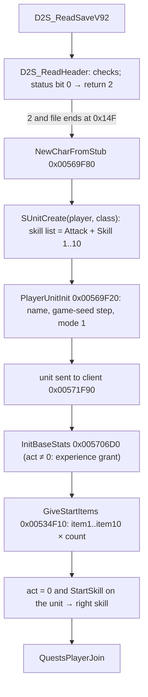

# 0001 — New character, starting items, experience and level-up

> **Subsystem:** player/creation
> **Question:** What does a new character of each class start with (stats, skills, items, with their seeds), how does
> experience turn into a level, and what does a level-up change?
> **Date:** 2026-10-15, Phase 2 2026-10-16   **Plan:** 0034 (Phases 1, 1b and 2)   **Status:** Phase 2 reproduced
> ([run:2026-10-16-player](experiments.md#run2026-10-16-player), § 11); Phase 2 accepted with fixes 2026-10-16 (architect); plan 0038
> batch S3a, 2026-10-16: 3 raised, 2 in part, [§ Plan 0038 batch S3a](#plan-0038-batch-s3a-2026-10-16)

Static reading of the pinned `Game.exe` (Phases 1 and 1b), then the bit-exact reproduction of Phase 2 (§ 11). Names are ours. The table docs of plan 0034 Phase 0
(`CharStats`, `Experience`, `CharTemplate`) have not landed, so columns are named by their `.txt` header and anchored
as `struct:CharStatsRec+0x…` / `struct:ExperienceRec+0x…` ([re/types/player.h](../../../re/types/player.h)), not as
`tbl:` anchors. Stat ids are ItemStatCost rows (`tbl:ItemStatCost.txt:ID`): 0 `strength`, 1 `energy`, 2 `dexterity`,
3 `vitality`, 4 `statpts`, 5 `newskills`, 6/7 `hitpoints`/`maxhp`, 8/9 `mana`/`maxmana`, 10/11 `stamina`/`maxstamina`,
12 `level`, 13 `experience`, 29 `lastexp`, 30 `nextexp`, 67 `velocitypercent`, 68 `attackrate`, 69 `other_animrate`,
70 `quantity`, 72 `durability`, 85 `item_addexperience`, 107 `item_singleskill`. Life, mana and stamina stats are
fixed point with 8 fraction bits (`value << 8`); the CharStats "per level" and "per point" columns are quarter points,
so the code multiplies them by 64.

## Answer (summary)

The tags below are those of the plan 0034 record. [§ Plan 0038 batch S3a](#plan-0038-batch-s3a-2026-10-16) raises
further statements; where it lists one, its tag and evidence take precedence over the bullet here.

- [C] **The stub.** The client writes a 335-byte header (`sub_0043C540_StubBuild`): name, class at `0x28`, the
  character-screen status word `| 1` (new) `| 0x20` for class 5 or 6, level 1, `time(NULL)` twice, 16 default graphics
  bytes from `0x0070CCC8` and 16 bytes `0xFF`; everything else 0. Status bit 0 set → the reader clears the bit and
  returns 2. (fn:sub_0043C540_StubBuild@0x0043C540, fn:D2S_ReadHeader@0x0056A090, run:2026-10-16-player: 35 stubs)
- [I] The server's checks on the stub, failure paths not exercised by run:2026-10-16-player (every stub passed): size ≥
  0x14F (else 4), checksum (6), size field (5), version 92..96 (7), name equal to the client's name ignoring case (7),
  `D2S_CheckStatus` (expansion bit vs the game, ladder with a host, hardcore vs the game, dead hardcore, difficulty
  progression), class byte ≤ 7 (4). `D2S_ReadSaveV92` calls `sub_00569F80_NewCharFromStub` only when the file ends
  exactly at `0x14F` (else load error 9). (fn:D2S_ReadHeader@0x0056A090, 0x0056B1C6–0x0056B1E2)
- [C] **The start values** come from CharStats record *class*, with no arithmetic beyond `<< 8`:
  `strength = str`, `energy = int`, `dexterity = dex`, `vitality = vit`, `hitpoints = maxhp = (vit + hpadd) << 8`,
  `mana = maxmana = int << 8`, `stamina = maxstamina = stamina << 8`, `level = 1`, `nextexp = Experience[class][1]`
  (500), stats 19/20 = 0, 67/68/69 = 100. `LifePerVitality` and `ManaPerMagic` are **not** applied to the starting
  attributes. (fn:PLAYER_InitBaseStats@0x005706D0, struct:CharStatsRec+0x30, run:2026-10-16-player)
- [C] **Starting skills.** The player unit's skill list gets skill 0 (Attack) and then `Skill 1..10` (valid ids only),
  each at level 1; left and right skills default to Attack. After the items, a non-blank `StartSkill` that the unit
  then has becomes the **right** skill (player data `+0x70`, save `0x7C`). Only Sorceress (36 Fire Bolt) and
  Necromancer (70 Raise Skeleton) have one; the skill comes from `item1`, which gets `item_singleskill(StartSkill) = 1`.
  (fn:SKILLS_InitPlayerSkills@0x00647EE0, fn:sub_00569F80_NewCharFromStub@0x00569F80, fn:sub_00534C70_StartItemCreate@0x00534C70, run:2026-10-16-player; the skill `item1` grants is a last list entry of base level 0, § 11)
- [C] **Starting items**, `item1`..`item10` in order, each `itemNcount` times: a creation record with item record
  index, ilvl = the player's base level (1), quality 2 (normal), record `+0x18` = 4, record flags `0x08 | 0x02` (no
  socket roll, no ethereal roll), no position, entered at `sub_00558D90_ItemCreate(game, &rec, 0)`, so each item's
  unit and item-data seeds come from the **game seed** (two steps per item, [rng/0002](../rng/0002-seed-tree.md#units)).
  Then: identified (`0x10`), stackable → quantity = max stack, `item1` only → `item_singleskill`. Placement: beltable
  type → belt; `itemNloc` ≠ 0 → equip at that body location; else inventory; then `durability` = max durability.
  (fn:PLAYER_GiveStartItems@0x00534F10, fn:sub_00534D60_StartItemSlot@0x00534D60, fn:ITEMS_CreateForStore@0x00559CE0, run:2026-10-16-player: 269 item copies; placement and the equip flag in § 11)
- [I] Branches no stock kit reaches, so not exercised by run:2026-10-16-player: a full belt or a failed equip falls
  back to inventory; a bow quiver gets `quantity` 250 instead of durability, 100 when not equipped.
  (fn:sub_00534D60_StartItemSlot@0x00534D60)
- [C] Every starting item gets item flag `0x20000`, the save's "starter" bit 17. (0x00534DB6, fmt:d2s#flags,
  run:2026-10-11-d2s-samples)
- [C] **Seeds.** The player unit draws one step from the game seed `+0xD0` (`sub_00552DF0_UnitSeedInit`), then each
  starting item two (unit seed, item-data seed). The save has no player seed: its only seed field is `map_seed`
  (`0xAB`), written from `game+0x7C` at save time; a stub returns before the map-seed reuse, so a new character's first
  save stores the map seed of the game it was created in. (0x00569F53, fn:D2S_ReadHeader@0x0056A090, run:2026-10-16-player: nothing else steps the game seed from `SUnitCreate` to the exit, § 11)
- [C] **Experience table.** Per class (column = class id). Record 0 is the `MaxLvl` row,
  record *L* + 1 is `Level` *L*; `Experience[class][lvl]` is the experience at which level *L* + 1 starts. Level from
  experience = the number of rows *L* = 0..MaxLvl−1 with `Experience[class][lvl] ≤ exp` (unsigned), capped at `MaxLvl`.
  `ExpRatio` scales gained experience: `exp × ExpRatio[level] >> ExpRatio[MaxLvl row]` (the MaxLvl row's 10 is the
  shift). (fn:EXP_GetThreshold@0x00611800, fn:EXP_LevelFromExp@0x00611860, fn:XP_ApplyExpRatio@0x0057E390,
  struct:ExperienceRec+0x1C, run:2026-10-16-player)
- [I] Not reached by run:2026-10-16-player, so on the code reading alone: the class column is clamped to 0..6 (else
  0), and experience is capped at `Experience[class][MaxLvl − 1]` (3,520,485,254 at 99). (fn:EXP_GetThreshold@0x00611800,
  fn:PLAYER_AddExperience@0x0057E510)
- [C] **Level-up** (`PLAYER_LevelUp`, once per experience change that changes the level, for all levels gained at
  once, `d` = new − old): `maxhp += LifePerLevel × d × 64`, `maxmana += ManaPerLevel × d × 64`,
  `maxstamina += StaminaPerLevel × d × 64` (base stats); then current life (if > 0), mana and stamina are set to their
  full maxima; `statpts += StatPerLevel × d` (signed byte); `newskills += d` (one skill point per level, hardcoded);
  `level` and `nextexp = Experience[class][level]`. Nothing is drawn: at run time no RNG function is called and no LCG
  step executes anywhere between its entry and its return (the static call graph reaches RNG code through callbacks,
  none of which ran).
  (fn:PLAYER_LevelUp@0x00570880, fn:PLAYER_AddExperience@0x0057E510, run:2026-10-16-player: no RNG-function call and no execution of any of the 852 LCG multiplier sites between its entry and its return, § 11)
- [I] **Boundary recommendation for Phase 2** (the architect rules): model §§ 1–5 and 7 in `tools/player.py`; take
  each starting item's creation inside `sub_00558D90_ItemCreate` as a logged boundary oracle (game seed asserted on
  entry, item unit/item-data seeds and the created item's lines taken at exit), or chain it to the existing normal-quality
  item model where `tools/props.py` covers the base; § 6 (experience gain) only through direct grants, with the
  monster share left to [monsters/stats](../monsters/0004-stats.md). (fn:sub_00558D90_ItemCreate@0x00558D90)



## Leads used

Phase 1b cross-check: see [§ 10](#10-community-cross-check-phase-1b). The claims above and §§ 1–9 were written from
the code before any source was read.

## Functions

A `C` row is a function whose behaviour in this table run:2026-10-16-player reproduces (§ 11); the
branches § 11 and the summary list as not exercised stay `[I]` in the text.

| Address | Name | Role | Tag |
|---|---|---|---|
| `0x00613260` | `CHARSTATS_LoadTable` | `charstats.bin`, 0xC4 records → `g_pCharStats` / `g_nCharStats`; field descriptor = the column offsets | I |
| `0x00613D30` | `EXP_LoadTable` | `experience.bin`, 0x20 records → `g_pExperience`; count not kept | I |
| `0x00611800` | `EXP_GetThreshold` | `(class, L)` → `record[L+1].perClass[class]`, class outside 0..6 → 0 | C |
| `0x00611830` | `sub_00611830_ExpMaxLevel` | `record[0].perClass[class]` (MaxLvl), class outside 0..6 → 0 | I |
| `0x00611860` | `EXP_LevelFromExp` | count of thresholds ≤ exp, capped at MaxLvl | C |
| `0x00613E60` | `EXP_GetRatio` | `ExpRatio` of level L; L ≤ 0 → the MaxLvl row's; L > `record[0].perClass[0]` → 0 | C |
| `0x00569F80` | `sub_00569F80_NewCharFromStub` | the new-character path from a stub | I |
| `0x00532590` | `sub_00532590_NewCharLegacy` | the same steps, reached from the version < 92 reader and `sub_005345A0_PlayerLoad` | I |
| `0x00569F20` | `sub_00569F20_PlayerUnitInit` | client link, name, game-seed step, mode 1, player data `+0x50..+0x5C` = 0 | C |
| `0x00532520` | `sub_00532520_PlayerUnitInitLegacy` | the same, for `0x00532590` | I |
| `0x005348C0` | `sub_005348C0_PlayerUnitAlloc` | `SUnitCreate`'s player branch: inventory, skill list, stat list | I |
| `0x00647EE0` | `SKILLS_InitPlayerSkills` | Attack + `Skill 1..10`; left/right default to Attack | C |
| `0x00647110` | `SKILLS_AddSkill` | add a skill at level 1, or raise an existing one by 1 (below its max) | C (plan 0038 H6g) |
| `0x005706D0` | `PLAYER_InitBaseStats` | starting stats; `act ≠ 0` → `PLAYER_GrantLevel` | C |
| `0x00534F10` | `PLAYER_GiveStartItems` | `item1..item10` | C |
| `0x00534D60` | `sub_00534D60_StartItemSlot` | one `itemN`, `count` times: create, flags, place, durability | C |
| `0x00534C70` | `sub_00534C70_StartItemCreate` | creation call, `item_singleskill` on `item1`, stack quantity | C |
| `0x00534B30` | `sub_00534B30_StartItemToInventory` | page 0, `sub_00560200_InvPlaceItem` | C |
| `0x00534BB0` | `sub_00534BB0_StartItemEquip` | equip at the item's body location (item data `+0x44`) | C |
| `0x00559CE0` | `ITEMS_CreateForStore` | (name from [items/0009](../items/0009-vendors.md); the generic builder) builds a creation record from arguments, `ItemCreate`, sets identified | I |
| `0x0055E9B0` | `sub_0055E9B0_ItemToBelt` | belt placement (`.\ITEMS\ItemMode.cpp`) | C |
| `0x005701B0` | `sub_005701B0_PlayerSetSkill` | set the left (`EDX` ≠ 0) or right (`EDX` = 0) skill | I |
| `0x006439F0` | `SKILLS_GetUnitSkill` | the unit's skill entry with that id, or 0 | I |
| `0x00643C50` | `SKILLS_SetRightSkill` | skill list `+0x0C` | I |
| `0x0057E510` | `PLAYER_AddExperience` | add, cap, `lastexp`, level change → `PLAYER_LevelUp` | C |
| `0x00570880` | `PLAYER_LevelUp` | per-level gains | C |
| `0x0057EB10` | `PLAYER_GrantLevel` | give `Experience[class][lvl] − exp` when level < lvl (players); mercenary branch | C |
| `0x0057E480` | `XP_Compute` | clamp, max-level test, level-difference factor, `ExpRatio`, `item_addexperience` | C |
| `0x0057E2F0` | `XP_LevelDiffPenalty` | the two 11-entry /256 tables, or `exp × clvl / mlvl` | C |
| `0x0057E390` | `XP_ApplyExpRatio` | `exp × ratio >> shift` with an overflow branch | C |
| `0x0057E6C0` | `XP_PartyShare` | party bonus and level-weighted split | I |
| `0x0057E5A0` | `sub_0057E5A0_PartyXpCollect` | party members alive, same level, within distance² 6400 | I |
| `0x0057E990` | `XP_OnMonsterKill` | experience of a killed monster to the credited player | C |
| `0x0057EAB0` | `sub_0057EAB0_AddExperienceDirect` | unadjusted grant to a player | I |
| `0x0058C5C0` | `sub_0058C5C0_ExpGrantCapped` | grant 1,400,000 / 20,000,000 / 40,000,000 by difficulty, cut to `T(L + 1) − T(L)` (§ H6g static read) | I |
| `0x005359F0` | `PLAYER_DeathExpLoss` | `DeathExpPenalty`% of the level span | C (plan 0038 H6g) |
| `0x00570D60` | `PLAYER_SpendStatPoint` | `statpts` − 1, attribute + 1 | C (plan 0038 H6g) |
| `0x00570A80` | `PLAYER_SpendEnergy` | energy and `ManaPerMagic` | C (plan 0038 H6g) |
| `0x00570B60` | `PLAYER_SpendVitality` | vitality, `LifePerVitality`, `StaminaPerVitality` | C (plan 0038 H6g) |
| `0x00570080` | `PLAYER_SpendSkillPoint` | skill-point spend: `newskills` (base stat 5) ≥ the cost, minus the cost, then `SKILLS_AddSkill` | I |
| `0x00535AB0` | `sub_00535AB0_PlayerDeathExpLossGate` | calls `PLAYER_DeathExpLoss` when the killer is a monster with no owner | C (plan 0038 H6g) |
| `0x005391E0` | `CLIENT_SetDeathExpLoss` | the client's kept amount (`DLC`) | C (plan 0038 H6g) |
| `0x00539210` | `CLIENT_GetDeathExpLoss` | read by the corpse creation | C (plan 0038 H6g) |
| `0x0057F700` | `PLAYER_CorpseCreate` | the corpse with 75 % of the kept amount | C (plan 0038 H6g) |
| `0x006253B0` | `STATS_GetUnitBaseStat` | `(unit, id, param)`: base entries; the kill's stat 13 read | C (plan 0038 H6g) |
| `0x00537970` | `sub_00537970_ClientFlag3D4Set` | `client +0x3D4 \|= 1` (0x00537993) | I |
| `0x0058D110` | `sub_0058D110_A5Q5_Statue476Init` | InitFn 65 (object 476): its id to quest data `+0x14` | I |
| `0x0058D150` | `sub_0058D150_A5Q5_Statue474Init` | InitFn 63 (object 474): its id to `+0x18` | I |
| `0x0058D190` | `sub_0058D190_A5Q5_Statue475Init` | InitFn 64 (object 475): its id to `+0x1C` | I |
| `0x0058D240` | `sub_0058D240_A5Q5_AltarInit` | InitFn 72 (object 546): its id to `+0x50`, its mode from `+0x4C` | I |
| `0x00548A50` | `sub_00548A50_InteractWalkTo` | `UnitInteract` beyond reach: `PLAYER_ModeCmdUnit(0, 3, …)` | I |
| `0x0063D430` | `INV_SetOwnerId` | inventory `+0x24` ← id (signature `0x01020304` checked) | I |
| `0x0063D450` | `INV_GetOwnerId` | inventory `+0x24`, −1 without an inventory | I |
| `0x0054D520` | `sub_0054D520_SrvPacket63Handler` | handler of packet 0x63 (`g_PacketTable` 0x006E0D18, index 0x63; read), calls `BeltFreeSlot` at 0x0054D5BF | I |
| `0x00570C80` | `sub_00570C80_StatsResetToBase` | attributes back to the CharStats values | I |
| `0x00622560` | `sub_00622560_PlayerBaseToHit` | `(dex − 7) × 5 + stat 19 + ToHitFactor` | I |
| `0x00622720` | `sub_00622720_UnitBlockChance` | `toblock + BlockFactor`, dex and level scaling, cap 75 | I |
| `0x0056E5B0` | `sub_0056E5B0_UnitWalkVelocity` | player: `WalkVelocity << 8` | I |
| `0x00620E80` | `sub_00620E80_RunVelocityStat` | `velocitypercent = RunVelocity × 100 / WalkVelocity − 100` | I |
| `0x0057F240` | `sub_0057F240_RunStaminaDrain` | `RunDrain × 2`, scaled | I |
| `0x00539A30` | `sub_00539A30_ClientCreate` | server client record; class from CharTemplate in a template game | I |
| `0x0053FE70` | `sub_0053FE70_GameIsTemplate` | game-info flags bit 8 | I |
| `0x006657C0` | `sub_006657C0_CharTemplateClass` | `Class` byte of a template record | I |
| `0x00664B80` | `CHARTEMPLATE_LoadTable` | `chartemplate.bin`, 0xF0 records | I |
| `0x006221A0` | `UNIT_GetPlayerData` | `unit+0x14` of a player | I |
| `0x005385F0` | `CLIENT_GetClass` | client `+0x08` | I |
| `0x00538620` | `CLIENT_SetClass` | | I |
| `0x00538630` | `CLIENT_SetStatus` | client `+0x0A` | I |
| `0x00538830` | `CLIENT_GetName` | client `+0x0D` | I |
| `0x005382B0` | `CLIENT_GetAct` | client `+0x1AC` | C (S3a) |
| `0x005382E0` | `CLIENT_SetAct` | asserts < 5 | I |
| `0x0052DFA0` | `sub_0052DFA0_SetStartAct` | `g_StartAct = arg` | I |
| `0x0044D5A0` | `sub_0044D5A0_ApplyActOption` | `-act N` (1..5) → `SetStartAct(N − 1)` | I |

Data: `data:g_pCharStats@0x0096C7F4` (`DataTables+0xBC4`), `data:g_nCharStats@0x0096C7F8`,
`data:g_pExperience@0x0096C8A8`, `data:g_pCharTemplate@0x0096D600`, `data:g_StartAct@0x00883D44`,
`data:g_ActStartLevel@0x006E1520` (u32 ×5: 1, 15, 20, 26, 32), `data:g_XpPenaltyBelow@0x006E1668` and
`data:g_XpPenaltyAbove@0x006E1694` (u32 ×11 each, /256).

## Walkthrough

### 1. The stub and the server's checks

- [I] `sub_0043C540_StubBuild(name, status, class in DL)` fills the 0x14F-byte image at `0x0077AC10`: `0x00`
  `0xAA55AA55`, `0x04` 96, `0x08` 0x14F, `0x14` the name, `0x24` `status | 1`, then `| 0x20` when class is 5 or 6,
  `0x28` class, `0x29` 16, `0x2A` 30, `0x2B` 1 (level), `0x2C` and `0x30` `time(NULL)`, `0x88..0x97` copied from
  `0x0070CCC8`, `0x98..0xA7` `0xFF`; the rest stays 0, so `0xA8..0xAA` (act per difficulty) and `0xAB` (map seed)
  are 0. Its callers pass the character screen's status word (client structure `+0x1EF`) and class (`+0x1EE`); the
  screen itself ORs `0x20` for class 5 or 6 before the call too. Hardcore is bit 2 (`0x04`) of that word. The checksum is
  added by `sub_0043C6B0_StubWrite`. (0x0043C568–0x0043C5D0, 0x00436360–0x004363CE)
- [I] `D2S_ReadHeader` on the server, in order: buffer shorter than 0x14F → 4; checksum over the buffer with `0x0C`
  zeroed ≠ `0x0C` → 6; length ≠ `0x08` → 5; version not in 92..96 (`0x5B < v ≤ 0x60`) → 7; client name null → 3; `_stricmp(client name, 0x14)` ≠ 0 → 7; `D2S_CheckStatus(status)` ≠ 0 → its code; class
  byte `0x28` > 7 (unsigned `cmp al, 7; ja`) → returns error code 4, the read stops and nothing is clamped
  (`0x0056A172`–`0x0056A174` → `mov eax, 4` at `0x0056A0C6`); `CLIENT_SetClass(class)`. With status bit 0 set it clears the bit in the buffer and the client
  (`CLIENT_SetStatus`) and returns 2 **before** the act byte, the map seed and the hotkeys are read.
  (0x0056A0AF–0x0056A1B1)
- [I] Class 7 passes the header check although CharStats has 7 records (0..6). Every CharStats lookup returns no
  record for it, so stats, items and the start skill are all skipped (each reader tests `class < g_nCharStats`).
  Experience lookups clamp class 7 to 0 (Amazon). (0x0056A172, 0x005706FD, 0x00611808)
- [I] `D2S_ReadSaveV92`: return 2 and cursor == end → `NewCharFromStub(EAX = client, EBX = game, [out unit])`;
  return 2 with bytes after the header → internal code 2, mapped to 9 by `data:g_D2sLoadErrorMap@0x006E1208`.
  (0x0056B1C6–0x0056B1E2, 0x0056B3A7)

### 2. `sub_00569F80_NewCharFromStub`

```c
// fn:sub_00569F80_NewCharFromStub@0x00569F80 (EAX = client, EBX = game; trimmed)
client->flags3D4 |= 1;                                   // 0x00537970
unit = SUnitCreate(UNIT_PLAYER, CLIENT_GetClass(client), game, 0, 0, 0, 0);
PlayerUnitInit(game, unit, client);                      // 0x00569F20
UnitSendToClient(game, unit, client);                    // 0x00571F90
act = CLIENT_GetAct(client);                             // client+0x1AC
PLAYER_InitBaseStats(game, unit, act);
PLAYER_GiveStartItems(unit, game, act);
pd = UNIT_GetPlayerData(unit); pd->leftSkill = 0; pd->rightSkill = 0;   // +0x74, +0x70
cs = CharStats(unit->classId);
if (act == 0 && cs && cs->startSkill != 0 && SKILLS_GetUnitSkill(unit, cs->startSkill)) {
    PlayerSetSkill(unit, /*right*/ 0, cs->startSkill, -1);
    pd->rightSkill = cs->startSkill;
}
QuestsPlayerJoin(game, unit, 1);
*out = unit; return 0;
```

- [I] `sub_00532590_NewCharLegacy` repeats the same body with `sub_00532520_PlayerUnitInitLegacy`, which is
  `sub_00569F20_PlayerUnitInit` instruction for instruction except for register use. It is reached from the
  version < 92 reader `0x00534020` and from `sub_005345A0_PlayerLoad`. (0x00532590, 0x00534098, 0x00534607)
- [I] `SUnitCreate` with type 0 does not seed the unit ([rng/0002](../rng/0002-seed-tree.md#units)); its player
  branch `sub_005348C0_PlayerUnitAlloc` creates the inventory, allocates the skill list (`unit+0xA8`) and calls
  `SKILLS_InitPlayerSkills`. (0x00555374, fn:sub_005348C0_PlayerUnitAlloc@0x005348C0)
- [I] `sub_00569F20_PlayerUnitInit`: client ↔ unit links (`0x005378E0`, `0x00553180`), `name` copied into the player
  data, **`sub_00552DF0_UnitSeedInit(unit, &game->seed)`** (one game-seed step: `unit+0x28` = low word,
  `unit.seed = init(low)`), `UNIT_SetMode(unit, 1)`, player data `+0x50/+0x54/+0x58/+0x5C` = 0. `UNIT_SetMode` →
  `UNIT_AnimInit` draws nothing for a player (its unit-type-0 branch has no RNG call; the draw is the object branch).
  (0x00569F53, 0x00569F5B, fn:UNIT_AnimInit@0x00624390)
- [I] The act passed on is the client's current act, `client+0x1AC`. For a stub it is **not** read from the header
  (the stub branch returns first); it keeps the value the client record got at creation, `g_StartAct` (`0x0052FB97`),
  which is 0 unless `-act N` set it to `N − 1` (`sub_0044D5A0_ApplyActOption`, config `+0x1FF`).
  (0x0056A1F7, 0x0052FB90, 0x0044D5D9)

### 3. Starting attributes — `PLAYER_InitBaseStats` (0x005706D0)

```c
// fn:PLAYER_InitBaseStats@0x005706D0 (ECX = game, EDX = unit, arg = act; trimmed)
if (act > 4) act = 4;
cs = CharStats(unit->classId); if (!cs) return;          // classId < g_nCharStats
SetStat(unit,  0 strength,  cs->str);    SetStat(unit, 1 energy,   cs->energy /*int*/);
SetStat(unit,  2 dexterity, cs->dex);    SetStat(unit, 3 vitality, cs->vit);
SetStat(unit, 19 tohit, 0);              SetStat(unit, 20 toblock, 0);
hp = (cs->hpadd + cs->vit) << 8;         SetStat(unit, 6, hp);  SetStat(unit, 7, hp);
mp = cs->energy << 8;                    SetStat(unit, 8, mp);  SetStat(unit, 9, mp);
st = cs->stamina << 8;                   SetStat(unit, 10, st); SetStat(unit, 11, st);
SetStat(unit, 12 level, 1);
SetStat(unit, 30 nextexp, EXP_GetThreshold(unit->classId, 1));
SetStat(unit, 68, 100); SetStat(unit, 67, 100); SetStat(unit, 69, 100);
if (act != 0) {                                          // only under -act N
    if (act >= 5 /*0x007326B4, constant*/) act = 0;
    PLAYER_GrantLevel(game, unit, g_ActStartLevel[act]); // {1, 15, 20, 26, 32}
}
```

- [I] All CharStats fields here are unsigned bytes (`movzx`); the order of the `SetStat` calls is as written.
  (0x0057071D–0x0057080E, struct:CharStatsRec+0x30, struct:CharStatsRec+0x35)
- [C] The CharStats record layout used in this finding (`str` `+0x30`, `dex` `+0x31`, `int` `+0x32`, `vit` `+0x33`,
  `stamina` `+0x34`, `hpadd` `+0x35`, `PercentStr/Int/Dex/Vit` `+0x36..+0x39`, `ManaRegen` `+0x3A`, `ToHitFactor`
  s32 `+0x3C`, `WalkVelocity` `+0x40`, `RunVelocity` `+0x41`, `RunDrain` `+0x42`, `LifePerLevel` `+0x43`,
  `StaminaPerLevel` `+0x44`, `ManaPerLevel` `+0x45`, `LifePerVitality` `+0x46`, `StaminaPerVitality` `+0x47`,
  `ManaPerMagic` `+0x48`, `BlockFactor` `+0x49`, `StatPerLevel` `+0x50`, `itemN`/`itemNloc`/`itemNcount`
  `+0x5C + 8(N−1)` / `+0x60` / `+0x61`, `StartSkill` `+0xAC`, `Skill 1..10` `+0xAE..+0xC0`) is the loader's field
  descriptor, and decoding `charstats.bin` with it reproduces all 301 compared cells of the 7 `charstats.txt` rows
  (the `Expansion` separator row is not compiled; record = class id 0..6). Blank `StartSkill`/`Skill N` are −1.
  (fn:CHARSTATS_LoadTable@0x00613260, struct:CharStatsRec+0x43; data check: the 7 records of `charstats.bin` (u32 count,
  then 0xC4-byte records) decoded at these offsets against the 7 class rows of the stock `charstats.txt`, rerun
  at the architect review 2026-10-15 with the 23 numeric columns, `itemN` and `itemNcount` (371 cells), 0
  mismatches; the `tools/excel_layouts.py` entry of Phase 0 makes it a tool check)
- [I] With stock data the starting values are (life = `vit + hpadd`, mana = `int`, stamina = `stamina`;
  fn:PLAYER_InitBaseStats@0x005706D0):

  | Class | id | str | dex | int (energy) | vit | life | mana | stamina |
  |---|---:|---:|---:|---:|---:|---:|---:|---:|
  | Amazon | 0 | 20 | 25 | 15 | 20 | 50 | 15 | 84 |
  | Sorceress | 1 | 10 | 25 | 35 | 10 | 40 | 35 | 74 |
  | Necromancer | 2 | 15 | 25 | 25 | 15 | 45 | 25 | 79 |
  | Paladin | 3 | 25 | 20 | 15 | 25 | 55 | 15 | 89 |
  | Barbarian | 4 | 30 | 20 | 10 | 25 | 55 | 10 | 92 |
  | Druid | 5 | 15 | 20 | 20 | 25 | 55 | 20 | 84 |
  | Assassin | 6 | 20 | 20 | 25 | 20 | 50 | 25 | 95 |

  (fn:PLAYER_InitBaseStats@0x005706D0, struct:CharStatsRec+0x33)
- [I] `tot`, `#walk`, `#run`, `#swing`, `#spell`, `#gethit`, `#bow` and `Comment` are not in the descriptor and are
  not compiled. `PercentStr..PercentVit` are compiled but no reader was found among the 23 code sites that index the
  CharStats array outside the loaders (the client getter `0x004833E0` was not followed). (fn:CHARSTATS_LoadTable@0x00613260)

### 4. Starting skills

- [I] `SKILLS_InitPlayerSkills(unit)`: unless the list already holds skill 0 with item ref −1, it adds skill 0, then
  each `Skill 1..10` with `0 ≤ id < skills count`, in column order, through `SKILLS_AddSkill`; then if the left skill
  is unset it sets Attack, and the same for the right. `SKILLS_AddSkill` appends a 0x40-byte entry with level 1 and
  item ref −1 (an existing entry is raised by 1 while below the skill's max level). One special case: for class 6
  (Assassin) skill 5 (`Left Hand Swing`) the entry's `+0x08` is 16 instead of the skill record's `+0x10` byte.
  (0x00647F2C–0x00647F9E, fn:SKILLS_AddSkill@0x00647110, tbl:Skills.txt:Id)
- [I] Stock lists: every class gets Attack, Throw (2), Kick (1), the scroll and book of Identify and Town Portal
  (217–220) and Unsummon (3); Barbarian adds Left Hand Throw (4) and Left Hand Swing (5), Assassin Left Hand Swing.
  (struct:CharStatsRec+0xAE)
- [I] The start skill: `sub_00534C70_StartItemCreate` gives the item created for slot 0 (`item1`, every copy of it)
  a stat-list entry `107 item_singleskill` with parameter `StartSkill`, value 1, when `0 ≤ StartSkill < skills count`;
  after the items, `NewCharFromStub` makes `StartSkill` the right skill if `SKILLS_GetUnitSkill` finds it on the unit
  (the check is `StartSkill ≠ 0`, so the blank −1 reaches `SKILLS_GetUnitSkill` and fails there). The right skill is
  player data `+0x70`, saved at `0x7C` ([save/0001](../save/0001-d2s-io.md) § 2, confirmed there). Skipped entirely when
  `act ≠ 0`. (0x00534CCD–0x00534D2F, 0x0056A001–0x0056A069, struct:PlayerData+0x70)

### 5. Starting items — `PLAYER_GiveStartItems` (0x00534F10)

```c
// fn:sub_00534D60_StartItemSlot@0x00534D60 (ECX = game, EDX = player; trimmed)
for (slot = 0; slot < 10; slot++) {                       // PLAYER_GiveStartItems
  it = &cs->items[slot];
  if (!ITEMS_GetByCode(it->code, &idx)) continue;        // "0   " is not an item
  for (k = 0; k < it->count; k++) {
    item = StartItemCreate(player, game, slot, idx);     // 0x00534C70
    ITEMS_SetFlag(item, 0x20000 /*starter*/, 1);
    item->data->bodyLoc = it->loc;                       // item data +0x44
    if (ItemTypeOf(item)->beltable) {                    // ItemTypes +0x19
      if (!ItemToBelt(game, player, item->id, x, 1, &fail)) StartItemToInventory(game, player, item, 1);
    } else if (it->loc == 0) {
      StartItemToInventory(game, player, item, 1);
      if (IsType(item, 5 /*bowq*/)) SetStat(item, 70, 250); else SetStat(item, 72, ItemMaxDurability(item));
      if (IsType(item, 5)) SetStat(item, 70, 100);
    } else {
      if (!StartItemEquip(player, item)) StartItemToInventory(game, player, item, 1);
      if (IsType(item, 5)) SetStat(item, 70, 250); else SetStat(item, 72, ItemMaxDurability(item));
    }
  }
}
```

- [I] `sub_00534C70_StartItemCreate`: `ilvl = sub_00558200_UnitDropLevel(player)` (the player's base `level`, 1 at
  this point), then `ITEMS_CreateForStore(ECX = player, EDX = item index, game, 4, 2, 1, 1, ilvl, 0, 0, 0)`;
  removes the item's stat list with flag `0x40` if there is one; for slot 0 adds `item_singleskill` (§ 4); for a
  stackable base sets `quantity` (70) to the max stack. (0x00534C7F–0x00534D4B, fn:sub_00558200_UnitDropLevel@0x00558200)
- [I] `ITEMS_CreateForStore` builds the 0x84-byte creation record, zeroed: `+0x00` source = player,
  `+0x08` game, `+0x0C` ilvl (≥ 1; −1 would mean "the source's level"), `+0x14` item index, `+0x18` = 4, position and
  room 0, `+0x28` u16 1, `+0x2A` u16 `game+0x78`, `+0x30` quality = 2 (normal), `+0x48/+0x4C` = 0 (no seed override),
  `+0x80 |= 0x08 | 0x02` (socket and ethereal rolls off, meanings from [items/0008](../items/0008-cube.md)). It calls
  `sub_00558D90_ItemCreate(game, &rec, 0)`, which seeds the unit and its item data from the game seed
  ([items/0001 § 8](../items/0001-tc-resolution.md)), and sets flag `0x10` (identified) on the result.
  (0x00559D0F–0x00559E0B, struct:ItemCreateRec+0x30, struct:ItemCreateRec+0x80)
- [I] So the draw order from the game seed at creation is: one step for the player (§ 2), then for each item copy, in
  slot order and copy order, the steps `ItemCreate` makes (two: `UnitSeedInit` and `ItemSeedInit`); the item's own
  creation draws (base stats of a normal item) are on its own seed, inside the item model. Whether anything between
  `SUnitCreate` and the items (unit sent to client, quests) also steps the game seed is open (§ Open questions).
  (fn:sub_00552E90_ItemSeedInit@0x00552E90, fn:sub_00558D90_ItemCreate@0x00558D90)
- [I] Placement: beltable types go to the belt by `sub_0055E9B0_ItemToBelt` (`.\ITEMS\ItemMode.cpp`; with argument
  1 the free belt slot is found by `0x0063C790`); a body location goes through `sub_00534BB0_StartItemEquip`
  (`0x005606B0` with the item data's `+0x44`); failures and the rest go to inventory page 0 through
  `sub_00560200_InvPlaceItem` (spot search not read). (tbl:ItemTypes.txt:Beltable, 0x00534DCA, 0x00534E47)
- [I] Stock starting kits (code ×count → place): Amazon `jav` → `rarm`, `buc` → `larm`, `hp1` ×4, `tsc`, `isc`;
  Sorceress `sst` → `rarm`, `hp1` ×4, `tsc`, `isc`; Necromancer `wnd` → `rarm`, then as the Sorceress; Paladin `ssd`,
  Barbarian `hax`, Druid `clb`, Assassin `ktr` → `rarm`, each with `buc` → `larm`, `hp1` ×4, `tsc`, `isc`. Loc index 4 is
  `rarm`, 5 `larm`, 0 none (as compiled). `hp1` is beltable; `tsc`/`isc` go to the inventory.
  (struct:CharStatsRec+0x5C)
- [I] `baseWClass` (`hth`) is the weapon-class code `0x0064F060` returns for a player in mode 0 or 0x11, or when
  neither hand holds an item of component 5 or 6. (0x0064F166, struct:CharStatsRec+0x4C)

### 6. Experience

- [C] `experience.bin` has 101 records of 0x20 bytes, `{u32 perClass[7]; u32 ExpRatio}`; record 0 is the `MaxLvl`
  row (99 ×7, ExpRatio 10) and record *L* + 1 is `Level` *L* (0..99); the decoded records equal all 101 rows of
  `experience.txt`. Columns are the class ids 0..6. (fn:EXP_LoadTable@0x00613D30, struct:ExperienceRec+0x1C; data
  check: `experience.bin` (u32 count 101, then the records) against the stock `experience.txt`, rerun at the
  architect review 2026-10-15, 101 rows × 8 values, 0 mismatches; a tool check once Phase 0 lands)
- [I] `EXP_GetThreshold(class, L) = record[L + 1].perClass[class]` (class outside 0..6 → 0); no bound check on L.
  `sub_00611830_ExpMaxLevel(class) = record[0].perClass[class]`. `EXP_LevelFromExp(class, exp)`:
  `n = 0; while (exp ≥ record[n + 1].perClass[class] && n < MaxLvl) n++; return n;` (unsigned compares). With stock
  data level 1 = 0..499, level 2 from 500, level 99 from 3,520,485,254. (0x00611800, 0x00611860–0x006118A5)
- [I] `PLAYER_AddExperience(game, oldLevel, add)` (ESI = player): `cap = EXP_GetThreshold(class, MaxLvl − 1)`;
  `new = exp + add` (u32), `new = min(new, cap)` compared **unsigned**, so a sum that wraps past 2³² is not caught;
  `lastexp (29) = new − exp`; `experience = new`; if `EXP_LevelFromExp(class, new) ≠ oldLevel` →
  `PLAYER_LevelUp` and `0x005C0C30(unit, 0, 0)`. (0x0057E510–0x0057E57E)
- [I] Gained experience from a kill goes through `XP_Compute` (`EAX` = experience, `EDI` = player level, `EBX` =
  player, args game and monster level; fn:XP_Compute@0x0057E480), in this order:
  1. `exp > 0x7FFFFF` → `0x7FFFFF`; else `exp ≤ 0` → return **1**;
  2. player level ≥ `MaxLvl(class)` → return 0;
  3. `XP_LevelDiffPenalty`: if `mlvl ≤ clvl`: `f = g_XpPenaltyBelow[min(clvl − mlvl, 10)]` (256 ×6, 207, 159, 110,
     61, 13); else if `clvl ≥ 25` and `mlvl > 0`: `exp = MulDiv(exp, clvl, mlvl)` and no table; else
     `f = g_XpPenaltyAbove[min(mlvl − clvl, 10)]` (256 ×6, 225, 174, 92, 38, 5); `f ≠ 256` → `exp = MulDiv(exp, f, 256)`;
  4. `XP_ApplyExpRatio(clvl)`: `r = EXP_GetRatio(clvl)`, `s = EXP_GetRatio(0)` (10); if `1 ≤ s ≤ 31`:
     `exp > (0x7FFFFFFF >> ((r >> s) + s))` ? `(exp >> s) × r` : `(exp × r) >> s` (signed 32-bit, arithmetic shifts);
  5. `item_addexperience` (stat 85) ≠ 0 → `exp += MulDiv(exp, stat85, 100)`;
  6. `0x0057E3F0`: unchanged for a player (it caps a mercenary's gain).

  (0x0057E480–0x0057E4FF, 0x0057E2F0–0x0057E347, 0x0057E390–0x0057E3E7, fn:sub_00483360_MulDiv@0x00483360)
- [I] `EXP_GetRatio(L)`: table null → 0; `L ≤ 0` → `record[0].ExpRatio`; `L > record[0].perClass[0]` (Amazon's
  MaxLvl) → 0; else `record[L + 1].ExpRatio` (1024 up to level 69 in stock data, falling to 5 at 99).
  (0x00613E60–0x00613E88, struct:ExperienceRec+0x1C)
- [I] Party: `XP_OnMonsterKill` credits the killer (or the owning player of a minion), then `XP_PartyShare` collects
  the credited player's party members that are alive, in the same level and within squared distance 6400 (up to 8).
  One member → `XP_Compute` and `PLAYER_AddExperience`. More: `total = exp + ((n − 1) × exp × 89) / 256` (signed,
  truncating), `q = (float)total / (float)Σlevels` stored as a 32-bit float, and each member gets
  `XP_Compute(ftol((float)level_i × q))` (`CRT_ftol2`, truncation) in collection order. The player-count factor on the
  monster's experience is applied when the monster is made ([monsters/0004](../monsters/0004-stats.md)).
  (0x0057E736–0x0057E79D, 0x0057E642–0x0057E6A8)
- [I] Death: `PLAYER_DeathExpLoss` (character level `lvl` > 1): `span = Exp[lvl] − Exp[lvl − 1]`, `loss = DeathExpPenalty × span / 100`
  (unsigned); if `loss ≠ 0`, `exp = exp − loss`, raised to `Exp[lvl − 1] + 1` when it falls to or below the level's start.
  The level never drops. (fn:PLAYER_DeathExpLoss@0x005359F0, tbl:DifficultyLevels.txt:DeathExpPenalty)
- [I] The level cap: experience stops at `Exp[MaxLvl − 1]` (`PLAYER_AddExperience`), `XP_Compute` returns 0 at
  `MaxLvl`, and `EXP_LevelFromExp` cannot exceed `MaxLvl`. MaxLvl is per class (99 for all in stock data).
  (0x0057E522–0x0057E540, 0x0057E4B2–0x0057E4BB)

### 7. Level-up — `PLAYER_LevelUp` (0x00570880)

```c
// fn:PLAYER_LevelUp@0x00570880 (EDX = unit; trimmed)
old = BaseStat(unit, 12);
lvl = EXP_LevelFromExp(class, Stat(unit, 13));
SetStat(unit, 12, lvl);  SetStat(unit, 30 nextexp, EXP_GetThreshold(class, lvl));
d = lvl - old;  if (d <= 0) return;
cs = CharStats(class);
SetStat(unit, 7,  BaseStat(unit, 7)  + cs->lifePerLevel    * d * 64);
if (Stat(unit, 6) > 0) SetStat(unit, 6, UnitGetMaxHp(unit));
SetStat(unit, 9,  BaseStat(unit, 9)  + cs->manaPerLevel    * d * 64);
SetStat(unit, 8,  UnitGetMaxMana(unit));                 // 0x00625D60
SetStat(unit, 11, BaseStat(unit, 11) + cs->staminaPerLevel * d * 64);
SetStat(unit, 10, UnitGetMaxStamina(unit));              // 0x00625DB0
AddStat(unit, 4 statpts,   (int8_t)cs->statPerLevel * d);
AddStat(unit, 5 newskills, d);
// then: 0x00536850 (queue a level message per proxy), UnitSetEvent, 0x005538D0, 0x0055F500, 0x0055FDE0(1),
// and the host callback (g_HostCallbacks+0x2C)(class, lvl) when present
```

- [I] As written: the per-level columns are unsigned bytes in quarter points (`× 64` = `/ 4 << 8`), the gains
  multiply by the number of levels gained at once, the level is recomputed from the **total** experience stat
  (`STATS_GetUnitStat`, not the base), and the refill uses the full maxima (with item bonuses). No RNG function is
  called by the handler or by any of its direct callees; the static call graph reaches RNG functions only at depth ≥ 7
  (through stat-change callbacks), not shown to run here. (fn:PLAYER_LevelUp@0x00570880, `tools/ghidra.sh rngcallgraph - 0x00570880`)
- [I] A **new** character's per-level gains for stock data (life/mana/stamina per level in points): Amazon 2/1.5/1,
  Sorceress 1/2/1, Necromancer 1.5/2/1, Paladin 2/1.5/1, Barbarian 2/1/1, Druid 1.5/2/1, Assassin 2/1.5/1.25;
  5 attribute points and 1 skill point per level for every class. (struct:CharStatsRec+0x43, struct:CharStatsRec+0x50)
- [I] Spending: `PLAYER_SpendStatPoint(unit, which)` (0 strength, 1 energy, 2 dexterity, 3 vitality) needs
  `statpts ≠ 0`, then `statpts −= 1`. Strength and dexterity add 1 and nothing else. Energy: `maxmana +=
  ManaPerMagic × n × 64`, `mana +=` the same when `n > 0`, `mana` clamped to `maxmana`. Vitality: `maxhp +=
  LifePerVitality × n × 64` and `maxstamina += StaminaPerVitality × n × 64`, current values likewise.
  (0x00570D60–0x00570DE3, fn:PLAYER_SpendEnergy@0x00570A80, fn:PLAYER_SpendVitality@0x00570B60)
- [I] Other level-ups: `PLAYER_GrantLevel(game, unit, lvl)` gives `Exp[lvl] − exp` when the level is below lvl, so the
  player reaches level **lvl + 1** (`-act 2..5` → levels 16, 21, 27, 33); this runs inside `PLAYER_InitBaseStats`,
  before the starting items, which therefore get that level as ilvl. `sub_0058C5C0_ExpGrantCapped` grants
  1,400,000 (Normal), 20,000,000 (Nightmare) or 40,000,000 (Hell) but at most `T(L + 1) − T(L)` (`T` =
  `EXP_GetThreshold`, `L` the level: the width of level L + 1), filling the current level and calling
  `PLAYER_LevelUp` per level until the grant is used or MaxLvl; the exact steps are in
  [§ Plan 0038 H6g shortfalls](#plan-0038-h6g-shortfalls-static-read-2026-10-30). (0x0057EB10–0x0057EB7E,
  0x0058C5C0–0x0058C6CB)

### 8. CharTemplate

- [I] `chartemplate.bin` (0xF0 records) is loaded into `g_pCharTemplate`; the loader builds a first-index table by
  the byte at record `+0x1F`. The only reader found is `sub_00539A30_ClientCreate`: in a game whose game-info flags
  have bit 8 (`sub_0053FE70_GameIsTemplate`), the client's class is `sub_006657C0_CharTemplateClass` (the record byte
  `+0x1E`) of the template chosen by the client's template index. Nothing else of the template (stats, skills, items)
  was found read. Stock single-player creation never sets that flag on the path read here. (0x00539AA2–0x00539AC3,
  0x00664B10, fn:sub_006657C0_CharTemplateClass@0x006657C0)

### 9. Other CharStats readers (for the archivist's table doc)

- [I] `ToHitFactor`: base attack rating `(dex − 7) × 5 + stat 19 + ToHitFactor` (`sub_00622560_PlayerBaseToHit`);
  `BlockFactor`: `block = toblock + BlockFactor`, with the dexterity form `((dex − 15) × block) / (2 × max(level, 1))`
  when the caller asks for it, capped at 75 (`sub_00622720_UnitBlockChance`); `WalkVelocity`/`RunVelocity`: walk speed
  `WalkVelocity << 8`, run as `velocitypercent = RunVelocity × 100 / WalkVelocity − 100`; `RunDrain`: per-step drain
  `RunDrain × 2`, scaled by the equipped armour and stat 154; `ManaRegen`: `× 25` in `0x00548640`; `StrAllSkills`,
  `StrSkillTab1..3`, `StrClassOnly`: string-table indices (`STRTABLE_KeyToIndex` at load). (0x00622560, 0x00622720,
  0x0056E5B0, 0x00620E80, 0x0057F240, 0x00548640, struct:CharStatsRec+0x3C)
- [I] **`+0x000..+0x01F`** (backlog 2026-10-15): right after the table load, `CHARSTATS_LoadTable` calls
  `sub_00612600_RecWideNameFill(stride 0xC4, key +0x20, dst +0x00, 0x10)`, which for each record clears the field,
  looks the `class` text (`+0x20`) up in the string tables (`STRTABLE_GetStringByKey`) and copies the result into
  `+0x00` as UTF-16 (at most 16 units); when the key is not found it builds a fallback from the key text instead. So
  the 32 bytes are the class's display name, filled at load; 0 in the file. (call at 0x00613D23,
  fn:CHARSTATS_LoadTable@0x00613260, fn:sub_00612600_RecWideNameFill@0x00612600)
- [I] **`StartSkill`** is a descriptor entry of type `0x14` (name lookup, stored as a word) on the `skills` name link
  (`DataTables+0xB9C`, `0x0096C7CC`), like `Skill 1..10`; so it is compiled through `skills`' `skill` column,
  lower-cased ([data/0004](../data/0004-cell-converters.md)), not through `skilldesc`. (0x006136E5–0x00613705,
  fn:CHARSTATS_LoadTable@0x00613260, tbl:CharStats.txt:StartSkill)
- `StaminaPerLevel` against `StaminaPerVitality`: the descriptor gives `+0x44` and `+0x47` (§ 3).

### 10. Community cross-check (Phase 1b)

Fetched and read 2026-10-15, after §§ 1–9 were written (ADR-0007). None of the pages shows code. Agreement adds
nothing to a tag.

- [L] src:arreat-summit-class-pages: starting Strength, Dexterity, Vitality, Energy, Hit Points, Stamina and Mana of
  the seven classes. **held**
  Detail: all 49 values equal § 3's table (`vit + hpadd`, `int`, `stamina`).
- [L] src:arreat-summit-class-pages: life, stamina and mana per level (e.g. Assassin +2 / +1.25 / +1.5). **held**
  Detail: the quarter-point columns `/ 4` for all seven classes (§ 7).
- [L] src:arreat-summit-class-pages: life and stamina per vitality point, mana per energy point (e.g. Barbarian 4 life,
  Assassin 1.25 stamina and 1.75 mana). **held**
  Detail: `LifePerVitality`, `StaminaPerVitality`, `ManaPerMagic` `/ 4` (`PLAYER_SpendVitality`, `PLAYER_SpendEnergy`).
- [L] src:maxroll-life-mana: base life and mana, per level, per vitality, per energy (D2R). **held**
  Detail: same values as the Arreat Summit pages.
- [L] src:arreat-summit-character-basics: 5 attribute points and 1 skill point per level. **held**
  Detail: `StatPerLevel` (5 for every class) × levels, `newskills` + levels (hardcoded, § 7). The page's quest bonus
  points are not covered here.
- [L] src:arreat-summit-character-basics: "Class Bonus to level of attacker": 20 Barbarian and Paladin, 15 Assassin, 5
  Amazon and Druid, −10 Necromancer, −15 Sorceress. **contradicted**
  Detail: the same numbers are `ToHitFactor`, and 1.14d adds them to the **attack rating**
  (`(dex − 7) × 5 + stat 19 + ToHitFactor`, `sub_00622560_PlayerBaseToHit`; `0x00583740` adds the column once more to
  a computed rating). Whether a chance-to-hit path also uses it as a level bonus was not read. Combat is outside plan
  0034; backlog 2026-10-15 "ToHitFactor".
- [L] src:arreat-summit-character-basics: `Total Blocking = (Blocking × (Dexterity − 15)) / (Character Level × 2)`,
  capped at 75 %. **held**
  Detail: `sub_00622720_UnitBlockChance` with `Blocking = toblock + BlockFactor`. The page's 25 % cap while running is
  **not covered** (not read; combat).
- [L] src:arreat-summit-character-basics: mana regeneration `25 × [[256 × max_mana / (25 × 120)] × …] / 256`.
  **held with refinement**
  Detail: the 120 is `ManaRegen` (120 for every class), read as `ManaRegen × 25` in `0x00548640`; the rest of that
  function was not read.
- [L] src:arreat-summit-experience: the kill's experience is increased by 35 % "when a party member of the killer is in
  the same named area". **held with refinement**
  Detail: `XP_PartyShare` adds `(n − 1) × exp × 89 / 256` (34.77 % per member beyond the first, truncated), counting
  members alive in the same level and within squared distance 6400 of the killer (the page: "within 2 screens").
- [L] src:arreat-summit-experience: each member's share is its level divided by the sum of the levels. **held with
  refinement**
  Detail: computed in single-precision float, truncated (`CRT_ftol2`), then each share goes through `XP_Compute` with
  the member's own level.
- [L] src:arreat-summit-experience: level-difference percentages under character level 25 (monster higher: 88, 68,
  36, 15, 2 for 6..10+ levels; monster lower: 81, 62, 43, 24, 5). **held with refinement**
  Detail: 1.14d uses /256 factors: 225, 174, 92, 38, 5 and 207, 159, 110, 61, 13 (87.9 %, 68.0 %, 35.9 %, 14.8 %,
  1.95 % and 80.9 %, 62.1 %, 43.0 %, 23.8 %, 5.1 %), applied by `MulDiv`. A spec must use the /256 values.
- [L] src:arreat-summit-experience: from level 25 on, the lower-monster percentages (81..5) apply. **held**
  Detail: `g_XpPenaltyBelow` is used at every level. For a higher monster at level ≥ 25 the code uses
  `exp × clvl / mlvl` (§ 6); the page's table as fetched does not give that case: **not covered**.
- [L] src:arreat-summit-experience: high-level penalty 95.31 % at level 70 down to 0.59 % at 98. **held**
  Detail: `ExpRatio / 1024` of the character's level row (976 → 95.31 %, 6 → 0.59 %).
- [L] src:arreat-summit-experience: on death, 5 % (Nightmare) or 10 % (Hell) of the difference between the current
  and the next level's experience is lost, never a level. **held**
  Detail: `DeathExpPenalty` (0, 5, 10) in `PLAYER_DeathExpLoss`. The page's **75 % recovery** with the corpse is
  **not covered**: a gap (no code read for it), listed under Open questions. *Superseded 2026-10-20 by the next two
  verdicts (page re-fetched, plan 0049).*
- [L] src:arreat-summit-experience (re-fetched 2026-10-20, plan 0049 Phase 1): "if you recover your corpse at the
  location of its demise, you can regain 75% of the experience points you lost." **held with refinement**
  Detail: the corpse gets 75 % of the amount actually taken (the kept amount after the `T(L − 1) + 1` floor), with an
  integer `·75/100` that switches to `(v/100)·75` above `0x100000`, and only its owner gets it back
  ([§ Death loss and the corpse](#death-loss-and-the-corpse-75--comes-back)). The page names no player-killer case; in
  the code a player killer, or a monster owned by a player, takes no loss at all (`PlayerDeathExpLossGate`).
  "At the location of its demise" is not a condition in the code read: the pickup tests the owner, not the place.
- [L] src:arreat-summit-experience (re-fetched 2026-10-20): if you "Save and Exit" to recover your body in town, "you
  will not regain any of your lost experience." **held** Detail: the corpse record of the save carries no stats, and the
  loader re-creates the corpse without writing stat 13 ([§ Plan 0049 Phase 1](#plan-0049-phase-1-2026-10-20-static) (d)).
- Starting items and starting skills: no page that could be fetched lists them (search snippets are not leads under
  ADR-0007). § 4 and § 5 stand on the code and the table only.

### 11. Phase 2: the reproduction (run:2026-10-16-player)

`tools/player.py` models §§ 1–7 and reproduces the run with 0 mismatches: 35 new characters (all seven classes three
times in the expansion, the five classic classes, three hardcore, six `-act N` starts), 269 starting item copies,
32 kills and 20 level-ups ([run:2026-10-16-player](experiments.md#run2026-10-16-player)). Each item copy's creation goes
through the item model (`tools/props.py`, `tools/items_chain.py`) from the game seed; 11 creations (the staff and the
wand) end in `ITEMS_RollStaffMods`, the item model's boundary oracle, and are counted as such.

- [C] The stub the server reads has `sub_0043C540_StubBuild`'s layout (§ 1) on every character, and `D2S_ReadHeader`
  returns 2 for it. (fn:sub_0043C540_StubBuild@0x0043C540, fn:D2S_ReadHeader@0x0056A090, run:2026-10-16-player)
- [C] The game seed: `sub_00569F20_PlayerUnitInit` steps it once (player `Unit+0x28` = the step's low word, unit seed
  `{low, 666}`); the logged game seed after `SUnitCreate`, after the unit is sent to the client, after
  `PLAYER_InitBaseStats`, after the items and after `QuestsPlayerJoin` is the model's, so nothing else steps it between
  the unit's creation and the first item, and nothing after the last. Each item copy steps it twice (`SUnitCreate`:
  unit seed `init(step)`, `Unit+0x28` = that low word, saved as the item's seed; `ItemSeedInit`: start seed = the next
  step, item seed `{start, 666}`). (0x00569F53, fn:sub_00558D90_ItemCreate@0x00558D90, run:2026-10-16-player)
- [C] The creation record of every copy: source = the player, ilvl = the player's level (1, or 16/21/27/33 under
  `-act 2..5`), index, `+0x18` = 4, `+0x28` = 1, item version, quality 2, row 0, no forced affixes, flags `0x0A`; the
  item comes back identified (`0x10`); `StartItemCreate` drops the `0x40` list, puts `item_singleskill(StartSkill) = 1`
  in a new list of flags `0x40` on `item1`'s copies and sets `quantity` to the max stack of a stackable base.
  (fn:ITEMS_CreateForStore@0x00559CE0, fn:sub_00534C70_StartItemCreate@0x00534C70, run:2026-10-16-player)
- [C] Placement: a beltable 1 × 1 item goes to the first free belt box of `sub_0063C600_BeltFreeSlot` on the default
  belt (`belts.txt` row 2, 4 boxes; the potion column search, then boxes 0..3 when the item record's byte `+0x131` is
  set); a body location is equipped by `sub_005606B0_ItemEquip`, which sets mode 1, page `0xFF`, the path cell (body
  location, 0) and item flag `0x1`; the rest goes to inventory page 0 by `sub_0063B490_InvSpotFindRow` (items one cell
  high: columns from the right, rows from the bottom) or `sub_0063B620_InvSpotFind` (rows from the top, columns from
  the left), keeping the first spot whose `sub_0063B340_InvSpotScore` (occupied or outside cells along its four
  sides, 255 when enclosed) is strictly greater than the best so far, stopping at 255. Then the starter flag and,
  for a non-beltable item, `durability` = the evaluated max durability. Stock kits: `tsc` at (9, 3), `isc` at (9, 2),
  `hp1` in boxes 0..3. The call chains: `sub_00560200_InvPlaceItem` → `sub_0063B950_InvPlaceAnywhere` →
  `sub_0063B850_InvSpotFindBySize` (one-cell-high items to the row search) with the fit test
  `sub_0063A8A0_InvGridFree` and the store `sub_0063AFD0_InvGridPut`; the belt through `sub_0063C790_BeltPlace`.
  (fn:sub_00534D60_StartItemSlot@0x00534D60, fn:sub_0063C600_BeltFreeSlot@0x0063C600,
  fn:sub_0063B340_InvSpotScore@0x0063B340, fn:sub_0063B490_InvSpotFindRow@0x0063B490,
  fn:sub_0063B620_InvSpotFind@0x0063B620, fn:sub_005606B0_ItemEquip@0x005606B0, run:2026-10-16-player)
- [C] The skill list at the exit: Attack, then `Skill 1..10` in column order at level 1 (item ref −1, entry `+0x08` =
  the skills record's byte `+0x10`, 16 for the Assassin's Left Hand Swing), then, once `item1` is equipped, its
  `StartSkill` as a last entry of base level 0; the right skill is `StartSkill` only when `act = 0` (the
  `-act` Sorceress and Necromancer keep Attack, with the level-0 entry). (fn:SKILLS_InitPlayerSkills@0x00647EE0,
  fn:SKILLS_AddSkill@0x00647110, run:2026-10-16-player)
- [C] The first save after *Save and Exit*: header (name, status without bit 0, class, level, map seed of the game,
  difficulty byte `0x80 | act`, mouse skills Attack/`StartSkill`, hot keys unset, no mercenary), the character stats
  of § 3 (and the `-act` grant), all class skill bytes 0, every item (code, location, body, cell, flags = the runtime
  flags with bit 19 cleared and bit 23 set, the equip's bit 0 clear again, bit 21 for a `compactsave` item, seed =
  `Unit+0x28`, ilvl, quality, durability, defence, quantity, the property list) are predicted; the quest, waypoint
  and NPC sections are the same bytes for every new character of a game type. (fmt:d2s#flags, run:2026-10-16-player)
- [C] Kill experience: `XP_Compute` reproduced on 32 kills, through the `g_XpPenaltyBelow` factors 0, 1, 8, 9 and 10,
  `g_XpPenaltyAbove[10]` (a level-1 character in Hell) and `exp × clvl / mlvl` (a level-49 character in Hell), with
  `sub_00483360_MulDiv`'s 32/64-bit branches and `ExpRatio` 1024, 8 and 6. (fn:XP_Compute@0x0057E480,
  fn:XP_LevelDiffPenalty@0x0057E2F0, fn:XP_ApplyExpRatio@0x0057E390, run:2026-10-16-player)
- [C] `PLAYER_LevelUp` reproduced on 20 calls: single levels 2, 10, 50 and 98 for the Sorceress, the Barbarian and the
  Paladin, and 15, 20, 26 and 32 levels at once under `-act 2..5` (`PLAYER_GrantLevel(g_ActStartLevel[act])`, levels
  16, 21, 27, 33, before the items). It draws nothing: no RNG-function call and no execution of any of the 852 LCG
  multiplier sites between its entry and its return (the same breakpoints fire 127 times in `NewCharFromStub`), and
  the game seed and the player's unit seed are unchanged across it. The refill reads the full maxima
  (`UnitGetMaxHp/Mana/Stamina`), which equal the base maxima without item bonuses (13 level-ups); on the 7 with item
  bonuses (the Sorceress's gear) the full maxima are logged value inputs (`LUM`), so the `[C]` covers that the refill
  reads them, not how the item bonuses add up. (fn:PLAYER_LevelUp@0x00570880,
  fn:PLAYER_GrantLevel@0x0057EB10, fn:PLAYER_AddExperience@0x0057E510, run:2026-10-16-player)

## Data touched

`struct:CharStatsRec+0x30` … `+0xC0` (§ 3, 4, 5, 9), `struct:ExperienceRec+0x00`/`+0x1C`, `struct:ItemCreateRec+0x30`,
`struct:ItemCreateRec+0x80`, `struct:PlayerData+0x70`, `tbl:ItemTypes.txt:Beltable`, `tbl:Skills.txt:Id`,
`tbl:ItemStatCost.txt:ID`, `tbl:DifficultyLevels.txt:DeathExpPenalty`, `fmt:d2s#flags`.

## Dead ends

- `sub_00573910_PlayerXpPct` is the monster's player-count factor, not the level table (plan 0034 context).
- The decompiler shows `0x005385D0` (called with `EDX` = 0, arg 1) as an empty function: it is a `ret 4`.
- Ghidra's call graph from `NewCharFromStub` lists room population and DRLG functions at depth 4+; they hang off
  `0x00571F90`'s non-player branches and the stat callbacks, not this path's player branch.

## Plan 0038 batch S3a (2026-10-16)

Static batch S3a of [plan 0038](../../plans/0038-inferred-claims-sweep.md) took 5 inferred statements of
[player/creation](../../specs/player/creation.md), rows of [the inventory](../../plans/0038-inventory/player-creation.md) (spec
lines `Lnnn` at `main` `b349849`). No game ran. The check is `python3 -I tools/mon_sweep.py player` over the 23 session logs of
run:2026-10-16-player (sha256 against `player-run-manifest.txt`, itself `ee2ce6bf…`; the 48 load logs carry none of these lines);
`tools/player.py check` still reports 35 new characters and 20 level-ups reproduced, 0 failed. The addendum is under the run
in [experiments.md](experiments.md#run2026-10-16-player).

```
stubs read by D2S_ReadHeader 35: the d2s checksum at 0x0C 35; status bit 0x04 in the 3 stubs of session 34109 (the
  hardcore characters) and in none of the 32 others; bit 0x20 in all 8 class 5/6 stubs and in all 19 other expansion
  ones, in none of the 8 classic ones; act bytes 0xA8..0xAA zero in all 35
client act at NC0: 0 in 29, 1, 1, 2, 3, 4, 4 in the six -act N characters (N = 2, 2, 3, 4, 5, 5)
kills 32: stat 85 0, XP_Compute's return = the value after XP_ApplyExpRatio in 32
```

- **player 7** (L127) **raised.** [C] The checksum at `0x0C` is the save checksum added when the stub is written:
  `sub_0043C6B0_StubWrite` calls `D2S_Checksum(stub, 0x14F)` (0x0043C71A) and stores it at `stub + 0x0C` (0x0043C731)
  before writing the file, and `D2S_ReadHeader` zeroes `+0x0C` (0x0056A0DF) and checks the same function's result
  (0x0056A0E6) (writer and reader, r2); all 35 stubs the server read carry it. (fn:sub_0043C6B0_StubWrite@0x0043C6B0,
  fn:D2S_Checksum@0x00411130, fn:D2S_ReadHeader@0x0056A090, run:2026-10-16-player)
- **player 13** (L179) **raised.** [C] The act is the client's `+0x1AC` (`CLIENT_GetAct`): the six `-act N` characters
  reach `PLAYER_InitBaseStats` with act `N − 1` as logged at `NC0` and are granted that act's level (15, 20, 26, 32), the 29
  others with 0. (fn:CLIENT_GetAct@0x005382B0, run:2026-10-16-player)
- **player 26** (L407) **raised.** [C] `0x0057E3F0` leaves a player's value unchanged: in all 32 kills (stat 85 0) the value
  `XP_Compute` returns equals the one after `XP_ApplyExpRatio`. (fn:XP_Compute@0x0057E480, 0x0057E3F0, run:2026-10-16-player)
- **player 10** (L146) **raised in part.** [C] Hardcore is bit `0x04` of the status word: it is set in the 3 stubs of the
  hardcore characters (session 34109) and in none of the 32 others; every class 5 or 6 stub carries `0x20`.
  (0x00436360–0x004363CE, fn:sub_0043C540_StubBuild@0x0043C540, run:2026-10-16-player) **Remainder, d-none:** that the
  character screen ORs `0x20` for class 5 or 6 as well as `StubBuild` (an OR of a bit already set, so no value shows it).
- **player 14** (L197) **raised in part.** [C] The act is not read from the stub: all 35 stubs have act bytes 0, and the
  client act is `N − 1` under `-act N` and 0 otherwise. (fn:D2S_ReadHeader@0x0056A090, run:2026-10-16-player) **Remainder
  `[I]`:** that the value comes through `g_StartAct` (`0x0052FB97`), which no line logs.

## Plan 0038 batch S3b (2026-10-16)

Static batch S3b of [plan 0038](../../plans/0038-inferred-claims-sweep.md) took 3 inferred statements of
[player/creation](../../specs/player/creation.md), rows of [the inventory](../../plans/0038-inventory/player-creation.md) (spec
lines `Lnnn` at `main` `7df5039`). No game ran. The check is `python3 -I tools/sweep_s3b.py player`: objdump pins of the
pinned image (the second tool) and the stock `experience` and `charstats` tables, `.txt` and `.bin`.

```
S3B player addskill_sites=12 charstats_records=7 charstats_repeat_or_attack=0 pins=25 ratio_max=1024 ratio_rows=100
  Experience row 0 (MaxLvl) per class [Amazon .. Assassin]: 99 each; ExpRatio 10
  ExpRatio rows 100, values 5 .. 1024; shift count (r >> 10) + 10 per row: {11: 70, 10: 30}; with r = 0 above MaxLvl: 10
  experience.bin: row 0 [99, 99, 99, 99, 99, 99, 99], ExpRatio of row 0 10, 101 rows
```

- **player/creation 16** (L259) **reclassified a-run, H6g** (proposed in inventory § 2.6). The raise branch, re-read with
  objdump: `SKILLS_AddSkill` walks the list for an entry with the same Skills record and item reference −1 (0x00647167,
  0x0064716B); on a match it compares the entry's level (`+0x28`) with `SKILLS_GetMaxLevel` (Skills `+0x12C`, 20 when
  that cell is ≤ 0; 0x004AA8CD, 0x004AA8D9) and adds 1 when below (0x0064724F–0x0064725E). New detail, `[I]`: for a
  monster unit (type 1) the entry is raised also at or above the maximum (`cmp [unit], 1` at 0x00647256). No stock
  creation reaches the branch: no CharStats record repeats a skill in `Skill 1..10` or names Attack, which
  `SKILLS_InitPlayerSkills` adds only when absent (0 of 7 records). The branch is reached in stock play by the skill-point
  path: `GetStat(5 newskills)`, `AddStat(5, −cost)`, `SKILLS_AddSkill` on the same skill (0x005700FF–0x0057011A), which
  no kept log covers. **Route:** spend two points on one class skill under `player.gdb` (an `AddSkill` line with the
  entry's level before and after), and, with H6g's level-98 save, one skill to its maximum.
  (fn:SKILLS_AddSkill@0x00647110, fn:SKILLS_GetMaxLevel@0x004AA8B0, struct:CharStatsRec+0xAE)
- **player/creation 21** (L366) **raised.** [C] `MaxLvl(class)` is row 0, column `c` of the experience table, with `c` 0
  for a class outside 0..6: `ExpMaxLevel` reads `[g_pExperience + 4c]` (0x00611854; column 0 at 0x00611847). Second code
  path: `EXP_LevelFromExp` loads the same cell with the same clamp as its loop bound (0x00611885, `cmp eax, esi` at
  0x00611895), and that function is `[C]` by run:2026-10-16-player (levels 1–98 from the total experience); `EXP_GetRatio`
  compares `L` with row 0, column 0 (0x00613E81). Data: row 0 (`MaxLvl`) holds 99 for all seven classes in the `.txt`
  and the `.bin`. (fn:sub_00611830_ExpMaxLevel@0x00611830, fn:EXP_LevelFromExp@0x00611860, fn:EXP_GetRatio@0x00613E60,
  data:g_pExperience@0x0096C8A8, tbl:Experience.txt:Amazon, run:2026-10-16-player)
- **player/creation 36** (L605) **raised.** [C] With stock data the shift count of G4's overflow bound is 10 or 11. Data
  behaviour over every row: `ExpRatio` takes 31 values from 5 to 1024 in the 100 level rows and is 10 in row 0, so
  `(r >> 10) + 10` is 11 for the 70 rows with 1024 and 10 for the other 30, and 10 for `r` = 0 (a level above `MaxLvl`).
  The count is computed as read: `sar edx, cl` then `add edx, eax` (0x0057E3B9, 0x0057E3C1), used by `sar ebx, cl` on
  `0x7FFFFFFF` (0x0057E3C5), after the `1 ≤ s ≤ 31` test (0x0057E3B0). (fn:XP_ApplyExpRatio@0x0057E390,
  tbl:Experience.txt:ExpRatio)

## Plan 0039 batch P1c (2026-10-17)

Row Q29 of [plan 0039](../../plans/done/0039-backlog-sweep-4.md). Static: Ghidra on the lane's copy and objdump. No game
run, so every statement here is inferred.

### What triggers `ExpGrantCapped`: the Rite of Passage reward

- [I] **All three callers are in `a5q5.cpp`** (the source path at 0x0058CADC). That is quest record word 39 (`0x27`),
  the Ancients. `sub_0058CE30_A5Q5_Init` stores `sub_0058C9A0_A5Q5_AncientDeath` as the quest's `+0xC0` callback.
  That callback is event 8, the monster death of a hooked monster, with the event block {game, 8, monster, killer
  player} ([items/0010 § 1](../items/0010-quest-drops.md)). (fn:sub_0058CE30_A5Q5_Init@0x0058CE30,
  fn:QUESTS_MonsterDeathEvent@0x00543A30)
- [I] **The death callback.** It acts only when classes 540, 541 or 542 die (`ancientbarb1`–`3`), and sets that
  Ancient's flag. It decrements the quest data's count `+0x44`. When the count reaches 0 and the quest is active
  (`+9`), the reward runs in this order (fn:sub_0058C9A0_A5Q5_AncientDeath@0x0058C9A0):
  1. The killing player gets the grant when its word 39 bit 0 is clear and its base level ≥ 20·(d + 1) (20, 40, 60).
     The quest bits 0 and 13 are set first.
  2. `sub_005537D0_GameForEachUnit(sub_0058C7E0_A5Q5_SummitExpGrant)` visits each player. A player standing in level
     120 (`0x78`, the Arreat Summit) gets the grant on the same two tests. If that player is in a party
     (`0x00554630` ≠ −1), each party member then gets it through `sub_0058C6D0_A5Q5_PartyExpGrant`, but only in an
     Act V level (act index 4) and only on the same tests.
  3. The quest then spawns its portal unit and sets its other states (not read here).

  (fn:sub_0058C9A0_A5Q5_AncientDeath@0x0058C9A0, fn:sub_0058C7E0_A5Q5_SummitExpGrant@0x0058C7E0,
  fn:sub_0058C6D0_A5Q5_PartyExpGrant@0x0058C6D0, fn:sub_005537D0_GameForEachUnit@0x005537D0,
  fn:sub_00540510_PartyForEach@0x00540510, fn:QUESTRECORD_GetState@0x0065C310)
- [I] The grant itself (§ 7): 1 400 000, 20 000 000 or 40 000 000 by difficulty, cut to `T(L + 1) − T(L)` (the
  width of level L + 1; [§ Plan 0038 H6g shortfalls](#plan-0038-h6g-shortfalls-static-read-2026-10-30)), then filled
  level by level with `PLAYER_LevelUp`. So the Ancients give at most one level. Each tested player is marked done (bit 0)
  before the grant, so a player can get it once per difficulty. (fn:sub_0058C5C0_ExpGrantCapped@0x0058C5C0)

### Death loss and the corpse: 75 % comes back

- [I] **When the loss is taken.** `sub_00580EC0_PlayerDeath` calls `sub_00535AB0_PlayerDeathExpLossGate(killer)`. The
  gate skips the loss when the killer is a player (type 0) or a monster whose owner is a player
  (`sub_0058F0D0_MonsterOwner`). Otherwise it calls `PLAYER_DeathExpLoss`. (fn:sub_00580EC0_PlayerDeath@0x00580EC0,
  fn:sub_00535AB0_PlayerDeathExpLossGate@0x00535AB0, fn:sub_0058F0D0_MonsterOwner@0x0058F0D0)
- [I] **The loss is kept on the client.** `PLAYER_DeathExpLoss` computes `loss = DeathExpPenalty × (T(L) − T(L − 1)) /
  100` (`EXP_GetThreshold`, unsigned, the `0x51EB851F` multiply then `shr 5`), for a character level above 1.
  (fn:PLAYER_DeathExpLoss@0x005359F0)
  - The new experience is `exp − loss`. When that is ≤ `T(L − 1)`, it becomes `T(L − 1) + 1`, and the kept amount
    becomes `exp − T(L − 1)`, floored at 0 (0x00535A61–0x00535A6F).
  - Before the stat write, the kept amount goes to `CLIENT_SetDeathExpLoss`, at client `+0x508` (0x00535A75–0x00535A8A).
    That setter stops with a fatal error on a negative value.

  (fn:PLAYER_DeathExpLoss@0x005359F0, fn:EXP_GetThreshold@0x00611800, fn:CLIENT_SetDeathExpLoss@0x005391E0,
  tbl:DifficultyLevels.txt:DeathExpPenalty)
- [I] **The corpse takes 75 % of it.** When the death mode ends (`sub_00581020_PlayerModeEnd`, mode 0),
  `sub_0057FCA0_PlayerDeathModeEnd` calls `PLAYER_CorpseCreate` at the player's position. That function creates the
  corpse unit (type 0, mode `0x11`), reads `v = CLIENT_GetDeathExpLoss` and writes the corpse's stat 13 (experience)
  (fn:PLAYER_CorpseCreate@0x0057F700):
  - `v·75/100` when `v` ≤ `0x100000`;
  - `(v/100)·75` above that (signed, truncating; the 64-bit branch at 0x0057F82B is not reachable for v ≥ 0) (0x0057F80F–0x0057F86C).

  It then clears the client value (`xor edx,edx`, 0x0057F86E–0x0057F875) and moves the items and gold onto the corpse.
  (fn:sub_00581020_PlayerModeEnd@0x00581020, fn:sub_0057FCA0_PlayerDeathModeEnd@0x0057FCA0,
  fn:PLAYER_CorpseCreate@0x0057F700, fn:CLIENT_GetDeathExpLoss@0x00539210)
- [I] **It comes back when the owner takes the corpse.** `PLAYER_CorpsePickup` runs on a unit in state 7
  (`playerbody`). It needs the permission test `0x0057FAF0` (the owner, or a unit that `0x0055B300` allows), and the
  corpse inventory's owner id must equal the picker's id. Then it reads the corpse's stat 13. If that is non-zero, it
  zeroes the stat and calls `sub_0057EAB0_AddExperienceDirect(picker, value)`. Another player's pickup returns no
  experience. (fn:PLAYER_CorpsePickup@0x0057FB70, fn:sub_0057EAB0_AddExperienceDirect@0x0057EAB0)
- The 75 % that § 10 records from a community page as a gap matches this reading. The *Leads used* verdict there is
  not changed here, because this batch did not re-fetch the page (ADR-0007); the code reading stands on its own. The
  two points a reimplementer needs are that the base is the experience actually taken and that a player killer takes
  none. A corpse saved with the character does not keep its stat 13: [§ Plan 0049 Phase 1](#plan-0049-phase-1-2026-10-20-static) (d).

### Status bit `0x20` (and `0x40`) on the character screen

- [I] **`0x20` (expansion) is on by default for every class in an expansion install.** The class-select handler
  `sub_00433BF0_CreateClassSelect` first sets up the screen's controls. When `sub_00408F20_HasExpansionMpq` is true and
  a class is selected (`0x0070CB80` ≠ −1), every branch reaches `or word [status+0x1EF], 0x20` (0x00433F72–0x00433FF1).
  The "expansion" checkbox callback `sub_00430770_CreateToggleExpansion` toggles the bit with `xor 0x20`, and only when
  the expansion MPQ is present. Class 5 or 6 forces the bit again (0x004365FF, and `StubBuild`). So a classic
  character of classes 0–4 is the default with the box cleared. (fn:sub_00433BF0_CreateClassSelect@0x00433BF0,
  fn:sub_00430770_CreateToggleExpansion@0x00430770, fn:sub_00408F20_HasExpansionMpq@0x00408F20,
  fn:sub_0043C540_StubBuild@0x0043C540)
- [I] **`0x04` and `0x40`** are toggled by `sub_00430730_CreateToggleHardcore` (`xor 0x04`) and
  `sub_00430750_CreateToggleLadder` (`xor 0x40`). The class-select handler also sets `0x40` by default when the screen's
  mode word `0x007795EC` is 1. That word is set at 0x00435B31 for a client `+0x35E` value of 2. Its writers are read in
  [§ Plan 0049 Phase 1](#plan-0049-phase-1-2026-10-20-static) (c): 1 is the *Battle.net* (realm) button, so the
  default ladder bit is a realm path's. The three callbacks are referenced only from the screen's control table
  (`0x0070B0D0`…`0x0070B4F0`, `tools/xrefscan.py`). (fn:sub_00430730_CreateToggleHardcore@0x00430730,
  fn:sub_00430750_CreateToggleLadder@0x00430750)
- The run's counts agree with this (bit `0x20` in all 19 expansion stubs of classes 0–4 and in none of the 8 classic
  ones, § Plan 0038 batch S3a). They do not show which control set it, so the statement stays inferred.

## Plan 0049 Phase 1 (2026-10-20, static)

Static readings for the plan 0039 P1c residues (c) and (d) and the S1a creation question ([plan 0049](../../plans/done/0049-backlog-sweep-5.md)
Phase 1, `lane/p49r`). No game run. The mode-word writers and the button records are printed by `tools/sweep_p49r.py
tables`; the string indices are resolved with `tools/tbl.py index workspace/merged/data/local/lng/eng spx <index>`
(kept outputs under `workspace/logs/p49r/`, manifest `p49r-manifest.txt`).

### (c) The front-end mode word `0x007795EC`

- [I] It has 11 writers (`mov ds:0x7795ec, …`, 0x00431A40 … 0x00435DB4). Five are main-menu button callbacks, identified by their records in the front-end control
  tables. Each record holds a string index 8 bytes before its callback pointer:

  | callback | records | string | value |
  |---|---|---|---|
  | `0x00435CD0` | `0x00708EE0`, `0x00709030` | 5106 *SINGLE PLAYER* | 0 |
  | `0x00435D30` | `0x00708F10`, `0x00709060` | 5107 *BATTLE.NET* | 1 |
  | `0x00435D10` | `0x0070BD00` | 5115 *OPEN BATTLE.NET* | 3 |
  | `0x00431A40` | `0x0070BD30` | 5116 *TCP/IP GAME* | 2 |
  | `0x00435D80` | `0x0070BE50` | 5118 *HOST GAME* | 2 (0x00435DB4) |

  (0x00435CD0, 0x00435D30, 0x00435D10, 0x00431A40, 0x00435DB4)
- [I] The front-end entry `0x004359D0` sets the word from the client's start mode `+0x35E`, which matches the
  buttons:
  - 2 → 1 (0x00435B31), 4 → 3 (0x00435B59), 3 → 2 (0x00435B90);
  - otherwise 0 (0x00435C19), or, with client `+0x35D` set, `1 + 2·(registry "Skip To Open" ≠ 0)` (0x00435BF8–0x00435C04).
  - The TCP/IP address dialog (the `LastTcpIp` value, `0x00434790`) writes 2 (0x0043491D).

  (0x00435B31, 0x00435C04, 0x0043491D)
- So the class-select handler's default ladder bit `0x40` (it sets `0x40` when the word is 1) is the *Battle.net* (realm)
  path's. In single player, TCP/IP and Open Battle.net the default is off and only the ladder checkbox sets it. The
  realm and ladder meanings are those of the button strings; the bit's ladder meaning stays as § Status bit gives it.
  (fn:sub_00433BF0_CreateClassSelect@0x00433BF0, fn:sub_00430750_CreateToggleLadder@0x00430750)

### (d) A saved corpse loses its experience

- [I] `D2S_WriteCorpses` writes 12 bytes per corpse (an uninitialised u32, then two positions) and the corpse's item
  list. It writes no stat (save/0001). `D2S_ReadCorpses` re-creates each corpse (0x0056A91E–0x0056A9D1) as follows:
  - `SUnitCreate` makes a type-0 unit in mode `0x11`;
  - the player data's `+0x9C` is set, and the corpse is named after the client;
  - its seed is initialised, and state 7 (`playerbody`) is set (`STATE_Set(u, 7, 1)`, 0x0056A968);
  - the inventory owner is set and the item list is read (`D2S_ReadItemList`, 0x0056A9A2);
  - the corpse is linked to the player's inventory, and packet `0x8E` is sent.

  None of the 13 calls in that loop writes a stat. So the re-created corpse has no stat 13.
  (fn:D2S_WriteCorpses@0x005697F0, fn:D2S_ReadCorpses@0x0056A830, fn:sub_00555230_SUnitCreate@0x00555230,
  fn:STATE_Set@0x00639DB0, fn:D2S_ReadItemList@0x0056A7E0)
- [I] `PLAYER_CorpseCreate`, the only writer of a corpse's stat 13 read so far, is called only from
  `sub_0057FCA0_PlayerDeathModeEnd` (0x0057FD1C). When the owner picks up a re-created corpse, `PLAYER_CorpsePickup`
  finds stat 13 at 0 and adds no experience. So the 75 % share is lost once the character is saved with the corpse
  on the ground, which is what the community page says for *Save and Exit* (§ 10, re-fetched).
  (fn:PLAYER_CorpseCreate@0x0057F700, fn:PLAYER_CorpsePickup@0x0057FB70)

### The S1a creation question: affix ids with an empty property list

- [I] **The 48 magic items.** `sub_00534C70_StartItemCreate` creates each starting item with
  `ITEMS_CreateForStore(…, quality 2, …)` (0x00534CA0). Then it takes the item's main property list (state 0, flags
  `0x40`; `0x006257D0(item, 0, 0x40)` at 0x00534CB5), unlinks it and frees it (`UNIT_UnlinkStatList`,
  `STATLIST_FreeIfPlain`, 0x00534CC2). The ring, amulet, jewel and small charm of the edited CharStats have ItemTypes
  `Magic` = 1, so `ITEMS_CreateForStore` turns the quality-2 request into a magic item
  ([items/0002](../items/0002-quality-roll.md): `rin`, `amu`, `jew`, `cm1`–`cm3`, quality 4). The affixes are picked
  and their properties written to the main list, which `StartItemCreate` then frees. The item keeps its affix ids, and
  the save writes them over an empty main list: the 40 `qit*` samples and the 8 d2s-io saves, all at ilvl 1 (the
  player's level). Slot 0's `item_singleskill` list is made after the free, so a slot-0 item would carry that one stat.
  (fn:sub_00534C70_StartItemCreate@0x00534C70, fn:ITEMS_CreateForStore@0x00559CE0,
  fn:sub_00557450_ItemCreateByQuality@0x00557450, fn:UNIT_UnlinkStatList@0x006277E0,
  fn:STATLIST_FreeIfPlain@0x00626CD0, tbl:ItemTypes.txt:Magic)
- [I] **Not on stock data.** The stock kits (§ 5) hold no base whose type has `Magic` = 1, so a stock character starts
  with no such item. The free still runs for every starting item, and on the stock bases it removes whatever list the
  creation made. The question belongs here (player/creation), not in items/affixes.
  (fn:sub_00534C70_StartItemCreate@0x00534C70, tbl:ItemTypes.txt:Magic)
- [I] **The 5 rare items at ilvl 99 are not game creations.** They are inputs that `tools/d2s.py build` wrote into the
  cube recipes. Rare items are given names only (the `rare` key: `cubereroll.json` 3, `cubesock.json` 1,
  `cubeclassic.json` 1), and the builder's default `ilvl` is 99. The game loaded those saves and wrote the items back
  unchanged (run:2026-10-15-cube-saves). They are a fact about the save corpus, not about the cube or creation.
  `sweep_s1a.py survey` now prints the breakdown: `empty_main_list_samples_q4_ilvl1` 40, `_d2sio_q4_ilvl1` 8,
  `_cube_q6_ilvl99` 5 (kept output `sweep-s1a-survey-p49r-2026-10-20.txt`). (run:2026-10-15-cube-saves)

## Plan 0038 batch H1a (run:2026-10-27-sweep-d2s-load)

Harness batch H1a of [plan 0038](../../plans/0038-inferred-claims-sweep.md) took six rows of
[player/creation](../../specs/player/creation.md) ([inventory](../../plans/0038-inventory/player-creation.md), rows 1, 8,
9, 11, 20, 34); the save rows are in
[save/0001](../save/0001-d2s-io.md#plan-0038-batch-h1a-run2026-10-27-sweep-d2s-load), with the method (tool-built
saves swapped in after the character screen read its list) and the counts of `workspace/logs/h1a/check/sweep-h1a-check.txt`.

- **Row 8** (A2, `D2S_ReadHeader`'s checks and their order) **raised.** [C] length < 0x14F → 4, then the checksum 6,
  the size 5, the version 7, the name 7, `D2S_CheckStatus`'s code, the class 4: each test failed alone gave its code,
  and the cases that fail two tests (`v97sum`: checksum before version; `both`: checksum before size; `namehc`: name
  before status; `class8hc`: status before class) gave the earlier one's. The "client name null → 3" test was not met
  (a single-player client always has its name). (fn:D2S_ReadHeader@0x0056A090, run:2026-10-27-sweep-d2s-load)
- **Row 9** (A4, a stub with bytes after the header) **raised.** [C] The stub with 10 bytes after its 335: header 2,
  failure exit internal 2, mapped 9; the same stub without them made a new character. (0x0056B1C6–0x0056B1E2,
  data:g_D2sLoadErrorMap@0x006E1208, run:2026-10-27-sweep-d2s-load)
- **Row 11** (A2, class 7 passes the class test) **raised.** [C] A class-7 full save and a class-7 stub both passed
  the header (`RCST` 0; the client's class 7; the stub returned 2). Neither loaded: the player unit of class 7 is not
  made, and `sub_00553180_PlayerSetClient` halts on the null unit (line 1210) from `sub_00569F20_PlayerUnitInit`
  (the full save) and from `sub_00569F80_NewCharFromStub` (the stub), per the two crash reports kept under
  `workspace/logs/h1a/`. (0x0056A172, 0x00553185–0x00553187, run:2026-10-27-sweep-d2s-load)
- **Rows 20 and 34** (class 7 reads class 0's experience column; it gets no attributes, items or start skill)
  **d-none** (proposed; accepted at the `lane/h1a` review, ruling 2). No class-7 player exists for that code to read
  (row 11): both ways in halt before. The statements stay `[I]` readings of 0x00611806–0x0061180F and 0x005706FD.
  [I] Reach condition: the clamp's other out-of-range input, the −1 of the callers' inlined null-unit test
  (0x005342DE, 0x00535A0A, 0x0056B13D), is not met by any run or reading; a null-unit call found at any of the 13
  `EXP_GetThreshold` callers moves row 20 back to (b). (fn:EXP_GetThreshold@0x00611800)
- **Row 1** (the version < 92 reader reaches the same steps through `sub_00532590_NewCharLegacy`) **shortfall.** No
  save in the legacy layout was built; the one legacy load (a version-96 body labelled 91) was refused (14) by
  `sub_00534020_ReadSaveLegacy`.

## Plan 0038 batch H3b (run:2026-10-27-sweep-data-load)

Harness batch H3b of [plan 0038](../../plans/0038-inferred-claims-sweep.md), data-excel row 74 of
[inventory data-excel](../../plans/0038-inventory/data-excel.md); method as in
[data/0004 § Plan 0038 batch H3b](../data/0004-cell-converters.md#plan-0038-batch-h3b-run2026-10-27-sweep-data-load)
(charstats dumped at `DATATBLS_LoadAll`'s return and at the excel unload in six runs,
[run:2026-10-27-sweep-data-load](../data/experiments.md#run2026-10-27-sweep-data-load)).

- **data/excel row 74** (spec L706, charstats `+0x000..+0x01F` the class's display name as UTF-16) **raised in part.**
  [C] In all 12 dumps the 7 records' first 32 bytes are the UTF-16 text `STRTABLE_GetStringByKey` gives for the
  record's `class` (`+0x20`) key, at most 16 units, zero padded (11 offsets differ from the file, which holds 0), and
  no other byte of the records differs from the file. **Remainder `[I]`:** the fallback built from the key text when the
  key is not found: every class key was found. (fn:sub_00612600_RecWideNameFill@0x00612600,
  fn:CHARSTATS_LoadTable@0x00613260, run:2026-10-27-sweep-data-load)

## Plan 0038 batch H6g (run:2026-10-27-sweep-player)

Harness batch H6g (`player`) of [plan 0038](../../plans/0038-inferred-claims-sweep.md) takes 17 statements of
[player/creation](../../specs/player/creation.md): rows 2-4, 12, 16, 18, 22, 23, 25, 27, 28 (2), 29, 30, 32, 33 and 35 of
[the inventory](../../plans/0038-inventory/player-creation.md). Run record
[run:2026-10-27-sweep-player](experiments.md#run2026-10-27-sweep-player): 9 kept logs on slot 2 (stock data, tool-built
saves, ADR-0013 § Neutral), logger `tools/gdb/h6g.gdb` (`player.gdb`'s files and the new `tools/gdb/h6g.py`). Checks
over the 9 kept logs: `tools/player.py check` (4 new characters, 1 level-up, 145 `XP_Compute` and `PLAYER_AddExperience`
calls reproduced, 0 failed) and `tools/sweep_h6g.py check` (**0 mismatches**, `workspace/logs/h6g/check/check-final.txt`);
`tools/sweep_h6g.py static` (`check-static-final.txt`): 31 pins, 0 failing.

### The new lines (`tools/gdb/h6g.py`)

- `NCF`/`C3W`: client `+0x3D4` after `sub_00537970_ClientFlag3D4Set` in `NewCharFromStub`, and before each of its
  writers (0x00537993 the `or [ecx], 1`, 0x005397A3, 0x00539594, 0x0053A3F0).
- `SP0`/`SPX`: `PLAYER_SpendStatPoint`'s entry (which: 0 str, 1 energy, 2 dex, 3 vit) with base entries 0-11 before and
  after; `SKC`/`SKX`/`AS0`/`ASX`: the skill-point spend (`PLAYER_SpendSkillPoint`, 0x00570080) and
  `SKILLS_AddSkill` with the entry's level after. `ASX` reads the Skills `+0x12C` maxlvl cell as a dword; it is an
  i16 (`movsx word` at 0x004AA8CD), so the checker takes the low word.
- `BFG`/`BFX`: the belt's boxes before and the path `sub_0063C600_BeltFreeSlot` took (return 0x0054D5C4 from
  `sub_0054D520_SrvPacket63Handler`, 0x0063C7AE from the item placement).
- `XKE`/`XK0`: `XP_OnMonsterKill`'s read of the monster's base stat 13 and its stat list; `DG0`/`DL0`/`DLP`/`DLL`/`DLC`/`DLW`/
  `DLX`: the death gate and `PLAYER_DeathExpLoss`'s steps; `CC0`/`CCX`: the corpse creation.

### Ledger (17 statements): raised 7, raised in part 8, open 2

- **Row 4 and row 32** (`PLAYER_SpendStatPoint`: `statpts` - 1, the attribute + 1) **raised.** [C] Four spends in the
  town session (6711): strength 35 -> 36, dexterity 25 -> 26, vitality 30 -> 31 (maxhp and hp + `LifePerVitality` x 64,
  maxstamina + `StaminaPerVitality` x 64) and energy 35 -> 36 (maxmana and mana + `ManaPerMagic` x 64): each
  reproduced from `SP0` and `SPX` with every base entry 0-11 compared (`stat:` lines of the check, 4 cases).
  (fn:PLAYER_SpendStatPoint@0x00570D60, fn:PLAYER_SpendEnergy@0x00570A80, fn:PLAYER_SpendVitality@0x00570B60,
  run:2026-10-27-sweep-player)
- **Row 18** (the belt column search path) **raised.** [C] The four Shift+click potions of the town session, to an
  8-box belt: the column path at box 4 (the same class in column 0), the first-free path at box 1 and at box 2, the column
  path at box 5; 2 + 2 cases from the packet-0x63 handler's call (0x0054D5C4) and 16 + 8 (free and none) from the
  placement (0x0063C7AE), each reproduced from the logged boxes, and the next lookup shows the item in the predicted
  box (3). (fn:sub_0063C600_BeltFreeSlot@0x0063C600, fn:sub_0054D520_SrvPacket63Handler@0x0054D520, run:2026-10-27-sweep-player)
  [I] The handler at 0x0054D520 is the packet-0x63 entry of the server's table (`g_PacketTable` at 0x006E0D18, 8 bytes
  per opcode, 0x0054D520 at index 0x63: the table address read from the dispatch at 0x0054D772, the entry from the
  bytes at 0x006E1030); what the client sends for the Shift+click is not read.
- **Row 22** (the input is the killed monster's experience) **raised.** [C] 145 kills: `XP_Compute`'s input equals
  the monster's base stat 13 read by `XP_OnMonsterKill` (`XKE`) and the `XK0` entry for each; the stat is read with
  `STATS_GetUnitBaseStat`. (fn:XP_OnMonsterKill@0x0057E990, fn:STATS_GetUnitBaseStat@0x006253B0,
  fn:XP_Compute@0x0057E480, run:2026-10-27-sweep-player)
- **Row 25** (the stat 85 bonus) **raised.** [C] 73 kills of the `xp85` session (Hell, an Annihilus carried): stat 85 =
  10 (the unique's `addxp` maximum) at every `XC85`, the term `exp + MulDiv(exp, 10, 100)` differing from `exp` on all
  73, each reproduced by `tools/player.py check`. (fn:XP_Compute@0x0057E480, tbl:UniqueItems.txt:addxp, run:2026-10-27-sweep-player)
- **Row 28** (the cap at the threshold of MaxLvl: two statements) **raised.** [C] The level-98 save (`cap98`, Hell): a
  kill adding 5 at `T(98) - 2` ended at `T(98)` exactly and level 99 (`XA0`, `XAX`, `PLAYER_LevelUp` reproduced);
  every later kill (71) returned 0 at `XCX`. (fn:PLAYER_AddExperience@0x0057E510, run:2026-10-27-sweep-player)
- **Row 23** (the clamp, the non-positive and the level-cap returns of `XP_Compute`) **raised in part.** [C] The
  cap return: `XP_Compute` returned 0 at clvl 99 (`>= MaxLvl`) on 71 of 71 kills (fn:XP_Compute@0x0057E480, run:2026-10-27-sweep-player). **Remainder `[I]`:** the non-positive
  return (no killed monster had experience <= 0: 145 of 145 positive) and the 0x7FFFFF clamp (d-owner, row 5).
- **Row 27** (the clamp, cap, overflow and stat 85 not reached: a note) **raised in part.** [C] The cap and stat 85 are
  now reached (rows 25, 28, 23; fn:XP_Compute@0x0057E480, run:2026-10-27-sweep-player); **remainder:** the clamp and the overflow test are still not reached (rows 5, 24, d-owner).
- **Row 35** (`XP_Compute` returns 1 for a non-positive input) **raised in part.** [C] The "0 at the level cap" side
  (71 cases; fn:XP_Compute@0x0057E480, run:2026-10-27-sweep-player). **Remainder `[I]`:** the return of 1, no input <= 0.
- **Row 16** (`SKILLS_AddSkill` raises an existing entry by 1 below its maximum) **raised in part.** [C] Through the
  skill-point path (`PLAYER_SpendSkillPoint`: `newskills` >= the cost, then minus the cost, then the add): Ice Bolt
  appended at level 1, then 1 -> 2, and Frozen Armor 19 -> 20 (the Skills maximum), `newskills` falling by the cost
  at each (`SKX`, 3 cases); the other callers only appended (467 cases). **Remainder `[I]`:** the
  at-the-maximum side: a click on Frost Nova at level 20 sent no request (the client refuses it), so the add never
  saw a full entry. (fn:SKILLS_AddSkill@0x00647110, fn:PLAYER_SpendSkillPoint@0x00570080, run:2026-10-27-sweep-player)
- **Rows 3, 30** (the death experience loss) **raised in part.** [C] `PLAYER_DeathExpLoss` reproduced in four deaths on
  three difficulties: Normal (`deathn`, pen 0): loss 0, corpse 0; Nightmare (`deathnm`, pen 5, span 1 964 461): the
  loss 98 223 would take the experience below `T(39)`, so the kept amount is the clamp: 1 000 (17 271 791 - 17 270 791),
  the new experience `T(39) + 1`, the corpse share 750; Hell (`deathh`, pen 10, span 4 650 593): loss 465 059, new
  49 534 941, corpse share 348 794 (465 059 x 75 / 100, truncated); and a second Nightmare death at `T(39) + 1`: kept
  1, the experience unchanged, share 0. The gate (`DG0`) was entered with a monster killer of type 1 and no owner
  every time (5). (fn:PLAYER_DeathExpLoss@0x005359F0, fn:sub_00535AB0_PlayerDeathExpLossGate@0x00535AB0,
  fn:CLIENT_SetDeathExpLoss@0x005391E0, fn:PLAYER_CorpseCreate@0x0057F700, fn:CLIENT_GetDeathExpLoss@0x00539210,
  tbl:DifficultyLevels.txt:DeathExpPenalty, run:2026-10-27-sweep-player) **Remainder `[I]`:** the corpse pickup, the share going back to the
  owner. Four `deathnm` sessions (r2 to r5, the last kept) walked from the town to the corpse; the character died
  again at or before it each time (life 60), so no `CP0` line was logged. **Static read 2026-10-30:** the remainder is
  narrowed (the fields the pickup reads are the ones the creation writes; proposed `[C]` by a writer/reader pair); the
  pickup's own run stays `[I]`:
  [§ Plan 0038 H6g shortfalls](#plan-0038-h6g-shortfalls-static-read-2026-10-30).
- **Row 12** (`client +0x3D4 |= 1` at 0x00537970) **raised in part.** [C] After the call the word equals the word at
  `NC0` with bit 0 set (4 new characters). [C] Bit 0 is already set at `NC0`, by 0x005397A3 in
  `sub_00539760_ClientAddPlayerToGame` (`C3W` before = 0 at 0x005397A3: 8, before = 1 at 0x00537993: 2 and at
  0x00539594: 8), so the `or` at 0x00537993 changes nothing in these sessions. **Remainder `[I]`:** a path that reaches
  0x00537970 with bit 0 clear. (fn:sub_00537970_ClientFlag3D4Set@0x00537970, run:2026-10-27-sweep-player)
- **Row 33** (J2-J5 not run: a note) **raised in part.** [C] J3 (death loss) and J5 (spend) ran, and the cap (H; fn:PLAYER_DeathExpLoss@0x005359F0, fn:PLAYER_SpendStatPoint@0x00570D60, run:2026-10-27-sweep-player);
  the party half stays d-2c. **Remainder:** J2, the capped grant (rows 2 and 29).
- **Rows 2 and 29** (`sub_0058C5C0_ExpGrantCapped`, the Ancients' reward) **open (shortfall).** Two tries of the `anc`
  route (seed 6718, then 4314: `towp2`, `wp:5,8`, `explore:40`, `warp:76:150`, `clickwarp:76:1`, `objop:546:1`, `farm
  --boss-cls 540,541,542`): the first never found warp 76 in level 118 (40 hops, "no warp 76"); the second reached
  level 120 but `objop` found no object of class 546 ("level explored"), and no Ancient was met. No `EG0` line.
  Plan 0042's x-summit sessions operated the summit door (class 564) at this stage. Routed, not retried (backlog).
  **Static read 2026-10-30:** class 546 is the altar (the route's object was right); the session never had the
  altar's room populated (no 546, 547 or statue object in any `OBJS` line). Rows 2 and 29 stay open; the route a
  later session needs is in [§ Plan 0038 H6g shortfalls](#plan-0038-h6g-shortfalls-static-read-2026-10-30).

## Plan 0038 H6g shortfalls, static read (2026-10-30)

The two H6g shortfalls (rows 2/29 and the remainder of rows 3/30 of
[the inventory](../../plans/0038-inventory/player-creation.md)), read statically on the owner's decision of 2026-10-30
(owner play postponed): backlog entry `2026-10-27-reverser-architect-plan-0038-h6g-shortfalls-ancients-altar-and-corpse.md`.
No game run. Tools: Ghidra on a project copy, objdump, `tools/ds1.py`. Kept outputs under `workspace/logs/h6gs/`
(manifest `manifest-h6gs.sha256`, 6 lines, passes from that directory; the sixth is `README.txt`): `mtntop-units.txt` (`9f08e785…`, the DS1
unit list below), `static-h6gs.s` (`2f7ac4ec…`, the disassembly of the ranges cited here), `callers.txt`
(`9b5d4888…`, direct call sites of `0x0057FB70`, `0x00548B00` and `0x0058C5C0` over the whole `.text`),
`grant-cut.py` (`f4e9eb94…`) and its output `grant-cut.txt` (`30c6c81b…`).

### Rows 2 and 29: what the Ancients' grant needs, and why the `anc` session missed it

- [I] **The grant, step by step** (`sub_0058C5C0_ExpGrantCapped(game)`, the player in `ESI`; 0x0058C5C0–0x0058C6CB):
  0. `QUESTS_SendPlayerRecord(game, player)` (0x0058C5CF), before anything else.
  1. `G` ← 1 400 000; 20 000 000 when the game's difficulty byte (`game+0x6D`) is 1; 40 000 000 when it is 2
     (0x0058C5D4–0x0058C5EE).
  2. `max` ← `ExpMaxLevel(class)`, `L` ← `STATS_GetUnitStat(player, 12)`. Nothing when `L ≥ max` (signed, 0x0058C624).
  3. `G` ← `min(G, T(L + 1) − T(L))`, `T` = `EXP_GetThreshold(class, ·)`, a signed compare (`cmp ebx, ecx; jle`,
     0x0058C649). `T(L)` is the experience at which level L + 1 starts (F1), so the cut is the width of level L + 1,
     not of the current level.
  4. Loop while `G ≠ 0` and `L < max`: `need` ← base stat 30 − base stat 13 (`nextexp − experience`). When `G < need`
     (unsigned, `jb` at 0x0058C673): stat 13 ← stat 13 + `G`, `G` ← 0. Otherwise stat 13 ← stat 30, stat 29
     (`lastexp`) ← `need`, `PLAYER_LevelUp`, `G` ← `G − need`, `L` re-read (0x0058C675–0x0058C6A2).

  A player who starts the grant inside level L levels up at most once: `need` at level L is `T(L) − exp` > 0, so what
  is left after the level-up is below `T(L + 1) − T(L)`, the `need` of level L + 1.
  (fn:sub_0058C5C0_ExpGrantCapped@0x0058C5C0, fn:EXP_GetThreshold@0x00611800, fn:sub_00611830_ExpMaxLevel@0x00611830,
  fn:PLAYER_LevelUp@0x00570880)
- [I] **No second code path.** The three grant amounts appear as immediates only in this function (the one other
  `0x2625A00` in `.text`, 0x0051E697, is a 64-bit time compare), and the three direct calls (0x0058C741, 0x0058C89D,
  0x0058CAAB, `callers.txt`) are the party, summit and killer grants already read. A static second source for J2 does
  not exist, so rows 2 and 29 need the session.
- [I] **The killer's grant** passes the game and the event block's killer (`[esi+0xC]`): the record is the killer's,
  bits 0 then 13 are set, and its base level is tested against `20·(d + 1)` (`cmp eax, edx; jl`, 0x0058CA8D)
  (0x0058CA58–0x0058CAAB). The summit grant sets bit 13 then bit 0 (0x0058C885, 0x0058C897).
- [I] **The altar is object 546**, so the route's `objop:546` named the right class. Level 120 is one preset (LvlPrest
  Def 1089, `expansion/mountaintop/MtnTop.ds1`, 20 × 28 tiles, act index 4). Its six units, after `DS1_Parse`'s
  table (`g_Ds1ObjectIds`) and its act-index-4 rewrites of MonStats 537–539 into objects (0x00665CB2),
  `mtntop-units.txt`:

  | DS1 (x, y) | Object | Name | OperateFn / InitFn |
  |---|---|---|---|
  | (57, 127) | 564 | summit door | 71 `0x0058D6A0` / 76 |
  | (48, 78) | 546 | `ancientsaltar` | 65 `0x0058D310` / 72 `0x0058D240` |
  | (48, 25) | 547 | Worldstone Keep door | 66 `0x0058D400` / 73 |
  | (37, 77) | 475 (from 538) | statue | 63 / 64 `0x0058D190` |
  | (48, 67) | 476 (from 537) | statue | 64 / 65 `0x0058D110` |
  | (58, 77) | 474 (from 539) | statue | 62 / 63 `0x0058D150` |

  The OperateFn and InitFn numbers are `tbl:objects.txt:OperateFn` and `tbl:objects.txt:InitFn`; the addresses are
  the entries of `data:g_ObjOperateFns@0x00732D18` and `data:g_ObjInitFns@0x00731BC0` at those indices.
  (fn:DS1_Parse@0x00665950, data:g_Ds1ObjectIds@0x00748AD8)
- [I] **Why the session missed it.** In the second `anc` try (seed 4314, `dev/dev2-h6g-s2-4314-anc.log`) the summit
  door is logged at (10057, 12667) in 4 of the 86 `OBJS` lines, which puts the preset's origin at (10000, 12540) and
  the altar at (10048, 12618), the door's position + (−9, −49). No line lists class 546, 547, 474, 475 or 476
  (0 hits each), and `OBJS` walks every object of the game's lists (`tools/gdb/vendors.py`, game `+0x1520`), so none of
  these units existed: their rooms were never populated (`sub_005559A0_RoomPresetUnits`). The 14 `PLR` lines on level
  120 stay within x 10058–10068 and y 12643–12670, at least 25 subtiles south of the altar; the pilot's `farm` gave up
  after 3 hops ("level explored"). The origin rests on one logged point; a session with a different map seed may
  place level 120 elsewhere, so a route should go by the door's logged position.
  (fn:sub_005559A0_RoomPresetUnits@0x005559A0, fn:DS1_Parse@0x00665950)
- [I] **What arms the fight** (the quest need not be active; fn:sub_0058D310_A5Q5_AltarOperate@0x0058D310,
  fn:sub_0058BF40_A5Q5_StatuesArm@0x0058BF40, fn:sub_0058C9A0_A5Q5_AncientDeath@0x0058C9A0):
  - The altar's OperateFn (`0x0058D310`) acts while the altar is in mode 0. When the quest is inactive (`+0x09` = 0),
    or active with its step (the quest object's `+0x0C`) below 4: if a town portal stands on level 120 (quest data
    `+0x0C > 0`) it closes them first (`GameForEachUnit(0x0058D2C0)`), then sends message 0x4E22 to the quest. While
    active with a step below 4 it also sets the step to 2 when it is below 2 (`QUESTS_SetStep`, 0x0058D3B0) and the
    state to 3 when it is not 3 (`QUESTS_SetState`, 0x0058D3CA). With the quest active and its step at 4 or more it
    sends nothing (`jae`, 0x0058D371). In every case it then sets the altar to mode 1 and `+0x4C` = 2.
    (0x0058D310–0x0058D3F0)
  - Message 0x4E22 (`0x0058C30F`): arms only with `+0x0C ≤ 0` and the three statue modes (`+0x30..+0x38`) all 0, and
    only when `sub_0058BF40_A5Q5_StatuesArm` finds all three statue units by the ids their InitFns stored (`+0x14`,
    `+0x18`, `+0x1C`; −1 without a unit). A missing statue returns 0, with no arming and no message. Otherwise each
    statue's room is pinned (`sub_0061AED0_RoomPinSet`), the statue goes to mode 3, its collision is cleared, and its
    event 7 is queued at frame + 20; then `+0x40` (spawned) ← 0, `+0x44` (alive) ← 0, `+0x10` ← `+0x11` ← 1.
    (0x0058C30F–0x0058C37C, 0x0058BF40–0x0058BFEF)
  - Statue event 7 (`0x0058C0E0`): for statue 474, 475 or 476, while `+0x40 < 3` and the statue is not in mode 4. With
    `+0x0C > 0` it resets the fight (`0x0058C000`). Otherwise it spawns the superunique whose id is the word at
    `DataTables+0xB3A`, `+0xB36` or `+0xB38` (writer not read) with `sub_00545C30_QuestPresetMonSpawn(position, 2,
    id)` at the statue. If that fails, it queues event 7 again at frame + 10. If it succeeds, the statue goes to mode
    4, the monster's id is stored, and `+0x40`, `+0x44` and `+0x48` are updated. (0x0058C0E0–0x0058C208)
  - The death callback (`0x0058C9A0`) counts only with `+0x11`, `+0x10` and `+0x0C = 0`, and only for classes 540–542.
    The grants run when `+0x44` reaches 0 and the quest is active (`+0x09`). (0x0058C9A0–0x0058CB91)
- **What a later session needs** (route, not a claim): the `anc` save as built (word 39 bit 0 clear, character level
  80 ≥ 20 in Normal); after arriving on level 120, walk from the logged summit door to about door + (−9, −49) until
  `OBJS` lists 546 and 474–476; operate 546 once; cast no town portal on level 120; kill the three bosses of classes
  540–542 (`farm --boss-cls 540,541,542`) without leaving the level (the warps out are refused, `0x0058D090`). The
  logger then needs `EG0` at `0x0058C5C0` with the player's stats 12, 13, 29 and 30 before and after, so the checker
  can reproduce steps 1–4 above. The cut of step 3 separates readings only where it binds, `T(L + 1) − T(L) < G`. In
  stock data (`patch_d2` `experience.txt`, the seven class columns equal on every row) it binds for L 1–35 in Normal,
  1–65 in Nightmare and 1–73 in Hell (`workspace/logs/h6gs/grant-cut.py` → `grant-cut.txt`). At level 80 in Normal
  the width of level 81 is 67 255 812, so the `anc` character as built (level 80, experience `T(80) − 1000`, so
  `need` = 1 000) meets only the uncut grant. It levels up once and keeps the other 1 399 000 inside level 81: that
  covers step 4's level-up branch but not the cut. The cut needs a character at level 20–35 in Normal (20 is the
  floor of the credit test); at level 25, for example, the cut is 512 612. The altar sends its message only while quest 35 is inactive or its step is below 4 (above); the step at the join is not read here. The recipe's quest bits (word 39 clear,
  `quests: all` setting bit 0 only, `tools/d2s.py`) leave quest 35 active at the join. This is a harness batch, not
  d-owner.

### Rows 3 and 30, remainder: the corpse pickup

- [I] **How the pickup is reached.** `PLAYER_CorpsePickup` has one direct caller, in `sub_00548B00_UnitInteract`'s
  unit-type-0 case (0x00548E56), and no address-table reference (a raw scan of the file for the dword `0x0057FB70`
  finds none). `UnitInteract` has three direct callers: the two packet handlers (0x0054AAC4, 0x0054AB27) and
  `sub_00580C20_PlrModeMoveFrame` (0x00580E73, the interaction stored at player data `+0x158`/`+0x15C` once a walk
  ends) (`callers.txt`). In the type-0 case (0x00548DE8–0x00548E66), with `d` the unit distance (`0x00641530`):
  - `d > 50` (unsigned): nothing.
  - `9 ≤ d ≤ 50`: `sub_00548A50_InteractWalkTo` starts a walk to the unit (`PLAYER_ModeCmdUnit(0, 3, …)`).
  - `d ≤ 8` and the target is in mode `0x11`: `PLAYER_CorpsePickup`, but only when `0x005678A0` returns 0 for the
    picker and for the corpse (`0x00554100` finds no linked unit with flag 0 that still exists; not read further).
    Otherwise the interaction goes to `sub_00566E60_TradeRequest`.

  A click on the corpse from up to 50 away therefore walks there and picks up when the walk ends. The share is not
  saved (§ Plan 0049 Phase 1 (d)), so the pickup has to happen in the game where the character died.
  (fn:sub_00548B00_UnitInteract@0x00548B00, fn:sub_00548A50_InteractWalkTo@0x00548A50,
  fn:PLAYER_ModeCmdUnit@0x00580A70, fn:sub_00580C20_PlrModeMoveFrame@0x00580C20, fn:PLAYER_CorpsePickup@0x0057FB70)
- [C] **The fields the pickup reads are the two the creation writes** (evidence rule 1, a writer/reader pair with the
  writer logged; fn:PLAYER_CorpseCreate@0x0057F700, fn:PLAYER_CorpsePickup@0x0057FB70,
  run:2026-10-27-sweep-player). Scope: which fields only; what the pickup does with them, and the other conditions on
  its path (the `0x005678A0` test of the caller, below), stay `[I]`:
  - The share. The creation passes it to `UnitSetStat(corpse, 13, share)` (0x0057F883; the share logged at `CCX` in
    all five deaths of run:2026-10-27-sweep-player). The pickup reads `STATS_GetUnitStat(corpse, 13, 0)` (0x0057FBBB).
  - The owner. The creation writes the dead player's id (`[ebx+0xC]`) into the corpse inventory's `+0x24` with
    `INV_SetOwnerId` (0x0057F8B5). The pickup reads it with `INV_GetOwnerId` (0x0057FBA1) and compares it with the
    picker's id (0x0057FBB2).
  - [I] Read from the code, not corroborated: the pickup returns nothing when stat 13 is 0 and writes 0 back
    (0x0057FBCE) before the add.

  (fn:PLAYER_CorpseCreate@0x0057F700, fn:PLAYER_CorpsePickup@0x0057FB70, fn:INV_SetOwnerId@0x0063D430,
  fn:INV_GetOwnerId@0x0063D450, run:2026-10-27-sweep-player)
- [I] **The add**: `sub_0057EAB0_AddExperienceDirect(game, picker, value)`. For a player (type 0) it calls
  `PLAYER_AddExperience(game, player, base stat 12, value)`, so the returned share goes through that function's level
  cap. For a monster (type 1) whose owner is a player, it calls `MERC_AddExp` with the monster and that owner instead; this pickup never
  passes a monster, because the owner test needs the picker's id. `PLAYER_AddExperience` takes the player in `ESI`, which holds the picker here (0x0057EAB5). (0x0057EAB0–0x0057EB0B,
  fn:PLAYER_AddExperience@0x0057E510, fn:MERC_AddExp@0x0057E860)
- **Remainder `[I]`** (fn:PLAYER_CorpsePickup@0x0057FB70): that a stock pickup runs this path, the zeroing and the add (`CP0`/`CPS`/`CPA`/`AED`, `XA0` of
  750). **What a later session needs:** a Nightmare or Hell death (Normal's penalty is 0, so the share is 0), then a
  click on the corpse from within 50 of it. Two ways to get there: a character who survives the return (more life, or
  a death to a single scripted monster that the pilot kills after respawning), or a return by waypoint and Teleport
  to a corpse near the waypoint. Leaving the game in between loses the share.

### Ledger moves (proposed; the review rules)

- **Rows 2 and 29 stay open**, class (b), batch H6g. There is no static second source (above), so they need the
  corrected `anc` route. They are not d-owner.
- **Rows 3 and 30 stay "raised in part"**, with the remainder narrowed. `[C]` (narrowed to which fields): the pickup's two reads match
  the creation's two writes (stat 13 and inventory `+0x24`). Still `[I]`: the pickup's run (the zeroing and the add;
  fn:PLAYER_CorpsePickup@0x0057FB70, fn:PLAYER_CorpseCreate@0x0057F700, run:2026-10-27-sweep-player).
- **Row 33** is unchanged: its J2 remainder is rows 2 and 29.
- No class changes, so the totals stand.
- Symbols: 7 new `[I]` rows (`0x0058D110`, `0x0058D150`, `0x0058D190`, `0x0058D240`, `0x00548A50`, `0x0063D430`,
  `0x0063D450`). None is raised: no run checks them.

## Open questions

- ~~Which UI path sets status bit `0x20` for classes 0–4 in an expansion game, and bit `0x40` (ladder): the stub only
  copies the word.~~ Read in [§ Plan 0039 batch P1c](#plan-0039-batch-p1c-2026-10-17): the class select sets `0x20` in
  an expansion install, a checkbox toggles it; `0x40` follows the screen's mode word `0x007795EC`, which is 1 on the
  *Battle.net* path ([§ Plan 0049 Phase 1](#plan-0049-phase-1-2026-10-20-static) (c)).
- ~~What triggers `sub_0058C5C0_ExpGrantCapped` (three callers `0x0058C6D0`, `0x0058C7E0`, `0x0058C9A0`; not read).~~
  The Ancients' death (Rite of Passage, word 39): [§ Plan 0039 batch P1c](#plan-0039-batch-p1c-2026-10-17).
- Readers of `PercentStr..PercentVit` (maybe only the client, through `0x004833E0`).
- The player-data fields `+0x50..+0x5C` zeroed at creation, and client `+0x3D4` bit 0.
- ~~The experience recovered with the corpse (75 % per src:arreat-summit-experience): find the code (the corpse pickup
  path) or show 1.14d has none.~~ Found: 75 % of the loss taken goes onto the corpse and back to its owner
  ([§ Plan 0039 batch P1c](#plan-0039-batch-p1c-2026-10-17)). A saved corpse does not keep it
  ([§ Plan 0049 Phase 1](#plan-0049-phase-1-2026-10-20-static) (d)).
- `ToHitFactor` as attacker-level bonus vs attack-rating term (§ 10, contradicted): read the chance-to-hit code.
- Settled by run:2026-10-16-player (§ 11): nothing but `PlayerUnitInit` steps the game seed before the first item;
  `PLAYER_LevelUp` draws nothing; the starting items chain to the item model (`ITEMS_RollStaffMods` is its boundary).
- Not run in Phase 2: `XP_PartyShare` (two clients), `PLAYER_DeathExpLoss`, the experience cap, class 7.
- The life value a Hell save writes (stat 6) is not the writer's runtime base entry when the character has taken
  damage (tools/d2sio.py reports `0x1FFFFF` against the base entry on six sessions): read the save path's source.

## Change notes

- 2026-10-16 (reverser, backlog 2026-10-16 spec-writer → reverser): § 1 walkthrough states the class-byte branch
  exactly: above 7 is an error return with code 4, not a clamp. save/0001 header row `0x028` aligned.
