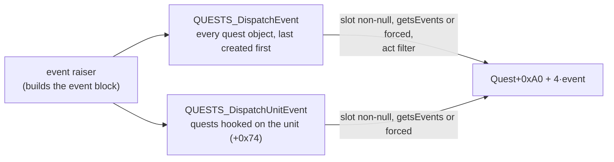

# 0001 — Quest progression: the registry, the events, every quest's bits, the game-wide record and the quest draws

> **Subsystem:** quests/progression
> **Question:** for each quest, which server event sets, clears or reads each bit of its record, per difficulty; which
> game-wide quest flags exist and what reads them; which events draw, on which seed; and which creation code reads the
> quest state?
> **Date:** 2026-10-17   **Plan:** 0042 (Phase 1 and 1b, static; Phase 2 run:2026-10-17-quests, § 15; part 2 run:2026-10-18-quests2, § 16; part 3 run:2026-10-19-quests3, § 17)   **Status:**
> answered (Phase 2 part 1 reviewed 2026-10-17, accept with fixes; part 2 reviewed 2026-10-19, accept with fixes; part 3 reviewed 2026-10-20, accept with fixes; plan 0042 closed 2026-10-20)

Static reading of the pinned `Game.exe`: Ghidra's decompile of the quest code (`[0x00543400, 0x00548200)`,
`[0x00586E00, 0x005A0000)`, `[0x005B3000, 0x005BE200)`) on the lane's copy, objdump for the instruction-level reads;
every bit write below was checked at the pushed constants of its `QUESTRECORD_SetState`/`ClearState` call (a scan of all
1592 calls of the five record functions; 353 setter sites cited in § 7–§ 10 match it). No game run. Names are ours.
"Record", "word *q*, bit *s*" are as in [save/0002](../save/0002-quest-words.md); "G" or "game record" is the game-wide
record (§ 3). The quest drops, rewards and the quest seed's item draws are [items/0010](../items/0010-quest-drops.md)'s
(plan 0032) and are linked, not repeated. NPC, monster and object numbers are `monstats` (`hcIdx`), `objects` and
`levels` rows; their row names are given as `[L]` labels only. Travel is [quests/0002](0002-travel.md).

## Answer (summary)

- [I] **Registry.** 41 quest objects: one per `g_QuestDescs` row (37: Act I 0–6 with 25 and 30, Act II 7–13 with 26, 27,
  Act III 14–20 with 28, Act IV 21–24 with 29, Act V 31–36) and four "NPC introduction" objects (37–40, second table,
  inactive, writing no quest bit). Each has 13 event callbacks plus a first-join and a later-join callback, a record
  word, a log-state, an NPC-gate and a chain callback. Dispatch visits them **from object 40 down to row 0**, so within
  one event the later acts' handlers run first. (fn:QUESTS_InitGame@0x00545D80, data:g_QuestDescs@0x00731510, § 1)
- [I] **Events.** NPC talk start (e0), talk end (e2), level change (e3), item placed (e4), item dropped (e5), monster
  death (e8, hooked units), quest item of a leaving player (e9), player leaves (e10), NPC message (e11, client packet
  `0x31`), first join (e13), later join (e14); e1, e6, e7, e12 are never raised. Object operates and object event 7
  reach quest code through `g_ObjOperateFns` and `QUESTS_ObjectEvent` (items/0010 § 9), and quest timers run every 20th
  frame. (fn:QUESTS_DispatchEvent@0x005438E0, fn:QUESTS_DispatchUnitEvent@0x005439A0, § 2, § 5)
- [C] **The game creator's history.** (run:2026-10-17-quests: 11 joins, § 15) At the first join, every quest the joining player has finished (bit 0 or 15) is
  deactivated for the whole game and marked in the game record (word bit 15). The dispatch then skips it only for
  unforced events, which are the item and monster hook events (e4, e5, and e8 outside the forced superunique and boss
  list); the dispatched events e0, e2, e3, e10 and e11 are all raised forced, so its handlers still run and each tests
  the quest's own state, which not every handler does: quest 11's NPC-331 message handler writes word 12 while the
  quest is off (§ 15). Later players never change this. (fn:sub_00546270_QuestsPlayerJoin@0x00546270,
  fn:QUESTS_DispatchEvent@0x005438E0 0x00543934–0x0054393E, § 2, § 3)
- [I] **One bit grammar for all quests.** Bit 0 done, bit 1 done-in-a-game-reward-pending, 13 done in this game, 14
  failed in this game, 15 reward pending from an earlier game, 2–11 log steps (cleared by `0x0065C3E0` at the reward),
  12 "seen in the log" (client packet `0x58`, no test). Credit goes to the actor, often to every player in the boss's
  level or near rooms, and to party members **standing in the same act**. Bit 0 is cleared only by word 9's first-join
  check. (§ 4)
- [I] **Per quest**, the bit tables with setter addresses, triggers and readers are § 7 (Act I), § 8 (Act II), § 9
  (Act III), § 10 (Acts IV–V). Highlights: the Countess completes at once (bits 13, 0, no reward step); the Hell respec
  is word 41, granted by `NPC_MenuAction`; Khalim's Will completes on the second operate of the orb with `qf2` held; Diablo's death raises
  the classic status progression; word 28 is set by the Harrogath portal object (566), expansion only; the Ancients'
  experience is 1.4M/20M/40M; no quest script writes word 33 (only packet `0x58`'s bit 12 can). (fn:sub_00595710_A1Q5_CountessDeath@0x00595710,
  fn:NPC_MenuAction@0x00579D60, fn:sub_005BB980_A3Q5_CompellingOrbOperate@0x005BB980,
  fn:sub_005B5880_A4Q2_HarrogathPortalOperate@0x005B5880, fn:sub_0058C6D0_A5Q5_PartyExpGrant@0x0058C6D0,
  fn:sub_0054C9C0_Pkt58QuestSeen@0x0054C9C0)
- [I] **Draws.** On the **quest seed**, besides plan 0032's item draws: the cairn-stone order (≥ 5 `mod 5` steps, first
  stone or the decoded scroll's use), the Act II eclipse timer (`RandLoHi(15, 17)`, once per game), each talk to NPC
  331 once the palace is open (`mod 3`), the Act III Dark Wanderer timer (one step per game), Anya's reward (`Range`),
  the Zoo (1–10 `RandLoHi`; its object is placed nowhere on stock data, § 10). The cairn order, the eclipse, the Dark
  Wanderer and Anya's draws are `[C]` from part 3 (§ 17). On the **player's unit seed**: every talk to NPC 266 (two draws, `Range(2)` or one step each: its e0 handler runs once
  for each of quest objects 25 and 30, `[C]` § 16) and to NPC 377. Every other
  quest event draws nothing in quest code; the spawns, portals and items it creates draw on their own seeds (oracles).
  (§ 11; fn:sub_00592E90_A1Q4_StoneOrderDraw@0x00592E90, 0x0059EDC0, 0x0059B1C0, fn:sub_005BD390_A3Q7_AfterglowTimer@0x005BD390,
  0x00589937, fn:sub_0058E830_A5Q6_ZooInit@0x0058E830, 0x00596B23, 0x0059E1CE)
- [I] **Creation-path readers** (§ 12): object inits that read the game record (Hratli's two InitFns by G16:13, InitFn
  52 by G22:13, the Tristram portal when quest 4 is inactive, the Zoo, whose object no stock map places), the Chaos Sanctuary gate (Diablo's private
  `+0x13`, set when the five seals are open and three seal bosses dead), Nihlathak's boss spawn (Anya rescued), the warp
  gates into 73, 100, 118/128 and 132, the true-tomb index (act `+0x094`) used by quest 12 and the client; act `+0x484`
  and `+0x474` are DRLG fields that no quest code reads. (fn:sub_005B70B0_A3Q0_HratliSpawnA@0x005B70B0,
  fn:sub_005B7160_A3Q0_HratliSpawnB@0x005B7160, fn:sub_0058A6C0_A5Q3_NihlathakBossSpawn@0x0058A6C0,
  fn:QUESTS_WarpGate@0x00545B80, fn:sub_005BBFA0_A3Q5_DuranceWarpGate@0x005BBFA0, fn:sub_0058E830_A5Q6_ZooInit@0x0058E830)
- [I] **NPC interaction** (§ 6): the server changes quest state in e11 handlers keyed by `{NPC class, message id}` from
  the client's packet `0x31`, with checks on the player's bits and held items; the dialogue is presentation.
  (fn:sub_0054BA90_Pkt31NpcMessage@0x0054BA90, fn:QUESTS_RaiseNpcMessage@0x005443B0)

## Leads used

Blind first: every claim of this finding was written from the code before any community text was read; the pages
below were fetched and compared afterwards.

### Phase 1b verdicts

- [L] src:arreat-summit-quest-acts: a player who joins a game gets only the quests its creator has not solved.
  **held with refinement**
  Detail: the first joiner's finished flag-0 quests (bit 0 or 15) are deactivated for the game (§ 3); the forced
  events (talks, messages, level changes, leaves, the forced boss and superunique deaths) still reach their handlers,
  which test the quest's state, and a later joiner's record changes nothing.
- [L] src:arreat-summit-quest-acts: party members share a completion only when they are in the same act. **held**
  Detail: every party-credit callback tests `DRLG_ActFromLevelId` of the member's level against the quest's act (§ 4).
- [L] src:arreat-summit-quest-acts: when another player completes a quest, it becomes unavailable until a new game.
  **held with refinement**
  Detail: `FailOthers` sets bit 14 for each player with bits 0 and 1 clear; the loader clears bit 14 (§ 4).
- [L] src:arreat-summit-quest-acts: the last quest of an act must be completed to advance to the next act. **held with
  refinement**
  Detail: the NPC travel tests word 6, 14 or 26 bit 0 and the Durance portal word 22 bit 13 or 0 (quests/0002 § 5);
  the server's waypoint travel tests only the waypoint bit, and the act tabs are a client gate (save/0002).
- [L] src:arreat-summit-quest-acts: Den of Evil completes when every monster in it is dead. **held with refinement**
  Detail: the level-8 monster region's dead count equals its total and every room has been counted (§ 7, word 1).
- [L] src:arreat-summit-quest-acts: the cairn stones must be touched "in the order written". **held with refinement**
  Detail: the order is drawn on the quest seed at the first stone or scroll (≥ 5 `mod 5` steps), so it differs per
  game (§ 7, word 4).
- [L] src:arreat-summit-quest-acts: the Malus quest needs character level 8. **held with refinement**
  Detail: the talk offers the hand-in message only at stat 12 > 7 with the Malus held (e0); the e11 handler itself
  tests only the Malus and bit 0 (§ 7, word 3), so the gate is the dialogue the client is given.
- [L] src:arreat-summit-quest-acts: all players in the party receive the imbue. **held with refinement**
  Detail: party members get bits 13 and 1 only while in Act I (§ 7, word 3).
- [L] src:arreat-summit-quest-acts: Sisters to the Slaughter is given by entering Catacombs 4. **held with refinement**
  Detail: entering any of levels 34–37 advances the quest's state (§ 7, word 6).
- [L] src:arreat-summit-quest-acts: The Seven Tombs is given by Jerhyn after level 20 or after one of three quests.
  **not covered**
  Detail: no character-level test is in quest 13's callbacks; the offer is the chain (§ 4) and the dialogue.
- [L] src:arreat-summit-quest-acts: Jerhyn opens the palace to the Arcane Sanctuary. **held with refinement**
  Detail: Jerhyn's message removes the harem blocker object 318 (`0x0059AEF0`); no quest bit gates level 74 (§ 8).
- [L] src:arreat-summit-quest-acts: killing the High Council without using Khalim's Will lets a player enter the
  Durance through a town portal. **held with refinement**
  Detail: the portal needs word 21 bit 0 (quests/0002 § 6); the last council death gives bit 0 only when word 18 bit 0
  is set, otherwise bit 4, which Cain's message 0x272 turns into bit 0 (§ 9, word 21).
- [L] src:arreat-summit-quest-acts: the Ancients are reset by leaving the area, opening a town portal or nobody being
  alive on the summit; credit needs level 20 / 40 / 60; the experience is capped at one level. **held with refinement**
  Detail: a portal on level 120 and an empty summit reset the fight; the **warps out of level 120 (to 118 and 128) are
  refused** while the quest is active and not done in this game (`0x0058D090`), so only a portal or death leaves.
  The level and cap are as stated (§ 10, word 39). Phase 2 (§ 15) found the summit door at the arrival point from
  118 refusing for every creator; the level-120 warp tiles were not taken (a part-2 case).
- [L] src:arreat-summit-quest-acts: Rescue on Mount Arreat reports "unable to complete quest" once failed. **not covered**
  Detail: bit 14 is set for the other players (§ 10, word 36); the message text is presentation.

## Functions

The core functions are below. The per-quest functions (about 530) are named in `re/symbols.csv` (subsystem
`quests/progression`, evidence this finding) and listed in each quest's callback table in § 7–§ 10.

| Address | Name | Role | Tag |
|---|---|---|---|
| `0x00545D80` | `QUESTS_InitGame` | builds the 41 quest objects, the quest seed, the game record (items/0010 § 1) | C (existing row) |
| `0x005438E0` / `0x005439A0` | `QUESTS_DispatchEvent` / `QUESTS_DispatchUnitEvent` | event dispatch (§ 2) | I |
| `0x00543B90` | `QUESTS_RaiseLevelChange` | e3 | I |
| `0x00543CE0` / `0x00543DE0` | `QUESTS_RaiseUnitEvent0` / `QUESTS_RaiseUnitEvent6` | unit events 0 and 6; no caller | I |
| `0x00543D10` / `0x00543D50` | `QUESTS_RaiseNpcTalk` / `QUESTS_RaiseNpcTalkEnd` | e0 / e2 | I |
| `0x00543D80` / `0x00543DB0` | `QUESTS_RaiseItemPlaced` / `QUESTS_RaiseItemDropped` | e4 / e5 | I |
| `0x005443B0` | `QUESTS_RaiseNpcMessage` | e11 | I |
| `0x0054BA90` | `sub_0054BA90_Pkt31NpcMessage` | packet `0x31` (9 bytes) | I |
| `0x0054C9C0` | `sub_0054C9C0_Pkt58QuestSeen` | packet `0x58`: bit 12 of a word < 42 | I |
| `0x00545780` | `QUESTS_RedispatchNpcTalk` | e0 again, then the game record is sent | I |
| `0x00543E10` / `0x00543F10` | `QUESTS_TimersRun` / `QUESTS_TimerAdd` | quest timers (§ 5) | I |
| `0x00543F90` | `QUESTS_DefaultLogState` | default `+0xE8` | I |
| `0x005435C0` | `QUESTS_UnitHookAdd` | adds a quest to a unit's `+0x74` list | I |
| `0x00545CD0` | `QUESTS_LevelHookMonster` | hooks a room's monsters to the level's Levels `+0x30` quest | I |
| `0x00543790` | `QUESTS_SetNpcMessage` | NPC quest-message index for the client (presentation) | I |
| `0x00544190` | `QUESTS_SendLogState` | one quest's log state to a player | I |
| `0x00544300` / `0x00544350` | `QUESTS_SetState` / `QUESTS_SetStep` | quest object `+0x0B` (broadcast) / `+0x0C` | I |
| `0x00544410` / `0x005444B0` | `QUESTS_Deactivate` / `QUESTS_IsActive` | `+0x09` = `+0x0A` = `+0x0B` = 0 / `+0x09` = 1 | I |
| `0x00544520` | `QUESTS_SendGameRecord` | the game record to the clients | I |
| `0x00544590` | `QUESTS_NpcHasQuest` | `+0xEC` of the act's quests at a talk | I |
| `0x00544FA0` / `0x00545100` | `QUESTS_SendActNpcFlags` / `QUESTS_SendTownNpcFlags` | NPC quest flags of an act | I |
| `0x00545200` / `0x00545240` / `0x00545290` / `0x005452C0` / `0x00545310` | `QUESTS_PlayerListAdd` / `QUESTS_PlayerListRemove` / `QUESTS_PlayerListHas` / `QUESTS_QuestPlayerHas` / `QUESTS_PlayerListLeave` | per-quest player lists | I |
| `0x005455B0` | `QUESTS_SendPlayerRecord` | the record to its player | I |
| `0x005455F0` | `QUESTS_ListSetPending` | each listed player with bits 0, 1 clear: bits 13 and 1 | I |
| `0x00545920` | `QUESTS_SendFailMsg` | message to a player in act ≥ n | I |
| `0x00546040` | `QUESTS_SendPlayerQuestInfo` | log states, quest-1/32 data, the true-tomb index | I |
| `0x0065C3E0` | `QUESTRECORD_ClearSteps` | clears bits 2–11 of a word | I |
| `0x005449D0` | `sub_005449D0_JoinMarkFlagClear` | clears byte `0x0073150C`; no caller | I |
| `0x00572360` / `0x005723C0` | `sub_00572360_NpcIntroBitSet` / `sub_005723C0_NpcIntroBitGet` | per-player NPC introduction flags (save NPC section) | I |

## Walkthrough

### 1. The registry

- [I] `QUESTS_InitGame` builds one 0xF8-byte quest object (`struct:QuestObject+0x00`) per row of
  `data:g_QuestDescs@0x00731510` (37 rows of 0x18 bytes, count `0x00731888`) and then one per row of the second table
  `0x0073188C` (4 rows of 8 bytes `{init, act}`, count `0x007318AC`), with ids 37–40. Each new object is linked at the
  head (`+0xF4` = the previous one, control `+0x00` = the last), so **the list runs from quest object 40 down to row 0**,
  and every dispatch visits the quests in that order. Main-table objects start with `+0x09` = 1 (active), second-table
  ones with `+0x09` = 0 and `+0x0A` = 1; each init then fills its callbacks, its word `+0xE0`, `+0x0A` = 1 and its private
  data. The control (`struct:QuestControl+0x00`, `Game+0x10F4`) gets the quest seed (one game-seed step, items/0010 § 1)
  and the game-wide record (`QUESTRECORD_Alloc`). (fn:QUESTS_InitGame@0x00545D80 0x00545DB0–0x00545F5F)

| row | id | act | word (`+0xE0`) | descriptor word | flag `+0x0C` | init | source file |
|---|---|---|---|---|---|---|---|
| 0 | 0 | I | 0 | 0 | 1 | `0x0058FB80` | (a1 intro) |
| 1–6 | 1–6 | I | 1–6 | 1–6 | 0 | `0x00590720`, `0x00591210`, `0x00591F70`, `0x005971B0`, `0x00595920`, `0x00596990` | `a1q1`–`a1q6` |
| 7 | 30 | I | 29 | 41 | 1 | `0x00596C40` | — |
| 8 | 7 | II | 8 | 8 | 1 | `0x00598810` | `a2q0` |
| 9–14 | 8–13 | II | 9–14 | 9–14 | 0 (row 10: 1) | `0x00599340`, `0x0059EB00`, `0x0059EEA0`, `0x0059F2A0`, `0x0059C280`, `0x0059D5B0` | `a2q1`, `a2q2`, `a2q3`, `a2q4`, `a2q5`, `a2q6` |
| 15, 16 | 26, 27 | II | 30, 31 | 30, 31 | 1 | `0x0059E330`, `0x0059E530` | `a2q7`, `a2q8` |
| 17 | 14 | III | 16 | 16 | 1 | `0x005B7010` | `a3q0` |
| 18–23 | 15–20 | III | 17–22 | 17–22 | 0 | `0x005B7E90`, `0x005BDA30`, `0x005B9850`, `0x005BAA70`, `0x005BBEB0`, `0x005BCDC0` | `a3q1`–`a3q6` |
| 24 | 28 | III | 16 (code: 32) | 32 | 0 | `0x005BD300` | `a3q7` |
| 25 | 21 | IV | 24 | 24 | 1 | `0x005B3780` | `a4q0` region |
| 26–28 | 22–24 | IV | 25–27 | 25–27 | 0 | `0x005B42B0`, `0x005B54C0`, `0x005B6610` | `a4q1`–`a4q3` |
| 29 | 25 | I | 29 | 29 | 1 | `0x00596C40` | — |
| 30 | 29 | IV | 33 | 33 | 1 | `0x005B6A70` | — |
| 31–36 | 31–36 | V | 35–40 | 35–40 | 0 | `0x005876E0`, `0x00588510`, `0x0058A410`, `0x0058BB20`, `0x0058CE30`, `0x0058E500` | `a5q1`–`a5q6` |
| x37–x40 | 37–40 | I, II, III, V | 42 (none written) | — | — | `0x0058FA20`, `0x005985D0`, `0x005B6E60`, `0x0058EA50` | NPC introductions |

- [I] The descriptor's act (`+0x04`), flag (`+0x0C`), quest id (`+0x10`) and word (`+0x14`) are read by the init loop and
  the join; `+0x08` (100 or 0) has no reader in the code read. Rows 7 and 29 share one init, which writes `+0xE0` = 29
  for both quest objects, so descriptor word 41 is used only by the join's bit-15 pass. Row 24's init writes `+0xE0`
  = 16 although its code and descriptor use word 32; the clash reaches only the quest log. The source-file column comes
  from the `…\Quests\aNqM.cpp` asserts in each init's range. (data:g_QuestDescs@0x00731510, 0x00596C40, 0x005BD368)
- [I] Words written by no quest object: 7, 15, 23, 28 (the act-travel words, written by the travel code,
  [quests/0002](0002-travel.md)), 34, 41 (written by `NPC_MenuAction`'s respec, § 7 word 1), 42 (the second-table objects
  carry it but never write it). Words 43–47 are never addressed. (fn:QUESTRECORD_SetState@0x0065C360,
  fn:NPC_MenuAction@0x00579D60, data:g_QuestDescs@0x00731510)

### 2. Events



- [I] **The block** (`struct:QuestEvent+0x00`): `+0x00` game, `+0x04` event, `+0x08` unit, `+0x0C` player, `+0x14`,
  `+0x18` event-specific. `QUESTS_DispatchEvent(force, actFilter)` calls slot `+0xA0 + 4·event` of each quest object
  whose slot is set, whose `+0x0A` is 1 unless `force`, and, with `actFilter`, whose act equals the act of the player's
  level. `QUESTS_DispatchUnitEvent(force)` walks the unit's hook list (`+0x74`, head-inserted by
  `QUESTS_HookMonster`/`0x005435C0`). A `IsBadCodePtr` test precedes each call. (fn:QUESTS_DispatchEvent@0x005438E0,
  fn:QUESTS_DispatchUnitEvent@0x005439A0)

| event | slot | raiser | dispatch | block | trigger |
|---|---|---|---|---|---|
| 0 | `+0xA0` | `0x00543D10`, from `sub_00572C10_NpcInteractStart` | all quests, forced, player's act | `+0x08` NPC, `+0x0C` player, `+0x14` | NPC talk starts |
| 0 | `+0xA0` | `0x00545780`, called by quest scripts | same | `+0x08` arg | re-dispatch after a quest changed state, then the game record is sent |
| 2 | `+0xA8` | `0x00543D50`, from `sub_00572F20_NpcInteractRemove` | all, forced, act | `+0x08` NPC | NPC talk ends |
| 3 | `+0xAC` | `0x00543B90`, from `sub_005380D0_ClientRoomSync` and the portal operate `0x00584870` | all, forced, any act | `+0x0C` player, `+0x14` level left, `+0x18` level entered | the player's room changed level |
| 4 | `+0xB0` | `0x00543D80`, 7 sites (`0x0053149C`, `0x00531627`, `0x0055D0AD`, `0x005601C0`, `0x00563130`, `0x005636F0`, `0x0057F9C3`) | item's hooks | `+0x08` item, `+0x0C` player | an item is placed by the player (inventory, socket, pick-up; the seven sites were not each read) |
| 5 | `+0xB4` | `0x00543DB0`, from `0x00558AA0` | item's hooks | `+0x08` item | an item is dropped on the ground |
| 8 | `+0xC0` | `QUESTS_MonsterDeathEvent`, from `sub_0057CCB0_UnitKilled` | monster's hooks | `+0x08` monster, `+0x0C` killer player | a hooked monster dies (after its drop, items/0010 § 2) |
| 9 | `+0xC4` | `sub_00543BD0_QuestsInvItemEvent`, from client removal `0x00539DA0` | the item's quest (Misc `+0x12A` − 1), direct call | `+0x08` item, `+0x0C` player | a leaving player carries that quest item |
| 10 | `+0xC8` | the same, after the item loop | all, forced, any act | `+0x0C` player | a player leaves the game |
| 11 | `+0xCC` | `0x005443B0`, packet `0x31` (`0x0054BA90`, 9 bytes) | all, forced, player's act | `+0x08` NPC, `+0x0C` player, `+0x14` NPC class, `+0x18` u16 message | the client reports a dialogue message (a quest step said or chosen) |
| 13 | `+0xD4` | `sub_00546270_QuestsPlayerJoin`, direct | every quest | the player | the first player joins (§ 3) |
| 14 | `+0xD8` | the same | every quest | the player | a later player joins |

- [I] Events 1, 7 and 12 have no raiser; the raisers of unit-event 0 (`0x00543CE0`) and event 6 (`0x00543DE0`) have no
  call and no pointer in the image, so the `+0xB8` handlers some quests fill (words 3, 4) are dead. (call and pointer
  scans of the pinned image)
- [I] **Forced death events.** `QUESTS_MonsterDeathEvent` forces the dispatch (deactivated quests still get it) when the
  monster is a superunique whose row's `+0x08` index is 26, 27, 29, 36–39, 42–45 or 60, or its class is 242, 243, 391 or
  544; otherwise the hooked quests get it only while `+0x0A` = 1. A killer that is a pet or hireling is first resolved to
  its owner (`0x0058F090`), and in a game of type 3 (`Game+0x6A`) with no killer the event takes a client's player
  (`0x00539070`, `0x00537860`).
  (fn:QUESTS_MonsterDeathEvent@0x00543A30 0x00543A5D–0x00543B4B)
- [I] **Hooks.** `QUESTS_HookMonster(questId, unit)` adds the quest to the unit's list; for quest 4 with object class 61,
  quest 8 with monster class 229 and quest 12 with class 250 it first records the unit in the quest (`0x00592F80`,
  `0x005991B0`, `0x0059C3B0`). `0x00545CD0` hooks every monster of a room to the quest named by its level's Levels
  `+0x30` byte. Item hooks are made by the quest scripts that create the item. (fn:QUESTS_HookMonster@0x005436B0,
  0x00545CD0)

### 3. The join and the game-wide record

```text
QuestsPlayerJoin(game, player, rejoin) (0x00546270)                                    [I]
  if control.recordReady == 0:                                   ; the first player of the game
      control.recordReady = 1
      if rejoin == 0:
          if byte 0x0073150C (= 1 in the image; its only writer 0x005449D0 has no caller):
              for each descriptor with flag +0x0C == 0:
                  if player word w bit 0 or bit 15:              ; done in an earlier game
                      QuestDeactivate(id)                         ; +0x09 = +0x0A = +0x0B = 0
                      game record word w bit 15 = 1
          for each quest: +0xD4(player)                           ; FirstJoin
      chain start: +0xF0 of quest objects 1, 8, 18, 22, 31 (fatal if missing)
  else:
      for each quest: +0xD8(player)                               ; later join
  send 0x5E (+0x09 of every main-table quest), the player record, the game record (0x00544520)
  if quest 1 exists and 0x00590810(): send 0x89
```

- [I] **The game creator's history shapes the game.** Every flag-0 quest the first player has finished (bit 0, or bit
  15 = "done, reward pending" saved earlier) is switched off for the whole game: its object stops receiving unforced
  events and its scripts see `+0x09` = 0. Later players' records are never consulted for this. The unforced events
  are only the hook events (e4 and e5 push force 0 at `0x00543D8A`; e8 outside the forced list, § 2): every raiser
  of a `QUESTS_DispatchEvent` event pushes force 1 (`0x00543BA2` e3, `0x00543C96` e10, `0x00543D2A` e0, `0x00543D5C`
  e2, `0x005443FA` e11, `0x005457BF` the re-dispatched e0). So a deactivated quest's talk, message, level-change and
  leave handlers still run, and what keeps them inert is each handler's own test of `+0x09`/`+0x0A` or of its state
  bytes, per quest (§ 7–§ 10); quest 11's e11 handler `0x0059AF50` has none and writes word 12 bit 7 or 8 with the
  quest off (§ 15, run:2026-10-17-quests). The NPC-talk reward handlers test the word's own bits, not `+0x09`, and write
  the same with the quest switched off (`[C]` for the rows reached, § 16, run:2026-10-18-quests2). This is how a quest boss's script stays inactive in a game made by a player who has
  done it, while forced death events (above) still reach it. (0x005462C0–0x0054634A, 0x00544410,
  fn:QUESTS_DispatchEvent@0x005438E0 0x00543934–0x0054393E)
- [I] The first-join callbacks (`+0xD4`) copy the creator's step bits into the quest's state bytes; the later-join ones
  (`+0xD8`) recount quest items and the like; § 7–§ 10 per quest. The `rejoin` argument is 1 at `0x00532673` and
  `0x0056A072` (after `0x005701B0`) and 0 at `0x005344EF` and `0x0053458F`. (fn:sub_00546270_QuestsPlayerJoin@0x00546270)
- [I] **The flows behind `rejoin`** (plan 0042 P1 review follow-up (b), `lane/rbs2`). `QuestsPlayerJoin` has four
  direct call sites (`grep -cE '(call|jmp) +0x546270$'` over `objdump -d --no-show-raw-insn -j .text`: 4). The same
  pattern gives one or two callers for every function on the way up (`D2S_ReadSave` 0x00534475 and 0x0053455E;
  `D2S_ReadSaveV92` 0x00534387; the version < 92 reader `0x00534020` at 0x0053437B; `PLRSAVE_ReadFile` 0x005344DB;
  `0x005344B0` 0x005345DB; `0x00534520` 0x005345FB), so all four are under `sub_005345A0_PlayerLoad`, whose one caller
  is `sub_00539760_ClientAddPlayerToGame` (0x00539804). Indirect calls are not covered by the pattern. The argument is
  "the character was made just now", not "joins again":
  - `rejoin` = 1: the two new-character builders, at their end. `NewCharFromStub` (0x0056A072) is reached from
    `D2S_ReadSaveV92` when the save is only the header stub (0x0056B1E2). `NewCharLegacy` (0x00532673) is reached
    from `PlayerLoad` when it has no save data (`[ebp+0xC]` = 0, 0x00534607) and from the version < 92 reader
    (0x00534098).
  - `rejoin` = 0: the two save readers, once the read has left a unit (`0x005344B0` whatever the return code,
    `0x00534520` only when `D2S_ReadSave` returned 0). `0x005344B0` reads the save file
    (`PLRSAVE_ReadFile`); `PlayerLoad` takes it in a game whose type byte `+0x6A` is not 1 or 2 and with no host
    callback (`0x00883D50` = 0). `0x00534520` reads the buffer the client sent (`0x00538E00`, `0x00538E30`) through
    `D2S_ReadSave`, for game type 1 or 2 or with the host callback, and calls `0x00538F10` first for types 1 and 2.
  - Both readers call the join on the unit `D2S_ReadSave` returns, and the new-character builders write that same
    out-pointer (0x0056A07B, 0x0053267C). So a character made from a stub, or by the version < 92 reader, joins
    **twice**: first with 1 (as the game's first player: no deactivation pass, `+0xD4` FirstJoin), then with 0. On
    the second call `recordReady` is already set, so it runs the later-join `+0xD8` pass and re-sends the 0x5E and
    record packets. Only `PlayerLoad`'s own no-save branch joins once, because 0x00534607 is followed by no join.
  (fn:sub_005344B0_PlayerLoadFromFile@0x005344B0, fn:sub_00534520_PlayerLoadFromClient@0x00534520, 0x005345B6–0x00534607, fn:PLRSAVE_ReadFile@0x005343A0, fn:D2S_ReadSave@0x00534330,
  fn:sub_00569F80_NewCharFromStub@0x00569F80, fn:sub_00532590_NewCharLegacy@0x00532590)
- [I] **The game-wide record** (`QuestControl+0x0C`, 96 bytes) is written only through
  `sub_00544720_GameQuestSet` and read through `sub_00544760_GameQuestGet` (both fatal before the first join), and by
  the join above. In the code read, bit 13 of word *w* marks "this game's step done" for that quest (set at the same
  event as the players' bits), bit 15 "the creator had it done", word 4 bit 11 "cow portal opened". Its readers gate
  spawns and objects (§ 12). It is sent to the clients after every NPC message (`0x00544520`).
  (fn:sub_00544720_GameQuestSet@0x00544720, fn:sub_00544760_GameQuestGet@0x00544760)
- [I] The player record is sent on join and after each change (`sub_0053D670_SendQuestRecord`, `0x005455B0`); the
  quest-log state per quest (`0x00544190` → `+0xE8` or the default `0x00543F90`) is presentation.

### 4. The common pattern of a quest word

- [I] **Bit meanings shared by the quest scripts** (each script also has its own bits, § 7–§ 10;
  fn:QUESTRECORD_SetState@0x0065C360, fn:QUESTRECORD_ClearState@0x0065C3A0):

| bit | meaning in the code | set by | cleared by |
|---|---|---|---|
| 0 | done (reward taken, or no reward) | the reward message or the completing event | only word 9's first-join check (`0x00599230`, call 0x0059927F) |
| 1 | done in a game, reward not yet taken | the completing event (`0x005455F0` sets 13 and 1 together) | the reward; the loader turns a saved bit 1 into bit 15 |
| 2–11 | quest steps (log progress) | `StepBits` per state | `0x0065C3E0` at most rewards (steps 2–11 cleared) |
| 12 | the log entry was seen | packet `0x58` `{u16 word}` for any word < 42, no test (`0x0054C9C0`) | never |
| 13 | done in this game | with bit 1 or 0 | the loader |
| 14 | failed in this game (another player finished it) | `FailOthers` | the loader; word 11 at 0x0059AAB7 |
| 15 | reward pending from an earlier game | the loader (save/0002 § 1); in the game record, the join | word 9's first-join check (0x00599293) |

  The "set by / cleared by" columns come from a scan of every `QUESTRECORD_SetState`/`ClearState` call's pushed
  constants (1592 calls of the five record functions; a bit passed in a register is listed by the act sections).
  (fn:QUESTRECORD_LoadBytes@0x0065C4D0, fn:QUESTRECORD_SetState@0x0065C360, fn:QUESTRECORD_ClearState@0x0065C3A0, 0x005455F0, 0x0065C3E0)
- [I] **Party credit.** When a quest credits a player, its party members (`sub_00540510_PartyForEach` on the party of
  `0x00554630`) get the same bits only if their bits 0 and 1 are clear and **their current level is in the quest's
  act** (`DRLG_ActFromLevelId`). Each quest has its own copy of this callback. (§ 7–§ 10;
  fn:sub_00598D40_A2Q1_PartyCredit@0x00598D40, fn:sub_005871C0_A5Q1_PartyCredit@0x005871C0)
- [I] **The chain.** Each quest's `+0xF0` starts it (`+0x0C` ← 1, "changing state") when it is active and not yet at
  its last state, or calls `+0xF0` of the quest whose id is in its `+0x10`. The join starts one chain per act (quest
  objects 1, 8, 18, 22, 31), so in each act the next quest is offered when the previous one finishes. (§ 7–§ 10;
  fn:sub_00593D70_A1Q4_ChainNext@0x00593D70, fn:sub_005B7CD0_A3Q1_Chain@0x005B7CD0, fn:sub_00546270_QuestsPlayerJoin@0x00546270)
- [I] **The NPC gate.** When a player starts talking to an NPC whose MonStats `+0x0D` bit 1 is set, `0x00544590` asks
  `+0xEC` of each quest of the player's act whether it has something for that NPC class (the "quest available" mark);
  the first yes sends a message (`0x0053DFF0`). (0x00544590)

### 5. Timers

- [I] `0x00543F10(period)` adds `{fn, quest, due = tick + period, period}` to the control's list; `0x00543E10`, called by
  `sub_0052D870_GameTick` **when `frame mod 20 = 0`** (0x0052D912–0x0052D920), increments the control's tick and runs
  every timer whose `due < tick`; a timer that returns 1 is removed, otherwise `due = tick + period`. So a period *p*
  timer runs `p + 1` boundaries after the last 20-frame boundary before it was added, then every `p + 1` boundaries
  (`20·(p + 1)` frames). When the tick reaches `0xFFFFFFFF` every `due` is replaced by `−1 − due`.
  Adding a timer while the list runs is fatal. (0x00543E10, 0x00543F10, fn:sub_0052D870_GameTick@0x0052D870)
- [C] **Raised in part** (run:2026-10-19-quests3, § 17): the registration (`due = tick + period`), the pass on frames
  with `frame mod 20 = 0` and the first run at `tick = due + 1` (the `due < tick` test, one tick per pass) hold for every
  timer run logged (7 runs in four games: the eclipse timer three times, the Dark Wanderer's four), and a timer
  returning 1 is not run again; the two quest timers reached (the eclipse
  `0x0059ED80`, the Dark Wanderer `0x005BD390`) are one-shots, so the re-arm branch (`due = tick + period` after a 0)
  and the tick wrap stay `[I]`. (0x00543E62–0x00543ED1, 0x00543F78–0x00543F80)

### 6. NPC interaction, server side

- [I] Three server events carry a talk: e0 at the start (`NpcInteractStart`, after the hireling list and the store),
  e11 for each message the client reports (packet `0x31`: `{u32 npc id, u16 message}`), e2 at the end. The quest state
  changes in e11 handlers: the message id is the dialogue line the client played, and the handler checks the NPC class,
  the player's bits and, often, a held item before it writes. No dialogue text is involved: the client chooses which
  message to report from the quest message index the server sent at e0 (`0x00543790`). (0x005443B0, 0x0054BA90)
- [I] Item services and travel are `NPC_MenuAction` actions (13-byte packet, [items/0009](../items/0009-vendors.md)):
  imbue (Charsi, word 3 bit 1), socket (Larzuk, word 35 bit 1), personalise (Anya, word 38 bit 1), the Hell respec
  (word 1 bit 1, word 41), and the act travel ([quests/0002 § 5](0002-travel.md#5-act-change-through-an-npc)). Their
  bit writes are in § 7–§ 10 and items/0010 § 6. (fn:NPC_MenuAction@0x00579D60)

### 7. Act I (rows 0–7 and 29, second-table object 37)

Conventions (all `[I]`; each bit write was read at the pushed constants of its call; fn:QUESTRECORD_SetState@0x0065C360):

- "rec" = the player's record for the game's difficulty (`PlayerData +0x10 + 4·game[+0x6D]`); "G" = the game-wide record
  (`QuestControl +0x0C`, written by `fn:sub_00544720_GameQuestSet@0x00544720`, read by
  `fn:sub_00544760_GameQuestGet@0x00544760`).
- A new helper read here: `0x0065C3E0` (rec, word) clears bits 2–11 of the word (loop `esi = 2..0xB`,
  `BITFIELD_Clear(16·word + esi)`) — proposed name `QUESTRECORD_ClearSteps`. Every "reward taken" path calls it.
- Common per-quest helper shapes (each quest has its own copy; listed per quest by address):
  - **StateSync** (`0x0058FBE0` …): run per player by `0x00544300` when it broadcasts a new `+0x0B` state: if the
    player's word has bit 0 or 15 set and neither 13 nor 14, nothing; else `0x00544190(id)` (send the quest-log state).
  - **StepBits** (`0x0058FC90` …): per player, if word bits 0 and 1 are clear, set a "step" bit chosen by the quest
    object's `+0x0C` state (2 → bit 2, 3 → bit 3 or 4 by `+0x0B`, …). Steps 2–11 are presentation progress bits that
    `0x0065C3E0` clears when the reward is taken; they gate nothing found outside the quest's own log-state code.
  - **PartyCredit**: for a credited player (bit 13 set), `0x00554630` (party id) ≠ −1 → `fn:sub_00540510_PartyForEach@0x00540510`
    with a member function: member's bits 0 and 1 clear **and** member's level in Act I
    (`fn:DRLG_ActFromLevelId@0x006427F0` = 0) → set bits 13 and 1 (Den/Blood Raven/Malus/Cain/Andariel) or 13 and 0 (Countess).
  - **FailOthers**: per player with bits 0 and 1 clear → set bit 14 ("failed in this game"), send the quest log (`0x00545920`).
  - **ChainNext** (`+0xF0`): if this quest is not finished in this game (`+0x0C` below its last state and `+0x09` = 1),
    start it (`+0x0C` ← 1, "changing state") and return 1; else call `+0xF0` of the next quest id (`QUESTS_FindById`).
    The join calls quest 1's `+0xF0` once, so the Act I offers run 1 → 2 → 3 → 4 → 5 → 6 as each finishes.
  - **FirstJoin** (`+0xD4`, first player only): if the creator's word has neither bit 0 nor bit 15, copy his step bits
    into the quest object's `+0x0B`/`+0x0C` (e.g. word 1: bit 4 → `+0x0B`=2,`+0x0C`=3; bit 3 → 3/1; bit 2 → 2/1).
  - `0x00543790(npcClass, n)`: sets NPC *npcClass*'s quest-message index for the client (presentation only).
- Event slots as in § 2. e10 (`+0xC8`, player leaves) is filled for words 1 (`0x005901F0`), 2 (`0x00590C10`),
  4 (`0x00592CF0`), 5 (`0x00594BB0`); each only removes the leaving player's guid from the quest's private lists
  (`0x00545240`) and, for word 4, recounts the scrolls.

#### Word 42 — quest object 37 (second table x37, init `0x0058FA20`)

| slot | function | does |
|---|---|---|
| e0 | `0x0058F8F0` | NPC talk with 147/148/150/154/155 (`gheed`, `akara`, `kashya`, `charsi`, `warriv1` `[L]` names): `0x005723C0(npc)` = 0 → NPC message 1 if the talking player's character class (`unit +0x04`) equals the index fixed per NPC (147→2, 148→1, 150→0, 154→4), else 0 |
| e11 | `0x0058F870` | NPC 147–154 message pairs (0x0B/0x0C, 0x2D/0x2E, 0x24/0x25, 0x18/0x19) → `0x00572360` (NPC-side, no record write) |
| +0xE8 | `0x0058F9B0` | log state: always 0 |
| +0xEC | `0x0058F9C0` | NPC 148 gate: word 1 bit 0 clear and `0x005723C0(148)` = 0 |

- [I] **No bit of word 42 (or any word) is written by this object**: its `+0xE0` = 0x2A is never passed to a setter.
  (0x0058FA20, 0x0058F870)
- Draws: none.

#### Word 0 — quest object 0 (row 0, a1 intro; init `0x0058FB80`)

| bit | set/clr | by | trigger | readers |
|---|---|---|---|---|
| 0 | set | 0x0058FAC1 (in `0x0058FA90`) | e11, NPC 155 (`warriv1` `[L]`), message 0 or 1 | `0x0058FAD0` (e0: NPC 155 message index 1/0 while bit 0 clear); `0x0058FB50` (+0xEC: NPC 155 has a message iff bit 0 clear) |

- [I] Word 0 bit 0 = "Warriv's introduction heard"; it gates only NPC 155's quest message (dialogue). It is **not**
  read by `fn:sub_005467E0_NpcActTravel@0x005467E0` (that tests word 7 bit 0), so it is no act-travel gate.
  (0x0058FA90, 0x0058FB50)
- +0xE8 `0x0058FB40` returns 0. Draws: none.

#### Word 1 — quest object 1 (row 1, a1q1.cpp; init `0x00590720`; `+0xE4` = 41)

| slot | function | does |
|---|---|---|
| e0 | `0x0058FF90` | NPC 148 talk: quest message by state (`0x00736CD0` table), 3 while bit 1 set |
| e2 | `0x0058FC40` | NPC 148 talk end: if private `+0x86` set, broadcast `+0x0B`=0 |
| e3 | `0x00590470` | entering level 8 → state 1/2→… and step bits; leaving level 1 → `0x00545310` |
| e8 | `0x00590260` | death of a hooked monster (level 8 region) |
| e10 | `0x005901F0` | player leaves: list removal |
| e11 | `0x0058FDD0` | NPC 148 messages 0x40 (accept) and 0x4C (reward) |
| +0xD4 | `0x00590690` | FirstJoin |
| +0xEC | `0x005905B0` | NPC 148 gate: bit 0 clear and (state 1 with bit 1 clear, or bit 1 set) |
| +0xF0 | `0x00590620` | ChainNext → quest 2 |

| bit | set/clr | by | trigger | readers |
|---|---|---|---|---|
| 13, 1 | set | `0x005455F0` (call 0x00590387) | e8: the level-8 monster region (`fn:sub_00547BB0_MonRegionGet@0x00547BB0`, level 8) has `+0x2D0` = `+0x2CC` (all its monsters dead) and `0x0061ABF0(act, 8)` ≤ region `+0x04` (every room counted); credits every player in the quest's private list (players that killed a hooked monster: `0x00545200` at 0x005902E3) whose bits 0 and 1 are clear | e11 0x4C; join |
| 13, 1 | set | 0x00590175/0x0059017F (`0x00590120`) | same kill: PartyCredit for each credited player's party members in Act I | — |
| 14 | set | 0x005900B8 (`0x00590080`) | same kill: FailOthers over all players | log state |
| G 13 | set | 0x00590375 | same kill | `0x00596A90`, `0x00596BC0` (word 29: G word **1** bit 13) |
| 0 | set | 0x0058FF11 | e11 NPC 148 msg 0x4C with bit 1 set | ChainNext of others; `QUESTS_PlayerJoin` |
| 1 | clr | 0x0058FF20 | same | B6 style tests in `0x00596A90` |
| 2–11 | clr | 0x0058FF4B (`0x0065C3E0`) | same | — |
| 41:13, 41:1 | set | 0x0058FF2F/0x0058FF3E | same (word `+0xE4` = 41): the respec offer | `NPC_MenuAction` |
| 2, 3, 4 | set | 0x0058FCDD/0x0058FCF9/0x0058FD0A (`0x0058FC90`) | StepBits by `+0x0C` (2, 3; 4 when `+0x0B` ≠ 1) | FirstJoin |

- [I] **Reward:** message 0x4C also adds 1 to stat 5 (`newskills`) of the player (`sub_006272B0_UnitAddStat(player, 5, 1, 0)`
  at 0x0058FF5A) — one skill point — and sets word 41 bits 13 and 1. (0x0058FDD0)
- [I] **Word 41 (respec, quest object 30's word in `g_QuestDescs`, but no quest object writes it except below):**
  `NPC_MenuAction` (fn:NPC_MenuAction@0x00579D60): in **Hell only** (`game+0x6D` = 2), a player with word 1 bit 1 set
  and word 41 bits 0 and 1 clear first gets word 41 bits 13 and 1 (`0x0058FD20`, call 0x0057A21E); then, when word 41
  bit 1 is set, the respec runs (`0x00570360`, `0x00570C80`) and `0x0058FD50` sets word 41 bit 0, clears bit 1 and,
  if bit 15 is clear, clears quest object 30's `+0x0A` (it stops receiving normal events). (0x0057A1D0–0x0057A266)
- [I] The kill-completion also registers a timer `0x00590230`, period 8 (`0x00543F10`, 0x005903E9), once (private
  `+0x87`): when `+0x0C` = 4 it broadcasts `+0x0B` = 5. The remaining-monster count `+0x88` (≤ 5 → `+0x0B` = 4) is a
  quest-log display. (0x00590260)
- Draws: none (no RNG call, no LCG step in `0x0058FBE0`–`0x00590830`).

#### Word 2 — quest object 2 (row 2, a1q2.cpp; init `0x00591210`)

| slot | function | does |
|---|---|---|
| e0 | `0x00590B10` | NPC talk messages |
| e2 | `0x00590920` | talk end |
| e3 | `0x00590FA0` | entering level 17 (0x11) → state; leaving level 1 → list removal / state 2 log |
| e8 | `0x00590EC0` | hooked-monster death |
| e10 | `0x00590C10` | list removal |
| e11 | `0x00590980` | NPC 150 (`kashya` `[L]`) messages 0x51 (accept) and 0x5C (reward) |
| +0xD4 / +0xEC / +0xF0 | `0x00591180` / `0x00591080` / `0x005910F0` | FirstJoin / NPC 150 gate / ChainNext → quest 3 |

| bit | set/clr | by | trigger | readers |
|---|---|---|---|---|
| 13, 1 | set | 0x00590D3C/0x00590D46 (`0x00590C40`) | e8 (the hooked monster, monsters/0003's hook for this quest): every player whose room is the dead monster's room **or in that room's near list** (`DUNGEON_GetNearRooms`) and whose bits 0, 1 are clear | e11 0x5C |
| 13, 1 | set | 0x00590DB5/0x00590DBF (`0x00590D60`) | PartyCredit (members in Act I) | — |
| 14 | set | 0x00590E07 (`0x00590DD0`) | FailOthers | — |
| G 13 | set | 0x00590F8F | e8 | log state |
| 0 / 1 | set / clr | 0x00590AB3 / 0x00590AC2 | e11 NPC 150 msg 0x5C with bit 1 set | — |
| 2, 3, 4 | set | 0x005908DD/0x005908F9/0x0059090A | StepBits | FirstJoin |

- [I] **Reward:** msg 0x5C calls `HIRE_GiveFreeMerc(150)` (fn:HIRE_GiveFreeMerc@0x00579180) after the bit write; no
  `0x0065C3E0` call here (steps stay). (0x00590980)
- [I] The death handler registers timer `0x00590BF0`, period 15 (0x00590F6C). (0x00590EC0)
- Draws: none in the quest's functions.

#### Word 3 — quest object 3 (row 3, a1q3.cpp; init `0x00591F70`)

| slot | function | does |
|---|---|---|
| e0 | `0x005916A0` | NPC talk; message 3 when the player holds `hdm ` and has clvl (stat 12) > 7 and bit 0 clear |
| e2 | `0x005913C0` | NPC 154 talk end: broadcasts `+0x0B` |
| e3 | `0x00591810` | level change: state 2 log / broadcast |
| e4 | `0x00591960` | item event on the hooked `hdm` (Malus): first time sets bit 6 |
| e6 | `0x00591A90` | (dead slot) |
| e9 | `0x00591A20` | a leaving player carried the Malus: broadcast state |
| e11 | `0x00591490` | NPC 154 (`charsi` `[L]`) messages 0xA3 (hand in) and 0x92 |
| +0xD4 / +0xD8 / +0xE8 / +0xEC / +0xF0 | `0x00591ED0` / `0x005919D0` / `0x00591D30` / `0x00591C30` / `0x00591E40` | FirstJoin (counts held Malus) / later join / log state (reads **G 3:13**) / NPC gate / ChainNext → 4 |

| bit | set/clr | by | trigger | readers |
|---|---|---|---|---|
| 6 | set | 0x0059198D | e4 on the Malus (hooked to quest 3 when `sub_00591AC0_A1Q3_MalusDrop` creates it, items/0010 § 9) | — |
| 13, 1 | set | 0x00591532/0x0059153F | e11 NPC 154 msg 0xA3, bit 0 clear, player holds `hdm ` (`fn:sub_00558110_PlayerFindItemByCode@0x00558110`); the Malus is then removed (`fn:sub_00544160_PlayerRemoveItemByCode@0x00544160`) | `NPC_MenuAction` imbue (bit 1) |
| 13, 1 | set | 0x00591476/0x00591480 (`0x00591430`) | PartyCredit (members in Act I) | — |
| G 13 | set | 0x005915B9 | same message when `+0x0C` = 4 | `0x00591D30` |
| 0 / 1 | set / clr | 0x005917A7 / 0x005917B1 | `fn:sub_00591790_A1Q3_ImbueDone@0x00591790` (items/0010 § 6) | — |
| 2, 3 | set | 0x0059138C/0x005913A5 | StepBits | FirstJoin |

- [I] `ImbueDone` also clears quest object 3's `+0x0A` when the player's bit 15 is clear (the quest stops receiving
  normal events in that game). (fn:sub_00591790_A1Q3_ImbueDone@0x00591790)
- Draws: none in the quest's own functions; the imbued item's creation is items/0010 § 6.

#### Word 4 — quest object 4 (row 4, a1q4.cpp; init `0x005971B0`)

| slot | function | does |
|---|---|---|
| e0 | `0x00592580` | NPC 146/148/265 talk; drops a held `bkd ` when private `+0x4F` (stones done) |
| e2 | `0x005921B0` | NPC 148 talk end; NPC 146 sets private `+0x93` |
| e3 | `0x00596DE0` | level 38 / 1 / 40 entry (below) |
| e4 | `0x00592E20` | item event (scroll): step bits |
| e6 | `0x00592E60` | (dead slot) |
| e8 | `sub_00593E70_A1Q4_CowKingDeath` | Cow King's death |
| e9 | `0x00592C80` | leaving player carried `bks `/`bkd `: count −1; last scroll gone → reset (`0x00592BD0`) |
| e10 | `0x00592CF0` | list removal |
| e11 | `sub_00592250_A1Q4_NpcMessage` | NPC 148 (0x61, 0x70, 0x76) and NPC 265 (`cain5` `[L]`: 0x7B, 0x7D, 0x7E) |
| +0xD4 / +0xD8 / +0xEC / +0xF0 | `0x00597030` / `0x00592B90` / `0x00592FB0` / `0x00593D70` | FirstJoin / later join (scroll count) / NPC gate / ChainNext → 5 |

Objects (`g_ObjInitFns`/`g_ObjOperateFns` slots from the pointer scan): init 6 `0x005935E0` (stones), init 9
`0x00593FC0` (`Inifuss` tree), init 13 `0x00594020` (hooks object 61 `Dummy` to quest 4: `QUESTS_HookMonster(4)` →
`0x00592F80` records its guid at private `+0x28`), init 54 `0x005940E0` (object 189, "cain portal" dummy: records its
position); operate 9 `0x00593710` (cairn stones), operate 10 `0x00593480` (`Gibbet`), operate 12
`sub_00593AF0_A1Q4_InifussDrop`; event 7 of object 26 → `0x00593290`, of 189 → `0x005942C0`; `0x00594290` queues
it. `0x00594360`–`0x00594610` are read by the Cain AI (`0x005E72C2`…, pointers at `0x005E77EF`…): position helpers, no
record access.

| bit | set/clr | by | trigger | readers |
|---|---|---|---|---|
| 4 | set | 0x00593A92 (`0x00593710`) | operate of the fifth cairn stone in the drawn order (below) while holding `bkd `; only if `+0x0B` < 4; also for party members in Act I with bits 0, 1 clear (`0x005936B0`, 0x00593705) | `0x00593710` (no "UnitSetEvent" hint if bit 3 or 4), FirstJoin |
| 13, 1 | set | 0x00593587/0x00593591 (`0x00593480`) | `Gibbet` operate (object 26, operate slot 10) by a player with bits 0, 1 clear; party members in Act I too (`0x005930B0`) | NPC 148 msg 0x76 |
| 13, 1 | set | 0x0059317D/0x00593187 (`0x00593130`) | the Gibbet's event 7 (`0x00593290`, queued at frame + 17): every player in level 38 (0x26) with bits 0, 1 clear, plus their Act I party members | — |
| 14 | set | 0x005931F7 (`0x005931C0`) | same event: FailOthers | — |
| 14 | set | 0x00592B46 (`0x00592B10`) | Cain lost: e3 entry into level 40 (0x28) by a player with bits 0, 1 clear while Cain is not rescued (`+0x50` = 0, `+0x0C` < 6), **or** `0x00597310`, called from `sub_00537340_TownLevelLeave` (0x0053743D) and the Warriv branch of `fn:sub_005467E0_NpcActTravel@0x005467E0` (0x00546A35, 0x00546AA9): every player with bits 0, 1 clear | — |
| G 13 | set | 0x00597005, 0x005973D2 | same two "Cain lost" paths | — |
| 0 / 1 | set / clr | 0x005923AC / 0x005923B6 | e11 NPC 148 msg 0x76 with bit 1 set | — |
| G 13 | set | 0x00592483 / 0x005924D8 | same message: if G 4:13 clear (then `+0xF0`), and if private `+0x63` (creator had bit 15) | `0x00597030` |
| G 13 | set | 0x00597081 | FirstJoin when the creator has bit 0 | — |
| 10 | set | 0x00593EF6 (CowKingDeath) | killer has word 4 bit 10 clear **and** word 26 (classic, `game+0x70` = 0) or word 40 (expansion) bit 0 set | `CUBE_CowPortalOpen`, CowKingDeath |
| 10 | set | 0x00593E5E (`0x00593E30`) | same death: every player then in level 39 (0x27) | — |
| G 11 | set | `CUBE_CowPortalOpen` 0x0059423A | items/0008 § 5.1 | `CUBE_CowPortalOpen` (G 4:11 refuses) |
| 2, 3 | set | 0x0059217C/0x00592195 (`0x00592130`) | StepBits | FirstJoin |

- [I] **Rewards and items.** NPC 148 msg 0x70 with `bks ` held: removes it, gives `bkd ` (`QUESTS_GiveItem(bkd, 0, 2, 1)`).
  Msg 0x76: gives `rin ` with ilvl 7 / 30 / 60 and quality 4 / 6 / 6 in Normal / Nightmare / Hell ,
  as items/0010 § 6 (Akara). The Inifuss tree drops `bks ` (items/0010). (sub_00592250_A1Q4_NpcMessage@0x00592250)
- [I] **Cairn stones.** On the first stone operate or the first use of the decoded scroll (`0x00593CB0`: the item-use
  path `0x00544840` from `0x0054C060`, item code `bkd `, which also sends packet `0x50` with the order; part 3
  refinement), `0x00592E90` fills the
  five-slot order once (private `+0x4A`): **quest-seed draws** `s ← lo·0x6AC690C5 + hi; i = low32(s) mod 5`, repeated
  until each of the five slots is filled, classes 17–21 (`StoneAlpha`…`StoneLambda` `[L]`) assigned in that order; so
  ≥ 5 draws, variable count. Each correct stone (`class = order[k]`) advances `k`; the fifth sets the dummy 61 to mode
  6, removes `bkd `, and calls `0x0056EDE0(0, 1, 0x120, x+6, y−3)` at stone 21's position (what it creates is open) and
  pins its room. (0x00592E90, 0x00593710)
- [C] **The order draw, reached by the scroll use** (run:2026-10-19-quests3, § 17): `0x00592E90` takes the quest seed
  from `QUESTS_GetSeed` once (0x00592EE1), then steps it inline until five slots are filled, slot `low mod 5`, classes
  17, 18, … in fill order; the logged order and the quest seed after it are predicted from the seed before in three
  first uses, and a second use (private `+0x4A` set) draws nothing and leaves the order. The stone-operate trigger
  stays `[I]` (not reached). `0x00544840` (from packet code at 0x0054C060, after the player-near test) looks up the used
  item by id and dispatches on its code: `bkd ` → `0x00593CB0`, `trs ` → `0x0059D6A0` (not run). (0x00592E90–0x00592F61,
  0x00593CD5–0x00593CE1, fn:sub_00544840_QuestsItemUseCode@0x00544840)
- [I] **Tristram portal in later games.** The stones' init (`0x005935E0`) on class 17: when quest 4 is inactive
  (`+0x09` = 0: the creator had it done) or private `+0x4C` is set, it registers timer `0x00592D50` (period 1) once,
  which creates `fn:sub_0056D130_PortalObjectCreate@0x0056D130`(room, x+4, y+4, dest 38, 0, class 60, 1) at stone 17.
  (0x00593646–0x00593677, 0x00592D50)
- [C] **"Cain lost" on the arrival in Lut Gholein** (run:2026-10-19-quests3, § 17, x-entry, x-entry2, h-entry): the first waypoint
  travel from Act I into 40 with word 4 = 0 runs `0x00597310` from `TownLevelLeave` (0x0053743D) inside
  `PlayerChangeLevel`: game word 4 b13 (`GameQuestSet`, 0x005973D2) and the player's b14 (0x00592B46); the e3 handler's
  own level-40 branch then finds the state at 7 and writes nothing; later arrivals in 40 write nothing. The re-check of
  part 1 adds a classic Nightmare case (c-wp, `QuestPortalC`). The Warriv branch and the e3 branch stay `[I]`.
  (0x00597310–0x005973E2)
- [I] **Gibbet event** (`0x00593290`): spawns monster 146 (`cain1` `[L]`) by `sub_005B2F20_SpawnAtPos` at the gibbet
  (+3, +3), retried once at a `0x00545340` free spot; if both fail it opens a class-59 portal to level 1 at (+6, +6).
  Cain in town: `0x00592960` spawns monster 265 near the dummy-189 position with up to 22 `SpawnAtPos` tries (radius
  5, 10, 15); the e3 entry to level 1 calls it. (0x00593290, 0x00592960, 0x00596DE0)
- Draws: quest seed in `0x00592E90` (≥ 5); `sub_00594630_A1Q4_WirtGold`: one `RNG_RandLoHi(quest seed, 10, 20)` (items/0010);
  spawns (`SpawnAtPos`) and `0x0056EDE0`, `PortalObjectCreate` draw on other seeds (oracles). No draw in the NPC messages.

#### Word 5 — quest object 5 (row 5, a1q5.cpp; init `0x00595920`)

| slot | function | does |
|---|---|---|
| e0 | `0x00594C50` | NPC talk messages |
| e3 | `0x00595010` | entry to levels 20 (0x14) and 25 (0x19) → state; leaving level 1: deactivate (`+0x0A`=0) when the lists empty |
| e8 | `sub_00595710_A1Q5_CountessDeath` | the Countess's death |
| e10 | `0x00594BB0` | list removal |
| e11 | `0x00594960` | message 0x7F (book read); NPC 147/148/150/154/155/265 messages 0x8C–0x91: report → `+0xF0` |
| +0xD4 / +0xEC / +0xF0 | `0x00595860` / `0x005952C0` / `0x00595240` | FirstJoin / NPC gate (player in private list +0x34) / ChainNext → 6 |

Objects: operate 6 `0x00594E70` (the tower book: object mode 1, message 0x7F to the operator, state); init 47
`0x00595A50` (chest 371: records the chest guid, up to 8, then `0x005954F0`); event 7 of 371 → `0x005956C0`.

| bit | set/clr | by | trigger | readers |
|---|---|---|---|---|
| 13, 0 | set; 1 clr | 0x00594F52/0x00594F5C/0x00594F66 (`0x00594F10`) | e8 Countess: every player **in level 25** with bit 0 clear (done at once; no "reward pending" step) | NPC messages |
| 14 | set | 0x00594FBA (`0x00594F10`), 0x00595348 (`0x00595320`) | same death: players elsewhere / FailOthers | — |
| 0, 13 | set | 0x00594E54/0x00594E5E (`0x00594DD0`) | same death, players in level 25 with bits 0, 1 clear | — |
| 13, 0 | set | 0x0059547A/0x00595483 (`0x00595420`) | same death: players in the private list `+0x80` with bit 0 clear | — |
| 13, 0 | set | 0x005953B6/0x005953C0 (`0x00595370`) | PartyCredit (members in Act I) | — |
| G 13 | set | 0x0059578D, 0x005957C7 | same death (twice) | — |
| 2–6 | set | 0x005948E1…0x0059493D (`0x00594890`) | StepBits by `+0x0C` | FirstJoin |

- [I] `0x00595160` (sets bit 1) has no caller and no pointer: dead.
- [I] Death side effects: timer `0x005954C0`, period 7; `0x005954F0` (at the death and on each chest event 7, frame + 10)
  spawns monster 326 at the Countess's death position (`SpawnAtPos(…, 326, 12, −1, 8)`, one retry at +5, +5) and then,
  per recorded chest 371, calls `0x0056EDE0(0, 1, 0x14C, x, y)` at the chest and pins its room. What 326 and `0x14C`
  produce is open. No item is created by the quest (items/0010). (0x005954F0)
- Draws: none in the quest's functions; the spawns draw on other seeds (oracles).

#### Word 6 — quest object 6 (row 6, a1q6.cpp; init `0x00596990`)

| slot | function | does |
|---|---|---|
| e0 | `0x00595E20` | NPC talk messages |
| e2 | `0x00595B80` | NPC 265 talk end → state |
| e3 | `0x00596010` | entry to 34–37 → state; entry to level 40 with `+0x0C` = 4 → state change |
| e8 | `sub_005965A0_A1Q6_AndarielDeath` | Andariel's death |
| e11 | `sub_00595C60_A1Q6_NpcMessage` | NPC 265 0xA6/0xB8, NPC 155 0xB7 (report), NPC 148 0xB3, NPC 150 0xB5 |
| +0xD4 / +0xEC / +0xF0 | `0x00596900` / `0x005967F0` / `0x005968E0` | FirstJoin / gate / ChainNext (timer `0x00596580`, period 20, sets state 1) |

| bit | set/clr | by | trigger | readers |
|---|---|---|---|---|
| 13, 1 | set | `sub_00596210_A1Q6_SetKilled` 0x00596218/0x00596222 | e8: the killer (bits 0, 1 clear); then every player **in level 37** with bits 0 and 15 clear (`0x00596260`); then party members in Act I (`0x00596320`) | B6 (items/0010 § 3) |
| 14 | set | 0x00596417 (`0x005963E0`) | same death: FailOthers | — |
| 1 / 0 | clr / set | 0x00595D92 / 0x00595D9C | e11 NPC 155 msg 0xB7 with bit 1 set | B6 |
| G 13 | set | 0x00595D88 | same message when bit 13 set | — |
| 2, 3, 4 | set | 0x00595C1D/0x00595C39/0x00595C4A (`0x00595BD0`) | StepBits | FirstJoin |

- [I] After the death a timer `0x00596500` (period 1) runs `0x00596490` for each player: a player in level 37 gets a
  class-59 portal at his position to level 1 (`PortalObjectCreate(room, x, y, 1, 0, 59, 0)`). (0x00596500, 0x00596490)
- Draws: Andariel's gems on the quest seed (items/0010 § 4, two LCG sites 0x00596651 and 0x005966C4); no other draw.

#### Word 29 — quest objects 25 and 30 (rows 29 and 7; one init `0x00596C40` writes `+0xE0` = 29 for both)

- [I] Rows 7 (id 30, descriptor word 41) and 29 (id 25, word 29) run the same init, so **both quest objects carry
  `+0xE0` = 29**; descriptor word 41 is used only by the join's bit-15 pass. (0x00596C40, data:g_QuestDescs@0x00731510)
- e0 `0x00596A90`: NPC 266 (`navi` `[L]`). If G **1**:13 is clear, the quest is active, and the player's word 1 bits 0,
  13 and 1 are clear: message = `RNG_Range(player unit seed +0x20, 2)`; otherwise one inline LCG step of the **player's
  unit seed** (`unit +0x20`) and message = `low32 mod 3 + 2`. **This NPC talk draws on the player's unit seed** every
  time NPC 266 is talked to, **once per run**, and the dispatch runs this handler once for each of the two quest objects:
  **two draws per talk** (correction, `[C]` § 16, run:2026-10-18-quests2). (0x00596B23, 0x00596B48–0x00596B5A)
- +0xEC `0x00596BC0`: NPC 266 has a message under the same G/word-1 condition. +0xC0 points at `0x00596BA0` (a stub).
- No record write. Draws: the one above, twice per talk.

#### Draws (Act I)

| event | function | seed | draws |
|---|---|---|---|
| NPC 266 talk (e0) | `0x00596A90` | player unit seed (`+0x20`) | 2: one per quest object (25, 30), each `RNG_Range(…, 2)` or one LCG step (§ 16) |
| first cairn-stone operate / first use of `bkd ` | `0x00592E90` | quest seed | ≥ 5 (`mod 5` until 5 distinct; `[C]` for the scroll use, § 17) |
| Wirt's body event 7 (first) | `sub_00594630_A1Q4_WirtGold` | quest seed | 1 (items/0010) |
| Andariel's death (e8) | `sub_005965A0_A1Q6_AndarielDeath` | quest seed | gems (items/0010) |
| Gibbet event 7, Cain in town, Countess death/chests | `SpawnAtPos`, `0x0056EDE0`, `PortalObjectCreate` | other seeds | oracles |
| all other Act I events | — | — | none |

#### Other notes (Act I)

- Warriv gate: `0x0058FB50` (word 0 bit 0, NPC 155) is a dialogue gate only (above).
- Cow level: word 4 bit 10 = per-player Cow King credit (killer and everyone in level 39); G 4:11 = cow portal opened
  in this game (CUBE_CowPortalOpen). Classic games test word 26, expansion word 40.
- Wirt: no record bit; `sub_00583E70_WirtLegDrop` / `WirtGold` as items/0010.
- Level-27 bit and act fields `+0x094`/`+0x484`/`+0x474`: **no Act I quest function reads or writes them** (no
  `+0x474`/`+0x484` operand in 0x0058F800–0x00597400).

#### Open points (Act I)

- `0x0056EDE0` arguments `0x120` (stones) and `0x14C` (Countess chests) and monster 326 at the Countess's death: what
  unit each creates.
- The block `+0x14` of e3 is the old level and `+0x18` the new (from the two raisers); handlers read `+0x14 == 1`
  as "leaving the Rogue Encampment".
- Which monsters are hooked to quests 1, 2, 5, 6 (Levels `+0x30` hooks via `0x00545CD0`, superunique hooks of
  monsters/0003) is not re-read here.
- `0x00544190` (send one quest's log state) and the client message ids (0x5D, 0x52, 0x50) are presentation.

### 8. Act II (rows 8–16, second-table object 38)

Every SetState/ClearState word and bit below was checked against the `push` immediates of its call. NPC ids are monstats
`hcIdx` rows; the names in brackets are the row names of the merged `monstats.txt`/`objects.txt` and are `[L]` as
meanings (176 `atma`, 175 `warriv2`, 177 `drognan`, 178 `fara`, 198 `greiz`, 199 `elzix`, 200 `geglash`, 201 `jerhyn`,
202 `lysander`, 210 `meshif1`, 244 `cain2`, 251 `tyrael1`, 229 `radament`, 250 `summoner`, 331 `act2guard2`,
377 `act2guard4`, 378 `act2guard5`). "Msg *m*" is the u16 at event block `+0x18` of e11 (the client's NPC message
packet) or the message the e0 handler sends through `0x00543790(npc, msg)`. Every quest below uses the generic
helpers: `0x00544300` (+0x0B state byte, broadcast through the given "log update" callback), `0x00544350` (+0x0C
"changing state"), `0x00545200`/`0x00545240`/`0x00545290`/`0x005452C0` (the +0x1C player list and a private list at
private +0x00..+0x80: add/remove/test), `0x00545310` (remove on entering town), `0x00545530` (e10: remove a leaving
player whose word has bits 0 and 1 set), `0x005455B0` (send the record), `0x00545780` (re-dispatch e0, send the game
record), `0x00545920` (send message `0x5D` "quest failed/other" to a player in act ≥ arg), `0x00553380` (unit event on
the player, id in EDX). "Party credit" = `sub_00540510_PartyForEach` over the party of the player, a callback that
applies the same bits to a member standing in Act II (`0x006427F0` = act of a level).

Generic pattern of the per-quest "log update" callbacks (`A2Q*_LogUpdate`, `0x005988B0`, `0x00599F50`, `0x0059AD50`,
`0x0059BCB0`, `0x0059C650`): for each player, unless (bit 0 or bit 15) and bits 13 and 14 clear, call `0x00544190(q)`
(send the quest's log state). Presentation-side; no record write.

**+0x10 / +0xF0 chain.** Each `+0xF0` (`0x005991C0`, `0x0059A480`, `0x0059B500`→`0x0059B4A0`, `0x0059D450`)
returns 1 while its quest is active and not at state 5, else tail-calls `+0xF0` of the quest object whose id is in its
own `+0x10` (`0x005991D3`, `0x0059A493`, `0x0059B4A0`; `0x0059D477` uses the constant 10). Act II chain of `+0x10`:
id 8 → 13, id 10 → 11, id 11 → 13, id 13 → 10 (constant). `0x00546270` starts it at id 8 on the first join. [I]

---

#### Word 42 (none written) — quest object 38 (second table x38, a2q0.cpp region)

| slot | function | does |
|---|---|---|
| e0 | `0x005984C0` | NPC talk start, NPCs 175, 177, 178, 198, 199, 200, 202, 210: if `0x005723C0(npc)` = 0 (NPC not yet introduced), send greeting `0x00543790(npc, 1 or 0)` by whether the player's class (`unit +0x04`) equals the NPC's table index |
| e11 | `0x005983E0` | per NPC, one or two message ids (e.g. 175: 0xCB/0xCC; 177: 0xE6/0xE7; …) → `0x00572360` (marks the NPC introduced in player data) |
| +0xE8 | `0x005985B0` | out = 0, returns 0 |
| +0xEC | `0x005985C0` | returns 0 |

- [I] No quest-record bit is read or written (no `0x0065C3x0` call in these functions; `+0xE0` = 42 is never passed to
  a setter). The state it keeps is the NPC-introduction flag set through `0x00572360`/`0x005723C0` (player data, the
  save's NPC section), which is presentation of dialogue. (0x005984C0, 0x005983E0, 0x00598464)
- Draws: none.

#### Word 8 — quest object 7 (row 8, a2q0.cpp)

| slot | function | does |
|---|---|---|
| e0 | `0x005986B0` | NPC 201: if word 8 bit 0 clear → greeting msg 0. NPC 244: if word 4 bit 14 set and the player is not in the private list → msg 1 and `0x005940A0` (Act I quest code) |
| e10 | `0x005987B0` | remove the leaving player from the private list (`0x00545240`) |
| e11 | `0x00598640` | NPC 201 msg 0xFD → **set word 8 bit 0**, game record word 8 bit 13. NPC 244 msg 0x7D → add the player to the private list |
| e13 | `0x005987D0` | first join: if the player's word 8 bit 0 is set → game record word 8 bit 13 |
| +0xE8 | `0x00598770` | returns 0 (no log state) |
| +0xEC | `0x00598780` | NPC 201 and word 8 bit 0 clear → 1 |

| bit | set/clear | by | trigger | readers |
|---|---|---|---|---|
| w8 b0 | set | `0x00598671` | e11, NPC 201 msg 0xFD | e0 and +0xEC (NPC 201 greeting gate), e13 (the word-10 and word-14 log callbacks `0x0059E630`/`0x0059CA50` read **word 7** b0, not word 8) |
| game w8 b13 | set | `0x0059867F`, `0x005987FE` | e11 above; first join of a player with w8 b0 | `0x0059F380`, `0x0059F4C2` (Jerhyn placement, word 12) |

- [I] All `[I]` from the addresses above. Draws: none. (0x00598640, 0x005987D0, 0x00598780)

#### Word 9 — quest object 8 (row 9, a2q1.cpp)

| slot | function | does |
|---|---|---|
| e0 | `0x00598C40` | NPC talk start: bit 1 → msg 3; in private list → msg 4; else by state byte `+0x0C` through table `0x007398FC` (state 1–3, or ≥ 4 only with bit 13) |
| e2 | `0x00598990` | talk end with NPC 176 while private `+0x08` = 1: state broadcast `+0x0B` (`0x005988B0`), private `+0x08` = 0, clears its own e2 slot |
| e3 | `0x00599130` | entering level 40: `0x00545310`; if state `+0x0C` = 2 and bits 0, 1 clear: state 3 and `0x005989E0` for every player |
| e8 | `sub_00599020_A2Q1_RadamentDeath` | Radament's death (hook: `QUESTS_HookMonster` id 8, class 229) |
| e10 | `0x00598980` | `0x00545530` |
| e11 | `0x00598A70` | NPC 176 msg 0x130: private `+0x08` = 1, state, `0x005989E0` for every player; msg 0x14E (needs bit 1): if bit 13 clear → `+0xF0` chain of private `+0x10`; else state 5, `+0xF0`, and game w9 b13 if the quest is inactive; then **set bit 0, clear bit 1**, add to the list; then `0x00545780` |
| e13 | `0x00599230` | first join (below) |
| +0xEC | `0x00598910` | NPC 176: bit 0 clear and ((active, state 1, bit 15 clear) or bit 1) |
| +0xF0 | `0x005991C0` | chain (above) |
| timer | `0x00598F70`, period 12 | registered once at Radament's death (`0x005990DF`); state 3 broadcast if state 4; private `+0x0A` = 0; one-shot |

| bit | set/clear | by | trigger | readers |
|---|---|---|---|---|
| b2 | set | `0x00598A2D` | `0x005989E0` (per player, bits 0, 1 clear, quest state `+0x0C` = 2) | e13 state restore |
| b3 | set | `0x00598A49` | `0x005989E0`, state 3 and `+0x0B` = 1 | e13 |
| b4 | set | `0x00598A5A` | `0x005989E0`, state 3 and `+0x0B` ≠ 1 | e13 |
| b13, b1, b5 | set | `0x00598D96`/`0x00598DA0`/`0x00598DAA` (party), `0x00598E20` (near) | e8: a player whose room is Radament's room or one of its near rooms (`DUNGEON_GetNearRooms`), bits 0, 1 clear; party members in Act II (`0x00598D40`) | B6 uses none (Radament has no `TCQuestId`); b5 counts the books to drop (`0x00598FA0`) |
| b14 | set | `0x00598DF7` | e8, every other player with bits 0, 1 clear (`0x00598DC0`), plus msg `0x5D` (`0x00545920`, act ≥ 1) | log |
| b0 | set | `0x00598A70` (`SetState(+0xE0, 0)`) | e11 msg 0x14E with bit 1 | e13, `0x0059E140`/`0x0059E2C0` (word 30 NPC 377) |
| b1 | clear | same | e11 msg 0x14E | e0, +0xEC |
| b0, b1, b15, b5 | clear | `0x0059927F`–`0x0059929D` | e13: first joiner with b0 and b5 set and no `ass` item | — |
| b5 | clear | `0x0055E3FB` | the player uses the item `ass ` (Book of Skill), in the item-use code `0x0055E3D0` (code `ass ` tested, the book removed, b5 cleared when set; `[C]` from part 3, § 17) | `0x00598FA0` |
| game w9 b13 | set | `0x0059906E`, `0x00598BB1`, `0x005992AC` | Radament's death; msg 0x14E when inactive; first joiner with b0 | `0x0059E1BC` (word 30), `0x0059F4D3` (Jerhyn placement) |

- [I] e13 (`0x00599230`): b0 → (b5 and no `ass` → clear b0, b1, b15, b5), game w9 b13, deactivate (`+0x09` = `+0x0C` = 0);
  else b15 → (b1 → private `+0x10` = 1), deactivate; else b4 → state (2, 3), b3 → (1, 3), b2 → (1, 2).
  So a first joiner who saved with the book still unread **loses the quest** (b0, b1, b15 cleared) and it can be redone.
- [I] `0x00599420` (called from monster AI at 0x005F2C47, Radament's level 49): if quest object 8 is active and state < 3 or
  `+0x0B` < 2: state 3, private `+0x09` = 1, `+0x0B` broadcast, `0x005989E0` per player.
- [I] Radament's death drops `+0x0C` books (`ass `) at the body, the count from `0x00598FA0` (players with b5 and no
  `ass`); the drop is [items/0010](../items/0010-quest-drops.md) § 5's. Unit event 0x32 to players with b13.
- Draws: no RNG call or LCG step in the quest's functions; the book drop is items/0010's (`sub_00559A30_DropItemAtUnit`).

#### Word 10 — quest object 9 (row 10, a2q2.cpp): the Horadric staff

| slot | function | does |
|---|---|---|
| e0 | `0x00599910` | NPC 244: bit 1 → msg 4; else Cain's item message `0x00599590` (msg 0–9 by item held and bits 3–6, 10), list → 5 |
| e3 | `0x00599A00` | entering level 40: `0x00545310` |
| e4 | `0x00599A30` | an item enters the inventory: `tr1` with b3 clear → `+0x0B` = 1; `vip`/`box` → `+0x0B` 6 or 2 by b3; `msf` → 6 or 2 and `0x00599570`; then log |
| e5 | `0x00599B30` | an item is dropped to the ground: `vip` → **clear b4**, `box` → **clear b6**, `msf` → **clear b5** (if set) |
| e8 | `0x00599A20` | `ret` |
| e9 | `0x0059EA20` | a leaving player holds `vip`/`msf`/`hst`/`box`: decrement the private counts (+0x24/+0x18/+0x1C/+0x20); when a part has no copy left and was found, quest object 13's private `+0x10` = 1 and `+0x14` = 8 (game `+0x6A` = 3) or 9 (word 14 log message), once (private `+0x2B`) |
| e10 | `0x00599A10` | `0x00545530` |
| e11 | `0x005997F0` | NPC 244: msg 0x14F → remove `tr1`, **set b3**; 0x150 → **b4, b3**; 0x151 → **b5, b3**; 0x152 → **b6, b3**; 0x153 → **clear b1; set b3, b10, b4, b6, b5**, add to list, `0x00545780` |
| e13 | `0x0059E850` | first join: count held parts; if b0 clear, quest active, private `+0x0B` = 0 and no `hst`: clear b5 if no `msf`, b6 if no `box`, b4 if no `vip` |
| e14 | `0x0059E970` | later join: count held parts; may reset quest object 13's private `+0x10` |
| +0xE8 | `0x0059E630` | log state from word 7 b0, word 10 b0/b1/b3/b6/b10/b13, word 14 b0 and the parts held |
| +0xEC | `0x005996C0` | NPC 244: b1, or Cain has an item message |

| bit | set/clear | by | trigger | readers |
|---|---|---|---|---|
| b3 | set | `0x00599857`, `0x00599876`, `0x00599899` | e11 NPC 244 msgs 0x14F–0x153 | e4, `0x00599590`, `0x0059E630`, `0x00599700` (scroll chest count) |
| b4 / b5 / b6 | set | `0x005998C6` (b4, b5, b6 in 0x153 path), `0x0059986C` (`SetState(10, msg−0x14C)` for 0x150–0x152) | e11 | `0x00599590` (Cain's message per part) |
| b4 / b5 / b6 | clear | `0x00599B7D`, `0x00599BC6`, `0x00599BA1`; `0x0059E935`/`0x0059E945`/`0x0059E955` | e5 (part dropped); e13 (part not held) | as above |
| b10 | set | `0x005998BC` | e11 msg 0x153 | `0x00599590`, `0x0059E630` |
| b1 | clear | `0x0059988F` | e11 msg 0x153 | e0, +0xEC, `0x0059E630` |
| b11 | set | `0x0059E614` | `sub_0059E5C0_QuestStaffMade` (the cube makes `hst`, [items/0008](../items/0008-cube.md)) | none found in Act II |
| b0, b13 | set | `0x0059DD9C`/`0x0059DDB4` | `sub_0059DD80_A2Q6_StaffPlaced` (the staff placed in the orifice): the placer | e13, `0x0059A7E0` (viper chest), `0x0059E630`, `0x0059CB20` (Meshif removal), `0x0059B530` |
| b0, b13 | set | `0x0059DC13`/`0x0059DC1D` | party credit `sub_0059DBD0_A2Q6_StaffPartyCredit` (member in Act II, b0 clear); removes `hst`, `vip`, `msf` unless `0x005678A0(1)` | as above |
| b0, b13 | set | `0x005468FB`/`0x00546905` | `sub_005467E0_NpcActTravel`, NPC 210, first crossing (word 15 b0 clear) with w10 b0 clear; removes `msf`, `vip` (**not** `hst`) | as above |
| b9 | clear | `0x0059D4E9`, `0x0059D50D` | word 14's e14 and e13 (every join) | no setter of b9 with a constant found |
| b1 | — | no setter found in Act II code (the word-generic setters `0x005455F0`, `0x00598D40`-style were not seen for word 10) | | |

- [I] Quest chests `sub_00599C10_A2Q2_ScrollChest`, `sub_00599CF0_A2Q2_StaffChest`, `sub_00599DF0_A2Q2_CubeChest`
  (OperateFn 40, 41, 39; objects 355, 356, 354): item counts per player, then **one quest-seed LCG step**,
  `n = low mod 5 + 5` gold piles (items/0010 § 4/§ 9). No record write. (fn:sub_00599C10_A2Q2_ScrollChest@0x00599C10,
  fn:sub_00599CF0_A2Q2_StaffChest@0x00599CF0, fn:sub_00599DF0_A2Q2_CubeChest@0x00599DF0)
- Draws: the three chests (one quest-seed step each, items/0010). No other.

#### Word 11 — quest object 10 (row 11, a2q3.cpp): the altar and the eclipse

| slot | function | does |
|---|---|---|
| e0 | `0x0059A270` | NPC talk: b1 → msg 3; b14 → none; list → 4; else by state (≤ 3) through `0x0073A620` |
| e3 | `0x0059EE00` | entering 44 or 45 with state 0 and active → `0x0059EDC0` (arm the eclipse, **draw**); entering 40 with private `+0x03` → eclipse on and `0x0059A4F0` per player; leaving 40 → `0x00545310`, state 2 → log |
| e10 | `0x00599FB0` | `0x00545530`, remove from private list +0x14 |
| e11 | `0x0059EBE0` | NPC 177 msg 0x15C: state broadcast; msgs 0x16A–0x174 (any NPC): with b13 and active, state 5 → `+0xF0` chain; then `0x00545780`, and with b1: **set b0, clear b1**, add to the list, game w11 b13 |
| e13 | `0x0059A5D0` | first join: b0 or b1 → game w11 b13; b2 → eclipse on (`0x0059A570`), state from b4/b3 |
| +0xEC | `0x0059A1C0` | NPCs 175–178, 198–202, 210, 244 with b1 (b0 clear); NPC 177 at state 1 |
| +0xF0 | `0x0059A480` | chain |
| timer | `0x0059ED80`, period `RandLoHi(quest seed, 15, 17)` | registered by `0x0059EDC0`; eclipse on (`0x0059A350`: `0x0061C450(game +0xC0)`), `0x0059A4F0` per player, one-shot |
| timer | `0x0059A700`, period 10 | registered by the altar; state 3 broadcast if state 4, private `+0x06` = 0 |

| bit | set/clear | by | trigger | readers |
|---|---|---|---|---|
| b2, b3, b4 | set | `0x0059A53D`, `0x0059A54E`, `0x0059A563` | `0x0059A4F0` per player with b0, b1 clear by quest state (≥ 1, = 2, = 3): eclipse started / reported | e13 |
| b1, b13 (b14 clear) | set | `0x0059AAA3`, `0x0059AAAD`, `0x0059AAB7` | altar operate `sub_0059A7E0_A2Q3_ViperChest` (OperateFn 24, object 149), the operator with b0 clear | e0, +0xEC, e11 |
| b13, b1 | set | `0x0059A6E5`/`0x0059A6EF` (`0x0059A680`) | same, every player in the altar's level with b0, b15 clear; party via `0x0059A040` | |
| b14 | set | `0x0059A017` | other players with b0, b1 clear (`0x00599FE0`), msg 0x5D | |
| b0 / b1 | set / clear | `0x0059ED3D` / `0x0059ED47` | e11 report (msgs 0x16A–0x174) with b1 | `0x0059B530` (word 12 first join: palace open) |
| game w11 b13 | set | `0x0059AAFF`, `0x0059A66C`, `0x0059ED73` | altar; first join with b0/b1; report | `0x0059E4FA` (word 31 NPC 378 gate) |

- [I] The altar (`0x0059A7E0`): refused (unit event) if the operator already has b1 or b0 and (w10 b0 or holds `vip`
  or `hst`); else eclipse off (`0x0061C4D0(game +0xC0)`), `vip` count, **one quest-seed step** for 5–9 gold piles,
  timer 10. (items/0010 § 4)
- [I] The eclipse is a flag on the Act II game struct (`game +0xC0`) set by `0x0061C450` and cleared by `0x0061C4D0`;
  `0x0059AC40` (called at 0x0053ACB3 on act entry) re-arms it while private `+0x03` is set.
- **Draws:** (1) e3 on the first entry to level 44 or 45 while state is 0: **one quest-seed draw**
  `RNG_RandLoHi(quest seed, 15, 17)` = 15 + R(2), the eclipse timer period (`0x0059EDD3`–`0x0059EDE1`); once per game
  (private `+0x01`; **corrected in part 3**: `+0x01` guards only between the registration and the timer, which clears
  it; what keeps it once per game is the state: the timer starts the eclipse through `0x0059A350`, whose
  `QUESTS_SetStep(1)` makes `+0x0C` = 1, and the e3 test needs 0). (2) The altar's gold count (one quest-seed step,
  items/0010).
- [C] **The eclipse arm** (run:2026-10-19-quests3, § 17, x-entry, x-entry2, h-entry: periods 15, 16, 16): on the first entry to level 44 by waypoint with word
  11 = 0 (quest 10 active, state 0), one quest-seed draw inside the e3 dispatch (`QUESTS_GetSeed` returns at
  0x0059EDD8), the timer `0x0059ED80` registered with period `15 + (low & 1)` of the stepped seed (`RandLoHi`'s
  power-of-two path, n = 2), run once at `tick = due + 1`, the eclipse started and b2 set for the player
  (0x0059A53D, state 1); a later entry to 44 in the same game (state 1) draws nothing. The b3/b4 branches (states 2, 3)
  stay `[I]`. (0x0059EE26–0x0059EE32, 0x0059EDC0–0x0059EDF3, 0x0059ED80–0x0059EDB3, 0x0059A350–0x0059A3A9)

#### Word 12 — quest object 11 (row 12, a2q4.cpp): the palace, Horazon's journal, the Canyon portal

| slot | function | does |
|---|---|---|
| e0 | `0x0059B1C0` | NPC 331: private `+0x0E` = 0 → msg 7; else **one quest-seed step**, msg `low mod 3 + 8`. Other NPCs: b1 → 4; list → 5; else by state through `0x00738D44` |
| e2 | `0x0059AE60` | talk end with NPC 177 while private `+0x04`: state 2 broadcast, `0x0059ADB0` per player, clears its e2 slot |
| e3 | `0x0059F0C0` | entering 74: state ≥ 4 broadcast; entering 50: **set b8, b7**; leaving 40: Jerhyn re-placement (`0x0059EF70`), `0x00545310`, state 3 → log |
| e10 | `0x0059AD40` | `0x00545530` |
| e11 | `0x0059AF50` | NPC 331 msg 0xBA → **b7**; 0xBB–0xBD → **b8**. Msgs 0x18D–0x197 (journal pages, any NPC): `0x00545780`, b1 → clear b1, add to list. Msg 0x18C (journal read): state; once, if the player's room is the journal's room: free spot (`0x00545340`, size 2, mask 0xBE11, 8 tries) and `sub_0056D130_PortalObjectCreate(room, x, y, level 46, 0, class 60, 0)`, game w12 b13. NPC 177 msg 0x175 → private `+0x04`, palace open (`0x0059AEF0`). NPC 201 msg 0x179 → state, log |
| e13 | `0x0059B530` | first join (below) |
| +0xEC | `0x0059ACA0` | NPC 331 (b1 clear): `+0x40` = 0 → b7 clear; `+0x40` = 2 and `+0x46` → b8 clear. NPC 177 at state 1, NPC 201 at state 2 → b0 clear |
| +0xF0 | `0x0059B500` | state 1 if 0, chain |

| bit | set/clear | by | trigger | readers |
|---|---|---|---|---|
| b7 | set | `0x0059AFC3`, `0x0059F173`, `0x0059B3E5`, `0x0059B46D` | e11 NPC 331 0xBA; e3 entering level 50; journal credit | +0xEC (guard dialogue) |
| b8 | set | `0x0059AFB2`, `0x0059F155`, `0x0059B3DB`, `0x0059B463` | e11 NPC 331 0xBB–0xBD; e3 level 50; journal credit | +0xEC |
| b2, b3, b4, b5 | set | `0x0059ADFD`, `0x0059AE13`, `0x0059AE49`, `0x0059AE38` | `0x0059ADB0` per player (bits 0, 1 clear) by quest state 2, 3, 4 (`+0x0B`) | e13 |
| b13, b1, b0; b2–b11 cleared; b8, b7 | set | `0x0059B3F0`/`0x0059B43D`… (`QUESTRECORD_ClearBits2to11` at `0x0059B3D1`) | **journal operate** `0x0059B970` (OperateFn 42, object 357): every player in level 74 with b0, b1 clear; party members in Act II (`0x0059B360`) | e0, +0xEC, `0x00546040` (join message: true tomb), `0x0059F580` |
| b14 | set | `0x0059B354` | journal operate: every other player with b0, b1 clear | |
| b1 | clear | `0x0059B035` | e11 msgs 0x18D–0x197 | |
| game w12 b13 | set | `0x0059B0FE`, `0x0059B643` | the Canyon portal made; first joiner with b0/b1 | `0x0059C621` (word 14 NPC 177 msg), `0x0059F3B9`, `0x0059F5D9` |

- [I] b0 and b1 are set **together** at the journal (`0x0059B3B5`–`0x0059B3C9`): the quest is complete on reading,
  and b1 is cleared by the next journal page message (msgs 0x18D–0x197). Words 13's and 14's Arcane steps are separate
  (below). The journal object 357's operate also queues object event 1 and sends message 0x18C. (0x0059B970)
- [I] **Arcane Sanctuary access.** No word-12 bit gates level 74's waypoint or the portal 298: object 298's init
  (`0x0059BA40`, InitFn 29) and `0x0059BAF0` (called from `0x00584722`/`0x00584745`, OperateFn 34 `0x005846B0`) only
  sync the mode of the portal pair in levels 74 and 54 through private `+0x42`/`+0x44`; no record read. This matches
  [save/0002 § 5](../save/0002-quest-words.md) (no quest gate on waypoint 16).
- [C] **Entering level 50** (run:2026-10-19-quests3, § 17, x-entry, x-entry2): quest 11's e3 sets word 12 b8 then b7
  (0x0059F155, 0x0059F173) with quest 11 active (word 12 = 0), as part 2's development log showed it switched off;
  no state, bit or `+0x09` test on the path. (0x0059F136–0x0059F173)
- [I] **Palace access** is not a record gate either: the harem blocker object 318 is created by `0x0059B710` (object
  event 7 of the Jerhyn placeholder 122 via `QUESTS_ObjectEvent`, `SUnitCreate(type 2, class 318)` at the placeholder
  −2/−1, once, while private `+0x0E` = 0) and removed by `0x0059AEF0` (mode 2, collision unmarked) when the palace opens
  (NPC 177 msg 0x175, or e13 with w11 b0, w12 b0/b1, a held `hst`, b2–b5, or w10 b0). Init of 318 (InitFn 30,
  `0x0059B7D0`) sets its mode from private `+0x40`. The guards (331) are placed by `0x0059F440` (InitFn 19 via
  `0x005448E0`, class-122 placeholder) through `0x005B3090` while game w14 b13 is clear, and Jerhyn (201) by
  `SpawnAtPos` in `0x0059F380`/`0x0059EF70` gated on game w8 b13, w12 b13, w9 b13, w14 b13 and word 14's state.
- **Draws:** e0 NPC 331 with the palace open (private `+0x0E`): **one quest-seed LCG step** per talk
  (`0x0059B229`, `low mod 3`; message choice). The Jerhyn and guard placements call spawn helpers (`sub_005B2F20_SpawnAtPos`,
  `0x005B3090`) and `sub_00555230_SUnitCreate` (object 318), which draw on their own seeds (oracles).

#### Word 13 — quest object 12 (row 13, a2q5.cpp): the Summoner

| slot | function | does |
|---|---|---|
| e0 | `0x0059BBC0` | b1 → msg 1; list → 2; else by state (≤ 1, or later with b13) through `0x0073B278` |
| e3 | `0x0059C200` | leaving town 40 for ≥ 40: `0x00545310` |
| e8 | `0x0059C150` | the Summoner's death (hook id 12, class 250; `QUESTS_HookMonster` special case `0x0059C3B0` is empty) |
| e10 | `0x0059BF70` | `0x00545530` |
| e11 | `0x0059BD70` | msgs 0x1A3–0x1AD (any NPC): with b1: b13 → state, game w13 b13; add to list; **set b0, clear b1**; `0x00545780` |
| e13 | `0x0059C220` | first join: b0, b15 clear and b2 → state 2 |
| +0xEC | `0x0059BB40` | NPCs 175–178, 199–202, 210, 244 with b1 |
| timer | `0x0059BFD0`, period 3 | registered once at the death; first run: unit event 0x33 to players in level 74 with b13 (`0x0059BF80`); second: state 4 broadcast; returns 1 then |

| bit | set/clear | by | trigger | readers |
|---|---|---|---|---|
| b13, b1 | set | `0x0059BF4E`/`0x0059BF58` (`0x0059BE70`), `0x0059C083`/`0x0059C08D` (party `0x0059C020`) | e8: players in the Summoner's room or a near room, bits 0, 1 clear; party members | e0, +0xEC, e11 |
| b14 | set | `0x0059C127` | e8, other players (msg 0x5D, act ≥ 1) | |
| b2 | set | `0x0059BD5B` | `0x0059BD10` per player at the state broadcast of `0x0059C330` | e13 |
| b0 / b1 | set / clear | `0x0059BE4A` / `0x0059BE54` | e11 report | |
| game w13 b13 | set | `0x0059BE13` | e11 report with b13 | none found in Act II |

- [I] `0x0059C330` (called from monster AI at 0x005F85ED): quest active → private `+0x01` = 1, state 1, `+0x0B` < 2 → broadcast and b2 per player.
- Draws: none in the quest's functions.

#### Word 14 — quest object 13 (row 14, a2q6.cpp): Tal Rasha's tomb and Duriel

| slot | function | does |
|---|---|---|
| e0 | `0x0059C3C0` | NPC 251 with private `+0x18` = 2 → msg 2. With b13: NPCs 176/175/177/202/244/178 → msg 6 unless b6/b7/b8/b9/b10/b11. Else b3 → 3; b4 → 4 (NPC 210: 5); list → 4; by state through `0x0073B8A8`; NPC 177 msg 1 is suppressed by game w12 b13 |
| e2 | `0x0059C760` | talk end with 251 (private `+0x09`) or 201 (`+0x08`/`+0x0A`): state broadcast, `0x0059C6C0` per player |
| e3 | `0x0059D1C0` | levels 40–74 only: entering 40 → `0x00545310`; entering the **true tomb** `T = act[+0x094]` (via `0x0061AEB0(game +0xC0)` → `0x00642230`) → state 2 (`0x0059C6C0`); entering 46 (Canyon) at state 0 → state 1; entering 73 at state ≤ 1 → state |
| e8 | `sub_0059D050_A2Q6_DurielDeath` | Duriel's death |
| e10 | `0x0059C6B0` | `0x00545530` |
| e11 | `0x0059CB20` | NPC 251 msg 0x12E (once): `PortalObjectCreate(room, x, y, level 40, 0, class 59, 0)` at the player, then `0x0059C860`/`0x0059C9A0`/`0x0059C9F0` per player. NPC 201 msg 0x1AE → state, `+0xF0`; msg 0x1BA with b3 → **set b4, clear b3**. NPC 210 msg 0x1C2 with b4 → (w10 b0 → remove `hst`, `vip`, `msf`), game w14 b13 if b13, **set b0**, **clear b4**. Msgs 0x1BC→b9, 0x1BD→b6, 0x1BE→b7, 0x1BF→b11, 0x1C1→b8, 0x1C4→b10 |
| e13 | `0x0059D4F0` | clear **w10 b9**; w10 b0 → private `+0x0C`/`+0x0D` = 1; state from b2/b3/b4 |
| e14 | `0x0059D4D0` | clear **w10 b9** |
| +0xE8 | `0x0059CA50` | log state from **word 7 b0**, private `+0x10`/`+0x14` (set by word 10's e9), b0, b3, b4, b5 |
| +0xEC | `0x0059D300` | NPC 201 (state 1, b3, b4 clear, or b3), 210 (b4), 251 (after the death, portal not made), others by b13 and b6–b11 |
| +0xF0 | `0x0059D450` | state 1, chain to id 10 |
| timer | `0x0059CEE0`, period 8 | at the death; state 3 broadcast unless `+0x0B` ∈ {3, 4, 5}; one-shot |
| timer | `0x0059D870`, period `(Missiles[338] +0x96 − 75) / 20` | registered by `sub_0059DD80_A2Q6_StaffPlaced` (and `0x0059DB50`, InitFn 21 of the orifice, period 1, when the staff was already placed); opens the chamber: door object (private `+0x28`, mode 1 + object event 1) and **creates object 100** (`SUnitCreate(type 2, class 100)` at the orifice's x − 13, y + 3, mode 1, rooms pinned) |

| bit | set/clear | by | trigger | readers |
|---|---|---|---|---|
| b2 | set | `0x0059C6FC` | `0x0059C6C0` (b0 clear, state > 1): e3 into the true tomb, e2 | e13 |
| b5 | set | `0x0059D0F0` (killer), `0x0059CF9D` (party in Act II), `0x0059D017` (`0x0059CFB0`: players in level 73) | e8, each with b0, b3, b4, b5 clear | +0xE8, B6 `TCQuestCP` 5 (items/0010 § 3) |
| b13, b3 | set | `0x0059C818`/`0x0059C822` (`0x0059C810`) | e11 NPC 251 msg 0x12E, portal made: players in level 73 with b13, b3, b4 clear (`0x0059C860`); party of those with b13 (`0x0059C9A0`) | e0, e11, +0xEC |
| b14 | set | `0x0059CA36` | same event, others with b0, b3, b4 clear (msg 0x5D) | |
| b4 / b3 | set / clear | `0x0059CD2F` / `0x0059CD39` | e11 NPC 201 msg 0x1BA with b3 | NPC 210 |
| b0 / b4 | set / clear | `0x0059CE06` / `0x0059CE1B` | e11 NPC 210 msg 0x1C2 with b4 | B6 (word 14 is Duriel's `TCQuestId` 14 test: b15, b1, b5), items/0010 |
| b6–b11 | set | `0x0059CE50`–`0x0059CEA5` | e11 msgs 0x1BD, 0x1BE, 0x1C1, 0x1BC, 0x1C4, 0x1BF | e0 / +0xEC "talked to NPC" |
| game w14 b13 | set | `0x0059CDCD` | e11 NPC 210 with b13 | `0x0059F45A`, `0x0059F5ED` (palace NPC placement) |

- [I] **The tomb fields.** Word 14's quest code reads only act `+0x094` (through `0x0061AEB0` → `0x00642230`): e3 compares
  the entered level with it (`0x0059D1C0`), `0x0059D6A0` sends `T` to the client (message 0x50; called from `0x005448A2`,
  item use), `0x0059D720` builds the six other tomb messages from `0x00738FAC` (string ids 307–313) skipping `T − 66`,
  and `0x00546040` (join) sends `T − 66` when word 12 b0 or b13 is set. No Act II quest function reads act `+0x484`; its
  readers are the maze builder `0x00671210` (room count × 2) and `0x00672D2E` (preset table `0x006EFFE8`), beside
  `+0x094`'s (× 3, `0x006EFFA8`). So `+0x094` is the tomb the quest treats as the true one; what `+0x484`'s extra rooms
  are is drlg's question. (0x0059D1C0, 0x0061AEB0, 0x00642230, 0x00671232, 0x0067124B, 0x00672D43, 0x00672D6D)
- [I] **Duriel's lair portal** (object 100, OperateFn 43 `0x00584D00`): created only by the staff timer above; its
  operate maps class 100 to level 73 and class 377 to its object data `+0x14 → +0x04`, takes the level's entry point
  (`0x0061B060`) and a free spot (`0x0064E7B0`, mask 0x1C09); it reads no quest word. (0x00584D5E–0x00584DEC)
- [I] Tyrael's portal (msg 0x12E) is a **class-59** portal to level 40 (`0x0059CBA8`); its town end is placed at
  level 40's point 12 (`0x0059DFD0` via `0x00545830` case 0x49, `0x0061B060(act, 40, 12)` and `0x0064E7E0`) while
  private `+0x3C` = 1.
- [I] **Meshif.** Two separate paths: word 14's e11 msg 0x1C2 (needs b4) removes `hst`, `vip`, `msf` when w10 b0 is
  set; the act travel `sub_005467E0_NpcActTravel` NPC 210 (first crossing) sets w10 b0, b13 when clear and removes
  `msf`, `vip` only. (0x0059CB20, fn:sub_005467E0_NpcActTravel@0x005467E0)
- Draws: none in the quest's functions. Object 100 and the portal 59 are created by `sub_00555230_SUnitCreate` /
  `sub_0056D130_PortalObjectCreate` (game-seed draw of `SUnitCreate`, rng/0002; oracles).

#### Word 30 — quest object 26 (row 15, a2q7.cpp)

| slot | function | does |
|---|---|---|
| e0 | `0x0059E140` | NPC 377 talk: picks a message with **one draw on the player's unit seed** (`unit +0x20`), below |
| e8 | `0x0059E2A0` | `ret` |
| e11 | `0x0059E0E0` | NPC 377: msgs 0x3B/0x3C → **set b13**, e2 slot = `0x0059E0B0` (talk end resets private `+0x00`); other msgs → **set b0** |
| +0xE8 | `0x0059E2B0` | returns 0 |
| +0xEC | `0x0059E2C0` | NPC 377: (b0, b13 clear) or (w9 b13 and b0 clear) |

- [I] e0 draw (one per talk, `0x0059E1C5`–`0x0059E273`): b0 set, or w9 b0/b13/b1, or game w9 b13 → inline LCG step on
  the player seed, msg `low mod 3 + 2`; else quest object 8 inactive → `RNG_Range(player seed, 3) + 2`; else b13 clear →
  `RNG_Range(player seed, 2)`; else inline step, `low mod 3 + 2`. **This NPC talk advances the player's unit seed.**
  (fn:RNG_Range@0x0045C390, 0x0059E1FC, 0x0059E232, 0x0059E257)

#### Word 31 — quest object 27 (row 16, a2q8.cpp)

| slot | function | does |
|---|---|---|
| e0 | `0x0059E3F0` | NPC 378: quest object 13 active at state < 2, quest object 10 inactive or at state ≥ 4, w14 b1 and b0 clear → msg 0 |
| e11 | `0x0059E3C0` | NPC 378 msg 0x12F → **set b0** (`0x0059E3E9`) |
| +0xE8 | `0x0059E4A0` | returns 0 |
| +0xEC | `0x0059E4B0` | NPC 378, quest 13 active at state < 2, game w11 b13, w14 b1/b0 clear |

- Draws: none.

#### Draws (Act II)

| event | quest | seed | draws | site |
|---|---|---|---|---|
| e3 first entry to level 44 or 45 (state 0) | word 11 | quest seed | 1 (`RandLoHi(15, 17)`, once per game by the state; `[C]`, § 17) | 0x0059EDE1 |
| e0 talk to NPC 331 with the palace open | word 12 | quest seed | 1 per talk (`low mod 3`) | 0x0059B229 |
| e0 talk to NPC 377 | word 30 | the player's unit seed `+0x20` | 1 per talk | 0x0059E1CE, 0x0059E1FC, 0x0059E232, 0x0059E257 |
| object operate: chests 354–356, altar 149 | words 10, 11 | quest seed | 1 each (gold count; items/0010) | 0x00599C97, 0x00599D8D, 0x00599E83, 0x0059A93A/0x0059AB97 |
| quest-item drops, Jerhyn/guard/blocker/lair-portal/Tyrael-portal creation | 9–14 | item, game, room seeds | oracles (items/0010, spawn, `SUnitCreate`) | |

Every other Act II callback (NPC messages, level changes, joins, item events, timers, deaths) makes no draw: no RNG
call or `0x6AC690C5` in them (byte scan of [0x00598000, 0x0059F840): nine LCG constants, all listed above, and
0x0059F9D9 belongs to missile code outside the quests).

#### Open points (Act II)

- Word 10 b1: no constant setter found (Cain's msg 0x153 clears it, e0/+0xEC read it); probably the generic
  `0x005455F0` with a register word, not traced. Word 10 b9 is cleared at every join by word 14 and never set.
- Missiles row 338 (`horadricstaff`) `+0x96` (the chamber-opening delay) has no table doc; column not identified.
- `0x00599420` and `0x0059C330` are called from monster AI (0x005F2C47, 0x005F85ED): which AI state triggers them
  (Radament, the Summoner seeing a player?) was not read.
- The guard-pass gate `0x0059F580` (called from AI 0x005E71D2) and `0x0059F510`/`0x0059DFB0`: what the guard does with
  `*param_1/*param_2` is AI (out of scope), named only.
- Game byte `+0x6A` = 3 in `0x0059EA20` (message 8 vs 9) is a game-type value not identified.
- `0x0055E3D0` (b5 cleared on reading `ass`) lies in an item-use function starting near 0x0055E170; the `ass ` branch is
  read and run in part 3 (§ 17: the book removed, b5 cleared when set, then a stat change at 0x0055E407).

### 9. Act III (rows 17–24, second-table object 39)

Every SetState/ClearState/GetState, GameQuestSet/Get, FindById, timer and draw constant below was re-read from the
`push`/`mov edx` immediates before the call (a scan of 0x005B6C10–0x005BDB20). "Rec" = the player's record
for the game's difficulty; "W*w* b*s*" = bit *s* of word *w*; "G-W*w* b*s*" = the game-wide record (control `+0x0C`,
`sub_00544720_GameQuestSet` / `sub_00544760_GameQuestGet`, ECX game, EDX word, pushed bit). NPC / monster / object
names are the `.txt` row names, `[L]`: monstats hcIdx 245 `cain3` (0xF5), 252 `asheara` (0xFC), 253 `hratli` (0xFD),
254 `alkor` (0xFE), 255 `ormus` (0xFF), 264 `meshif2` (0x108), 297 `natalya` (0x129), 366 `compellingorb` (0x16E),
368 `darkwanderer` (0x170); objects 131 `Dummy vile dog afterglow`, 252 `gidbinn`, 251 `gidbinn altar`, 341 `Dummy`,
342 `portal`, 366 `sewer stairs`, 367 `sewer lever`, 404 `compellingorb`. Levels: 75 Act III town, 77 Jungle 2,
79–82 Kurast 1–4, 83 Travincal, 100–102 Durance 1–3 (`levels.txt` `Name`, `[L]` as names).

**The e3 block** (read at the raisers): `0x00543B90` stores EDX at `+0x14` and both call sites
pass the **old** level there (`0x00538180 mov edx,ebx`, ebx = level of the client's previous room; `0x00584AF4`), the
new level at `+0x18`, the player at `+0xC`. So e3 handlers test `+0x18` = level entered, `+0x14` = level left. `[I]`
(0x00538163–0x00538182, 0x00584ADB–0x00584AF6)

**Init-table quirk.** `+0xC8` (e10, player leaves) is written as decimal `200` in the decompile. In Act III: rows 18, 21, 22, 23 set `+0xC8` (→ `0x00545530` thunks, or `0x005B7FE0` =
`ret` for row 19). `[I]`

#### Word 16 — quest object 14 (row 17, `a3q0.cpp`) — Hratli's place

| slot | function | role |
|---|---|---|
| e0 `+0xA0` | `0x005B6F20` | NPC 0xFD talk, W16 b0 clear: NPC dialogue flag (`0x00543790`, presentation) |
| e11 `+0xCC` | `0x005B6ED0` | NPC 0xFD message 0x1D1 or 0x1D2: **set Rec W16 b0** and **G-W16 b13** |
| e13 `+0xD4` | `0x005B6FD0` | first joiner with W16 b0: **G-W16 b13** |
| `+0xE8` | `0x005B6F90` | returns 0 (no log entry) |
| `+0xEC` | `0x005B6FA0` | NPC 0xFD has a message while W16 b0 clear |

| bit | set/clear | by | trigger | readers |
|---|---|---|---|---|
| W16 b0 | set | 0x005B6F09 | e11, NPC 0xFD, message 0x1D1/0x1D2 | 0x005B6F50, 0x005B6FEC, 0x005B6FA0; join's game-record pass |
| G-W16 b13 | set | 0x005B6F18 (e11), 0x005B6FFE (e13) | as above / first joiner has W16 b0 | object InitFn 49 `0x005B70B0` (0x005B70CF) and InitFn 50 `0x005B7160` (0x005B7197) |

- [I] **Creation-path reader:** two object `InitFn`s spawn Hratli (0xFD) once per game at the object's position with
  `sub_005B2F20_SpawnAtPos(x, y, 0xFD, 1, −1, 0)`: InitFn 49 (`0x005B70B0`) only while G-W16 b13 is **clear**, InitFn 50
  (`0x005B7160`) only while it is **set** (and then ORs `+0xC4 |= 0x3000000` on him); a guid in the quest data keeps a
  second spawn out. So the game record word 16 bit 13 picks which of two preset places Hratli starts at.
  (0x005B70CF, 0x005B710B, 0x005B7197, 0x005B71DA, data:g_ObjInitFns@0x00731BC0 entries `+0xC4`, `+0xC8`)
- [I] No draw (SpawnAtPos is an oracle; its own draws are monsters/spawn's). (fn:sub_005B70B0_A3Q0_HratliSpawnA@0x005B70B0,
  fn:sub_005B7160_A3Q0_HratliSpawnB@0x005B7160, fn:sub_005B2F20_SpawnAtPos@0x005B2F20)

#### Word 17 — quest object 15 (row 18, `a3q1.cpp`) — Lam Esen's tome

| slot | function | role |
|---|---|---|
| e0 | `0x005B7400` | NPC talk: dialogue flags only |
| e3 `+0xAC` | `0x005B7620` | entered level 79 (0x4F): state `+0xC` ≥ 1; left level 75 (old = 0x4B): drop from list, and in state 2, if Rec W17 b0 clear: state 3, then for every player `0x005B73A0` |
| e4 `+0xB0` | `0x005B7970` | item event: state bytes |
| e5 `+0xB4` | `0x005B7A00` | item dropped: list / state |
| e9 `+0xC4` | `0x005B7B80` | leaving player held the tome: counter |
| e10 `+0xC8` | `0x005B7610` → `0x00545530` | leaving player |
| e11 `+0xCC` | `0x005B7740` | NPC 0xFE messages 0x225 / 0x234 (below) |
| e13 `+0xD4` | `0x005B7C10` | first joiner: W17 b0 → G-W17 b13; tome held → state 4; W17 b3 → state 3; W17 b2 → state 2 |
| e14 `+0xD8` | `0x005B7BC0` | later joiner holding `bbb`: counter, state |
| `+0xE8` | `0x005B7D70` | log state (needs W15 b0) |
| `+0xEC` | `0x005B72B0` | NPC 0xFE: state 1 and W17 b0/b15 clear, or `bbb` held |
| `+0xF0` | `0x005B7CD0` | chains to quest `+0x10` (= 0x13)'s `+0xF0` once done |
| e2 (installed at run time) | `0x005B76E0` | NPC 0xFE talk end: the tome giver gets `UnitSetEvent(0x43)` (presentation) |

| bit | set/clear | by | trigger | readers |
|---|---|---|---|---|
| W17 b2 | set | 0x005B73F3 (`0x005B73A0`, per player) | e3 left town 75 in state 2/3, or e11 msg 0x225: players with W17 b0, b1 clear while quest state ∈ {2, 3} | e13 0x005B7C10 |
| W17 b13, b0, b1 | set | 0x005B753A, 0x005B7544, 0x005B754E (`0x005B74E0`, per player) | e11 NPC 0xFE msg 0x234 with `bbb` held: removes `bbb`, then **every player in Act III** (`DRLG_ActFromLevelId = 2`) with W17 b0 and b1 clear; once per game (private byte 0) | `0x005B75A0`, B6-style readers below |
| W17 b1 | cleared | 0x005B75C0 (`0x005B7580`) | same pass, right after: each player with W17 b1 gets **`sub_006272B0_UnitAddStat(player, 4, 5, 0)`** (stat 4, +5), a message (`0x005458E0`), then b1 cleared | — |
| W17 b14 | set | 0x005B7604 (`0x005B75D0`) | same pass: each player with b0 and b1 still clear (not in Act III) | `+0xE8` (via `0x00544190` log updates) |
| G-W17 b13 | set | 0x005B7902 (e11), 0x005B7C41 (e13) | W17 b13 of the reporter set; first joiner with W17 b0 | Act III council and Mephisto state texts (`0x005BB1CE`, `0x005BB26F`, `0x005BB5FB`, `0x005BC45E`, `0x005BC4FB`, `0x005BC554`, `0x005BC603`): which state value is logged only |

- [I] The reward is the stat add, not a record bit: **+5 to stat 4** for every player of the game who was in Act III when
  the tome was handed in, once per game (`*private = 1` at init, cleared after the pass). (0x005B75A3–0x005B75AA,
  fn:sub_006272B0_UnitAddStat@0x006272B0)
- [I] Tome creation is plan 0032's `sub_005B7A60_A3Q1_TomeDrop` (object 193 operate): it refuses a player whose W17
  b0 is set ([items/0010 § 5](../items/0010-quest-drops.md)). No draw in word 17's code.
  (fn:sub_005B7A60_A3Q1_TomeDrop@0x005B7A60, fn:sub_005B7E90_A3Q1_Init@0x005B7E90)

#### Word 18 — quest object 16 (row 19, `a3q2.cpp`, init `0x005BDA30`) — Khalim's Will

| slot | function | role |
|---|---|---|
| e0 | `0x005BD630` | NPC 0xF5 talk: dialogue flag from which of `qf1 qey qhr qbr qf2` are held and W18 b2–b7 |
| e3 | `0x005B7FF0` | entered level 77 (0x4D): state 1 if < 3 |
| e4 | `0x005B8210` | item event on `qf1/qf2/qey/qbr/qhr`: messages only (`0x005B81C0` sends message 0x5D) |
| e10 | `0x005B7FE0` | `ret` |
| e11 | `0x005B8060` | NPC 0xF5 messages 0x21F–0x224 (below) |
| e13 | `0x005B8470` | first joiner: state bytes from W18 b0, b7, b2 |
| `+0xE8` | `0x005BD850` | log state from the five items and W18 b2, b5 |
| `+0xEC` | `0x005BD500` | Cain (0xF5) has a message |
| `+0xF0` | `0x005B8150` | chains to quest `+0x10` (= 0xF) `+0xF0` |

| bit | set/clear | by | trigger | readers |
|---|---|---|---|---|
| W18 b2 | set | 0x005B80C6 | e11 Cain msg 0x21F (also state 2; installs e2 `0x005B8020`) | 0x005BD500, 0x005BD630, 0x005BD850, 0x005B8470 |
| W18 b6 / b3 / b4 / b5 / b7 | set | 0x005B80F9 / 0x005B80E8 / 0x005B810A / 0x005B811B / 0x005B812C | e11 Cain msgs 0x220 / 0x221 / 0x222 / 0x223 / 0x224 (which item was discussed) | same (dialogue gates) |
| W18 b0, b13 | set | 0x005BB9F7, 0x005BBA14 (`0x005BB980`) | **Compelling Orb operate** (object 404, OperateFn 53): the operator's primary weapon is `qf2`, and the orb's hit counter (private `+0x38`) reaches 2 | Durance warp gate (see word 21), `0x00546AC0` removal (`save/0002`), council `0x005BB210` |
| W18 b0, b13 | set | 0x005BB8E7, 0x005BB8F1 (`0x005BB850`, party members) | same operate: each party member in Act III (`0x00540510` PartyForEach); a member who already had b0 just loses the five items | — |

- [I] **Compelling Orb operate** (`0x005BB980`, data:g_ObjOperateFns@0x00732D18 `+0xD4`): an operate counts a hit only
  when the operator's primary weapon is `qf2` (the code test at 0x005BB9B3 exits before the counter's increment at
  0x005BB9CD), so an operate without it changes nothing; on the second counted hit: sets W18 b0 and b13, removes `qf2`, and if the operator's W21 b4 is set, sets W21 b0
  (0x005BBA6F, the record re-read through `QUESTS_PlayerRecord`); the orb monster spawned at the object (private `+0x2C`,
  `0x005BBBA0`) is killed (`0x005DDFC0`, `0x005DFEE0`); the object goes to mode 1 and queues object event 1; council
  private `+0xC` = 1 ("orb broken"); `0x00545760` sends every player's record; the quest's `+0xF0`; party pass
  `0x005BB850`. `[I]` (0x005BB9C5–0x005BBB60)
- [I] **The five items are removed on completion** for each party member: `qey qhr qbr qf1 qf2` unless the `0x005678A0(1)`
  test is non-zero (not read). The Durance removal of the same codes is save/0002's `0x00546AC0`. (0x005BB850)
- [I] The Khalim chests' gold (`5 + low32(LCG) mod 5` piles on the quest seed) and their part counts are plan 0032's
  (items/0010 § 5; `0x005B8878`, `0x005B8958`, `0x005B8A38`): **one quest-seed draw per chest opened**. The cube's
  `sub_005B86E0_QuestKhalimWillMade` only moves the part counters (private `+0x10..+0x20`); it reads W18 b0/b1 but writes
  no bit. No other draw in word 18.
- [I] **Object InitFn 60** (`0x005BBBA0`, object 404): spawns monster 0x16E (`0x005B3090`) at the orb once per game, ORs
  `+0xC4 |= 0x20000`, keeps its guid; sets the object to mode 2 if the orb is already broken. InitFn 53 `0x005BBB70`:
  mode 2 when broken. (data:g_ObjInitFns@0x00731BC0 `+0xF0`, `+0xD4`)

#### Word 19 — quest object 17 (row 20, `a3q3.cpp`) — Gidbinn

| slot | function | role |
|---|---|---|
| e0 | `0x005B8EC0` | NPC talk: dialogue flags |
| e2 | `0x005B8C50` | talk end: NPC 0xFD after msg 0x23B → state 2, every player `0x005B8B20`; NPC 0xFF → private flags |
| e3 | `0x005B9090` | entered level 78 (0x4E): state 1; left town 75 in state 2 with W19 b0/b15 clear: state 3, every player `0x005B8B20`; in state 5: `+0x0A` = 0 |
| e4 | `0x005B9520` | item `g33` handled: state 4; the holder gets W19 b9 (once) |
| e9 | `0x005B96C0` | leaving player held `g33` |
| e11 | `sub_005B9240_A3Q3_NpcMessage` | below |
| e13 | `0x005B9700` | first joiner: state bytes; W19 b6, b7, b8 all set and b0 clear → **set W19 b0** and `+0x09` = 0 |
| e14 | `0x005B9680` | later joiner holding `g33` |
| `+0xE8` / `+0xEC` / `+0xF0` | `0x005B8CC0` / `0x005B8E10` / `0x005B9610` | log state / NPCs 0xFD, 0xFF, 0xFC / chain |

| bit | set/clear | by | trigger | readers |
|---|---|---|---|---|
| W19 b2 / b3 / b4 / b5 | set | 0x005B8BC1 / 0x005B8BDC / 0x005B8BA9 / 0x005B8B89 (`0x005B8B20`, per player) | b5 when the player holds `g33`; b4 (and b2 if b3 clear) when the dagger is out (private byte 0); b3 when quest state = 2 | `+0xE8`, e0 |
| W19 b6 | set | 0x005B92EC | e11 Ormus (0xFF) msg 0x24B with `g33` held, b5 set, b8 clear: removes `g33`, and party members in Act III with b0/b6/b7/b8 clear get b6 (`0x005B91B0`, 0x005B9229) | e0, e11, `+0xEC` |
| W19 b14 | set | 0x005B9194 (`0x005B9130`) | same msg: every player with b0, b6, b7, b8 clear and no `g33` | log |
| W19 b8 | set | 0x005B93EE | e11 Ormus msg 0x251 with b6 set, b8 clear: **`QUESTS_GiveItem('rin', ilvl, 6, 1)`** (quality 6, ilvl 0x15 / 0x23 / 0x4B by difficulty `game+0x6D` 0 / 1 / 2) | e13, e11 |
| W19 b7 | set | 0x005B94BE | e11 Asheara (0xFC) msg 0x24D with b7 clear: **`HIRE_GiveFreeMerc(0xFC)`** | e13, e11 |
| W19 b13, b0 | set | 0x005B943B/0x005B9445, 0x005B94E6/0x005B94F0 | e11: after b8 when b7 is set, or after b7 when b8 is set (both rewards taken) | everything |
| W19 b0 | set | 0x005B97C7 | e13: first joiner with b6, b7, b8 set and b0 clear | — |
| W19 b9 | set | 0x005B95AC | e4 `g33` item event, once per player (then `UnitSetEvent`) | — |
| G-W19 b13 | set | 0x005B9332 | e11 msg 0x24B, quest active | — |

- [I] **Spawning and draws.** Gidbinn altar operate (`0x005B9B40`, OperateFn 31, object 252): player W19 b0, b7, b8 clear →
  object mode 1, object event 1, and once per game **registers a quest timer** `0x005B9A30` with period 7
  (`0x00543F10`, 0x005B9C2F). The timer (one shot; returns 1) needs a player unit in the rooms near the altar position
  stored by InitFn 39 (`0x005B9D40`, object 251), then `0x005B9930` calls `sub_005A43E0_SpecialMonSpawn(0, 0x197, 1, 0,
  0, 1)` and installs `sub_005B9980_A3Q3_GidbinnDrop` as e8: the Gidbinn (`g33`) drops from the next hooked death of a
  unique or `boss` monster (items/0010 § 5). The quest's own code draws nothing; SpecialMonSpawn's draws are
  monsters/special's (oracle). (0x005B9943, 0x005B99F0)
- [I] Reward items are created through `QUESTS_GiveItem` (plan 0032); the free hireling through `HIRE_GiveFreeMerc`
  (hirelings). (fn:QUESTS_GiveItem@0x005466B0, fn:HIRE_GiveFreeMerc@0x00579180)

#### Word 20 — quest object 18 (row 21, `a3q4.cpp`) — Golden Bird

| slot | function | role |
|---|---|---|
| e0 | `0x005B9ED0` | dialogue flags |
| e2 (installed) | `0x005BA0B0` | talk end with 0xFE / 0xF5 / 0x108: state changes after the e11 steps |
| e3 | `0x005BA0A0` | left town 75: list removal |
| e4 | `0x005BA6A0` | item event: `g34` → state 3; `j34` → state 1 and W20 b6 (once) |
| e9 / e10 / e13 / e14 | `0x005BA9A0` / `0x005BA990` / `0x005BA870` / `0x005BA9E0` | leave with item / leave / first join (state; `+0x09` = 0 if W20 b0 or b1) / later join |
| e11 | `sub_005BA320_A3Q4_NpcMessage` | below |
| `+0xE8` / `+0xEC` / `+0xF0` | `0x005BA170` / `0x005B9D90` / `0x005BA7B0` | log / NPCs 0xFE, 0x108, 0xF5 / chain to two quests |

| bit | set/clear | by | trigger | readers |
|---|---|---|---|---|
| W20 b2 | set | 0x005BA382 (+ party `0x005BA290`, 0x005BA2DB) | e11 Cain msg 0x20F | log, dialogue |
| W20 b4 | set | 0x005BA408 (+ party) | e11 Cain msg 0x213 | log |
| W20 b1 | set | 0x005BA4C9 (+ party, bit from private `+0x18`) | e11 Alkor (0xFE) msg 0x216 with `g34` held, b0/b1 clear: removes `g34` | "potion pending" |
| W20 b1 | cleared | 0x005BA52B | e11 Alkor msg 0x21A with b1 set, b0 clear | — |
| W20 b0, b13, b5 | set | 0x005BA535, 0x005BA53F, 0x005BA556 | same msg 0x21A; also `0x0065C3E0(rec, word)` (not read) and **`QUESTS_GiveItem('xyz', 0, 2, 1)`** | B-style readers, `+0xEC` |
| W20 b6 | set | 0x005BA78B | e4 on `j34`, once per player | — |
| G-W20 b13 | set | 0x005BA5CA | after msg 0x21A when the reporter has b13 | — |

- [I] Meshif (0x108) msg 0x211 with `j34` held: removes `j34`, **`QUESTS_GiveItem('g34', 0, 2, 1)`** (no bit written).
  (fn:sub_005BA320_A3Q4_NpcMessage@0x005BA320, fn:QUESTS_GiveItem@0x005466B0)
- [I] **The figurine monster** (`0x00544E80`, called at 0x005A0B7F after a pack spawn `0x005B30E0` in Act III): when
  quest 18 is active, the class is not 0x197 and MonStats `+0x0D & 0x40` is clear, `0x005BAC70` hooks the first such
  monster (`QUESTS_HookMonster(0x12)`) while the private "armed" byte is set and quest 17's dagger flag is clear, and
  installs `sub_005BAB60_A3Q4_FigurineDrop` as e8 (drops `j34` unless the killer has W20 b0; items/0010). `0x00544F20`
  (from 0x0054233A, the room-release monster save) re-arms the figurine if that monster is saved (`0x005BACF0`). No
  draw in word 20's code. (0x00544EC1–0x00544F12, 0x00544F20–0x00544F56)

#### Word 21 — quest object 19 (row 22, `a3q5.cpp`) — the Council / Travincal

| slot | function | role |
|---|---|---|
| e0 | `0x005BAFD0` | dialogue flags (W21 b4 → message 5) |
| e2 (installed) | `0x005BB0C0` | talk end with Ormus after msg 0x252: state 2, every player `0x005BADC0` |
| e3 | `0x005BB120` | entered level 82 (0x52): state 1; left town 75 in state 2–3 with W21 b0/b4 clear: state, every player `0x005BADC0` |
| e8 | `sub_005BBC00_A3Q5_CouncilDeath` | council member death |
| e10 / e13 | `0x005BB400` / `0x005BB480` | leave / first join: W18 b0 → private `+0xC` = 1 (orb broken); W21 b0 or b4 → **G-W21 b13** and `+0x09` = 0; else states from W21 b2, b3, W17 b0 |
| e11 | `0x005BB210` | Ormus msg 0x252 (state); Cain msg 0x272 (below) |
| `+0xEC` / `+0xF0` | `0x005BAD60` / `0x005BB410` | NPCs 0xFF, 0xF5 / chain |

| bit | set/clear | by | trigger | readers |
|---|---|---|---|---|
| W21 b2 / b3 | set | 0x005BAE01 / 0x005BAE14 (`0x005BADC0`) | per player, quest state 2–3: b2; b3 when the council-seen flag (private `+5`) is set | e13 |
| W21 b4 or b0, and b13 | set | 0x005BAF53 (bit 4 if W18 b0 clear, **bit 0 if W18 b0 set**), 0x005BAF5D (`0x005BAE20`) | last council member's death: every player in Act III whose room is the last council member's room or one of its near rooms (`DUNGEON_GetNearRooms`) | Cain msg, orb operate |
| W21 b4, b13 | set | 0x005BB6A7, 0x005BB6B1 (`0x005BB640`, party) | same death: party members in Act III of players that got b13 (`0x005BB6C0`) | — |
| W21 b14 | set | 0x005BB747 (`0x005BB710`) | same death: players with b0 and b4 clear | log |
| W21 b0 | set / b4 cleared | 0x005BB3B6 / 0x005BB3C0 | e11 Cain msg 0x272 with b4 set (the five Khalim items removed if W18 b0) | — |
| W21 b0 | set | 0x005BB96B, 0x005BBA6F | orb operate (party pass and operator) when W21 b4 set | — |
| G-W21 b13 | set | 0x005BB343, 0x005BB53A, 0x005BBE09 | Cain msg 0x272 (reporter has b13), first join, last council death | — |

- [I] **Council hook:** `0x00545B50` (after `QUESTS_HookMonster(0x13)` at 0x005A4C47, special-monster setup) calls
  `0x005BB550` for monsters of levels < 108: up to 6 members recorded by guid, count at private `+0x30`/`+0x34`.
  `CouncilDeath` decrements `+0x34`; at 0 the passes above run. On a non-council death (class ≠ 0x16E) it also drops,
  once each per game, **`qf1` with quality 7** to each Act III player lacking W18 b0, `qf1` and `qf2` (count private
  `+0x3C`), and on a later death **`box`** to each such player lacking a Horadric Cube (`+0x40`) (items/0010). A
  0x16E death only ORs `+0xC4 |= 0x20000`. No draw in the quest code. (0x005BBC00–0x005BBE19, 0x005BB7B0)
- [I] **Travincal → Durance warp gate:** `sub_005550B0_WarpExitPos` asks `0x00545B80` before a warp into level 73, 100,
  118, 128 or 132; for target 100 it calls `0x005BBFA0`, which **refuses** the warp unless the player's room level is
  101 or the council quest's "orb broken" byte (private `+0xC`) is set. That byte is set by the orb operate and by the
  first joiner's W18 b0. So the Durance entrance opens game-wide once any player breaks the orb (or a creator joins with
  W18 b0). (0x0055517D–0x005551A2, 0x00545BA7, 0x005BBFA9)

#### Word 22 — quest object 20 (row 23, `a3q6.cpp`) — Mephisto, the Durance portal

| slot | function | role |
|---|---|---|
| e0 | `0x005BC270` | dialogue (W22 b11 → message 5) |
| e3 | `0x005BC3C0` | levels 75 (left town; state 2–3 → states + `0x005BC020` for all), > 97, 100, 102 (states) |
| e8 | `sub_005BC8B0_A3Q6_MephistoDeath` | below |
| e10 | `0x005BC710` → `0x00545530` | (installed at the death) |
| e11 | `0x005BC5A0` | Ormus msg 0x274 (state); any NPC msg 0x291–0x297: **clear W22 b11** |
| e13 | `0x005BCC80` | first joiner: W22 b0, b11 or **W23 b0** → **G-W22 b13** and private `+0xC` = 2; else state bytes from W22 b2–b9 |
| `+0xEC` / `+0xF0` | `0x005BBFE0` / `0x005BCC60` | NPC has a message while W22 b11 set (or Ormus in state 1) / state 1 |

| bit | set/clear | by | trigger | readers |
|---|---|---|---|---|
| W22 b2–b9 | set | 0x005BC088 … 0x005BC11D (`0x005BC020`, every player) | e3 state pass: state `+0xC` 2 → b2, 3 → b3, 4 with `+0xB` 2/3/4 → b4/b5/b6, 5 with `+0xB` 2/3/4 → b7/b8/b9 (jump table 0x005BC12C) | e13 |
| W22 b13, b0, b11 | set | 0x005BC148, 0x005BC152, 0x005BC15C (`sub_005BC140_A3Q6_SetDone`) | Mephisto's death: (a) the killer if W22 b0 clear; (b) every player on level 102 with W22 b0 and b11 clear (`0x005BC190`); (c) party members in Act III of players with b13 (`0x005BC7C0` → `0x005BC750`) | **Durance portal operate `0x00584750` (b13 or b0)**, e13, `+0xEC` |
| W22 b14 | set | 0x005BC847 (`0x005BC810`) | same death: players with b0 and b11 clear | log |
| W22 b11 | cleared | 0x005BC6D1 | e11, any NPC message 0x291–0x297 (the kill reported) | `+0xEC`, e0 |
| G-W22 b13 | set | 0x005BC9F0 (death, unconditional), 0x005BCDAA (e13) | — | `0x005BCE80` |

- [I] `SetDone` also sends message 0xCC with the difficulty (`0x00538680(game+0x6D)`, not read). The soulstone (`mss`)
  count = private `+0x1C`, raised once per (a)–(c) player whose b11 was clear (items/0010). (0x005BC140–0x005BC18A)
- [I] **The Durance portal and bridge state.** Mephisto's death sets private `+0xC` = 2 (pcVar `[0xC..0xF]` = 2), and if
  the portal object exists (private `+1`, `+4`, kept by **InitFn 44 `0x005BCBF0`**, object 342) puts it in mode 1 and
  queues object event 1; InitFn 44 itself sets mode 2 on level 104 (0x68) and otherwise the stored mode `+0xC`.
  Object 341 (InitFn 45 `0x005BCB90`) stores its guid and mode `+0x10` and queues **object event 7** every 20 frames;
  its event-7 target `0x005BCAC0` (via `QUESTS_ObjectEvent`), while `+0xC` = 2, looks for a **player unit within
  distance < 18** of the object in its room (`0x00641530`): mode 0 → mode 1; mode 1 → mode 2 and `UNIT_CollUnmarkRect`;
  then re-queues event 7 at frame + 24. (0x005BCA43, 0x005BCAC0–0x005BCB83, 0x005BCB90–0x005BCBE6, 0x005BCBF0–0x005BCC5F)
- [I] **`0x005BCFD0`** (the architect's open callee of `sub_00546AC0_DuranceActTravel` on a level other than 102, call
  0x00546C4D): forces private `+0xC` = `+0x10` = 2, the portal object (if known) to mode 1 and the 341 object to mode 2.
  So operating an `OperateFn` 46 object off level 102 (410 `Siege Control`) would only force the Mephisto portal and
  bridge open in the game; it moves no player and writes no record bit. (0x005BCFD0–0x005BD03C)
- [I] **Object InitFn 52 `0x005BCE80`**: while G-W22 b13 is clear, spawns monster 0x129 at the object
  (`SpawnAtPos(x, y, 0x129, 1, −1, 0)`, retry with 3), once per game. So in a game whose creator had W22 b0, W22 b11 or
  W23 b0 (e13), that NPC is not placed there. (0x005BCE8C, 0x005BCEE6, 0x005BCF06)
- [I] **Timer:** Mephisto's death registers `0x005BC720` with period 12 once per game (`0x00543F10`, 0x005BC9DF): state
  `+0xB` = 4, one shot. No draw in word 22's code (the `mss` drops are DropAtUnit, plan 0032).

#### Word 32 — quest object 28 (row 24, `a3q7.cpp`) — the Dark Wanderer in Act III

| slot | function | role |
|---|---|---|
| e13 | `0x005BD2C0` | first joiner with **W32 b0**: **G-W32 b13**, and private `+1` = 0 (no Dark Wanderer) |
| `+0xE8`, `+0xEC` | `0x005BD0B0`, `0x005BD0C0` | `xor al, al` (no log, no NPC) |
| object InitFn 43 | `0x005BD1F0` | while private `+1` is set: spawn the Dark Wanderer `SpawnAtPos(x + 7, y, 0x170, 1, −1, 0)`; private `+0` = 1, position kept |

| bit | set/clear | by | trigger | readers |
|---|---|---|---|---|
| W32 b0 | set | 0x005BD2AB (`0x005BD260`, every player) | the timer below fires: every player in Act III with W32 b0 clear | e13 (`0x005BD2DC`) |
| G-W32 b13 | set | 0x005BD2EE | e13 | — |

- [I] **`+0xE0` is 16, not 32.** The init writes `+0xE0 = 0x10` (0x005BD368) although the descriptor names word 32 and the
  code uses immediate 0x20 everywhere. `+0xE0` is read only by the generic log/state code (`0x00544190`, `0x00546040`,
  e10 `0x00545530`), and this quest has no e10 and a log callback that returns 0, so the clash with word 16's quest
  (also `+0xE0` = 16) is presentation only. `[I]`
- [I] **The quest's draw.** The darkwanderer AI (0x005EA1FC, 0x005EA263) calls `0x005BD4A0`, which (once, private `+0xD`)
  registers timer `0x005BD390` with **period 2**. The timer, once (private `+0xC`): runs `0x005BD260` on every player,
  then, if the Dark Wanderer unit still exists, **steps the quest seed once** (inlined LCG, 0x005BD3DD–0x005BD3F7) and
  loops `i = low32 & 1 … 7`: target = his position + table `0x00741538[i]` = (−3,−3), (−3,0), (−3,3), (0,−3), (0,3),
  (3,−3), (3,0), **(−3,3) again**; `0x00545340(3, 0x3F11, …, 11, 100)` finds a free spot (no draw) and
  `sub_00555230_SUnitCreate(type 2, class 0x83, …)` creates **object 131** there. So 8 objects (low bit 0) or 7 (low bit
  1), two of them on the same target. This is the `0x005BD390` non-item quest-seed draw of items/0010 § 1. Object 131's
  event 7 spawns monster 301 on level 76 (items/0010 § 9 `QUESTS_ObjectEvent` table). (0x005BD390–0x005BD48F,
  0x00741538 read from the image)
- [C] **The Dark Wanderer's step and objects** (run:2026-10-19-quests3, § 17): in four games (a save with word 32 = 0,
  the Kurast Docks reached by waypoint and the player next to the Dark Wanderer at the Spider Forest edge) the AI
  registered timer `0x005BD390` with period 2, the timer ran once at `tick = due + 1`, stepped the quest seed once
  (`QUESTS_GetSeed` at 0x005BD3DD, the logged low word = one step of the seed before) and tried the targets
  `i = low & 1 … 7` in order, one free-spot search each; word 32 b0 was set for the player (0x005BD2AB) before the
  step. `low & 1` was 0 in all four (8 tries), so the 7-try branch stays `[I]`. The objects created are `SUnitCreate`'s (game seed: oracle). (0x005BD390–0x005BD486)
- [I] `0x005BD0D0` (AI, 0x005EA156) returns the walk target: the stored position, moved down by 20, probing four
  points with `0x006229F0(…, 0x3C01)` the first time. Movement, not quest state.

#### Second-table entry 39 (init `0x005B6E60`, act 2, `+0xE0` = 42) — Act III NPC introductions

- [I] e0 `0x005B6D30`: NPCs 0xF5, 0x129, 0xFC, 0xFE, 0xFF, 0x108: dialogue flag only if the NPC's greeting bit is clear
  (`0x005723C0`). e11 `0x005B6C60`: NPC-specific messages (0x1F5/0x1F6, 0x1DE/0x1DF, 0x1EA/0x1EB, 0x202/0x203, 0x1C5,
  0x1CA) call **`0x00572360`**, which sets the player's **NPC-introduction bit** (player data `+0x60 + 4·game+0x6D`,
  bit from the table at `0x00732738` by NPC class, else bit 0) via `BITFIELD_Set`. No quest-record bit, no draw.
  `+0xE8` returns 0; `+0xEC` answers for Cain only while his greeting bit is clear. (0x005B6C60–0x005B6CD4,
  0x00572360–0x005723BF)

#### Sewer lever and stairs (`QUESTS_ObjectEvent` class 367 → `0x005B85E0`)

- [I] The lever (object 367, OperateFn 45 `0x005B8530`) and the stairs (object 366, InitFn 41 `0x005B8660`, InitFn 42
  `0x005B86B0`) belong to **quest object 16 (word 18)** (`FindById(0x10)` at 0x005B854D, 0x005B866A, 0x005B86BA), but
  write **no record bit**. The stairs' InitFn stores their guid (private byte 0 = 1, `+4`) and sets the stairs to the
  stored mode `+8` (mode 2 if the quest is inactive, `+0x09` = 0, i.e. done by the creator). The lever operate, while the
  stairs exist: lever mode 1 + object event 1; private `+8` = 2; **object event 7 on the lever at frame + 30**; `0x00545760`
  (send every record). The event-7 target `0x005B85E0` sets the stairs to mode `+8` (= 2) and, if it was not 2, queues
  the stairs' event 1. No draw. (0x005B8530–0x005B85D0, 0x005B85E0–0x005B865A)

#### Durance portal test and the rng/seeds `+0x474` question

- [I] The test `0x00584750` makes (save/0002: player W22 b13 or b0) is fed only by `SetDone` (above): bit 13 is the
  "done in this game" copy and is cleared on load, so a reloaded character passes through bit 0.
- [I] **Act `+0x474` is not a quest field.** No instruction in 0x005B6C10–0x005BDB20 (all Act III quest code) addresses
  `+0x474`, `+0x094` or `+0x484`; the only readers of act `+0x474` in the image are 0x0067EB0D and 0x0067EC44 (outdoor
  Kurast gates, confirmed in drlg/0008). So rng/seeds' Act III bit is a DRLG choice, settled there. (operand scan of the image)

#### Draws (Act III summary)

| quest | draw | seed | where |
|---|---|---|---|
| W18 | 1 LCG step per Khalim chest opened (`5 + low mod 5` gold piles) | quest seed | 0x005B8881, 0x005B8961, 0x005B8A41 (plan 0032) |
| W32 | 1 LCG step per game, when the Dark Wanderer timer fires (`low & 1` = start index; `[C]`, § 17) | quest seed | 0x005BD3E6 |
| W16, W17, W19, W20, W21, W22, x39 | **none in the quest code** | — | oracles only: SpawnAtPos (Hratli 0xFD, 0x129, Dark Wanderer 0x170), `0x005B3090` (orb 0x16E), SpecialMonSpawn (0x197), DropAtUnit / GiveItem / DropItemCodeAt (items) |

No `RNG_Range`, `RNG_RangeB` or `RNG_RandLoHi` call lies in 0x005B6C10–0x005BDB20 (call scan). `[I]`

#### Open points

- `0x0065C3E0(rec, word)` (called at Golden Bird completion, 0x005BA54C) and `0x005678A0(1)` (Khalim item removal test,
  0x005BB8A0 area): not read.
- Which hook delivers the Gidbinn guardian's death to quest 17's e8 (the SpecialMonSpawn path's `QUESTS_HookMonster`
  id) was not traced; GidbinnDrop accepts any unique/boss death once installed.
- `0x00538680` (message 0xCC with difficulty at Mephisto's `SetDone`) not read: possibly the act-completion notice.
- `0x005B7230` (quest 14: unit move toward a stored target) has no caller or pointer in the image (dead code?).
- The state bytes `+0x0B`/`+0x0C` are summarised, not tabulated per message: they drive dialogue and the log (and a few
  gates: "orb broken" is private, not a state byte).

### 10. Acts IV and V (rows 25–28 and 30, rows 31–36, second-table object 40)

Conventions of this section. "Rec" is the event player's record for the game's difficulty
(`PlayerData+0x10+4·game[+0x6D]`); "word *w* bit *b*" is `QUESTRECORD` bit `16w+b`. "Steps" means bits 2..11, which
`0x0065C3E0` clears in one call (loop `b = 2..11`, `BITFIELD_Clear(16w+b)`, 0x0065C40C–0x0065C426). "Log state" is
the quest object's `+0x0B`/`+0x0C` pair (set through `0x00544300`/`0x00544350`; client quest-log presentation); the
transitions are listed only where they gate a bit write. "Near credit" means: every player whose room is the death
room or in its near-room list (`DUNGEON_GetNearRooms`). "Party credit" means: each player with the credit bit (13)
gets a `PartyForEach` (`fn:sub_00540510_PartyForEach@0x00540510`) over his party, and a member in the act (by
`DRLG_ActFromLevelId` of his room) without the quest gets the same credit. "Bit 14 to the rest" means: every other
player with bits 0, 1 and 13 clear gets bit 14 and a message (`0x00545920`). Monster, NPC and object class numbers are
`monstats`/`objects` record indices; the names after them are table row names and are `[L]`.

Two patterns repeat in every quest below and are stated once here:

- [I] **e10 (player leaves)** of every Act IV/V quest with a player list removes the leaver's GUID from the quest's
  list at `+0x1C` (`0x00545240`, a tail jump): 0x005B3E30 (word 25), 0x005B6050 (27), 0x005870D0 (35), 0x00587F20
  (36, also its second list in the private data), 0x00589D20 (37, which also decrements the `ice ` count +0xD8 when the
  leaver holds one), 0x0058B460 (38), 0x0058C750 (39), 0x0058DCF0 (40).
- [I] **e13 (first join) restores the log state from the first joiner's step bits** (bit 4 → `+0x0B`=2/`+0x0C`=3,
  bit 3 → 1/3, bit 2 → 1/2), and does nothing when the first joiner has bit 0 or bit 15: 0x005B4220 (25, also sets
  private `+0x0C` from bit 4), 0x005B5080 (26), 0x005B64E0 (27), 0x005875F0 (35, sets `+0x0B`=5 when bit 0/15/1),
  0x00588470 (36), 0x0058A110 (37), 0x0058B990 (38), 0x0058CDA0 (39), `sub_0058E430_A5Q6_PlayerJoin` (40).

#### Word 24 — quest object 21 (row 25, init 0x005B3780; no source string)

| slot | function | does |
|---|---|---|
| e0 | 0x005B36D0 | talk to class 367 (`tyrael2` [L]) with word 24 bit 0 clear: NPC message offer (`0x00543790`) |
| e11 | 0x005B36A0 | message 0x298 from class 367: **sets word 24 bit 0** |
| +0xE8 | 0x005B3740 | returns 0 (no log entry) |
| +0xEC | 0x005B3750 | class 367 has something while word 24 bit 0 is clear |

| bit | set/clr | by | trigger | readers |
|---|---|---|---|---|
| 0 | set | 0x005B36C9 | e11, NPC 367, message 0x298 | 0x005B36D0, 0x005B3750 |

- [I] No draw, no timer, no unit created. Word 24 is the Act IV "intro" word (a dialogue flag); nothing else in Acts
  IV/V reads it. (0x005B36A0, 0x005B36D0, 0x005B3750)

#### Word 25 — quest object 22 (row 26, init 0x005B42B0, `a4q1.cpp`)

Private data 0x1C bytes (`+0x04` death room, `+0x0C` byte, `+0x0D` timer armed, `+0x0F`, `+0x10` "ghost to spawn",
`+0x11` msg flag, `+0x12`, `+0x14` death unit).

| slot | function | does |
|---|---|---|
| e0 | 0x005B3BB0 | NPC message selection (class 406 with bit 5 clear: offer; class 367 by log state, table `0x0073DBA0`) |
| e2 | 0x005B41D0 | end of talk with 367 after message 0x29E: log state 1, removes its own e2 slot |
| e3 | 0x005B4140 | new level 103 (`0x67`) and log state 2 and bit 0 clear: log state 3, ForEach `0x005B3860` (step bits) |
| e8 | 0x005B4020 | the hooked monster's death (see below); clears its own e2 and e8 slots |
| e10 | 0x005B3E30 | list removal |
| e11 | 0x005B39A0 | messages from 367 (0x29E, 0x2A4) and 406 (0x2A3) |
| e13 | 0x005B4220 | first-join restore |
| +0xEC | 0x005B37F0 | 367: bit 0 clear and (bit 1 set or `+0x0C`=1); 406: bits 0 and 5 clear |
| +0xF0 | 0x005B38E0 | returns 1 while `+0x0C`≠5 and the quest is active, else chains to quest `+0x10` (= 24)'s `+0xF0` |

| bit | set/clr | by | trigger | readers |
|---|---|---|---|---|
| 1, 13 | set | 0x005B40BA/0x005B40C4 (killer), 0x005B3FFF/0x005B4009 (near credit), 0x005B3DC4/0x005B3DCE (party credit, member in act index 3) | e8, the hooked monster dies; bits 0 and 1 clear | 0x005B39A0, 0x005B37F0 |
| steps | clr | 0x005B40D1, 0x005B3DD6, 0x005B3B14 | with the credit; and at the reward | — |
| 14 | set | 0x005B3D07 | e8, the rest of the game (`0x005B3CD0`) | log |
| 2, 3, 4 | set | 0x005B38A0/0x005B38CC/0x005B38BB | log state 2 → bit 2; state 3 → bit 3 (private `+0x0C`=0) or bit 4 (≠0); ForEach at e3/e11 | e13 |
| 5 | set | 0x005B3B86 | e11, NPC 406 message 0x2A3 (private `+0x0F`, `+0x12` = 1) | 0x005B3BB0, 0x005B37F0 |
| 0 | set | 0x005B3AF8 | e11, NPC 367 message 0x2A4 with bit 1 set: reward | 0x005B3860 etc. |
| 1 | clr | 0x005B3B07 | same | — |
| game 25.13 | set | `sub_00544720_GameQuestSet` 0x005B3AE9 | same, when the player also has bit 13 (done in this game) | — |

- [I] **Reward:** message 0x2A4 with bit 1 set adds **2 to stat 5** of the player (`sub_006272B0_UnitAddStat(p, 5, 2)`,
  0x005B3B1F), then sets bit 0, clears bit 1 and the steps; with bit 13 also (first time in this game) it runs `+0xF0`,
  clears e2 and sets the game record's word 25 bit 13. That stat 5 is the skill-point pool is `[L]` (ItemStatCost row
  name). (0x005B39A0)
- [I] **The ghost:** the e8 handler arms a quest timer `0x005B3E60` with period 3 (0x005B4133) once; when private
  `+0x10` is set the timer spawns class 406 at the death position (`+0x04/+0x08`) with
  `sub_005B2F20_SpawnAtPos(x, y, 406, 8, r, 0)` for r = −1, then 3, then 5 until one succeeds, and returns 1 (removed).
  Spawn draws are the spawner's (oracle). (0x005B3E95–0x005B3F14)
- [I] **Draws:** none in the quest's own code; the ghost spawn is a `SpawnAtPos` oracle.
  (fn:sub_005B3E60_A4Q1_GhostTimer@0x005B3E60, fn:sub_005B4020_A4Q1_IzualDeath@0x005B4020)
- [I] The hooked monster is the one whose death reaches this e8 (`QUESTS_HookMonster` 22); which class is not read
  here (monsters/0003 lists no superunique hook 22; the hook is placed elsewhere — open point).
  (fn:QUESTS_HookMonster@0x005436B0, fn:sub_005B4020_A4Q1_IzualDeath@0x005B4020)

#### Word 26 — quest object 23 (row 27, init 0x005B54C0, `a4q2.cpp`): Diablo, the seals, the Harrogath portal

Private data 0x4C bytes: `+0x01..+0x05` timer flags, `+0x06` start point present, `+0x08` start-point object id,
`+0x0C..+0x10` the five seal flags, `+0x11` Diablo spawned, `+0x13` **Diablo summoned** (read by
`sub_005B5210_DiabloQuestFlag`), `+0x14` Diablo killed in this game, `+0x15`, `+0x18` tick counter / start time,
`+0x1C` credited count, `+0x24..+0x3B` the three boss-seal spawn points, `+0x3C` Diablo's death room, `+0x40` object
mode, `+0x44/+0x45` Harrogath portal flags, `+0x48` seal-boss deaths.

| slot | function | does |
|---|---|---|
| e0 | 0x005B4790 | NPC messages: classes 367 and 246 (`cain4` [L]) by bits 6–9 and the log state (table `0x0073D56C`) |
| e2 | 0x005B4F90 | end of talk with 367: log state 1 after msg 0x2A9; expansion: creates the Harrogath portal if `+0x44` and not `+0x45` |
| e3 | 0x005B4EA0 | new level 103 with log state 2 and bit 0 clear: state 3 + ForEach `0x005B4560`; new level 108 (`0x6C`): state 3 (`edx = 108−0x69`), ForEach `0x005B4560` |
| e8 | `sub_005B52E0_A4Q2_DiabloDeath` | Diablo (class 243 `0xF3`) or a seal boss dies |
| e11 | 0x005B4670 | messages from 367 / 246 (below) |
| e13 | 0x005B5080 | expansion: bit 9 set and word 28 bit 0 clear → **clear bit 9**; then first-join restore |
| e14 | 0x005B5030 | the same bit-9 clear for later joiners (expansion) |
| +0xEC | 0x005B4450 | 367/246 gates by bits 0, 6–9, 15, expansion |
| +0xF0 | 0x005B4530 | state 0 and active: log state 1; returns 1 |

| bit | set/clr | by | trigger | readers |
|---|---|---|---|---|
| 13, 0 | set | 0x005B4D28/0x005B4D32 in `0x005B4D20` | e8, Diablo dies: near credit (`0x005B5140`, Diablo's room = `+0x3C`, bits 0, 1 clear) and party credit (`0x005B4DF0` → `0x005B4DA0`, act index 3, bit 0 clear) | `fn:sub_00593E70_A1Q4_CowKingDeath@0x00593E70` and `fn:CUBE_CowPortalOpen@0x00594140` (classic word-26 gate, items/0008), `sub_0049C9C0_WpMenuDraw` (Act V tab), 0x005B5880, 0x005B69F0 |
| steps | clr | 0x005B4D3A | same | — |
| 6, 7 | set | 0x005B4D4A/0x005B4D54 | same, **classic games only** (`game+0x70` = 0) | 0x005B4790, 0x005B4450 |
| 14 | set | 0x005B4998 | e8 Diablo, the rest (`0x005B4970`) | log |
| 2, 3, 4 | set | 0x005B459E/0x005B45BA/0x005B45CB | log state 2 / 3 (`+0x0B`=1 → 3, else 4); ForEach at e3/e11 | e13 |
| 7 | clr | 0x005B46EF | e11, 367 message 0x2AC (classic after-kill talk) | 0x005B4790 |
| 6 | clr | 0x005B474F | e11, 246 message 0x2AD | 0x005B4790 |
| 9 | set | 0x005B4715 | e11, 367 message 20000 (`0x4E20`), **expansion only**; then the Harrogath portal (`0x005B45E0`) unless `+0x45` | 0x005B4790, 0x005B4450, e13/e14 |
| 8 | set | 0x005B4778 | e11, 246 message `0x4E21` (no expansion test) | 0x005B4790, 0x005B4450 |
| 9 | clr | 0x005B506B, 0x005B50C3 | join (e13, e14): expansion, bit 9 set and word 28 bit 0 clear | — |

- [I] **The Chaos Sanctuary gate (monsters/spawn's oracle).** `+0x13` is set once, by `0x005B5230`, when all five seal
  flags `+0x0C..+0x10` are set **and** `+0x48` = 3. `0x005B5230` also broadcasts (`0x00545760`) and puts every live,
  non-Diablo monster on level 108 whose stat list `0x006259B0` is clear into mode 0 through `sub_005A7C20_MonSetMode`
  (0x005B528F–0x005B52C9). It is called from three places: the seal operate `0x005B5630` (0x005B56EA), the seal-boss
  death (0x005B5329) and the Diablo start-point init (InitFn 55, 0x005B55E2). So once the fifth seal is open and the
  three seal bosses are dead, in either order, room population on level 108 stops (monsters/spawn 0x0054EC1B reads
  `sub_005B5210_DiabloQuestFlag`). (0x005B5230, 0x005B5630, 0x005B52E0, 0x005B5590)
- [I] **The seals.** Objects 392–396 (`Seal`): 393 and 395 use OperateFn 52 = `0x005B5630`; 392, 394, 396 use
  OperateFn 54/55/56 = `0x005B6B70`/`0x005B6BC0`/`0x005B6C10`, which store a boss spawn point (operated seal position
  plus (−12, −52), (−39, +33), (+32, +16) into `+0x24`, `+0x2C`, `+0x34`), create object 131 there through
  `sub_005B6AD0_SealObjectCreate` (free-spot search `0x00545340` radius 13/14/15, `SUnitCreate`, room pin) and then run
  `0x005B5630`. `0x005B5630` works only on a seal in mode 0: mode 1, object event 1 at `frame + (Objects+0xDC >> 7)`,
  seal flag by class (392 → `+0x0C` … 396 → `+0x10`), then the summon test. (g_ObjOperateFns entries 52, 54–56,
  0x005B6B70–0x005B6C50)
- [I] **The seal bosses.** Object 131's event 7 is `0x005B5750` (items/0010 § 9): it matches its own position against
  the three stored points and spawns the superunique `DataTables+0xB28`, `+0xB2A` or `+0xB2C` there with `0x00545C30`
  (`sub_0054E600_PresetMonSpawn`), re-queueing event 7 at frame + 10 while the spawn fails. These are superuniques
  36–38, hooked to quest 23 (monsters/0003 § hard-coded tails); every hooked death that is not class 243 increments
  `+0x48` and, at 3 with all seals set, summons. (0x005B5750, 0x005B52E0 0x005B5300–0x005B5330)
- [I] **Diablo's spawn** is quest-timer driven: the summon arms timer `0x005B4BE0` (period 1) with `+0x02` = 1; each
  run increments `+0x18`, and from the 10th run, if InitFn 55 (object 255 `diablo start point`, `0x005B5590`) recorded
  the start point (`+0x06`), it spawns class 243 at the start point with `SpawnAtPos(x, y, 243, 1, r, 0)`, r = −1, 5,
  10 (`0x005B4B60`), sets `+0x11` and the unit's `+0xC4 |= 0x3000000`, and removes itself. (0x005B4BE0, 0x005B4B60)
- [I] **Diablo's death** (e8, victim class 243): classic games broadcast at once (`0x00545760`); `+0x14` = 1;
  `+0x3C` = the death room; with a killer and the timer not armed, the timer is re-armed in "end" mode
  (`+0x03..+0x05` = 1, `+0x18` = `GetTickCount()`); then log state 13, the near/party credit, bit 14 to the rest,
  message `0x005B49C0` to each credited player, and, if the killer had bit 0 clear, `+0x1C` calls of `0x00545990(0x40)`,
  a function that returns at once (no drop). (sub_005B52E0_A4Q2_DiabloDeath, 0x00545990)
- [I] **The end timer uses wall-clock time, not frames.** In end mode `0x005B4BE0` compares `GetTickCount()` with
  `+0x18`: after 75 000 ms it calls `0x0052E2A0` once (`+0x15`); after 90 000 ms, in a classic game, every player runs
  `0x005B4A80` (player data `+0x4C` = 1; with word 26 bit 13: `sub_0053AEC0_PlayerChangeLevel(103, 0)` and a message);
  after 95 000 ms the flags are cleared and, in a classic game, `0x00530590` runs; the timer then removes itself.
  (0x005B4C04–0x005B4C9A)
- [I] **Classic lock-out:** `0x005B5810` returns 1 in a classic game when quest 23 is missing or `+0x14` is set; the
  cube button and the trade/interaction packet handlers refuse with it (callers 0x00566E7B, 0x00567693, 0x00568223,
  0x005684C0). So after Diablo dies in a classic game, cube and trade actions are refused until the game ends.
- [I] **Progression:** the classic credit (`0x005B4D20`) calls `0x00538680(client, 4, difficulty)`, which raises the
  client's status-word progression (bits 8–12 of client `+0x0A`) to `step·d + 4`, step = 5 when status bit 5
  (expansion) is set, else 4, and never lowers it. Baal's credit uses 5 (below). (0x00538680, 0x005B4D70)
- [I] **The Harrogath portal (Act IV → V)** is object 566 (`last last portal`), created only in expansion games by
  `0x005B45E0` (free spot near class 367, `SUnitCreate(…, 566, …)`, `+0x44`/`+0x45`); InitFn 78 = `0x005B5840`
  (mode toggle). OperateFn 73 = `0x005B5880`: expansion only; a player with word 26 bits 0 and 13 clear is refused
  (`sub_00553380_UnitSetEvent`); otherwise, in act index 3, it **sets word 28 bits 0 and 13** if bit 0 was clear (the
  save/0002 setter 0x005B590F/0x005B5919) with a message, moves the player with `0x0054B830(109, 5)`, sends the record
  and marks Harrogath's waypoint (`0x005B4FF0`: `WAYPOINT_IndexFromLevel(109)`, `WAYPOINT_Set`). (0x005B5880)
- [I] **Draws:** none in the quest's own code. Oracles: the Diablo and seal-boss spawns, `SUnitCreate` of objects 131
  and 566 (each one game-seed step, drlg/0009 § 6). `GetTickCount` makes the end timer non-deterministic in frames.
  (fn:sub_005B4B60_A4Q2_DiabloSpawn@0x005B4B60, fn:sub_005B45E0_A4Q2_HarrogathPortalCreate@0x005B45E0,
  fn:sub_005B4BE0_A4Q2_Timer@0x005B4BE0, fn:sub_005B54C0_A4Q2_Init@0x005B54C0)

#### Word 27 — quest object 24 (row 28, init 0x005B6610, `a4q3.cpp`): the Hellforge

The forge itself (OperateFn 49, the strikes, the waves and the rune) is plan 0032's ([items/0010 § 4, § 9](../items/0010-quest-drops.md#4-special-drops)); only the record and the item flow are here.

| slot | function | does |
|---|---|---|
| e0 | 0x005B62D0 | NPC 246 message by `mss`/state |
| e2 | 0x005B6440 | end of talk with 246: log state 1 (4 if `+0x1C`), ForEach `0x005B5FC0` (step bits), clears its e2 |
| e3 | 0x005B6080 | new level 103 with log state 2 and bits 0, 1 clear: state 3 + ForEach `0x005B5FC0` |
| e4 | 0x005B5A90 | item event: bits 0, 1, 13 clear, active, state 0: log state 1 |
| e8 | `sub_005B65D0_A4Q3_HammerDrop` | the hooked monster drops `hfh` (`sub_00559A30_DropItemAtUnit(7, …)`, items/0010) and the hammer count `+0x10` increments |
| e9 | 0x005B64A0 | a leaving player holds `hfh`: `+0x10` − 1 |
| e10 | 0x005B6050 | list removal |
| e11 | 0x005B6100 | 246 messages 0x2A6, 0x2A7 (`QUESTS_GiveItem('mss ', 0, 2, 1)`, `+0x1C` = 1), 0x2A8 (reward) |
| e13 | 0x005B64E0 | `hfh` held → `+0x10` + 1; first-join restore; `mss` held and bit 5 → `+0x1C` = 1 |
| e14 | 0x005B64C0 | `hfh` held → `+0x10` + 1 |
| +0xEC | 0x005B5EE0 | 246: bits 0, 1 clear, active, state 1, `+0x1C` = 0 |

| bit | set/clr | by | trigger | readers |
|---|---|---|---|---|
| 13, 1 | set | 0x005B5D3C/0x005B5D49 (striker), 0x005B5B72/0x005B5B7C (`0x005B5B00`, ForEach) | the third strike (`ForgeOperate`): the striker, and **every player in act index 3** with bits 0, 1 clear; the ForEach also removes each one's `hfh` and `mss` | 0x005B6100, 0x005B5EE0 |
| steps | clr | 0x005B5D59, 0x005B5B84 | same | — |
| 14 | set | 0x005B5BE7 | the rest of the game | log |
| 2 / 5 / 3 | set | 0x005B6027 / 0x005B6016 / 0x005B603D | log state 2 → bit 5 if `+0x1C` (Soulstone given) else bit 2; state 3 → bit 3 | e13 |
| 0 | set | 0x005B6287 | e11, 246 message 0x2A8 with bit 1 set (reward talk) | ForgeOperate (bits 0, 1 clear to operate) |
| 1 | clr | 0x005B6296 | same | — |

- [I] **Draws:** the forge's (items/0010). The quest's own code draws nothing.
  (fn:sub_005B5C10_A4Q3_ForgeOperate@0x005B5C10, fn:sub_005B6610_A4Q3_Init@0x005B6610)

#### Word 33 — quest object 29 (row 30, init 0x005B6A70; no source string)

| slot | function | does |
|---|---|---|
| e0 | 0x005B6940 | talk to class 408 (`0x198`): offer message 0 while word 27 bits 0, 1, 13 are clear, else message 1 unless Diablo's `+0x14` |
| +0xE8 | 0x005B69E0 | no log entry |
| +0xEC | 0x005B69F0 | 408 has something while word 27 bits 0, 1, 13 are clear, or word 26 bits 0 and 13 are clear |

- [I] **No quest script writes word 33**: no `QUESTRECORD_SetState` with word 33 exists in Acts IV/V code and the
  global scan of constant-word setters finds none (heuristic: immediate pushes before `0x0065C360`). Its only writers
  are packet `0x58`, which sets bit 12 of any word < 42 (`0x0054C9C0`, § 4), and the loader. The object is a dialogue
  selector only. No draw. (0x005B6A70, 0x0054C9C0)

#### Word 35 — quest object 31 (row 31, init 0x005876E0, `a5q1.cpp`): Shenk, Larzuk's socket

Private data 0x18 bytes (`+0x00` Larzuk's preset path, `+0x04` death room, `+0x08` msg flag, `+0x10` Larzuk unit id,
`+0x15` Larzuk spawned, `+0x16` socket msg flag, `+0x17` path given).

| slot | function | does |
|---|---|---|
| e0 | 0x00586FF0 | NPC 511 (`0x1FF`, Larzuk [L]) message by bit 1/5 and state (table `0x00733928`) |
| e2 | 0x00586D80 | end of talk with 511: log state 1 after msg 0x4E6D, log state 4 after 0x4E7A |
| e3 | 0x005873E0 | new level 110–112 with state 1/2 → state 3 + ForEach `0x00586DE0`; new level 109 with state 2 and bits 0, 1 clear → state 3 |
| e8 | 0x00587330 | the hooked monster dies (superunique 42 `Siege Boss`, hook 31, monsters/0003) |
| e10 | 0x005870D0 | list removal |
| e11 | 0x00586E70 | 511 messages 0x4E6D (start), 0x4E7A (socket offered) |
| e13 | 0x005875F0 | first-join restore; with NPC-intro `0x005723C0(0x201)` set: log state 1 |
| +0xE8 | 0x00586CE0 | log byte from bits 1, 5, 13, 14 |
| +0xEC | 0x005874E0 | 511 has something: bit 1 set and bit 5 clear, or state 1 with bits 0, 1 clear |
| +0xF0 | 0x00587560 | `+0x0C`≠5 and active: 1; else chains to quest 32's |

| bit | set/clr | by | trigger | readers |
|---|---|---|---|---|
| 1, 13 | set | 0x0058719E/0x005871A8 (near credit, `0x00587100`: room = death room or near list, bit 0 clear), 0x00587224/0x0058722E (party credit `0x005871C0`, member in act index 4, bits 0, 1, 13 clear) | e8, Shenk dies | `NPC_MenuAction` (0x0057A2D1, socket service), 0x005874E0 |
| 14 | set | 0x005872D6 | e8, the rest | log |
| game 35.13 | set | `sub_00544720_GameQuestSet` 0x005873A8 | e8 | — |
| 2, 3, 4 | set | 0x00586E2D/0x00586E5A/0x00586E49 | state 2 → 2; state 3 → 3 (`+0x0B`≠2) or 4 | e13 |
| steps | clr | 0x00586F27 | e11, 511 message 0x4E7A with bit 1 set | — |
| 5 | set | 0x00586F36 | same | 0x00586FF0, 0x005874E0, +0xE8 |
| 0 | set | 0x005877D7 | `sub_005877C0_A5Q1_SocketDone` (items/0010 § 6) | everything |
| 1 | clr | 0x005877E1 | same | — |

- [I] **Larzuk's spawn** is object-driven: InitFn 70 = 0x00587830 (object 542 `Larzuk Greeting`), InitFn 71 =
  `0x00587840` (543 `Larzuk Standard`): once (`+0x15`), a free-spot search and `SpawnAtPos(x, y, 511, 1, 5, 0)`, unit
  flags `|= 0x3000000`, and the preset path from `0x00545C90` (object 543's DS1 path, `0x00587950`) is handed to the
  unit. Superunique 42's AI calls `0x00587900` (0x005E27D0) to move the log state to 1. (0x00587840, 0x00587950,
  0x00587900)
- [I] **Draws:** none in the quest's code; Larzuk's `SpawnAtPos` is an oracle.
  (fn:sub_00587840_A5Q1_LarzukSpawn@0x00587840, fn:sub_005876E0_A5Q1_Init@0x005876E0)

#### Word 36 — quest object 32 (row 32, init 0x00588510, `a5q2.cpp`): the barbarian prisoners

Private data 0x160 bytes: `+0x84` msg flag, `+0x86..+0x88` cage opened (3 cages), `+0x8C+8i` cage position,
`+0xA4` barbarians spawned, `+0xA8` barbarians killed before rescue, `+0xAC` barbarians rescued, `+0xB0+20i+4j` the
barbarians of cage *i* (5 each), `+0xEC+4i` the cage's dummy object, `+0xF8+i`, `+0xFC+4i`, `+0x108+i`/`+0x10B+i`
per-cage flags, `+0x10E+i` cage freed, `+0x114+4i` per-cage deaths, `+0x120` rescued list (count `+0x15C`).

| slot | function | does |
|---|---|---|
| e0 | 0x00587D30 | NPC 515 (`0x203`, Qual-Kehk [L]) message by bits 1, 4 and state (table `0x00734270`) |
| e2 | 0x00587A30 | end of talk with 515 after 0x4E80, while `+0xA8` < 5: log state 1, clears its e2 |
| e3 | 0x00588200 | new level 111/112 (`0x6F..0x70`) while `+0xA8` < 5: state 3 (from 1/2) or 1, ForEach `0x00587A90`; old level 109 with state 2, bits 0, 1 clear: state 3 |
| e8 | 0x00588040 | a hooked monster dies (below) |
| e10 | 0x00587F20 | list removal (two lists) |
| e11 | `sub_00587B00_A5Q2_NpcMessage` | 515 messages 0x4E80 (start), 0x4E8E (reward) |
| e13 | 0x00588470 | **clears bit 4** of the first joiner, then restore |
| e14 | 0x00588450 | **clears bit 4** of a later joiner |
| +0xEC | 0x00588340 | 515: state 1 with bits 0, 1 clear, or bit 1 set; class 534 (`0x216`): bits 0, 1 clear |
| +0xF0 | 0x005883E0 | state 0 → 1; chains to quest 33's when done |

| bit | set/clr | by | trigger | readers |
|---|---|---|---|---|
| 4 | set | 0x00588C0C | a cage freed but the rescue not complete (`0x005888D0`, from the prisoner AI 0x005EE533) | 0x00587D30, e13/e14 clear it |
| 13, 1 | set | 0x00588B81/0x00588B8B (the triggering player), 0x00587EBA/0x00587EC4 (party credit `0x00587E60`, act index 4) | rescue complete: spawned = killed + rescued, all 3 cages open, rescued ≥ 12 | `HIRE_Hire` (0x00577131, bit 0), 0x00588340 |
| 5 / 6 / 7 | set | 0x00588BAD (player), 0x00587EE8/0x00587EFD/0x00587F0D (party) | same: rescued = 15 → 5, 14 → 6, else (12–13) → 7 | `sub_00587B00_A5Q2_NpcMessage` (rune count) |
| 14 | set | 0x00587FA6 | rescue complete with rescued < 12, or `+0xA8` > 4 (`0x00587F60`, ForEach) | log |
| 0 | set | 0x00587CAB | e11, 515 message 0x4E8E with bit 1 set, after at least one rune was given | everything |
| 1, steps | clr | 0x00587CBA, 0x00587CC7 | same | — |
| 2, 3 | set | 0x00587ADC/0x00587AF1 | log state 2/3 (`0x00587A90`) | e13 |

- [I] **Reward count:** 3 runes by default (bit 5), 2 with bit 6, 1 with bit 7, from `g_QualKehkRunes` through
  `QUESTS_GiveItem(…, 0, 2, 1)` (items/0010 § 6); bits 0/1 move only if at least one item was made.
  (sub_00587B00_A5Q2_NpcMessage 0x00587C3B–0x00587CC7)
- [I] **The cages:** InitFn 62 = `0x005886A0` (object 473 `cagedwussie1`) records the cage position (up to 3,
  duplicates ignored) and spawns its 5 prisoners with `0x00588600`: up to 25 tries of `SpawnAtPos(x, y, 534, 1, 5, 0)`,
  each success flagged `|= 0x3000000`, stored, and hooked to quest 32 (`QUESTS_HookMonster(0x20)`). The prisoner
  door (class 434, `0x1B2`) death collects the live prisoners within 15 of the door into the rescued list
  (`+0xAC` +1 each) and pins the room; a hooked death that is not a rescued prisoner counts `+0xA8` (and > 4 ends the
  quest for the game: log state 12, bit 14 to all); a rescued prisoner's death counts against its cage. The freed cage
  gets a class-189 dummy object whose object event 7 (every 25 frames) is `0x00588CA0` (QUESTS_ObjectEvent class 189
  → quest 32 outside Act I and level 109). (0x00588040, 0x005888D0, 0x00588CA0, 0x00588600)
- [I] **Draws:** none in the quest's code; up to 25 `SpawnAtPos` per cage and the `SUnitCreate` of the dummy objects
  are oracles (game seed for each created unit). (fn:sub_00588600_A5Q2_CageSpawnPrisoners@0x00588600,
  fn:sub_005886A0_A5Q2_CageInit@0x005886A0)

#### Word 37 — quest object 33 (row 33, init 0x0058A410, `a5q3.cpp`): Anya, Malah's potion and scroll

Private data 0x114 bytes (`+0x84` Anya state: 1 thawed, 2 back in town; `+0x88` "Nihlathak may spawn"; `+0x91..+0x93`,
`+0x94`/`+0x9C` town Anya/Nihlathak unit ids, `+0xAC` msg flag, `+0xAD`, `+0xD8` `ice ` potions given/held in game,
`+0xE1..+0xE4`, `+0xF0/+0xF4` thaw position, `+0x100..+0x102`, `+0x104/+0x108` preset paths).

| slot | function | does |
|---|---|---|
| e0 | 0x00589B00 | NPC 513 (`0x201`, Malah), 512 (`0x200`, Anya), 527 (`0x20F`) messages |
| e2 | 0x00588F80 | end of talk with 513: log state 1 after 0x4E94; state 4 after the potion |
| e3 | 0x00589D80 | new level 112 → state 1; 113/114 → state 3 + ForEach `0x00588F10`; town return (`0x005893E0`); old level 109 with state 2 → 3; new level 121–124 (`0x79..0x7C`) with state < 5 → bit 14 to the game (`0x00589AA0`), state 6, `+0x84` = 2, `+0x88` = 1 |
| e10 | 0x00589D20 | list removal; `ice ` held → `+0xD8` − 1 |
| e11 | `sub_00589580_A5Q3_NpcMessage` | 513: 0x4E94 (start), 0x4E9F (`ice `), 0x4EA4 (`tr2 `); 512: 0x4EA8 (reward); any: 0x4EA3 (town return) |
| e13 | 0x0058A110 | `ice ` held → `+0xD8` = 1; bit 0/15 → `+0x84` = 2, `+0x88` = 1; restore |
| e14 | 0x0058A1E0 | `ice ` held → `+0xD8` + 1; a joiner with word 37 bits 0, 1, 6 clear while quest 34 is active and quest 33 is done or inactive: **sets word 38 bit 14** |
| +0xE8 | 0x0058A300 | log byte (uses `0x0058A2A0`, below) |
| +0xEC | 0x00589F10 | 513 / 527 / 512 gates |
| +0xF0 | 0x00589160 | state 0 → 1 while < 5; chains to quest 34's |

| bit | set/clr | by | trigger | readers |
|---|---|---|---|---|
| 13, 1 | set | 0x0058ACD3/0x0058ACE0 (operator), 0x00589055/0x0058905F (party credit `0x00589000`, act index 4) | OperateFn 67 = `0x0058ABC0` on object 558 (`fana`) by a player with bits 0, 1 clear **holding `ice `**: the potion is removed, `+0xD8` − 1, `+0x84` = 1 | 0x00589F10, Anya's reward, `0x0058B4A0` (word 38 credit) |
| 14 | set | 0x00589AE6 | the rest of the game at the thaw, and on entering 121–124 | log |
| 2, 3 | set | 0x00588F5C/0x00588F71 | log state 2/3 (`0x00588F10`) | e13 |
| 8 | set | 0x005896F1 | e11, 513 message 0x4EA4 with bit 1 set, bit 0 clear, `tr2 ` given | 0x00589B00, `sub_0055CC90_ItemQuestGate` (0x0055CE39), the scroll use 0x0055E4CC, client 0x00483FC4 |
| 9 | set | 0x005899BA | e11, 512 message 0x4EA8 (bit 1 set, bits 0 and 10 clear), reward item made | 0x00589B00, +0xEC |
| 10 | set | 0x005899E6 | same | 0x00589580 (once only) |
| 0 / 1 | set / clr | 0x00589744 / 0x0058973A and 0x005899DC / 0x005899D2 | whichever of the two talks comes second (8 and 9 both set) | everything |
| 7 | set | 0x0055E4F5 | the player **uses** `tr2 ` with bit 8 set and bit 7 clear (item-use code `0x0055E170`) | `0x0058A0A0` |

- [C] **Level-entry steps of word 37** (run:2026-10-19-quests3, § 17, x-entry: 113; x-entry2, h-entry: 113 and 123): with word 37 = 0 (quest 33 active,
  state 0), the waypoint entry into 112 moves the state to 1 (no write), the entry into 113 to 3 and runs `0x00588F10`
  for the player: b3 (0x00588F71); the entry into 123 (Halls of Pain) with the state below 5 runs `0x00589AA0`: b14
  (0x00589AE6), state 6. The old-level-109 branch and the 114/121/122/124 entries stay `[I]`. (0x00589D80–0x00589EFE)
- [I] **Scroll of resistance:** `0x0058A0A0` adds 10 per difficulty record (Normal, Nightmare, Hell: player data
  `+0x10`, `+0x14`, `+0x18`) whose word 37 has bit 7, and puts that total into stats 39, 41, 43, 45 of a new stat list
  linked to the player (`0x00589FF0`). It runs at the scroll use (0x0055E501) and from 0x00539A1B (player load path,
  not read). So the bonus is +10/+20/+30 by the number of difficulties done, in every difficulty. That 39–45 are the
  four resistances is `[L]` (ItemStatCost row names). (0x0058A0A0, 0x00589FF0, 0x0055E4B4–0x0055E506)
- [I] **Anya's reward** (plan 0032, items/0010 § 6): table by difficulty and clvl (`game+0x6D` = 1 and (`game+0x6A`
  = 3 or clvl > 45) → Nightmare table; 2 and (`+0x6A` = 3 or clvl > 65) → Hell table; else Normal), **one quest-seed
  draw** `RNG_Range(questSeed, count[class])` (0x00589937), then `QUESTS_GiveItem(code, UnitDropLevel, 6, 1)`.
- [C] **Anya's reward reached** (run:2026-10-19-quests3, § 17, x-anya, nm-anya, h-anya): with word 37 = b1, b8, b15 (the loader's
  copy puts Anya in town through e13, quest 33 switched off) the e11 handler for NPC 512 message 0x4EA8 runs with no
  `+0x09` test: the table chosen by difficulty and clvl as above, one `RNG_Range(quest seed, count[class])` on the seed
  `QUESTS_GetSeed` returns (0x00589929), the code `codes[draw]` given, then b9 (0x005899BA), with b8 set b1 cleared and
  b0 set (0x005899D2, 0x005899DC), and b10 (0x005899E6); a second talk gives nothing (b10). (0x00589883–0x005899E6)
- [C] **The `tr2 ` use** (run:2026-10-19-quests3, x-anya): the item use `0x0055E4B4` sets word 37 b7 (0x0055E4F5)
  with b8 set and b7 clear, then `0x0058A0A0` builds the resistance list. (0x0055E4CC–0x0055E501)
- [I] **Malah's potion** is given at most once per game while no player holds one (`+0xD8` = 0), and `tr2 ` once more
  per game (`+0x102`) to a player who already did the quest, has bit 8 and not bit 7.
  (fn:sub_00589580_A5Q3_NpcMessage@0x00589580, 0x00589F10)
- [I] **Bug, presentation only:** `0x0058A2A0` (log byte) asks the party whether any member holds `ice ` with the
  callback `0x0058A270`, which writes the flag into **quest object 3's** private data (`QUESTS_FindById(game, 3)`,
  0x0058A281) at `+0xE2`, while the reader tests quest 33's `+0xE2` (0x0058A2EA). A party member's potion therefore
  never shows in the log. Whether quest 3's private block is at least 0xE3 bytes was not checked (open point).
- [I] **Town changes:** the thaw timer `0x0058AAB0` (period 1, armed at 0x0058AD61) sets object 460 (`Drehya Start
  Outside Town`, id `+0xFC`) to mode 2, then spawns class 527 at the thaw point with `0x005459A0` and removes the
  object; `0x005893E0` (town return, message 0x4EA3) puts the town Anya placeholder (`+0x94`) and Nihlathak in town
  (`+0x9C`, via `0x00589340`: stat 6 = 0, mode 12) away and sets `+0x88` = 1. InitFns 66–69 place them: 66
  `0x0058EAC0` (459), 67 `0x0058A5B0` (460, event 7 → `0x0058A500`), 68 `0x0058A610` (461: `0x005459A0(…, 514)`), 69
  `0x0058A6C0` (462 `Nihlathak Start Outside Town`: **spawns superunique `DataTables+0xB58` with
  `sub_0054E600_PresetMonSpawn` only while `+0x88` = 1**, once). So Nihlathak's boss in his halls exists only after
  Anya's return in this game, or when the first joiner already had word 37 bit 0/15. (0x0058A6C0, 0x0058A110)
- [I] **Draws:** one quest-seed draw at Anya's reward (plan 0032). Spawns (`0x005459A0`, `PresetMonSpawn`) and
  `SUnitCreate` are oracles.

#### Word 38 — quest object 34 (row 34, init 0x0058BB20, `a5q4.cpp`): Nihlathak, the red portal, personalization

Private data 0x90 bytes (`+0x85` timer armed, `+0x86` msg flag, `+0x87` portal pending, `+0x88` portal made, `+0x89`
"no Halls of Vaught waypoint", `+0x8C` death room).

| slot | function | does |
|---|---|---|
| e0 | 0x0058B2C0 | NPC 512 messages when word 37 bit 0 or 1 is set |
| e2 | 0x0058B050 | end of talk with 512: log state 1; **creates the red portal** if `+0x87` and not `+0x88` |
| e3 | 0x0058BAB0 | old level 109 with state 2 → 3 + ForEach `0x0058B0B0`; new level 121 with `+0x0B` = 1 → `+0x0B` = 2 |
| e8 | 0x0058B7A0 | Nihlathak (superunique 60, hook 34) dies |
| e10 | 0x0058B460 | list removal |
| e11 | 0x0058B1C0 | 512: 0x4EA9 (start: `+0x86`, `+0x87`), 0x4EB4 (bit 4) |
| e13 | 0x0058B990 | inactive quest: state 5, and `+0x89` = 1 when the first joiner lacks the waypoint of level 123; else bits 3/2 → `+0x87` = 1 |
| +0xE8 | 0x0058AF00 | log byte |
| +0xEC | 0x0058B870 | 512: state 1, word 37 bit 0 or 1, word 38 bits 0, 1 clear; or bit 13 set and bit 4 clear |
| +0xF0 | 0x0058B140 | state 0 → log 1; chains to quest 35's |

| bit | set/clr | by | trigger | readers |
|---|---|---|---|---|
| 1, 13 | set | 0x0058B596/0x0058B5A0 (near credit `0x0058B4A0`, also needs word 37 bit 0 or 1 and word 38 bits 14, 0 clear), 0x0058B663/0x0058B66D (party credit `0x0058B5B0`) | e8, Nihlathak dies | `NPC_MenuAction` 0x0057A4FF (personalize), 0x0058B870 |
| game 38.13 | set | `sub_00544720_GameQuestSet` 0x0058B81C | same | — |
| 14 | set | 0x0058B716 (`0x0058B6D0`), 0x0058A267 (word-37 e14) | the rest at the kill; a joiner per the e14 above | +0xE8, 0x0058B4A0 |
| 2, 3 | set | 0x0058B118/0x0058B12D | log states (ForEach `0x0058B0B0`) | e13 |
| 4 | set | 0x0058B24E | e11, 512 message 0x4EB4 | 0x0058B2C0, 0x0058B870, client 0x004A1D48 |
| 0 / 1 | set / clr | 0x0058BC16 / 0x0058BC20 | `sub_0058BC00_A5Q4_PersonalizeDone` (items/0010 § 6) | everything |

- [I] **The red portal to Nihlathak's Temple** is `sub_0056D130_PortalObjectCreate(room, x + 10, y + 5, level 121, 0,
  class 60, 1)` at the Anya town placeholder's position (`0x0058AF90`), made once per game (`+0x88`) after message
  0x4EA9 (talk end) or by object 459's event 7 (`0x0058B940`, every 12 frames until it succeeds). A second creator,
  `0x0058BC80` (from 0x005E72B3, monster AI), makes the same portal when `+0x89` is set and the unit is in act index 4.
  (0x0058AF90, 0x0058B940, 0x0058BC80)
- [I] **Draws:** none in the quest's code; the portal object's `SUnitCreate` is an oracle.
  (fn:sub_0058AF90_A5Q4_RedPortalCreate@0x0058AF90, fn:sub_0058BC80_A5Q4_RedPortalCreateAI@0x0058BC80)

#### Word 39 — quest object 35 (row 35, init 0x0058CE30, `a5q5.cpp`): the Ancients

Private data 0x64 bytes: `+0x00` done in this game, `+0x01` msg flag, `+0x04` timer armed, `+0x0C` **town portals on
level 120**, `+0x10` armed, `+0x11` ready, `+0x14/+0x18/+0x1C` statue ids, `+0x20..` ancient ids, `+0x2C..` spawned
flags, `+0x30..` statue modes, `+0x3C..+0x3E` ancient dead flags, `+0x40` spawned, `+0x44` alive, `+0x48`, `+0x4A` door
open, `+0x4C` altar mode, `+0x50` altar id, `+0x54` live players on 120, `+0x58..` summit door.

| slot | function | does |
|---|---|---|
| e0 | 0x0058C440 | NPC messages; statue ancients 537–539 (`0x219..0x21B`) when not armed; town NPCs by bits 5–9 |
| e2 | 0x0058BE80 | end of talk with 515: log state 1 |
| e3 | 0x0058CBA0 | old level 109, state 2, bit 0 clear: state 3 and ForEach `0x0058C210`; new level 120 (`0x78`): state ≥ 3 handling, ForEach `0x0058C210`, summit door mode 1 if not done |
| e8 | 0x0058C9A0 | an Ancient (540–542, `0x21C..0x21E`) dies |
| e10 | 0x0058C750 | list removal |
| e11 | 0x0058C290 | 515 0x4EB9 (start); 0x4E22 (altar); 0x4EC9 (bit 4); town NPCs 0x4EC4–0x4EC8 (bits 5–9) |
| e13 | 0x0058CDA0 | bit 0/15 → `+0x4A` = 1 (Worldstone Keep door starts open); else restore |
| +0xEC | 0x0058CCF0 | 515 at state 1 with bit 0 clear |
| +0xF0 | 0x0058CD30 | state 0 → 1; chains to quest 36's |

| bit | set/clr | by | trigger | readers |
|---|---|---|---|---|
| 0, 13 | set | 0x0058CA96/0x0058CAA0 (killer), 0x0058C885/0x0058C897 (`0x0058C7E0`: each player **on level 120**), 0x0058C731/0x0058C73B (`0x0058C6D0`: their party, act index 4) | e8, the third Ancient dies; each needs **clvl ≥ 20·(d+1)** and bit 0 clear | door 0x0058D400, `0x0058D5E0`, client 0x004BDC33 |
| 14 | set | 0x0058C7B7 | the rest | log |
| 2 / 3 | set | 0x0058C26C/0x0058C282 (`0x0058C210`) | log state 2/3, players with clvl ≥ 20·(d+1) | e13 |
| 4 | set | 0x0058C39C | e11 message 0x4EC9 (OperateFn 69 `0x0058D5E0`, object 561 `invisible ancient`, bit 0 set and bit 4 clear) | `0x0058D5E0`, client 0x004BDC46 |
| 5–9 | set | 0x0058C40B | e11 from NPC 511 → 5, 520 (`0x208`) → 6, 512 → 7, 513 → 8, 515 → 9 (the switch at 0x0058C3B3) | 0x0058C440 |

- [I] **Experience reward:** each credit calls `sub_0058C5C0_ExpGrantCapped` (player/0001): 1 400 000 (Normal),
  20 000 000 (Nightmare), 40 000 000 (Hell), capped at the experience between the current and next level. No draw.
  (fn:sub_0058C5C0_ExpGrantCapped@0x0058C5C0, fn:sub_0058C6D0_A5Q5_PartyExpGrant@0x0058C6D0,
  fn:sub_0058C7E0_A5Q5_SummitExpGrant@0x0058C7E0)
- [I] **Arming:** the altar (OperateFn 65 = `0x0058D310`, object 546) sends message 0x4E22 to e11: if `+0x0C` = 0 and
  all three statue modes are 0, `0x0058BF40` pins the statues' rooms, puts the three statues (474–476) in mode 3 and
  queues their object event 7 at frame + 20, and sets `+0x10`/`+0x11`. With `+0x0C` > 0 the altar instead closes every
  player's town portal that stands on level 120 (`0x0058D2C0` → `0x00535430`). Event 7 of a statue is `0x0058C0E0`
  (items/0010 § 9): it spawns superunique `DataTables+0xB36/+0xB38/+0xB3A` with `0x00545C30` (PresetMonSpawn), or
  resets the fight (`0x0058C000`) when `+0x0C` > 0. The statues' own OperateFns 62–64 only refuse
  (`UnitSetEvent(…, 0x13)`). (0x0058C290, 0x0058BF40, 0x0058C0E0, 0x0058D1E0)
- [I] **Town portals reset the Ancients.** `+0x0C` counts town portals on level 120: `0x0058CF00` (+1) from the
  portal creator (0x005BE389, 0x005BE393), `0x0058CF50` (−1) when a class-59 portal is freed (0x0053548D, 0x005354D2)
  and from OperateFn 15 (0x00584C1B). A portal created on 120 before the quest is done clears `+0x10`/`+0x11` and
  despawns the Ancients (`0x0058C000`); the death count only advances with `+0x0C` = 0 and `+0x11`. `0x0058D560`
  (from 0x00535141..0x0053519F) resets the same way when no living player (mode ∉ {0, 17}) is left on 120.
- [I] **Gates:** the Worldstone Keep door (OperateFn 66 `0x0058D400`, object 547) refuses a player with bits 0 and 1
  clear, and refuses everyone while the quest is active and not done in this game. The summit door (OperateFn 71
  `0x0058D6A0`, object 564) is not the same: it reads only quest 35's private "done in this game" byte (`+0x18`
  → byte 0) and neither `+0x09` nor the operator's record, and refuses (message 0x13) while that byte is 0 (§ 15,
  run:2026-10-17-quests, 0x0058D6DC–0x0058D711). `0x00545B80(from, to)` is called by `fn:sub_005550B0_WarpExitPos@0x005550B0` (0x0055519B) for a warp whose
  target level is 73, 100, 118, 128 or 132, and a non-zero return refuses the warp; from 120 to 118 or 128 it
  returns `0x0058D090`, true while quest 35 is active (`+0x09`, `0x0058D09A`) and not done in this game. So both warps
  out of the summit are refused until the Ancients die in this game, unless the creator's history switched quest 35
  off (then `0x0058D090` returns 0). Phase 2 reached the door, never these warps (§ 15). Each kill also creates
  object 561 (`0x231`) at the killer and a skill/missile effect (`0x0058C8D0`, `0x0059FA30`, oracle).
- [I] **Draws:** none in the quest's code. Oracles: the Ancients' `PresetMonSpawn`, `SUnitCreate`, `0x0059FA30`.

#### Word 40 — quest object 36 (row 36, init 0x0058E500, `a5q6.cpp`): Baal, the Worldstone, the Zoo

Private data 0xA8 bytes (`+0x86` Worldstone portal open, `+0x88` credited count, `+0x8C` death room, `+0x90`,
`+0x94`/`+0x9C` portal modes, `+0x98` msg flag, `+0xA0`/`+0xA4` Zoo pick).

| slot | function | does |
|---|---|---|
| e0 | 0x0058D9F0 | NPC messages (ancients 537–539 while armed, town NPCs by bits 4–10) |
| e2 | 0x0058D870 | end of talk with class 521 (`0x209`, `tyrael3` [L]) once (`+0x98`): ForEach `0x0058D7D0` (players on level 132 get object 565 `last portal` near them) |
| e3 | 0x0058E190 | new level 109: Zoo message (`0x0058E120`); old 109 with state 2: state 3 + ForEach `0x0058D8B0`; new level > 130: state 1 + ForEach `0x0058D8B0` |
| e8 | `sub_0058DF20_A5Q6_BaalDeath` | Baal dies (plan 0032 for the gold) |
| e10 | 0x0058DCF0 | list removal |
| e11 | 0x0058D940 | messages 0x4ECF..0x4ED4 → bits 7, 9, 5, 4, 6, 8 through the jump table at 0x0058D9D0 (`msg − 0x4ECF`), not in message order (`+0xE0` word; § 16) |
| e13 | `sub_0058E430_A5Q6_PlayerJoin` | bit 0/15: **sets bit 10**, progression raise (`0x00538680(…, 5, d)`); else bits 3/2 restore (`+0x90`) |
| e14 | 0x0058E3F0 | a later joiner with bit 0: **sets bit 10** |
| +0xEC | 0x0058E2B0 | ancients 537–539 while armed; NPC 511 → bit 4, 512 → 9, 513 → 6, 515 → 8, 520 → 5 unless 10, 521 → 7 |
| +0xF0 | 0x0058E390 | quest 36 active and state 0: `+0x90` = 1, state 2, log 1, ForEach `0x0058D8B0` |

| bit | set/clr | by | trigger | readers |
|---|---|---|---|---|
| 13, 0 | set | 0x0058DD38/0x0058DD42 (`0x0058DD30`: each player **on level 132**, bits 0, 1 clear, via `0x0058DEA0`), 0x0058DCB6/0x0058DCC0 (party `0x0058DC60`, act index 4) | e8, Baal dies | `fn:CUBE_CowPortalOpen@0x00594140` (0x005941BE, expansion cow gate, items/0008), 0x0058E740 (bit 13), `MONSTER_DropItems` B6 (items/0010) |
| 14 | set | 0x0058DE08 | the rest | log |
| 2 / 3 | set | 0x0058D91D/0x0058D933 (`0x0058D8B0`, act index 4) | log state 2/3 | e13 |
| 4–9 | set | 0x0058D9C7 | e11 messages 0x4ECF → b7, 0x4ED0 → b9, 0x4ED1 → b5, 0x4ED2 → b4, 0x4ED3 → b6, 0x4ED4 → b8 (§ 16; `[C]` for 0x4ED2 in § 16, 0x4ED0 and 0x4ED3 in § 17, the other three `[I]`) | 0x0058D9F0, 0x0058E2B0 |
| 10 | set | 0x0058E7FC (the last portal), 0x0058E4CB (first join), 0x0058E424 (later join) | see slots | 0x0058D9F0, 0x0058E2B0 |

- [I] **Progression:** every Baal credit calls `0x00538680(client, 5, d)` (status progression ≥ 5d + 5), and so does
  the first join of a player who already has bit 0/15. (0x0058DCDB, 0x0058DD65, 0x0058E4F1)
- [I] **The Worldstone Chamber portal:** objects 563 and 569 (`baals portal`, OperateFn 70 `0x0058E6A0`, InitFn 75
  `0x0058E670`): on level 131 it moves the player to 132 with arrival type 11 **only after `+0x86` = 1**, which
  `0x0058E600` sets from Baal's AI (0x005EF67B); elsewhere it moves to 131. `0x00545B80`(…, 132) → `0x0058E640`
  refuses a warp into 132 until then (same caller). The last portal (object 565, OperateFn 72 `0x0058E740`): with `+0x9C` = 2, a
  player with bit 13 goes to level 109, player data `+0x4C` = 1, **sets bit 10**; one without is refused.
- [I] **The Zoo (InitFn 79 = `0x0058E830`, object 567):** once per game (`+0xA0`) it draws up to 10 times
  `RNG_RandLoHi(questSeed, 1, nMonStats)` (**quest seed**, 0x0058E87C/0x0058E888) until the drawn MonStats row has
  `zoo` (`+0x00E` bit 6, mask `0x006CE280` = `0x40`); after 10 failures it stores class 0. The class goes to `+0xA4`
  and every player gets message `0x0058E120` (also sent on each entry to level 109). The consumer of `+0xA4` beyond
  that message is not traced. (0x0058E830–0x0058E90B, tbl:MonStats.txt:zoo)
- [I] **The Zoo never runs on stock data** (part 3, static): no DS1 places object 567 (`tools/quests.py objplace 567
  368`, output `workspace/logs/quests/2026-10-19-quests3-objplace.txt`: 2 274 DS1 files, object 368 twice in
  `act3/jungle/transl.ds1`/`transu.ds1`, object 567 nowhere) and no code pushes class `0x237` to a creator (the three
  `push 0x237` in the image are source-line arguments, `workspace/logs/quests/2026-10-19-quests3-zoo-imm.txt`). So
  InitFn 79 and its 1–10 quest-seed draws are unreachable by stock play, as NPC 377 is (§ 16); the draw stays `[I]`
  and `+0xA4` stays 0 for the e3 message. (0x0058E830, data:g_ObjInitFns@0x00731BC0)
- [I] **Draws:** Baal's gold (plan 0032: `RNG_RandLoHi(questSeed, …)` per credited player when the killer had bit 0
  clear) and the Zoo's 1–10 draws, both on the quest seed; `0x0056EDE0(0, 1, 625, x, y)` at Baal's death (not read),
  `0x0058E920` (`SpawnAtPos(…, 521, 1, 4, 0x42)`, from monster code) and the objects' `SUnitCreate` are oracles.

#### Word 42 (no record word) — quest object 40 (second table, init 0x0058EA50, act index 4)

- [I] Callbacks: e0 `0x00586B50`, e11 `0x0058E990`, `+0xE8` `0x00586C40` (no log entry), `+0xEC` `0x00586C50`
  (NPC 513 while its NPC-intro flag `0x005723C0` is clear); `+0xE0` = 42, `+0xDC` = `0x00732FF8`. It writes **no
  quest bit**: e11 marks the per-player NPC-intro flag (`0x00572360`) for messages of NPCs 512–520, and messages
  0x4E45–0x4E47 also move quest 31 (Shenk) from log state 0 to 1. No draw. (0x0058E990–0x0058EA2B)

#### The Siege Control / hellgate handler (OperateFn 46)

- [I] `sub_00584750_DurancePortalOperate` gates on word 22 bit 13 or bit 0 (0x00584792–0x005847BF), then calls
  `sub_00546AC0_DuranceActTravel(level of the object's room)`. On a level other than 102 that function calls
  `0x005BCFD0` (0x00546C4D), which is **Mephisto's quest code**: `QUESTS_FindById(game, 20)` (quest object 20 = word
  22), private `+0x0C` = `+0x10` = 2, and the units whose ids it stored at `+0x04`/`+0x08` set to modes 1 and 2 (the
  bridge/hellgate pair of Act III). Only level 102 marks waypoint 103 and travels (0x005847D0). So the handler serves
  the Durance portal; on any other level it re-opens the Act III bridge state and moves nobody. (0x005BCFD0)
- [I] **Object 410 (`Siege Control`) is not placed by stock data:** no entry of `g_Ds1ObjectIds` (`0x00748AD8`, 5×150)
  is 410, no `objgroup.txt` cell names 410, and no `SUnitCreate` call with the immediate 410 was found (heuristic scan
  of `push 0x19a`). Hellgate 342 is DS1 object id 104 of act index 2 and **id 45 of act index 3** (Act IV); an Act IV
  hellgate, if a stock DS1 places one, would run the non-102 branch above (not checked against the DS1 files).

#### Act IV/V summary of draws per event kind

| event | draws |
|---|---|
| NPC talk (e0, e2), messages (e11), level change (e3), join (e13, e14), leave (e9, e10) | none in quest code, except e11 Anya reward (1 quest-seed `Range`) |
| monster death (e8) | none in quest code except Baal's gold (quest seed, per credited player); creations by spawners/`SUnitCreate` are oracles |
| object operate / object event 7 / quest timers | Hellforge (quest seed, plan 0032); the Zoo InitFn (1–10 quest-seed `RandLoHi`; object 567 placed nowhere on stock data, part 3); spawns are oracles |

### 11. Which events draw (all acts)

The review of plan 0041 asked, for each event kind, whether it draws. Every quest function was scanned for `RNG_*` calls
and for the LCG multiplier `0x6AC690C5` (per-act scans in § 7–§ 10); the result:

| event kind | draws in quest code | seed | sites |
|---|---|---|---|
| e0 NPC talk | NPC 266 (word 29): `Range(2)` or one step, twice per talk (two quest objects, § 16) | **player's unit seed** `+0x20` | 0x00596B23, 0x00596B48 |
| e0 NPC talk | NPC 377 (word 30): one step or `Range`, every talk | **player's unit seed** | 0x0059E1CE–0x0059E257 |
| e0 NPC talk | NPC 331 (word 12), palace open: one step, message `low mod 3 + 8` | quest seed | 0x0059B229 |
| e11 NPC message | Anya's reward (word 37): `Range(count[class])` | quest seed | 0x00589937 |
| e3 level change | first entry to 44 or 45 (word 11, state 0): `RandLoHi(15, 17)`, the eclipse timer's period | quest seed | 0x0059EDE1 |
| object operate, item use | first cairn stone, or the first use of the decoded scroll `bkd ` (word 4): `mod 5` until five distinct, ≥ 5 steps | quest seed | 0x00592E90 |
| object operate, event 7 | quest chests, Wirt's gold, the Hellforge | quest seed | items/0010 § 4, § 9 |
| object init | the Zoo (InitFn 79, word 40): 1–10 `RandLoHi(1, nMonStats)` until a `zoo` row; object 567 is placed by no DS1 and created by no code, so never on stock data (part 3, § 10) | quest seed | 0x0058E87C, 0x0058E888 |
| quest timer | the Dark Wanderer (word 32): one step, start index `low & 1` | quest seed | 0x005BD3E6 |
| e8 monster death | Andariel's gems, Baal's gold | quest seed | items/0010 § 4 |
| every other e0, e2, e3, e4, e5, e8, e9, e10, e11, e13, e14, timer | none in quest code | — | — |

- [C] **Raised by part 3** (run:2026-10-19-quests3, § 17): the eclipse arm (one draw, the period), the cairn order by
  the `bkd ` use (the count and the order), the Dark Wanderer timer (one step) and Anya's reward (one `Range`), each
  predicted from the quest seed before it; the timer callbacks other than the Dark Wanderer's drew nothing on the quest
  seed in its three runs. The NPC 266 row is § 16's. The other rows stay `[I]` (the Zoo unreachable, NPC 377 unplaced).
- [I] So the **quest seed** is drawn by both item and non-item quest events, as items/0010 § 1 said; the five
  non-item sites it listed are now placed: `0x00592E90` cairn order, `0x0059B1C0` NPC 331, `0x0059EDC0` the eclipse
  timer, `0x005BD390` the Dark Wanderer, `0x0058E830` the Zoo. (items/0010 § 1)
- [I] **Spawns, portals, objects and items created by quest events draw on their own seeds** and are oracles here:
  `sub_005B2F20_SpawnAtPos` and the monster spawners (room and game seeds), `sub_00555230_SUnitCreate` (game seed),
  `sub_0056D130_PortalObjectCreate` ([quests/0002 § 6](0002-travel.md#6-town-portals)), item creation (items/0010).
  (fn:sub_005B2F20_SpawnAtPos@0x005B2F20, fn:sub_00555230_SUnitCreate@0x00555230,
  fn:sub_0056D130_PortalObjectCreate@0x0056D130)
- [I] **Chaining (ADR-0014).** Quest-seed draws chain across quests: the seed is one object for the game, and its state
  at any draw depends on which of the events above ran before. The player-seed draws of NPC 266 and 377 chain with every
  other user of the player's unit seed (combat, skills). Phase 2 must assert the quest seed on entry to each drawing
  event and log the player seed around the two talks. (fn:sub_00592E90_A1Q4_StoneOrderDraw@0x00592E90, 0x0059EDC0,
  0x0059B1C0, 0x00589937, 0x00596B23, 0x0059E1CE)

### 12. Creation-path readers of the quest state

The reviewed specs that take quest state as an oracle, and what reads it:

| spec | oracle | reader found | quest state read |
|---|---|---|---|
| items/quest-drops | B6 bits at kill time; quest seed on entry | `MONSTER_DropItems` (items/0010 § 2) | killer's word `TCQuestId` bits 15, 1, `TCQuestCP`, read before the boss's script writes (unchanged) |
| objects | quest-state `InitFn`s | InitFn 49 / 50 (Hratli, G16:13 clear / set), InitFn 52 (NPC 297, skipped when G22:13), the cairn stones' init (Tristram portal when quest 4 is inactive), InitFn 55 (Diablo's start point), InitFn 69 (Nihlathak's boss after Anya's rescue, quest 33 private `+0x88`), InitFn 79 (the Zoo; object 567 placed nowhere on stock data, § 10), InitFn 44 (hellgate 342) | game record and quest private state; § 9, § 10 |
| monsters/spawn | the Chaos Sanctuary gate | `sub_005B5210_DiabloQuestFlag` reads Diablo's private `+0x13`, set by `0x005B5230` when the five seals are open and three seal bosses are dead | quest 23 private state; § 10 |
| monsters/special | superunique quest hooks | `QUESTS_HookMonster` callers; forced death dispatch (§ 2) | — |
| rng/seeds | act `+0x094`, `+0x484`, `+0x474`, the level-27 bit | `+0x094` (via `0x0061AEB0`): quest 12's "true tomb" entry, the join's tomb index, `OBJINIT_Portal`'s Duriel-lair pair; `+0x484`: maze code only; `+0x474`: the outdoor Kurast gates only; the level-27 bit: no quest code | § 8, § 9 |
| items/cube | the classic word-26 cow gate | `CUBE_CowPortalOpen` (unchanged); the Cow King's credit sets word 4 bit 10 | § 7 |
| drlg/collision | the Arcane Sanctuary waypoint's quest word | none: no quest bit gates level 74 or portal 298 | § 8 |
| save/d2s | which block is which difficulty | every reader takes `+0x10 + 4·difficulty` (unchanged) | — |

- [I] Also read by creation code: the warp gates into 73 (refused while an Act II quest object is active with its private byte `+0x0B` = 0,
  `0x0059DB20`), 100 (the orb broken), 118 and 128
  from 120 (the Ancients), 132 (Baal's quest state) through `QUESTS_WarpGate`, and the portal destination's
  `QuestFlag`/`QuestFlagEx` ([quests/0002 § 6](0002-travel.md#6-town-portals)). (0x00545B80)

### 13. Boundary recommendation for Phase 2 (the architect rules)

- **Event entry points** to log: the dispatchers (`QUESTS_DispatchEvent` with the block, `QUESTS_DispatchUnitEvent`),
  the join (`sub_00546270_QuestsPlayerJoin` with the joining record and the game record before and after), the timers
  (`QUESTS_TimersRun` per run), `NPC_MenuAction`'s quest actions, the quest operate slots and `QUESTS_ObjectEvent`.
- **Model** (`tools/quests.py`): each quest's bit writes from the logged event (§ 7–§ 10), the join pass, the party and
  near-room credit (logged party ids and rooms), the quest seed's draws per event (§ 11), the timer schedule in frames.
- **Inputs, not modelled**: the trigger itself (a kill, an operate, a talk message id, a level change, a packet), the
  client's choice of dialogue message, the party membership, the players' rooms and near lists, held items.
- **Oracles**: spawns and object creation (their own seeds), item creation (items/0010), the walk and AI of NPCs, the
  presentation state bytes `+0x0B`/`+0x0C` where they gate nothing (logged, compared, not modelled).
- **Real-time inputs**: Diablo's end-of-game timer reads `GetTickCount` (§ 10), as do the travel gates; they are logged
  as inputs, not as frames.

### 14. Function index (per-quest functions)

The names given to the quest functions read in § 7–§ 10 (all inferred from the code, subsystem `quests/progression` in
`re/symbols.csv`). The role of each is in its quest's callback table; this index ties the address to the name.

**Act V** (97):

| Address | Name | Address | Name | Address | Name |
|---|---|---|---|---|---|
| `0x00586B50` | `sub_00586B50_A5Q0_NpcTalk` | `0x00586C50` | `sub_00586C50_A5Q0_NpcGate` | `0x00586C80` | `sub_00586C80_A5Q1_StepBits` |
| `0x00586CE0` | `sub_00586CE0_A5Q1_LogState` | `0x00586D80` | `sub_00586D80_A5Q1_TalkEnd` | `0x00586DE0` | `sub_00586DE0_A5Q1_StepBitsByState` |
| `0x00586E70` | `sub_00586E70_A5Q1_NpcMessage` | `0x00586FF0` | `sub_00586FF0_A5Q1_NpcTalk` | `0x00587100` | `sub_00587100_A5Q1_NearCredit` |
| `0x005871C0` | `sub_005871C0_A5Q1_PartyCredit` | `0x00587330` | `sub_00587330_A5Q1_ShenkDeath` | `0x005873E0` | `sub_005873E0_A5Q1_LevelChange` |
| `0x005874E0` | `sub_005874E0_A5Q1_NpcGate` | `0x005875F0` | `sub_005875F0_A5Q1_FirstJoin` | `0x005876E0` | `sub_005876E0_A5Q1_Init` |
| `0x00587840` | `sub_00587840_A5Q1_LarzukSpawn` | `0x00587950` | `sub_00587950_A5Q1_LarzukPath` | `0x005879D0` | `sub_005879D0_A5Q2_StepBits` |
| `0x00587D30` | `sub_00587D30_A5Q2_NpcTalk` | `0x00587E60` | `sub_00587E60_A5Q2_PartyCredit` | `0x00587F60` | `sub_00587F60_A5Q2_FailBit` |
| `0x00587FC0` | `sub_00587FC0_A5Q2_CageOfUnit` | `0x00588040` | `sub_00588040_A5Q2_MonsterDeath` | `0x00588200` | `sub_00588200_A5Q2_LevelChange` |
| `0x00588340` | `sub_00588340_A5Q2_NpcGate` | `0x00588510` | `sub_00588510_A5Q2_Init` | `0x00588600` | `sub_00588600_A5Q2_CageSpawnPrisoners` |
| `0x005886A0` | `sub_005886A0_A5Q2_CageInit` | `0x005888D0` | `sub_005888D0_A5Q2_CageFreed` | `0x00588CA0` | `sub_00588CA0_A5Q2_CageDummyEvent` |
| `0x00588EB0` | `sub_00588EB0_A5Q3_StepBits` | `0x00589000` | `sub_00589000_A5Q3_PartyCredit` | `0x005893E0` | `sub_005893E0_A5Q3_TownReturn` |
| `0x00589B00` | `sub_00589B00_A5Q3_NpcTalk` | `0x00589D80` | `sub_00589D80_A5Q3_LevelChange` | `0x00589F10` | `sub_00589F10_A5Q3_NpcGate` |
| `0x00589FF0` | `sub_00589FF0_A5Q3_ResistListAdd` | `0x0058A0A0` | `sub_0058A0A0_A5Q3_ResistBonusApply` | `0x0058A110` | `sub_0058A110_A5Q3_FirstJoin` |
| `0x0058A1E0` | `sub_0058A1E0_A5Q3_LaterJoin` | `0x0058A270` | `sub_0058A270_A5Q3_PartyIceProbe` | `0x0058A2A0` | `sub_0058A2A0_A5Q3_PartyHoldsIce` |
| `0x0058A300` | `sub_0058A300_A5Q3_LogState` | `0x0058A410` | `sub_0058A410_A5Q3_Init` | `0x0058A6C0` | `sub_0058A6C0_A5Q3_NihlathakBossSpawn` |
| `0x0058AAB0` | `sub_0058AAB0_A5Q3_ThawTimer` | `0x0058ABC0` | `sub_0058ABC0_A5Q3_FrozenAnyaOperate` | `0x0058AEA0` | `sub_0058AEA0_A5Q4_StepBits` |
| `0x0058AF00` | `sub_0058AF00_A5Q4_LogState` | `0x0058AF90` | `sub_0058AF90_A5Q4_RedPortalCreate` | `0x0058B050` | `sub_0058B050_A5Q4_TalkEnd` |
| `0x0058B1C0` | `sub_0058B1C0_A5Q4_NpcMessage` | `0x0058B2C0` | `sub_0058B2C0_A5Q4_NpcTalk` | `0x0058B4A0` | `sub_0058B4A0_A5Q4_NearCredit` |
| `0x0058B7A0` | `sub_0058B7A0_A5Q4_NihlathakDeath` | `0x0058B870` | `sub_0058B870_A5Q4_NpcGate` | `0x0058B940` | `sub_0058B940_A5Q4_PortalRetryEvent` |
| `0x0058B990` | `sub_0058B990_A5Q4_FirstJoin` | `0x0058BB20` | `sub_0058BB20_A5Q4_Init` | `0x0058BC80` | `sub_0058BC80_A5Q4_RedPortalCreateAI` |
| `0x0058BE20` | `sub_0058BE20_A5Q5_StepBits` | `0x0058BF40` | `sub_0058BF40_A5Q5_StatuesArm` | `0x0058C000` | `sub_0058C000_A5Q5_AncientsReset` |
| `0x0058C0E0` | `sub_0058C0E0_A5Q5_StatueEvent` | `0x0058C210` | `sub_0058C210_A5Q5_StepBitsByLevel` | `0x0058C290` | `sub_0058C290_A5Q5_NpcMessage` |
| `0x0058C440` | `sub_0058C440_A5Q5_NpcTalk` | `0x0058C6D0` | `sub_0058C6D0_A5Q5_PartyExpGrant` | `0x0058C7E0` | `sub_0058C7E0_A5Q5_SummitExpGrant` |
| `0x0058C9A0` | `sub_0058C9A0_A5Q5_AncientDeath` | `0x0058CBA0` | `sub_0058CBA0_A5Q5_LevelChange` | `0x0058CCF0` | `sub_0058CCF0_A5Q5_NpcGate` |
| `0x0058CE30` | `sub_0058CE30_A5Q5_Init` | `0x0058CF00` | `sub_0058CF00_A5Q5_SummitPortalAdd` | `0x0058CF50` | `sub_0058CF50_A5Q5_SummitPortalRemove` |
| `0x0058D090` | `sub_0058D090_A5Q5_SummitWarpBlocked` | `0x0058D310` | `sub_0058D310_A5Q5_AltarOperate` | `0x0058D400` | `sub_0058D400_A5Q5_KeepDoorOperate` |
| `0x0058D560` | `sub_0058D560_A5Q5_SummitEmptyReset` | `0x0058D5E0` | `sub_0058D5E0_A5Q5_InvisibleAncientOperate` | `0x0058D6A0` | `sub_0058D6A0_A5Q5_SummitDoorOperate` |
| `0x0058D8B0` | `sub_0058D8B0_A5Q6_StepBitsByState` | `0x0058D940` | `sub_0058D940_A5Q6_NpcMessage` | `0x0058D9F0` | `sub_0058D9F0_A5Q6_NpcTalk` |
| `0x0058DC60` | `sub_0058DC60_A5Q6_PartyCredit` | `0x0058DD30` | `sub_0058DD30_A5Q6_Credit` | `0x0058DEA0` | `sub_0058DEA0_A5Q6_ChamberCredit` |
| `0x0058E190` | `sub_0058E190_A5Q6_LevelChange` | `0x0058E2B0` | `sub_0058E2B0_A5Q6_NpcGate` | `0x0058E500` | `sub_0058E500_A5Q6_Init` |
| `0x0058E600` | `sub_0058E600_A5Q6_ChamberPortalOpen` | `0x0058E640` | `sub_0058E640_A5Q6_ChamberWarpBlocked` | `0x0058E6A0` | `sub_0058E6A0_A5Q6_BaalPortalOperate` |
| `0x0058E740` | `sub_0058E740_A5Q6_LastPortalOperate` | `0x0058E830` | `sub_0058E830_A5Q6_ZooInit` | `0x0058E990` | `sub_0058E990_A5Q0_NpcMessage` |
| `0x0058EA50` | `sub_0058EA50_A5Q0_Init` |  |  |  |  |

**Act I** (146):

| Address | Name | Address | Name | Address | Name |
|---|---|---|---|---|---|
| `0x0058F870` | `sub_0058F870_A1Intro_NpcMessage` | `0x0058F8F0` | `sub_0058F8F0_A1Intro_NpcTalk` | `0x0058F9B0` | `sub_0058F9B0_A1Intro_LogState` |
| `0x0058F9C0` | `sub_0058F9C0_A1Intro_NpcGate` | `0x0058FA20` | `sub_0058FA20_A1Intro_Init` | `0x0058FA90` | `sub_0058FA90_A1Q0_NpcMessage` |
| `0x0058FAD0` | `sub_0058FAD0_A1Q0_NpcTalk` | `0x0058FB40` | `sub_0058FB40_A1Q0_LogState` | `0x0058FB50` | `sub_0058FB50_A1Q0_NpcGate` |
| `0x0058FB80` | `sub_0058FB80_A1Q0_Init` | `0x0058FBE0` | `sub_0058FBE0_A1Q1_StateSync` | `0x0058FC40` | `sub_0058FC40_A1Q1_NpcTalkEnd` |
| `0x0058FC90` | `sub_0058FC90_A1Q1_StepBits` | `0x0058FD20` | `sub_0058FD20_A1Q1_RespecOffer` | `0x0058FD50` | `sub_0058FD50_A1Q1_RespecDone` |
| `0x0058FDD0` | `sub_0058FDD0_A1Q1_NpcMessage` | `0x0058FF90` | `sub_0058FF90_A1Q1_NpcTalk` | `0x00590080` | `sub_00590080_A1Q1_FailOthers` |
| `0x005900E0` | `sub_005900E0_A1Q1_DoneEvent` | `0x00590120` | `sub_00590120_A1Q1_PartyCreditMember` | `0x00590190` | `sub_00590190_A1Q1_PartyCredit` |
| `0x005901F0` | `sub_005901F0_A1Q1_PlayerLeave` | `0x00590230` | `sub_00590230_A1Q1_DoneTimer` | `0x00590260` | `sub_00590260_A1Q1_MonsterDeath` |
| `0x00590470` | `sub_00590470_A1Q1_LevelChange` | `0x005905B0` | `sub_005905B0_A1Q1_NpcGate` | `0x00590620` | `sub_00590620_A1Q1_ChainNext` |
| `0x00590690` | `sub_00590690_A1Q1_FirstJoin` | `0x00590720` | `sub_00590720_A1Q1_Init` | `0x00590830` | `sub_00590830_A1Q2_StateSync` |
| `0x00590890` | `sub_00590890_A1Q2_StepBits` | `0x00590920` | `sub_00590920_A1Q2_NpcTalkEnd` | `0x00590980` | `sub_00590980_A1Q2_NpcMessage` |
| `0x00590B10` | `sub_00590B10_A1Q2_NpcTalk` | `0x00590BF0` | `sub_00590BF0_A1Q2_DoneTimer` | `0x00590C10` | `sub_00590C10_A1Q2_PlayerLeave` |
| `0x00590C40` | `sub_00590C40_A1Q2_CreditNearBoss` | `0x00590D60` | `sub_00590D60_A1Q2_PartyCreditMember` | `0x00590DD0` | `sub_00590DD0_A1Q2_FailOthers` |
| `0x00590E30` | `sub_00590E30_A1Q2_DoneEvent` | `0x00590E70` | `sub_00590E70_A1Q2_PartyCredit` | `0x00590EC0` | `sub_00590EC0_A1Q2_MonsterDeath` |
| `0x00590FA0` | `sub_00590FA0_A1Q2_LevelChange` | `0x00591080` | `sub_00591080_A1Q2_NpcGate` | `0x005910F0` | `sub_005910F0_A1Q2_ChainNext` |
| `0x00591180` | `sub_00591180_A1Q2_FirstJoin` | `0x00591210` | `sub_00591210_A1Q2_Init` | `0x005912E0` | `sub_005912E0_A1Q3_StateSync` |
| `0x00591340` | `sub_00591340_A1Q3_StepBits` | `0x005913C0` | `sub_005913C0_A1Q3_NpcTalkEnd` | `0x00591430` | `sub_00591430_A1Q3_PartyCreditMember` |
| `0x00591490` | `sub_00591490_A1Q3_NpcMessage` | `0x005916A0` | `sub_005916A0_A1Q3_NpcTalk` | `0x00591810` | `sub_00591810_A1Q3_LevelChange` |
| `0x005918D0` | `sub_005918D0_A1Q3_MalusReset` | `0x00591960` | `sub_00591960_A1Q3_MalusPickup` | `0x005919D0` | `sub_005919D0_A1Q3_PlayerJoin` |
| `0x00591A20` | `sub_00591A20_A1Q3_PlayerLeaveItem` | `0x00591A90` | `sub_00591A90_A1Q3_Event6` | `0x00591C30` | `sub_00591C30_A1Q3_NpcGate` |
| `0x00591D30` | `sub_00591D30_A1Q3_LogState` | `0x00591E40` | `sub_00591E40_A1Q3_ChainNext` | `0x00591ED0` | `sub_00591ED0_A1Q3_FirstJoin` |
| `0x00591F70` | `sub_00591F70_A1Q3_Init` | `0x005920D0` | `sub_005920D0_A1Q4_StateSync` | `0x00592130` | `sub_00592130_A1Q4_StepBits` |
| `0x005921B0` | `sub_005921B0_A1Q4_NpcTalkEnd` | `0x00592580` | `sub_00592580_A1Q4_NpcTalk` | `0x005928C0` | `sub_005928C0_A1Q4_CainTownStart` |
| `0x00592960` | `sub_00592960_A1Q4_CainTownSpawn` | `0x00592B10` | `sub_00592B10_A1Q4_FailPlayer` | `0x00592B90` | `sub_00592B90_A1Q4_JoinScrollCount` |
| `0x00592BD0` | `sub_00592BD0_A1Q4_ScrollsLost` | `0x00592C80` | `sub_00592C80_A1Q4_ScrollLeave` | `0x00592CF0` | `sub_00592CF0_A1Q4_PlayerLeave` |
| `0x00592D50` | `sub_00592D50_A1Q4_TristramPortalTimer` | `0x00592E20` | `sub_00592E20_A1Q4_ItemEvent` | `0x00592E60` | `sub_00592E60_A1Q4_Event6` |
| `0x00592E90` | `sub_00592E90_A1Q4_StoneOrderDraw` | `0x00592F80` | `sub_00592F80_A1Q4_StoneDummyHook` | `0x00592FB0` | `sub_00592FB0_A1Q4_NpcGate` |
| `0x005930B0` | `sub_005930B0_A1Q4_PartyCreditMember` | `0x00593130` | `sub_00593130_A1Q4_CreditTristram` | `0x005931C0` | `sub_005931C0_A1Q4_FailOthers` |
| `0x00593260` | `sub_00593260_A1Q4_GibbetTimer` | `0x00593290` | `sub_00593290_A1Q4_GibbetEvent7` | `0x00593480` | `sub_00593480_A1Q4_GibbetOperate` |
| `0x005935E0` | `sub_005935E0_A1Q4_StoneInit` | `0x005936B0` | `sub_005936B0_A1Q4_StonePartyBit4` | `0x00593710` | `sub_00593710_A1Q4_StoneOperate` |
| `0x00593CB0` | `sub_00593CB0_A1Q4_SendStoneOrder` | `0x00593D70` | `sub_00593D70_A1Q4_ChainNext` | `0x00593E30` | `sub_00593E30_A1Q4_CowLevelCredit` |
| `0x00593FC0` | `sub_00593FC0_A1Q4_InifussInit` | `0x00594020` | `sub_00594020_A1Q4_StoneDummyInit` | `0x005940E0` | `sub_005940E0_A1Q4_CainPortalDummyInit` |
| `0x00594290` | `sub_00594290_A1Q4_Dummy189Queue` | `0x005942C0` | `sub_005942C0_A1Q4_Dummy189Event` | `0x00594830` | `sub_00594830_A1Q5_StateSync` |
| `0x00594890` | `sub_00594890_A1Q5_StepBits` | `0x00594960` | `sub_00594960_A1Q5_NpcMessage` | `0x00594BB0` | `sub_00594BB0_A1Q5_PlayerLeave` |
| `0x00594C50` | `sub_00594C50_A1Q5_NpcTalk` | `0x00594DD0` | `sub_00594DD0_A1Q5_CreditInLevel` | `0x00594E70` | `sub_00594E70_A1Q5_BookOperate` |
| `0x00594F10` | `sub_00594F10_A1Q5_CreditAtDeath` | `0x00595010` | `sub_00595010_A1Q5_LevelChange` | `0x00595160` | `sub_00595160_A1Q5_DeadSetBit1` |
| `0x00595240` | `sub_00595240_A1Q5_ChainNext` | `0x005952C0` | `sub_005952C0_A1Q5_NpcGate` | `0x00595320` | `sub_00595320_A1Q5_FailOthers` |
| `0x00595370` | `sub_00595370_A1Q5_PartyCreditMember` | `0x005953D0` | `sub_005953D0_A1Q5_PartyCredit` | `0x00595420` | `sub_00595420_A1Q5_CreditList` |
| `0x005954C0` | `sub_005954C0_A1Q5_DeathTimer` | `0x005954F0` | `sub_005954F0_A1Q5_DeathSpawn` | `0x005956C0` | `sub_005956C0_A1Q5_ChestEvent7` |
| `0x00595860` | `sub_00595860_A1Q5_FirstJoin` | `0x00595920` | `sub_00595920_A1Q5_Init` | `0x00595A50` | `sub_00595A50_A1Q5_ChestInit` |
| `0x00595B20` | `sub_00595B20_A1Q6_StateSync` | `0x00595B80` | `sub_00595B80_A1Q6_NpcTalkEnd` | `0x00595BD0` | `sub_00595BD0_A1Q6_StepBits` |
| `0x00595E20` | `sub_00595E20_A1Q6_NpcTalk` | `0x00596010` | `sub_00596010_A1Q6_LevelChange` | `0x00596170` | `sub_00596170_A1Q6_DoneEvent` |
| `0x00596260` | `sub_00596260_A1Q6_CreditInLevel` | `0x00596320` | `sub_00596320_A1Q6_PartyCreditMember` | `0x005963E0` | `sub_005963E0_A1Q6_FailOthers` |
| `0x00596440` | `sub_00596440_A1Q6_PartyCredit` | `0x00596490` | `sub_00596490_A1Q6_PortalForPlayer` | `0x00596500` | `sub_00596500_A1Q6_DeathTimer` |
| `0x00596580` | `sub_00596580_A1Q6_OfferTimer` | `0x005967F0` | `sub_005967F0_A1Q6_NpcGate` | `0x005968E0` | `sub_005968E0_A1Q6_ChainNext` |
| `0x00596900` | `sub_00596900_A1Q6_FirstJoin` | `0x00596990` | `sub_00596990_A1Q6_Init` | `0x00596A90` | `sub_00596A90_A1Q29_NpcTalk` |
| `0x00596BB0` | `sub_00596BB0_A1Q29_LogState` | `0x00596BC0` | `sub_00596BC0_A1Q29_NpcGate` | `0x00596C40` | `sub_00596C40_A1Q29_Init` |
| `0x00596CA0` | `sub_00596CA0_A1Q4_GibbetSetDone` | `0x00596DE0` | `sub_00596DE0_A1Q4_LevelChange` | `0x00597030` | `sub_00597030_A1Q4_FirstJoin` |
| `0x005971B0` | `sub_005971B0_A1Q4_Init` | `0x00597310` | `sub_00597310_A1Q4_FailOnActLeave` |  |  |

**Act II** (108):

| Address | Name | Address | Name | Address | Name |
|---|---|---|---|---|---|
| `0x005984C0` | `sub_005984C0_A2Intro_NpcTalk` | `0x005985B0` | `sub_005985B0_A2Intro_LogState` | `0x005985D0` | `sub_005985D0_A2Intro_Init` |
| `0x00598640` | `sub_00598640_A2Q0_NpcMessage` | `0x005986B0` | `sub_005986B0_A2Q0_NpcTalk` | `0x00598780` | `sub_00598780_A2Q0_NpcGate` |
| `0x005987D0` | `sub_005987D0_A2Q0_FirstJoin` | `0x00598810` | `sub_00598810_A2Q0_Init` | `0x005988B0` | `sub_005988B0_A2Q1_LogUpdate` |
| `0x00598910` | `sub_00598910_A2Q1_NpcGate` | `0x00598A70` | `sub_00598A70_A2Q1_NpcMessage` | `0x00598C40` | `sub_00598C40_A2Q1_NpcTalk` |
| `0x00598D40` | `sub_00598D40_A2Q1_PartyCredit` | `0x00598E20` | `sub_00598E20_A2Q1_NearCredit` | `0x00598F70` | `sub_00598F70_A2Q1_Timer` |
| `0x00599130` | `sub_00599130_A2Q1_LevelChange` | `0x00599230` | `sub_00599230_A2Q1_FirstJoin` | `0x00599340` | `sub_00599340_A2Q1_Init` |
| `0x00599420` | `sub_00599420_A2Q1_BossSeen` | `0x00599510` | `sub_00599510_A2Q2_LogPending` | `0x00599590` | `sub_00599590_A2Q2_CainItemMsg` |
| `0x005996C0` | `sub_005996C0_A2Q2_NpcGate` | `0x005997F0` | `sub_005997F0_A2Q2_NpcMessage` | `0x00599910` | `sub_00599910_A2Q2_NpcTalk` |
| `0x00599A30` | `sub_00599A30_A2Q2_ItemToInv` | `0x00599B30` | `sub_00599B30_A2Q2_ItemToGround` | `0x00599F50` | `sub_00599F50_A2Q3_LogUpdate` |
| `0x0059A1C0` | `sub_0059A1C0_A2Q3_NpcGate` | `0x0059A270` | `sub_0059A270_A2Q3_NpcTalk` | `0x0059A350` | `sub_0059A350_A2Q3_EclipseOn` |
| `0x0059A3F0` | `sub_0059A3F0_A2Q3_AltarInit` | `0x0059A480` | `sub_0059A480_A2Q3_NextQuest` | `0x0059A5D0` | `sub_0059A5D0_A2Q3_FirstJoin` |
| `0x0059A680` | `sub_0059A680_A2Q3_LevelCredit` | `0x0059A700` | `sub_0059A700_A2Q3_Timer` | `0x0059AC40` | `sub_0059AC40_A2Q3_ActEnter` |
| `0x0059ACA0` | `sub_0059ACA0_A2Q4_NpcGate` | `0x0059AD50` | `sub_0059AD50_A2Q4_LogUpdate` | `0x0059AEF0` | `sub_0059AEF0_A2Q4_PalaceOpen` |
| `0x0059AF50` | `sub_0059AF50_A2Q4_NpcMessage` | `0x0059B1C0` | `sub_0059B1C0_A2Q4_NpcTalk` | `0x0059B360` | `sub_0059B360_A2Q4_PartyCredit` |
| `0x0059B3F0` | `sub_0059B3F0_A2Q4_JournalCredit` | `0x0059B530` | `sub_0059B530_A2Q4_FirstJoin` | `0x0059B660` | `sub_0059B660_A2Q4_StaffMade` |
| `0x0059B710` | `sub_0059B710_A2Q4_HaremBlockerMake` | `0x0059B7D0` | `sub_0059B7D0_A2Q4_HaremBlockerInit` | `0x0059B970` | `sub_0059B970_A2Q4_JournalOperate` |
| `0x0059BA40` | `sub_0059BA40_A2Q4_ArcanePortalInit` | `0x0059BAF0` | `sub_0059BAF0_A2Q4_ArcanePortalUse` | `0x0059BB40` | `sub_0059BB40_A2Q5_NpcGate` |
| `0x0059BBC0` | `sub_0059BBC0_A2Q5_NpcTalk` | `0x0059BCB0` | `sub_0059BCB0_A2Q5_LogUpdate` | `0x0059BD70` | `sub_0059BD70_A2Q5_NpcMessage` |
| `0x0059BE70` | `sub_0059BE70_A2Q5_NearCredit` | `0x0059BFD0` | `sub_0059BFD0_A2Q5_Timer` | `0x0059C150` | `sub_0059C150_A2Q5_SummonerDeath` |
| `0x0059C220` | `sub_0059C220_A2Q5_FirstJoin` | `0x0059C280` | `sub_0059C280_A2Q5_Init` | `0x0059C330` | `sub_0059C330_A2Q5_BossSeen` |
| `0x0059C3C0` | `sub_0059C3C0_A2Q6_NpcTalk` | `0x0059C650` | `sub_0059C650_A2Q6_LogUpdate` | `0x0059C6C0` | `sub_0059C6C0_A2Q6_CanyonCredit` |
| `0x0059C760` | `sub_0059C760_A2Q6_NpcTalkEnd` | `0x0059C810` | `sub_0059C810_A2Q6_LairCredit` | `0x0059C860` | `sub_0059C860_A2Q6_LairCheck` |
| `0x0059CA50` | `sub_0059CA50_A2Q6_LogState` | `0x0059CB20` | `sub_0059CB20_A2Q6_NpcMessage` | `0x0059CEE0` | `sub_0059CEE0_A2Q6_Timer` |
| `0x0059CF20` | `sub_0059CF20_A2Q6_PartyKillCredit` | `0x0059CFB0` | `sub_0059CFB0_A2Q6_LairKillCredit` | `0x0059D1C0` | `sub_0059D1C0_A2Q6_LevelChange` |
| `0x0059D300` | `sub_0059D300_A2Q6_NpcGate` | `0x0059D450` | `sub_0059D450_A2Q6_NextQuest` | `0x0059D4D0` | `sub_0059D4D0_A2Q6_LaterJoin` |
| `0x0059D4F0` | `sub_0059D4F0_A2Q6_FirstJoin` | `0x0059D5B0` | `sub_0059D5B0_A2Q6_Init` | `0x0059D6A0` | `sub_0059D6A0_A2Q6_SendTomb` |
| `0x0059D720` | `sub_0059D720_A2Q6_WrongTombMsg` | `0x0059D870` | `sub_0059D870_A2Q6_LairPortalTimer` | `0x0059DA50` | `sub_0059DA50_A2Q6_ObjInit37` |
| `0x0059DAD0` | `sub_0059DAD0_A2Q6_TyraelDoorInit` | `0x0059DB50` | `sub_0059DB50_A2Q6_OrificeInit` | `0x0059DFD0` | `sub_0059DFD0_A2Q6_TownPortalPos` |
| `0x0059E0E0` | `sub_0059E0E0_A2Q7_NpcMessage` | `0x0059E140` | `sub_0059E140_A2Q7_NpcTalk` | `0x0059E2C0` | `sub_0059E2C0_A2Q7_NpcGate` |
| `0x0059E330` | `sub_0059E330_A2Q7_Init` | `0x0059E3C0` | `sub_0059E3C0_A2Q8_NpcMessage` | `0x0059E3F0` | `sub_0059E3F0_A2Q8_NpcTalk` |
| `0x0059E4B0` | `sub_0059E4B0_A2Q8_NpcGate` | `0x0059E530` | `sub_0059E530_A2Q8_Init` | `0x0059E630` | `sub_0059E630_A2Q2_LogState` |
| `0x0059E850` | `sub_0059E850_A2Q2_FirstJoin` | `0x0059E970` | `sub_0059E970_A2Q2_LaterJoin` | `0x0059EA20` | `sub_0059EA20_A2Q2_ItemLeave` |
| `0x0059EB00` | `sub_0059EB00_A2Q2_Init` | `0x0059EBE0` | `sub_0059EBE0_A2Q3_NpcMessage` | `0x0059ED80` | `sub_0059ED80_A2Q3_EclipseTimer` |
| `0x0059EDC0` | `sub_0059EDC0_A2Q3_EclipseArm` | `0x0059EE00` | `sub_0059EE00_A2Q3_LevelChange` | `0x0059EEA0` | `sub_0059EEA0_A2Q3_Init` |
| `0x0059EF70` | `sub_0059EF70_A2Q4_JerhynMove` | `0x0059F0C0` | `sub_0059F0C0_A2Q4_LevelChange` | `0x0059F2A0` | `sub_0059F2A0_A2Q4_Init` |
| `0x0059F380` | `sub_0059F380_A2Q4_JerhynSpawn` | `0x0059F440` | `sub_0059F440_A2Q4_JerhynPlaceholder` | `0x0059F580` | `sub_0059F580_A2Q4_GuardBlock` |

**Acts IV and III** (172):

| Address | Name | Address | Name | Address | Name |
|---|---|---|---|---|---|
| `0x005B36A0` | `sub_005B36A0_A4Q0_NpcMessage` | `0x005B36D0` | `sub_005B36D0_A4Q0_NpcTalk` | `0x005B3750` | `sub_005B3750_A4Q0_NpcGate` |
| `0x005B3780` | `sub_005B3780_A4Q0_Init` | `0x005B37F0` | `sub_005B37F0_A4Q1_NpcGate` | `0x005B3940` | `sub_005B3940_A4Q1_StepBits` |
| `0x005B39A0` | `sub_005B39A0_A4Q1_NpcMessage` | `0x005B3BB0` | `sub_005B3BB0_A4Q1_NpcTalk` | `0x005B3E60` | `sub_005B3E60_A4Q1_GhostTimer` |
| `0x005B3F20` | `sub_005B3F20_A4Q1_NearCredit` | `0x005B4020` | `sub_005B4020_A4Q1_IzualDeath` | `0x005B4140` | `sub_005B4140_A4Q1_LevelChange` |
| `0x005B42B0` | `sub_005B42B0_A4Q1_Init` | `0x005B4450` | `sub_005B4450_A4Q2_NpcGate` | `0x005B45E0` | `sub_005B45E0_A4Q2_HarrogathPortalCreate` |
| `0x005B4670` | `sub_005B4670_A4Q2_NpcMessage` | `0x005B4790` | `sub_005B4790_A4Q2_NpcTalk` | `0x005B4A80` | `sub_005B4A80_A4Q2_EndMovePlayer` |
| `0x005B4B60` | `sub_005B4B60_A4Q2_DiabloSpawn` | `0x005B4BE0` | `sub_005B4BE0_A4Q2_Timer` | `0x005B4D20` | `sub_005B4D20_A4Q2_Credit` |
| `0x005B4E40` | `sub_005B4E40_A4Q2_StepBits` | `0x005B4EA0` | `sub_005B4EA0_A4Q2_LevelChange` | `0x005B4FF0` | `sub_005B4FF0_A4Q2_HarrogathWaypointSet` |
| `0x005B5080` | `sub_005B5080_A4Q2_FirstJoin` | `0x005B5140` | `sub_005B5140_A4Q2_NearCredit` | `0x005B5230` | `sub_005B5230_A4Q2_DiabloSummon` |
| `0x005B54C0` | `sub_005B54C0_A4Q2_Init` | `0x005B5590` | `sub_005B5590_A4Q2_StartPointInit` | `0x005B5630` | `sub_005B5630_A4Q2_SealOperate` |
| `0x005B5750` | `sub_005B5750_A4Q2_SealBossEvent` | `0x005B5810` | `sub_005B5810_A4Q2_ClassicEndLock` | `0x005B5880` | `sub_005B5880_A4Q2_HarrogathPortalOperate` |
| `0x005B59C0` | `sub_005B59C0_A4Q3_StepBits` | `0x005B5B00` | `sub_005B5B00_A4Q3_ForgeCredit` | `0x005B5EE0` | `sub_005B5EE0_A4Q3_NpcGate` |
| `0x005B6100` | `sub_005B6100_A4Q3_NpcMessage` | `0x005B62D0` | `sub_005B62D0_A4Q3_NpcTalk` | `0x005B64E0` | `sub_005B64E0_A4Q3_FirstJoin` |
| `0x005B6610` | `sub_005B6610_A4Q3_Init` | `0x005B6940` | `sub_005B6940_A4Q4_NpcTalk` | `0x005B69F0` | `sub_005B69F0_A4Q4_NpcGate` |
| `0x005B6A70` | `sub_005B6A70_A4Q4_Init` | `0x005B6B70` | `sub_005B6B70_A4Q2_SealBossOperateA` | `0x005B6BC0` | `sub_005B6BC0_A4Q2_SealBossOperateB` |
| `0x005B6C10` | `sub_005B6C10_A4Q2_SealBossOperateC` | `0x005B6C60` | `sub_005B6C60_A3Q0x_NpcMessage` | `0x005B6D30` | `sub_005B6D30_A3Q0x_NpcTalk` |
| `0x005B6E60` | `sub_005B6E60_A3Q0x_Init` | `0x005B6ED0` | `sub_005B6ED0_A3Q0_NpcMessage` | `0x005B6F20` | `sub_005B6F20_A3Q0_NpcTalk` |
| `0x005B6FA0` | `sub_005B6FA0_A3Q0_NpcGate` | `0x005B6FD0` | `sub_005B6FD0_A3Q0_FirstJoin` | `0x005B7010` | `sub_005B7010_A3Q0_Init` |
| `0x005B70B0` | `sub_005B70B0_A3Q0_HratliSpawnA` | `0x005B7160` | `sub_005B7160_A3Q0_HratliSpawnB` | `0x005B72B0` | `sub_005B72B0_A3Q1_NpcGate` |
| `0x005B7340` | `sub_005B7340_A3Q1_LogUpdate` | `0x005B73A0` | `sub_005B73A0_A3Q1_SetBit2` | `0x005B7400` | `sub_005B7400_A3Q1_NpcTalk` |
| `0x005B74E0` | `sub_005B74E0_A3Q1_SetDone` | `0x005B7580` | `sub_005B7580_A3Q1_StatReward` | `0x005B75D0` | `sub_005B75D0_A3Q1_SetMissed` |
| `0x005B7620` | `sub_005B7620_A3Q1_LevelChange` | `0x005B76E0` | `sub_005B76E0_A3Q1_NpcTalkEnd` | `0x005B7740` | `sub_005B7740_A3Q1_NpcMessage` |
| `0x005B7970` | `sub_005B7970_A3Q1_ItemEvent` | `0x005B7A00` | `sub_005B7A00_A3Q1_ItemDropped` | `0x005B7B80` | `sub_005B7B80_A3Q1_LeaveItem` |
| `0x005B7BC0` | `sub_005B7BC0_A3Q1_LaterJoin` | `0x005B7C10` | `sub_005B7C10_A3Q1_FirstJoin` | `0x005B7CD0` | `sub_005B7CD0_A3Q1_Chain` |
| `0x005B7D70` | `sub_005B7D70_A3Q1_LogState` | `0x005B7E90` | `sub_005B7E90_A3Q1_Init` | `0x005B7FF0` | `sub_005B7FF0_A3Q2_LevelChange` |
| `0x005B8020` | `sub_005B8020_A3Q2_NpcTalkEnd` | `0x005B8060` | `sub_005B8060_A3Q2_NpcMessage` | `0x005B8150` | `sub_005B8150_A3Q2_Chain` |
| `0x005B81C0` | `sub_005B81C0_A3Q2_ItemMessage` | `0x005B8210` | `sub_005B8210_A3Q2_ItemEvent` | `0x005B8470` | `sub_005B8470_A3Q2_FirstJoin` |
| `0x005B8530` | `sub_005B8530_A3Q2_SewerLeverOperate` | `0x005B85E0` | `sub_005B85E0_A3Q2_SewerLeverEvent7` | `0x005B8660` | `sub_005B8660_A3Q2_SewerStairsInit` |
| `0x005B86B0` | `sub_005B86B0_A3Q2_SewerStairsInitB` | `0x005B8B20` | `sub_005B8B20_A3Q3_SetProgressBits` | `0x005B8BF0` | `sub_005B8BF0_A3Q3_LogUpdate` |
| `0x005B8C50` | `sub_005B8C50_A3Q3_NpcTalkEnd` | `0x005B8CC0` | `sub_005B8CC0_A3Q3_LogState` | `0x005B8E10` | `sub_005B8E10_A3Q3_NpcGate` |
| `0x005B8EC0` | `sub_005B8EC0_A3Q3_NpcTalk` | `0x005B9090` | `sub_005B9090_A3Q3_LevelChange` | `0x005B9130` | `sub_005B9130_A3Q3_SetMissed` |
| `0x005B91B0` | `sub_005B91B0_A3Q3_PartySetBit6` | `0x005B9520` | `sub_005B9520_A3Q3_ItemEvent` | `0x005B9610` | `sub_005B9610_A3Q3_Chain` |
| `0x005B9680` | `sub_005B9680_A3Q3_LaterJoin` | `0x005B96C0` | `sub_005B96C0_A3Q3_LeaveItem` | `0x005B9700` | `sub_005B9700_A3Q3_FirstJoin` |
| `0x005B9850` | `sub_005B9850_A3Q3_Init` | `0x005B9930` | `sub_005B9930_A3Q3_GuardianSpawn` | `0x005B9A30` | `sub_005B9A30_A3Q3_GuardianTimer` |
| `0x005B9B40` | `sub_005B9B40_A3Q3_AltarOperate` | `0x005B9D40` | `sub_005B9D40_A3Q3_AltarInit` | `0x005B9D90` | `sub_005B9D90_A3Q4_NpcGate` |
| `0x005B9E70` | `sub_005B9E70_A3Q4_LogUpdate` | `0x005B9ED0` | `sub_005B9ED0_A3Q4_NpcTalk` | `0x005BA0A0` | `sub_005BA0A0_A3Q4_LevelChange` |
| `0x005BA0B0` | `sub_005BA0B0_A3Q4_NpcTalkEnd` | `0x005BA170` | `sub_005BA170_A3Q4_LogState` | `0x005BA290` | `sub_005BA290_A3Q4_PartySetBit` |
| `0x005BA2F0` | `sub_005BA2F0_A3Q4_PartyPass` | `0x005BA6A0` | `sub_005BA6A0_A3Q4_ItemEvent` | `0x005BA7B0` | `sub_005BA7B0_A3Q4_Chain` |
| `0x005BA870` | `sub_005BA870_A3Q4_FirstJoin` | `0x005BA9A0` | `sub_005BA9A0_A3Q4_LeaveItem` | `0x005BA9E0` | `sub_005BA9E0_A3Q4_LaterJoin` |
| `0x005BAA70` | `sub_005BAA70_A3Q4_Init` | `0x005BAC70` | `sub_005BAC70_A3Q4_FigurineArm` | `0x005BACF0` | `sub_005BACF0_A3Q4_FigurineRearm` |
| `0x005BAD60` | `sub_005BAD60_A3Q5_NpcGate` | `0x005BADC0` | `sub_005BADC0_A3Q5_SetProgressBits` | `0x005BAE20` | `sub_005BAE20_A3Q5_CouncilDoneNear` |
| `0x005BAF70` | `sub_005BAF70_A3Q5_LogUpdate` | `0x005BAFD0` | `sub_005BAFD0_A3Q5_NpcTalk` | `0x005BB0C0` | `sub_005BB0C0_A3Q5_NpcTalkEnd` |
| `0x005BB120` | `sub_005BB120_A3Q5_LevelChange` | `0x005BB210` | `sub_005BB210_A3Q5_NpcMessage` | `0x005BB410` | `sub_005BB410_A3Q5_Chain` |
| `0x005BB480` | `sub_005BB480_A3Q5_FirstJoin` | `0x005BB550` | `sub_005BB550_A3Q5_CouncilHook` | `0x005BB640` | `sub_005BB640_A3Q5_PartySetBit4` |
| `0x005BB710` | `sub_005BB710_A3Q5_SetMissed` | `0x005BB7B0` | `sub_005BB7B0_A3Q5_CountFlailCube` | `0x005BB850` | `sub_005BB850_A3Q5_OrbPartyPass` |
| `0x005BB980` | `sub_005BB980_A3Q5_CompellingOrbOperate` | `0x005BBB70` | `sub_005BBB70_A3Q5_OrbInitB` | `0x005BBBA0` | `sub_005BBBA0_ObjInitCompellingOrb` |
| `0x005BBEB0` | `sub_005BBEB0_A3Q5_Init` | `0x005BBF80` | `sub_005BBF80_A3Q5_OrbIntact` | `0x005BBFA0` | `sub_005BBFA0_A3Q5_DuranceWarpGate` |
| `0x005BBFE0` | `sub_005BBFE0_A3Q6_NpcGate` | `0x005BC020` | `sub_005BC020_A3Q6_SetProgressBits` | `0x005BC190` | `sub_005BC190_A3Q6_SetDoneLevel102` |
| `0x005BC210` | `sub_005BC210_A3Q6_LogUpdate` | `0x005BC270` | `sub_005BC270_A3Q6_NpcTalk` | `0x005BC370` | `sub_005BC370_A3Q6_NpcTalkEnd` |
| `0x005BC3C0` | `sub_005BC3C0_A3Q6_LevelChange` | `0x005BC5A0` | `sub_005BC5A0_A3Q6_NpcMessage` | `0x005BC720` | `sub_005BC720_A3Q6_DeathTimer` |
| `0x005BC750` | `sub_005BC750_A3Q6_PartySetDone` | `0x005BC7C0` | `sub_005BC7C0_A3Q6_PartyPass` | `0x005BC810` | `sub_005BC810_A3Q6_SetMissed` |
| `0x005BCAC0` | `sub_005BCAC0_A3Q6_BridgeEvent7` | `0x005BCB90` | `sub_005BCB90_A3Q6_BridgeInit` | `0x005BCBF0` | `sub_005BCBF0_A3Q6_PortalInit` |
| `0x005BCC60` | `sub_005BCC60_A3Q6_Chain` | `0x005BCC80` | `sub_005BCC80_A3Q6_FirstJoin` | `0x005BCDC0` | `sub_005BCDC0_A3Q6_Init` |
| `0x005BCE80` | `sub_005BCE80_A3Q6_NpcSpawnInit` | `0x005BCFD0` | `sub_005BCFD0_A3Q6_ForcePortalOpen` | `0x005BD0D0` | `sub_005BD0D0_A3Q7_WalkTarget` |
| `0x005BD1F0` | `sub_005BD1F0_A3Q7_WandererSpawnInit` | `0x005BD260` | `sub_005BD260_A3Q7_SetSeen` | `0x005BD2C0` | `sub_005BD2C0_A3Q7_FirstJoin` |
| `0x005BD300` | `sub_005BD300_A3Q7_Init` | `0x005BD390` | `sub_005BD390_A3Q7_AfterglowTimer` | `0x005BD4A0` | `sub_005BD4A0_A3Q7_TimerStart` |
| `0x005BD500` | `sub_005BD500_A3Q2_NpcGate` | `0x005BD630` | `sub_005BD630_A3Q2_NpcTalk` | `0x005BD850` | `sub_005BD850_A3Q2_LogState` |
| `0x005BDA30` | `sub_005BDA30_A3Q2_Init` |  |  |  |  |

**Engine-side helpers met by the quest code** (5):

| Address | Name | Address | Name | Address | Name |
|---|---|---|---|---|---|
| `0x00538680` | `sub_00538680_PlayerProgressionRaise` | `0x00544E80` | `sub_00544E80_A3Q4_FigurineArmHook` | `0x00544F20` | `sub_00544F20_A3Q4_FigurineSaveHook` |
| `0x00545240` | `QUESTS_PlayerListRemove` | `0x00545290` | `QUESTS_PlayerListHas` |  |  |

### 15. Phase 2 (run:2026-10-17-quests)

The run ([experiments](experiments.md#run2026-10-17-quests)) logged every `QUESTS_DispatchEvent` and
`QUESTS_DispatchUnitEvent` at entry and exit (the block, the quest objects in list order with `+0x08`–`+0x0B` and
`+0xE0`, the ids whose slot for the event is set, the three seeds), every callback about to run, the join with the
joiner's record and the game record before and after, every quest-bit write (plan 0032's `QS`/`QC`), packet `0x58`
and the summit door; `tools/quests.py check` predicts them with **0 mismatches** (the travel half is
[quests/0002 § 12](0002-travel.md#12-phase-2-run2026-10-17-quests)).

| Claim (section) | Run | Result |
|---|---|---|
| dispatch order: object 40 down to row 0, slot set, `+0x0A` = 1 unless forced, the act filter (§ 1, § 2) | 503 dispatches (e0 103, e2 101, e3 235, e11 64), all forced; the act filter on in 268, excluding a slotted quest of another act in each; 8203 callbacks | **raised in part** `[C]` for the order, the slot test, the act filter and "forced runs a quest whatever its `+0x0A`"; the unforced half (`+0x0A` = 0 skips: e4, e5, e8) stays `[I]`, no unforced dispatch being logged (run:2026-10-17-quests, fn:QUESTS_DispatchEvent@0x005438E0) |
| every `QUESTS_DispatchEvent` raiser of e0, e2, e3, e11 pushes force 1 (§ 3, review (b)) | 4631 callbacks of deactivated quests ran (e0 352, e2 242, e3 3781, e11 256) | **raised** `[C]` (run:2026-10-17-quests, fn:QUESTS_DispatchEvent@0x005438E0) |
| the join's pass: each flag-0 row whose word has bit 0 or 15 in the first joiner's record is deactivated and its game-record word gets bit 15, in descriptor order (§ 3) | 11 joins: 176 quests switched off (26 for each `quests: all` creator: `QuestBookLost` twice, `TravelWpOne` twice, `TravelWpFive`; 24 for `QuestSummit`, 16 for `ActFourDurance`, 6 for `ActTwoWarriv`), 0 for the fresh creators (`QuestPortalC` twice, classic; `QuestFresh`) | **raised** `[C]` for the branch the run reached: a first join (ready 0) with `rejoin` 0 and byte `0x0073150C` set, 11 of 11; the other branches (a rejoin, the byte clear, a later join) stay `[I]`. No first-join callback switched off another quest in these joins (run:2026-10-17-quests, fn:sub_00546270_QuestsPlayerJoin@0x00546270) |
| a deactivated quest's forced handlers stay inert through their own tests (§ 3) | 4631 forced callbacks of deactivated quests, in 334 dispatches | **corrected in part**: in 290 of the 334 dispatches they wrote nothing, but quest 11's e11 handler `0x0059AF50` tests only the NPC class (331) and the message and writes word 12 bit 8 (messages 0xBB–0xBD; bit 7 for 0xBA) with the quest switched off: 44 writes, one per Kaelan talk, in Normal and Nightmare (`0x0059AF84`–`0x0059AFC3`). The other handlers' "inert" stays per handler: `[C]` for the e0, e2, e3 and e11 handlers the run reached, `[I]` for the rest (run:2026-10-17-quests, 0x0059AF50) |
| NPC 331 talk with the palace open: one quest-seed step (§ 8, § 11) | 44 talks, 42 chained pairs (Normal and Nightmare, 21 each) | **raised** `[C]`: one step per talk, the exit seed of one talk the entry of the next (nothing else drew on the quest seed in between); quest 11's `+0x0E` was 1 in every talk (opened by the join, w11 bit 0) (run:2026-10-17-quests, 0x0059B229) |
| NPC 266 and 377 talks step the player's unit seed (§ 7, § 8, § 11) | none | **not reached**: `navi` (266) is placed only as the Blood Moor's preset centre monster ([drlg/preset](../../specs/drlg/preset.md) step note 1: `Def` 4–7, file index 3), absent from the Blood Moor of the save the run used; no unit of class 377 was ever in a server unit list (Lut Gholein walked in three difficulties). Stays `[I]`, shortfall (run:2026-10-17-quests, 0x00596B23) |
| packet `0x58` sets bit 12 of the word, for any word < 42 (§ 4) | 53 packets (the quest log opened in two sessions: words 1–6, 10–14, 17–22, 25–27, 35–40) | **raised** `[C]` for the words the client sends; word 33 is never sent by the stock client (its quest log has no entry for it), so "packet 0x58 on word 33" is not reachable by play: shortfall, stays `[I]` (run:2026-10-17-quests, fn:sub_0054C9C0_Pkt58QuestSeen@0x0054C9C0) |
| the summit door refuses while quest 35 is active and not done in this game (§ 10) | 73 operates: 37 by `QuestSummit` (word 39 clear, quest 35 active), 36 by `TravelWpFive` (every quest done, quest 35 switched off by the join) | **raised** `[C]` for the refusal (private byte 0: message 0x13, the player stays on 120); the door reads no `+0x09` (0x0058D6A0–0x0058D725), so it refused the same way for both creators: its private byte is 0 in a new game whatever the creator did, and ruling (f)'s "allowed" half does not hold for the door (corrected, `[C]`; 0x0058D6DC–0x0058D711). The door stands at the arrival point from 118; level 120's own warp tiles (the WRP lines' rows 82 and 83) were logged but never taken, so `QUESTS_WarpGate`'s 120 → 118/128 branch (`0x0058D090`, which does read `+0x09` at `0x0058D09A`) never ran and its "allowed when switched off" half stays `[I]` (run:2026-10-17-quests, fn:sub_0058D6A0_A5Q5_SummitDoorOperate@0x0058D6A0) |
| the Compelling Orb counts only with `qf2` (§ 9, review (a)) | none | **not reached**: the scripted walk to the Kurast Docks waypoint failed (x-orb); stays `[I]` (run:2026-10-17-quests, fn:sub_005BB980_A3Q5_CompellingOrbOperate@0x005BB980) |
| e9, e10, e13/e14 (the double join of a stub character), timers, e4/e5/e8 hook events | not targeted | stay `[I]` (shortfalls below) (run:2026-10-17-quests, fn:QUESTS_DispatchEvent@0x005438E0) |

**Shortfalls (named).** Question 3's per-quest pass (no quest was completed: the run's quest events are talks, the
join, level changes, the quest log and two objects), so the per-quest bit tables (§ 7–§ 10) stay `[I]`; the ten
Nightmare/Hell quests and the classic Acts I–IV quests likewise; the `Save and Exit` word comparison; timers (question
6: not logged); NPC 266/377 (above); the double join of a stub character (no stub save was built); the creation-path
readers of question 7 other than the summit door (Hratli's InitFns, InitFn 52, the Tristram portal, Diablo's `+0x13`,
the warp gates into 73, 100, 132); word 33. Party credit and the portal party gate are two-client cases: plan 0044,
out of scope here. (run:2026-10-17-quests)

### 16. Phase 2 part 2 (run:2026-10-18-quests2)

The completion pass ([experiments](experiments.md#run2026-10-18-quests2)) ran on slot 2 alone, one client, agent-driven.
Each quest step started from a tool-built save set just before it (the `quest-talk*` recipes), the session ended
with *Save and Exit* where it could, and `tools/quests.py check` predicted every bit write of the step from the logged
event (the NPC class and the message id of the e11 dispatch, and the word before it) and the written save's quest
words from the loaded record plus the logged writes. Totals are in the run record; the travel half is
[quests/0002 § 13](0002-travel.md#13-phase-2-part-2-run2026-10-18-quests2).

| Claim (section) | Run | Result |
|---|---|---|
| the NPC-talk reward and message steps of § 7–§ 10, each bit write at its call site (the e11 rows with one NPC message as trigger) | Normal expansion (x-talk1–5, x-talk3b: Acts I–V), Hell (h-talk1, h-talk3, h-talk4: 12 quest words), classic Normal (c-talk1, c-talk4: Acts I and IV): 41 talk-step checks, the steps of the table below | **raised** `[C]` row by row, for the rows and branches the run reached (table below): every predicted write at its call site and nothing else on that word inside the dispatch, and none when the condition was off. Four rows were transcribed short into the checker at first and matched the finding once read in full (word 20's 0x21A: b0, b13, the steps clear, b5, the `xyz` reward; word 27's b1 clear; word 35's b5; word 19's both-rewards b13 and b0): the finding's rows hold. Word 9's two writes, which § 8 gives by function only, are at 0x00598BFE (b0) and 0x00598C0D (b1 clear) (run:2026-10-18-quests2, the call sites below) |
| a switched-off quest's handlers stay inert unless they skip the `+0x09` test (§ 3, § 15) | the reward talks above all ran with the quest switched off by the join (a saved bit 1 loads as bits 1 and 15, and the join's pass switches off every row with bit 0 or 15) | **corrected in part** `[C]`: the reward handlers test the word's own bits (word 1: `GetState(word, 1)` at 0x0058FE6D, then bit 13 at 0x0058FE85, no `+0x09` read before the writes at 0x0058FF11–0x0058FF4B) and write the same switched off; the checker's switched-off rule now takes the talk-step rows. `[C]` for the rows reached, `[I]` for the other handlers (run:2026-10-18-quests2, 0x0058FE59–0x0058FF4B) |
| the reward's steps clear (`0x0065C3E0`, § 7 conventions) | every `QK` line (logger revision D) in the talk sessions | **raised** `[C]`: `0x0065C3E0(rec, word)` clears bits 2–11 with `BITFIELD_Clear`, no `QUESTRECORD_ClearState` call (no `QC` line); the saved words match only with it applied (run:2026-10-18-quests2, 0x0065C3E0) |
| the saved quest words (save/0002 § 1, § 4 of this finding) | 17 sessions wrote a save at *Save and Exit*; the 16 that started from a loaded save were compared (x-newchar started from the menu) (144 words each: 48 words × 3 difficulties; 2 304 word checks), 115 logged player-record writes applied, 46 words changed in the game's difficulty; the join's record equalled the loader rule's in all 16 | **raised** `[C]`: `D2S_ReadQuests` loads each of the three records with `QUESTRECORD_LoadBytes(…, 0x60, flag 1)` (`push 0x1` at 0x0056A3B7): per word 0–41 bits 13 and 14 cleared and bit 15 set when bit 1 is; words 42–47 copied; the join's logged record equals that in every session; the written save holds that record after every logged server write to the player's record (`QS`, `QC`, `QK`), in order, word by word in all three difficulties, and the other two records as loaded (run:2026-10-18-quests2, fn:D2S_ReadQuests@0x0056A370, fn:QUESTRECORD_LoadBytes@0x0065C4D0) |
| the Compelling Orb counts only with `qf2` (§ 9) | x-orb: 2 operates with `qf2` wielded, object in mode 0; x-orbno (`qf1` held, a staff wielded): no operate reached the server in 4 probe clicks and the scripted clicks | **raised in part** `[C]` for the counted half: each operate in mode 0 with `ORBW` = `qf2 ` grows the counter by one; the second sets word 18 bits 0 and 13 at 0x005BB9F7 and 0x005BBA14 and leaves the object in mode 1; the game seed moves inside the completing hit (the orb monster's death, 0x005DDFC0/0x005DFEE0: a monster oracle, not asserted). The "without `qf2`" half is not reached server-side (the client sent no operate) and stays `[I]` (run:2026-10-18-quests2, fn:sub_005BB980_A3Q5_CompellingOrbOperate@0x005BB980) |
| the Travincal → Durance gate (§ 9 word 21, `0x005BBFA0`) | x-orb: one warp 83 → 100 after the orb broke; x-orbno: the warp (row 64) took no click while the orb was whole | **not raised**: the one allowed case holds (gate 0) but one case of a two-valued answer decides nothing (review fix 10); the refusal was not reached server-side (no `WarpExitPos` call). Stays `[I]` (run:2026-10-18-quests2, fn:sub_005BBFA0_A3Q5_DuranceWarpGate@0x005BBFA0) |
| NPC 266 talks step the player's unit seed once (§ 7 word 29, § 11) | x-navi: map seed 45, Flavie (266) found in the Blood Moor's border preset; 23 talks, 22 chained pairs | **corrected** `[C]`: **two** steps per talk. `0x00596A90` is the e0 handler of both quest objects 25 and 30 (one init `0x00596C40` for rows 29 and 7, § 7 word 29), the dispatch runs it once for each, and each run steps the player's unit seed once (`RNG_Range(…, 2)` at 0x00596B23 or the inline step at 0x00596B48); the exit seed of one talk is the next talk's entry seed 22 times. The checker predicts the steps as the number of runs of `0x00596A90` in the dispatch (2 in every talk) (run:2026-10-18-quests2, 0x00596A90, 0x00596B23, 0x00596B48) |
| NPC 266's placement (§ 7 word 29) | x-navi (seed 45) | **held** `[C]` for this case: 266 was in the server unit list only once the Blood Moor's border preset room (`Def` 4–7) near the camp was active, as drlg/preset step note 1 places the centre monster (file index 3) (run:2026-10-18-quests2) |
| NPC 377 talks (§ 8 word 30) | static scan, `tools/quests.py npcplace navi act2guard4` (output `workspace/logs/quests/2026-10-18-quests2-npcplace.txt`) | **shortfall, with the reason** `[I]`: no DS1 that a LvlPrest row names places `act2guard4` (MonPreset Act 2 index 54) or a `place_talkingguard`/`place_dumbguard` placeholder; the only DS1 with those placeholders is `act2/town/lut2.ds1`, which LvlPrest does not name (Lut Gholein, `Def` 301, uses `LutW`/`LutN`); no Levels monster column or SuperUniques class names it; no code pushes `0x179` as a spawn class (`objdump … | grep -E "0x179\b"`: the pushes at 0x0059E20A, 0x0059E23D, 0x0059E286 are word 30's own message calls). So stock play cannot place NPC 377 and its player-seed draw stays `[I]` (run:2026-10-18-quests2) |
| a character made from a header stub joins twice (§ 3, the open question) | x-newchar: a Sorceress made through the menu on an empty saves directory | **raised** `[C]`: two `QuestsPlayerJoin` calls, the first from `NewCharFromStub` (return 0x0056A077 after the call at 0x0056A072) with `rejoin` 1 and `recordReady` 0, the second from the save reader (return 0x005344F4 after 0x005344EF) with `rejoin` 0 and `recordReady` 1; neither runs the deactivation pass (the first by `rejoin`, the second as a later join) (run:2026-10-18-quests2, fn:sub_00546270_QuestsPlayerJoin@0x00546270) |
| more switched-off writers (§ 3), seen in development logs only | `dev-p42q-harem-a` (entering the palace, level 50, quest 11 off); `dev-p42q-x-tyrael-a` (Tyrael's message 0x4E20, quest 26 off) | **not raised** (development logs raise nothing), read in the code and taken into the checker so those logs check: quest 11's e3 handler `0x0059F0C0` sets word 12 b8 and b7 on entering level 50 with no `+0x09` test (0x0059F136–0x0059F173); word 26's e11 sets b9 on Tyrael's 0x4E20 when the game is expansion (`game +0x70` at 0x005B4702) with no `+0x09` test, then makes the Harrogath portal unless private `+0x45` (0x005B4715–0x005B4720); the 0x4E20 write was then logged in x-talk4 (above). `[I]` beyond what the table above raises (0x0059F0C0, 0x005B46F8) |
| the Tristram portal in a later game (§ 7 word 4) | x-tristram (`TravelWpOne`, quest 4 switched off): the Stony Field explored for 240 s, the cairn stones never reached | **not reached**; stays `[I]` (the checker has the rule: class 60 to 38, `noSearch` 1, quest 4 off) (run:2026-10-18-quests2) |
| word 40's e11 messages 0x4ECF–0x4ED4 set bits 4–9 (§ 10) | x-talk5: Larzuk's 0x4ED2 set b4 | **corrected** `[C]` for 0x4ED2 (the message-order reading gives b7): `0x0058D940` indexes a jump table at 0x0058D9D0 with `msg − 0x4ECF`, so 0x4ECF → b7, 0x4ED0 → b9, 0x4ED1 → b5, 0x4ED2 → b4, 0x4ED3 → b6, 0x4ED4 → b8, one setter call at 0x0058D9C7, no NPC or `+0x09` test; the other five messages `[I]` (code) (run:2026-10-18-quests2, 0x0058D940, 0x0058D9D0) |
| quest timers (§ 5, question 6) | none | **not reached**: no logger line was added for `0x00543E10`/`0x00543F10` in this pass; stays `[I]` |

Talk steps reached (each row `[C]` for the branch shown; "sessions" lists where it fired, every one with the
predicted writes at the listed call sites; a reward run with the quest switched off by the join wrote the same;
run:2026-10-18-quests2, fn:QUESTRECORD_SetState@0x0065C360):

| word | NPC (class) | message | condition (word before) | writes (call site) | sessions |
|---|---|---|---|---|---|
| 0 | 155 | 0 | — | b0 (0x0058FAC1) | x-talk1, h-talk1, c-talk1 |
| 1 | 148 | 0x4C | b1 | b0 (0x0058FF11), b1 clear (0x0058FF20), steps clear (0x0058FF4B); word 41 b13, b1 in the saved words | x-talk1, h-talk1, c-talk1 |
| 2 | 150 | 0x5C | b1 | b0 (0x00590AB3), b1 clear (0x00590AC2); the free hireling (game seed: oracle) | x-talk1, h-talk1, c-talk1 |
| 4 | 148 | 0x76 | b1 | b0 (0x005923AC), b1 clear (0x005923B6); the ring (oracle) | x-talk1, h-talk1, c-talk1 |
| 6 | 155 | 0xB7 | b1 | b1 clear (0x00595D92), b0 (0x00595D9C) | x-talk1, h-talk1, c-talk1 |
| 8 | 201 | 0xFD | — | b0 (0x00598671) | x-talk2 |
| 9 | 176 | 0x14E | b1 | b0 (0x00598BFE), b1 clear (0x00598C0D) | x-talk2 |
| 14 | 201 | 0x1BA | b3 | b4 (0x0059CD2F), b3 clear (0x0059CD39) | x-talk2 |
| 14 | 210 | 0x1C2 | b4 | b0 (0x0059CE06), b4 clear (0x0059CE1B) | x-talk2 |
| 16 | 253 | 0x1D2 | — | b0 (0x005B6F09) | x-talk3, h-talk3 |
| 19 | 255 | 0x251 | b6, b8 clear, b7 clear | b8 (0x005B93EE); the ring (oracle) | x-talk3, h-talk3 |
| 19 | 252 | 0x24D | b7 clear, b8 set | b7 (0x005B94BE), b13 (0x005B94E6), b0 (0x005B94F0); the hireling (oracle) | h-talk3 |
| 20 | 254 | 0x21A | b1, b0 clear | b1 clear (0x005BA52B), b0 (0x005BA535), b13 (0x005BA53F), steps clear (0x005BA54C), b5 (0x005BA556); `xyz` (oracle) | x-talk3b, h-talk3 |
| 24 | 367 | 0x298 | — | b0 (0x005B36C9) | x-talk4, h-talk4, c-talk4 |
| 25 | 367 | 0x2A4 | b1 | b0 (0x005B3AF8), b1 clear (0x005B3B07), steps clear (0x005B3B14) | x-talk4, h-talk4, c-talk4 |
| 26 | 367 | 0x4E20 | expansion | b9 (0x005B4715); the Harrogath portal (game seed: oracle) | x-talk4, h-talk4 |
| 26 | 246 | 0x4E21 | — | b8 (0x005B4778) | x-talk4, h-talk4 |
| 27 | 246 | 0x2A8 | b1 | b0 (0x005B6287), b1 clear (0x005B6296) | x-talk4, h-talk4, c-talk4 |
| 35 | 511 | 0x4E7A | b1 | steps clear (0x00586F27), b5 (0x00586F36) | x-talk5 |
| 40 | 511 | 0x4ED2 | — | b4 (0x0058D9C7) | x-talk5 |


**Shortfalls (named).** The per-quest pass covers the NPC-talk steps only: no step triggered by a kill, an operate other than the
Compelling Orb, an item use or a level entry was run (their rows in § 7–§ 10 stay `[I]`), nor word 21's Cain report
(Cain played 0x1CA, not 0x272), word 19's Asheara step in Normal, word 11, 12, 13, 17, 22, 36–39's talk rows. Nightmare:
none; Hell: 12 quest words (h-talk1, h-talk3, h-talk4). Classic: Acts I and IV only (c-talk2 and c-talk3 not run).
The Tristram portal; quest timers; Hratli's `InitFn`s and `InitFn` 52; the gates into 73 and 132 and the refusal into
100; word 33's packet 0x58 (named at part 1); the Compelling Orb without `qf2` server-side; NPC 377 (no stock
placement, above). **Owner play, not played:** the act-boss steps (Andariel, Duriel, Mephisto, Diablo, Baal), the
Ancients and the summit door's open path, the Nightmare and Hell boss steps, Diablo's `+0x13` reader, the Uber levels
133–136 and the portal refusal on 136 (backlog entry to the owner still open). Party credit and the portal party gate
stay plan 0044's. (run:2026-10-18-quests2)

### 17. Phase 2 part 3 (run:2026-10-19-quests3)

The last reproduction pass ([experiments](experiments.md#run2026-10-19-quests3)) targeted the quest-seed draws and the
quest steps a waypoint hop, a town talk or an item use reaches, from tool-built saves (`quest-p3*.json`). The logger
gained revision E (`tools/gdb/questev.py`: the timer list `TMA`/`TMR`/`TMX`, the cairn order `CRN0`/`CRN`, the Dark
Wanderer's step and tries `DWS`/`DWF`, Anya's reward `ANL`/`ANY`, and the quest state byte `+0x0C` in every quest-object
list), and `tools/quests.py check` the part 3 rules (its docstring and `tools/test_quests.py`). The travel half is
[quests/0002 § 14](0002-travel.md#14-phase-2-part-3-run2026-10-19-quests3).

| Claim (section) | Run | Result |
|---|---|---|
| quest timers: registration, the 20-frame pass, `due < tick` (§ 5) | every timer line of the run: x-entry, x-entry2, h-entry, x-wpact3r-0: 7 runs (the eclipse 3, the Dark Wanderer 4) | **raised in part** `[C]`: each timer ran first at `tick = registration tick + period + 1`, on a frame with `frame mod 20 = 0`, and a run returning 1 was not repeated; only one-shot timers were reached, so the re-arm after a 0 and the tick wrap stay `[I]` (run:2026-10-19-quests3, 0x00543E10, 0x00543F10) |
| word 11's eclipse arm: one quest-seed `RandLoHi(15, 17)`, the timer, once per game (§ 8) | x-entry, x-entry2 (Normal), h-entry (Hell): three arms, periods 15, 16, 16; a second entry to 44 in each | **raised** `[C]` with a **correction**: the draw and the period `15 + (low & 1)` predicted from the quest seed at the e3 entry, the timer run once, b2 set by `0x0059A4F0` at state 1; the second entry to 44 drew nothing because the state was 1, not because of private `+0x01` (cleared by the timer); carried into § 8 (run:2026-10-19-quests3, 0x0059EDC0, 0x0059ED80) |
| word 4's cairn order: ≥ 5 quest-seed steps, slot `low mod 5` (§ 7) | the decoded scroll used twice at the start of x-entry, x-entry2, h-entry | **raised** `[C]` for the scroll path, with a **refinement** of the trigger (the `bkd ` item use through `0x00544840`, not a "scroll send"; carried into § 7 and § 11): order and seed after predicted, 28 steps in all (15, 6, 7); the second use draws nothing (private `+0x4A`). The stone-operate trigger stays `[I]` (run:2026-10-19-quests3, 0x00592E90, 0x00593CB0) |
| word 32's Dark Wanderer timer: one quest-seed step, targets `low & 1 … 7` (§ 9) | x-entry, x-entry2, h-entry, x-wpact3r-0: the timer once per game, `low & 1` = 0 each time (8 tries; the 7-try branch not reached) | **raised** `[C]`: one step per game, the tries from `low & 1` in order, word 32 b0 for the player first (run:2026-10-19-quests3, 0x005BD390, 0x005BD4A0) |
| word 37's Anya reward: table by difficulty and clvl, one `RNG_Range` (§ 10) | x-anya (Normal table), nm-anya (Nightmare), h-anya (Hell): one reward each, clvl 80 | **raised** `[C]`: table, count, draw and item code predicted in each difficulty; the writes b9, b1 cleared, b0, b10 at their call sites with b8 set (switched off by the join, no `+0x09` test); the second talk gave nothing (run:2026-10-19-quests3, 0x00589883–0x005899E6) |
| word 9's `ass ` use (item use, § 8) | x-book (`QuestBookHeld`: word 9 b0, b5) | **raised** `[C]` for the branch reached (b5 set): the item use `0x0055E3D0` removes the book and clears b5 at 0x0055E3FB (run:2026-10-19-quests3, 0x0055E3D0–0x0055E3FB) |
| word 37's `tr2 ` use (item use, § 10) | x-anya | **raised** `[C]` for the branch reached (b8 set, b7 clear): b7 at 0x0055E4F5 (run:2026-10-19-quests3, 0x0055E4CC–0x0055E4F5) |
| level-entry steps (e3) reachable by a waypoint hop (§ 7–§ 10) | x-entry, x-entry2, h-entry (Lut Gholein, Lost City, Far Oasis, Kurast Docks, Arreat Plateau, Crystalline Passage, Glacial Trail, Halls of Pain, the palace) | **raised** `[C]` for the branches reached: word 4's "Cain lost" on the first arrival in 40 (`0x00597310` from `TownLevelLeave`, not the e3 handler: game b13, player b14); word 12 b8, b7 on entering 50 (quest 11 active); word 37's 112 → 113 → 123 steps (b3, then b14). Other e3 rows: candidates table below (run:2026-10-19-quests3, 0x00597310, 0x0059F136, 0x00589D80) |
| word 40's e11 map (§ 10, § 16) | Anya's talks reported 0x4ED0 (x-anya, h-anya, nm-anya), Malah's 0x4ED3 (one talk) | **held** for two more messages: 0x4ED0 → b9 and 0x4ED3 → b6, as § 16's jump-table reading has them (run:2026-10-19-quests3, 0x0058D9C7) |
| the Zoo's draws (§ 10, word 40) | static scan (`objplace`), no session | **shortfall, unreachable on stock data** `[I]`: object 567 is placed by no DS1 and created by no code (§ 10) |

Level-entry and item-use candidates from § 7–§ 10 (the e3 and item-use rows a waypoint hop or a town reaches; each
reached row is `[C]` above for its branch, the rest stays `[I]`):

| word | trigger | write | part 3 |
|---|---|---|---|
| 4 | first arrival in 40 with b0, b1 clear, Cain not rescued | game b13, b14 | reached (`TownLevelLeave` path) |
| 4 | use of `bkd ` | the order draw (no bit) | reached |
| 11 | entering 44/45 at state 0 | the draw; b2 at the timer | reached |
| 11 | leaving 40 at state 2; entering 40 with private `+0x03` | log state; eclipse re-armed | not reached (states set by the altar) |
| 12 | entering 50 | b8, b7 | reached |
| 14 | entering 46 at state 0; the true tomb | state only; state 2 | not reached (no write on 46; the tomb is a walk) |
| 17, 18, 21 | entering 79, 77, 82 | state only | not attempted (no write) |
| 19 | entering 78; leaving 75 at state 2 | state; log bits | not reached (state 2 from a quest step not taken) |
| 25, 26, 27 | entering 103 at log state 2; 108 | log bits | not reached (log state 2 from boss steps; 108 is a walk) |
| 35, 36 | entering 110–112 at state 1/2 | state 3, log bits | not reached (states from Larzuk's and Qual-Kehk's quest talks, not built) |
| 37 | entering 112, 113/114, 121–124; leaving 109 at state 2 | state; b3; b14 | 112, 113, 123 reached; 114, 121, 122, 124 and the 109 branch not |
| 37 | use of `tr2 ` | b7 | reached |
| 38, 39, 40 | entering 121 (+0x0B 1), 120, > 130 | state, log bits | not reached (need Anya's portal, the Ancients, Baal) |
| 9 | use of `ass ` | b5 clear | reached (x-book) |

**Shortfalls (named, final for this plan).** No further pass is planned (plan 0042 Phase 2 part 3 ruling): these stay `[I]` in
this plan. The Zoo's draws (object 567 placed nowhere on stock data) and NPC 377's (no stock placement, § 16); the
cairn stones' operate trigger (the order was drawn by the scroll use only); the eclipse's b3/b4 branches and the
altar's states; the timer re-arm after a 0 and the tick wrap (only one-shot timers ran); the e3 rows of the candidates
table not reached; every step triggered by a kill, a
boss or a far operate; Nightmare beyond Anya's reward; classic Acts II and III; the owner-play steps (the owner entry
stays open). Party credit and every two-client case stay plan 0044's. (run:2026-10-19-quests3)

## Data touched

- `tbl:MonStats.txt:TCQuestId`, `tbl:MonStats.txt:TCQuestCP` (through items/0010), `tbl:MonStats.txt:zoo` (the Zoo)
- `tbl:Levels.txt:QuestFlag`, `tbl:Levels.txt:QuestFlagEx` (quests/0002), Levels `+0x30` (the level's quest hook byte,
  `0x00545CD0`)
- `tbl:Misc.txt:quest` (the item's quest id, e9), `tbl:Misc.txt:questdiffcheck` (items/0010)
- `struct:QuestObject+0x0A`, `struct:QuestObject+0xE0`, `struct:QuestControl+0x0C`, `struct:QuestControl+0x18`,
  `struct:QuestEvent+0x18` (`re/types/quests.h`)

## Dead ends

- The event-raiser wrappers `0x00543CE0` (unit event 0) and `0x00543DE0` (event 6) have no caller and no pointer; the
  `+0xB8` handlers of words 3 and 4 are dead with them.
- `0x005449D0` clears the join's "mark done quests" byte but has no caller: the pass always runs.
- `0x00595160` (word 5 bit 1) and `0x005B7230` (quest 14) have no caller or pointer.

## Open questions

- ~~Which flows pass `rejoin` = 1 to `QuestsPlayerJoin`~~: the new-character builders, read in § 3 (`lane/rbs2`). The
  double join of a stub character is confirmed by logging the two calls (0x0056A072, 0x005344EF): § 16,
  run:2026-10-18-quests2.
- [L] The monsters hooked to quests 1, 2, 5, 6 and 22 (Levels `+0x30` and superunique hooks) were not all re-read;
  monsters/0003 lists the superunique hooks.
- [L] What `0x0056EDE0` creates with arguments `0x120` (the stones), `0x14C` (the Countess's chests) and 625 (Baal's
  death).
- [L] The descriptor's `+0x08` (100 or 0) has no reader in the code read.
- [L] The AI states that call `0x00599420` and `0x0059C330` (Act II), the game-type 3 test in `0x0059EA20`, and the
  missiles column behind field `+0x96` used by the staff timer.
- [L] The Anya quest's party callback writes into quest object 3's private data (`+0xE2`) instead of quest 33's; whether
  that block is large enough, and whether anything reads it, is open (§ 10).
- Per-act open points are listed at the end of § 7–§ 10.
