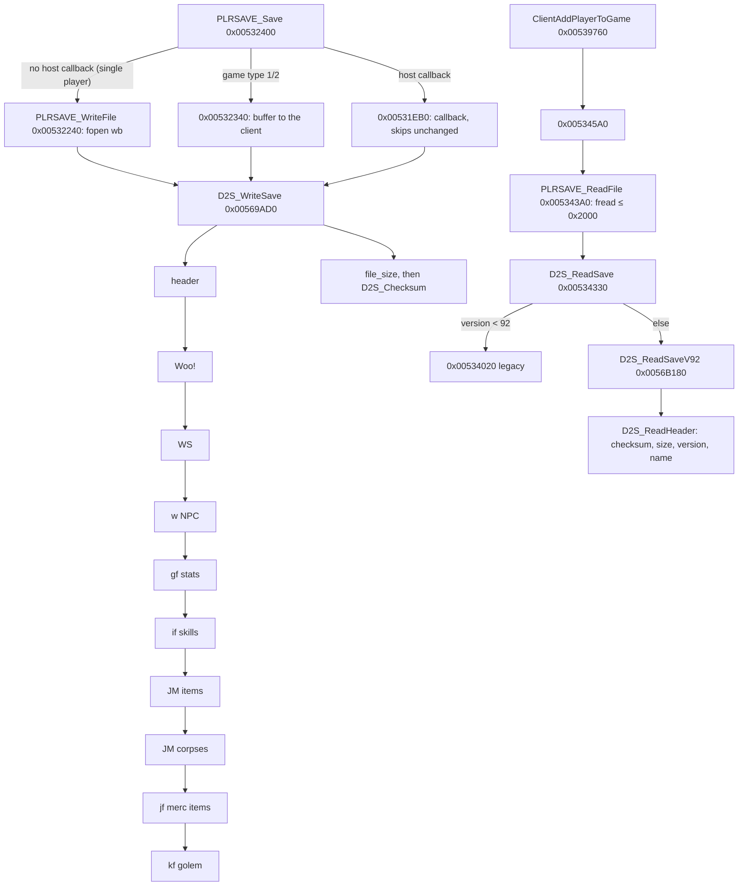

# 0001 — The `.d2s` writer and reader

> **Subsystem:** save/d2s
> **Question:** Which code writes and reads a `.d2s` save, and which runtime field does each persisted field come from and go back to?
> **Date:** 2026-10-12   **Plan:** 0013 (Phase 1)   **Status:** open (Phase 1 read `[I]`; four claims `[C]` by an earlier logged run; Phase 2 round trips pending)

Static reading only (plan 0013 Phase 1). Names of functions, structs and fields are ours. File offsets are those of
[d2s.md](../../formats/d2s.md); "header" means file bytes `0x000`–`0x14E`. The server-side code sits in two modules:
`.\PLAYER\PlrSave.cpp` (string `0x006E09AC`: file I/O, item lists, the old-format reader) and `.\PLAYER\PlrSave2.cpp`
(`0x006E11F0`: the version-96 writer and the version-92..96 reader). The item bitstream itself is item code
(`.\ITEMS\Items.cpp` neighbourhood, `0x0062xxxx`). "Client" is the server's per-connection client object (accessors
`0x005385xx`–`0x005392xx`, asserts in `.\GAME\Clients.cpp`); "player data" is `unit+0x14` of a player unit
(`0x006221A0` returns it); "item data" is `unit+0x14` of an item unit. All are partial types in
[re/types/save.h](../../../re/types/save.h).

## Answer (summary)

- [I] **Writer.** `fn:PLRSAVE_Save@0x00532400` serialises the client's player through `fn:D2S_WriteSave@0x00569AD0`
  into an 8 KiB stack buffer and, in a single-player game (no host callback `0x00883D50`, game type not 1 or 2),
  `fn:PLRSAVE_WriteFile@0x00532240` writes it with `fopen("%s%s.d2s", "wb")`. Sections are written in file order,
  then `file_size` (`+0x08`) = bytes written and `checksum` (`+0x0C`) is computed over the whole buffer with the
  checksum field still 0 from the header `memset`. (0x00569D2F–0x00569D38)
- [C] **Checksum.** `fn:D2S_Checksum@0x00411130` (stdcall `(buf, len)`): `sum = 2·sum + byte + (sum < 0)` per byte,
  i.e. `rotl32(sum, 1) + byte`, from 0. The reader saves `+0x0C`, zeroes it, recomputes over the bytes read and
  returns internal error 6 on mismatch, then 5 if `file_size` ≠ bytes read. Corroborated by data (23 samples) and by
  the refused corrupt save of run:2026-10-11-d2s-edit. (0x0056A0D2–0x0056A104, run:2026-10-11-d2s-edit)
- [I] **Reader.** `fn:PLRSAVE_ReadFile@0x005343A0` reads at most `0x2000` bytes; `fn:D2S_ReadSave@0x00534330` rejects
  fewer than 8 bytes or a wrong magic (code 9), sends version < 92 to the legacy reader `0x00534020` and the rest to
  `fn:D2S_ReadSaveV92@0x0056B180`, whose header step `fn:D2S_ReadHeader@0x0056A090` accepts versions 92–96 only
  (else 7). Any failure is mapped through `data:g_D2sLoadErrorMap@0x006E1208` and makes
  `sub_00539760_ClientAddPlayerToGame` log `"[PLAYER LOAD] … Error Loading"` and fail the join. (0x00539760)
- [C] **The character-select screen does not verify the checksum**: the checksum routine has four callers, the
  writer, the server reader, the client stub writer `0x0043C6B0` and the client expansion converter `0x0043CAA0`;
  the select-screen readers of `"%s%s.d2s"` (`0x00431F70`, `0x0043C8A0`, `0x00478040`, `0x0045C520`) are not among
  them. Matches the corrupt `smpsor` shown at level 2 in run:2026-10-11-d2s-edit. (fn:D2S_Checksum@0x00411130,
  run:2026-10-11-d2s-edit)
- [I] **Bit I/O** (`fn:BITBUF_Write@0x00410EB0`, `fn:BITBUF_Read@0x00410F60`): LSB first within each byte, bytes in
  order; a width up to 32 per call; a write zeroes each new byte before OR-ing; an overrun sets a sticky error flag
  (`+0x10`) and the item serialiser then returns 0 bytes. Signed reads (`fn:BITBUF_ReadSigned@0x00411030`)
  sign-extend widths below 32.
- [C] **Header `level` is written from stat 12**, not kept from the file: `D2S_WriteHeader` stores the unit's stat 12
  at `0x2B`, and no reader step reads `0x2B`. run:2026-10-11-d2s-edit saw header level 2 rewritten as 1.
  (0x0056904D, run:2026-10-11-d2s-edit)
- [I] **`map_seed` is reused.** The writer stores `game+0x7C` (the map seed of [rng/0002](../rng/0002-seed-tree.md))
  at `0xAB`. The reader copies `0xAB` back into `game+0x7C` when the game type is 3 (single player), no `-seed`
  override is set (`game+0x84` = 0) and the save's difficulty byte for the game's difficulty has bit 7 set. Act
  creation follows the load in the join (`0x00530190` → `0x0052C210` → `0x0053AFB0` → `sub_0053AC70_ActCreate`), so
  such a game rebuilds the saved maps. Every logged run so far used `-seed N` and so took the no-reuse branch.
  (0x0056A1FC–0x0056A217)
- [I] **Item `seed`** (bits 111–142) is `unit+0x28`, the value the item unit's RNG was initialised from; the reader
  stores it back at `+0x28` and calls `RNG_SeedInit(unit+0x20, seed)`. For a dropped item that value is the game
  seed's low word after the step in `sub_00552DF0_UnitSeedInit` ([rng/0002 § Units](../rng/0002-seed-tree.md#units),
  [items/0001 §8](../items/0001-tc-resolution.md)). The item-data seed (`ItemData+0x04`) is not saved. Simple items
  carry no seed and load with `+0x28` = 0. (0x006302CF, 0x0062CD13–0x0062CD16, 0x0062AC3E–0x0062AC45)
- [I] **Item `flags` bit 23** is ORed in by the serialiser on every item (`flags & ~0x80000 | 0x800000`), and bit 21
  comes from the item record's `compactsave` byte (`+0x143`). **Bit 13** is cleared on every item loaded from a save
  (`0x00558CB0`), so only items created in the session being saved carry it. The 10-bit **`version`** is item data
  `+0x30`, set at creation from `game+0x78`, which game setup makes **101** in an expansion game and **2** in a
  classic one. (0x006312D1–0x006312D6, 0x00631312, 0x00558D46–0x00558D4C, 0x00530D49)

## Leads used

- [L] src:d2s-community-format: used only through [d2s.md](../../formats/d2s.md)'s layout, to know which bytes to look
  for; every claim here was read from the code first. Cross-check verdicts on its byte-level claims are the
  archivist's (d2s.md). Two places where the code refines that doc's layout (simple items, waypoint width) go to the
  archivist through the backlog, not as verdicts on the source.

## Functions

| Address | Name | Role | Tag |
|---|---|---|---|
| `0x00410E40` | `BITBUF_Init` | `(ctx, buf, bytes)`: ptr, capacity in bits, byte count, bit position, error flag | I |
| `0x00410E90` | `BITBUF_GetSize` | bytes used, a partial byte counted | I |
| `0x00410EB0` | `BITBUF_Write` | `(ctx, value, nbits)` LSB first | I |
| `0x00410F60` | `BITBUF_Read` | `(ctx, nbits)` unsigned; an overrun is truncated and flagged | I |
| `0x00411020` | `BITBUF_ReadUnsigned` | jumps to `BITBUF_Read` | I |
| `0x00411030` | `BITBUF_ReadSigned` | read, then sign-extend when nbits < 32 | I |
| `0x00411070` | `BITBUF_AlignByte` | skip to the next byte boundary | I |
| `0x00411130` | `D2S_Checksum` | `rotl32(sum,1) + byte` over `(buf, len)` | C |
| `0x0043C540` | `sub_0043C540_StubBuild` | client: 335-byte header of a new character | I |
| `0x0043C6B0` | `sub_0043C6B0_StubWrite` | client: checksums and writes the stub | I |
| `0x0043CAA0` | `sub_0043CAA0_ConvertToExpansion` | client: sets status bit 5, re-checksums, rewrites | I |
| `0x0052C900` | `sub_0052C900_SaveClients` | saves one client, then the others in the game | I |
| `0x0052D350` | `sub_0052D350_AutosaveTick` | hosted-only periodic save (10 s / 45 s timers) | I |
| `0x0052E9C0` | `sub_0052E9C0_SaveAllOnShutdown` | every client of every game, at server shutdown | I |
| `0x00530190` | `sub_00530190_SrvJoinAct` | join: load, then create the client's act | I |
| `0x00531EB0` | `sub_00531EB0_SaveViaCallback` | hosted save; skips an unchanged buffer | I |
| `0x00532240` | `PLRSAVE_WriteFile` | `"%s%s.d2s"`, `wb` | I |
| `0x00532400` | `PLRSAVE_Save` | save entry: picks client buffer, file or callback | I |
| `0x00534330` | `D2S_ReadSave` | magic, version dispatch | I |
| `0x005343A0` | `PLRSAVE_ReadFile` | `"%s%s.d2s"`, `rb`, ≤ `0x2000` bytes | I |
| `0x005345A0` | `sub_005345A0_PlayerLoad` | file (single player) or client buffer (types 1/2, hosted) | I |
| `0x00539760` | `sub_00539760_ClientAddPlayerToGame` | load, then status and class checks | I |
| `0x0056B180` | `D2S_ReadSaveV92` | section readers in order; error map | I |
| `0x00568DC0` | `sub_00568DC0_ItemRefFromId` | unit id → 1-based position in the inventory list | I |
| `0x00568E60` | `D2S_WriteMercHeader` | `0xAF`–`0xBE` | I |
| `0x00568F20` | `D2S_WriteHeader` | `0x000`–`0x14E` | I |
| `0x00569320` | `D2S_WriteQuests` | `Woo!` | I |
| `0x005693E0` | `D2S_WriteWaypoints` | `WS` | I |
| `0x00569490` | `D2S_WriteNpcs` | `01 77` | I |
| `0x00569540` | `D2S_WriteStats` | `gf` | I |
| `0x005696F0` | `D2S_WriteSkills` | `if` | I |
| `0x005697B0` | `D2S_WriteItemList` | `JM` list of an inventory | I |
| `0x005697F0` | `D2S_WriteCorpses` | corpse `JM` | I |
| `0x005699A0` | `D2S_WriteMercItems` | `jf` | I |
| `0x00569A00` | `D2S_WriteGolem` | `kf` | I |
| `0x00569AD0` | `D2S_WriteSave` | whole file; size and checksum | I |
| `0x00569D80` | `D2S_CheckStatus` | status word vs game: expansion, ladder, hardcore, dead, difficulty | I |
| `0x00569EC0` | `sub_00569EC0_DecodeSkillSlot` | `u16 skill|flag, u16 item ref` → skill, flag, ref | I |
| `0x00569F80` | `sub_00569F80_NewCharFromStub` | builds a new character for a stub | I |
| `0x0056A090` | `D2S_ReadHeader` | checksum, size, version, name, header fields | I |
| `0x0056A370` | `D2S_ReadQuests` | | I |
| `0x0056A3E0` | `D2S_ReadWaypoints` | | I |
| `0x0056A470` | `D2S_ReadNpcs` | | I |
| `0x0056A4F0` | `D2S_ReadStatsBits` | `gf` bitstream (version ≥ 95) | I |
| `0x0056A620` | `D2S_ReadStats` | dispatch; bitmask format for version ≤ 94 | I |
| `0x0056A710` | `D2S_ReadSkills` | | I |
| `0x0056A7E0` | `D2S_ReadItemList` | | I |
| `0x0056A830` | `D2S_ReadCorpses` | | I |
| `0x0056AA50` | `D2S_ReadMercHeader` | recreates the mercenary from `0xAF`–`0xBE` | I |
| `0x0056AC10` | `D2S_ReadMercItems` | | I |
| `0x0056AE50` | `D2S_ReadGolem` | | I |
| `0x0056AF80` | `D2S_LoadFinish` | gold clamps, life/mana restore, derived stats | I |
| `0x005316D0` | `sub_005316D0_WriteOneItem` | one item and its socketed items | I |
| `0x005317B0` | `ITEMS_WriteInventoryList` | `JM`, count, items | I |
| `0x005335E0` | `ITEMS_ReadInventoryList` | `JM`, count, items and their socketed items | I |
| `0x00558CB0` | `sub_00558CB0_ItemCreateFromSave` | creates the unit, reads, sets `0x80000`, clears `0x2000` | I |
| `0x0062A970` | `ITEMS_ReadCompact` | simple item | I |
| `0x0062AC80` | `ITEMS_ReadProperty` | one generic property | I |
| `0x0062AE20` | `ITEMS_PeekHeader` | flags, mode, position, code, `n_filled` before creating the unit | I |
| `0x0062AF80` | `ITEMS_WriteCompact` | simple item | I |
| `0x0062CBE0` | `ITEMS_ReadFull` | extended item | I |
| `0x0062E430` | `ITEMS_Deserialize` | `JM`, flags, then compact or full | I |
| `0x0062FFF0` | `ITEMS_WriteFull` | extended item | I |
| `0x006312B0` | `ITEMS_SerializeBits` | `JM`, flags, body, socketed items byte-aligned | I |
| `0x006313E0` | `ITEMS_Serialize` | `(item, buf, size, …)` → bytes or 0 | I |
| `0x00661030` | `WAYPOINT_Load` | 16 bytes in; forces waypoint 0 | I |
| `0x006610B0` | `WAYPOINT_Save` | 16 bytes out | I |
| `0x00483410` | `SETS_GetRecord` | `DataTables+0xC0C`, stride `0x128` | I |
| `0x00483440` | `SETITEMS_GetRecord` | `DataTables+0xC18`, stride `0x1B8` | I |

Data: `data:g_D2sLoadErrorMap@0x006E1208` (u32 per internal reader code), `data:g_WaypointBits@0x00746428`
(u16 word index, u16 mask, per waypoint), `data:g_MagicAffixInfo@0x0096CA7C` (merged affix array: `+0x04` base,
`+0x0C` first prefix, `+0x10` first automagic; returned by `0x00633ED0`).

## Walkthrough

### 1. When a save is written

- [I] `PLRSAVE_Save` (ECX = game, EDX = player unit) clears unit flag `+0xC8` bit 1, then: game type (`game+0x6A`) 1 or 2
  → `0x00532340` serialises with a 0x2000 cap and hands the buffer to the client object (`0x00538CE0`), no file; no host
  callback (`0x00883D50` = 0) → `PLRSAVE_WriteFile`; otherwise `sub_00531EB0_SaveViaCallback`. (0x00532400)
- [I] `sub_00531EB0_SaveViaCallback` compares the new buffer with the previous one with `checksum`, `last_played`
  (`0x30`), `unk_34` and `map_seed` masked to 0 in both, and skips the callback when nothing else changed. So those four
  fields are the ones that change without game progress. (0x00532001–0x0053210E)
- [I] Callers of `PLRSAVE_Save`: `sub_0052C900_SaveClients` (a leaving client and the rest, called from client
  removal `0x00539DA0`), `sub_0052E9C0_SaveAllOnShutdown` (`"Open server thread shut down"` caller), `0x0052E2A0`
  (game types 1/2, quest and act events: `a5q6.cpp`), `sub_0052D350_AutosaveTick` (only with a host callback: after
  10 s with a pending-change counter above 10, or 45 s, or a forced flag), and `0x0057FCA0` in `.\PLAYER\PlrModes.cpp`,
  which first sets client status bit 3 (`0x08`, dead) and then saves. Which one *Save and Exit* takes in single player is
  for Phase 2 (breakpoint on `0x00532240`). No autosave runs in single player. (0x0052D3BA, 0x0057FD3F)
- [I] A new character is not written by the server: the client builds a 335-byte header (`sub_0043C540_StubBuild`) and
  `sub_0043C6B0_StubWrite` writes it with a checksum over those 335 bytes. The stub has status bit 0 set, `level` 1,
  `0x29` = 16, `0x2A` = 30, `0x2C` = `0x30` = `time(NULL)`, and status bit 5 for class 5 or 6. (0x0043C568–0x0043C5D0)

### 2. Header (`D2S_WriteHeader` 0x00568F20 / `D2S_ReadHeader` 0x0056A090)

The writer `memset`s a 0x14F-byte image, fills it, copies it to the output. Fields it does not set stay 0.

| offset | written from | read into | tag |
|---|---|---|---|
| `0x000` | `0xAA55AA55` | checked by `D2S_ReadSave` (code 9) | I |
| `0x004` | 96 | must be 92..96, else 7; < 92 goes to the legacy reader | I |
| `0x008` | bytes written | must equal bytes read, else 5 | I |
| `0x00C` | `D2S_Checksum` | verified, else 6 | C |
| `0x010` | bit 0 = client `+0x45C` ≠ 0 (weapon switch) | bit 0 → client `+0x45C` | I |
| `0x014` | client name (`+0x0D`, NUL within 16 bytes required) | `0x23` forced to 0, then `_stricmp` with the client's name, else 7 | I |
| `0x024` | u32 = client `+0x0A` (u16 status word) `\| 0x20` if expansion game `\| 0x40` if ladder game (`game+0x74`) | low u16 → client `+0x0A` after `D2S_CheckStatus` | I |
| `0x028` | client `+0x08` (class) | > 7 → 4; → client `+0x08`; class of the new player unit | I |
| `0x029` | constant 16 | stat-slot count for the version ≤ 94 stat reader only | I |
| `0x02A` | `DataTables+0xBA8` (30, skills per class) | number of skill bytes `D2S_ReadSkills` reads | I |
| `0x02B` | stat 12 (`0x00625480(unit, 12)`) | not read | C |
| `0x02C` | client `+0x488` | → client `+0x488` | I |
| `0x030` | `time(NULL)` | not read | I |
| `0x034` | constant `0xFFFFFFFF` (`0x005385C0`) | not read | I |
| `0x038` | 16 × (u16 skill `\| 0x8000` if the slot flag, u16 item ref) from client hotkey slots (`0x005390D0`) | decoded by `0x00569EC0` (`0xFFFF` = empty, skill = `& 0xFFF`, ref 0 = none) → `0x005390A0` | I |
| `0x078` | (u16 skill, u16 item ref) of the left skill (`0x00620190`) | → player data `+0x74` / `+0x7C` | I |
| `0x07C` | the same for the right skill (`0x006201D0`) | → `+0x70` / `+0x78` | C |
| `0x080` | swap-set skill A (`0x00623220`) | → `+0x84` / `+0x8C` | I |
| `0x084` | swap-set skill B (`0x00623290`) | → `+0x80` / `+0x88` | I |
| `0x088` | 16 graphics bytes (`0x0063E510`, default `0xFF`) | not read by the server | I |
| `0x098` | 16 colour bytes (same call) | not read by the server | I |
| `0x0A8`+`d` | only the game's difficulty `d` (`game+0x6D`): client act (`+0x1AC`) `\| 0x80`; the other two bytes 0 | `b & 0x7F` → client act (≥ 5 → 0); `b & 0x80` gates the map-seed reuse | I |
| `0x0AB` | `game+0x7C` (map seed) | → `game+0x7C` if game type 3, `game+0x84` = 0 and `b & 0x80` | I |
| `0x0AF` | u32: 0, bit 16 if the mercenary is dead | bit 16 = dead flag of the recreated mercenary | I |
| `0x0B3` | mercenary seed (`merc info+0x00`) | creation seed of the mercenary | I |
| `0x0B7` | mercenary name id − hireling record `+0x114` (u16) | + `+0x114`, reset to `+0x114` if above `+0x116` | I |
| `0x0B9` | hireling id (`merc info+0x08`, u16) | record looked up by id (`0x006562F0`) | I |
| `0x0BB` | mercenary stat 13 (experience) | stat 13; mercenary level = highest level whose experience threshold it reaches | I |
| `0x0CF` | client `+0x480` | → client `+0x480` (`+0x481`, `+0x482` set to 0) | I |

- [I] **Status word** (`0x024` u16, client `+0x0A`), from `D2S_CheckStatus` and `D2S_ReadHeader`: bit 0 = new
  character (stub): the reader clears it and, if the file ends at the header, builds a fresh character
  (`sub_00569F80_NewCharFromStub`) instead of reading sections; bit 2 = hardcore, must match the game's hardcore flag
  (`0x0053FD40() & 0x800`, codes 11/12); bit 3 = dead, refused if hardcore (code 10); bit 5 = expansion, must match
  `game+0x70` (codes 8/9); bit 6 = ladder, checked only with a host. Bits 8–12 (`progression & 0x1F`) gate the
  difficulty: Nightmare needs ≥ 5 in an expansion save, ≥ 4 in a classic one; Hell needs ≥ 10 / ≥ 8 (codes 13/14).
  The load test of the fifth session of run:2026-10-11-tc-drops (progression 5: Nightmare open, Hell greyed) is
  consistent; its menu is client code not read here. (0x00569D80)
- [I] **`unk_26`** is the high half of the u32 at `0x024`, always 0 (the client word is zero-extended). (0x00569012–0x0056901B, fn:D2S_WriteHeader@0x00568F20)
- [I] **`unk_29`** is two bytes: `0x29` = 16 (constant) and `0x2A` = 30 (`DataTables+0xBA8`). Neither is a version. (0x00569091–0x005690AA, 0x0056A620, 0x0056A710)
- [I] **`unk_2c`** is a pass-through: the reader stores it at client `+0x488`, the writer writes it back, and no other
  instruction touches `+0x488` (the only two are the accessors `0x00538760`/`0x00538790`). A stub never reaches that
  read (the new-character path returns first), so a character's first full save writes the client's initial value: 0
  in every sample. The stub's value is the client's creation time.
- [I] **`unk_34`** is written as the constant `0xFFFFFFFF` and never read. (0x00569077, fn:D2S_ReadHeader@0x0056A090)
- [I] **`unk_bf`**: only `0xCF` is written (client `+0x480`, a byte read back on load); `0xBF`–`0xCE` and `0xD0`–`0x14E`
  stay 0 and are not read. The meaning of client `+0x480`–`+0x482` is not resolved; `0x0052C900` and `0x0052CA10` pass
  them to the host callback.
- [I] **`difficulty`**: one byte per difficulty, bit 7 = "saved while playing this difficulty", bits 0–6 = act index.
  A save made in Nightmare in act 1 holds `00 80 00` (normal's byte becomes 0). That is what the load test of
  run:2026-10-11-tc-drops (fifth session) used.
- [C] **Right mouse skill** at `0x07C`: run:2026-10-11-tc-drops (fifth session) set `0x07C` = 154 (War Cry) and the
  right button cast it. (0x0056A2D0, run:2026-10-11-tc-drops)

### 3. Quests, waypoints, NPCs

- [I] `Woo!`, u32 6, u16 `0x12A`, then three 96-byte blocks copied from the quest records at player data `+0x10`,
  `+0x14`, `+0x18` (`0x0065C560`, size asserted 0x60). On load (`0x0065C4D0`) each 16-bit quest word of a block gets
  bits 13 and 14 cleared and bit 15 set when bit 1 is set (43 words). (0x00569320, 0x0056A370)
- [I] `WS`, u32 1, u16 `0x50`, then three 24-byte blocks: 16 bytes copied from the waypoint records at player data
  `+0x1C`, `+0x20`, `+0x24` (`WAYPOINT_Save`) and 8 bytes never written. Each record is a u16 marker `0x0102` and seven
  u16 words: waypoint *n* (< 112, asserted) is word `1 + n/16`, mask `1 << (n % 16)` (`g_WaypointBits`), i.e. bit *n*
  LSB-first from block byte `+0x02`; the field is 14 bytes, not 5. The reader accepts a marker `0x0102`, `0x0101` or 0
  (else code 16): with 0 or `0x0101` it zeroes the record. Then it **forces waypoint 0 on**. Which of the three player
  data slots is which difficulty is not shown by this code. (0x005693E0, 0x0056A3E0, 0x00661030–0x006610A8)
- [I] `01 77`, u16 `0x34`, then 3 × 8 bytes (first record of player data `+0x60 + 4·d` slot, `0x00572520`) and 3 × 8
  bytes (second record, `0x00572530`), d = 0, 1, 2; the reader copies them back (`0x00572540`/`0x00572550`).
  (0x00569490–0x0056952B, 0x0056A470)

### 4. Character stats (`gf`)

- [I] **Writer** (`D2S_WriteStats`): the player's base stat list (`unit+0x5C`, `0x00625C90`, up to 512 entries of
  `{u16 param, u16 id, s32 value}`) in list order. An entry is skipped when its id is out of range or its
  `ItemStatCost` record has `CSvBits` (`+0x0A`, u8) = 0. Otherwise: id (9 bits), the param in `CSvParam` (`+0x0B`)
  bits if non-zero, the value in `CSvBits` bits. Before writing, a value is clamped when `CSvBits` < 32: unsigned
  stats (record byte `+0x05` bit 5 clear) to `[0, 2^bits − 1]`, signed ones to `[−2^(bits−1), 2^(bits−1) − 1]`.
  Then `0x1FF` (9 bits) and padding to a byte. There is no zero test in the writer: a stat absent from the base list
  is absent from the file. (0x00569540–0x005696DF)
- [I] **Reader** (`D2S_ReadStatsBits`, version ≥ 95): id = 9 bits unsigned; `0x1FF` ends; an id ≥ count or with
  `CSvBits` = 0 fails (code 18); param = `CSvParam` bits read **signed**; value = `CSvBits` bits, signed when
  `CSvBits` < 32 and `+0x05` bit 5 is set, else unsigned; `SetStat(unit, id, value, param)` (`0x00627260`). The value is
  stored as is: life, mana and stamina keep their 8 fraction bits. (0x0056A4F0)
- [I] **`.bin` vs `.txt`** (backlog D2S (a)): both functions read only the in-memory record at
  `DataTables+0xBCC + 0x144·id` (count `DataTables+0xBD4`). Under `-txt` that record is compiled from `.txt` by the same
  loader into the same layout ([data/0001](../data/0001-excel-loader.md)), so the save code cannot tell them apart.
  The data check of d2s.md (0 `CSvBits` mismatches over 359 records) is the corroboration still missing for `[C]`.
  (fn:D2S_WriteStats@0x00569540, fn:D2S_ReadStatsBits@0x0056A4F0, fn:DATATBLS_LoadTable@0x006122F0)
- [I] **After the item lists** (`D2S_LoadFinish`): gold (14) is set to 0 if negative or above the level's maximum
  (`0x00622E70`), the same for goldbank (15) against `0x00623460`; stamina (10) = `0x00625DB0` (the maximum); then
  stats 6 and 8 are set back to the values read before items were attached; 67, 68, 69 = 100; 30 (`nextexp`) =
  experience table at level + 1. Stats 7 and 9 (max life, max mana) are **not** recomputed by any reader step.
  (0x0056AF80)
- [I] The old format (version ≤ 94, `D2S_ReadStats`): a bitmask of `hdr[0x29]` bits, then one u32 per set bit, for
  stats 0..n−1. Not written by 1.14d. (0x0056A620)

### 5. Skills (`if`)

- [I] `if`, then one byte per skill of the class, in the class's skill list order (`0x006460F0(class, i)`, count
  `0x00646140(class)`): the unit's base level of that skill. The reader takes `hdr[0x2A]` bytes and sets each non-zero
  one (`0x0056DEB0`). (0x005696F0, 0x0056A710)

### 6. Item lists

- [I] `ITEMS_WriteInventoryList`: `JM`, u16 count, then each item of the inventory list through
  `sub_005316D0_WriteOneItem`. Items in the two hand slots (body 4, 5) of the equipped list and the cursor item are
  written after the others; an item `ITEMS_Serialize` refuses (unit `+0xC8` bit 15) is dropped and the count lowered.
  Socketed items follow their parent, each starting on a byte boundary (`BITBUF_AlignByte`), and are not counted.
  (0x005317B0, 0x006312B0)
- [I] Corpses: `JM`, u16 count (0 or 1; ≥ 2 is refused, error `0x68`), and per corpse 12 bytes (a u32 not resolved,
  then two u32 from the position getters `0x0045ADF0`/`0x0045AE20`) and an item list. (0x005697F0, 0x0056A830)
- [I] `jf` is written only in an expansion game; the mercenary's item list follows only when a mercenary exists
  (pet type 7). `kf` (expansion only) is followed by a byte = 1 when the player owns a pet of type 3 whose class is 291
  (`irongolem`) and that golem holds an item; the item follows. (0x005699A0, 0x00569A00, 0x0056AE50)

### 7. One item (`ITEMS_SerializeBits` → `ITEMS_WriteFull` / `ITEMS_WriteCompact`)

Common part, written by `ITEMS_SerializeBits` and the first lines of `ITEMS_WriteFull`; every value is clamped to its
width before writing:

| bits | field | runtime source → load target | tag |
|---|---|---|---|
| 16 | `JM` | constant; read signed and compared | I |
| 32 | `flags` | item data `+0x18` `& ~0x80000 \| 0x800000`, `\| 0x200000` if record `compactsave`; → `+0x18` (bit 25 stripped, bit 19 cleared) | I |
| 10 | `version` | item data `+0x30` → `+0x30` (`0x0062A6C0`) | I |
| 3 | `location` | unit mode `+0x10` → `0x00624690` | I |
| 4+4+4+3 | `body`, `x`, `y`, `store` | body `+0x44`, grid position, `store` = inventory page (`+0x45`) + 1 → the same | I |
| 16+16 | `x`, `y` | instead, for mode 3 (ground) or 5 (dropping): world position | I |
| 32 | `code` | item record code (`0x00628590`) → record index by code (`0x00633680`) | I |
| 3 | `n_filled` | number of socketed items (`0x0062A900`) → how many items the list reader takes after this one | I |

- [I] **Simple items** (`ITEMS_WriteCompact`) stop after `code` (or the ear fields), then: for gold (type 4) a
  1-bit "> 4095" flag and the amount; for a quest item with `questdiffcheck`, stat 356 in its `Save Bits`; and the
  1-bit realm flag (97 bits when set). They have **no `n_filled`**: the peek reader `ITEMS_PeekHeader` reads `n_filled`
  only when flags bits 21 and 25 are clear. Bit 108 of a simple item is therefore the realm flag, not `n_filled`. On
  load a simple item gets seed 0, ilvl 1 and quality 2. (0x0062AF80, 0x0062AF1F, 0x0062AC3E–0x0062AC45)

Extended part (`ITEMS_WriteFull` with the save flag set; `ITEMS_ReadFull` mirrors it):

| field | width | runtime source → load target | tag |
|---|---|---|---|
| `seed` | 32 | `unit+0x28` → `+0x28`, and `RNG_SeedInit(unit+0x20, seed)` | I |
| `ilvl` | 7 | item data `+0x2C`, clamped to 1..99 → `+0x2C` (min 1) | I |
| `quality` | 4 | item data `+0x00` (2 if no item data) → `+0x00` | I |
| `has_gfx`, `gfx` | 1, 3 | `0x0062E8D0` (variable graphics), item data `+0x49` | I |
| `has_class`, `class_affix` | 1, 11 | item data `+0x36` (automagic affix) minus the automagic base of `g_MagicAffixInfo` when above it; the reader adds the base back to a non-zero value | I |
| quality fields | below | | I |
| `runeword` | 16 | flags bit 26: `Runes` record (`0x0062BED0`) `+0x82` (u16), `0xFFFF` if none → item data `+0x38` | I |
| ear / `pname` | | flags bit 16: class 3, level 7 (`+0x48`), name; else bit 24: name, 7 bits per char incl. the 0 (`+0x4A`) | I |
| `realm` | 1 (+96) | save only: `0x00629E40` pair; 1, u32, u32, u32 0 when present | I |
| armor | | `ItemIsType(50)`: stat 31 `armorclass`, then 73 `maxdurability`, then 72 `durability` if 73 ≠ 0 | I |
| weapon | | `ItemIsType(45)`: 73, then 72 if 73 ≠ 0 | I |
| gold | 1 + 12/32 | `ItemIsType(4)`: stat 14 | I |
| `quantity` | 9 | stackable (`0x006289F0`): stat 70 | I |
| `sockets` | `Save Bits`[194] | flags bit 11: stat 194 → `0x0062BE00` | I |
| `set_lists` | 5 | quality 5: bit *i* set when the item holds the stat list of set state `0x006E90B8[i]` | I |
| property lists | | main list (state 0, flag `0x40`), then the set lists, then the runeword list (state 171) | I |

Quality fields: 1 and 3 → 3 bits (`0x00629DA0`, the quality-specific index); 4 → prefix 11, suffix 11; 5 and 7 → 12
bits (`0x00629DA0`; < 0 written as `0xFFF`); 6 and 8 → `name1` 8, `name2` 8, then three pairs (prefix slot
`+0x38/+0x3A/+0x3C`, suffix slot `+0x3E/+0x40/+0x42`), each a present bit and 11 bits; 9 → `name1`, `name2` only; any
other value is written as 2 (normal), and normal items of type 13 (`charm`) carry 1 + 11 bits, of type 40 (`body`,
not 7) 10 bits, of types 18/22 (`book`/`scroll`) 5 bits. A magic, set, unique, rare or crafted field is written only
when the item is identified (flags bit 4) or the save flag is set, so in a save always. (0x0063048F)

- [I] **Affix ids** are stored relative to their block of the merged affix array: a non-zero prefix id is stored as
  `id − firstPrefix`, and the reader adds `firstPrefix` back; suffix ids are stored and read unchanged. The rare/crafted
  pairs are therefore **prefix, suffix** alternately (writer and reader agree). Which table rows these ids index is
  `items/affixes` (backlog D2S (e)). (0x0062CEEA, 0x0062CFBA, 0x0062D0A3)
- [I] **Unique and set ids.** A unique id ≥ the unique count (`DataTables+0xC28`) loads as −1. A set id (version ≥ 93)
  is looked up with `SETITEMS_GetRecord(id)` and the item gets that record's `+0x00` (s16); no record fails the item.
  (0x0062D0DC–0x0062D103, 0x0062D11C–0x0062D1A1)
- [I] **Runeword field** (backlog D2S (d)): the 16 bits are one u16, the `+0x82` field of the item's `Runes` record;
  d2s.md's (159, 5) is `0x509F` = 20639 read as 12 + 4 bits. What `+0x82` holds (a string index in the `20000` block
  is the obvious candidate) is for `items/sockets-runewords`. The reader stores the u16 at item data `+0x38`.
  (0x00630887, 0x0062D1CB)
- [I] **Not saved, rebuilt on load**: weapon damage (stats 21–24, 159, 160 from the item record, ×3/4 for low quality,
  ×3/2 when `0x0062A8D0` holds), speed (67/68 = −record `speed`), block (20 from record `block`). (0x0062D397–0x0062D6B7)

#### Property lists

- [I] Writer, per list: for each stat with `Save Bits` (`+0x19`) ≠ 0 and `value >> ValShift` (`+0x18`) ≠ 0: id (9
  bits); then, for the grouped ids, that value and the next ids' values from the same list with no id of their own:
  17 (+18), 48 (+49), 50 (+51), 52 (+53), 54 (+55, +56), 57 (+58, +59); for every other id the param in `Save Param
  Bits` (`+0x24`) bits if non-zero and the value. Each value written is `(value >> ValShift) + Save Add` (`+0x1C`),
  clamped to `[0, 2^bits − 1]`. A list ends with `0x1FF`. (0x00630E3B–0x00631245)
- [I] Reader (`ITEMS_ReadProperty`): `value = (read(Save Bits) − Save Add) << ValShift`, param = `Save Param Bits`
  bits. The grouped ids are read as above; after the 57 group it also sets stat 326 (`poison_count`) = 1, which is
  never written. For saves of version < 93 it uses `1.09-Save Bits` (`+0x1A`) and `1.09-Save Add` (`+0x20`) instead,
  and a series of per-id width overrides for older versions. (0x0062AC80, 0x0062D9AE–0x0062E1A9)
- [I] The record offsets `+0x18` = `ValShift`, `+0x1A` = `1.09-Save Bits`, `+0x20` = `1.09-Save Add` are each the only
  candidate `python3 -I tools/excel_bin.py probe … itemstatcost` reports for those columns; the code reads them at those
  offsets. `+0x0B` (`CSvParam`) and the `CSvSigned` flag (`+0x05` bit 5) are where the code reads them; the data cannot
  place them (blank columns). (fn:ITEMS_ReadProperty@0x0062AC80, 0x0056A4F0)

## Data touched

- `ItemStatCost.txt` columns `CSvBits`, `CSvParam`, `CSvSigned`, `Save Bits`, `Save Add`, `Save Param Bits`, `ValShift`,
  `1.09-Save Bits`, `1.09-Save Add` (record `0x144`; no table doc yet, offsets above).
- tbl:Weapons.txt:compactsave (`+0x143`), `quest` (`+0x12A`), `questdiffcheck` (`+0x12B`), `speed` (`+0xD8`),
  `block` (`+0x111`), `mindam`/`maxdam` (`+0xFE`/`+0xFF`) and the two-hand and missile damage bytes.
- struct:Game+0x74 ladder, `+0x78` item version, `+0x7C` map seed, `+0x84` seed override; struct:Client fields of the
  header table; struct:PlayerData `+0x10`, `+0x1C`, `+0x60`, `+0x70`–`+0x8C`; struct:ItemData `+0x00`–`+0x4A`;
  struct:Unit+0x10 mode, `+0x28` initial seed, `+0x5C` stat list, `+0x60` inventory.

## Open questions

- Which save path *Save and Exit* takes in single player (shutdown vs client removal), and whether anything else writes
  during play. Phase 2: breakpoint on `PLRSAVE_WriteFile` (0x00532240) with a return-address log.
- Max life/mana: no reader step recomputes stats 7/9, yet the fifth session of run:2026-10-11-tc-drops showed mana
  `8002 / 1072` after loading `mana` = `maxmana` = `8002 << 8` with energy 1000. The `1072` suggests a recompute
  somewhere after the load (a stat callback when level or energy is set, or the join path after
  `sub_00539760_ClientAddPlayerToGame`). Phase 2: log stat 9 at `D2S_LoadFinish` and at the first frame in game.
- The map-seed reuse needs a run without `-seed` (seed 0): save, reload, and log `game+0x7C` at `0x0056A217` and the act
  seed at `DRLG_ActCreate`.
- Which waypoint and quest slot (player data `+0x1C/+0x20/+0x24`, `+0x10/+0x14/+0x18`) is which difficulty.
- The meaning of client `+0x480`–`+0x482` (`0xCF`), of status bit 1 (set by the client at creation, `0x0043C6A4`) and of
  the corpse record's first u32.
- `Runes` `+0x82` (runeword field), affix-array layout (`g_MagicAffixInfo`), and what the 3-bit low/superior field
  indexes: `items/sockets-runewords`, `items/affixes`, `items/quality`.
