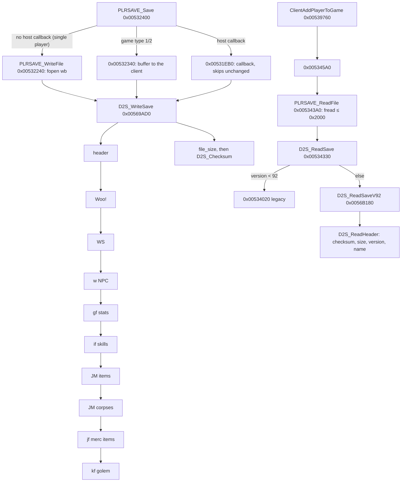

# 0001 — The `.d2s` writer and reader

> **Subsystem:** save/d2s
> **Question:** Which code writes and reads a `.d2s` save, and which runtime field does each persisted field come from and go back to?
> **Date:** 2026-10-12   **Plan:** 0013 (Phases 1–2)   **Status:** open (Phase 2 round trips done, [run:2026-10-12-d2s-io](experiments.md#run2026-10-12-d2s-io): the write path, header sources, `gf` stream, item common part, seed/ilvl/quality, checksum and size checks, map-seed reuse and the drop seed `[C]`; the rest `[I]`)

Phase 1 is a static reading; Phase 2 ([run:2026-10-12-d2s-io](experiments.md#run2026-10-12-d2s-io), logger
`tools/gdb/d2s-io.gdb`, checker `tools/d2sio.py`) confirmed the claims tagged with that run. Names of functions, structs and fields are ours. File offsets are those of
[d2s.md](../../formats/d2s.md); "header" means file bytes `0x000`–`0x14E`. The server-side code sits in two modules:
`.\PLAYER\PlrSave.cpp` (string `0x006E09AC`: file I/O, item lists, the old-format reader) and `.\PLAYER\PlrSave2.cpp`
(`0x006E11F0`: the version-96 writer and the version-92..96 reader). The item bitstream itself is item code
(`.\ITEMS\Items.cpp` neighbourhood, `0x0062xxxx`). "Client" is the server's per-connection client object (accessors
`0x005385xx`–`0x005392xx`, asserts in `.\GAME\Clients.cpp`); "player data" is `unit+0x14` of a player unit
(`0x006221A0` returns it); "item data" is `unit+0x14` of an item unit. All are partial types in
[re/types/save.h](../../../re/types/save.h).



## Answer (summary)

- [C] **Writer.** `fn:PLRSAVE_Save@0x00532400` serialises the client's player through `fn:D2S_WriteSave@0x00569AD0`
  into an 8 KiB stack buffer and, in a single-player game (no host callback `0x00883D50`, game type not 1 or 2),
  `fn:PLRSAVE_WriteFile@0x00532240` writes it with `fopen("%s%s.d2s", "wb")`. Sections are written in file order,
  then `file_size` (`+0x08`) = bytes written and `checksum` (`+0x0C`) is computed over the whole buffer with the
  checksum field still 0 from the header `memset`. *Save and Exit* in single player writes the file **twice**,
  byte-identical: first through `sub_0052CA10_SaveGameClients` (every client of the game), then through
  `sub_0052C900_SaveClients`. Every header field and item common-part field compared in the run equals its runtime
  source. (0x00569D2F–0x00569D38, run:2026-10-12-d2s-io)
- [C] **Checksum.** `fn:D2S_Checksum@0x00411130` (stdcall `(buf, len)`): `sum = 2·sum + byte + (sum < 0)` per byte,
  i.e. `rotl32(sum, 1) + byte`, from 0. The reader saves `+0x0C`, zeroes it, recomputes over the bytes read and
  returns internal error 6 on mismatch, then 5 if `file_size` ≠ bytes read; the failure exit maps both to 14
  (`g_D2sLoadErrorMap`) and the player is back at the main menu. Corroborated by data (23 samples), by the refused
  corrupt save of run:2026-10-11-d2s-edit and by the logged returns 6 and 5 of run:2026-10-12-d2s-io (the size test
  was hit with a correct checksum). Only codes 0, 5, 6 and 14 have been seen. (0x0056A0D2–0x0056A104,
  run:2026-10-11-d2s-edit, run:2026-10-12-d2s-io)
- [I] **Reader.** `fn:PLRSAVE_ReadFile@0x005343A0` reads at most `0x2000` bytes; `fn:D2S_ReadSave@0x00534330` rejects
  fewer than 8 bytes or a wrong magic (code 9), sends version < 92 to the legacy reader `0x00534020` and the rest to
  `fn:D2S_ReadSaveV92@0x0056B180`, whose header step `fn:D2S_ReadHeader@0x0056A090` accepts versions 92–96 only
  (else 7). Any failure is mapped through `data:g_D2sLoadErrorMap@0x006E1208` and makes
  `sub_00539760_ClientAddPlayerToGame` log `"[PLAYER LOAD] … Error Loading"` and fail the join. (0x00539760)
- [I] **Legacy reader** (versions 71..91, [§ Plan 0038 lane/rlg](#plan-0038-lanerlg-the-legacy-and-version-92-readers-static-2026-10-27)):
  no version of 71..91 is refused (0..70 also reach it and fail the header's version test with 1); a `0x82`-byte header (its own length word at `+0x20`), then `Woo!`, `WS`, `01 77`, `gf`
  with a 3-byte mask over stats 0..15, `if`, and the item, corpse, mercenary and hotkey sections, with no checksum or
  size test; failures after the skills do not fail the load. Item lists take the save's version: 71 its own 25-byte
  records, 72..91 the current bitstream under the version tests listed there. (fn:sub_00534020_ReadSaveLegacy@0x00534020)
- [C] **The character-select screen does not verify the checksum**: the checksum routine has four callers, the
  writer, the server reader, the client stub writer `0x0043C6B0` and the client expansion converter `0x0043CAA0`;
  the select-screen readers of `"%s%s.d2s"` (`0x00431F70`, `0x0043C8A0`, `0x00478040`, `0x0045C520`) are not among
  them. Matches the corrupt `smpsor` shown at level 2 in run:2026-10-11-d2s-edit. (fn:D2S_Checksum@0x00411130,
  run:2026-10-11-d2s-edit)
- [I] **Bit I/O** (`fn:BITBUF_Write@0x00410EB0`, `fn:BITBUF_Read@0x00410F60`): LSB first within each byte, bytes in
  order; a width up to 32 per call; a write zeroes each new byte before OR-ing; an overrun sets a sticky error flag
  (`+0x10`) and the item serialiser then returns 0 bytes. Signed reads (`fn:BITBUF_ReadSigned@0x00411030`)
  sign-extend widths below 32.
- [C] **Header `level` is written from stat 12**, not kept from the file: `D2S_WriteHeader` stores the unit's stat 12
  at `0x2B`, and no reader step reads `0x2B`. run:2026-10-11-d2s-edit saw header level 2 rewritten as 1.
  (0x0056904D, run:2026-10-11-d2s-edit)
- [C] **`map_seed` is reused.** The writer stores `game+0x7C` (the map seed of [rng/0002](../rng/0002-seed-tree.md))
  at `0xAB`. The reader copies `0xAB` back into `game+0x7C` when the game type is 3 (single player), no `-seed`
  override is set (`game+0x84` = 0) and the save's difficulty byte for the game's difficulty has bit 7 set. Act
  creation follows the load in the join (`0x00530190` → `0x0052C210` → `0x0053AFB0` → `sub_0053AC70_ActCreate`), so
  such a game rebuilds the saved maps. In run:2026-10-12-d2s-io a `-seed 0` game (no override) saved its clock map
  seed, and the next load in the same process replaced its own clock map seed with it: both games built Act I from
  the same act seed. A save with bit 7 clear, and the same save under `-seed 7`, kept the game's own value.
  (0x0056A1FC–0x0056A217, run:2026-10-12-d2s-io)
- [C] **Item `seed`** (bits 111–142) is `unit+0x28`, the value the item unit's RNG was initialised from; the reader
  stores it back at `+0x28` and calls `RNG_SeedInit(unit+0x20, seed)`. For a dropped item that value is the game
  seed's low word after the step in `sub_00552DF0_UnitSeedInit` ([rng/0002 § Units](../rng/0002-seed-tree.md#units),
  [items/0001 §8](../items/0001-tc-resolution.md)). The item-data seed (`ItemData+0x04`) is not saved. Simple items
  carry no seed and load with `+0x28` = 0. Run: 16 distinct extended items over 8 writes and 5 loads, plus one Blood Moor drop
  whose `unit+0x28`, quality and ilvl logged at its creation are the saved seed, quality and ilvl after the pickup;
  loaded items get `+0x20` = `{seed, 666}`. The draw behind a server unit's `+0x28` is `[C]` in rng/0002. (0x006302CF,
  0x0062CD13–0x0062CD16, 0x0062AC3E–0x0062AC45, run:2026-10-12-d2s-io)
- [C] **Item `flags` bit 23** is ORed in by the serialiser on every item (`flags & ~0x80000 | 0x800000`), and bit 21
  comes from the item record's `compactsave` byte (`+0x143`) (bit 21 `[I]`: seen only on simple items). **Bit 13** is
  cleared on every item loaded from a save (`0x00558CB0`): every item that had it was written without it after a load.
  A drop has it **set at creation** and the same item, picked up, was saved with it **clear**: some step between the drop
  and the write cleared it (the writer only masks bit 19), so "created in this session" does not carry it into the save.
  What clears it there is read statically in §8 (plan 0015): the per-frame unit pass, not the pickup `[I]`; what the
  bit means is open. The 10-bit **`version`** is item data `+0x30`, set at creation from `game+0x78`: **101** in an
  expansion game (`[C]`, every item of the run, `game+0x78` = 101 logged); **2** in a classic one (`[I]`, no classic
  run). (0x006312D1–0x006312D6, 0x00631312, 0x00558D46–0x00558D4C, 0x00530D49, run:2026-10-12-d2s-io)
- [C] **Max life and mana are not recomputed at load.** Stats 7 and 9 keep the values read through `D2S_LoadFinish`,
  and the character screen shows stat 9 as the maximum (left box) while current mana (right box) regenerates. The
  `8002 / 1072` of run:2026-10-11-tc-drops was maximum / current. (fn:D2S_LoadFinish@0x0056AF80, run:2026-10-12-d2s-io)

## Leads used

- [L] src:d2s-community-format: used only through [d2s.md](../../formats/d2s.md)'s layout, to know which bytes to look
  for; every claim here was read from the code first. Cross-check verdicts on its byte-level claims are the
  archivist's (d2s.md). Two places where the code refines that doc's layout (simple items, waypoint width) go to the
  archivist through the backlog, not as verdicts on the source.

## Functions

| Address | Name | Role | Tag |
|---|---|---|---|
| `0x00410E40` | `BITBUF_Init` | `(ctx, buf, bytes)`: ptr, capacity in bits, byte count, bit position, error flag | I |
| `0x00410E90` | `BITBUF_GetSize` | bytes used, a partial byte counted | I |
| `0x00410EB0` | `BITBUF_Write` | `(ctx, value, nbits)` LSB first | I |
| `0x00410F60` | `BITBUF_Read` | `(ctx, nbits)` unsigned; an overrun is truncated and flagged | I |
| `0x00411020` | `BITBUF_ReadUnsigned` | jumps to `BITBUF_Read` | I |
| `0x00411030` | `BITBUF_ReadSigned` | read, then sign-extend when nbits < 32 | I |
| `0x00411070` | `BITBUF_AlignByte` | skip to the next byte boundary | I |
| `0x00411130` | `D2S_Checksum` | `rotl32(sum,1) + byte` over `(buf, len)` | C |
| `0x00438F70` | `sub_00438F70_CharListBuild` | client: the character list from `*.d2s` (name 2..15 characters, no trailing `-`, no leading `_`) (§ Plan 0038 H1a) | I |
| `0x0043C540` | `sub_0043C540_StubBuild` | client: 335-byte header of a new character | I |
| `0x0043C6B0` | `sub_0043C6B0_StubWrite` | client: checksums and writes the stub | I |
| `0x0043C8A0` | `sub_0043C8A0_CharListReadInfo` | client: one list entry from a file: length, magic, version 71..91 or 92..96 (§ Plan 0038 H1a) | I |
| `0x0043CAA0` | `sub_0043CAA0_ConvertToExpansion` | client: sets status bit 5, re-checksums, rewrites | I |
| `0x0052C900` | `sub_0052C900_SaveClients` | saves one client, then the others in the game; second write of *Save and Exit* | C |
| `0x0052CA10` | `sub_0052CA10_SaveGameClients` | saves every client of the game (`+0x88` list); first write of *Save and Exit* | C |
| `0x0052D350` | `sub_0052D350_AutosaveTick` | hosted-only periodic save (10 s / 45 s timers) | I |
| `0x0052E9C0` | `sub_0052E9C0_SaveAllOnShutdown` | every client of every game, at server shutdown | I |
| `0x00530190` | `sub_00530190_SrvJoinAct` | join: load, then create the client's act | I |
| `0x00531EB0` | `sub_00531EB0_SaveViaCallback` | hosted save; skips an unchanged buffer | I |
| `0x00532240` | `PLRSAVE_WriteFile` | `"%s%s.d2s"`, `wb` | C |
| `0x00532400` | `PLRSAVE_Save` | save entry: picks client buffer, file or callback | C |
| `0x00531040` | `sub_00531040_OldItemPlace` | places a version-71 item by its mode: stored, equipped, belt, cursor, socketed (§ Plan 0038 lane/rlg) | I |
| `0x00531390` | `sub_00531390_OldItemPlaceCorpse` | the same for a corpse's list: modes 0, 1, 6 (§ Plan 0038 lane/rlg) | I |
| `0x00532690` | `sub_00532690_ReadHeaderLegacy` | the `0x82`-byte legacy header (§ Plan 0038 lane/rlg; run:2026-10-27-sweep-d2s-legacy) | C |
| `0x00532BE0` | `sub_00532BE0_ReadQuestsLegacy` | `Woo!`, 6, three 96-byte blocks (§ Plan 0038 lane/rlg) | I |
| `0x00532C70` | `sub_00532C70_ReadWaypointsLegacy` | `WS`, three 24-byte blocks (§ Plan 0038 lane/rlg) | I |
| `0x00532D00` | `sub_00532D00_ReadNpcsLegacy` | `01 77`, 3 × 8 + 3 × 8 bytes (§ Plan 0038 lane/rlg) | I |
| `0x00532DA0` | `sub_00532DA0_ReadStatsLegacy` | `gf`, 3-byte mask over stats 0..15, u32 values (§ Plan 0038 lane/rlg) | C |
| `0x00532E90` | `sub_00532E90_ReadSkillsLegacy` | `if`, one byte per class skill (§ Plan 0038 lane/rlg) | C |
| `0x00533850` | `sub_00533850_ReadCorpseLegacy` | 12 unread bytes, then an item list (§ Plan 0038 lane/rlg) | I |
| `0x005339A0` | `sub_005339A0_ReadCorpsesLegacy` | `JM`, count, corpses (§ Plan 0038 lane/rlg) | I |
| `0x00533F70` | `sub_00533F70_ReadHotkeysLegacy` | hotkey slots 8–15 (≥ 73), swap-set skills (≥ 82) (§ Plan 0038 lane/rlg) | C |
| `0x00534020` | `sub_00534020_ReadSaveLegacy` | the version < 92 reader (§ Plan 0038 H1a, lane/rlg; run:2026-10-27-sweep-d2s-legacy) | C |
| `0x00534330` | `D2S_ReadSave` | magic, version dispatch | C |
| `0x005343A0` | `PLRSAVE_ReadFile` | `"%s%s.d2s"`, `rb`, ≤ `0x2000` bytes | C |
| `0x005345A0` | `sub_005345A0_PlayerLoad` | file (single player) or client buffer (types 1/2, hosted) | C |
| `0x00539760` | `sub_00539760_ClientAddPlayerToGame` | load, then status and class checks | I |
| `0x00553180` | `sub_00553180_PlayerSetClient` | halts (line 1210) on a null unit, 1211 on a non-player; stores the client at player data `+0x9C` (§ Plan 0038 H1a) | I |
| `0x0056B180` | `D2S_ReadSaveV92` | section readers in order; error map | C |
| `0x00568DC0` | `sub_00568DC0_ItemRefFromId` | unit id → 1-based position in the inventory list | I |
| `0x00568E60` | `D2S_WriteMercHeader` | `0xAF`–`0xBE` | C |
| `0x00568F20` | `D2S_WriteHeader` | `0x000`–`0x14E` | C |
| `0x00569320` | `D2S_WriteQuests` | `Woo!` | I |
| `0x005693E0` | `D2S_WriteWaypoints` | `WS` | I |
| `0x00569490` | `D2S_WriteNpcs` | `01 77` | I |
| `0x00569540` | `D2S_WriteStats` | `gf` | I |
| `0x005696F0` | `D2S_WriteSkills` | `if` | I |
| `0x005697B0` | `D2S_WriteItemList` | `JM` list of an inventory | I |
| `0x005697F0` | `D2S_WriteCorpses` | corpse `JM` | C |
| `0x005699A0` | `D2S_WriteMercItems` | `jf` | C |
| `0x00569A00` | `D2S_WriteGolem` | `kf` | I |
| `0x00569AD0` | `D2S_WriteSave` | whole file; size and checksum | C |
| `0x00569D80` | `D2S_CheckStatus` | status word vs game: expansion, ladder, hardcore, dead, difficulty | C |
| `0x00569EC0` | `sub_00569EC0_DecodeSkillSlot` | `u16 skill|flag, u16 item ref` → skill, flag, ref | I |
| `0x00569F80` | `sub_00569F80_NewCharFromStub` | builds a new character for a stub | I |
| `0x0056A090` | `D2S_ReadHeader` | checksum, size, version, name, header fields | C |
| `0x0056A370` | `D2S_ReadQuests` | | C |
| `0x0056A3E0` | `D2S_ReadWaypoints` | | C |
| `0x0056A470` | `D2S_ReadNpcs` | | I |
| `0x0056A4F0` | `D2S_ReadStatsBits` | `gf` bitstream (version ≥ 95) | C |
| `0x0056A620` | `D2S_ReadStats` | dispatch; bitmask format for version ≤ 94 | C |
| `0x0056A710` | `D2S_ReadSkills` | | I |
| `0x0056A7E0` | `D2S_ReadItemList` | | I |
| `0x0056A830` | `D2S_ReadCorpses` | | C |
| `0x0056AA50` | `D2S_ReadMercHeader` | recreates the mercenary from `0xAF`–`0xBE` | C |
| `0x0056AC10` | `D2S_ReadMercItems` | | C |
| `0x0056AE50` | `D2S_ReadGolem` | | I |
| `0x0056AF80` | `D2S_LoadFinish` | gold clamps, life/mana restore, derived stats | C |
| `0x005316D0` | `sub_005316D0_WriteOneItem` | one item and its socketed items | I |
| `0x005317B0` | `ITEMS_WriteInventoryList` | `JM`, count, items | I |
| `0x005335E0` | `ITEMS_ReadInventoryList` | `JM`, count, items and their socketed items | I |
| `0x00558CB0` | `sub_00558CB0_ItemCreateFromSave` | creates the unit, reads, sets `0x80000`, clears `0x2000` | C |
| `0x00629E40` | `sub_00629E40_ItemGetRealmData` | item data `+0x1C`, `+0x20` out (0, 0 for no item data) (§ Plan 0038 lane/rlg) | I |
| `0x00629EA0` | `sub_00629EA0_ItemSetRealmData` | item data `+0x1C`, `+0x20` in (§ Plan 0038 lane/rlg) | I |
| `0x0062A970` | `ITEMS_ReadCompact` | simple item | I |
| `0x0062AC80` | `ITEMS_ReadProperty` | one generic property | I |
| `0x0062AE20` | `ITEMS_PeekHeader` | flags, mode, position, code, `n_filled` before creating the unit | I |
| `0x0062AF80` | `ITEMS_WriteCompact` | simple item | I |
| `0x0062CBE0` | `ITEMS_ReadFull` | extended item | C |
| `0x0062E430` | `ITEMS_Deserialize` | `JM`, flags, then compact or full | I |
| `0x0062FFF0` | `ITEMS_WriteFull` | extended item | I |
| `0x006312B0` | `ITEMS_SerializeBits` | `JM`, flags, body, socketed items byte-aligned | C |
| `0x006313E0` | `ITEMS_Serialize` | `(item, buf, size, …)` → bytes or 0 | I |
| `0x0065C7A0` | `sub_0065C7A0_UnpackSkillLevel` | `v & 0x1FF`, `(v >> 9) & 0x1F` (§ Plan 0038 lane/rlg) | I |
| `0x0065C7D0` | `sub_0065C7D0_UnpackCharges` | skill 9, level 5, charges 8, maximum 8 bits (§ Plan 0038 lane/rlg) | I |
| `0x0065CB10` | `sub_0065CB10_UnpackSkillChance` | skill 9, level 5, chance 7 bits (§ Plan 0038 lane/rlg) | I |
| `0x0065CB60` | `sub_0065CB60_UnpackClassTab` | low 5 bits → `/ 3`, `% 3`; next 5 bits (§ Plan 0038 lane/rlg) | I |
| `0x00661030` | `WAYPOINT_Load` | 16 bytes in; forces waypoint 0 | C |
| `0x006610B0` | `WAYPOINT_Save` | 16 bytes out | C |
| `0x00483410` | `SETS_GetRecord` | `DataTables+0xC0C`, stride `0x128` | I |
| `0x00483440` | `SETITEMS_GetRecord` | `DataTables+0xC18`, stride `0x1B8` | I |
| `0x0045C4F0` | `ITEMSTATCOST_GetRecord` | ECX = id → record (stride `0x144`) or NULL (§8) | I |
| `0x0052D870` | `sub_0052D870_GameTick` | server game frame: frame counter `+0xA8`, per-frame passes (§8) | I |
| `0x0053B000` | `sub_0053B000_ActUnitsFrameReset` | for each flagged act, every unit of every room → `sub_00553220_UnitFrameReset` (§8) | I |
| `0x00553220` | `sub_00553220_UnitFrameReset` | clears per-frame unit flags; items: flags `0x20` and `0x2000` (§8) | I |
| `0x00559300` | `sub_00559300_DropGoldPile` | creates one `gld ` pile at a position, clears bit 13 (§8) | I |
| `0x0055A2A0` | `sub_0055A2A0_ItemCopy` | serialise, recreate, set bit 19, clear bit 13, also for socketed items (§8) | I |
| `0x006253B0` | `STATS_GetUnitBaseStat` | `(unit, id, param)`: base entries (`+0x24`) of the stat list at `unit+0x5C` | C (plan 0038 H6g, [player/0001](../player/0001-creation.md)) |
| `0x00625480` | `STATS_GetUnitStat` | `(unit, id, param)`: the list's accumulated entries (`+0x48`) when its flags (`+0x10`) have bit 31, else the base entries | I |
| `0x00627F50` | `ITEMS_SetAutoAffix` | item data `+0x36` (§8) | I |
| `0x006280D0` | `ITEMS_SetFlag` | stdcall `(item, mask, set)`: OR or AND-NOT into item data `+0x18` | I |
| `0x0062AF50` | `BITBUF_WriteClamped` | ECX = bits, EDX = value, stack = buffer: `min((u32)value, 2^bits − 1)` unless 32 (§8) | I |

Data: `data:g_D2sLoadErrorMap@0x006E1208` (u32 per internal reader code), `data:g_WaypointBits@0x00746428`
(u16 word index, u16 mask, per waypoint), `data:g_MagicAffixInfo@0x0096CA7C` (merged affix array: `+0x04` base,
`+0x0C` first prefix, `+0x10` first automagic; returned by `0x00633ED0`).

## Walkthrough

### 1. When a save is written

- [I] `PLRSAVE_Save` (ECX = game, EDX = player unit) clears unit flag `+0xC8` bit 1, then: game type (`game+0x6A`) 1 or 2
  → `0x00532340` serialises with a 0x2000 cap and hands the buffer to the client object (`0x00538CE0`), no file; no host
  callback (`0x00883D50` = 0) → `PLRSAVE_WriteFile`; otherwise `sub_00531EB0_SaveViaCallback`. (0x00532400)
- [I] `sub_00531EB0_SaveViaCallback` compares the new buffer with the previous one with `checksum`, `last_played`
  (`0x30`), `unk_34` and `map_seed` masked to 0 in both, and skips the callback when nothing else changed. So those four
  fields are the ones that change without game progress. (0x00532001–0x0053210E)
- [I] Callers of `PLRSAVE_Save`: `sub_0052C900_SaveClients` (a leaving client and the rest, called from client
  removal `0x00539DA0`), `sub_0052E9C0_SaveAllOnShutdown` (`"Open server thread shut down"` caller), `0x0052E2A0`
  (game types 1/2, quest and act events: `a5q6.cpp`), `sub_0052D350_AutosaveTick` (only with a host callback: after
  10 s with a pending-change counter above 10, or 45 s, or a forced flag), and `0x0057FCA0` in `.\PLAYER\PlrModes.cpp`,
  which first sets client status bit 3 (`0x08`, dead) and then saves. No autosave runs in single player.
  (0x0052D3BA, 0x0057FD3F)
- [C] *Save and Exit* in single player: `PLRSAVE_Save` is called from `0x0052CA5F` in `sub_0052CA10_SaveGameClients`
  (walks the game's client list `game+0x88`, next `+0x4A8`) and then from `0x0052C940` in `sub_0052C900_SaveClients`;
  both reach `PLRSAVE_WriteFile` (return `0x005324F0`) and write the same bytes. Nothing was written during play in the
  runs. (fn:sub_0052CA10_SaveGameClients@0x0052CA10, run:2026-10-12-d2s-io)
- [I] A new character is not written by the server: the client builds a 335-byte header (`sub_0043C540_StubBuild`) and
  `sub_0043C6B0_StubWrite` writes it with a checksum over those 335 bytes. The stub has status bit 0 set, `level` 1,
  `0x29` = 16, `0x2A` = 30, `0x2C` = `0x30` = `time(NULL)`, and status bit 5 for class 5 or 6. (0x0043C568–0x0043C5D0)

### 2. Header (`D2S_WriteHeader` 0x00568F20 / `D2S_ReadHeader` 0x0056A090)

The writer `memset`s a 0x14F-byte image, fills it, copies it to the output. Fields it does not set stay 0.

| offset | written from | read into | tag |
|---|---|---|---|
| `0x000` | `0xAA55AA55` | checked by `D2S_ReadSave` (code 9) | C (write), I (read) |
| `0x004` | 96 | must be 92..96, else 7; < 92 goes to the legacy reader | C (write), I (read) |
| `0x008` | bytes written | must equal bytes read, else 5 | C |
| `0x00C` | `D2S_Checksum` | verified, else 6 | C |
| `0x010` | bit 0 = client `+0x45C` ≠ 0 (weapon switch) | bit 0 → client `+0x45C` | I |
| `0x014` | client name (`+0x0D`, NUL within 16 bytes required) | `0x23` forced to 0, then `_stricmp` with the client's name, else 7 | C (write), I (read) |
| `0x024` | u32 = client `+0x0A` (u16 status word) `\| 0x20` if expansion game `\| 0x40` if ladder game (`game+0x74`) | low u16 → client `+0x0A` after `D2S_CheckStatus` | C (expansion, not ladder) |
| `0x028` | client `+0x08` (class) | unsigned u8 > 7 → the read fails with error code 4 (`ja` at `0x0056A174` → the shared error exit `0x0056A0C4`–`0x0056A0CF`: `mov eax, 4` at `0x0056A0C6`, `ret 0xC`; no clamp, the class is not set); ≤ 7 → client `+0x08`, class of the new player unit | C (write and ≤ 6 read), I (> 7) |
| `0x029` | constant 16 | stat-slot count for the version ≤ 94 stat reader only | C (write), I (read) |
| `0x02A` | `DataTables+0xBA8` (30, skills per class) | number of skill bytes `D2S_ReadSkills` reads | C (write), I (read) |
| `0x02B` | stat 12 (`0x00625480(unit, 12)`) | not read | C |
| `0x02C` | client `+0x488` | → client `+0x488` (an edited `0x0BADF00D` was read and written back) | C |
| `0x030` | `time(NULL)` | not read | C (write), I (read) |
| `0x034` | constant `0xFFFFFFFF` (`0x005385C0`) | not read | C (write), I (read) |
| `0x038` | 16 × (u16 skill `\| 0x8000` if the slot flag, u16 item ref) from client hotkey slots (`0x005390D0`) | decoded by `0x00569EC0` (`0xFFFF` = empty, skill = `& 0xFFF`, ref 0 = none) → `0x005390A0` | I |
| `0x078` | (u16 skill, u16 item ref) of the left skill (`0x00620190`) | → player data `+0x74` / `+0x7C` | C (skill id, ref 0) |
| `0x07C` | the same for the right skill (`0x006201D0`) | → `+0x70` / `+0x78` | C |
| `0x080` | swap-set skill A (`0x00623220`) | → `+0x84` / `+0x8C` | I |
| `0x084` | swap-set skill B (`0x00623290`) | → `+0x80` / `+0x88` | I |
| `0x088` | 16 graphics bytes (`0x0063E510`, default `0xFF`) | not read by the server | I |
| `0x098` | 16 colour bytes (same call) | not read by the server | I |
| `0x0A8`+`d` | only the game's difficulty `d` (`game+0x6D`): client act (`+0x1AC`) `\| 0x80`; the other two bytes 0 | `b & 0x7F` → client act (≥ 5 → 0); `b & 0x80` gates the map-seed reuse | C (Normal, act 0) |
| `0x0AB` | `game+0x7C` (map seed) | → `game+0x7C` if game type 3, `game+0x84` = 0 and `b & 0x80` | C |
| `0x0AF` | u32: 0, bit 16 if the mercenary is dead | bit 16 = dead flag of the recreated mercenary | I |
| `0x0B3` | mercenary seed (`merc info+0x00`) | creation seed of the mercenary | I |
| `0x0B7` | mercenary name id − hireling record `+0x114` (u16) | + `+0x114`, reset to `+0x114` if above `+0x116` | I |
| `0x0B9` | hireling id (`merc info+0x08`, u16) | record looked up by id (`0x006562F0`) | I |
| `0x0BB` | mercenary stat 13 (experience) | stat 13; mercenary level = highest level whose experience threshold it reaches | I |
| `0x0CF` | client `+0x480` | → client `+0x480` (`+0x481`, `+0x482` set to 0) | I |

The `C` rows are confirmed by run:2026-10-12-d2s-io (every write compared with the logged runtime source; the read
side by the logged client and player-data fields after `D2S_ReadHeader`); "write"/"read" marks which side the run
covers, and a qualifier names the only case seen.

- [I] **Status word** (`0x024` u16, client `+0x0A`), from `D2S_CheckStatus` and `D2S_ReadHeader`: bit 0 = new
  character (stub): the reader clears it and, if the file ends at the header, builds a fresh character
  (`sub_00569F80_NewCharFromStub`) instead of reading sections; bit 2 = hardcore, must match the game's hardcore flag
  (`0x0053FD40() & 0x800`, codes 11/12); bit 3 = dead, refused if hardcore (code 10); bit 5 = expansion, must match
  `game+0x70` (codes 8/9); bit 6 = ladder, checked only with a host. Bits 8–12 (`progression & 0x1F`) gate the
  difficulty: Nightmare needs ≥ 5 in an expansion save, ≥ 4 in a classic one; Hell needs ≥ 10 / ≥ 8 (codes 13/14).
  The load test of the fifth session of run:2026-10-11-tc-drops (progression 5: Nightmare open, Hell greyed) is
  consistent; its menu is client code not read here. (0x00569D80)
- [I] **`unk_26`** is the high half of the u32 at `0x024`, always 0 (the client word is zero-extended). (0x00569012–0x0056901B, fn:D2S_WriteHeader@0x00568F20)
- [I] **`unk_29`** is two bytes: `0x29` = 16 (constant) and `0x2A` = 30 (`DataTables+0xBA8`). Neither is a version. (0x00569091–0x005690AA, 0x0056A620, 0x0056A710)
- [C] **`unk_2c`** is a pass-through: the reader stores it at client `+0x488`, the writer writes it back (an edited
  `0x0BADF00D` survived two load/save cycles, run:2026-10-12-d2s-io), and no other
  instruction touches `+0x488` (the only two are the accessors `0x00538760`/`0x00538790`). A stub never reaches that
  read (the new-character path returns first), so a character's first full save writes the client's initial value: 0
  in every sample. The stub's value is the client's creation time.
- [I] **`unk_34`** is written as the constant `0xFFFFFFFF` and never read. (0x00569077, fn:D2S_ReadHeader@0x0056A090)
- [I] **`unk_bf`**: only `0xCF` is written (client `+0x480`, a byte read back on load); `0xBF`–`0xCE` and `0xD0`–`0x14E`
  stay 0 and are not read. The meaning of client `+0x480`–`+0x482` is not resolved; `0x0052C900` and `0x0052CA10` pass
  them to the host callback.
- [C] **`difficulty`**: one byte per difficulty, bit 7 = "saved while playing this difficulty", bits 0–6 = act index.
  A save made in Nightmare in act 1 holds `00 80 00` (normal's byte becomes 0). That is what the load test of
  run:2026-10-11-tc-drops (fifth session) used. run:2026-10-12-d2s-io: a load of `00 00 00` in Normal saved
  `80 00 00` (only Normal, act 0 seen; the Nightmare and act cases rest on the earlier load test and the code).
- [C] **Right mouse skill** at `0x07C`: run:2026-10-11-tc-drops (fifth session) set `0x07C` = 154 (War Cry) and the
  right button cast it. (0x0056A2D0, run:2026-10-11-tc-drops)

### 3. Quests, waypoints, NPCs

- [I] `Woo!`, u32 6, u16 `0x12A`, then three 96-byte blocks copied from the quest records at player data `+0x10`,
  `+0x14`, `+0x18` (`0x0065C560`, size asserted 0x60). On load (`0x0065C4D0`) each 16-bit quest word of a block gets
  bits 13 and 14 cleared and bit 15 set when bit 1 is set (42 words, 0–41; **(corrected 2026-10-13)** from 43: the loop
  ends at `cmp esi, 0x2AE`, 0x0065C547). Block *d* is difficulty *d* (`+0x10 + 4·game[+0x6D]`); the words that open
  the act tabs and a write recipe are in [save/0002](0002-quest-words.md). (0x00569320, 0x0056A370)
- [I] `WS`, u32 1, u16 `0x50`, then three 24-byte blocks: 16 bytes copied from the waypoint records at player data
  `+0x1C`, `+0x20`, `+0x24` (`WAYPOINT_Save`) and 8 bytes never written. Each record is a u16 marker `0x0102` and seven
  u16 words: waypoint *n* (< 112, asserted) is word `1 + n/16`, mask `1 << (n % 16)` (`g_WaypointBits`), i.e. bit *n*
  LSB-first from block byte `+0x02`; the field is 14 bytes, not 5. The reader accepts a marker `0x0102`, `0x0101` or 0
  (else code 16): with 0 or `0x0101` it zeroes the record. Then it **forces waypoint 0 on**. Slot *d* is difficulty *d*: gameplay takes
  `+0x1C + 4·game[+0x6D]` (`fn:sub_00547F50_PlayerWaypointRecord@0x00547F50`, [save/0002](0002-quest-words.md)). (0x005693E0, 0x0056A3E0, 0x00661030–0x006610A8)
- [I] `01 77`, u16 `0x34`, then 3 × 8 bytes (first record of player data `+0x60 + 4·d` slot, `0x00572520`) and 3 × 8
  bytes (second record, `0x00572530`), d = 0, 1, 2; the reader copies them back (`0x00572540`/`0x00572550`).
  (0x00569490–0x0056952B, 0x0056A470)

### 4. Character stats (`gf`)

- [C] **Writer** (`D2S_WriteStats`): the player's base stat list (`unit+0x5C`, `0x00625C90`, up to 512 entries of
  `{u16 param, u16 id, s32 value}`) in list order. An entry is skipped when its id is out of range or its
  `ItemStatCost` record has `CSvBits` (`+0x0A`, u8) = 0. Otherwise: id (9 bits), the param in `CSvParam` (`+0x0B`)
  bits if non-zero, the value in `CSvBits` bits. Before writing, a value is clamped when `CSvBits` < 32: unsigned
  stats (record byte `+0x05` bit 5 clear) to `[0, 2^bits − 1]`, signed ones to `[−2^(bits−1), 2^(bits−1) − 1]`.
  **(precised 2026-10-13)** The clamp is inline and compares the value as a signed s32 (`jg`/`jl`/`jge`); it does not
  call `fn:BITBUF_WriteClamped@0x0062AF50`, which compares as u32. So a negative value of an unsigned stat is written as
  0 here (`setle cl; sub ecx, 1; and esi, ecx` at 0x0056965B–0x00569661), where the item writer's clamp writes
  `2^bits − 1`. A signed value is written in two's complement, low `CSvBits` bits (`BITBUF_Write` masks each chunk).
  The param is written as its u16, unclamped, in `CSvParam` bits. `CSvBits` ≥ 32 skips the clamp (`cmp cl, 0x20; jae`
  at 0x00569610). (0x00569605–0x00569698)
  Then `0x1FF` (9 bits) and padding to a byte. There is no zero test in the writer: a stat absent from the base list
  is absent from the file. Run: the `gf` list of 8 writes equals the logged base list (11 and 13 stats, no param, no
  clamp hit). (0x00569540–0x005696DF, run:2026-10-12-d2s-io)
- [C] **Reader** (`D2S_ReadStatsBits`, version ≥ 95): id = 9 bits unsigned; `0x1FF` ends; an id ≥ count or with
  `CSvBits` = 0 fails (code 18); param = `CSvParam` bits read **signed**; value = `CSvBits` bits, signed when
  `CSvBits` < 32 and `+0x05` bit 5 is set, else unsigned; `SetStat(unit, id, value, param)` (`0x00627260`). The value is
  stored as is: life, mana and stamina keep their 8 fraction bits. Run: the `SetStat` calls of 5 loads equal the
  file's list in order (no param, no signed stat, no error code seen: those parts stay `[I]`). (0x0056A4F0,
  run:2026-10-12-d2s-io)
- [I] **`.bin` vs `.txt`** (backlog D2S (a)): both functions read only the in-memory record at
  `DataTables+0xBCC + 0x144·id` (count `DataTables+0xBD4`). Under `-txt` that record is compiled from `.txt` by the same
  loader into the same layout ([data/0001](../data/0001-excel-loader.md)), so the save code cannot tell them apart.
  The data check of d2s.md (0 `CSvBits` mismatches over 359 records) is the corroboration still missing for `[C]`.
  (fn:D2S_WriteStats@0x00569540, fn:D2S_ReadStatsBits@0x0056A4F0, fn:DATATBLS_LoadTable@0x006122F0)
- [I] **After the item lists** (`D2S_LoadFinish`): gold (14) is set to 0 if negative or above the level's maximum
  (`0x00622E70`), the same for goldbank (15) against `0x00623460`; stamina (10) = `0x00625DB0` (the maximum); then
  stats 6 and 8 are set back to the values read before items were attached; 67, 68, 69 = 100; 30 (`nextexp`) =
  experience table at level + 1. Stats 7 and 9 (max life, max mana) are **not** recomputed by any reader step: `[C]`,
  stat 9 = `8000 << 8` from an edited save was unchanged at the entry and exit of `D2S_LoadFinish`, shown as the
  maximum in game and saved unchanged (run:2026-10-12-d2s-io). The clamps and the other stat writes stay `[I]`.
  (0x0056AF80)
- [I] The old format (version ≤ 94, `D2S_ReadStats`): a bitmask of `hdr[0x29]` bits, then one u32 per set bit, for
  stats 0..n−1. Not written by 1.14d. (0x0056A620)

### 5. Skills (`if`)

- [I] `if`, then one byte per skill of the class, in the class's skill list order (`0x006460F0(class, i)`, count
  `0x00646140(class)`): the unit's base level of that skill. The reader takes `hdr[0x2A]` bytes and sets each non-zero
  one (`0x0056DEB0`). (0x005696F0, 0x0056A710)

### 6. Item lists

- [I] `ITEMS_WriteInventoryList`: `JM`, u16 count, then each item of the inventory list through
  `sub_005316D0_WriteOneItem`. Items in the two hand slots (body 4, 5) of the equipped list and the cursor item are
  written after the others; an item `ITEMS_Serialize` refuses (unit `+0xC8` bit 15) is dropped and the count lowered.
  Socketed items follow their parent, each starting on a byte boundary (`BITBUF_AlignByte`), and are not counted.
  (0x005317B0, 0x006312B0)
- [I] Corpses: `JM`, u16 count (0 or 1; ≥ 2 is refused, error `0x68`), and per corpse 12 bytes (a u32 not resolved,
  then two u32 from the position getters `0x0045ADF0`/`0x0045AE20`) and an item list. (0x005697F0, 0x0056A830)
- [I] `jf` is written only in an expansion game; the mercenary's item list follows only when a mercenary exists
  (pet type 7). `kf` (expansion only) is followed by a byte = 1 when the player owns a pet of type 3 whose class is 291
  (`irongolem`) and that golem holds an item; the item follows. (0x005699A0, 0x00569A00, 0x0056AE50)

### 7. One item (`ITEMS_SerializeBits` → `ITEMS_WriteFull` / `ITEMS_WriteCompact`)

Common part, written by `ITEMS_SerializeBits` and the first lines of `ITEMS_WriteFull`; every value is clamped to its
width before writing:

| bits | field | runtime source → load target | tag |
|---|---|---|---|
| 16 | `JM` | constant; read signed and compared | I |
| 32 | `flags` | item data `+0x18` `& ~0x80000 \| 0x800000`, `\| 0x200000` if record `compactsave`; → `+0x18` (bit 25 stripped, bit 19 cleared) | C |
| 10 | `version` | item data `+0x30` → `+0x30` (`0x0062A6C0`) | C |
| 3 | `location` | unit mode `+0x10` → `0x00624690` | C (modes 0, 1, 2) |
| 4+4+4+3 | `body`, `x`, `y`, `store` | body `+0x44`, grid position, `store` = inventory page (`+0x45`) + 1 → the same | C (`body`, `store`), I (`x`, `y`) |
| 16+16 | `x`, `y` | instead of all four fields above (no `body`, no `store`), for mode 3 (ground) or 5 (dropping): world position; same in `ITEMS_WriteCompact` and `ITEMS_PeekHeader` (§8) | I |
| 32 | `code` | item record code (`0x00628590`) → record index by code (`0x00633680`); for a simple item with flags bit 16 (ear) the ear fields replace it (§8) | C |
| 3 | `n_filled` | number of socketed items (`0x0062A900`) → how many items the list reader takes after this one | I |

`C` rows: run:2026-10-12-d2s-io compared each with the logged runtime item over 8 writes (14 or 11 items each,
no socketed item) and each load target over 5 loads.

- [I] **Simple items** (`ITEMS_WriteCompact`) stop after `code` (or the ear fields), then: for gold (type 4) a
  1-bit "> 4095" flag and the amount; for a quest item with `questdiffcheck`, stat 356 in its `Save Bits`; and the
  1-bit realm flag (97 bits when set). They have **no `n_filled`**: the peek reader `ITEMS_PeekHeader` reads `n_filled`
  only when flags bits 21 and 25 are clear. Bit 108 of a simple item is therefore the realm flag, not `n_filled`. On
  load a simple item gets seed 0, ilvl 1 and quality 2 (`[C]` for the load values: 5 simple items per load in
  run:2026-10-12-d2s-io). (0x0062AF80, 0x0062AF1F, 0x0062AC3E–0x0062AC45)

Extended part (`ITEMS_WriteFull` with the save flag set; `ITEMS_ReadFull` mirrors it):

| field | width | runtime source → load target | tag |
|---|---|---|---|
| `seed` | 32 | `unit+0x28` → `+0x28`, and `RNG_SeedInit(unit+0x20, seed)` | C |
| `ilvl` | 7 | item data `+0x2C`, clamped to 1..99 → `+0x2C` (min 1) | C (1 and 99 seen) |
| `quality` | 4 | item data `+0x00` (2 if no item data) → `+0x00` | C (1, 2, 4, 7) |
| `has_gfx`, `gfx` | 1, 3 | `0x0062E8D0` (variable graphics), item data `+0x49` | C (`gfx`), I (`has_gfx`) |
| `has_class`, `class_affix` | 1, 11 | `has_class` = item data `+0x36` ≠ 0 (an automagic affix was rolled at creation, §8); `class_affix` = `+0x36` minus the automagic base of `g_MagicAffixInfo` when above it; the reader adds the base back to a non-zero value | I |
| quality fields | below | | I |
| `runeword` | 16 | flags bit 26: `Runes` record (`0x0062BED0`) `+0x82` (u16), `0xFFFF` if none → item data `+0x38` | I |
| ear / `pname` | | flags bit 16: class 3, level 7 (`+0x48`), name; else bit 24: name, 7 bits per char incl. the 0 (`+0x4A`). The ear branch here serves only an ear that is not `compactsave`; the shipped `ear` is, so ears take the simple-item form (§8) | I |
| `realm` | 1 (+96) | save only: `0x00629E40` pair; 1, u32, u32, u32 0 when present | I |
| armor | | `ItemIsType(50)`: stat 31 `armorclass`, then 73 `maxdurability`, then 72 `durability` if 73 ≠ 0; each `Save Bits` wide, value + `Save Add`, no `ValShift` (§8) | I |
| weapon | | `ItemIsType(45)`: 73, then 72 if 73 ≠ 0, encoded as for armor | I |
| gold | 1 + 12/32 | `ItemIsType(4)`: stat 14; flag = amount ≥ 4096, then 12 or 32 bits, no `Save Add` | I |
| `quantity` | 9 | stackable (`0x006289F0`): stat 70, fixed width 9, no `Save Add` | I |
| `sockets` | `Save Bits`[194] | flags bit 11: base stat 194, no `Save Add` → `0x0062BE00` | I |
| `set_lists` | 5 | quality 5: bit *i* set when the item holds the stat list of set state `0x006E90B8[i]` | I |
| property lists | | main list (state 0, flag `0x40`), then the set lists, then the runeword list (state 171) | I |

Quality fields: 1 and 3 → 3 bits (`0x00629DA0`, the quality-specific index); 4 → prefix 11, suffix 11; 5 and 7 → 12
bits (`0x00629DA0`; < 0 written as `0xFFF`); 6 and 8 → `name1` 8, `name2` 8, then three pairs (prefix slot
`+0x38/+0x3A/+0x3C`, suffix slot `+0x3E/+0x40/+0x42`), each a present bit and 11 bits; 9 → `name1`, `name2` only; any
other value is written as 2 (normal), and normal items of type 13 (`charm`) carry 1 + 11 bits, of type 40 (`body`,
not 7) 10 bits, of types 18/22 (`book`/`scroll`) 5 bits. A magic, set, unique, rare or crafted field is written only
when the item is identified (flags bit 4) or the save flag is set, so in a save always. (0x0063048F)

- [I] **Affix ids** are stored relative to their block of the merged affix array: a non-zero prefix id is stored as
  `id − firstPrefix`, and the reader adds `firstPrefix` back; suffix ids are stored and read unchanged. The rare/crafted
  pairs are therefore **prefix, suffix** alternately (writer and reader agree). Which table rows these ids index is
  `items/affixes` (backlog D2S (e)). (0x0062CEEA, 0x0062CFBA, 0x0062D0A3)
- [I] **Unique and set ids.** A unique id ≥ the unique count (`DataTables+0xC28`) loads as −1. A set id (version ≥ 93)
  is looked up with `SETITEMS_GetRecord(id)` and the item gets that record's `+0x00` (s16); no record fails the item.
  (0x0062D0DC–0x0062D103, 0x0062D11C–0x0062D1A1)
- [I] **Runeword field** (backlog D2S (d)): the 16 bits are one u16, the `+0x82` field of the item's `Runes` record;
  d2s.md's (159, 5) is `0x509F` = 20639 read as 12 + 4 bits. What `+0x82` holds (a string index in the `20000` block
  is the obvious candidate) is for `items/sockets-runewords`. The reader stores the u16 at item data `+0x38`.
  (0x00630887, 0x0062D1CB)
- [I] **Not saved, rebuilt on load**: weapon damage (stats 21–24, 159, 160 from the item record, ×3/4 for low quality,
  ×3/2 when `0x0062A8D0` holds), speed (67/68 = −record `speed`), block (20 from record `block`). (0x0062D397–0x0062D6B7)

#### Property lists

- [I] Writer, per list: for each stat with `Save Bits` (`+0x19`) ≠ 0 and `value >> ValShift` (`+0x18`) ≠ 0: id (9
  bits); then, for the grouped ids, that value and the next ids' values from the same list with no id of their own:
  17 (+18), 48 (+49), 50 (+51), 52 (+53), 54 (+55, +56), 57 (+58, +59); for every other id the param in `Save Param
  Bits` (`+0x24`) bits if non-zero and the value. Each value written is `(value >> ValShift) + Save Add` (`+0x1C`),
  then `min(as u32, 2^bits − 1)`, so a negative sum saturates to all ones (§8). A list ends with `0x1FF`.
  Followers, the shift kind and the fixed fields: §8. (0x00630E3B–0x00631245)
- [I] Reader (`ITEMS_ReadProperty`): `value = (read(Save Bits) − Save Add) << ValShift`, param = `Save Param Bits`
  bits. The grouped ids are read as above; after the 57 group it also sets stat 326 (`poison_count`) = 1, which is
  never written. For saves of version < 93 it uses `1.09-Save Bits` (`+0x1A`) and `1.09-Save Add` (`+0x20`) instead,
  and a series of per-id width overrides for older versions. (0x0062AC80, 0x0062D9AE–0x0062E1A9)
- [I] The record offsets `+0x18` = `ValShift`, `+0x1A` = `1.09-Save Bits`, `+0x20` = `1.09-Save Add` are each the only
  candidate `python3 -I tools/excel_bin.py probe … itemstatcost` reports for those columns; the code reads them at those
  offsets. `+0x0B` (`CSvParam`) and the `CSvSigned` flag (`+0x05` bit 5) are where the code reads them; the data cannot
  place them (blank columns). (fn:ITEMS_ReadProperty@0x0062AC80, 0x0056A4F0)

### 8. Plan 0015 Phase 3: framing details and item flag bit 13

Static reading (plan 0015 Phase 3), answering the spec-writer's 2026-10-12 entry. Writer and reader agreeing is
noted, but promotes nothing.

**Property-list framing** (`ITEMS_WriteFull` `0x0062FFF0`, list loop `0x00630E3B`–`0x0063125C`):

```c
// per list (trimmed). written[] is a 511-entry int array, memset 0 per list (0x00630E53)
for each (param, id, value) in the list (0x00625C90, up to 511):
    rec = ItemStatCost[id];
    if (rec.SaveBits == 0) continue;
    v = value >> rec.ValShift;                  // sar: arithmetic (0x00630ED9)
    if (v == 0 || v == written[id]) continue;   // 0x00630EDB, 0x00630EE5
    Write(id, 9);
    switch (id) {
      case 17: Write(clampU(v + rec.SaveAdd, rec.SaveBits));
               f = GetStat(list, 18, 0);  written[18] = f;            // raw value, no ValShift
               Write(clampU(f + ISC[18].SaveAdd, ISC[18].SaveBits)); break;
      case 48, 50, 52: likewise with one follower (49, 51, 53);
      case 54, 57:     likewise with two followers (55, 56 / 58, 59);
      case 326:        nothing more (id 326 has SaveBits 0 in the shipped table, so it never gets here);
      default:         if (rec.ParamBits > 0) Write(clampU(param, rec.ParamBits));
                       Write(clampU(v + rec.SaveAdd, rec.SaveBits));
    }
clampU(x, n) = (n == 32) ? x : min((u32)x, 2^n − 1)      // BITBUF_WriteClamped 0x0062AF50 and inlined copies
```

- [I] **A follower present without its head** (18, 49, 51, 53, 55, 56, 58, 59 in a list that lacks 17, 48, 50, 52,
  54, 57) is written as an ordinary property: its own 9-bit id, its param if `Save Param Bits` > 0, and its value.
  `written[]` is set only when a head writes its followers, so the skip test does not catch it; the follower ids take
  the `default` path (`0x006311B2`). The reader's id switch (`0x0062D99C`, table `0x0062E2CC`/`0x0062E330`) has
  cases for 17, 48, 50, 52, 54 and 57 only, so it reads such a follower through the default `ITEMS_ReadProperty`
  (`0x0062E1A1`).
- [I] **A follower missing from the list** while its head is present: the head writes `GetStat(list, follower, 0)`,
  which is 0 for an absent stat, so the field holds `clampU(0 + Save Add)` of the follower (0 for every follower in
  the shipped table). Followers are written raw, without `ValShift` (all eight have `ValShift` 0 in the shipped table).
  A follower that is also in the list with the same value is skipped when its own entry comes up (`written[]`).
  (0x00630F5B–0x00630FA3, 0x0063105D–0x006311AB)
- [I] **`>> ValShift` is arithmetic** (`sar edi, cl` at `0x00630ED9`, on the s32 value); the zero test is on the
  shifted value.
- [I] **Clamp.** Every width-limited write in the item writer is `min((u32)x, 2^n − 1)` (n < 32): a value that is
  negative as an s32 saturates to `2^n − 1`, it is not clamped to 0. (fn:BITBUF_WriteClamped@0x0062AF50, 0x00630F38–0x00630F4E)
- [I] **Fixed fields** (`0x00630A19`–`0x00630CF3`), each through the stat's `ItemStatCost` record but **without
  `ValShift`**:
  - armor (`ITEMS_UnitIsType(50)`): `armorclass` = `STATS_GetUnitBaseStat(item, 31)` + `Save Add`[31] in `Save Bits`[31]
    bits (11 and 10 in the shipped table, so the format doc's `Save Add` decoding is the game's); `maxdurability` =
    base stat 73 + `Save Add`[73] in `Save Bits`[73]; if that base stat ≠ 0, `durability` = `STATS_GetUnitStat(item, 72)`
    + `Save Add`[72] in `Save Bits`[72].
  - weapon (`ITEMS_UnitIsType(45)`, when not armor): 73, then 72 if 73 ≠ 0, the same encoding.
  - gold (`ITEMS_UnitIsType(4)`, when neither): 1 bit `stat 14 ≥ 0x1000`, then stat 14 in 12 bits, or 32 when the
    bit is set (`0x00630C2F`–`0x00630C44`); no `Save Add`.
  - `quantity` (stackable, `0x006289F0`): `STATS_GetUnitStat(item, 70)` in a fixed 9 bits, no `Save Add` (stat 70
    has `Save Bits` 0).
  - `sockets` (flags bit 11): `STATS_GetUnitBaseStat(item, 194)` in `Save Bits`[194] bits (4), **no** `Save Add`.

**Item fields:**

- [I] **`has_class`** is 1 exactly when item data `+0x36` ≠ 0 (`0x00630408`–`0x0063043A`). `+0x36` is written by
  `ITEMS_SetAutoAffix` (`0x00627F50`): 0 at the start of `sub_00557450_ItemCreateByQuality` (`0x0055748B`), then, when
  the item version is ≥ 100 (`sub_0062A670_ItemGetVersion`, an expansion item) and the quality is 1, 2, 3, 4, 6, 8 or
  9 (switch `0x005579B3`, table `0x00557A58`: not 5 set, not 7 unique), the base record's `auto prefix` (`+0x0F8`) ≠ 0
  and the roll `0x005C1940` returns a non-zero affix, that affix (`0x005579F2`). The reader also writes it
  (`0x0062CE57`, 0 at `0x0062CE6D`). So a classic item, a set or unique item, or a base without `auto prefix` has
  `has_class` 0. The roll itself is `items/affixes`.
- [I] **Modes 3 and 5 write no `body` and no `store`.** After the 3-bit mode, mode 3 or 5 jumps to the 16-bit `x`
  and 16-bit `y` (`0x0063008E`/`0x0063009C` → `0x006301EB`); only other modes write `body` 4, `x` 4, `y` 4, `store` 3.
  `ITEMS_WriteCompact` does the same (`0x0062B015`/`0x0062B01E`) and `ITEMS_PeekHeader` reads it the same way
  (`0x0062AE82`–`0x0062AEE5`).
- [I] **Ear fields sit in place of `code`.** `ITEMS_WriteCompact` writes, when flags bit 16 is set, class 3 bits,
  level 7 bits and the name in 7-bit characters including the terminating 0, **instead of** the 32-bit code
  (`0x0062B1D3`); `ITEMS_PeekHeader` then takes the code `'ear '` without reading 32 bits (`0x0062AEE9`–`0x0062AEF1`)
  and reads no `n_filled` (bit 21 is set). The shipped `ear` record has `compactsave` 1, so a save's ears always take
  this form. The ear branch after the runeword field in `ITEMS_WriteFull` serves only a non-`compactsave` item with
  bit 16, which the shipped data has none of. (Same place: a code `nec ` read from a save of version ≤ 92 is
  replaced by `neg `.)
- [I] **`D2S_ReadMercHeader` runs after the corpses**: the reader order is header, quests, waypoints, NPCs, stats
  (then stats 6 and 8 are kept), skills, item list, corpses, `D2S_ReadMercHeader(hdr + 0xAF)` (`0x0056B313`), the
  mercenary items (`0x0056B32D`, given the mercenary it returned), `0x005726C0(1)` when a mercenary exists, golem,
  `D2S_LoadFinish`. It reads the saved header bytes, not the stream, and its result is not checked for an error.
  (fn:D2S_ReadSaveV92@0x0056B180)

**Item flag bit 13** (the four clear sites through `ITEMS_SetFlag` `0x006280D0`, stdcall `(item, mask, set)`):

| site | function | reached from | what the item is |
|---|---|---|---|
| `0x00553351` | `sub_00553220_UnitFrameReset` (EDX = unit; for an item it clears flags `0x20` and `0x2000`) | `sub_0053B000_ActUnitsFrameReset` (`0x0053B044`), from the server game tick `sub_0052D870_GameTick` (`0x0052D900`): for each act at `game+0xBC + 4a` whose dword `+0x00` is non-zero, every room from `act+0x10` along `room+0x7C`, every unit along `room+0x1C`/`unit+0xE0`; then `act+0x00` = 0. The other two callers (`0x00554924`, `0x00554B62`) pass a monster (their unit-type case 1) | any item unit in a room's unit list: an item on the ground |
| `0x00559482` | `sub_00559300_DropGoldPile` | after `sub_00558D90_ItemCreate` of `gld ` at a room position; called from `0x0054F8C0` (a handler-table entry at `0x00731C30`, which drops 1–9 piles) | a new gold pile |
| `0x0055A360` | `sub_0055A2A0_ItemCopy` | serialise (`ITEMS_Serialize`) then recreate (`sub_00558CB0_ItemCreateFromSave`); callers in `.\PLAYER\PlrTrade.cpp`, `.\UNIT\SUNITNPC.CPP`, `.\PLAYER\PlrModes.cpp` code and others (13 call sites) | the copy |
| `0x0055A438` | `sub_0055A2A0_ItemCopy` | same, for each socketed item of the copy | each socketed copy |

- [I] **Set sites**: `sub_00558D90_ItemCreate` sets bit 13 when its create parameters have `+0x2C` = 0
  (`0x00558E95`–`0x00558EA3`), which is how a drop gets it; `0x005A31F4` (in `0x005A30E0`, after a `sub_0055A2A0_ItemCopy`)
  sets it on another item, not followed.
- [I] **The pickup is ruled out as the clearer; the ground pass is the site.** None of the four sites is on a pickup
  path: two are item copies, one is a gold-pile spawn, and `sub_00553220_UnitFrameReset` reaches items only through
  the per-frame walk over room unit lists. A drop lies in a room until it is picked up, so the first game-frame pass
  over its act clears bit 13; an item created into an inventory (starting items, cube outputs) is in no room list and
  keeps it, which matches the samples. Not read: who sets `act+0x00`, so how soon the pass runs after a drop.
  (fn:sub_00553220_UnitFrameReset@0x00553220, fn:sub_0053B000_ActUnitsFrameReset@0x0053B000, 0x00553351)
- **Breakpoint for the next save run** (confirms the site and the timing): `break *0x00553357` (the `0x2000` clear
  call in `sub_00553220_UnitFrameReset`; ESI = the unit) with `if *(int*)$esi == 4`, printing `*(int*)($esi+0x0C)`
  (unit id) and `*(int*)(*(int*)($esi+0x14)+0x18)` (flags before the clear), and matching the unit id with the
  `CPOST` line of the drop; as a cross-check, `watch -l *(int*)(itemdata+0x18)` armed at `CPOST` on the drop catches
  any other writer.

## Plan 0038 batch S1a (2026-10-16)

Static batch S1a of [plan 0038](../../plans/0038-inferred-claims-sweep.md): the 56 rows of
[inventory save-d2s](../../plans/0038-inventory/save-d2s.md) assigned to S1a. No session was played. The checks are
`python3 -I tools/sweep_s1a.py all` (sha256 `c07086a3…`; report `workspace/logs/sweep-s1a-all.txt`, exit 0), run under
`systemd-run --user --scope -p MemoryMax=4G`. The logs it reads are hashed in `workspace/logs/sweep-s1a-manifest.txt`
(91 logs, sha256 `18318973…1676`), each equal to the hash its run record or run manifest gives. Where a statement above is
tagged inferred and this section raises it, the tag and the second source given here are the current ones.

**The corpus of game-written saves** (`sweep_s1a.py corpus`): 146 files with distinct sha256 (144 full saves, 2 stubs).
A file counts when its sha256 equals a buffer the d2s-io logger saw the game write (`WDONE`; 100 files) or its hash is
written in the run record or format doc that says the game wrote it (46 files). Sources: the samples, the two edited and
two waypoint saves the game wrote back (run:2026-10-11-d2s-samples, run:2026-10-11-d2s-edit,
run:2026-10-11-d2s-waypoints), run:2026-10-12-d2s-io (4), the owner-played and session saves of run:2026-10-11-tc-drops,
run:2026-10-12-tc-champion, run:2026-10-12-quality and run:2026-10-13-quality (6), run:2026-10-14-props-forced (1;
ADR-0013: the save code reads no `ItemRatio` cell), run:2026-10-15-socket-saves (2), run:2026-10-15-cube-saves (6),
run:2026-10-15-vendors (3), run:2026-10-16-quest-drops (5) and run:2026-10-16-player (48 load, 35 new-character, 13
level-up saves). Two level-up files with no `WDONE` match (sessions 34401 and 34422, which the record excludes) are left
out. *Review note (2026-10-16):* the item saves of run:2026-10-11-d2s-samples (`qit*`) and the saves written from them
were made under an edited `charstats.txt` and `cubemain.txt` with `-direct -txt` (`tools/d2s_samples.py`); they are in
the corpus under ADR-0013 by the same reading as the props-forced save (the edited cells decide which items exist; the
save code reads no CharStats or CubeMain cell). Over the corpus: 1 853 items (1 204 simple, 649 extended), 652 property lists, 1 687 properties (90 with a param),
77 distinct ids (44 in the 25-save survey of § J), 32 classic and 112 expansion saves; `tools/d2s.py roundtrip`
re-encodes all 144 full saves and 1 853 items byte for byte.

**The logs.** Every write of the d2s-io logger kept: run:2026-10-12-d2s-io (logs 1 and 7) and run:2026-10-16-player (9
new-character, 48 load and 14 level-up logs): 200 writes, 1 960 final-pass items. Every load: 104 (`RHDR`), 35 of them
stubs, 67 full loads with 803 `RSTAT` and 747 `RITEM` lines. The calc run (14 logs) and the props-forced session 5602.

Rulings, by inventory row (spec line in brackets). **39 raised, 15 raised in part, 2 returned.**

- **Row 5** (L40, the client's 335-byte stub) **raised.** [C] The 35 stubs the server read in run:2026-10-16-player
  (`RHDR`, length 335) each have a valid checksum over 335 bytes, `file_size` 335, status bit 0, level 1, `0x29` = 16,
  `0x2A` = 30, `0x2C` = `0x30`, and status bit 5 in all 8 of class 5 or 6; [player/creation](../../specs/player/creation.md)
  A1 is `[C]` by the same run. (fn:sub_0043C540_StubBuild@0x0043C540, run:2026-10-16-player)
- **Row 7** (L78, only the in-memory `ItemStatCost` record; `-txt` gives the same layout) **raised.** [C] The pinned game's
  own `-direct -txt` compile (run:2026-10-15-cube-saves, accepted as runtime evidence at the S1b review) wrote an
  `itemstatcost.bin` byte-identical to the shipped one, and the save widths read from the shipped `.bin` at the offsets
  the code reads (`+0x05` bit 5, `+0x0A`, `+0x0B`, `+0x19`, `+0x1C`, `+0x24`) equal the `.txt` columns on all 359
  records; all 144 saves decode with them. (fn:D2S_WriteStats@0x00569540, fn:D2S_ReadStatsBits@0x0056A4F0)
- **Row 8** (L106, `HEADER_SIZE` 0x14F) **raised.** [C] `push 0x14f` at 0x00568FCE in `D2S_WriteHeader`; `Woo!` at
  `0x14F` in all 144 saves, and both stubs are 0x14F bytes. (fn:D2S_WriteHeader@0x00568F20)
- **Row 11** (L109, `LIST_END` 0x1FF) **raised.** [C] `push 0x1ff` at 0x005696BA and 0x00631245; the `gf` list of every
  save (144) and every property list (652) ends at `0x1FF` and each item ends at the next item's first byte (0 leftover
  bytes, the round trip byte-exact). (fn:D2S_WriteStats@0x00569540, 0x00631245)
- **Row 12** (L110, `JM` 16 bits) **raised.** [C] `push 0x10; push 0x4d4a; push edi; call BITBUF_Write` (0x00631339–0x00631341); all
  1 853 items start with `JM`. (fn:ITEMS_SerializeBits@0x006312B0)
- **Row 13** (L130, the bit writer: LSB first, new bytes zeroed) **raised.** [C] Bit-exact reproduction (rule 4):
  `tools/d2s.py`'s LSB-first writer, which zeroes each new byte, re-encodes the 144 game-written saves byte for byte. In
  the code: the first byte cleared at bit 0 (0x00410EF3), each chunk `shl bl, cl; or [edi], bl` (0x00410F1D–0x00410F1F)
  and each newly entered byte cleared (0x00410F48). (fn:BITBUF_Write@0x00410EB0)
- **Row 14** (L136, the reader is the unsigned inverse) **raised.** [C] In the 67 full loads the game's reader consumed
  exactly the bytes our LSB-first decode gives each item (747 `RITEM` byte counts equal) and set the stats it decodes
  (803 `RSTAT` values equal, as u32). (fn:BITBUF_Read@0x00410F60, run:2026-10-12-d2s-io, run:2026-10-16-player)
- **Row 15** (L137, `ReadSigned` sign-extends below 32) **raised** (rule 1). [C] objdump: below 32 bits
  (`cmp esi, 0x20; jge` at 0x00411041) a set top bit ORs in `~((1 << n) − 1)` (0x00411060–0x00411062). The only
  writer of a signed save field, `D2S_WriteStats`, clamps to `[−2^(n−1), 2^(n−1) − 1]` and writes the low n bits, and
  the reader of that field (`D2S_ReadStatsBits`, 0x0056A598/0x0056A5BA) takes it back with `ReadSigned`: the pair agrees.
  No stock save exercises it: no `ItemStatCost` row has `CSvSigned` or `CSvParam` (0 of 359). 18 call sites.
  (fn:BITBUF_ReadSigned@0x00411030)
- **Row 16** (L138, `AlignByte` pads with zero bits) **raised.** [C] The padding of all 1 853 items and 144 `gf` lists is
  0; `BITBUF_AlignByte` (one caller, 0x006313AA) clears the byte it enters (0x0041109A) and the writer clears each new
  byte (row 13). (fn:BITBUF_AlignByte@0x00411070)
- **Row 20** (L194, `jf`/`kf` only in expansion; the mercenary list only with a pet of type 7) **raised in part.** [C]
  the expansion half: the 112 expansion saves carry `jf` and `kf` after the corpses, the 32 classic ones end at the
  corpse list. **Remainder** `[I]`: no corpus save has a mercenary (all 144 headers have seed 0), so the mercenary list
  is not observed. Piece for H1b: a save with a hired mercenary written by *Save and Exit* under `d2s-io.gdb`.
  (fn:D2S_WriteMercItems@0x005699A0, fn:D2S_WriteGolem@0x00569A00)
- **Row 24** (L265, `weapon_set` bit 0 from client `+0x45C`) **raised in part.** [C] for the value 0: in all 200 writes
  the file's u32 at `0x010` is 0 and the logged client `+0x45C` is 0. **Remainder** `[I]`: the swapped set (no write had
  `+0x45C` ≠ 0). Piece for H1b: swap weapons (`w`) before *Save and Exit*. (fn:D2S_WriteHeader@0x00568F20,
  run:2026-10-12-d2s-io, run:2026-10-16-player)
- **Row 32** (L275, hotkeys read: `0xFFFF` empty, skill = `& 0xFFF`) **raised in part.** [C] In the seven calc field
  sessions every evaluation through a caller that no hover session shows (5 073 evaluations; a cast path, since nothing is
  cast while hovering) is of one of the save's hotkeyed skills, and in every class the skills are first cast in hotkey
  slot order (34 of the 56 hotkeyed skills cast: Sorceress and Druid all 8). *Review:* the caller filter can only add
  failures (every evaluation it keeps must be a hotkeyed skill), so a misclassified caller cannot make the check pass;
  the slot mapping rests on the field recipe pressing F1–F8 in order and the casts following that order. The 1 024 empty slots of 64 built saves come
  back `0xFFFF` after the load and the write (`pairs`). **Remainder** `[I]`: the `& 0xFFF` mask and the `0x8000` flag: no
  slot of any save carries bits 12–15. Piece for H1b: a hotkey bound to a left-button skill, saved and reloaded.
  (run:2026-10-16-calc)
- **Row 45** (L290, `unk_bf` rest written 0) **raised.** [C] All 200 writes have `0xBF`–`0xCE` and `0xD0`–`0x14E` zero and
  `0xCF` = client `+0x480` (re-check of run:2026-10-12-d2s-io's 8 writes over run:2026-10-16-player's 192).
- **Row 51** (L329, the u16 at `0x026` is 0) **raised.** [C] 0 in all 144 saves (rule 2). (fn:D2S_WriteHeader@0x00568F20)
- **Row 58** (L374, `D2S_LoadFinish` after the item lists) **raised.** [C] In all 67 full loads the lines come in the order
  `RHDR`, `RHRET`, `RSTAT`…, `RITEM`…, `LFIN`, `LFIN2`. (fn:D2S_LoadFinish@0x0056AF80)
- **Row 61** (L424, quests: `Woo!`, 6, `0x12A`, three blocks in index order) **raised.** [C] Tag, version 6 and size `0x12A`
  in all 144 saves; in the 64 built/written pairs no quest bit of the 192 blocks is lost; block 0 is the played Normal
  game's: run:2026-10-16-quest-drops saw the join's word 40 bit 10 added in Normal's block only. (fn:D2S_WriteQuests@0x00569320)
- **Row 63** (L428, waypoints: `WS`, 1, `0x50`, 16 bytes, 8 never written) **raised.** [C] Version 1 and size `0x50` in all
  144 saves; all 432 blocks start with the marker `02 01` and end with 8 zero bytes. (fn:D2S_WriteWaypoints@0x005693E0)
- **Row 64** (L430, waypoint *n* is bit *n* LSB first from `+0x02`) **raised.** [C] run:2026-10-11-d2s-waypoints: the
  game's menu listed exactly the waypoints whose bits `tools/d2s.py setwp` set, by that reading (two saves). (data:g_WaypointBits@0x00746428)
- **Row 66** (L434, NPCs: `01 77`, `0x34`, read back in order) **raised.** [C] Tag and size in all 144 saves; the NPC section
  of the 64 pairs comes back byte-identical. (fn:D2S_WriteNpcs@0x00569490)
- **Row 69** (L497, skills: `if`, one byte per class skill) **raised.** [C] `if` and 30 bytes then `JM` in all 144 saves
  (header `0x29`/`0x2A` = 16/30); the 1 920 skill bytes of the 64 pairs (175 non-zero) come back unchanged; row 70.
  (fn:D2S_WriteSkills@0x005696F0)
- **Row 70** (L498, the skill reader sets each non-zero byte) **raised.** [C] In the seven calc hover sessions, every class
  skill with formula cells (207) is evaluated at its saved byte (and the next level in the tree), a 0 byte at level 1
  only; 68 extra level-1 evaluations of passive skills come through one caller (return 0x00646E9C). With the bytes
  shifted by one skill the check fails in all 7 classes. (fn:D2S_ReadSkills@0x0056A710, run:2026-10-16-calc)
- **Row 71** (L514, item order: hand slots and the cursor last; refused items uncounted) **raised in part.** [C] In all 200
  writes no other top-level item follows a hand-slot item (328 of them); the earlier, non-final serialiser calls of the
  same writes walk the inventory list with the hand items first in all 200, so the order in the file is the writer's.
  The count field equals the items written in all 200. **Remainder** `[I]`: the cursor item (none at a write; piece for
  H1b: *Save and Exit* with an item on the cursor) and the refusal (unit `+0xC8` bit 15; never seen, its setter not read).
  (fn:ITEMS_WriteInventoryList@0x005317B0)
- **Row 74** (L526, the reader takes `n_filled` socketed children) **raised.** [C] run:2026-10-15-socket-saves: the game
  read and wrote back unchanged 4 parents with filled sockets and their 6 children; in this batch's pairs, 5 parents with
  `n_filled` ≠ 0 and their 7 children come back equal. (fn:ITEMS_ReadInventoryList@0x005335E0)
- **Row 75** (L605, `SerializeItem`'s common part) **raised.** [C] The common part decodes all 1 853 items and re-encodes
  byte for byte; in the 200 logged writes each of the 1 960 final-pass items is the file item at its logged offset
  (flags, version, mode, body, store, code). (fn:ITEMS_SerializeBits@0x006312B0)
- **Row 76** (L609, `compactsave` sets bit 21) **raised.** [C] `cmp byte [eax+0x143], 0; or ebx, 0x200000`
  (0x00631312, 0x0063131B); bit 21 equals the base record's `compactsave` on all 1 853 corpus items and all 1 960 logged
  items (1 372 set, 588 clear).
- **Row 79** (L617, grid `x`, `y` 4 bits) **raised.** [C] In the 64 pairs the 419 stored items (394 with a non-zero cell)
  come back at the same `x`, `y`; run:2026-10-15-socket-saves the same for the stash; run:2026-10-16-player predicted the
  inventory cells of the starting items.
- **Row 81** (L625, `n_filled` 3 bits) **raised.** [C] As row 74. (fn:ITEMS_ReadInventoryList@0x005335E0, run:2026-10-15-socket-saves)
- **Row 84** (L636, `WriteFull`'s extended part) **raised.** [C] All 649 extended items decode by I3 and re-encode byte for
  byte; their seed, ilvl, quality and gfx equal the logged item in the 200 writes (`tools/d2sio.py check`).
  (fn:ITEMS_WriteFull@0x0062FFF0)
- **Row 85** (L640, `has_gfx` for variable-graphics items) **raised.** [C] `0x0062E8D0` returns `ItemTypes +0x23`
  (`imul eax, eax, 0xe4` at 0x0062E8F7, `mov al, [eax+0x23]` at 0x0062E907), `VarInvGfx`; on all 649 extended items
  `has_gfx` = (`VarInvGfx` of the base's type ≠ 0): 194 set, 455 clear. (tbl:ItemTypes.txt:VarInvGfx)
- **Row 86** (L641, `has_class` = automagic affix ≠ 0) **raised in part.** [C] for the 0 side: the 588 extended items of the
  200 writes have `+0x36` = 0 and `has_class` 0, and the 252 extended items loaded get `+0x36` = 0. **Remainder** `[I]`:
  `has_class` 1: no item of the corpus has one. Piece for H1b: a class item with an automagic affix (picked up or
  built), saved and reloaded under `d2s-io.gdb`. (0x00630408–0x0063043A, run:2026-10-12-d2s-io, run:2026-10-16-player)
- **Row 87** (L642, `class_affix` = `+0x36` − automagic base) **raised** (rule 1). [C] Writer and reader agree: both
  compute the automagic base as `(+0x10 − +0x04) / 0x90` of `g_MagicAffixInfo` (0x006303D5, 0x0062CD9C); the writer
  subtracts it when `+0x36` is above it (0x00630413–0x00630417), the reader adds it back to a non-zero 11-bit value
  (0x0062CE45) and stores `+0x36` (0x0062CE57). Refinement for the spec: the reader gives 0 for a save version ≤ 88 and
  adds 1 at 89 (0x0062CE2A–0x0062CE3D); 1.14d writes 96. No stock save holds `has_class` 1 (row 86). *Seen at the
  review:* for versions 72–88 the reader lowers both bases it computed (prefix base at `[ebp+0x14]`, automagic base in
  `ebx`) by a per-version constant through a jump table (0x0062CDC4–0x0062CE10; e.g. 0x295 and 0x4EE); version 96 takes
  no case, nor do 74..79 (the constants per version: § Plan 0038 lane/rlg, base adjustment). `[I]`, d-edit with row 130's version < 93 remainder.
- **Row 92** (L649, `Fixed(v, id)`: `Save Add`, `Save Bits`, no `ValShift`) **raised in part.** [C] `Save Add` and
  `Save Bits`: the defense, durability and quantity of the 3 saved props-forced items equal the stat lists logged at
  their creation (`tools/props.py saved`), and run:2026-10-16-player predicted the same fields of all 269 extended starting
  items in the 35 first saves (24 armour defenses, 59 durabilities, 5 quantities). **Remainder** d-none: "no `ValShift`"
  has no observable, since stats 31, 72, 73 have `ValShift` 0 in the shipped table.
- **Row 93** (L650, armour: 31, 73, then 72 if 73 ≠ 0) **raised.** [C] As row 92 for the values (the `brs` and 24 `buc`);
  the order decodes all 237 armour items of the corpus. (0x00630A19–0x00630CF3, run:2026-10-14-props-forced,
  run:2026-10-16-player)
- **Row 94** (L653, weapon: 73, then 72) **raised.** [C] The saved `7cm` and 59 starting weapons as row 92; 2 weapons with
  maximum durability 0 carry no durability field and still end at the next item (166 others carry both).
  (0x00630A19–0x00630CF3, run:2026-10-14-props-forced, run:2026-10-16-player)
- **Row 96** (L655, quantity in 9 bits) **raised.** [C] The saved `cqv` (the logged quantity), 5 starting javelins, and the
  39 stackables of the corpus. (0x00630A19–0x00630CF3, run:2026-10-14-props-forced, run:2026-10-16-player)
- **Row 97** (L656, sockets: stat 194 in `Save Bits`[194]) **raised.** [C] run:2026-10-15-socket-saves (counts 2–6 back
  as built); the 24 socketed items of the 64 pairs come back with their counts.
- **Row 98** (L657, 5 bits of set lists) **raised.** [C] The table the bits index holds states 165–169 (`0x006E90B8`,
  read from the image); the one set item of the corpus has bits `0b11` and exactly two set lists after its main list.
  *Review:* the reader takes the lists in one loop over the five bits, the same body for each (`1 << i` tested, state
  `[0x006E90B8 + 4i]`, 0x0062D8D4–0x0062D8F0), so bits 2–4 differ from the observed bits 0–1 only in the index (the S4b
  invariance ruling); the width is shown by the item ending at the next item.
- **Row 99** (L659, the runeword list after the set lists) **raised.** [C] The corpus's one runeword item (*Steel*) carries
  its state-171 list after the main list and ends at the next item. Scope: that item (as § J). *Review:* the runeword
  list is the same loop's extra pass with state `0xAB` (171) when the runeword flag is set (0x0062D8BB–0x0062D8CF).
- **Row 100** (L664, quality fields written when identified or saving) **raised.** [C] 7 unidentified items (magic 2,
  rare 3, unique 2) carry their quality fields and decode to the next item. (0x0063048F)
- **Row 101** (L678, prefix ids rebased, suffix ids unchanged) **raised.** [C] Data over every magic, rare and crafted item
  with a main list (85 items, 127 affix ids): stored suffix *s* is `MagicSuffix` record *s* − 1 and stored prefix *p* is
  `MagicPrefix` record *p* − 1, records counted as the shipped `.bin` has them (the `Expansion` rows skipped, 747 and 669
  records); every record's stats are in the item's list (127 of 127). Counterfactuals fail: records shifted by +1 (9
  unmatched), −1 (46), prefix and suffix swapped (124). Code: the writer subtracts the base (`cmp ecx, ebx; jle; sub
  edx, ebx` at 0x00630688–0x0063068F for magic, 0x0063055B–0x0063055F for a rare prefix slot, the suffix slot raw at
  0x006305A7), the reader adds it back at 0x0062CEEA, 0x0062CFBA, 0x0062D0A3. Refinement: the writer's test is "above
  the base", which every prefix id is. The base the code computes is the merged index 747 (the `MagicSuffix` count).
- **Row 103** (L692, `has_class` exactly when `+0x36` holds an affix) **raised in part.** As row 86.
- **Row 104** (L698, fixed fields with `Save Add`, no `ValShift`; gold, quantity, sockets without) **raised in part.** As row
  92 for the `Save Add` of 31, 72, 73. **Remainder** d-none: `ValShift` is 0 for all six stats and `Save Add` is 0 or
  blank for 14, 70 and 194, so "without" has no observable.
- **Row 109** (L715, the peek reader takes `n_filled` only for bits 21 and 25 clear) **raised.** [C] The game's reader
  consumed exactly the decoded length of all 495 simple items it loaded (no `n_filled`), and 2 simple quest items (`j34`,
  `mss`) have non-zero bits 108–110, where an `n_filled` read would have claimed socketed children. (fn:ITEMS_PeekHeader@0x0062AE20)
- **Row 117** (L769, `written[]` zeroed per list) **returned** (c → b, H1b). No item of the corpus repeats a follower's
  value in two lists (0 cases), so nothing shows the zeroing. Piece: a set item whose main list and a bonus list hold the
  same damage group.
- **Row 119** (L774, skip a shifted value of 0 or one already written) **raised in part.** [C] None of the 1 687 saved
  properties outside the groups has a value of 0, and no follower is listed with its head. **Remainder** d-none: a
  non-zero value that shifts to 0 (`maxhp`/`maxmana` below 256), which no stock item stat holds. (0x00630EDB,
  0x00630EE5)
- **Row 120** (L778, group followers written raw, `GetStat` param 0) **raised in part.** [C] the framing: the 73 groups of
  the corpus (17 ×14, 48 ×17, 50 ×26, 54 ×15, 57 ×1) carry their followers' values with no id and no param. **Remainder**
  d-none: "raw" (all eight followers have `ValShift` 0) and param 0. (0x00630F5B–0x00630FA3, 0x0063105D–0x006311AB)
- **Row 121** (L782, other ids and lone followers: param, then value) **raised.** [C] All 1 614 non-group properties of 77
  ids, 90 with a param, decode by that framing and end at the next item. Lone followers: row 124. (0x006311B2,
  fn:ITEMS_ReadProperty@0x0062AC80)
- **Row 123** (L788, groups 52 and 57 framed like the others) **raised in part.** [C] group 57 (one item, new to this
  survey). **Remainder** `[I]`: group 52 (no item). Piece for H1b: an item with magic damage (`dmg-mag`).
  (0x0063105D–0x006311AB, 0x0062D99C)
- **Row 124** (L795, a follower read alone takes the default path) **returned** (c → b, H1b). No lone follower in the
  corpus. Stock properties write one (`fire-max` alone, stat 49): piece for H1b, an item with such a property saved.
- **Row 128** (L818, followers raw; a missing follower writes `Save Add` 0; `written[]` skip) **raised in part.** [C] the
  followers' values after their heads (row 120) and no follower listed after its head. **Remainder** `[I]`: a missing
  follower (no group with a 0 follower in the corpus); piece for H1b with row 124 (`fire-min` alone writes 48 with 49 = 0).
  (0x00630F5B–0x00630FA3, 0x0063105D–0x006311AB)
- **Row 130** (L827, unseen ids, groups, clamp bounds, stat 326, version < 93) **raised in part.** [C] the 33 ids and group
  57 the wider survey adds. **Remainder:** group 52 (b, H1b, row 123); the clamp bounds (d-none: the only value at a bound
  is the 1-bit stat 153); stat 326 after group 57 (d-none: never written, and no load logs an item's stats); version < 93
  (d-edit: only an old-format file reaches it). (0x00630E3B–0x00631245, 0x0062D9AE–0x0062E1A9)
- **Row 131** (L847, read outputs) **raised.** [C] In the 67 full loads the stats set (`RSTAT`, 803) and the items created
  (`RITEM`, 747) are the file's, in order; the client and map-seed fields are run:2026-10-12-d2s-io's `[C]` rows.
  (fn:D2S_ReadSaveV92@0x0056B180)
- **Row 135** (L981, followers and fixed fields skip `ValShift`, apply `Save Add`) **raised in part.** As rows 92 and 120:
  `Save Add` of the fixed fields `[C]`; the `ValShift` half d-none. (0x00630A19–0x00630CF3)
- **Row 136** (L984, simple items: bit 108 is the realm flag) **raised.** As row 109.
- **Row 137** (L985, prefix ids rebased, suffix ids not) **raised.** As row 101.
- **Row 138** (L988, groups 52 and 57 read the same way) **raised in part.** As row 123.

**Seen in passing (no row of this batch):**
- `ITEMS_SerializeBits` has a third argument that, when non-zero, clears flags bit 22 and sets bit 25 (0x00631321–
  0x0063132D), and a first argument whose 0 skips the `JM` tag and clears bit 11 of an unidentified item
  (0x00631333–0x0063134D). Every save write passes `(1, 1, 0)` (all 1 960 final-pass `SBIT` lines), so neither changes a
  save; the bit-25 strip of the reader matches the non-save form.
- The Hell level-up saves of run:2026-10-16-player wrote stat 8 (mana) as `2^21 − 1` = 2 097 151 while the runtime base
  entry was larger: the `gf` writer's unsigned clamp at its top bound, observed (F1's clamp row is not in this batch).
- 53 magic, rare and crafted items carry an empty main list; nothing in this batch depends on it. *Corrected at the
  review:* 48 are magic items at ilvl 1 with non-zero affix ids, the ring, amulet, jewel and small charm that the edited
  CharStats of run:2026-10-11-d2s-samples gives every class (40 in the samples, 8 in run:2026-10-12-d2s-io's written saves);
  5 are rare items at ilvl 99 in the run:2026-10-15-cube-saves saves (not cube outputs: recipe inputs built by `tools/d2s.py`, below). Why their affixes carry no stats is a
  creation question (backlog, reverser). *Answered 2026-10-20* ([player/0001 § Plan 0049 Phase 1](../player/0001-creation.md#the-s1a-creation-question-affix-ids-with-an-empty-property-list)):
  the 48 starting items lose their main list in `sub_00534C70_StartItemCreate` (0x00534CB5), and the 5 rare items
  are `tools/d2s.py`-built recipe inputs with no properties. *Tool addendum (2026-10-20, plan 0049, the S1a review's
  tool follow-ups (a) and (c)):* `sweep_s1a.py survey` prints the breakdown by group, quality and ilvl
  (`empty_main_list_samples_q4_ilvl1` 40, `_d2sio_q4_ilvl1` 8, `_cube_q6_ilvl99` 5), and `corpus` notes the ADR-0013
  admissions of the props-forced save and the `qit*` samples
  (`workspace/logs/p49r/sweep-s1a-survey-p49r-2026-10-20.txt`, `sweep-s1a-corpus-p49r-2026-10-20.txt`, manifest
  `p49r-manifest.txt`; fn:sub_00534C70_StartItemCreate@0x00534C70).

**Symbols I → C:** (review: also `BITBUF_ReadSigned`, row 15, and `BITBUF_ReadUnsigned`, a frame and a `jmp` to
`BITBUF_Read` at 0x00411020–0x00411024, the 11-bit read of row 87) `BITBUF_Write`, `BITBUF_Read`, `BITBUF_AlignByte`, `sub_0043C540_StubBuild`, `D2S_WriteQuests`,
`D2S_WriteWaypoints`, `D2S_WriteNpcs`, `D2S_WriteSkills`, `D2S_ReadSkills`, `ITEMS_PeekHeader`, `ITEMS_WriteFull`.

## Plan 0039 batch P1b (2026-10-17)

Rows B10 and Q25 of [plan 0039](../../plans/done/0039-backlog-sweep-4.md). Static: Ghidra on the lane's copy and objdump, plus
a re-read of kept logs. No game run.

### B10: the Hell `0x1FFFFF` life is the writer's clamp

- [C] **The `0x1FFFFF` is the `CSvBits` clamp of § 4, applied to a base value above 2²¹ − 1.** `D2S_WriteStats` reads
  the stat from the base list and, for 0 < `CSvBits` < 32 and an unsigned stat, writes the value clamped to
  `[0, 2^bits − 1]` (§ 4)
  (0x00569605–0x00569698). Life, max life, mana, max mana, stamina and max stamina (6–11) have `CSvBits` 21, so any
  base value ≥ `0x1FFFFF` (8191.99 points with the 8 fraction bits) is written as `0x1FFFFF`. `D2S_WriteHeader` has no
  stat pass of its own; the header writes only stat 12 (level). Data: the 14 level-up logs of run:2026-10-16-player
  (sha256 checked against `workspace/scratch-h34p2/player-run-manifest.txt`) hold 26 save writes; for all 364 stat
  entries the written value (decoded from the `WDONE` buffer) equals `min(base, 2^CSvBits − 1)` of the header-time base
  list (`WHDR` `stats`), and the 10 entries that differ from the base are those with a base ≥ `0x1FFFFF`: stat 6 in
  `LvBarD` 34423 and `LvPalD` 34434 (bases 2 129 152 and 2 122 240), stat 8 in `LvSorC` 34413 and 34443 (2 258 482) and
  `LvSorD` 34414 (2 276 402), two writes each. The backlog's "the base entry is lower" was a misreading: the base is
  higher, by the item bonuses carried in the base list. (fn:D2S_WriteStats@0x00569540, tbl:ItemStatCost.txt:CSvBits,
  run:2026-10-16-player)
- [I] Since `D2S_LoadFinish` sets stats 6 and 8 back to the values read (§ 4), a character saved with more than 8191
  life or mana comes back with 8191.99 until it is recomputed. Not run. (fn:D2S_LoadFinish@0x0056AF80)
- The checker `tools/d2sio.py` compared the base entry, not the clamped value; a follow-up was filed (backlog).
  **Done 2026-10-17** (`lane/rbs`): `check` now puts each base value through the writer's clamp (`csv_clamp`: s32
  compare, `[0, 2^bits − 1]` unsigned, `[−2^(bits−1), 2^(bits−1) − 1]` signed, none at 32 bits) before the comparison
  (tool sha256 `2ac6e9f1…af928369`). Over the 23 logs of `workspace/scratch-h34p2/player-run.lst`: 13 268 comparisons, 0 mismatches (re-run at the review,
  output `workspace/logs/d2sio-check-player-rbs-2026-10-17.txt`, `5601670e…742668`; the parent version gives 10); the 10
  clamped entries of the five logs above no longer differ. (fn:D2S_WriteStats@0x00569540, run:2026-10-16-player)

### Q25: the save fields left open

- **Affix and name ids (stale).** The prefix rebasing (`id − firstPrefix`, base 747), the suffix ids, the rare
  `name1`/`name2` ids (merged `RareSuffix` then `RarePrefix`), the low and superior 3-bit index (the row the builder
  picked) and the automagic `class_affix` are answered: [items/0005 § 1](../items/0005-affixes.md#1-the-merged-affix-arrays-and-the-ids-0x00633730-0x00633f40),
  [d2s § Extended items](../../formats/d2s.md#extended-items-simple--0), and rows 87 and 101 of § Plan 0038 batch S1a
  (`[C]`).
- **Quest and waypoint slots (stale):** slot *d* is difficulty *d* ([save/0002](0002-quest-words.md)).
- [I] **NPC slots: slot *d* is difficulty *d* as well.** The game-time readers of the NPC record index player data
  `+0x60 + 4·d` with the game's difficulty byte: `sub_00572360`, `sub_005723C0` and `sub_005724C0` each load
  `UNIT_GetPlayerData` and then `[pdata + 4·game+0x6D + 0x60]` (0x0057236C–0x00572370, 0x005723CC–0x005723D0,
  0x005724CC–0x005724D0). `D2S_WriteNpcs` and the reader write and read the three slots in index order (§ 3).
  (fn:D2S_WriteNpcs@0x00569490, struct:Game+0x6D)
- [I] **Client `+0x480`–`+0x482` are three bytes the game only carries for its host.** Their only accesses on the client
  record are the getter `sub_00539190_ClientGetHostBytes`, the setter `sub_005391C0_ClientSetHostBytes`, and the
  client-removal report at 0x00539D0C–0x00539D38 (0 sent as `0xFF`); the other 5 operands at those displacements in the
  image are the DRLG act record (`sub_00641F60_TownDt1Add`, `DRLG_ActCreate`, `sub_00673320_MazeRiverOfFlame`,
  `sub_006772C0_LevelLinkBuild`, 0x00642A77). The setter is called by `D2S_ReadHeader` (0x0056A343, from header byte
  `0x0CF`) and by the join path at 0x00532997 (from a join record); the getter by `D2S_WriteHeader` (0x005692A9) and by
  the two save callers `sub_0052C900_SaveClients`/`sub_0052CA10_SaveGameClients` (0x0052C9AB, 0x0052CA84), which pass the
  bytes to the host callback only in a ladder game (`Game+0x74` ≠ 0), with the status word and the experience. No
  game rule reads them, so what they mean is the host's: **not determinable statically** from `Game.exe`.
  (fn:sub_00539190_ClientGetHostBytes@0x00539190, fn:sub_005391C0_ClientSetHostBytes@0x005391C0,
  fn:D2S_ReadHeader@0x0056A090, fn:sub_0052C900_SaveClients@0x0052C900)
- [I] **The corpse record's first u32 is uninitialised stack.** `D2S_WriteCorpses` writes `[ebp−0x2C]` there
  (0x0056994E–0x00569954), a local of its `0x2C`-byte frame that no instruction of the function writes (the only access
  to it is that read). The reader `D2S_ReadCorpses` checks that 12 bytes remain and skips them without reading any of
  the three u32s (0x0056A900–0x0056A91B; the corpse unit is created fresh). So the u32 holds whatever an earlier call
  left on the stack, and it has no effect on load; the two position u32s are not read either.
  (fn:D2S_WriteCorpses@0x005697F0, fn:D2S_ReadCorpses@0x0056A830)
- [I] **Which corpse is written.** With more than one corpse of the player, the writer keeps the one whose items have
  the highest summed `sub_0062FDC0_ItemTradePrice(…, mode 3, …)` over items not of type 4 (gold), ties going to the later
  corpse (`jb`, 0x005698CE). (0x00569835–0x005698EA)
- **Status bit 1 (moved).** Its only setter is the client's creation screen, `0x0043C6A0` (`ECX` ≠ 0 →
  `0x0077AC34 |= 2`, the stub's status word, called with `ECX` = 1 from 0x004360A4); `D2S_CheckStatus` tests bits 2, 3,
  5 and 6 and not bit 1 (0x00569D80–0x00569F00). What the client screen means by it is client presentation, outside
  plan 0039 (its *Out of this plan*).

## Plan 0038 batch S1e (2026-10-17)

Static batch S1e of [plan 0038](../../plans/0038-inferred-claims-sweep.md), rows 82, 122, 129 and 133 of
[inventory save-d2s](../../plans/0038-inventory/save-d2s.md). No session was played. Method: `BITBUF_WriteClamped` run
under Ghidra's p-code emulator against a model ([ADR-0015](../../adrs/0015-emulated-reproduction.md)),
[run:2026-10-17-sweep-emu](../data/experiments.md#run2026-10-17-sweep-emu) family `bitbuf`, plus an objdump comparison
of the inlined copy (`python3 -I tools/sweep_s1e.py static`). Read set: the bit-buffer context and its bytes (case
memory) and `BITBUF_Write`'s mask table `u32[9]` at 0x006CE368 (`.rdata`, read-only); the trace found nothing else.
Where a statement above is tagged inferred and this section raises it, the tag and the second source given here are
the current ones.

- **The clamp, rows 82, 122, 129, 133** (spec L627 and L786 `ClampU(x, n) = x if n = 32, else min((u32) x, 2^n − 1)`;
  L825 and L978: a negative value saturates to `2^n − 1`, not 0) **raised.** [C] 2 500 emulated calls (ECX = `n` 0…32,
  EDX = the value, stack = the buffer context; random buffer state, bit position 0–7, capacity exact, one short and
  large) give the modelled clamp followed by `fn:BITBUF_Write@0x00410EB0`'s bytes, context and overflow path, bit for
  bit, `ret 4`: 1 092 negative values written as all ones, 737 positive values clamped, 77 with `n` = 32 unclamped,
  404 overflows. The negative control (a signed clamp, negative to 0) differs in 881 cases. The `cmp`/`sbb`/`and`/
  `shl cl` sequence the claim turns on is cited from the disassembly (ADR-0015 condition 5): 0x0062AF53–0x0062AF6E.
  [C] The writer's inlined copy at 0x00630F33–0x00630F4E (the property writer's path that L627 and L825 cite) is the
  same twelve mnemonics in the same order (`sweep_s1e.py static`: `clamp_sequence_equal=1`; both copies' operands are
  among the 53 pins, 53 of 53), and passes its result to `BITBUF_Write` at 0x00630F56. *Review note (architect,
  2026-10-17):* the operands are not a plain renaming. The function zeroes EAX and compares it with the value in EDX
  (`xor eax, eax; cmp eax, edx; sbb eax, eax; and eax, edx`); the copy zeroes EDX and compares it with the value in ESI
  (`xor edx, edx; cmp edx, esi; sbb eax, eax; and eax, esi`). Both leave the value in EAX (`sbb` gives −1 when the
  value is non-zero, and the `and` keeps it), and the mask and compare that follow are the same with ESI for EDX. The
  review read the two as the same map, so the emulated map covers that path; the copy is the same computation, not
  an independent source. (fn:BITBUF_WriteClamped@0x0062AF50, 0x00630F38–0x00630F4E, run:2026-10-17-sweep-emu)
  *Tool addendum (`lane/rbs3`, S1e review (c)):* `sweep_s1e.py static` now also compares the two copies under that
  explicit operand map, rather than by mnemonic order alone. It runs both decoded sequences (0x0062AF53–0x0062AF6E,
  0x00630F33–0x00630F4E) in a small register model, with the value in EDX → ESI, the width in ECX, and the result in
  EDX → ESI. The inputs are every width 0–32 and 2 107 seeded values (`random.Random("s1e-clamp-map")`, plus the edges
  and `2^k − 1`, `2^k`, `2^k + 1`). Result: `clamp_operand_map_cases=69531 clamp_operand_map_diff=0`. Both equal
  `min(value, 2^w − 1)` for w < 32 and the value for w = 32. Comparing EDX with EDX instead differs (the negative
  control). This settles the map that the review read by hand; it is not a second source for the function's
  behaviour. (0x00630F38, `workspace/logs/sweep-s1e-static-rbs3-2026-10-17.txt`)

## Plan 0038 batch H1b (run:2026-10-27-sweep-d2s-play)

Harness batch H1b of [plan 0038](../../plans/0038-inferred-claims-sweep.md), 47 statements in 44 rows of
[inventory save-d2s](../../plans/0038-inventory/save-d2s.md) (rows 117 and 124 joined the batch at the S1a review,
c → b); hirelings 24 is in [hirelings/0001](../hirelings/0001-hirelings.md#plan-0038-batch-h1b-run2026-10-27-sweep-d2s-play).
Record: [experiments § run:2026-10-27-sweep-d2s-play](experiments.md#run2026-10-27-sweep-d2s-play). Every count below
is copied from the kept check output `workspace/logs/h1b/check/sweep-h1b-check-r2.txt` (2 798 comparisons, 0 failing;
manifest `h1b-manifest-r2.sha256`). Two logger revisions were used (the record names the difference): the property
checks (stats 7/9, 326, 52/53, 356) and the write-side runeword check rest on the five revision-2 logs only. Where a
statement above is tagged inferred and this section raises it, the tag and the second source given here are the
current ones.

**Raised (24 here, 25 with hirelings 24):**

- [C] **Row 4: the join load chain.** Every single-player load (18 in the 13 logs) logged
  `ClientAddPlayerToGame` ← 0x005301E9, `PlayerLoad` ← 0x00539809, `PLRSAVE_ReadFile` ← 0x005344E0, `D2S_ReadSave` ←
  0x0053447A, in that order; the TCP/IP host's load called `D2S_ReadSave` from 0x00534563 with no `PLRSAVE_ReadFile`
  (the client-buffer path of `PlayerLoad`). *(Review fix, `lane/h1b` review: the chain has one more frame on each
  path. 0x005344E0 is inside `sub_005344B0_PlayerLoadFromFile` and 0x00534563 inside
  `sub_00534520_PlayerLoadFromClient`; `PlayerLoad` calls them at 0x005345DB and 0x005345FB, their only call sites in
  the image (objdump). So the file path is `PlayerLoad` → `PlayerLoadFromFile` → `PLRSAVE_ReadFile` → `D2S_ReadSave`
  and the client path is `PlayerLoad` → `PlayerLoadFromClient` → `D2S_ReadSave`. The logged returns are `[C]`. The
  two `PlayerLoad` links are not logged returns; with one call site each they are a code reading, `[I]`.)*
  (fn:sub_00539760_ClientAddPlayerToGame@0x00539760, fn:sub_005345A0_PlayerLoad@0x005345A0,
  fn:sub_005344B0_PlayerLoadFromFile@0x005344B0, fn:sub_00534520_PlayerLoadFromClient@0x00534520,
  fn:PLRSAVE_ReadFile@0x005343A0, fn:D2S_ReadSave@0x00534330, run:2026-10-27-sweep-d2s-play)
- [C] **Row 21: steps a–i are the section writers.** In every write the final-pass cursor at each writer's entry
  (`WSEC`) is the offset of that section in the written file (`header` 0, `quests` 335, `waypoints` 633, `npcs` 713,
  `stats` 765, then `skills`, `items`, `corpses`, `merc`, `golem` at the file's own offsets), and the scratch pass's
  sizes equal the final pass's. (fn:D2S_WriteSave@0x00569AD0, run:2026-10-27-sweep-d2s-play)
- [C] **Row 25: `weapon_set` read into client `+0x45C`.** rt-r2's file written after `w` has bit 0 = 1, and its reload
  stores 1 at client `+0x45C`; the unswapped saves store 0. (fn:D2S_ReadHeader@0x0056A090, run:2026-10-27-sweep-d2s-play)
- [C] **Rows 33 and 34: swap skills A and B, write and read** (4 statements). The writer takes A from player data
  `+0x84` and B from `+0x80` (`WSKL` swapA/swapB: 54/48 after the swap in rt-r2's four writes; 42/43 before it), the
  file holds those values, and the reader stores them back at `+0x84`/`+0x80`. (fn:D2S_WriteHeader@0x00568F20,
  fn:D2S_ReadHeader@0x0056A090, 0x005691C2, 0x005691FB, run:2026-10-27-sweep-d2s-play)
- [C] **Rows 35 and 37: graphics and colour bytes from `0x0063E510`.** In every write the header's graphics and colour
  bytes equal the image `sub_0063E510_CompositeFromEquip` left (`GFX` lines), with non-`0xFF` bytes present (equipped
  items). (fn:sub_0063E510_CompositeFromEquip@0x0063E510, 0x00569283,
  run:2026-10-27-sweep-d2s-play)
- [C] **Row 39: merc flags bit 16 dead, write and read** (2 statements). The writer sets bit 16 when its dead test is
  1: the tool-built dead mercenary (dead, header `00000100…`) and the Rogue killed in play (hell-r3, merc mode 12);
  0 for the living ones (rt-r2, hire, drop). The reader of a dead header recreates the mercenary dead: after each read
  of a header with bit 16 (dead reads 1 and 2, hell-r3 read 2) the next write found it in mode 12 with the dead test
  1, where a reader that dropped the bit would have made it alive (hell-r3's read 1, bit clear, gave a living Rogue). (fn:D2S_WriteMercHeader@0x00568E60, fn:D2S_ReadMercHeader@0x0056AA50,
  run:2026-10-27-sweep-d2s-play)
- [C] **Rows 40–43: merc seed, name, hireling id and experience written from their sources.** Three cases separate
  them: tool-built 12345 / name 3 / Id 0 / 2 790 000 (rt-r2; 2 796 000 after drop's kills), tool-built 54321 / 20 / 7 /
  3 000 000 (dead), and the Kashya hire 2 573 073 805 / 0 / 1 / 52 424 400 (hire); in each, the `MHW` lines give
  mercenary info `+0x00` (seed), the name id minus record `+0x114`, info `+0x08` (Id) and stat 13, equal to the bytes
  written. (fn:D2S_WriteMercHeader@0x00568E60, run:2026-10-27-sweep-d2s-play)
- [C] **Rows 55–57: the readers in file order, `D2S_ReadMercHeader` from the header bytes, then the merc items and
  `0x005726C0(1)`, then the golem.** `RSEC` cursors run header, quests, waypoints, NPCs, stats, skills, items, corpses
  at the file's offsets; `D2S_ReadMercHeader` is called at 0x0056B313 with the header pointer `+0xAF` and the cursor
  unchanged across it (`MRX`); `0x005726C0` with argument 1 exactly when a mercenary was made (rt-r2, dead, hire read
  2, hell-r3: 1 call each; hire read 1, rw, qr: 0); the golem read follows. The all-zero header (hire read 1) gives no
  mercenary and the load continues: the result is not tested. (fn:D2S_ReadSaveV92@0x0056B180,
  fn:D2S_ReadMercHeader@0x0056AA50, fn:D2S_ReadMercItems@0x0056AC10, fn:sub_005726C0_MercSendStats@0x005726C0,
  run:2026-10-27-sweep-d2s-play)
- [C] **Row 108: the runeword u16 read into item data `+0x38`.** `qitbarb`'s `lsd` (flags bit 26) reads field 20639
  into `+0x38` and `RWR`'s 16 bits are the same value (rw and rw-r2, both reads). (fn:ITEMS_ReadFull@0x0062CBE0,
  0x00558D28, run:2026-10-27-sweep-d2s-play)
- [C] **Rows 111–113: bit 13 set at the drop's creation, cleared by the ground pass.** drop's five drops (ids 27–31:
  two `gld`, `mp3`, `hp5`, `cm3`) each had `0x2000` at creation, set through `ITEMS_SetFlag` from 0x00558EA8 in
  `ItemCreate` with create parameters `+0x2C` = 0 (`B13S`); each was cleared on the ground (mode 3) by
  `UnitFrameReset` (`ITEMS_SetFlag` returning to 0x0055335C), inside the tick's `ActUnitsFrameReset` call (return
  0x0053B049; `B13C` 5). (fn:sub_00558D90_ItemCreate@0x00558D90, fn:sub_00553220_UnitFrameReset@0x00553220,
  fn:sub_0053B000_ActUnitsFrameReset@0x0053B000, fn:ITEMS_SetFlag@0x006280D0, run:2026-10-27-sweep-d2s-play)
- [C] **Row 125: after group 57, stat 326 = 1.** The Septic dagger (`dgr`, 57/58/59 = 41, 41, 75) has stat 326 = 1 in
  its full stat array after the read (rt-r2 reads 1 and 2, drop). (run:2026-10-27-sweep-d2s-play)
- [C] **Row 127: `ValShift` 8 for maxhp/maxmana, the reader shifts left 8.** Full stat = file value << 8 on 13 items
  (rt-r2 6, qr-r2 2, qrh-r2 2, drop 3: file 5 → 1 280, file 1 → 256), and the written value is the full stat >> 8.
  (tbl:ItemStatCost.txt:ValShift, run:2026-10-27-sweep-d2s-play)

**Raised in part (14):**

- **Row 2:** [C] without a host callback the periodic save does not save: `AutosaveTick` was called in every session
  (logged at call 1 and every 500th, up to 6 500), `0x00883D50` read 0 at every logged call, and no `PLRSAVE_Save`
  returned into it. [I] The callback half (it saves when the callback is set): no session had one. *(Review fix,
  `lane/h1b` review: the `[C]` is the outcome, callback 0 and no save. The run does not show which test stopped the
  save. The candidates are the entry test of `0x00730FFC` (0x0052D353, which returns at once when it is 0), the
  per-client time and pending-count tests (0x0052D3A8–0x0052D3D7) and the callback test (0x0052D3D9). The logger
  breaks only at the entry. That the callback test is the gate that stopped it stays `[I]`. The only writer of
  `0x00883D50` is 0x0052C0E0, and objdump finds no call, jump or absolute pointer to it (reverser entry).)* *(2026-10-27, `lane/r1h`: confirmed by Ghidra and a raw byte scan. Nothing in the image reaches the
  setter (`[I]`, § Plan 0038 r1h), so the callback half is proposed d-none and the row stays raised in part.)* *(`lane/r1h` review: accepted.)*
  (fn:sub_0052D350_AutosaveTick@0x0052D350, 0x0052D353, 0x0052D3D9, run:2026-10-27-sweep-d2s-play)
- **Row 6:** [C] no single-player autosave (as row 2), and the death path saves: in hell-r3 `PLRSAVE_Save` was called
  once from `sub_0057FCA0_PlayerDeathModeEnd` (return 0x0057FD88), the write before the respawn, with status word
  `0x0F28` (bit 3 set). [I] The other callers: `0x0052E2A0` (game types 1/2) was not reached;
  `SaveAllOnShutdown` as row 1. *(Review note, `lane/h1b` review: the death write does not contradict "no
  single-player autosave". It is an event save. The spec already lists the death path among the other callers, and
  with callback 0 the code at 0x0057FD4B–0x0057FD62 saves unconditionally. With a callback set it saves only when
  status test 4 (0x00538670) is non-zero; that is `[I]` and unreached. It does mean that single player writes the file
  during play, at a death. The spec's "Nothing was written during play in the runs" is true of run:2026-10-12-d2s-io
  only (spec-writer entry). `PLRSAVE_Save` has 8 direct call sites (objdump). One of them, the wrapper at 0x00534630,
  is not in the spec's list and has no call site or pointer of its own.)* *(2026-10-27, `lane/r1h`: `sub_00534630_PlrSaveWrapper`; Ghidra and the byte scan agree, § Plan 0038 r1h.)*
  (fn:sub_0057FCA0_PlayerDeathModeEnd@0x0057FCA0, 0x0057FD4B, run:2026-10-27-sweep-d2s-play)
- **Row 18:** [C] the file branch (game type 3, callback 0: `SAVE` on every single-player write) and the client-buffer
  branch (TCP/IP game type 2: `0x00532340`, `SVCL` 2, no file written by the server). [I] The callback branch: no
  `SVCB` line. *(2026-10-27, `lane/r1h`: the callback is never set on this image, because its setter has no
  caller (§ Plan 0038 r1h). The callback branch is proposed d-none as a half.)* *(`lane/r1h` review: accepted.)* (fn:PLRSAVE_Save@0x00532400, run:2026-10-27-sweep-d2s-play)
- **Row 31:** [C] hotkeys are written with the `0x8000` flag for a left-button skill (slot 2 `left:Teleport` →
  `0x8036`) and the skill alone otherwise. [I] The item reference: every logged ref was 0 (no item-skill hotkey).
  (fn:D2S_WriteHeader@0x00568F20, 0x00568F5C, run:2026-10-27-sweep-d2s-play)
- **Row 48:** [C] the write side and the dead flag (rows 39–43), and the all-zero header not checked (row 56).
  [I] The name reset past `+0x116`: `d2s.py build` refuses a name outside the row's range (archivist entry).
  (fn:D2S_WriteMercHeader@0x00568E60, run:2026-10-27-sweep-d2s-play)
- **Row 60:** [C] `D2S_LoadFinish`: gold 900 000 above the level-80 maximum 800 000 → 0, bank 3 000 000 above
  2 500 000 → 0, 500 000 kept (hire); stamina set to its maximum; stats 6 and 8 restored; 67–69 = 100; stat 30 =
  `EXP_GetThreshold(class, L)`, the experience.txt row of level L (level 80 → 742 730 244 with experience 750 000 000 in
  dead, so it is not the experience; level 1 → 500). [I] Negative gold: no save had it. (fn:D2S_LoadFinish@0x0056AF80,
  fn:EXP_GetThreshold@0x00611800, tbl:experience.txt, run:2026-10-27-sweep-d2s-play)
- **Row 72:** [C] one corpse: count 1, 12 bytes, a list of 11 items (equipped, location 1), written five times and read
  back (hell-r3). [I] The refusal of a count ≥ 2 and the first u32 (P1b: uninitialised stack; it differed between
  writes, `7c00e302791e…` then `7c00e3020000…`). (fn:D2S_WriteCorpses@0x005697F0, fn:D2S_ReadCorpses@0x0056A830,
  run:2026-10-27-sweep-d2s-play)
- **Row 73:** [C] the mercenary item list (the short bow, written and read). The `lane/h1b` review raised
  `D2S_WriteMercItems` to C as well (rule 14). It rests on the same evidence as `D2S_ReadMercItems`: the `merc`
  section cursor at its call site, 0x00569CF4, and the written list the checker compares. [I] The iron-golem item
  byte: no golem.
  (fn:D2S_WriteMercItems@0x005699A0, fn:D2S_ReadMercItems@0x0056AC10, run:2026-10-27-sweep-d2s-play)
- **Row 83:** [C] quest stat 356 written from the item's stat (`mss` 0, qr-r2 0, qrh-r2 2). [I] Gold and the realm bit:
  no gold item in a save, no realm game. (run:2026-10-27-sweep-d2s-play)
- **Row 88:** [C] the runeword u16 written from `Runes +0x82`: rw-r2's four writes, field 20639 = `RWW`'s `+0x82`
  both times per write. [I] The `0xFFFF` of no record: not met. (run:2026-10-27-sweep-d2s-play)
- **Row 102:** [C] weapon damage, speed and block are not in the file and the reader rebuilds them from weapons.txt and
  armor.txt: 43 weapon reads (qualities 2, 4, 7; 4 ethereal reads, the ×3/2 branch) each equal the table. [I] The
  low-quality ×3/4 branch: no low-quality item. (tbl:Weapons.txt:mindam, tbl:Weapons.txt:speed, tbl:Armor.txt:block,
  run:2026-10-27-sweep-d2s-play)
- **Row 115:** [C] `ItemCopy` clears bit 13 on the copy: the 11 corpse items recreated at the death (`COPY` 11). [I] The
  socketed copy: none. (fn:sub_0055A2A0_ItemCopy@0x0055A2A0, run:2026-10-27-sweep-d2s-play)
- **Row 116:** [C] the ground pass clears the bit (rows 112–113). [I] That a pickup does not: no item still carrying the
  bit was picked up (no pickup was made). (run:2026-10-27-sweep-d2s-play)
- **Row 118:** [C] the writer shifts the value right by `ValShift` (row 127). [I] Arithmetic, not logical: no negative
  value was shifted, so the readings are not separated. (run:2026-10-27-sweep-d2s-play)

**Shortfall (7):** rows 1 (`SaveAllOnShutdown` was entered once per game exit, return 0x0044F2FE or 0x0044D052, and
saved nothing: its game list at 0x00882D38 was already empty), 3 and 19 (no host callback, no `SVCB`), 110 (the
watchpoint armed on drop 27 logged no write, not even the clear `B13C` saw: no working control, so "only through
`ITEMS_SetFlag`" is not tested), 114 (no `DropGoldPile` call: the two `gld` drops came from `ItemCreate`), 117 (no
separating case: rule 10) and 124 (`d2s.py build` refuses a follower without its group head: archivist entry). *(Review
ruling, `lane/h1b` review: rows 1, 3 and 19 stay shortfalls, not d-2c. d-2c needs a second client to be what reaches
the code, and nothing shows that. For rows 3 and 19 a second client does not set the host callback: its only writer,
0x0052C0E0, has no call, jump or absolute pointer in the image (objdump). If a reverser static check confirms that,
rows 3 and 19 and the callback halves of rows 2 and 18 become d-none (reverser entry). For row 1, `SaveAllOnShutdown` saved
nothing at any of its 19 entries (`check` H1B who lines). The `SHUT` line logs only the return and the callback, not
the game list at 0x00882D38, so "already empty" above is a reading of why, `[I]`. No route is known that leaves a game
in the list at that call.)* *(2026-10-27, `lane/r1h`: Ghidra xrefs and a raw byte scan agree that nothing in the image reaches
`sub_0052C0E0_SetHostSaveCallback`, the only writer of the callback, so rows 3 and 19 are proposed **d-none**
(§ Plan 0038 r1h). Rows 1, 110, 114, 117 and 124 remain shortfalls.)* *(`lane/r1h` review: accepted; rows 3 and 19 are d-none.)*

**Proposed d-none (2): rows 77 and 78** (modes 3/5 in the item record). Their route was a save path holding a mode 3
or 5 item, else d-none: no item record in mode 3 or 5 was written or read (the saves hold stored, equipped,
belt and socketed items; the corpse's 11 items are equipped, mode 1).

**S1a pieces met** (the rows stay S1a): the hired mercenary (row 20), the swapped weapon set (24), the left-button
hotkey (32), group 52 (Ginther's Rift `9cr` 52/53 = 50/120: 123, 130 and 138 in part). Not met: the cursor item (71),
an automagic class item (86, 103), a lone `fire-min` (128).
*(`lane/s38s` review, 2026-10-27: two of these pieces carry a compared line in the kept check output
`workspace/logs/r1h/sweep-h1b-check-r1h.txt`, 0 failing: `weapon_set bit 0` against the logged client `+0x45C` in
rt-r2's four writes (bit 0 = 1, `tools/d2sio.py`; the `H1B mouse` lines print it), and `group 52 stats 52/53 = file` on the `9cr` in rt-r2's
two reads and drop's one, rt-r2's second read taking the file the game wrote. So row 24 is raised (its swapped-set
remainder met), rows 123 and 138 are raised (group 52 met; one item), and row 130's group-52 remainder is met (the
row stays raised in part on its d-none and d-edit remainders). Row 20's pet-type-7 test stays `[I]` (no pet of
another type separates it), and row 32's `& 0xFFF` mask stays `[I]`: the H1b checks compare the written hotkey words
only, not the read. (fn:D2S_WriteHeader@0x00568F20, fn:D2S_WriteMercItems@0x005699A0, 0x00569EC0,
0x0063105D–0x006311AB, run:2026-10-27-sweep-d2s-play; [inventory § 2.6](../../plans/0038-inventory/README.md#26-moves-made-by-the-batch-reviews)).)*

## Plan 0038 r1h: the host-callback setter and the d2sio model (2026-10-27)

Static follow-up to the `lane/h1b` review, rulings (d) and (i)
([backlog entry](../../backlog/archive/2026-10-27-architect-reverser-h1b-review-host-callback-setter-and-d2sio-model.md)).
No harness. Kept outputs are under `workspace/logs/r1h/`, manifest `r1h-manifest.sha256` (`94f2b304…`, checked from that
directory). Ghidra queries ran on the lane's copy of the project after `import-symbols`.

### The setter of `0x00883D50` has no caller in the image

- [C] **The only writes to `0x00883D50`** are the two stores in `sub_0052C0E0_SetHostSaveCallback` (0x0052C0EC
  stores the argument, 0x0052C0FF stores 0). The function stores its stack argument at `0x00883D50` and 1 at
  `0x00883D54` when the argument is non-zero, and 0 at both when it is 0 (0x0052C0E0–0x0052C10C, `ret 4`). Two
  sources agree: Ghidra lists 40 references to `0x00883D50`, 38 READ and the two WRITE in the setter, and objdump
  finds 41 instructions naming the address. The one extra is a read at 0x0052BFCF, inside code Ghidra did not
  disassemble (0x0052BFC0, described below). None of the 41 is a store except the two in the setter.
  (`findptr-r1h.txt`: `ref` 40, `ptr` 41; `near-883d50-r1h.txt`: the 41 instructions; `setter-objdump-r1h.txt`; 0x0052C0EC, 0x0052C0FF)
- [I] **Nothing in the image reaches the setter.** `tools/ghidra.sh findptr` (`re/ghidra_scripts/FindPointer.java`,
  new in this lane) checks six channels for 0x0052C0E0. All six are empty: Ghidra references of any type (`ref` 0),
  the four bytes of the VA or the RVA `0x0012C0E0` at any alignment in every initialized block (`ptr` 0), an
  instruction immediate equal to either (`scalar` 0), a raw `E8`/`E9`/`0F 8x`/`EB`/`7x` branch to it in the bytes of
  any executable block, disassembled or not (`rel` 0), an export entry (`entry` 0), and fall-through from the
  instruction before it (`fall` 0: it follows `ret 8` at 0x0052C0DC and `int3` padding). The image exports 24
  names, all `BNGatewayAccess` members, `SErrSetBlizzardErrorFunction` and `rInitialWindowRect`, and none is at RVA
  `0x0012C0E0` (`exports-r1h.txt`). The same six searches are empty for the `PLRSAVE_Save` wrapper
  `sub_00534630_PlrSaveWrapper` (0x00534630, `wrapper-objdump-r1h.txt`). **Controls**, in the same run: `PLRSAVE_Save`
  gives its 8 direct calls under `ref` and `rel`; `sub_0057FCA0_PlayerDeathModeEnd` gives its call and its
  `.rdata` table slot 0x006E17C8 under `ref`, `rel` and `ptr`; `0x0052F720` gives its `push` immediate at
  0x0052F78A under `ref`, `ptr` and `scalar`; export 1 (RVA `0x00117E40`) gives its export-table slot under `ptr`
  (RVA) and `entry`. So each channel finds what it is built to find.
  The result stays `[I]` and not `[C]` for one reason. A target computed at run time from parts the file does not
  hold whole (a base plus an offset, a pointer assembled in a register) gets past every byte and reference search.
  Nothing here points to one. The only address-taking instructions within `0x00883D00`–`0x00883D6F` are compares
  with loop bounds `0x00883D38`/`0x00883D3C`, the `push` of `0x00883D4C` into the 4-byte registry read
  `0x00414F10("Diablo II", "PlayerPos", 0, &…)` at 0x00530691, and the `push` of `0x00883D64`. The `rep stos` at
  0x005306A7–0x005306B8 zeroes `0x00882D38`–`0x00883D37`, which ends below the callback (`near-883d50-r1h.txt`).
  So no block write reaches `0x00883D50` either. (`findptr-r1h.txt`, `exports-r1h.txt`, `near-883d50-r1h.txt`)
  *(2026-10-27, `lane/r1h` review: the nearest indexed store is the client-slot table writer at 0x0052C134,
  `mov [0x00882D34 + 4·id], ecx` with a 16-bit `id`, for which `0x00883D50` would be `id` 0x407. It stores only into a
  slot that holds −1 (test at 0x0052C122, else the fatal exit at 0x0052C145). The only store of −1 into that table is at
  0x0052C1E1, for an `id` from the allocator at 0x0052C170, which wraps above 0x400 to 1. `0x00883D50` starts at 0, so
  the writer never reaches it. Other indexed stores into `.data` below `0x00883D50` exist (at 0x00882128, 0x008822A8,
  0x0087E430 and others) and are not bounded here. That is the residual this `[I]` stands on.
  (`workspace/logs/r1h/review/slots-review.txt`, 0x0052C110–0x0052C142, 0x0052C170–0x0052C1F6))*
- [I] The callback is an object, not a bare function. The undisassembled function at 0x0052BFC0 returns the string
  pointer `0x006E0498` when `0x00883D54` is 0. Otherwise it loads `[0x00883D50]` and jumps to the function pointer at
  object `+0x3C` (0x0052BFC0–0x0052BFD7). Its callers are unfollowed. (0x0052BFC0, `findptr-r1h.txt`)
  *(2026-10-27, `lane/r1h` review: nothing reaches 0x0052BFC0 either. A raw scan finds no VA or RVA bytes, and no
  `E8`/`E9`/`0F 8x`/`EB`/`7x` branch to it. The same scan finds `PLRSAVE_Save`'s 8 calls as its control
  (`workspace/logs/r1h/review/rawscan-review.txt`, manifest `review-manifest.sha256` `d7aca001…`). Its read of
  `0x00883D50` at 0x0052BFCF runs only when `0x00883D54` is non-zero, and the only stores to `0x00883D54` are the
  setter's (0x0052C0F1, 0x0052C105). So the read site is one more callback-gated path, gated by the same setter, and
  it does not change the d-none moves below. `[I]`, for the same reason as the setter's absence.)*
- **Consequence for the H1b rows** (proposed, for the review, and accepted at the `lane/r1h` review; [inventory § 2.6](../../plans/0038-inventory/README.md#26-moves-made-by-the-batch-reviews)).
  `0x00883D50` starts at 0, since it lies in `.data` past the section's raw size (RVA `0x00483D50`, with raw data ending at `0x0034D000`), which the loader zero-fills. Only the setter can make it non-zero. So on this image every
  test of it reads 0, and the row-6 callback branch at 0x0057FD4B–0x0057FD62 saves unconditionally. The paths
  gated on a non-zero callback are therefore code readings with nothing that runs them: `PLRSAVE_Save`'s branch to
  `sub_00531EB0_SaveViaCallback` (row 18's callback branch, and row 3), `SaveViaCallback`'s masked comparison (row
  19), and `AutosaveTick`'s save with the callback set (row 2's callback half). By the ruling's route, rows 3 and 19
  move from shortfall to **d-none**. The callback halves of rows 2 and 18 are d-none as halves, and both rows stay
  counted as H1b, raised in part. The statements stay `[I]`, as readings. (0x00532400, 0x00531EB0, 0x0052D3D9,
  0x0057FD4B)

### The d2sio model

- **Mouse words.** `tools/d2sio.py check` now compares each header mouse word (`0x078`/`0x07C`/`0x080`/`0x084`) with the
  writer's own source where the log has `WSKL` lines (`tools/gdb/d2s-h1b.py`): the unit's current left and right
  skills (`0x00620190`/`0x006201D0`, at 0x0056915B/0x00569191) and swap skills A and B (`0x00623220`/`0x00623290`,
  at 0x005691C2/0x005691FB). A log without `WSKL` lines (run:2026-10-12-d2s-io, H1b logger revision 1) still uses
  player data `+0x74`/`+0x70`/`+0x84`/`+0x80`, and the label says so. The item-ref check (ref 0 for player data
  ref 0 or −1) is unchanged.
- **The load's items.** The items of a load are now the `RITEM` lines up to `LFIN2`. `RITEM` lines after it are
  `sub_0055A2A0_ItemCopy` re-creations. They are counted apart (`later=`), and when the segment has `COPY`/`COPY2`
  lines their number is compared with those lines.
- **Replaced revisions:** `tools/d2sio.py` `2ac6e9f1…` (git `2b087d2c`) → `29561293…`. `tools/sweep_h1b.py`
  `c0063a8b…` → `b2d9ac1a…` (its wrapper that explained the two mismatches is removed, so every d2sio mismatch now
  counts). The kept `workspace/logs/h1b/check/sweep-h1b-check-r2.txt` (`f44b92e0…`) was made with the replaced pair
  and stays as it was.
- [C] **Result** (`systemd-run --user --scope -p MemoryMax=4G python3 -I tools/sweep_h1b.py check
  workspace/merged/data/global/excel $(ls workspace/logs/h1b/*.log)` → `sweep-h1b-check-r1h.txt` `c39fd4bd…`):
  **2 798 H1B comparisons, 0 failing**, and every D2SIO line has 0 mismatches. rt-r2 has 1 334 comparisons and 0
  mismatches, where it had 4. Its writes 1 and 2 hold left/right 42/43 with player data 0/0, which are the four
  cases that separate the two models, and the file words equal `WSKL`. hell-r3 has 1 034 comparisons and 0
  mismatches, where it had 1 033 and 1. Its read 1 has `items=14 later=11`, the 11 later lines equal the 11 `COPY`
  lines, and its read 2 has `later=0`. The diff against `sweep-h1b-check-r2.txt` is those two D2SIO blocks and
  nothing else. On the six run:2026-10-12-d2s-io logs, the new `d2sio.py` gives the same totals and the same output
  as the replaced one once its added `later=` field is removed (`d2sio-regress-r1h.txt`).
- **Session copies** (entry item 3): `tools/h1b_sessions.py` now keeps `.d2s` copies under the log's stem (`-rN`
  included), so a rerun never overwrites an earlier session's copies. No session was run in this lane.

## Plan 0038 batch H1a (run:2026-10-27-sweep-d2s-load)

Harness batch H1a of [plan 0038](../../plans/0038-inferred-claims-sweep.md): 35 statements in 34 rows of
[inventory save-d2s](../../plans/0038-inventory/save-d2s.md), hirelings 3, 30, 32, 33
([hirelings/0001](../hirelings/0001-hirelings.md#plan-0038-batch-h1a-run2026-10-27-sweep-d2s-load)), player/creation 1,
8, 9, 11, 20, 34 ([player/0001](../player/0001-creation.md#plan-0038-batch-h1a-run2026-10-27-sweep-d2s-load)) and
items-uniques-sets 21 (below). Record: [experiments § run:2026-10-27-sweep-d2s-load](experiments.md#run2026-10-27-sweep-d2s-load).
Every count below is copied from the kept check output `workspace/logs/h1a/check/sweep-h1a-check.txt` (manifest
`h1a-manifest.sha256`). The inputs are tool-built saves (`tools/h1a_saves.py`), many malformed on purpose: they back
the code that reads the built bytes (ADR-0013 § Neutral), never how a game makes them. Where a statement above is
tagged inferred and this section raises it, the tag and the second source given here are the current ones.

**How a malformed file reaches the server's reader (the swap).** [I] The character screen builds its list from the
saves directory itself (`sub_00438F70`: `FindFirstFile`, a name of 2 to 15 characters, no trailing `-`, no leading
`_`), and keeps a file only if `0x0043C8A0` accepts it: at least 8 bytes, the magic, a version ≤ 91 with at least
0x82 bytes and a version ≥ 71, or a version 92..96 with at least 0x14F bytes; the entry takes the class (`0x28`),
level (`0x2B`), status (`0x24`) and appearance (`0x88`, `0x98`) from the file, its name from the **file name**
(0x00438FE0–0x00439043, 0x0043C93E–0x0043C9C4). So a bad magic, a short file or version 97 are never listed, and the
status the game is made with is the listed file's. [C] That the swap reaches the server: the runner (`tools/h1a_sessions.py`) therefore copies the listed
file into the saves directory, opens the character screen (the list is read), copies the case's file over it, and
presses OK: the server then reads the swapped bytes (`RHDR` = the case file's sha256 in every case that reached
`D2S_ReadHeader`, `RSV` = its byte count), while the client's name, status and the difficulty offered come from the
listed file (every status case's `RCST` game flag and difficulty are the listed file's). (fn:sub_00438F70_CharListBuild@0x00438F70, fn:sub_0043C8A0_CharListReadInfo@0x0043C8A0,
run:2026-10-27-sweep-d2s-load)

*Scope (`lane/h1a` review ruling 1).* The swap edits no table, no memory and no code: the server's reader runs on the
stock image with a file's bytes and a client state the stock character screen made from another real file, so the
raises below are ADR-0013 § Neutral evidence for **what the reader does with those bytes**, not a forced-path run, and
no check of the server is bypassed. What it does bypass is the client's list filter, so a reachability note goes with
them. [I] In single player, a file the filter refuses (fewer than 8 bytes, a bad magic, a version above 96 or
below 71) and a file whose status, expansion bit or progression differs from the listed one (the `D2S_CheckStatus`
codes 8 to 14 and the version code 7 of `D2S_ReadHeader`) reach the server only when the file changes between the
list being read and *OK*; a bad checksum, a bad size, a name that is not the file name, a class byte above 7 and every
section reader's code are reached by a listed file as well (the filter tests none of them). (0x0043C93E–0x0043C9C4,
0x00438FE0–0x00439043)

**Raised** (28 statements of save/d2s here; with hirelings 32 and player/creation 8, 9 and 11, 32). Symbols raised
I → C by rule 14 (a logged return or output compared with the model): `D2S_ReadSave`, `PLRSAVE_ReadFile`,
`sub_005345A0_PlayerLoad`, `D2S_CheckStatus`, `D2S_ReadQuests`, `D2S_ReadWaypoints`, `D2S_ReadStats`,
`QUESTRECORD_LoadBytes`, `WAYPOINT_Load`, `WAYPOINT_Save`, `ITEMS_ReadFull`; added (I): `sub_00438F70_CharListBuild`,
`sub_0043C8A0_CharListReadInfo`, `sub_00534020_ReadSaveLegacy`, `sub_00553180_PlayerSetClient`.

- [C] **Rows 22 and 53: `D2S_ReadSave`'s own test gives 9.** A file of 7 bytes (`short`) and a 1 179-byte file with
  `0x000` = `0x12345678` (`magic`) were each read in full by `PLRSAVE_ReadFile` (`RSV` byte counts 7 and 1 179) and
  refused with 9 (`RSV`, `PLD`) before `D2S_ReadHeader` (no `RHDR`). The 9 is returned by `D2S_ReadSave` itself
  (0x0053433C, 0x0053435A), not through `D2S_ReadSaveV92`'s failure exit (no `RERR`), and `PlayerLoad` passes it to the
  join as is. (fn:D2S_ReadSave@0x00534330, run:2026-10-27-sweep-d2s-load)
- [C] **Rows 9 and 52, and the read half of row 140: `PLRSAVE_ReadFile` reads at most `0x2000` bytes.** Two files of
  8 392 bytes: `big8k`, whose first 8 192 bytes are a valid save of `file_size` 8 192 (the 1 179-byte base, zero-padded)
  followed by 200 bytes `0xEE`, loaded (`RHDR` length 8 192, code 0, written back at 1 179 bytes); `bigbad`, a valid
  8 392-byte save (`file_size` 8 392, checksum over all of it), failed with 6 (the checksum over the 8 192 bytes read;
  mapped 14). A reader that took the whole file would fail `big8k` (5) and load `bigbad`.
  (fn:PLRSAVE_ReadFile@0x005343A0, 0x0053441F, run:2026-10-27-sweep-d2s-load)
- [C] **Player/creation 8, and rows 23 (part), 47, 54: `D2S_ReadHeader`'s tests and their order.** Each case
  below fails one test, or two so that the code names the first; `RHRET`, `RERR` and `PLD` agree with the model of
  `tools/sweep_h1a.py` in every case (fn:D2S_ReadHeader@0x0056A090, run:2026-10-27-sweep-d2s-load):

  | Case | File | `RHRET` | Mapped (`RERR`, `PLD`) | Shows |
  |---|---|---|---|---|
  | `hdrshort` | the first 0x100 bytes | 4 | 9 | length < 0x14F first |
  | `v97sum` | version 97, checksum + 1 | 6 | 14 | the checksum before the version |
  | `both` | checksum + 1, `file_size` + 1 | 6 | 14 | the checksum before the size (row 132) |
  | `v97` | version 97 | 7 | 1 | the version test |
  | `namehc` | name `qitsox`, status bit 2 | 7 | 1 | the name before the status |
  | `class8hc` | class 8, status bit 2 | 11 | 20 | the status before the class |
  | `class8` | class 8 | 4 | 9 | the class test (row 47); `RCST` 0 first |

  (fn:D2S_ReadHeader@0x0056A090, 0x0056A0B7–0x0056A174, run:2026-10-27-sweep-d2s-load)
- [C] **Row 26: the name test.** `name15` (file `qitsorfifteenzz.d2s`, header name the same 15 characters and byte
  `0x23` = `Z`, no NUL in the 16 bytes) loaded: the reader stores 0 at `0x23` before `_stricmp` (0x0056A12B), and
  without it the comparison would see 16 characters against the client's 15 and fail 7; the write gave the name and a
  0. `skills29`'s header name `QITSOR` loaded for the client's `qitsor` (the comparison ignores case); `namehc`
  (`qitsox`) failed 7. (fn:D2S_ReadHeader@0x0056A090, 0x0056A129–0x0056A155, run:2026-10-27-sweep-d2s-load)
- [C] **Row 132: both checksum and size wrong fail 6, not 5** (`both` above). (0x0056A0E6–0x0056A104,
  run:2026-10-27-sweep-d2s-load)
- [C] **Row 50 (in part): `D2S_CheckStatus`'s codes.** `RCST` logs the code with the file's status word and the game's
  expansion flag and difficulty; each case is the listed file's game with a swapped file: hardcore file in a softcore
  game 11 (mapped 20), softcore in hardcore 12 (19), dead hardcore 10 (21), classic file in an expansion game 9 (23),
  expansion file in a classic game 8 (24), progression 4 in Nightmare 13 (17), progression 0 in Hell 14 (18), and the
  controls progression 5 in Nightmare and 10 in Hell pass (0). The bounds 5 and 10 are met from both sides. Not met:
  the ladder test (bit 6), which runs only with the host callback set (`0x00883D54`, 0x00569DBC), never set on this
  image (§ Plan 0038 r1h), and the classic bounds (4, 8). (fn:D2S_CheckStatus@0x00569D80, run:2026-10-27-sweep-d2s-load)
- [C] **Row 59: a failure code is mapped through `g_D2sLoadErrorMap` and the join fails.** The internal codes met
  (2, 4, 6, 7, 8–14, 16) gave `RERR` mapped and `PLD` values equal to the table read from the image (`tools/d2sio.py`
  `LOAD_ERROR_MAP`): 2 → 9, 4 → 9, 6 → 14, 7 → 1, 8 → 24, 9 → 23, 10 → 21, 11 → 20, 12 → 19, 13 → 17, 14 → 18,
  16 → 3; after each the game was back at the main menu (`*-after.png`). (data:g_D2sLoadErrorMap@0x006E1208,
  fn:D2S_ReadSaveV92@0x0056B180, run:2026-10-27-sweep-d2s-load)
- [C] **Player/creation 9: a stub with bytes after the header fails 9.** `stubtrail` (the stub sample, name `qitsor`,
  10 bytes `0xEE` after its 335): `RHRET` 2, then `RERR` internal 2, mapped 9; the control `stubok` (the same stub
  without the 10 bytes) built a new character (`PLD` 0, written as a full save). (0x0056B1C6–0x0056B1E2,
  run:2026-10-27-sweep-d2s-load)
- [C] **Row 28: the skill count byte sets how many skill bytes are read.** `skills29` (`0x2A` = 29, the last of the
  30 skill bytes removed, bytes 0 and 28 = 1): `RSKC` count 29, the item list's cursor 2 + 29 bytes after the
  skills', the load passed, and the write had 30 skill bytes, the 29 read and a 0. A reader taking 30 bytes would
  have read the item list's `J` as a skill and failed on the list tag. (fn:D2S_ReadSkills@0x0056A710, 0x0056A7C3–0x0056A7D0,
  run:2026-10-27-sweep-d2s-load)
- [C] **Rows 29, 30, 36, 38, 46: `last_played`, `unk_34`, the graphics and colour bytes and the rest of `unk_bf` are
  not read by the server.** `fields` edited all of them (`0x11111111`, `0x22222222`, sixteen `0x01`, sixteen `0x05`,
  `0x77` in `0xBF`–`0xCE` and `0xD0`–`0x14E`); the load passed with the same client and player-data fields as the
  base, and the write took each from its own source: `time()` (`WTIME`), `0xFFFFFFFF`, the writer's image after
  `0x0063E510` (`GFX`, the base's bytes, not the edited ones), and 0. The same load carried `0xCF` (below) and
  `unk_2c` through, so the carrying channel was live. Second source: the full operand scan of the header buffer in
  `D2S_ReadHeader` and `D2S_ReadSaveV92` (`check/readheader-buffer-operands.txt`) reads `0x04`, `0x08`, `0x0C`,
  `0x10`, `0x14`–`0x23`, `0x24`, `0x28`, `0x29`, `0x2A`, `0x2C`, `0x38`–`0x87`, `0xA8`+d, `0xAB`, `0xAF` (16 bytes,
  `D2S_ReadMercHeader`) and `0xCF`, and none of `0x30`, `0x34`, `0x88`–`0xA7` or the rest of `unk_bf` (the checksum
  pass reads every byte as data). (fn:D2S_ReadHeader@0x0056A090, fn:D2S_WriteHeader@0x00568F20,
  run:2026-10-27-sweep-d2s-load)
- [C] **Row 44 (2): `0xCF` goes to client `+0x480`, `+0x481`/`+0x482` are zeroed, and it is written back.** `fields`'
  `0x5A`: `RHRET` client bytes `5a 00 00`, written `0xCF` = `0x5A`. (0x0056A339–0x0056A343, run:2026-10-27-sweep-d2s-load)
- [C] **Row 62: the quest words on load.** `RQW` (the three records after `D2S_ReadQuests`) equals the model of
  `QUESTRECORD_LoadBytes` with its flag 1 for all 126 words: Hell word 1 `0x6002` → `0x8002`, word 2 `0x6000` →
  `0x0000` (bits 13 and 14 cleared with bit 1 clear: the clear is unconditional), word 3 `0x0002` → `0x8002`; words
  42–47 unchanged; the write copied the three records as read. (fn:QUESTRECORD_LoadBytes@0x0065C4D0,
  fn:D2S_ReadQuests@0x0056A370, run:2026-10-27-sweep-d2s-load)
- [C] **Row 65: waypoint markers.** `fields`: Normal (marker `0x0102`, waypoint bit 0 clear, bit 1 set) read as
  `0x0003` (waypoint 0 forced, bit 1 kept); Nightmare (`0x0101`, bits 0–3) and Hell (marker 0, bits 0–3) each read as
  a record of 16 zero bytes with waypoint 0 set: **the marker too is 0** (`WAYPOINT_Load` stores `0x0102` at
  0x00661086 and overwrites it with the dword at 0x0066108B). The write stored `0x0102` back: `WAYPOINT_Save` sets the
  marker of a record whose marker is 0 or `0x0101` (0x006610EB) before copying. `wpbad` (Normal marker `0x0303`):
  `D2S_ReadWaypoints` 16, mapped 3, before `WAYPOINT_Load`, whose own test of the marker (a fatal error, 0x00661065)
  is therefore not reached from the save. (fn:D2S_ReadWaypoints@0x0056A3E0, fn:WAYPOINT_Load@0x00661030,
  fn:WAYPOINT_Save@0x006610B0, run:2026-10-27-sweep-d2s-load)
- [C] **Rows 80 and 105: an ear takes the simple form.** `items`' ear (flags bits 4, 16, 21, 23; class 3, level 42,
  name `earname` in 7-bit characters with its 0, then the realm bit 0) was read into item data `+0x28` = 3, `+0x48` =
  42 and `+0x4A` = `earname` (`RIX`), the next item's record started where the ear's ended, and the write gave the
  same bytes back. (0x0062B1D3–0x0062B277, 0x0062AEE9–0x0062AEF1, run:2026-10-27-sweep-d2s-load)
- [C] **Row 90: the personalized name**, 7 bits per character with its 0: the stash unique cap with flags bit 24 and
  `Hoarder` read into item data `+0x4A`, written back to the byte. (0x0062D288–0x0062D2A7, run:2026-10-27-sweep-d2s-load)
- [C] **Row 91: the realm field.** The magic gloves with the realm bit and `0x11223344`, `0x55667788`, `0x99AABBCC`:
  item data `+0x1C`/`+0x20` = the first two (`RIX`); the third word is read and dropped (a version above 93,
  0x0062D2D3–0x0062D2DF), and the write gave 1, the pair and 0 (0x0062B36E–0x0062B387 for the simple form; the
  extended writer the same). All 15 written records matched the read ones with that one change.
  (0x0062D2AF–0x0062D2EA, fn:ITEMS_WriteFull@0x0062FFF0, run:2026-10-27-sweep-d2s-load)
- [C] **Row 106: a unique id at or above the unique count is read as −1.** `uniqbad`'s amulet with id 4000 has item
  data `+0x28` = −1 (`RIX`), and the write stored it as `0xFFF` (the quality-field writer's "< 0 written as 0xFFF").
  The game kept running and saved. (0x0062D0DC–0x0062D103, run:2026-10-27-sweep-d2s-load)
- [C] **Row 107: a set id with no `SetItems` record fails the item, not the load.** `setbad`'s gloves as a set item
  with id 4000: the item was read (31 bytes), its unit freed (the next item got the same unit address), the list went
  on, the load passed (`PLD` 0), and each of the two writes held 13 items, no set item. (0x0062D18E–0x0062D1A3,
  0x00558D2D, 0x00558D6C, run:2026-10-27-sweep-d2s-load)
- [C] **Row 68: the version ≤ 94 stat form.** `v94` (version 94, `gf`, a 2-byte bitmask over stats 0..15, a u32 per
  set bit): `RSTV` version 94 and count 16 (`0x29`), one `SetStat` per stat 0..15 (`RSTL`: the u32 or 0), the skills'
  cursor 2 + 2 + 4 × 11 bytes after the stats'; the write was version 96 with the stats in the bit form. **New:** for a
  version ≤ 95, `ITEMS_ReadFull` reads stat 72 (current durability) in 8 bits instead of `Save Bits`
  (0x0062D425–0x0062D433, 0x0062D759–0x0062D764); the case was built so, and the three durabilities (7, 8, 20) came
  back in the write. *(`lane/s38s` review: the version tested is the save's, `ITEMS_ReadFull`'s argument at `[ebp+0x1C]`
  (`cmp [ebp+0x1C], 0x5F; ja`), not the item's 10-bit version: the `v94` items keep item version 101, and every other
  version test of the reader reads the same argument. 94 and 96 were loaded, 95 was not.)* (fn:D2S_ReadStats@0x0056A620, run:2026-10-27-sweep-d2s-load)
- [C] **Row 49: an act byte of 5 or more is read as 0.** `RACT` (after the clamp): `fields`' Normal byte `0x85` and
  `act6`'s `0x86` both gave act 0; 6 separates the clamp from a modulo 5 (which gives 1). Both writes stored `80 00
  00`. (0x0056A1E8–0x0056A1F1, run:2026-10-27-sweep-d2s-load)
- [C] **Row 27: the stat-slot count is used by the version ≤ 94 stat reader only.** `v94s12` (version 94, `0x29` =
  12): `RSTV` count 12, a bitmask of 2 bytes and one `SetStat` for each of stats 0..11 only; stat 12 (`level`) was not
  set, and the write held no stat 12 and header level 0. `slots8` (version 96, `0x29` = 8): `RSTV` count 8, no old-form
  `SetStat`, every stat of the file's `gf` list read (`RSTAT`), and the write's `0x29` was 16 again.
  (fn:D2S_ReadStats@0x0056A620, 0x0056A627–0x0056A640, run:2026-10-27-sweep-d2s-load)
- [C] **Row 139, the item half: an item property's param is read unsigned.** `param`: the equipped staff's property
  107 with param 270 in its 9 bits (a signed read gives −242) was read as 270 (`RIST` full list `[107, 270, 1]`) and
  written back as 270. (fn:ITEMS_ReadProperty@0x0062AC80, run:2026-10-27-sweep-d2s-load)
- [C] **Player/creation 11: class 7 passes the class test** — and no class-7 character loads. `class7` (the base with
  class byte 7): `RCST` 0, then the client's class 7 at `RMAP` (set after the test at 0x0056A172), then the process
  halted: the crash report (`workspace/logs/h1a/class7-crash/Crash.txt`) gives "Unrecoverable internal error … failed at
  (1210)" with the stack 0x0055319C ← 0x0056A240 ← 0x0056B1C0 ← 0x0053438C ← 0x0053447A. 1210 is `0x4BA`, the null-unit
  test of `sub_00553180` (0x00553185–0x00553187), called by 0x00569F20 with the unit `D2S_ReadHeader` got from
  0x00555230 (0x0056A22C–0x0056A23B): the player unit of class 7 is not made, and the load halts the game.
  (fn:D2S_ReadHeader@0x0056A090, 0x00553180, run:2026-10-27-sweep-d2s-load)

**Raised in part:**

- **Row 23** (version < 92 to the legacy reader; 92..96 accepted; else 7). [C] `v91` (the base labelled 91) went to
  the legacy reader `0x00534020` (`LEG` version 91, no `RHDR`), which returned 14 on the version-96 body (`LEGR`, `RSV`,
  `PLD` 14); 94 and 96 passed `D2S_ReadHeader`'s version test, 97 failed with 7. [I] 92, 93 and 95 were not loaded, so
  the lower bound of the accepted range rests on the code (`cmp eax, 0x5B; jbe`, 0x0056A117, after `D2S_ReadSave`
  sent ≤ 91 away at 0x00534364). The legacy reader on a real legacy layout was not run (no builder; shortfall rows
  below). (fn:D2S_ReadSave@0x00534330, run:2026-10-27-sweep-d2s-load)
- **Row 50** (the status checks). [C] as above. [I] the ladder test and the classic progression bounds.
  (fn:D2S_CheckStatus@0x00569D80, 0x00569DBC, run:2026-10-27-sweep-d2s-load)
- **Row 139** (`CSvParam` read signed in `gf`, an item param unsigned). [C] the item half (`param`, above). The `gf`
  half has no stock case: no `ItemStatCost` row with `CSvBits` has a `CSvParam` (the 16 character stats 0..15 all
  have none), so a `gf` param is never read on stock data — proposed **d-none for that half**.
  (fn:ITEMS_ReadProperty@0x0062AC80, fn:D2S_ReadStatsBits@0x0056A4F0, run:2026-10-27-sweep-d2s-load)
- **Row 140** (the reader stops at 8 KiB; the writer's buffer is 8 KiB). [C] the reader (rows 9, 52). [I] the writer:
  no write above 8 KiB (rows 10, 17). (fn:PLRSAVE_ReadFile@0x005343A0, fn:PLRSAVE_Save@0x00532400,
  run:2026-10-27-sweep-d2s-load)

**Shortfall:**

- **Rows 10 and 17** (the 8 KiB write buffer; an overrun's sticky error makes the serialiser return 0 bytes): no
  character whose write passes 8 KiB was made. A save the reader accepts is at most 8 KiB, so the case needs a
  character that grows in play past it (items bought or picked up); not attempted.
- **Row 126** (item version < 93: the 1.09 widths and the per-id overrides): needs a version-92 save whose items carry
  property lists in the 1.09 widths (and the old stat form); not built. *(Plan 0038 batch H1c: `leg92props` built and loaded, row 126 raised,
  [§ Plan 0038 batch H1c](#plan-0038-batch-h1c-run2026-10-27-sweep-d2s-legacy).)* *(lane/rlg: the widths, the per-id overrides
  and the set path are read in § Plan 0038 lane/rlg (b).)*
- **Hirelings 3, 30, 33, player/creation 1, items-uniques-sets 21** (the legacy reader: `ReadMercOldSave`, the Id
  `0xFFFF` of a version-71 save, `MercExpFromOldSave`, `NewCharLegacy`, the version-`0x47` item list's restore
  flag): all need a save in the version 71 or 87 layout, which no tool builds and `docs/formats/d2s.md` does not
  describe; the only legacy load (`v91`) carried a version-96 body and the reader refused it (14). Archivist entry
  filed for the layout and a builder. *(Plan 0038 batch H1c: loaded; hirelings 3 and items-uniques-sets 21 raised,
  hirelings 30 and 33 and player-creation 1 raised in part,
  [§ Plan 0038 batch H1c](#plan-0038-batch-h1c-run2026-10-27-sweep-d2s-legacy).)* *(lane/rlg: the layout is read in [§ Plan 0038 lane/rlg](#plan-0038-lanerlg-the-legacy-and-version-92-readers-static-2026-10-27);
  no legacy version is refused, so these rows stay shortfalls and wait for a builder.)*

**Reclassified (proposed):**

- **Player/creation 20 and 34** (class 7: the experience lookups read class 0's column; it gets no attributes, items or
  start skill) → **d-none**. No class-7 character exists: both a class-7 full save and a class-7 stub halt the game
  when the player unit is made (above; `Crash.txt` of each), so no code that reads a class-7 player's CharStats row or
  experience column runs. The statements stay `[I]` as readings of `EXP_GetThreshold`'s clamp (0x00611806–0x0061180F)
  and `0x005706FD`.
  *Accepted at the `lane/h1a` review (ruling 2), with this reach condition:* the clamp's other out-of-range input is
  the −1 that callers' inlined null-unit test passes (`or edi, 0xFFFFFFFF` at 0x005342DE, 0x00535A0A and 0x0056B13D,
  ahead of the calls at 0x005342F2, 0x00535A29/0x00535A32 and 0x0056B151); no run or reading shows a null unit at any of
  them (at 0x0056B151 the same unit was already passed to `sub_00627260_UnitSetStat`). A null-unit call found at any
  of the 13 `EXP_GetThreshold` callers moves player-creation 20 back to (b). [I] (fn:EXP_GetThreshold@0x00611800)

## Plan 0038 lane/rlg: the legacy and version-92 readers (static, 2026-10-27)

Work of the archivist entry [2026-10-27-archivist-reverser-d2s-legacy-and-v92-readers-static-reading](../../backlog/archive/2026-10-27-archivist-reverser-d2s-legacy-and-v92-readers-static-reading.md),
questions (a)–(e). A static reading of the pinned image with GNU objdump and Ghidra's decompiler (lane copy), no run
and no emulation, so every statement below is `[I]` unless it names a run. The lists (every version compare, the three
jump tables, the version-`0x47` record's reads, the legacy header's accesses) are the output of
`python3 -I tools/rlg_static.py` kept as `workspace/logs/rlg/static.txt` (manifest `workspace/logs/rlg/rlg-manifest.sha256`,
which passes `sha256sum -c` from `workspace/logs/rlg/`; sha256 `83509d23…`); its last line is `RLG_STATIC hits=73
functions=42`. "Version" is the save's (header `+0x04`), passed down to every reader below; offsets are file offsets
from the start of the section named. Host-callback branches (`0x00883D50` ≠ 0) are listed but cannot run on this image: the global has no
setter ([§ Plan 0038 r1h](#the-setter-of-0x00883d50-has-no-caller-in-the-image)).

### (a) The version < 92 reader

**Which versions load.** [I] No legacy version (71..91) is refused as such. `D2S_ReadSave` sends every version 0..91
here (0x00534364, `cmp ebx, 0x5B; jbe`, unsigned, after only the size ≥ 8 and magic tests), `sub_00534020_ReadSaveLegacy`
refuses a file below `0x82` bytes (9, 0x0053402A), and the header reader accepts versions `0x47`..`0x60` (0x005327A4,
0x005327B5): a version 0..70 is refused there with 1 (9 on the host path, 0x00532BA9–0x00532BC9; the `0x47` test comes
after the header-length test at 0x00532751), and only the half above `0x60` is never sent (`D2S_ReadSave` gives 92 and
above to `D2S_ReadSaveV92`). *Corrected at the `lane/rlg` review: the section first said `D2S_ReadSave` sends 71..91 and
the header's version refusal is never reached.* Every later test is a tag, a length word or a field bound, none of them a version: so a file of any version
71..91 with the layout below reaches the end of the reader. The character screen lists such a file (71..91 and ≥ `0x82` bytes, 0x0043C95D–0x0043C970), so
the code is reachable by a file the stock game shows. Inside the reader the version picks five branches: the item-list
form (71 or 72..96, 0x005337F6), the mercenary form (71 or not, 0x00533C76), the mercenary experience conversion (≤ 89,
0x00533D4F), the hotkey tail (≥ 73, 0x00533F96) and the swap-set skills (≥ 82, 0x00533FE9); and, for 72..91, the
version tests of the item bitstream ((c) below).
(fn:D2S_ReadSave@0x00534330, fn:sub_00534020_ReadSaveLegacy@0x00534020, fn:sub_00532690_ReadHeaderLegacy@0x00532690)

**Order and framing.** [I] `sub_00534020_ReadSaveLegacy(ECX = game, EDX = client, buf, size, out unit, …)` reads,
each section starting where the previous one's returned length ends, with no padding
(fn:sub_00534020_ReadSaveLegacy@0x00534020):

| # | Section | Reader | Tested | Length | Failure code |
|---|---|---|---|---|---|
| 1 | header | `0x00532690` | below | `0x82` (the u16 at `+0x20`) | 1, 9, 14, 17–21, 23, 24 |
| 2 | quests | `0x00532BE0` | `Woo!` and the u32 at `+0x04` = 6 | `0x12A` | 2 |
| 3 | waypoints | `0x00532C70` | `WS` (u16) | `0x50` | 3 |
| 4 | NPCs | `0x00532D00` | `01 77` (u16 `0x7701`) | `0x34` | 11 |
| 5 | stats | `0x00532DA0` | `gf` | 5 + 4 · (set mask bits) | 4 |
| 6 | skills | `0x00532E90` | `if` | 2 + the class's skill count | 5 |
| 7 | items | `0x005337F0` | `JM` | the list's | none (below) |
| 8 | corpses | `0x005339A0` | `JM` | the list's | none |
| 9 | mercenary | `0x00533C70` | below | 8 (version 71) or 1 / `0x12` + its item list | none |
| 10 | hotkey tail | `0x00533F70` | none | `0x30`, `0x38` for ≥ 82 (nothing read for ≤ 72) | none |

- [I] **Sections 1–6 fail the load; 7–10 do not.** A non-zero return of sections 1–6 is returned (0x00534087–0x0053412D,
  0x005341DC). A non-zero return of the item list, the corpse list or the mercenary jumps to 0x0053429A, which restores
  life and mana and returns 0 (0x00534246, 0x00534265, 0x00534283 → 0x00534317): the character loads with the items
  read so far, and nothing after the failing section is read. The hotkey tail runs only after a mercenary return of 0,
  and its return is not read.
- [I] **No checksum and no `file_size`.** The reader never calls `D2S_Checksum` and reads no size field; the only
  length test is `size` ≥ `0x82`. The remaining byte count passed down is tested only by the mercenary reader (≥ 1,
  ≥ `0x12`, 0x00533CC9, 0x00533D00); trailing bytes after the last section are ignored.
- [I] **Codes are final.** The legacy reader returns its codes as they are; they are not mapped through
  `g_D2sLoadErrorMap` (only `D2S_ReadSaveV92`'s failure exit maps). Its status codes already carry the mapped values
  of `D2S_CheckStatus`'s codes (24 for 8, 23 for 9, …; § Plan 0038 batch H1a row 59). (0x00532788, 0x00532837,
  fn:D2S_ReadSaveV92@0x0056B180)
- [I] **After the sections** (0x0053429A–0x00534317): stats 6 and 8 back to the values read (taken at 0x00534137
  after the stats, before the items), stats 67, 68, 69 set to 100, stat 30 set to `EXP_GetThreshold(class, stat 12)`,
  and a check of client `+0x45C` (`0x00539220`, the weapon-switch byte) followed by `0x0053E110`. Gold (14) and stash
  gold (15) above their caps or negative are set to 0 before the items (0x00534151–0x005341B5).

**Header (`0x82` bytes), `sub_00532690`.** [I] The reader copies `0x82` bytes and reads these offsets (the full
operand list is `static.txt` § header); every other byte is not read by the server
(fn:sub_00532690_ReadHeaderLegacy@0x00532690):

| offset | width | use | test | tag |
|---|---|---|---|---|
| `+0x00` | u32 | magic `0xAA55AA55` | else 1 (host: new character) | I |
| `+0x04` | u32 | version, returned to the caller | `0x47`..`0x60`, else 1 (host: 9) | I |
| `+0x08` | 16 bytes | name; `+0x17` forced to 0, `_stricmp` with the client's name | else 1 | I |
| `+0x18` | u32 (low u16 used) | status: bit 0 new character, bit 2 hardcore, bit 3 dead, bit 5 expansion, bits 8–12 progression, bit 13 weapon switch (→ client `+0x45C`, `0x00539230`) | see below | I |
| `+0x1C` | u16 | at most the skill row count (`DataTables+0xBA0`); passed to the skill reader, which does not read it | else 1 (host: new character) | I |
| `+0x1E` | u16 | at most 16; kept in a local the reader does not read | else 1 (host: new character) | I |
| `+0x20` | u16 | header length, must be `0x82`; returned as the header's length | else 14 (host: new character) | I |
| `+0x22` | u16 | class → `CLIENT_SetClass` and `SUnitCreate` | none (no class bound, unlike `D2S_ReadHeader`'s ≤ 7) | I |
| `+0x24` | u8 | level: **not read by the server**; the character screen shows it (0x0043C97C) | — | I |
| `+0x26`, `+0x36` | 11 bytes each | appearance: not read by the server; the character screen copies 11 bytes from each (0x0043C989, 0x0043C98F) | — | I |
| `+0x46` | 8 × 2 bytes | hotkey slots 0–7: (skill byte, flag byte) → client slot (`0x005390A0`: skill, flag, item ref −1) | — | I |
| `+0x56` | u8 | left skill (skill byte), returned to the caller, which applies it after the skills section: `PlayerSetSkill(unit, 1, s, −1)`, player data `+0x74`, only when `s` ≠ 0 (0x005341EC–0x005341FD) | — | I |
| `+0x57` | u8 | right skill (skill byte), applied likewise: `PlayerSetSkill(unit, 0, s, −1)`, player data `+0x70`, only when `s` ≠ 0 (0x00534202–0x00534210) | — | I |
| `+0x58` | u8 | low nibble act, high nibble difficulty of the save | act ≥ 5 or difficulty ≥ 3: 9 | I |
| `+0x59` | u16 | → client `+0x45E` (`0x00539120`) | — | I |
| `+0x5B` | 3 bytes | → client `+0x460` as a u32 with a 0 high byte (`0x00539140`) | — | I |
| `+0x5F` | 27 bytes | string → client `+0x464` (`0x00539170`; `+0x7A` replaced by the terminator) | — | I |
| `+0x7B`, `+0x7C`, `+0x7D` | u8 each | → client `+0x480`, `+0x481`, `+0x482` (`sub_005391C0_ClientSetHostBytes`) | — | I |
| `+0x7E` | u32 | map seed → `game+0x7C` when game type 3, `game+0x84` = 0 and `+0x58`'s difficulty = the game's | — | I |

- [I] **Skill byte** (`+0x46` pairs, `+0x56`, `+0x57`, the hotkey tail): `b` in `0x9C`..`0xD8` is skill `b + 0x41`
  (221..281), `0xFF` is −1 (none), any other `b` is skill `b` (0x00532B00–0x00532B1B). So a byte holds skills 0..155 as
  they are and 221..281 shifted down by 65; skills 156..220 and above 281 cannot be stored.
- [I] **Status tests, in order** (0x00532808–0x00532946): bit 5 set in a classic game (`game+0x70` = 0) 24, clear in an
  expansion game 23; bit 2 set: bit 3 also set 21, game not hardcore (`0x0053FD40() & 0x800`) 20; bit 2 clear in a
  hardcore game 19; progression (bits 8–12) < 8 in Hell 18; progression < 5 with bit 5 set, or < 4, in Nightmare or
  Hell 17. So an expansion save needs 5 for Nightmare and 8 for Hell, a classic one 4 and 8 (`D2S_CheckStatus` asks 10
  of an expansion save for Hell). Then the client bytes above are set; **status bit 0** (new character) clears the bit,
  sets the status and returns 0 with the new-character flag, and the caller builds a new character with
  `sub_00532590_NewCharLegacy` without reading further (0x005329A2–0x005329C5, 0x0053408D–0x00534098). Otherwise the
  class and status are set (0x005329FA, 0x00532A07) before the act byte is tested, so a 9 from `+0x58` leaves them set.
- [I] **Act.** A difficulty nibble other than the game's sets act 0 (0x00532A48–0x00532A4D); the act is not clamped,
  an act nibble of 5..15 fails 9 (`D2S_ReadHeader` clamps the act to 0 instead).

**Quests, waypoints, NPCs.** [I] Quests: `Woo!`, u32 6 (both tested), `+0x08` u16 not read, three 96-byte blocks at
`+0x0A` loaded into player data `+0x10`/`+0x14`/`+0x18` by `QUESTRECORD_LoadBytes(record, block, 0x60, 1)` (0x00532C48),
the same call as `D2S_ReadQuests`. Waypoints: `WS` tested, `+0x02`..`+0x07` not read, three 24-byte blocks at `+0x08`,
each marker `0x0102`, `0x0101` or 0 (else 3) and `WAYPOINT_Load` as in § 3 (0x00532CB3–0x00532CCB). NPCs: the tag
tested, `+0x02` not read, 3 × 8 bytes at `+0x04` (`0x00572540`) and 3 × 8 at `+0x1C` (`0x00572550`), as § 3.

**Stats (`gf`), `sub_00532DA0`.** [I] Called with the count 16 (a constant, `push 0x10` at 0x00534121): `gf`, then a
mask of **3 bytes** at `+0x02` of which bits 0–15 are read (bit *i* in byte `i >> 3`, LSB first; the third byte is
never read), then one u32 per set bit in id order from `+0x05`; stats 0..15 are set to the u32 or to 0 (0x00532DE3–0x00532E16).
Length 5 + 4 · (bits set among 0–15). Then, if game flag bit 1 (`0x0053FCE0`: `game+0x1D28` byte `+0x08` bit 1),
life and mana are set to their maxima; stamina is always set to its maximum (0x00532E22–0x00532E59). This is not the
92..94 old form of `D2S_ReadStats` ((d)): there the mask is ⌈`0x029`/8⌉ bytes.

**Skills (`if`), `sub_00532E90`.** [I] `if`, then one byte per skill of the client's class list (`0x00646140(class)`
skills, the *i*-th id from `0x006460F0(class, i)`): a non-zero byte adds the skill at that level
(`sub_0056DEB0_UnitSkillAdd`). Length 2 + that count; the header's `+0x1C` count is passed in and not read.

**Item lists.** [I] The list's version is the save's: `sub_00534020` passes header `+0x04` to
`sub_005337F0_ItemListReadByVersion` (0x0053423F), and so do the corpse (0x00533907–0x00533985) and mercenary
(0x00533F0E) readers. Version 71 goes to `sub_00533350_ItemListReadV71`, 72..96 to `ITEMS_ReadInventoryList`, which
reads the current bitstream with the save version passed to `ITEMS_PeekHeader`, `sub_00558CB0_ItemCreateFromSave` and
from there `ITEMS_ReadCompact`/`ITEMS_ReadFull`/`ITEMS_ReadProperty`; the version tests met there are those of (c).
So a version-72..91 item is a version-96 item record read with those tests; the common part has none.

**The version-71 list, `sub_00533350`.** [I] `JM`, a u16 count of top-level items, then per item `JM` and one record
(`sub_00532F30`, returning its length), followed by its socketed items, each `JM` and a record; the socketed items are
not in the count. A missing `JM` returns 14. The count of socketed items is the record's `+0x01` (3 bits; returned by
the placing helper). Before creating a top-level item the reader compares it with every earlier top-level item of the
list on five fields (code `+0x44`, `+0x20`, `+0x02`, seeds `+0x28`, `+0x2C`); an equal one is skipped with its socketed
items, which are read and not created (0x00533412–0x005334E6). An item is created by
`sub_00530F40_ItemCreateFromOldRec` and placed by `sub_00531040_OldItemPlace` (the save's own list, argument 0) or
`sub_00531390_OldItemPlaceCorpse` (corpse lists, argument 1), by the created unit's mode: the first places mode 0
stored at (`+0x18`, `+0x1C`), 1 equipped at body `+0x00`, 2 in belt slot `+0x18`, 4 on the cursor, 6 socketed into
the previous parent, and returns 12 for any other mode or a failed placement; the second places modes 0, 1 and 6 and
returns 13 otherwise. A failed top-level item on the save's list is skipped and its socketed items' records are then
read as top-level items (0x0053352D → 0x005334EB); a failed socketed item, or any failure on the corpse path, ends the
list with that code (0x00533497, 0x005335A9). The seen-item table has no bound test: its 20-byte entries fill the
frame's `0x5000` bytes below the locals (`0x5074` − `0x74`), 1 024 entries, and the shortest record (the
`0x100000`+`0x200000` non-ear form, 98 bits, 13 bytes, 15 with its `JM`) lets an 8 192-byte file hold at most
⌊8192 / 15⌋ = 546, so the table cannot overflow from a file the reader accepts.

**One version-71 record, `sub_00532F30`** (the 51 reads of `static.txt` § v71record). [I] A `0x48`-byte record is
zeroed and a bit reader set over the next 64 bytes (`BITBUF_Init(…, 0x40)`, whatever the bytes left). LSB first, as
the current bitstream (fn:sub_00532F30_ItemReadV71Record@0x00532F30):

| Form | Bits, in order (width → record offset) | Length |
|---|---|---|
| all | 32 flags → `+0x24` | |
| flags `0x100000` clear, ear `0x10000` clear | 5 → `+0x00` body; 3 → `+0x01` socketed count; 12 → `+0x02` ilvl; **signed 10 → classic index**; 3 → `+0x0A` mode; 4 → `+0x0B` quality; signed 20 → `+0x0C`; 8 → `+0x10`; 8 → `+0x14`; 5 → `+0x18` x; 3 → `+0x1C` y; signed 10 → `+0x20` file index; 32 → `+0x28` unit seed; 32 → `+0x2C` item seed; 8 → `+0x30` page (195 bits) | 25 |
| `0x100000` clear, ear set | 5 → `+0x00`; signed 10, not stored; 3 → `+0x0A`; 5 → `+0x18`; 3 → `+0x1C`; signed 10 → `+0x20` (the file index, where the current reader keeps an ear's class); 8 → `+0x30`; 8 → `+0x31`; 7-bit characters → `+0x32` up to a 0 or 16 characters; `+0x02` = 1, code `ear ` | 25 |
| `0x100000` set, `0x200000` set | 10 → `+0x42` (low byte kept); 5 → `+0x00`; 3 → `+0x0A`; 5 → `+0x18`; 3 → `+0x1C`; 8 → `+0x30`; then with the ear bit: 3 → `+0x20`, 8 → `+0x31`, 16 × 7 → `+0x32` (all 16 read), code `ear `; without: 32 → `+0x44` code; `+0x02` = 1 | the bytes read |
| `0x100000` set, `0x200000` clear | 10 → `+0x42` (low byte kept); 32 → `+0x44` code; then as the first form from the 5-bit body to the 8-bit page, the item named by the code instead of an index | the bytes read |

- [I] The 10-bit index (first form): `sub_006335A0_ItemClassicIndexMap(i)` gives the current item index (`+0x06`) and
  the item record's code `+0x80` gives `+0x44`; an index < 0 or no record gives −1 and code 0 (0x0053330D–0x00533345;
  data/0001 Q3). The other forms take `+0x06` from `sub_00633680_ItemIndexByCode(+0x44)` (0x00533149).
- [I] **Into the creation record** (`sub_00530F40`): `+0x02` → `+0x0C` (ilvl), `+0x06` → `+0x14` (item), `+0x0A` →
  `+0x18` (passed to the unit's creation; taken to be the mode the placing helpers switch on), `+0x0B` → `+0x30`
  (quality), `+0x0C` → `+0x34` (one branch of `sub_00558D90_ItemCreate` sets stat 70, quantity, from it, 0x00558FE0),
  `+0x10` → `+0x38` and `+0x14` → `+0x3C` (stats 72 and 73, durability and maximum, the maximum capped at 255 and the
  current at the maximum, 0x00558FEE–0x00559020), `+0x18`/`+0x1C` → `+0x1C`/`+0x20`,
  `+0x20` → `+0x40`, `+0x24` → `+0x44` (flags), `+0x28`/`+0x2C` → `+0x48`/`+0x4C` (seeds, with the restore flag
  `+0x2C` = 1), `+0x31` → `+0x50`, `+0x32` → `+0x58` (name), `+0x42` → `+0x2A` (item version, passed to `0x0062A6C0`
  as `ITEMS_ReadFull` passes its 10-bit version); then `ITEMS_SetFileIndex(item, +0x20)` and `ItemSetPage(item, +0x30)`
  (0x00530F40–0x0053103A).

**Corpses, `sub_005339A0` and `sub_00533850`.** [I] `JM`, a u16 count, then per corpse 12 bytes **not read** and an
item list of the save's version read for a new corpse unit (`SUnitCreate` type 0 with argument `0x11`) with the
corpse argument (0x00533866, 0x00533904–0x00533990). Length 4 + Σ (12 + list).

**Mercenary, `sub_00533C70_ReadMercOldSave`.** [I] No tag (the current file's `jf`/`kf` do not exist here) (fn:sub_00533C70_ReadMercOldSave@0x00533C70):
- version 71: `JM` (else 14), u32 seed at `+0x02`, u16 name at `+0x06`; if both are non-zero
  `MERC_Create(game, owner, name, seed, 0xFFFF, 0, 0)`; length 8 (0x00533C87–0x00533CB7). No experience, no Id, no items.
- version 72..91: at least 1 byte left (else 14); byte `+0x00` = 0 is "no mercenary", length 1. Otherwise at least
  `0x12` bytes (else 14), and the record: `+0x01` not read; `+0x02` u32 flags (bit 16 dead); `+0x06` u32 seed;
  `+0x0A` u16 name, plus the hireling record's `+0x114` and reset to it above `+0x116`; `+0x0C` u16 hireling id
  (`HIRELING_GetRecord(game+0x70, id, 1)`, none: 14); `+0x0E` u32 experience, converted by
  `sub_00533BF0_MercExpFromOldSave(id, exp)` for a version ≤ 89 (0x00533D4F). `MERC_Create(game, owner, name, seed,
  id, record +0x08, dead)`; if it returns no unit the length is `0x12` and no item list is read; otherwise the level
  from the experience (as hirelings/0001 § 7) and the mercenary's item list, of the save's version, straight after
  the record; length `0x12` + the list.

**Hotkey tail, `sub_00533F70`.** [I] For a version ≥ 73: hotkey slots 8–15 as 8 records of 6 bytes (byte 0 the
skill byte, byte 1 the flag; bytes 2–5 not read), then for a version ≥ 82 two u32, swap-set skills A and B
(`0x00623300` → player data `+0x84`/`+0x8C` with ref −1, `0x00623350` → `+0x80`/`+0x88`). Version 72 reads nothing.

**For a builder.** [I] A version-87 file is: the `0x82`-byte header, `Woo!` (`0x12A`), `WS` (`0x50`), `01 77` (`0x34`),
`gf` with the 3-byte mask, `if` with one byte per class skill, `JM` items in the current bitstream read with the
tests of (c) that hold for 87 (the 1.09 widths, no param in the generic path, the ≤ 92 encodings and the fold of
(b), `ITEMS_ReadProperty`'s ≤ 89 and ≤ 87 widths, freeze ≤ 89, the class affix read as 0, rare affixes + 1, the
85..87 base adjustment (below), stat 72 in 8 bits, `Sets` ids, `nec `; and the realm bit, set lists and a 9-bit quantity,
which 87 has), `JM` corpses (12 unread bytes each), the mercenary (1 byte 0, or `0x12` bytes and its list), and the
hotkey tail (`0x38` bytes). A version-71 file differs in the item lists (the
version-71 records), the mercenary (`JM` + 6 bytes) and the absent tail. (fn:sub_00534020_ReadSaveLegacy@0x00534020,
0x005337F6, 0x00533C76, 0x00533F96)

- [I] **The base adjustment** (added at the `lane/rlg` review from 0x0062CD94–0x0062CE10; `static.txt` § jt-version
  gives the cases, the constants are the `sub` immediates of each case). `ITEMS_ReadFull` computes two affix bases,
  the prefix base at `[ebp+0x14]` and the automagic base in `ebx` (row 87, § Plan 0038 batch H1a), and for a save
  version *v* lowers them by: 72, 73, 80, 81, 82: `0x295` and `0x4EE`; 83, 84: `0x2A2` and `0x4F1`; 85, 86, 87: `0x2A3`
  and `0x4F2`; 88: `0x2D9` and `0x5A0`; 74..79 and 89 and above: nothing (the table's default case, and `v − 0x48`
  above 16). The automagic base so lowered is what the class affix adds back for a version of 89 (0x0062CE45); for
  ≤ 88 the class affix reads 0 whatever the base.

### (b) Version 92: property widths and fixed fields

[I] For a version below 93 `ITEMS_ReadFull` sets `ebx` = 1 (0x0062D2F1) and every width and add it reads from an
`ItemStatCost` record is taken at `+0x19 + ebx` and `+0x1C + 4·ebx`: `1.09-Save Bits` (`+0x1A`) and `1.09-Save Add`
(`+0x20`) instead of `Save Bits` / `Save Add`. That covers the fixed fields too: defense (31), maximum and current
durability (73, 72) and sockets (194) (0x0062D334, 0x0062D3DD, 0x0062D42C, 0x0062D819); quantity (70) and gold take no
`ItemStatCost` width (9 bits for a version above 80, 0x0062D7B7). Stat 72 is 8 bits for any version ≤ 95 (0x0062D425,
0x0062D759), so for 92 its `1.09-Save Bits` is not used. `ITEMS_ReadProperty` receives the flag in `EAX` and reads the
param width at `+0x24 + 4·flag`: `Save Param Bits` (`+0x24`) or, below 93, the record's `+0x28`, which is 0 in all 359
records ([ItemStatCost § Record layout](../../tables/ItemStatCost.md#record-layout)): **a version-92 property in the generic path has no param** (0x0062AC89–0x0062AC93).

**The per-stat switch** (`ITEMS_ReadFull`, ids 0..213 through 0x0062D9AE; `static.txt` § jt-fullprop) and
`ITEMS_ReadProperty`'s own (ids 23..106 through 0x0062ACB4; § jt-readprop). Columns: what a version-92 save gets, then
the tests that only an older version meets. "w/a" is the record's width and add (the 1.09 ones below 93):

| id(s) | version 92 | older versions | where |
|---|---|---|---|
| 0, 2 | w/a, set as is (no `ValShift`, no param) | — | 0x0062D9B5 |
| 1 | w/a | ≤ 85: then stat 9 with 9's w/a, set unshifted | 0x0062DA46, 0x0062D9F8 |
| 3 | w/a | ≤ 85: then stat 7 with 7's w/a, set `<< 8` | 0x0062D9DA, 0x0062DA64 |
| 17 (+18), 50 (+51), 52 (+53), 54 (+55, +56), 48 (+49), 57 (+58, +59; then 326 = 1) | each value with its own w/a, no id | ≤ 81: 48 in 6 bits, 49, 51, 55, 57 in 7, 58 in 8 | 0x0062DAAF–0x0062DDC4 |
| 83, 84, 85, 86, 87, 179, 180 | 3 bits → stat 83 with param 0, 3, 2, 1, 4, 5, 6 (the class) | — | 0x0062DDF8–0x0062DF39 |
| 126 | 4 bits → stat 126, param 1 | — | 0x0062DF99 |
| 107, 108, 109, 181..187 | 14 bits: skill = low 9, level = next 5 (`sub_0065C7A0_UnpackSkillLevel`) → stat 107 (param skill) if 0 < level ≤ 2^`Save Bits`(107) − 1 and `0x00627AF0(skill)` passes, else nothing | — | 0x0062DFC4–0x0062E037 |
| 188..193 | 10 bits: low 5 = 3·class + tab, high 5 = value (`sub_0065CB60_UnpackClassTab`) → stat 188, param 8·class + tab, value capped at 7 | — | 0x0062DF3E–0x0062DF87 |
| 195..197, 198..200, 201..203 | 21 bits: skill 9, level 5, chance 7 (`sub_0065CB10_UnpackSkillChance`) → stat 195, 198 or 201, value the chance, param `skill << 6 \| level & 0x3F` | — | 0x0062E03C–0x0062E11E |
| 204..213 | 30 bits: skill 9, level 5, charges 8, maximum 8 (`sub_0065C7D0_UnpackCharges`) → stat 204, value `charges \| max << 8`, param `skill << DataTables+0xC6C \| level & DataTables+0xC70` | ≤ 73: 29 bits | 0x0062E123–0x0062E190 |
| 134 | the generic path | ≤ 89: 16 bits read and dropped, stat 134 = 1 | 0x0062DDC9 |
| 92, 94 / 95, 97 / 98, 100 / 101, 103 / 104, 106 | generic, stored as stat 93 / 96 / 99 / 102 / 105 (w/a of the id read) | — | 0x0062AD23–0x0062AD58 |
| 93, 96, 99, 102, 105 | generic | ≤ 87: 6 bits | 0x0062AD17 |
| 23, 24, 74, 79, 80 | generic | ≤ 89: 5, 6, 5 (add 10), 8 (add 20), 7 (add 20) bits | 0x0062ACBB–0x0062AD15 |
| every other id | generic: param (none below 93), value `(read(w) − a) << ValShift` | — | 0x0062AD5D |

For 93..96 every special case above except 0–3 and the grouped ids sends its id to the generic path (0x0062E1A1).

- [I] **After the list** (version ≤ 92, 0x0062E1DA–0x0062E24C): if stat 83's params 0..4 (the five classic classes) are
  all equal and above 0, params 0..6 are cleared and stat 127 (all skills) gets that value.
- [I] **A set item below 93** (0x0062D124–0x0062D18C): the 12-bit field is a `Sets` id (`SETS_GetRecord`), not a
  `SetItems` id; the item's file index is the row of the set member whose item code (`SetItems +0x28`) equals the item's
  code, the first in member order. No set record, no member or no match fails the item (the same failure flag as
  version ≥ 93's missing record, § Plan 0038 batch H1a row 107).
- [I] **Other version-92 tests:** a simple quest item's difficulty (stat 356) is read only above 92 (0x0062AB1A), and
  an item code `nec ` reads as `neg ` (0x0062AF03, § 8). The class-affix, rare-affix, base-adjust, quantity, set-list
  and realm tests are below 92 ((c)).

### (c) Every version test of the version 92..96 path

[I] `static.txt` § versiontests lists 73 compares of an immediate in 71..96 (or a range test from 71/72) in the 42
functions of both chains. Five are not version tests: 0x0062AC9D (the stat-id range of `ITEMS_ReadProperty`'s
switch) and 0x0062D3BA, 0x0062D40D, 0x0062D6FE, 0x0062D740 (`DataTables+0xBD4`, the `ItemStatCost` count). Of the
other 68, those a version 92..96 file meets with a result that depends on the version:

| test | where | 92 | 93 | 94 | 95 | 96 |
|---|---|---|---|---|---|---|
| stats in the old form (`0x029` slots) | 0x0056A627 | old | old | old | bits | bits |
| stat 72 in 8 bits | 0x0062D425, 0x0062D759 | 8 | 8 | 8 | 8 | `Save Bits` |
| third realm word (simple, extended) | 0x0062AC2B, 0x0062D2D3 | no | no | yes | yes | yes |
| `1.09-Save Bits/Add`, param width `+0x28` | 0x0062D2F1 (→ `ITEMS_ReadProperty`) | yes | no | no | no | no |
| set id through `Sets` (else `SetItems`) | 0x0062D124 | yes | no | no | no | no |
| stat 356 of a simple quest item read | 0x0062AB1A | no | yes | yes | yes | yes |
| `nec ` read as `neg ` | 0x0062AF03 | yes | no | no | no | no |
| the ≤ 92 property encodings ((b)), 14 tests | 0x0062DDF8–0x0062E0D8, 0x0062E126 | yes | no | no | no | no |
| the five-class fold into stat 127 | 0x0062E1DA | yes | no | no | no | no |
| stat id remap 92→93 … (5 tests) | 0x0062AD23–0x0062AD53 | yes | no | no | no | no |

The rest hold the same for every version 92..96: the range tests `D2S_ReadSave` (0x00534364), `D2S_ReadHeader`
(0x0056A117, 0x0056A120), the item-list dispatch (0x005337F6, 0x00533818) and the corpse readers' (0x00533907,
0x0053396E, 0x005339AF, legacy only); the realm bit itself (> 86, 0x0062ABFF, 0x0062D2AF) and the set lists (> 84,
0x0062D856), true for all; and those below 92: the legacy header and mercenary (0x005327A4, 0x005327B5, 0x00533C76,
0x00533D4F, 0x00533F96, 0x00533FE9), the base adjustment (0x0062CDC4, 72..88), the class affix (0x0062CE2A,
0x0062CE37), the rare affixes (0x0062CFA9, 0x0062CFFF), quantity (0x0062D7B7), the energy and vitality pairs
(0x0062D9F8, 0x0062DA64), the damage widths (six, 0x0062DB25–0x0062DD50), freeze (0x0062DDC9), the charges width
(0x0062E12B) and `ITEMS_ReadProperty`'s six width overrides (0x0062ACBB–0x0062AD17). `D2S_ReadQuests`,
`D2S_ReadWaypoints`, `D2S_ReadNpcs`, `D2S_ReadStatsBits`, `D2S_ReadSkills`, `D2S_ReadItemList`, `D2S_ReadCorpses`,
`D2S_ReadMercHeader`, `D2S_ReadMercItems`, `D2S_ReadGolem`, `D2S_LoadFinish`, `ITEMS_ReadInventoryList`,
`sub_00558CB0_ItemCreateFromSave` and `ITEMS_Deserialize` hold none. So a version 93..95 file differs from 96 in the
first three rows only, and 92 from 93 in the other rows. Scope: the 42 functions listed; a test on the version after
it has been copied to another register or slot would not be matched by the pattern, and none was seen reading the
listings by hand.

### (d) The old stat form's mask width

[I] `D2S_ReadStats` for a version ≤ 94 (0x0056A643–0x0056A6ED): with *n* the header byte `0x029` (zero-extended,
0x0056B25B), the mask is `(n + 7) / 8` bytes (`add 7; cdq; and edx, 7; add; sar 3`, a signed division of a value that
is never negative), i.e. ⌈*n*/8⌉, not a fixed u16: 0 bytes for *n* = 0, 1 for 1..8, 2 for 9..16 (H1a's 12 and 16), 3
for 17..24, up to 32 for 255. Tests, all code 18: `gf` and the mask within the bytes read, and the mask plus 4 ×
(set bits in **all** mask bytes, `0x00411170`) within them. Only bits 0..*n*−1 are used: stat *i* < *n* is set to the
next u32 or 0, and the cursor ends after the u32s of those bits. A set bit at *n* or above in the last mask byte makes
the bound test ask for 4 more bytes and is otherwise ignored. What `UnitSetStat` does with ids at or above the stat
count, for a large *n*, was not followed.

### (e) The ear's realm bit

- [I] **Reader.** `ITEMS_ReadCompact`'s ear branch (flags bit 16: class 3 bits, level 7, the name in 7-bit
  characters up to its 0, 0x0062AA31–0x0062AA8F) jumps to the shared tail at 0x0062AB1A, which reads the realm bit and
  data like any simple item (0x0062ABFF–0x0062AC34: for a version above 86, when its first argument, `ITEMS_Deserialize`'s
  `JM`-tag flag, is non-zero, as `ITEMS_ReadInventoryList` passes it; a third u32 above 93). So the reader takes the
  realm bit after the ear's name: a 5- or 13-character ear name separates the two readings (it ends on a byte
  boundary). The stat-356 read in between applies only above 92 and to an item whose record has `quest` and
  `questdiffcheck` (0x0062AB1A–0x0062AB57).
- [I] **Writer** (`ITEMS_WriteCompact`): the ear name ends at 0x0062B277 and jumps to 0x0062B2E2, the same tail as
  every simple item: the stat-356 field when the item record has `quest` and `questdiffcheck` (0x0062B2E5–0x0062B33C),
  then at 0x0062B341 the realm field when the writer's argument is non-zero: `sub_00629E40_ItemGetRealmData` gives item
  data `+0x1C` and `+0x20`; **if `+0x20` ≠ 0** it writes 1, `+0x1C` (32), `+0x20` (32) and 0 (32), else a single 0 bit
  (0x0062B347–0x0062B387). So a realm pair whose second word is 0 is not written back, and the third word is always
  written as 0 whatever the file held; the reader's store is `sub_00629EA0_ItemSetRealmData` (0x0062AC26, 0x0062D2EA).

### The legacy rows (ruling 3)

[I] Not every legacy layout is refused: (a) finds no version test that refuses 71..91, and the layout above reaches
`NewCharLegacy` (a header with status bit 0), `ReadMercOldSave` (both forms), `MercExpFromOldSave` (≤ 89) and the
version-71 item list with its restore flag. So hirelings 3, 30, 33, player-creation 1 and items-uniques-sets 21 stay
shortfalls (b): what they need is a builder for this layout (archivist entry
[2026-10-27-reverser-archivist-d2s-legacy-layouts-for-a-builder](../../backlog/archive/2026-10-27-reverser-archivist-d2s-legacy-layouts-for-a-builder.md)),
not a reclassification. Save-d2s 126 (the 1.09 widths and overrides) likewise: (b) gives the layout. (0x005327A4,
0x005327B5, fn:sub_00532590_NewCharLegacy@0x00532590, fn:sub_00533C70_ReadMercOldSave@0x00533C70)

### Corroboration and limits

- [C] **The `v91` refusal.** H1a's `v91` (a version-96 body labelled 91) returned 14 from the legacy reader before any
  section (`LEGR`, `RSV`, `PLD` 14; § Plan 0038 batch H1a row 23). [I] That 14 is the header-length test (0x00532751):
  before it the header reader tests only the magic (which passed `D2S_ReadSave`); sections 2–6 return 2, 3, 11, 4, 5;
  the 14s of the item, corpse and mercenary readers are swallowed into 0 (above); so 0x00532788 is the only place a
  14 can come from on this image, and the version-96 body's u16 at `+0x20` lies inside its name field. The run read
  no other legacy field.
- [I] **A second reader of the header.** The character screen reads the same legacy header at the same offsets for
  its own fields: status `+0x18`, class `+0x22` (agreeing with the server's), level `+0x24`, appearance `+0x26`/`+0x36`
  (0x0043C976–0x0043C98F). Both are static readings.
- Not settled here: the meaning of client `+0x45E`, `+0x460`, `+0x464` (the header's `+0x59`, `+0x5B`, `+0x5F`), of
  the creation record's `+0x1C`/`+0x20` beyond the placing helper's use, of the corpse record's 12 bytes (unread), and
  of `0x00627AF0` beyond its range and `Skills +0x194` tests. No legacy file was loaded.

## Plan 0038 batch H1c (run:2026-10-27-sweep-d2s-legacy)

Harness batch H1c of [plan 0038](../../plans/0038-inferred-claims-sweep.md): the legacy and version-92 readers of
[§ Plan 0038 lane/rlg](#plan-0038-lanerlg-the-legacy-and-version-92-readers-static-2026-10-27) run on the `leg*` builds of
`lane/a72`, under that review's ruling 3 (the reader path and its return logged; the game's version-96 write-back
compared field by field with the build). Run record: [experiments](experiments.md#run2026-10-27-sweep-d2s-legacy); every
count below is from its `check/sweep-h1c-check.txt` (`tools/sweep_h1c.py check`, 272 comparisons over 7 cases, 0 failing).
The saves are tool-built (ADR-0013 § Neutral): a load that is accepted shows what the reader read and what the game wrote
back from it, never what a game writes at a version below 92. Statements of the lane/rlg section that a case
separates are `[C]` here; every one not named stays `[I]` there.

**Raised: save-d2s 126** (item version < 93: the 1.09 widths and overrides). [C] `leg92props` (version 92, 964 bytes,
checksum valid: `RSUM` computed = stored) went to `D2S_ReadSaveV92` (no `LEG`; `RHRET` 0, `RSTV` 92 with 16 slots, `RSKC` 92
with 30) and its cap, built with property values that differ per id (stats 0 = 5, 7 = 10 (held as 2 560, `<< 8`), 39 = 20 in the 1.09 widths,
and the per-id encodings 83 (param 1) = 2, 107 (param 54) = 3, 188 (param 8) = 2, 195 (param 3075) = 10, 126 (param
1) = 2), was read to exactly those stats (`RIST`, base and full lists) and written back with the same list; the Ward
(`lrg`, set row 0) and the belt potion came back with the same fields. A wrong width or a missing override would shift
every later field of the item; no item after the cap changed. (fn:ITEMS_ReadFull@0x0062CBE0, fn:ITEMS_ReadProperty@0x0062AC80,
run:2026-10-27-sweep-d2s-legacy) [I] The set path ("a set item below 93 reads a `Sets` id, not a `SetItems` id") is
not separated: the Ward's set row is 0 in both tables.

**The legacy reader on real layouts** (lane/rlg (a); versions 71 and 87). [C] `sub_00534020_ReadSaveLegacy` was reached
for versions 87 (825 bytes) and 71 (696, 835, 777 and 696 bytes) with the version and length it was given (`LEG`), and
returned 0 (`LEGR`); `D2S_ReadHeader` did not run (no `RHDR`, no `RSUM`: a file with no checksum and no size field was
accepted). The section readers were called in the order of the lane/rlg table, each returning 0: header
(0x00532690), quests (0x00532BE0), waypoints (0x00532C70), NPCs (0x00532D00), stats (0x00532DA0), skills
(0x00532E90), items (0x005337F0), corpses (0x005339A0), the mercenary (0x00533C70), the hotkey tail (0x00533F70)
(`SEC`, `MOS`). The bytes left when each was called give the lengths: the empty corpse list 4 (`JM` and a u16, left
106 to 102 at 87, 12 to 8 at 71); the version-71 mercenary 8 (`MOSR`), the version-87 one 46 (0x12 and its list of
28), and at 87 the tail takes the 56 = 0x38 bytes left after it, at 71 none. [C] Fields the write-back held as built:
name, class, level, stats 0–3 and 6–15 (`gf` with the 3-byte mask), the skills, hotkey slots 0–7 (the header's), the
left and right skills (header `+0x56`, `+0x57`; the written mouse skills), at 87 hotkey slots 8 and 9 and the swap
skills A and B (the tail: 44, 42 and 48, 42), at 71 none of those (slots 8–15 empty, swap skills 0), and the
difficulty/act byte (`0x80` | act, written as `0xA8`). Items: the version-71 records by classic index (`hax`, `lrg`,
`axe`, `amu`, `hp1`, `cap`) came back with the same code, location and position, the code-form record (`jew`) too, the
unique and set rows as built (0, 1; 0, 1), the seed, and socketed children at location 6 after their parent; the
version-87 items in the 92 form with the ≤ 89 widths came back with the same property lists (`cap`: 39, 74; `hax`: 0, 17,
135, 136), defense and durability. (fn:sub_00534020_ReadSaveLegacy@0x00534020, fn:sub_00532690_ReadHeaderLegacy@0x00532690,
fn:sub_00533350_ItemListReadV71@0x00533350, run:2026-10-27-sweep-d2s-legacy)

**The new-character branch.** [C] A version-87 file whose header status has bit 0 (`leg87new`): the header section was
the only section called, `sub_00532590_NewCharLegacy` followed (`NCL`, returned 0), the reader and `PlayerLoad` returned
0, and the write-back was a new character (level 1, the class's start stats, no skills, status `0x20`), not the file's
(level 30, 60/60/25/100): [player/0001 § Plan 0038 batch H1c](../player/0001-creation.md#plan-0038-batch-h1c-run2026-10-27-sweep-d2s-legacy).

**The mercenary and the unique and insert sites** are in [hirelings/0001](../hirelings/0001-hirelings.md#plan-0038-batch-h1c-run2026-10-27-sweep-d2s-legacy)
(rows 3, 30, 33), [items/0004](../items/0004-uniques-sets.md#plan-0038-batch-h1c-run2026-10-27-sweep-d2s-legacy) (us 21) and
[items/0007](../items/0007-sockets-runewords.md#plan-0038-batch-h1c-run2026-10-27-sweep-d2s-legacy) (sock 1's first
version-71 site).

**Not run (stay `[I]`):** the failures of sections 7–10 (a malformed item list, corpse or mercenary), the status tests
and the act bound of the legacy header, the corpse list with items and the 12 unread bytes (the builder writes none),
the ear, magic, rare and crafted records of the version-71 form, the base-adjustment table beyond versions 87 and 71,
versions 72–86 and 88–91, the 8 KiB bound, and the old-form mask for 92 with a count other than 16.

## Data touched

- `ItemStatCost.txt` columns `CSvBits`, `CSvParam`, `CSvSigned`, `Save Bits`, `Save Add`, `Save Param Bits`, `ValShift`,
  `1.09-Save Bits`, `1.09-Save Add` (record `0x144`; [ItemStatCost](../../tables/ItemStatCost.md), offsets above).
- tbl:Weapons.txt:compactsave (`+0x143`), `quest` (`+0x12A`), `questdiffcheck` (`+0x12B`), `speed` (`+0xD8`),
  `block` (`+0x111`), `mindam`/`maxdam` (`+0xFE`/`+0xFF`) and the two-hand and missile damage bytes.
- struct:Game+0x74 ladder, `+0x78` item version, `+0x7C` map seed, `+0x84` seed override; struct:Client fields of the
  header table; struct:PlayerData `+0x10`, `+0x1C`, `+0x60`, `+0x70`–`+0x8C`; struct:ItemData `+0x00`–`+0x4A`;
  struct:Unit+0x10 mode, `+0x28` initial seed, `+0x5C` stat list, `+0x60` inventory.

## Open questions

- Item flags bit 13: the four clear sites are attributed in §8 and the pickup is ruled out `[I]`: the drop loses the
  bit on the ground, in the per-frame pass `sub_00553220_UnitFrameReset` (`0x00553351`). Open: who sets `act+0x00`
  (so when that pass first runs after a drop) and what the bit means. Run case for the next save run: the breakpoint
  at `0x00553357` written in §8. *Plan 0038 H1b* ran it: five drops cleared by that pass on the ground; the write watchpoint
  logged no hit, so who else writes the bit stays open (§ Plan 0038 batch H1b, row 110).
- The reader's other error codes (2–4, 7–18), the signed and param stat paths, the mercenary, golem and corpse
  sections, the hotkeys and the item grid position were not exercised at run time. *Plan 0038 H1b:* the mercenary header and item
  list, one corpse and the skill hotkeys were (§ Plan 0038 batch H1b); a golem item, a corpse count ≥ 2 and an item-ref
  hotkey still were not. *Plan 0038 H1a:* the reader's codes 2, 4, 6–14 and 16 and
  `D2S_ReadSave`'s 9 were met with tool-built saves, with the old stat form and an item param above the signed range
  (§ Plan 0038 batch H1a); codes 3, 15, 17–19 and the ladder codes 25/26 were not, nor the legacy reader on a legacy layout.
- ~~Which waypoint and quest slot is which difficulty.~~ Slot *d* = difficulty *d* ([save/0002](0002-quest-words.md), 2026-10-13).
- ~~The meaning of client `+0x480`–`+0x482` (`0xCF`), of status bit 1 (set by the client at creation, `0x0043C6A4`) and of
  the corpse record's first u32.~~ [§ Plan 0039 batch P1b](#plan-0039-batch-p1b-2026-10-17): the corpse u32 is
  uninitialised stack and unread; `+0x480`–`+0x482` are host bytes the game only carries (not determinable statically);
  status bit 1 is set only by the client's creation screen (client presentation).
- ~~`Runes` `+0x82` (runeword field), affix-array layout (`g_MagicAffixInfo`), and what the 3-bit low/superior field
  indexes: `items/sockets-runewords`, `items/affixes`, `items/quality`.~~ Answered: items/0007 § 9 and the § Plan 0039
  batch P1b B9 note there (`+0x82`), items/0005 § 1 and d2s.md (ids, the 3-bit field).
- The legacy reader and the version-92 item paths (§ Plan 0038 lane/rlg) are a static reading: no legacy or version-92
  file has been loaded. Pieces for a run once `tools/d2s.py` builds them: a version-87 save (the header's tests, a
  mercenary of the `0x12`-byte form with experience conversion, the hotkey tail, items with the 1.09 widths and a
  ≤ 92 skill encoding), a version-71 save (the 25-byte records, a mercenary with Id `0xFFFF`), a version-92 save with
  a set item (the `Sets` path) and an ear whose name ends on a byte boundary (the realm bit after it). Open from the
  reading: client `+0x45E`, `+0x460`, `+0x464` (legacy header `+0x59`, `+0x5B`, `+0x5F`) and the corpse record's 12
  unread bytes.

## Change notes

- 2026-10-13 (reverser, backlog 2026-10-12 archivist → reverser): § 3 quest words are 42 (0–41), not 43; the quest and
  waypoint slot *d* is difficulty *d*. Quest-word meaning, act-tab gates and the `build` recipe went to
  [save/0002](0002-quest-words.md).
- 2026-10-13 (reverser, backlog 2026-10-12 spec-writer → reverser): § 4 writer clamp made precise: inline signed
  comparison, not `BITBUF_WriteClamped`; a negative unsigned stat writes 0.
- 2026-10-16 (reverser, backlog 2026-10-16 spec-writer → reverser): header row `0x028` made explicit: a class byte
  above 7 is an error return with code 4 (`0x0056A172`–`0x0056A174` → `0x0056A0C4`), not a clamp to class 4; that
  branch is `[I]` (no run fed it). Agrees with [player/0001 § 1](../player/0001-creation.md).
- 2026-10-27 (reverser, plan 0038 H1a, run:2026-10-27-sweep-d2s-load): § Plan 0038 batch H1a added; the Functions
  table raises eleven readers to C (rule 14) and adds four functions (count corrected from "ten" at the `lane/h1a`
  review).
- 2026-10-27 (reverser, `lane/rlg`, backlog 2026-10-27 archivist → reverser): § Plan 0038 lane/rlg added (static):
  the legacy reader's layout for versions 71..91, version 92's widths and set path, the version tests of the 92..96
  path, the old stat form's mask width, the ear's realm bit; an Answer bullet; seventeen functions added to the table and `re/symbols.csv`.
- 2026-10-27 (architect, `lane/rlg` review): § (a) "Which versions load" corrected (`D2S_ReadSave` sends 0..91, so
  0..70 fail the header's version test with 1); the header's left and right skills are applied by the caller after the
  skills section, a 0 not applied; the per-version base adjustment constants added; the ItemStatCost table doc linked.
