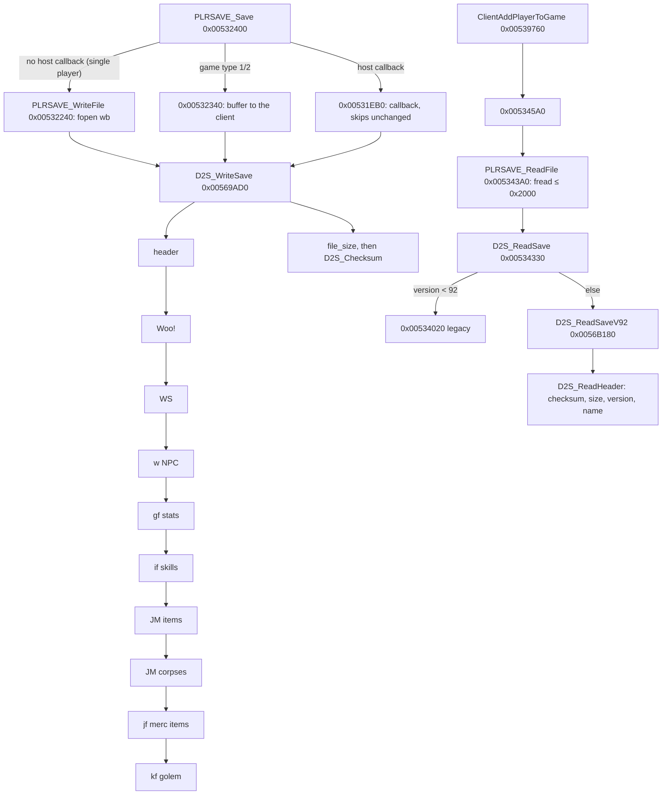

# 0001 — The `.d2s` writer and reader

> **Subsystem:** save/d2s
> **Question:** Which code writes and reads a `.d2s` save, and which runtime field does each persisted field come from and go back to?
> **Date:** 2026-10-12   **Plan:** 0013 (Phases 1–2)   **Status:** open (Phase 2 round trips done, [run:2026-10-12-d2s-io](experiments.md#run2026-10-12-d2s-io): the write path, header sources, `gf` stream, item common part, seed/ilvl/quality, checksum and size checks, map-seed reuse and the drop seed `[C]`; the rest `[I]`)

Phase 1 is a static reading; Phase 2 ([run:2026-10-12-d2s-io](experiments.md#run2026-10-12-d2s-io), logger
`tools/gdb/d2s-io.gdb`, checker `tools/d2sio.py`) confirmed the claims tagged with that run. Names of functions, structs and fields are ours. File offsets are those of
[d2s.md](../../formats/d2s.md); "header" means file bytes `0x000`–`0x14E`. The server-side code sits in two modules:
`.\PLAYER\PlrSave.cpp` (string `0x006E09AC`: file I/O, item lists, the old-format reader) and `.\PLAYER\PlrSave2.cpp`
(`0x006E11F0`: the version-96 writer and the version-92..96 reader). The item bitstream itself is item code
(`.\ITEMS\Items.cpp` neighbourhood, `0x0062xxxx`). "Client" is the server's per-connection client object (accessors
`0x005385xx`–`0x005392xx`, asserts in `.\GAME\Clients.cpp`); "player data" is `unit+0x14` of a player unit
(`0x006221A0` returns it); "item data" is `unit+0x14` of an item unit. All are partial types in
[re/types/save.h](../../../re/types/save.h).



## Answer (summary)

- [C] **Writer.** `fn:PLRSAVE_Save@0x00532400` serialises the client's player through `fn:D2S_WriteSave@0x00569AD0`
  into an 8 KiB stack buffer and, in a single-player game (no host callback `0x00883D50`, game type not 1 or 2),
  `fn:PLRSAVE_WriteFile@0x00532240` writes it with `fopen("%s%s.d2s", "wb")`. Sections are written in file order,
  then `file_size` (`+0x08`) = bytes written and `checksum` (`+0x0C`) is computed over the whole buffer with the
  checksum field still 0 from the header `memset`. *Save and Exit* in single player writes the file **twice**,
  byte-identical: first through `sub_0052CA10_SaveGameClients` (every client of the game), then through
  `sub_0052C900_SaveClients`. Every header field and item common-part field compared in the run equals its runtime
  source. (0x00569D2F–0x00569D38, run:2026-10-12-d2s-io)
- [C] **Checksum.** `fn:D2S_Checksum@0x00411130` (stdcall `(buf, len)`): `sum = 2·sum + byte + (sum < 0)` per byte,
  i.e. `rotl32(sum, 1) + byte`, from 0. The reader saves `+0x0C`, zeroes it, recomputes over the bytes read and
  returns internal error 6 on mismatch, then 5 if `file_size` ≠ bytes read; the failure exit maps both to 14
  (`g_D2sLoadErrorMap`) and the player is back at the main menu. Corroborated by data (23 samples), by the refused
  corrupt save of run:2026-10-11-d2s-edit and by the logged returns 6 and 5 of run:2026-10-12-d2s-io (the size test
  was hit with a correct checksum). Only codes 0, 5, 6 and 14 have been seen. (0x0056A0D2–0x0056A104,
  run:2026-10-11-d2s-edit, run:2026-10-12-d2s-io)
- [I] **Reader.** `fn:PLRSAVE_ReadFile@0x005343A0` reads at most `0x2000` bytes; `fn:D2S_ReadSave@0x00534330` rejects
  fewer than 8 bytes or a wrong magic (code 9), sends version < 92 to the legacy reader `0x00534020` and the rest to
  `fn:D2S_ReadSaveV92@0x0056B180`, whose header step `fn:D2S_ReadHeader@0x0056A090` accepts versions 92–96 only
  (else 7). Any failure is mapped through `data:g_D2sLoadErrorMap@0x006E1208` and makes
  `sub_00539760_ClientAddPlayerToGame` log `"[PLAYER LOAD] … Error Loading"` and fail the join. (0x00539760)
- [C] **The character-select screen does not verify the checksum**: the checksum routine has four callers, the
  writer, the server reader, the client stub writer `0x0043C6B0` and the client expansion converter `0x0043CAA0`;
  the select-screen readers of `"%s%s.d2s"` (`0x00431F70`, `0x0043C8A0`, `0x00478040`, `0x0045C520`) are not among
  them. Matches the corrupt `smpsor` shown at level 2 in run:2026-10-11-d2s-edit. (fn:D2S_Checksum@0x00411130,
  run:2026-10-11-d2s-edit)
- [I] **Bit I/O** (`fn:BITBUF_Write@0x00410EB0`, `fn:BITBUF_Read@0x00410F60`): LSB first within each byte, bytes in
  order; a width up to 32 per call; a write zeroes each new byte before OR-ing; an overrun sets a sticky error flag
  (`+0x10`) and the item serialiser then returns 0 bytes. Signed reads (`fn:BITBUF_ReadSigned@0x00411030`)
  sign-extend widths below 32.
- [C] **Header `level` is written from stat 12**, not kept from the file: `D2S_WriteHeader` stores the unit's stat 12
  at `0x2B`, and no reader step reads `0x2B`. run:2026-10-11-d2s-edit saw header level 2 rewritten as 1.
  (0x0056904D, run:2026-10-11-d2s-edit)
- [C] **`map_seed` is reused.** The writer stores `game+0x7C` (the map seed of [rng/0002](../rng/0002-seed-tree.md))
  at `0xAB`. The reader copies `0xAB` back into `game+0x7C` when the game type is 3 (single player), no `-seed`
  override is set (`game+0x84` = 0) and the save's difficulty byte for the game's difficulty has bit 7 set. Act
  creation follows the load in the join (`0x00530190` → `0x0052C210` → `0x0053AFB0` → `sub_0053AC70_ActCreate`), so
  such a game rebuilds the saved maps. In run:2026-10-12-d2s-io a `-seed 0` game (no override) saved its clock map
  seed, and the next load in the same process replaced its own clock map seed with it: both games built Act I from
  the same act seed. A save with bit 7 clear, and the same save under `-seed 7`, kept the game's own value.
  (0x0056A1FC–0x0056A217, run:2026-10-12-d2s-io)
- [C] **Item `seed`** (bits 111–142) is `unit+0x28`, the value the item unit's RNG was initialised from; the reader
  stores it back at `+0x28` and calls `RNG_SeedInit(unit+0x20, seed)`. For a dropped item that value is the game
  seed's low word after the step in `sub_00552DF0_UnitSeedInit` ([rng/0002 § Units](../rng/0002-seed-tree.md#units),
  [items/0001 §8](../items/0001-tc-resolution.md)). The item-data seed (`ItemData+0x04`) is not saved. Simple items
  carry no seed and load with `+0x28` = 0. Run: 16 distinct extended items over 8 writes and 5 loads, plus one Blood Moor drop
  whose `unit+0x28`, quality and ilvl logged at its creation are the saved seed, quality and ilvl after the pickup;
  loaded items get `+0x20` = `{seed, 666}`. The draw behind a server unit's `+0x28` is `[C]` in rng/0002. (0x006302CF,
  0x0062CD13–0x0062CD16, 0x0062AC3E–0x0062AC45, run:2026-10-12-d2s-io)
- [C] **Item `flags` bit 23** is ORed in by the serialiser on every item (`flags & ~0x80000 | 0x800000`), and bit 21
  comes from the item record's `compactsave` byte (`+0x143`) (bit 21 `[I]`: seen only on simple items). **Bit 13** is
  cleared on every item loaded from a save (`0x00558CB0`): every item that had it was written without it after a load.
  A drop has it **set at creation** and the same item, picked up, was saved with it **clear**: some step between the drop
  and the write cleared it (the writer only masks bit 19), so "created in this session" does not carry it into the save.
  What clears it there is read statically in §8 (plan 0015): the per-frame unit pass, not the pickup `[I]`; what the
  bit means is open. The 10-bit **`version`** is item data `+0x30`, set at creation from `game+0x78`: **101** in an
  expansion game (`[C]`, every item of the run, `game+0x78` = 101 logged); **2** in a classic one (`[I]`, no classic
  run). (0x006312D1–0x006312D6, 0x00631312, 0x00558D46–0x00558D4C, 0x00530D49, run:2026-10-12-d2s-io)
- [C] **Max life and mana are not recomputed at load.** Stats 7 and 9 keep the values read through `D2S_LoadFinish`,
  and the character screen shows stat 9 as the maximum (left box) while current mana (right box) regenerates. The
  `8002 / 1072` of run:2026-10-11-tc-drops was maximum / current. (fn:D2S_LoadFinish@0x0056AF80, run:2026-10-12-d2s-io)

## Leads used

- [L] src:d2s-community-format: used only through [d2s.md](../../formats/d2s.md)'s layout, to know which bytes to look
  for; every claim here was read from the code first. Cross-check verdicts on its byte-level claims are the
  archivist's (d2s.md). Two places where the code refines that doc's layout (simple items, waypoint width) go to the
  archivist through the backlog, not as verdicts on the source.

## Functions

| Address | Name | Role | Tag |
|---|---|---|---|
| `0x00410E40` | `BITBUF_Init` | `(ctx, buf, bytes)`: ptr, capacity in bits, byte count, bit position, error flag | I |
| `0x00410E90` | `BITBUF_GetSize` | bytes used, a partial byte counted | I |
| `0x00410EB0` | `BITBUF_Write` | `(ctx, value, nbits)` LSB first | I |
| `0x00410F60` | `BITBUF_Read` | `(ctx, nbits)` unsigned; an overrun is truncated and flagged | I |
| `0x00411020` | `BITBUF_ReadUnsigned` | jumps to `BITBUF_Read` | I |
| `0x00411030` | `BITBUF_ReadSigned` | read, then sign-extend when nbits < 32 | I |
| `0x00411070` | `BITBUF_AlignByte` | skip to the next byte boundary | I |
| `0x00411130` | `D2S_Checksum` | `rotl32(sum,1) + byte` over `(buf, len)` | C |
| `0x0043C540` | `sub_0043C540_StubBuild` | client: 335-byte header of a new character | I |
| `0x0043C6B0` | `sub_0043C6B0_StubWrite` | client: checksums and writes the stub | I |
| `0x0043CAA0` | `sub_0043CAA0_ConvertToExpansion` | client: sets status bit 5, re-checksums, rewrites | I |
| `0x0052C900` | `sub_0052C900_SaveClients` | saves one client, then the others in the game; second write of *Save and Exit* | C |
| `0x0052CA10` | `sub_0052CA10_SaveGameClients` | saves every client of the game (`+0x88` list); first write of *Save and Exit* | C |
| `0x0052D350` | `sub_0052D350_AutosaveTick` | hosted-only periodic save (10 s / 45 s timers) | I |
| `0x0052E9C0` | `sub_0052E9C0_SaveAllOnShutdown` | every client of every game, at server shutdown | I |
| `0x00530190` | `sub_00530190_SrvJoinAct` | join: load, then create the client's act | I |
| `0x00531EB0` | `sub_00531EB0_SaveViaCallback` | hosted save; skips an unchanged buffer | I |
| `0x00532240` | `PLRSAVE_WriteFile` | `"%s%s.d2s"`, `wb` | C |
| `0x00532400` | `PLRSAVE_Save` | save entry: picks client buffer, file or callback | C |
| `0x00534330` | `D2S_ReadSave` | magic, version dispatch | I |
| `0x005343A0` | `PLRSAVE_ReadFile` | `"%s%s.d2s"`, `rb`, ≤ `0x2000` bytes | I |
| `0x005345A0` | `sub_005345A0_PlayerLoad` | file (single player) or client buffer (types 1/2, hosted) | I |
| `0x00539760` | `sub_00539760_ClientAddPlayerToGame` | load, then status and class checks | I |
| `0x0056B180` | `D2S_ReadSaveV92` | section readers in order; error map | C |
| `0x00568DC0` | `sub_00568DC0_ItemRefFromId` | unit id → 1-based position in the inventory list | I |
| `0x00568E60` | `D2S_WriteMercHeader` | `0xAF`–`0xBE` | I |
| `0x00568F20` | `D2S_WriteHeader` | `0x000`–`0x14E` | C |
| `0x00569320` | `D2S_WriteQuests` | `Woo!` | I |
| `0x005693E0` | `D2S_WriteWaypoints` | `WS` | I |
| `0x00569490` | `D2S_WriteNpcs` | `01 77` | I |
| `0x00569540` | `D2S_WriteStats` | `gf` | I |
| `0x005696F0` | `D2S_WriteSkills` | `if` | I |
| `0x005697B0` | `D2S_WriteItemList` | `JM` list of an inventory | I |
| `0x005697F0` | `D2S_WriteCorpses` | corpse `JM` | I |
| `0x005699A0` | `D2S_WriteMercItems` | `jf` | I |
| `0x00569A00` | `D2S_WriteGolem` | `kf` | I |
| `0x00569AD0` | `D2S_WriteSave` | whole file; size and checksum | C |
| `0x00569D80` | `D2S_CheckStatus` | status word vs game: expansion, ladder, hardcore, dead, difficulty | I |
| `0x00569EC0` | `sub_00569EC0_DecodeSkillSlot` | `u16 skill|flag, u16 item ref` → skill, flag, ref | I |
| `0x00569F80` | `sub_00569F80_NewCharFromStub` | builds a new character for a stub | I |
| `0x0056A090` | `D2S_ReadHeader` | checksum, size, version, name, header fields | C |
| `0x0056A370` | `D2S_ReadQuests` | | I |
| `0x0056A3E0` | `D2S_ReadWaypoints` | | I |
| `0x0056A470` | `D2S_ReadNpcs` | | I |
| `0x0056A4F0` | `D2S_ReadStatsBits` | `gf` bitstream (version ≥ 95) | C |
| `0x0056A620` | `D2S_ReadStats` | dispatch; bitmask format for version ≤ 94 | I |
| `0x0056A710` | `D2S_ReadSkills` | | I |
| `0x0056A7E0` | `D2S_ReadItemList` | | I |
| `0x0056A830` | `D2S_ReadCorpses` | | I |
| `0x0056AA50` | `D2S_ReadMercHeader` | recreates the mercenary from `0xAF`–`0xBE` | I |
| `0x0056AC10` | `D2S_ReadMercItems` | | I |
| `0x0056AE50` | `D2S_ReadGolem` | | I |
| `0x0056AF80` | `D2S_LoadFinish` | gold clamps, life/mana restore, derived stats | I |
| `0x005316D0` | `sub_005316D0_WriteOneItem` | one item and its socketed items | I |
| `0x005317B0` | `ITEMS_WriteInventoryList` | `JM`, count, items | I |
| `0x005335E0` | `ITEMS_ReadInventoryList` | `JM`, count, items and their socketed items | I |
| `0x00558CB0` | `sub_00558CB0_ItemCreateFromSave` | creates the unit, reads, sets `0x80000`, clears `0x2000` | C |
| `0x0062A970` | `ITEMS_ReadCompact` | simple item | I |
| `0x0062AC80` | `ITEMS_ReadProperty` | one generic property | I |
| `0x0062AE20` | `ITEMS_PeekHeader` | flags, mode, position, code, `n_filled` before creating the unit | I |
| `0x0062AF80` | `ITEMS_WriteCompact` | simple item | I |
| `0x0062CBE0` | `ITEMS_ReadFull` | extended item | I |
| `0x0062E430` | `ITEMS_Deserialize` | `JM`, flags, then compact or full | I |
| `0x0062FFF0` | `ITEMS_WriteFull` | extended item | I |
| `0x006312B0` | `ITEMS_SerializeBits` | `JM`, flags, body, socketed items byte-aligned | C |
| `0x006313E0` | `ITEMS_Serialize` | `(item, buf, size, …)` → bytes or 0 | I |
| `0x00661030` | `WAYPOINT_Load` | 16 bytes in; forces waypoint 0 | I |
| `0x006610B0` | `WAYPOINT_Save` | 16 bytes out | I |
| `0x00483410` | `SETS_GetRecord` | `DataTables+0xC0C`, stride `0x128` | I |
| `0x00483440` | `SETITEMS_GetRecord` | `DataTables+0xC18`, stride `0x1B8` | I |
| `0x0045C4F0` | `ITEMSTATCOST_GetRecord` | ECX = id → record (stride `0x144`) or NULL (§8) | I |
| `0x0052D870` | `sub_0052D870_GameTick` | server game frame: frame counter `+0xA8`, per-frame passes (§8) | I |
| `0x0053B000` | `sub_0053B000_ActUnitsFrameReset` | for each flagged act, every unit of every room → `sub_00553220_UnitFrameReset` (§8) | I |
| `0x00553220` | `sub_00553220_UnitFrameReset` | clears per-frame unit flags; items: flags `0x20` and `0x2000` (§8) | I |
| `0x00559300` | `sub_00559300_DropGoldPile` | creates one `gld ` pile at a position, clears bit 13 (§8) | I |
| `0x0055A2A0` | `sub_0055A2A0_ItemCopy` | serialise, recreate, set bit 19, clear bit 13, also for socketed items (§8) | I |
| `0x006253B0` | `STATS_GetUnitBaseStat` | `(unit, id, param)`: base entries (`+0x24`) of the stat list at `unit+0x5C` | I |
| `0x00625480` | `STATS_GetUnitStat` | `(unit, id, param)`: the list's accumulated entries (`+0x48`) when its flags (`+0x10`) have bit 31, else the base entries | I |
| `0x00627F50` | `ITEMS_SetAutoAffix` | item data `+0x36` (§8) | I |
| `0x006280D0` | `ITEMS_SetFlag` | stdcall `(item, mask, set)`: OR or AND-NOT into item data `+0x18` | I |
| `0x0062AF50` | `BITBUF_WriteClamped` | ECX = bits, EDX = value, stack = buffer: `min((u32)value, 2^bits − 1)` unless 32 (§8) | I |

Data: `data:g_D2sLoadErrorMap@0x006E1208` (u32 per internal reader code), `data:g_WaypointBits@0x00746428`
(u16 word index, u16 mask, per waypoint), `data:g_MagicAffixInfo@0x0096CA7C` (merged affix array: `+0x04` base,
`+0x0C` first prefix, `+0x10` first automagic; returned by `0x00633ED0`).

## Walkthrough

### 1. When a save is written

- [I] `PLRSAVE_Save` (ECX = game, EDX = player unit) clears unit flag `+0xC8` bit 1, then: game type (`game+0x6A`) 1 or 2
  → `0x00532340` serialises with a 0x2000 cap and hands the buffer to the client object (`0x00538CE0`), no file; no host
  callback (`0x00883D50` = 0) → `PLRSAVE_WriteFile`; otherwise `sub_00531EB0_SaveViaCallback`. (0x00532400)
- [I] `sub_00531EB0_SaveViaCallback` compares the new buffer with the previous one with `checksum`, `last_played`
  (`0x30`), `unk_34` and `map_seed` masked to 0 in both, and skips the callback when nothing else changed. So those four
  fields are the ones that change without game progress. (0x00532001–0x0053210E)
- [I] Callers of `PLRSAVE_Save`: `sub_0052C900_SaveClients` (a leaving client and the rest, called from client
  removal `0x00539DA0`), `sub_0052E9C0_SaveAllOnShutdown` (`"Open server thread shut down"` caller), `0x0052E2A0`
  (game types 1/2, quest and act events: `a5q6.cpp`), `sub_0052D350_AutosaveTick` (only with a host callback: after
  10 s with a pending-change counter above 10, or 45 s, or a forced flag), and `0x0057FCA0` in `.\PLAYER\PlrModes.cpp`,
  which first sets client status bit 3 (`0x08`, dead) and then saves. No autosave runs in single player.
  (0x0052D3BA, 0x0057FD3F)
- [C] *Save and Exit* in single player: `PLRSAVE_Save` is called from `0x0052CA5F` in `sub_0052CA10_SaveGameClients`
  (walks the game's client list `game+0x88`, next `+0x4A8`) and then from `0x0052C940` in `sub_0052C900_SaveClients`;
  both reach `PLRSAVE_WriteFile` (return `0x005324F0`) and write the same bytes. Nothing was written during play in the
  runs. (fn:sub_0052CA10_SaveGameClients@0x0052CA10, run:2026-10-12-d2s-io)
- [I] A new character is not written by the server: the client builds a 335-byte header (`sub_0043C540_StubBuild`) and
  `sub_0043C6B0_StubWrite` writes it with a checksum over those 335 bytes. The stub has status bit 0 set, `level` 1,
  `0x29` = 16, `0x2A` = 30, `0x2C` = `0x30` = `time(NULL)`, and status bit 5 for class 5 or 6. (0x0043C568–0x0043C5D0)

### 2. Header (`D2S_WriteHeader` 0x00568F20 / `D2S_ReadHeader` 0x0056A090)

The writer `memset`s a 0x14F-byte image, fills it, copies it to the output. Fields it does not set stay 0.

| offset | written from | read into | tag |
|---|---|---|---|
| `0x000` | `0xAA55AA55` | checked by `D2S_ReadSave` (code 9) | C (write), I (read) |
| `0x004` | 96 | must be 92..96, else 7; < 92 goes to the legacy reader | C (write), I (read) |
| `0x008` | bytes written | must equal bytes read, else 5 | C |
| `0x00C` | `D2S_Checksum` | verified, else 6 | C |
| `0x010` | bit 0 = client `+0x45C` ≠ 0 (weapon switch) | bit 0 → client `+0x45C` | I |
| `0x014` | client name (`+0x0D`, NUL within 16 bytes required) | `0x23` forced to 0, then `_stricmp` with the client's name, else 7 | C (write), I (read) |
| `0x024` | u32 = client `+0x0A` (u16 status word) `\| 0x20` if expansion game `\| 0x40` if ladder game (`game+0x74`) | low u16 → client `+0x0A` after `D2S_CheckStatus` | C (expansion, not ladder) |
| `0x028` | client `+0x08` (class) | unsigned u8 > 7 → the read fails with error code 4 (`ja` at `0x0056A174` → the shared error exit `0x0056A0C4`–`0x0056A0CF`: `mov eax, 4` at `0x0056A0C6`, `ret 0xC`; no clamp, the class is not set); ≤ 7 → client `+0x08`, class of the new player unit | C (write and ≤ 6 read), I (> 7) |
| `0x029` | constant 16 | stat-slot count for the version ≤ 94 stat reader only | C (write), I (read) |
| `0x02A` | `DataTables+0xBA8` (30, skills per class) | number of skill bytes `D2S_ReadSkills` reads | C (write), I (read) |
| `0x02B` | stat 12 (`0x00625480(unit, 12)`) | not read | C |
| `0x02C` | client `+0x488` | → client `+0x488` (an edited `0x0BADF00D` was read and written back) | C |
| `0x030` | `time(NULL)` | not read | C (write), I (read) |
| `0x034` | constant `0xFFFFFFFF` (`0x005385C0`) | not read | C (write), I (read) |
| `0x038` | 16 × (u16 skill `\| 0x8000` if the slot flag, u16 item ref) from client hotkey slots (`0x005390D0`) | decoded by `0x00569EC0` (`0xFFFF` = empty, skill = `& 0xFFF`, ref 0 = none) → `0x005390A0` | I |
| `0x078` | (u16 skill, u16 item ref) of the left skill (`0x00620190`) | → player data `+0x74` / `+0x7C` | C (skill id, ref 0) |
| `0x07C` | the same for the right skill (`0x006201D0`) | → `+0x70` / `+0x78` | C |
| `0x080` | swap-set skill A (`0x00623220`) | → `+0x84` / `+0x8C` | I |
| `0x084` | swap-set skill B (`0x00623290`) | → `+0x80` / `+0x88` | I |
| `0x088` | 16 graphics bytes (`0x0063E510`, default `0xFF`) | not read by the server | I |
| `0x098` | 16 colour bytes (same call) | not read by the server | I |
| `0x0A8`+`d` | only the game's difficulty `d` (`game+0x6D`): client act (`+0x1AC`) `\| 0x80`; the other two bytes 0 | `b & 0x7F` → client act (≥ 5 → 0); `b & 0x80` gates the map-seed reuse | C (Normal, act 0) |
| `0x0AB` | `game+0x7C` (map seed) | → `game+0x7C` if game type 3, `game+0x84` = 0 and `b & 0x80` | C |
| `0x0AF` | u32: 0, bit 16 if the mercenary is dead | bit 16 = dead flag of the recreated mercenary | I |
| `0x0B3` | mercenary seed (`merc info+0x00`) | creation seed of the mercenary | I |
| `0x0B7` | mercenary name id − hireling record `+0x114` (u16) | + `+0x114`, reset to `+0x114` if above `+0x116` | I |
| `0x0B9` | hireling id (`merc info+0x08`, u16) | record looked up by id (`0x006562F0`) | I |
| `0x0BB` | mercenary stat 13 (experience) | stat 13; mercenary level = highest level whose experience threshold it reaches | I |
| `0x0CF` | client `+0x480` | → client `+0x480` (`+0x481`, `+0x482` set to 0) | I |

The `C` rows are confirmed by run:2026-10-12-d2s-io (every write compared with the logged runtime source; the read
side by the logged client and player-data fields after `D2S_ReadHeader`); "write"/"read" marks which side the run
covers, and a qualifier names the only case seen.

- [I] **Status word** (`0x024` u16, client `+0x0A`), from `D2S_CheckStatus` and `D2S_ReadHeader`: bit 0 = new
  character (stub): the reader clears it and, if the file ends at the header, builds a fresh character
  (`sub_00569F80_NewCharFromStub`) instead of reading sections; bit 2 = hardcore, must match the game's hardcore flag
  (`0x0053FD40() & 0x800`, codes 11/12); bit 3 = dead, refused if hardcore (code 10); bit 5 = expansion, must match
  `game+0x70` (codes 8/9); bit 6 = ladder, checked only with a host. Bits 8–12 (`progression & 0x1F`) gate the
  difficulty: Nightmare needs ≥ 5 in an expansion save, ≥ 4 in a classic one; Hell needs ≥ 10 / ≥ 8 (codes 13/14).
  The load test of the fifth session of run:2026-10-11-tc-drops (progression 5: Nightmare open, Hell greyed) is
  consistent; its menu is client code not read here. (0x00569D80)
- [I] **`unk_26`** is the high half of the u32 at `0x024`, always 0 (the client word is zero-extended). (0x00569012–0x0056901B, fn:D2S_WriteHeader@0x00568F20)
- [I] **`unk_29`** is two bytes: `0x29` = 16 (constant) and `0x2A` = 30 (`DataTables+0xBA8`). Neither is a version. (0x00569091–0x005690AA, 0x0056A620, 0x0056A710)
- [C] **`unk_2c`** is a pass-through: the reader stores it at client `+0x488`, the writer writes it back (an edited
  `0x0BADF00D` survived two load/save cycles, run:2026-10-12-d2s-io), and no other
  instruction touches `+0x488` (the only two are the accessors `0x00538760`/`0x00538790`). A stub never reaches that
  read (the new-character path returns first), so a character's first full save writes the client's initial value: 0
  in every sample. The stub's value is the client's creation time.
- [I] **`unk_34`** is written as the constant `0xFFFFFFFF` and never read. (0x00569077, fn:D2S_ReadHeader@0x0056A090)
- [I] **`unk_bf`**: only `0xCF` is written (client `+0x480`, a byte read back on load); `0xBF`–`0xCE` and `0xD0`–`0x14E`
  stay 0 and are not read. The meaning of client `+0x480`–`+0x482` is not resolved; `0x0052C900` and `0x0052CA10` pass
  them to the host callback.
- [C] **`difficulty`**: one byte per difficulty, bit 7 = "saved while playing this difficulty", bits 0–6 = act index.
  A save made in Nightmare in act 1 holds `00 80 00` (normal's byte becomes 0). That is what the load test of
  run:2026-10-11-tc-drops (fifth session) used. run:2026-10-12-d2s-io: a load of `00 00 00` in Normal saved
  `80 00 00` (only Normal, act 0 seen; the Nightmare and act cases rest on the earlier load test and the code).
- [C] **Right mouse skill** at `0x07C`: run:2026-10-11-tc-drops (fifth session) set `0x07C` = 154 (War Cry) and the
  right button cast it. (0x0056A2D0, run:2026-10-11-tc-drops)

### 3. Quests, waypoints, NPCs

- [I] `Woo!`, u32 6, u16 `0x12A`, then three 96-byte blocks copied from the quest records at player data `+0x10`,
  `+0x14`, `+0x18` (`0x0065C560`, size asserted 0x60). On load (`0x0065C4D0`) each 16-bit quest word of a block gets
  bits 13 and 14 cleared and bit 15 set when bit 1 is set (42 words, 0–41; **(corrected 2026-10-13)** from 43: the loop
  ends at `cmp esi, 0x2AE`, 0x0065C547). Block *d* is difficulty *d* (`+0x10 + 4·game[+0x6D]`); the words that open
  the act tabs and a write recipe are in [save/0002](0002-quest-words.md). (0x00569320, 0x0056A370)
- [I] `WS`, u32 1, u16 `0x50`, then three 24-byte blocks: 16 bytes copied from the waypoint records at player data
  `+0x1C`, `+0x20`, `+0x24` (`WAYPOINT_Save`) and 8 bytes never written. Each record is a u16 marker `0x0102` and seven
  u16 words: waypoint *n* (< 112, asserted) is word `1 + n/16`, mask `1 << (n % 16)` (`g_WaypointBits`), i.e. bit *n*
  LSB-first from block byte `+0x02`; the field is 14 bytes, not 5. The reader accepts a marker `0x0102`, `0x0101` or 0
  (else code 16): with 0 or `0x0101` it zeroes the record. Then it **forces waypoint 0 on**. Slot *d* is difficulty *d*: gameplay takes
  `+0x1C + 4·game[+0x6D]` (`fn:sub_00547F50_PlayerWaypointRecord@0x00547F50`, [save/0002](0002-quest-words.md)). (0x005693E0, 0x0056A3E0, 0x00661030–0x006610A8)
- [I] `01 77`, u16 `0x34`, then 3 × 8 bytes (first record of player data `+0x60 + 4·d` slot, `0x00572520`) and 3 × 8
  bytes (second record, `0x00572530`), d = 0, 1, 2; the reader copies them back (`0x00572540`/`0x00572550`).
  (0x00569490–0x0056952B, 0x0056A470)

### 4. Character stats (`gf`)

- [C] **Writer** (`D2S_WriteStats`): the player's base stat list (`unit+0x5C`, `0x00625C90`, up to 512 entries of
  `{u16 param, u16 id, s32 value}`) in list order. An entry is skipped when its id is out of range or its
  `ItemStatCost` record has `CSvBits` (`+0x0A`, u8) = 0. Otherwise: id (9 bits), the param in `CSvParam` (`+0x0B`)
  bits if non-zero, the value in `CSvBits` bits. Before writing, a value is clamped when `CSvBits` < 32: unsigned
  stats (record byte `+0x05` bit 5 clear) to `[0, 2^bits − 1]`, signed ones to `[−2^(bits−1), 2^(bits−1) − 1]`.
  **(precised 2026-10-13)** The clamp is inline and compares the value as a signed s32 (`jg`/`jl`/`jge`); it does not
  call `fn:BITBUF_WriteClamped@0x0062AF50`, which compares as u32. So a negative value of an unsigned stat is written as
  0 here (`setle cl; sub ecx, 1; and esi, ecx` at 0x0056965B–0x00569661), where the item writer's clamp writes
  `2^bits − 1`. A signed value is written in two's complement, low `CSvBits` bits (`BITBUF_Write` masks each chunk).
  The param is written as its u16, unclamped, in `CSvParam` bits. `CSvBits` ≥ 32 skips the clamp (`cmp cl, 0x20; jae`
  at 0x00569610). (0x00569605–0x00569698)
  Then `0x1FF` (9 bits) and padding to a byte. There is no zero test in the writer: a stat absent from the base list
  is absent from the file. Run: the `gf` list of 8 writes equals the logged base list (11 and 13 stats, no param, no
  clamp hit). (0x00569540–0x005696DF, run:2026-10-12-d2s-io)
- [C] **Reader** (`D2S_ReadStatsBits`, version ≥ 95): id = 9 bits unsigned; `0x1FF` ends; an id ≥ count or with
  `CSvBits` = 0 fails (code 18); param = `CSvParam` bits read **signed**; value = `CSvBits` bits, signed when
  `CSvBits` < 32 and `+0x05` bit 5 is set, else unsigned; `SetStat(unit, id, value, param)` (`0x00627260`). The value is
  stored as is: life, mana and stamina keep their 8 fraction bits. Run: the `SetStat` calls of 5 loads equal the
  file's list in order (no param, no signed stat, no error code seen: those parts stay `[I]`). (0x0056A4F0,
  run:2026-10-12-d2s-io)
- [I] **`.bin` vs `.txt`** (backlog D2S (a)): both functions read only the in-memory record at
  `DataTables+0xBCC + 0x144·id` (count `DataTables+0xBD4`). Under `-txt` that record is compiled from `.txt` by the same
  loader into the same layout ([data/0001](../data/0001-excel-loader.md)), so the save code cannot tell them apart.
  The data check of d2s.md (0 `CSvBits` mismatches over 359 records) is the corroboration still missing for `[C]`.
  (fn:D2S_WriteStats@0x00569540, fn:D2S_ReadStatsBits@0x0056A4F0, fn:DATATBLS_LoadTable@0x006122F0)
- [I] **After the item lists** (`D2S_LoadFinish`): gold (14) is set to 0 if negative or above the level's maximum
  (`0x00622E70`), the same for goldbank (15) against `0x00623460`; stamina (10) = `0x00625DB0` (the maximum); then
  stats 6 and 8 are set back to the values read before items were attached; 67, 68, 69 = 100; 30 (`nextexp`) =
  experience table at level + 1. Stats 7 and 9 (max life, max mana) are **not** recomputed by any reader step: `[C]`,
  stat 9 = `8000 << 8` from an edited save was unchanged at the entry and exit of `D2S_LoadFinish`, shown as the
  maximum in game and saved unchanged (run:2026-10-12-d2s-io). The clamps and the other stat writes stay `[I]`.
  (0x0056AF80)
- [I] The old format (version ≤ 94, `D2S_ReadStats`): a bitmask of `hdr[0x29]` bits, then one u32 per set bit, for
  stats 0..n−1. Not written by 1.14d. (0x0056A620)

### 5. Skills (`if`)

- [I] `if`, then one byte per skill of the class, in the class's skill list order (`0x006460F0(class, i)`, count
  `0x00646140(class)`): the unit's base level of that skill. The reader takes `hdr[0x2A]` bytes and sets each non-zero
  one (`0x0056DEB0`). (0x005696F0, 0x0056A710)

### 6. Item lists

- [I] `ITEMS_WriteInventoryList`: `JM`, u16 count, then each item of the inventory list through
  `sub_005316D0_WriteOneItem`. Items in the two hand slots (body 4, 5) of the equipped list and the cursor item are
  written after the others; an item `ITEMS_Serialize` refuses (unit `+0xC8` bit 15) is dropped and the count lowered.
  Socketed items follow their parent, each starting on a byte boundary (`BITBUF_AlignByte`), and are not counted.
  (0x005317B0, 0x006312B0)
- [I] Corpses: `JM`, u16 count (0 or 1; ≥ 2 is refused, error `0x68`), and per corpse 12 bytes (a u32 not resolved,
  then two u32 from the position getters `0x0045ADF0`/`0x0045AE20`) and an item list. (0x005697F0, 0x0056A830)
- [I] `jf` is written only in an expansion game; the mercenary's item list follows only when a mercenary exists
  (pet type 7). `kf` (expansion only) is followed by a byte = 1 when the player owns a pet of type 3 whose class is 291
  (`irongolem`) and that golem holds an item; the item follows. (0x005699A0, 0x00569A00, 0x0056AE50)

### 7. One item (`ITEMS_SerializeBits` → `ITEMS_WriteFull` / `ITEMS_WriteCompact`)

Common part, written by `ITEMS_SerializeBits` and the first lines of `ITEMS_WriteFull`; every value is clamped to its
width before writing:

| bits | field | runtime source → load target | tag |
|---|---|---|---|
| 16 | `JM` | constant; read signed and compared | I |
| 32 | `flags` | item data `+0x18` `& ~0x80000 \| 0x800000`, `\| 0x200000` if record `compactsave`; → `+0x18` (bit 25 stripped, bit 19 cleared) | C |
| 10 | `version` | item data `+0x30` → `+0x30` (`0x0062A6C0`) | C |
| 3 | `location` | unit mode `+0x10` → `0x00624690` | C (modes 0, 1, 2) |
| 4+4+4+3 | `body`, `x`, `y`, `store` | body `+0x44`, grid position, `store` = inventory page (`+0x45`) + 1 → the same | C (`body`, `store`), I (`x`, `y`) |
| 16+16 | `x`, `y` | instead of all four fields above (no `body`, no `store`), for mode 3 (ground) or 5 (dropping): world position; same in `ITEMS_WriteCompact` and `ITEMS_PeekHeader` (§8) | I |
| 32 | `code` | item record code (`0x00628590`) → record index by code (`0x00633680`); for a simple item with flags bit 16 (ear) the ear fields replace it (§8) | C |
| 3 | `n_filled` | number of socketed items (`0x0062A900`) → how many items the list reader takes after this one | I |

`C` rows: run:2026-10-12-d2s-io compared each with the logged runtime item over 8 writes (14 or 11 items each,
no socketed item) and each load target over 5 loads.

- [I] **Simple items** (`ITEMS_WriteCompact`) stop after `code` (or the ear fields), then: for gold (type 4) a
  1-bit "> 4095" flag and the amount; for a quest item with `questdiffcheck`, stat 356 in its `Save Bits`; and the
  1-bit realm flag (97 bits when set). They have **no `n_filled`**: the peek reader `ITEMS_PeekHeader` reads `n_filled`
  only when flags bits 21 and 25 are clear. Bit 108 of a simple item is therefore the realm flag, not `n_filled`. On
  load a simple item gets seed 0, ilvl 1 and quality 2 (`[C]` for the load values: 5 simple items per load in
  run:2026-10-12-d2s-io). (0x0062AF80, 0x0062AF1F, 0x0062AC3E–0x0062AC45)

Extended part (`ITEMS_WriteFull` with the save flag set; `ITEMS_ReadFull` mirrors it):

| field | width | runtime source → load target | tag |
|---|---|---|---|
| `seed` | 32 | `unit+0x28` → `+0x28`, and `RNG_SeedInit(unit+0x20, seed)` | C |
| `ilvl` | 7 | item data `+0x2C`, clamped to 1..99 → `+0x2C` (min 1) | C (1 and 99 seen) |
| `quality` | 4 | item data `+0x00` (2 if no item data) → `+0x00` | C (1, 2, 4, 7) |
| `has_gfx`, `gfx` | 1, 3 | `0x0062E8D0` (variable graphics), item data `+0x49` | C (`gfx`), I (`has_gfx`) |
| `has_class`, `class_affix` | 1, 11 | `has_class` = item data `+0x36` ≠ 0 (an automagic affix was rolled at creation, §8); `class_affix` = `+0x36` minus the automagic base of `g_MagicAffixInfo` when above it; the reader adds the base back to a non-zero value | I |
| quality fields | below | | I |
| `runeword` | 16 | flags bit 26: `Runes` record (`0x0062BED0`) `+0x82` (u16), `0xFFFF` if none → item data `+0x38` | I |
| ear / `pname` | | flags bit 16: class 3, level 7 (`+0x48`), name; else bit 24: name, 7 bits per char incl. the 0 (`+0x4A`). The ear branch here serves only an ear that is not `compactsave`; the shipped `ear` is, so ears take the simple-item form (§8) | I |
| `realm` | 1 (+96) | save only: `0x00629E40` pair; 1, u32, u32, u32 0 when present | I |
| armor | | `ItemIsType(50)`: stat 31 `armorclass`, then 73 `maxdurability`, then 72 `durability` if 73 ≠ 0; each `Save Bits` wide, value + `Save Add`, no `ValShift` (§8) | I |
| weapon | | `ItemIsType(45)`: 73, then 72 if 73 ≠ 0, encoded as for armor | I |
| gold | 1 + 12/32 | `ItemIsType(4)`: stat 14; flag = amount ≥ 4096, then 12 or 32 bits, no `Save Add` | I |
| `quantity` | 9 | stackable (`0x006289F0`): stat 70, fixed width 9, no `Save Add` | I |
| `sockets` | `Save Bits`[194] | flags bit 11: base stat 194, no `Save Add` → `0x0062BE00` | I |
| `set_lists` | 5 | quality 5: bit *i* set when the item holds the stat list of set state `0x006E90B8[i]` | I |
| property lists | | main list (state 0, flag `0x40`), then the set lists, then the runeword list (state 171) | I |

Quality fields: 1 and 3 → 3 bits (`0x00629DA0`, the quality-specific index); 4 → prefix 11, suffix 11; 5 and 7 → 12
bits (`0x00629DA0`; < 0 written as `0xFFF`); 6 and 8 → `name1` 8, `name2` 8, then three pairs (prefix slot
`+0x38/+0x3A/+0x3C`, suffix slot `+0x3E/+0x40/+0x42`), each a present bit and 11 bits; 9 → `name1`, `name2` only; any
other value is written as 2 (normal), and normal items of type 13 (`charm`) carry 1 + 11 bits, of type 40 (`body`,
not 7) 10 bits, of types 18/22 (`book`/`scroll`) 5 bits. A magic, set, unique, rare or crafted field is written only
when the item is identified (flags bit 4) or the save flag is set, so in a save always. (0x0063048F)

- [I] **Affix ids** are stored relative to their block of the merged affix array: a non-zero prefix id is stored as
  `id − firstPrefix`, and the reader adds `firstPrefix` back; suffix ids are stored and read unchanged. The rare/crafted
  pairs are therefore **prefix, suffix** alternately (writer and reader agree). Which table rows these ids index is
  `items/affixes` (backlog D2S (e)). (0x0062CEEA, 0x0062CFBA, 0x0062D0A3)
- [I] **Unique and set ids.** A unique id ≥ the unique count (`DataTables+0xC28`) loads as −1. A set id (version ≥ 93)
  is looked up with `SETITEMS_GetRecord(id)` and the item gets that record's `+0x00` (s16); no record fails the item.
  (0x0062D0DC–0x0062D103, 0x0062D11C–0x0062D1A1)
- [I] **Runeword field** (backlog D2S (d)): the 16 bits are one u16, the `+0x82` field of the item's `Runes` record;
  d2s.md's (159, 5) is `0x509F` = 20639 read as 12 + 4 bits. What `+0x82` holds (a string index in the `20000` block
  is the obvious candidate) is for `items/sockets-runewords`. The reader stores the u16 at item data `+0x38`.
  (0x00630887, 0x0062D1CB)
- [I] **Not saved, rebuilt on load**: weapon damage (stats 21–24, 159, 160 from the item record, ×3/4 for low quality,
  ×3/2 when `0x0062A8D0` holds), speed (67/68 = −record `speed`), block (20 from record `block`). (0x0062D397–0x0062D6B7)

#### Property lists

- [I] Writer, per list: for each stat with `Save Bits` (`+0x19`) ≠ 0 and `value >> ValShift` (`+0x18`) ≠ 0: id (9
  bits); then, for the grouped ids, that value and the next ids' values from the same list with no id of their own:
  17 (+18), 48 (+49), 50 (+51), 52 (+53), 54 (+55, +56), 57 (+58, +59); for every other id the param in `Save Param
  Bits` (`+0x24`) bits if non-zero and the value. Each value written is `(value >> ValShift) + Save Add` (`+0x1C`),
  then `min(as u32, 2^bits − 1)`, so a negative sum saturates to all ones (§8). A list ends with `0x1FF`.
  Followers, the shift kind and the fixed fields: §8. (0x00630E3B–0x00631245)
- [I] Reader (`ITEMS_ReadProperty`): `value = (read(Save Bits) − Save Add) << ValShift`, param = `Save Param Bits`
  bits. The grouped ids are read as above; after the 57 group it also sets stat 326 (`poison_count`) = 1, which is
  never written. For saves of version < 93 it uses `1.09-Save Bits` (`+0x1A`) and `1.09-Save Add` (`+0x20`) instead,
  and a series of per-id width overrides for older versions. (0x0062AC80, 0x0062D9AE–0x0062E1A9)
- [I] The record offsets `+0x18` = `ValShift`, `+0x1A` = `1.09-Save Bits`, `+0x20` = `1.09-Save Add` are each the only
  candidate `python3 -I tools/excel_bin.py probe … itemstatcost` reports for those columns; the code reads them at those
  offsets. `+0x0B` (`CSvParam`) and the `CSvSigned` flag (`+0x05` bit 5) are where the code reads them; the data cannot
  place them (blank columns). (fn:ITEMS_ReadProperty@0x0062AC80, 0x0056A4F0)

### 8. Plan 0015 Phase 3: framing details and item flag bit 13

Static reading (plan 0015 Phase 3), answering the spec-writer's 2026-10-12 entry. Writer and reader agreeing is
noted, but promotes nothing.

**Property-list framing** (`ITEMS_WriteFull` `0x0062FFF0`, list loop `0x00630E3B`–`0x0063125C`):

```c
// per list (trimmed). written[] is a 511-entry int array, memset 0 per list (0x00630E53)
for each (param, id, value) in the list (0x00625C90, up to 511):
    rec = ItemStatCost[id];
    if (rec.SaveBits == 0) continue;
    v = value >> rec.ValShift;                  // sar: arithmetic (0x00630ED9)
    if (v == 0 || v == written[id]) continue;   // 0x00630EDB, 0x00630EE5
    Write(id, 9);
    switch (id) {
      case 17: Write(clampU(v + rec.SaveAdd, rec.SaveBits));
               f = GetStat(list, 18, 0);  written[18] = f;            // raw value, no ValShift
               Write(clampU(f + ISC[18].SaveAdd, ISC[18].SaveBits)); break;
      case 48, 50, 52: likewise with one follower (49, 51, 53);
      case 54, 57:     likewise with two followers (55, 56 / 58, 59);
      case 326:        nothing more (id 326 has SaveBits 0 in the shipped table, so it never gets here);
      default:         if (rec.ParamBits > 0) Write(clampU(param, rec.ParamBits));
                       Write(clampU(v + rec.SaveAdd, rec.SaveBits));
    }
clampU(x, n) = (n == 32) ? x : min((u32)x, 2^n − 1)      // BITBUF_WriteClamped 0x0062AF50 and inlined copies
```

- [I] **A follower present without its head** (18, 49, 51, 53, 55, 56, 58, 59 in a list that lacks 17, 48, 50, 52,
  54, 57) is written as an ordinary property: its own 9-bit id, its param if `Save Param Bits` > 0, and its value.
  `written[]` is set only when a head writes its followers, so the skip test does not catch it; the follower ids take
  the `default` path (`0x006311B2`). The reader's id switch (`0x0062D99C`, table `0x0062E2CC`/`0x0062E330`) has
  cases for 17, 48, 50, 52, 54 and 57 only, so it reads such a follower through the default `ITEMS_ReadProperty`
  (`0x0062E1A1`).
- [I] **A follower missing from the list** while its head is present: the head writes `GetStat(list, follower, 0)`,
  which is 0 for an absent stat, so the field holds `clampU(0 + Save Add)` of the follower (0 for every follower in
  the shipped table). Followers are written raw, without `ValShift` (all eight have `ValShift` 0 in the shipped table).
  A follower that is also in the list with the same value is skipped when its own entry comes up (`written[]`).
  (0x00630F5B–0x00630FA3, 0x0063105D–0x006311AB)
- [I] **`>> ValShift` is arithmetic** (`sar edi, cl` at `0x00630ED9`, on the s32 value); the zero test is on the
  shifted value.
- [I] **Clamp.** Every width-limited write in the item writer is `min((u32)x, 2^n − 1)` (n < 32): a value that is
  negative as an s32 saturates to `2^n − 1`, it is not clamped to 0. (fn:BITBUF_WriteClamped@0x0062AF50, 0x00630F38–0x00630F4E)
- [I] **Fixed fields** (`0x00630A19`–`0x00630CF3`), each through the stat's `ItemStatCost` record but **without
  `ValShift`**:
  - armor (`ITEMS_UnitIsType(50)`): `armorclass` = `STATS_GetUnitBaseStat(item, 31)` + `Save Add`[31] in `Save Bits`[31]
    bits (11 and 10 in the shipped table, so the format doc's `Save Add` decoding is the game's); `maxdurability` =
    base stat 73 + `Save Add`[73] in `Save Bits`[73]; if that base stat ≠ 0, `durability` = `STATS_GetUnitStat(item, 72)`
    + `Save Add`[72] in `Save Bits`[72].
  - weapon (`ITEMS_UnitIsType(45)`, when not armor): 73, then 72 if 73 ≠ 0, the same encoding.
  - gold (`ITEMS_UnitIsType(4)`, when neither): 1 bit `stat 14 ≥ 0x1000`, then stat 14 in 12 bits, or 32 when the
    bit is set (`0x00630C2F`–`0x00630C44`); no `Save Add`.
  - `quantity` (stackable, `0x006289F0`): `STATS_GetUnitStat(item, 70)` in a fixed 9 bits, no `Save Add` (stat 70
    has `Save Bits` 0).
  - `sockets` (flags bit 11): `STATS_GetUnitBaseStat(item, 194)` in `Save Bits`[194] bits (4), **no** `Save Add`.

**Item fields:**

- [I] **`has_class`** is 1 exactly when item data `+0x36` ≠ 0 (`0x00630408`–`0x0063043A`). `+0x36` is written by
  `ITEMS_SetAutoAffix` (`0x00627F50`): 0 at the start of `sub_00557450_ItemCreateByQuality` (`0x0055748B`), then, when
  the item version is ≥ 100 (`sub_0062A670_ItemGetVersion`, an expansion item) and the quality is 1, 2, 3, 4, 6, 8 or
  9 (switch `0x005579B3`, table `0x00557A58`: not 5 set, not 7 unique), the base record's `auto prefix` (`+0x0F8`) ≠ 0
  and the roll `0x005C1940` returns a non-zero affix, that affix (`0x005579F2`). The reader also writes it
  (`0x0062CE57`, 0 at `0x0062CE6D`). So a classic item, a set or unique item, or a base without `auto prefix` has
  `has_class` 0. The roll itself is `items/affixes`.
- [I] **Modes 3 and 5 write no `body` and no `store`.** After the 3-bit mode, mode 3 or 5 jumps to the 16-bit `x`
  and 16-bit `y` (`0x0063008E`/`0x0063009C` → `0x006301EB`); only other modes write `body` 4, `x` 4, `y` 4, `store` 3.
  `ITEMS_WriteCompact` does the same (`0x0062B015`/`0x0062B01E`) and `ITEMS_PeekHeader` reads it the same way
  (`0x0062AE82`–`0x0062AEE5`).
- [I] **Ear fields sit in place of `code`.** `ITEMS_WriteCompact` writes, when flags bit 16 is set, class 3 bits,
  level 7 bits and the name in 7-bit characters including the terminating 0, **instead of** the 32-bit code
  (`0x0062B1D3`); `ITEMS_PeekHeader` then takes the code `'ear '` without reading 32 bits (`0x0062AEE9`–`0x0062AEF1`)
  and reads no `n_filled` (bit 21 is set). The shipped `ear` record has `compactsave` 1, so a save's ears always take
  this form. The ear branch after the runeword field in `ITEMS_WriteFull` serves only a non-`compactsave` item with
  bit 16, which the shipped data has none of. (Same place: a code `nec ` read from a save of version ≤ 92 is
  replaced by `neg `.)
- [I] **`D2S_ReadMercHeader` runs after the corpses**: the reader order is header, quests, waypoints, NPCs, stats
  (then stats 6 and 8 are kept), skills, item list, corpses, `D2S_ReadMercHeader(hdr + 0xAF)` (`0x0056B313`), the
  mercenary items (`0x0056B32D`, given the mercenary it returned), `0x005726C0(1)` when a mercenary exists, golem,
  `D2S_LoadFinish`. It reads the saved header bytes, not the stream, and its result is not checked for an error.
  (fn:D2S_ReadSaveV92@0x0056B180)

**Item flag bit 13** (the four clear sites through `ITEMS_SetFlag` `0x006280D0`, stdcall `(item, mask, set)`):

| site | function | reached from | what the item is |
|---|---|---|---|
| `0x00553351` | `sub_00553220_UnitFrameReset` (EDX = unit; for an item it clears flags `0x20` and `0x2000`) | `sub_0053B000_ActUnitsFrameReset` (`0x0053B044`), from the server game tick `sub_0052D870_GameTick` (`0x0052D900`): for each act at `game+0xBC + 4a` whose dword `+0x00` is non-zero, every room from `act+0x10` along `room+0x7C`, every unit along `room+0x1C`/`unit+0xE0`; then `act+0x00` = 0. The other two callers (`0x00554924`, `0x00554B62`) pass a monster (their unit-type case 1) | any item unit in a room's unit list: an item on the ground |
| `0x00559482` | `sub_00559300_DropGoldPile` | after `sub_00558D90_ItemCreate` of `gld ` at a room position; called from `0x0054F8C0` (a handler-table entry at `0x00731C30`, which drops 1–9 piles) | a new gold pile |
| `0x0055A360` | `sub_0055A2A0_ItemCopy` | serialise (`ITEMS_Serialize`) then recreate (`sub_00558CB0_ItemCreateFromSave`); callers in `.\PLAYER\PlrTrade.cpp`, `.\UNIT\SUNITNPC.CPP`, `.\PLAYER\PlrModes.cpp` code and others (13 call sites) | the copy |
| `0x0055A438` | `sub_0055A2A0_ItemCopy` | same, for each socketed item of the copy | each socketed copy |

- [I] **Set sites**: `sub_00558D90_ItemCreate` sets bit 13 when its create parameters have `+0x2C` = 0
  (`0x00558E95`–`0x00558EA3`), which is how a drop gets it; `0x005A31F4` (in `0x005A30E0`, after a `sub_0055A2A0_ItemCopy`)
  sets it on another item, not followed.
- [I] **The pickup is ruled out as the clearer; the ground pass is the site.** None of the four sites is on a pickup
  path: two are item copies, one is a gold-pile spawn, and `sub_00553220_UnitFrameReset` reaches items only through
  the per-frame walk over room unit lists. A drop lies in a room until it is picked up, so the first game-frame pass
  over its act clears bit 13; an item created into an inventory (starting items, cube outputs) is in no room list and
  keeps it, which matches the samples. Not read: who sets `act+0x00`, so how soon the pass runs after a drop.
  (fn:sub_00553220_UnitFrameReset@0x00553220, fn:sub_0053B000_ActUnitsFrameReset@0x0053B000, 0x00553351)
- **Breakpoint for the next save run** (confirms the site and the timing): `break *0x00553357` (the `0x2000` clear
  call in `sub_00553220_UnitFrameReset`; ESI = the unit) with `if *(int*)$esi == 4`, printing `*(int*)($esi+0x0C)`
  (unit id) and `*(int*)(*(int*)($esi+0x14)+0x18)` (flags before the clear), and matching the unit id with the
  `CPOST` line of the drop; as a cross-check, `watch -l *(int*)(itemdata+0x18)` armed at `CPOST` on the drop catches
  any other writer.

## Plan 0038 batch S1a (2026-10-16)

Static batch S1a of [plan 0038](../../plans/0038-inferred-claims-sweep.md): the 56 rows of
[inventory save-d2s](../../plans/0038-inventory/save-d2s.md) assigned to S1a. No session was played. The checks are
`python3 -I tools/sweep_s1a.py all` (sha256 `c07086a3…`; report `workspace/logs/sweep-s1a-all.txt`, exit 0), run under
`systemd-run --user --scope -p MemoryMax=4G`. The logs it reads are hashed in `workspace/logs/sweep-s1a-manifest.txt`
(91 logs, sha256 `18318973…1676`), each equal to the hash its run record or run manifest gives. Where a statement above is
tagged inferred and this section raises it, the tag and the second source given here are the current ones.

**The corpus of game-written saves** (`sweep_s1a.py corpus`): 146 files with distinct sha256 (144 full saves, 2 stubs).
A file counts when its sha256 equals a buffer the d2s-io logger saw the game write (`WDONE`; 100 files) or its hash is
written in the run record or format doc that says the game wrote it (46 files). Sources: the samples, the two edited and
two waypoint saves the game wrote back (run:2026-10-11-d2s-samples, run:2026-10-11-d2s-edit,
run:2026-10-11-d2s-waypoints), run:2026-10-12-d2s-io (4), the owner-played and session saves of run:2026-10-11-tc-drops,
run:2026-10-12-tc-champion, run:2026-10-12-quality and run:2026-10-13-quality (6), run:2026-10-14-props-forced (1;
ADR-0013: the save code reads no `ItemRatio` cell), run:2026-10-15-socket-saves (2), run:2026-10-15-cube-saves (6),
run:2026-10-15-vendors (3), run:2026-10-16-quest-drops (5) and run:2026-10-16-player (48 load, 35 new-character, 13
level-up saves). Two level-up files with no `WDONE` match (sessions 34401 and 34422, which the record excludes) are left
out. *Review note (2026-10-16):* the item saves of run:2026-10-11-d2s-samples (`qit*`) and the saves written from them
were made under an edited `charstats.txt` and `cubemain.txt` with `-direct -txt` (`tools/d2s_samples.py`); they are in
the corpus under ADR-0013 by the same reading as the props-forced save (the edited cells decide which items exist; the
save code reads no CharStats or CubeMain cell). Over the corpus: 1 853 items (1 204 simple, 649 extended), 652 property lists, 1 687 properties (90 with a param),
77 distinct ids (44 in the 25-save survey of § J), 32 classic and 112 expansion saves; `tools/d2s.py roundtrip`
re-encodes all 144 full saves and 1 853 items byte for byte.

**The logs.** Every write of the d2s-io logger kept: run:2026-10-12-d2s-io (logs 1 and 7) and run:2026-10-16-player (9
new-character, 48 load and 14 level-up logs): 200 writes, 1 960 final-pass items. Every load: 104 (`RHDR`), 35 of them
stubs, 67 full loads with 803 `RSTAT` and 747 `RITEM` lines. The calc run (14 logs) and the props-forced session 5602.

Rulings, by inventory row (spec line in brackets). **39 raised, 15 raised in part, 2 returned.**

- **Row 5** (L40, the client's 335-byte stub) **raised.** [C] The 35 stubs the server read in run:2026-10-16-player
  (`RHDR`, length 335) each have a valid checksum over 335 bytes, `file_size` 335, status bit 0, level 1, `0x29` = 16,
  `0x2A` = 30, `0x2C` = `0x30`, and status bit 5 in all 8 of class 5 or 6; [player/creation](../../specs/player/creation.md)
  A1 is `[C]` by the same run. (fn:sub_0043C540_StubBuild@0x0043C540, run:2026-10-16-player)
- **Row 7** (L78, only the in-memory `ItemStatCost` record; `-txt` gives the same layout) **raised.** [C] The pinned game's
  own `-direct -txt` compile (run:2026-10-15-cube-saves, accepted as runtime evidence at the S1b review) wrote an
  `itemstatcost.bin` byte-identical to the shipped one, and the save widths read from the shipped `.bin` at the offsets
  the code reads (`+0x05` bit 5, `+0x0A`, `+0x0B`, `+0x19`, `+0x1C`, `+0x24`) equal the `.txt` columns on all 359
  records; all 144 saves decode with them. (fn:D2S_WriteStats@0x00569540, fn:D2S_ReadStatsBits@0x0056A4F0)
- **Row 8** (L106, `HEADER_SIZE` 0x14F) **raised.** [C] `push 0x14f` at 0x00568FCE in `D2S_WriteHeader`; `Woo!` at
  `0x14F` in all 144 saves, and both stubs are 0x14F bytes. (fn:D2S_WriteHeader@0x00568F20)
- **Row 11** (L109, `LIST_END` 0x1FF) **raised.** [C] `push 0x1ff` at 0x005696BA and 0x00631245; the `gf` list of every
  save (144) and every property list (652) ends at `0x1FF` and each item ends at the next item's first byte (0 leftover
  bytes, the round trip byte-exact). (fn:D2S_WriteStats@0x00569540, 0x00631245)
- **Row 12** (L110, `JM` 16 bits) **raised.** [C] `push 0x10; push 0x4d4a; push edi; call BITBUF_Write` (0x00631339–0x00631341); all
  1 853 items start with `JM`. (fn:ITEMS_SerializeBits@0x006312B0)
- **Row 13** (L130, the bit writer: LSB first, new bytes zeroed) **raised.** [C] Bit-exact reproduction (rule 4):
  `tools/d2s.py`'s LSB-first writer, which zeroes each new byte, re-encodes the 144 game-written saves byte for byte. In
  the code: the first byte cleared at bit 0 (0x00410EF3), each chunk `shl bl, cl; or [edi], bl` (0x00410F1D–0x00410F1F)
  and each newly entered byte cleared (0x00410F48). (fn:BITBUF_Write@0x00410EB0)
- **Row 14** (L136, the reader is the unsigned inverse) **raised.** [C] In the 67 full loads the game's reader consumed
  exactly the bytes our LSB-first decode gives each item (747 `RITEM` byte counts equal) and set the stats it decodes
  (803 `RSTAT` values equal, as u32). (fn:BITBUF_Read@0x00410F60, run:2026-10-12-d2s-io, run:2026-10-16-player)
- **Row 15** (L137, `ReadSigned` sign-extends below 32) **raised** (rule 1). [C] objdump: below 32 bits
  (`cmp esi, 0x20; jge` at 0x00411041) a set top bit ORs in `~((1 << n) − 1)` (0x00411060–0x00411062). The only
  writer of a signed save field, `D2S_WriteStats`, clamps to `[−2^(n−1), 2^(n−1) − 1]` and writes the low n bits, and
  the reader of that field (`D2S_ReadStatsBits`, 0x0056A598/0x0056A5BA) takes it back with `ReadSigned`: the pair agrees.
  No stock save exercises it: no `ItemStatCost` row has `CSvSigned` or `CSvParam` (0 of 359). 18 call sites.
  (fn:BITBUF_ReadSigned@0x00411030)
- **Row 16** (L138, `AlignByte` pads with zero bits) **raised.** [C] The padding of all 1 853 items and 144 `gf` lists is
  0; `BITBUF_AlignByte` (one caller, 0x006313AA) clears the byte it enters (0x0041109A) and the writer clears each new
  byte (row 13). (fn:BITBUF_AlignByte@0x00411070)
- **Row 20** (L194, `jf`/`kf` only in expansion; the mercenary list only with a pet of type 7) **raised in part.** [C]
  the expansion half: the 112 expansion saves carry `jf` and `kf` after the corpses, the 32 classic ones end at the
  corpse list. **Remainder** `[I]`: no corpus save has a mercenary (all 144 headers have seed 0), so the mercenary list
  is not observed. Piece for H1b: a save with a hired mercenary written by *Save and Exit* under `d2s-io.gdb`.
- **Row 24** (L265, `weapon_set` bit 0 from client `+0x45C`) **raised in part.** [C] for the value 0: in all 200 writes
  the file's u32 at `0x010` is 0 and the logged client `+0x45C` is 0. **Remainder** `[I]`: the swapped set (no write had
  `+0x45C` ≠ 0). Piece for H1b: swap weapons (`w`) before *Save and Exit*.
- **Row 32** (L275, hotkeys read: `0xFFFF` empty, skill = `& 0xFFF`) **raised in part.** [C] In the seven calc field
  sessions every evaluation through a caller that no hover session shows (5 073 evaluations; a cast path, since nothing is
  cast while hovering) is of one of the save's hotkeyed skills, and in every class the skills are first cast in hotkey
  slot order (34 of the 56 hotkeyed skills cast: Sorceress and Druid all 8). *Review:* the caller filter can only add
  failures (every evaluation it keeps must be a hotkeyed skill), so a misclassified caller cannot make the check pass;
  the slot mapping rests on the field recipe pressing F1–F8 in order and the casts following that order. The 1 024 empty slots of 64 built saves come
  back `0xFFFF` after the load and the write (`pairs`). **Remainder** `[I]`: the `& 0xFFF` mask and the `0x8000` flag: no
  slot of any save carries bits 12–15. Piece for H1b: a hotkey bound to a left-button skill, saved and reloaded.
  (run:2026-10-16-calc)
- **Row 45** (L290, `unk_bf` rest written 0) **raised.** [C] All 200 writes have `0xBF`–`0xCE` and `0xD0`–`0x14E` zero and
  `0xCF` = client `+0x480` (re-check of run:2026-10-12-d2s-io's 8 writes over run:2026-10-16-player's 192).
- **Row 51** (L329, the u16 at `0x026` is 0) **raised.** [C] 0 in all 144 saves (rule 2).
- **Row 58** (L374, `D2S_LoadFinish` after the item lists) **raised.** [C] In all 67 full loads the lines come in the order
  `RHDR`, `RHRET`, `RSTAT`…, `RITEM`…, `LFIN`, `LFIN2`. (fn:D2S_LoadFinish@0x0056AF80)
- **Row 61** (L424, quests: `Woo!`, 6, `0x12A`, three blocks in index order) **raised.** [C] Tag, version 6 and size `0x12A`
  in all 144 saves; in the 64 built/written pairs no quest bit of the 192 blocks is lost; block 0 is the played Normal
  game's: run:2026-10-16-quest-drops saw the join's word 40 bit 10 added in Normal's block only. (fn:D2S_WriteQuests@0x00569320)
- **Row 63** (L428, waypoints: `WS`, 1, `0x50`, 16 bytes, 8 never written) **raised.** [C] Version 1 and size `0x50` in all
  144 saves; all 432 blocks start with the marker `02 01` and end with 8 zero bytes. (fn:D2S_WriteWaypoints@0x005693E0)
- **Row 64** (L430, waypoint *n* is bit *n* LSB first from `+0x02`) **raised.** [C] run:2026-10-11-d2s-waypoints: the
  game's menu listed exactly the waypoints whose bits `tools/d2s.py setwp` set, by that reading (two saves). (data:g_WaypointBits@0x00746428)
- **Row 66** (L434, NPCs: `01 77`, `0x34`, read back in order) **raised.** [C] Tag and size in all 144 saves; the NPC section
  of the 64 pairs comes back byte-identical. (fn:D2S_WriteNpcs@0x00569490)
- **Row 69** (L497, skills: `if`, one byte per class skill) **raised.** [C] `if` and 30 bytes then `JM` in all 144 saves
  (header `0x29`/`0x2A` = 16/30); the 1 920 skill bytes of the 64 pairs (175 non-zero) come back unchanged; row 70.
  (fn:D2S_WriteSkills@0x005696F0)
- **Row 70** (L498, the skill reader sets each non-zero byte) **raised.** [C] In the seven calc hover sessions, every class
  skill with formula cells (207) is evaluated at its saved byte (and the next level in the tree), a 0 byte at level 1
  only; 68 extra level-1 evaluations of passive skills come through one caller (return 0x00646E9C). With the bytes
  shifted by one skill the check fails in all 7 classes. (fn:D2S_ReadSkills@0x0056A710, run:2026-10-16-calc)
- **Row 71** (L514, item order: hand slots and the cursor last; refused items uncounted) **raised in part.** [C] In all 200
  writes no other top-level item follows a hand-slot item (328 of them); the earlier, non-final serialiser calls of the
  same writes walk the inventory list with the hand items first in all 200, so the order in the file is the writer's.
  The count field equals the items written in all 200. **Remainder** `[I]`: the cursor item (none at a write; piece for
  H1b: *Save and Exit* with an item on the cursor) and the refusal (unit `+0xC8` bit 15; never seen, its setter not read).
  (fn:ITEMS_WriteInventoryList@0x005317B0)
- **Row 74** (L526, the reader takes `n_filled` socketed children) **raised.** [C] run:2026-10-15-socket-saves: the game
  read and wrote back unchanged 4 parents with filled sockets and their 6 children; in this batch's pairs, 5 parents with
  `n_filled` ≠ 0 and their 7 children come back equal. (fn:ITEMS_ReadInventoryList@0x005335E0)
- **Row 75** (L605, `SerializeItem`'s common part) **raised.** [C] The common part decodes all 1 853 items and re-encodes
  byte for byte; in the 200 logged writes each of the 1 960 final-pass items is the file item at its logged offset
  (flags, version, mode, body, store, code). (fn:ITEMS_SerializeBits@0x006312B0)
- **Row 76** (L609, `compactsave` sets bit 21) **raised.** [C] `cmp byte [eax+0x143], 0; or ebx, 0x200000`
  (0x00631312, 0x0063131B); bit 21 equals the base record's `compactsave` on all 1 853 corpus items and all 1 960 logged
  items (1 372 set, 588 clear).
- **Row 79** (L617, grid `x`, `y` 4 bits) **raised.** [C] In the 64 pairs the 419 stored items (394 with a non-zero cell)
  come back at the same `x`, `y`; run:2026-10-15-socket-saves the same for the stash; run:2026-10-16-player predicted the
  inventory cells of the starting items.
- **Row 81** (L625, `n_filled` 3 bits) **raised.** [C] As row 74.
- **Row 84** (L636, `WriteFull`'s extended part) **raised.** [C] All 649 extended items decode by I3 and re-encode byte for
  byte; their seed, ilvl, quality and gfx equal the logged item in the 200 writes (`tools/d2sio.py check`).
  (fn:ITEMS_WriteFull@0x0062FFF0)
- **Row 85** (L640, `has_gfx` for variable-graphics items) **raised.** [C] `0x0062E8D0` returns `ItemTypes +0x23`
  (`imul eax, eax, 0xe4` at 0x0062E8F7, `mov al, [eax+0x23]` at 0x0062E907), `VarInvGfx`; on all 649 extended items
  `has_gfx` = (`VarInvGfx` of the base's type ≠ 0): 194 set, 455 clear. (tbl:ItemTypes.txt:VarInvGfx)
- **Row 86** (L641, `has_class` = automagic affix ≠ 0) **raised in part.** [C] for the 0 side: the 588 extended items of the
  200 writes have `+0x36` = 0 and `has_class` 0, and the 252 extended items loaded get `+0x36` = 0. **Remainder** `[I]`:
  `has_class` 1: no item of the corpus has one. Piece for H1b: a class item with an automagic affix (picked up or
  built), saved and reloaded under `d2s-io.gdb`.
- **Row 87** (L642, `class_affix` = `+0x36` − automagic base) **raised** (rule 1). [C] Writer and reader agree: both
  compute the automagic base as `(+0x10 − +0x04) / 0x90` of `g_MagicAffixInfo` (0x006303D5, 0x0062CD9C); the writer
  subtracts it when `+0x36` is above it (0x00630413–0x00630417), the reader adds it back to a non-zero 11-bit value
  (0x0062CE45) and stores `+0x36` (0x0062CE57). Refinement for the spec: the reader gives 0 for a save version ≤ 88 and
  adds 1 at 89 (0x0062CE2A–0x0062CE3D); 1.14d writes 96. No stock save holds `has_class` 1 (row 86). *Seen at the
  review:* for versions 72–88 the reader lowers both bases it computed (prefix base at `[ebp+0x14]`, automagic base in
  `ebx`) by a per-version constant through a jump table (0x0062CDC4–0x0062CE10; e.g. 0x295 and 0x4EE); version 96 takes
  no case. `[I]`, d-edit with row 130's version < 93 remainder.
- **Row 92** (L649, `Fixed(v, id)`: `Save Add`, `Save Bits`, no `ValShift`) **raised in part.** [C] `Save Add` and
  `Save Bits`: the defense, durability and quantity of the 3 saved props-forced items equal the stat lists logged at
  their creation (`tools/props.py saved`), and run:2026-10-16-player predicted the same fields of all 269 extended starting
  items in the 35 first saves (24 armour defenses, 59 durabilities, 5 quantities). **Remainder** d-none: "no `ValShift`"
  has no observable, since stats 31, 72, 73 have `ValShift` 0 in the shipped table.
- **Row 93** (L650, armour: 31, 73, then 72 if 73 ≠ 0) **raised.** [C] As row 92 for the values (the `brs` and 24 `buc`);
  the order decodes all 237 armour items of the corpus.
- **Row 94** (L653, weapon: 73, then 72) **raised.** [C] The saved `7cm` and 59 starting weapons as row 92; 2 weapons with
  maximum durability 0 carry no durability field and still end at the next item (166 others carry both).
- **Row 96** (L655, quantity in 9 bits) **raised.** [C] The saved `cqv` (the logged quantity), 5 starting javelins, and the
  39 stackables of the corpus.
- **Row 97** (L656, sockets: stat 194 in `Save Bits`[194]) **raised.** [C] run:2026-10-15-socket-saves (counts 2–6 back
  as built); the 24 socketed items of the 64 pairs come back with their counts.
- **Row 98** (L657, 5 bits of set lists) **raised.** [C] The table the bits index holds states 165–169 (`0x006E90B8`,
  read from the image); the one set item of the corpus has bits `0b11` and exactly two set lists after its main list.
  *Review:* the reader takes the lists in one loop over the five bits, the same body for each (`1 << i` tested, state
  `[0x006E90B8 + 4i]`, 0x0062D8D4–0x0062D8F0), so bits 2–4 differ from the observed bits 0–1 only in the index (the S4b
  invariance ruling); the width is shown by the item ending at the next item.
- **Row 99** (L659, the runeword list after the set lists) **raised.** [C] The corpus's one runeword item (*Steel*) carries
  its state-171 list after the main list and ends at the next item. Scope: that item (as § J). *Review:* the runeword
  list is the same loop's extra pass with state `0xAB` (171) when the runeword flag is set (0x0062D8BB–0x0062D8CF).
- **Row 100** (L664, quality fields written when identified or saving) **raised.** [C] 7 unidentified items (magic 2,
  rare 3, unique 2) carry their quality fields and decode to the next item.
- **Row 101** (L678, prefix ids rebased, suffix ids unchanged) **raised.** [C] Data over every magic, rare and crafted item
  with a main list (85 items, 127 affix ids): stored suffix *s* is `MagicSuffix` record *s* − 1 and stored prefix *p* is
  `MagicPrefix` record *p* − 1, records counted as the shipped `.bin` has them (the `Expansion` rows skipped, 747 and 669
  records); every record's stats are in the item's list (127 of 127). Counterfactuals fail: records shifted by +1 (9
  unmatched), −1 (46), prefix and suffix swapped (124). Code: the writer subtracts the base (`cmp ecx, ebx; jle; sub
  edx, ebx` at 0x00630688–0x0063068F for magic, 0x0063055B–0x0063055F for a rare prefix slot, the suffix slot raw at
  0x006305A7), the reader adds it back at 0x0062CEEA, 0x0062CFBA, 0x0062D0A3. Refinement: the writer's test is "above
  the base", which every prefix id is. The base the code computes is the merged index 747 (the `MagicSuffix` count).
- **Row 103** (L692, `has_class` exactly when `+0x36` holds an affix) **raised in part.** As row 86.
- **Row 104** (L698, fixed fields with `Save Add`, no `ValShift`; gold, quantity, sockets without) **raised in part.** As row
  92 for the `Save Add` of 31, 72, 73. **Remainder** d-none: `ValShift` is 0 for all six stats and `Save Add` is 0 or
  blank for 14, 70 and 194, so "without" has no observable.
- **Row 109** (L715, the peek reader takes `n_filled` only for bits 21 and 25 clear) **raised.** [C] The game's reader
  consumed exactly the decoded length of all 495 simple items it loaded (no `n_filled`), and 2 simple quest items (`j34`,
  `mss`) have non-zero bits 108–110, where an `n_filled` read would have claimed socketed children. (fn:ITEMS_PeekHeader@0x0062AE20)
- **Row 117** (L769, `written[]` zeroed per list) **returned** (c → b, H1b). No item of the corpus repeats a follower's
  value in two lists (0 cases), so nothing shows the zeroing. Piece: a set item whose main list and a bonus list hold the
  same damage group.
- **Row 119** (L774, skip a shifted value of 0 or one already written) **raised in part.** [C] None of the 1 687 saved
  properties outside the groups has a value of 0, and no follower is listed with its head. **Remainder** d-none: a
  non-zero value that shifts to 0 (`maxhp`/`maxmana` below 256), which no stock item stat holds.
- **Row 120** (L778, group followers written raw, `GetStat` param 0) **raised in part.** [C] the framing: the 73 groups of
  the corpus (17 ×14, 48 ×17, 50 ×26, 54 ×15, 57 ×1) carry their followers' values with no id and no param. **Remainder**
  d-none: "raw" (all eight followers have `ValShift` 0) and param 0.
- **Row 121** (L782, other ids and lone followers: param, then value) **raised.** [C] All 1 614 non-group properties of 77
  ids, 90 with a param, decode by that framing and end at the next item. Lone followers: row 124.
- **Row 123** (L788, groups 52 and 57 framed like the others) **raised in part.** [C] group 57 (one item, new to this
  survey). **Remainder** `[I]`: group 52 (no item). Piece for H1b: an item with magic damage (`dmg-mag`).
- **Row 124** (L795, a follower read alone takes the default path) **returned** (c → b, H1b). No lone follower in the
  corpus. Stock properties write one (`fire-max` alone, stat 49): piece for H1b, an item with such a property saved.
- **Row 128** (L818, followers raw; a missing follower writes `Save Add` 0; `written[]` skip) **raised in part.** [C] the
  followers' values after their heads (row 120) and no follower listed after its head. **Remainder** `[I]`: a missing
  follower (no group with a 0 follower in the corpus); piece for H1b with row 124 (`fire-min` alone writes 48 with 49 = 0).
- **Row 130** (L827, unseen ids, groups, clamp bounds, stat 326, version < 93) **raised in part.** [C] the 33 ids and group
  57 the wider survey adds. **Remainder:** group 52 (b, H1b, row 123); the clamp bounds (d-none: the only value at a bound
  is the 1-bit stat 153); stat 326 after group 57 (d-none: never written, and no load logs an item's stats); version < 93
  (d-edit: only an old-format file reaches it).
- **Row 131** (L847, read outputs) **raised.** [C] In the 67 full loads the stats set (`RSTAT`, 803) and the items created
  (`RITEM`, 747) are the file's, in order; the client and map-seed fields are run:2026-10-12-d2s-io's `[C]` rows.
  (fn:D2S_ReadSaveV92@0x0056B180)
- **Row 135** (L981, followers and fixed fields skip `ValShift`, apply `Save Add`) **raised in part.** As rows 92 and 120:
  `Save Add` of the fixed fields `[C]`; the `ValShift` half d-none.
- **Row 136** (L984, simple items: bit 108 is the realm flag) **raised.** As row 109.
- **Row 137** (L985, prefix ids rebased, suffix ids not) **raised.** As row 101.
- **Row 138** (L988, groups 52 and 57 read the same way) **raised in part.** As row 123.

**Seen in passing (no row of this batch):**
- `ITEMS_SerializeBits` has a third argument that, when non-zero, clears flags bit 22 and sets bit 25 (0x00631321–
  0x0063132D), and a first argument whose 0 skips the `JM` tag and clears bit 11 of an unidentified item
  (0x00631333–0x0063134D). Every save write passes `(1, 1, 0)` (all 1 960 final-pass `SBIT` lines), so neither changes a
  save; the bit-25 strip of the reader matches the non-save form.
- The Hell level-up saves of run:2026-10-16-player wrote stat 8 (mana) as `2^21 − 1` = 2 097 151 while the runtime base
  entry was larger: the `gf` writer's unsigned clamp at its top bound, observed (F1's clamp row is not in this batch).
- 53 magic, rare and crafted items carry an empty main list; nothing in this batch depends on it. *Corrected at the
  review:* 48 are magic items at ilvl 1 with non-zero affix ids, the ring, amulet, jewel and small charm that the edited
  CharStats of run:2026-10-11-d2s-samples gives every class (40 in the samples, 8 in run:2026-10-12-d2s-io's written saves);
  5 are rare cube outputs at ilvl 99 in the run:2026-10-15-cube-saves saves. Why their affixes carry no stats is a
  creation question (backlog, reverser).

**Symbols I → C:** (review: also `BITBUF_ReadSigned`, row 15, and `BITBUF_ReadUnsigned`, a frame and a `jmp` to
`BITBUF_Read` at 0x00411020–0x00411024, the 11-bit read of row 87) `BITBUF_Write`, `BITBUF_Read`, `BITBUF_AlignByte`, `sub_0043C540_StubBuild`, `D2S_WriteQuests`,
`D2S_WriteWaypoints`, `D2S_WriteNpcs`, `D2S_WriteSkills`, `D2S_ReadSkills`, `ITEMS_PeekHeader`, `ITEMS_WriteFull`.

## Plan 0039 batch P1b (2026-10-17)

Rows B10 and Q25 of [plan 0039](../../plans/0039-backlog-sweep-4.md). Static: Ghidra on the lane's copy and objdump, plus
a re-read of kept logs. No game run.

### B10: the Hell `0x1FFFFF` life is the writer's clamp

- [C] **The `0x1FFFFF` is the `CSvBits` clamp of § 4, applied to a base value above 2²¹ − 1.** `D2S_WriteStats` reads
  the stat from the base list and, for `CSvBits` < 32 and an unsigned stat, writes `min(value, 2^bits − 1)`
  (0x00569605–0x00569698). Life, max life, mana, max mana, stamina and max stamina (6–11) have `CSvBits` 21, so any
  base value ≥ `0x1FFFFF` (8191.99 points with the 8 fraction bits) is written as `0x1FFFFF`. `D2S_WriteHeader` has no
  stat pass of its own; the header writes only stat 12 (level). Data: the 14 level-up logs of run:2026-10-16-player
  (sha256 checked against `workspace/scratch-h34p2/player-run-manifest.txt`) hold 26 save writes; for all 364 stat
  entries the written value (decoded from the `WDONE` buffer) equals `min(base, 2^CSvBits − 1)` of the header-time base
  list (`WHDR` `stats`), and the 10 entries that differ from the base are those with a base ≥ `0x1FFFFF`: stat 6 in
  `LvBarD` 34423 and `LvPalD` 34434 (bases 2 129 152 and 2 122 240), stat 8 in `LvSorC` 34413 and 34443 (2 258 482) and
  `LvSorD` 34414 (2 276 402), two writes each. The backlog's "the base entry is lower" was a misreading: the base is
  higher, by the item bonuses carried in the base list. (fn:D2S_WriteStats@0x00569540, tbl:ItemStatCost.txt:CSvBits,
  run:2026-10-16-player)
- [I] Since `D2S_LoadFinish` sets stats 6 and 8 back to the values read (§ 4), a character saved with more than 8191
  life or mana comes back with 8191.99 until it is recomputed. Not run.
- The checker `tools/d2sio.py` compares the base entry, not the clamped value; a follow-up is filed (backlog).

### Q25: the save fields left open

- **Affix and name ids (stale).** The prefix rebasing (`id − firstPrefix`, base 747), the suffix ids, the rare
  `name1`/`name2` ids (merged `RareSuffix` then `RarePrefix`), the low and superior 3-bit index (the row the builder
  picked) and the automagic `class_affix` are answered: [items/0005 § 1](../items/0005-affixes.md#1-the-merged-affix-arrays-and-the-ids-0x00633730-0x00633f40),
  [d2s § Extended items](../../formats/d2s.md#extended-items-simple--0), and rows 87 and 101 of § Plan 0038 batch S1a
  (`[C]`).
- **Quest and waypoint slots (stale):** slot *d* is difficulty *d* ([save/0002](0002-quest-words.md)).
- [I] **NPC slots: slot *d* is difficulty *d* as well.** The game-time readers of the NPC record index player data
  `+0x60 + 4·d` with the game's difficulty byte: `sub_00572360`, `sub_005723C0` and `sub_005724C0` each load
  `UNIT_GetPlayerData` and then `[pdata + 4·game+0x6D + 0x60]` (0x0057236C–0x00572370, 0x005723CC–0x005723D0,
  0x005724CC–0x005724D0). `D2S_WriteNpcs` and the reader write and read the three slots in index order (§ 3).
  (fn:D2S_WriteNpcs@0x00569490, struct:Game+0x6D)
- [I] **Client `+0x480`–`+0x482` are three bytes the game only carries for its host.** Their only accesses on the client
  record are the getter `sub_00539190_ClientGetHostBytes`, the setter `sub_005391C0_ClientSetHostBytes`, and the
  client-removal report at 0x00539D0C–0x00539D38 (0 sent as `0xFF`); the other 5 operands at those displacements in the
  image are the DRLG act record (`sub_00641F60_TownDt1Add`, `DRLG_ActCreate`, `sub_00673320_MazeRiverOfFlame`,
  `sub_006772C0_LevelLinkBuild`, 0x00642A77). The setter is called by `D2S_ReadHeader` (0x0056A343, from header byte
  `0x0CF`) and by the join path at 0x00532997 (from a join record); the getter by `D2S_WriteHeader` (0x005692A9) and by
  the two save callers `sub_0052C900_SaveClients`/`sub_0052CA10_SaveGameClients` (0x0052C9AB, 0x0052CA84), which pass the
  bytes to the host callback only in a ladder game (`Game+0x74` ≠ 0), with the status word and the experience. No
  game rule reads them, so what they mean is the host's: **not determinable statically** from `Game.exe`.
  (fn:sub_00539190_ClientGetHostBytes@0x00539190, fn:sub_005391C0_ClientSetHostBytes@0x005391C0,
  fn:D2S_ReadHeader@0x0056A090, fn:sub_0052C900_SaveClients@0x0052C900)
- [I] **The corpse record's first u32 is uninitialised stack.** `D2S_WriteCorpses` writes `[ebp−0x2C]` there
  (0x0056994E–0x00569954), a local of its `0x2C`-byte frame that no instruction of the function writes (the only access
  to it is that read). The reader `D2S_ReadCorpses` checks that 12 bytes remain and skips them without reading any of
  the three u32s (0x0056A900–0x0056A91B; the corpse unit is created fresh). So the u32 holds whatever an earlier call
  left on the stack, and it has no effect on load; the two position u32s are not read either.
  (fn:D2S_WriteCorpses@0x005697F0, fn:D2S_ReadCorpses@0x0056A830)
- [I] **Which corpse is written.** With more than one corpse of the player, the writer keeps the one whose items have
  the highest summed `sub_0062FDC0_ItemTradePrice(…, mode 3, …)` over items not of type 4 (gold), ties going to the later
  corpse (`jb`, 0x005698CE). (0x00569835–0x005698EA)
- **Status bit 1 (moved).** Its only setter is the client's creation screen, `0x0043C6A0` (`ECX` ≠ 0 →
  `0x0077AC34 |= 2`, the stub's status word, called with `ECX` = 1 from 0x004360A4); `D2S_CheckStatus` tests bits 2, 3,
  5 and 6 and not bit 1 (0x00569D80–0x00569F00). What the client screen means by it is client presentation, outside
  plan 0039 (its *Out of this plan*).

## Data touched

- `ItemStatCost.txt` columns `CSvBits`, `CSvParam`, `CSvSigned`, `Save Bits`, `Save Add`, `Save Param Bits`, `ValShift`,
  `1.09-Save Bits`, `1.09-Save Add` (record `0x144`; no table doc yet, offsets above).
- tbl:Weapons.txt:compactsave (`+0x143`), `quest` (`+0x12A`), `questdiffcheck` (`+0x12B`), `speed` (`+0xD8`),
  `block` (`+0x111`), `mindam`/`maxdam` (`+0xFE`/`+0xFF`) and the two-hand and missile damage bytes.
- struct:Game+0x74 ladder, `+0x78` item version, `+0x7C` map seed, `+0x84` seed override; struct:Client fields of the
  header table; struct:PlayerData `+0x10`, `+0x1C`, `+0x60`, `+0x70`–`+0x8C`; struct:ItemData `+0x00`–`+0x4A`;
  struct:Unit+0x10 mode, `+0x28` initial seed, `+0x5C` stat list, `+0x60` inventory.

## Open questions

- Item flags bit 13: the four clear sites are attributed in §8 and the pickup is ruled out `[I]`: the drop loses the
  bit on the ground, in the per-frame pass `sub_00553220_UnitFrameReset` (`0x00553351`). Open: who sets `act+0x00`
  (so when that pass first runs after a drop) and what the bit means. Run case for the next save run: the breakpoint
  at `0x00553357` written in §8.
- The reader's other error codes (2–4, 7–18), the signed and param stat paths, the mercenary, golem and corpse
  sections, the hotkeys and the item grid position were not exercised at run time.
- ~~Which waypoint and quest slot is which difficulty.~~ Slot *d* = difficulty *d* ([save/0002](0002-quest-words.md), 2026-10-13).
- ~~The meaning of client `+0x480`–`+0x482` (`0xCF`), of status bit 1 (set by the client at creation, `0x0043C6A4`) and of
  the corpse record's first u32.~~ [§ Plan 0039 batch P1b](#plan-0039-batch-p1b-2026-10-17): the corpse u32 is
  uninitialised stack and unread; `+0x480`–`+0x482` are host bytes the game only carries (not determinable statically);
  status bit 1 is set only by the client's creation screen (client presentation).
- ~~`Runes` `+0x82` (runeword field), affix-array layout (`g_MagicAffixInfo`), and what the 3-bit low/superior field
  indexes: `items/sockets-runewords`, `items/affixes`, `items/quality`.~~ Answered: items/0007 § 9 and the § Plan 0039
  batch P1b B9 note there (`+0x82`), items/0005 § 1 and d2s.md (ids, the 3-bit field).

## Change notes

- 2026-10-13 (reverser, backlog 2026-10-12 archivist → reverser): § 3 quest words are 42 (0–41), not 43; the quest and
  waypoint slot *d* is difficulty *d*. Quest-word meaning, act-tab gates and the `build` recipe went to
  [save/0002](0002-quest-words.md).
- 2026-10-13 (reverser, backlog 2026-10-12 spec-writer → reverser): § 4 writer clamp made precise: inline signed
  comparison, not `BITBUF_WriteClamped`; a negative unsigned stat writes 0.
- 2026-10-16 (reverser, backlog 2026-10-16 spec-writer → reverser): header row `0x028` made explicit: a class byte
  above 7 is an error return with code 4 (`0x0056A172`–`0x0056A174` → `0x0056A0C4`), not a clamp to class 4; that
  branch is `[I]` (no run fed it). Agrees with [player/0001 § 1](../player/0001-creation.md).
