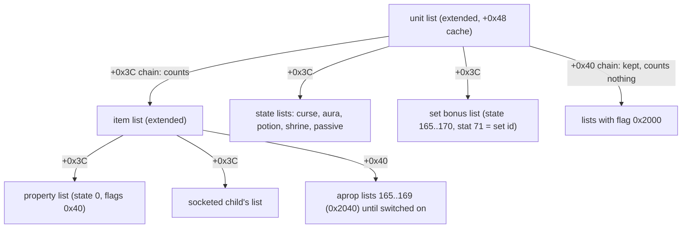
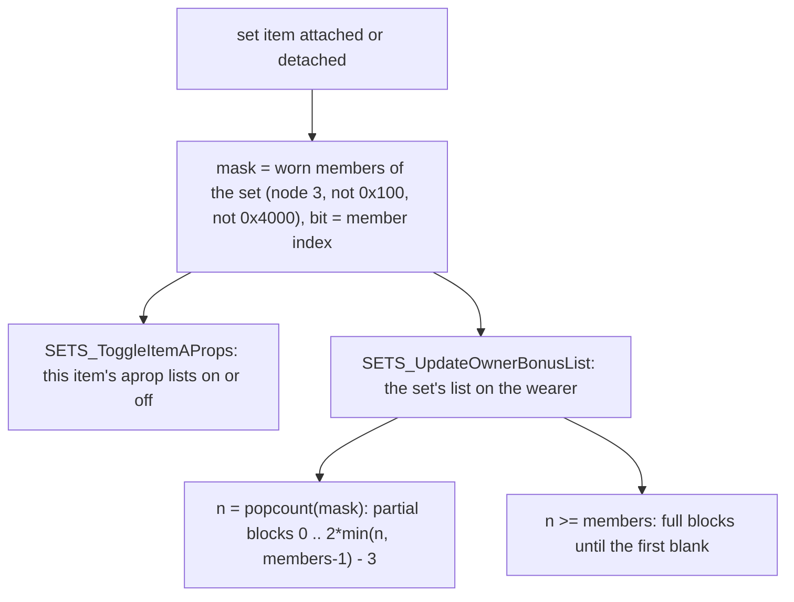

# 0001 — Stat aggregation: the stat lists, the `op` derivations, the maxima, items and set bonuses

> **Subsystem:** stats/aggregate
> **Question:** given a unit's base stats, its equipped items, its set bonuses, its passives, the auras around it and
> the states on it, what value does the server read for a stat, and when is that value recomputed?
> **Date:** 2026-10-17   **Plan:** 0041 (Phase 1 and 1b, static; Phase 2 run)   **Status:** Phase 2 run reviewed 2026-10-17 (accept with fixes)

## Answer (summary)

Phase 2 (run:2026-10-17-stats) replayed the server player's lists of six characters against the model of this
finding, write for write; § 9 lists what each claim was checked against and what stays `[I]`.

- [C] **A unit owns one "extended" stat list; every other list hangs under it.** `sub_00626D40_UnitStatListCreate`
  makes it (0x64 bytes, flag `0x80000000`) with the stat callback `0x0055B800` for players and monsters and none for
  items and objects. Item property lists, set lists, state lists (curses, auras, potions, shrines, passives) and the
  wearer's item lists are linked under a unit list by `STATLIST_LinkToUnit`: on the `+0x3C` chain they count, on the
  `+0x40` chain (list flag `0x2000`) they are kept but count for nothing. (fn:sub_00626D40_UnitStatListCreate@0x00626D40,
  fn:STATLIST_LinkToUnit@0x00626E10, struct:StatList+0x3C, run:2026-10-17-stats)
- [C] **Every full read is a cache read.** `sub_00625500_UnitGetStat` and `STATS_GetUnitStat` read the unit list's
  `+0x48` array (the "full" values); `STATS_GetUnitBaseStat` reads its `+0x24` array (the unit's own entries). Nothing
  is summed at read time. (fn:sub_00625420_StatListGetStat@0x00625420, fn:sub_00624F60_StatListGetValue@0x00624F60,
  fn:sub_00624ED0_StatListGetBaseValue@0x00624ED0, run:2026-10-17-stats)
- [I] Both readers floor the value at `MinAccr << ValShift` when the stat has `fMin` and the unit is a player or a
  monster: no read of the run reached the floor. (fn:sub_00624F60_StatListGetValue@0x00624F60, tbl:ItemStatCost.txt:fMin,
  tbl:ItemStatCost.txt:MinAccr) **S4e 2026-11-16, contradicted in part:** the test is `v < MinAccr` (unshifted), and
  only then is `MinAccr << ValShift` returned, so a value between the two is kept; the floor also needs the list's
  extended bit and a non-NULL record argument, and an absent entry returns 0 unfloored. `[C]` as code, [§ 11](#11-plan-0066-batch-s4e-part-1-the-stats-family-under-emulation-run2026-11-16-sweep2-s4e-emu).
  (0x00624FC5–0x00624FD1, run:2026-11-16-sweep2-s4e-emu)
- [C] **The cache is kept by propagation.** Every add or set on any list passes the delta up the parent chain
  (`STATLIST_Propagate`): a stat with no `op` link adds the delta to each extended list's cache; a stat that feeds an
  `op` or is an `op` target is re-evaluated (`sub_006266C0_StatRecompute`). The walk stops after a list with flag
  `0x2000`, and, for a `damagerelated` stat, after a list linked "without damage" (flag `0x40000000`). Linking and
  unlinking a list propagate all its entries the same way. (fn:STATLIST_Propagate@0x00626920,
  fn:STATLIST_CacheAdd@0x006250B0, fn:STATLIST_Unlink@0x006269F0, run:2026-10-17-stats)
- [C] **The full value of a stat** on an extended list is `own + Σ children` (its `+0x24` entry plus each `+0x3C`
  child's active array, one level), then each `op` input in `ITEMSTATCOST_Load`'s order (source-row order) adds its
  term: op 1/11/13 a percentage of a base value, op 2/4 `(src × level) >> param`, op 5 a percentage of that, op 8/9
  `CharStats × (full − own) × 64` for energy and vitality. The arithmetic is § 4. (fn:sub_00626200_StatEvaluate@0x00626200,
  fn:ITEMSTATCOST_Load@0x00637A00, run:2026-10-17-stats)
- [I] Op 3 (no row), op 6 and 7 (time of day; no spawnable row) and the empty ops 10 and 12 were not reached.
  (fn:sub_00626200_StatEvaluate@0x00626200, fn:STAT_ByTimeValue@0x0065CA30) **S4e 2026-11-16:** op 3, 10 and 12 as
  code, and "no row" for op 3, 10 and 12 over the table, `[C]` in [§ 11](#11-plan-0066-batch-s4e-part-1-the-stats-family-under-emulation-run2026-11-16-sweep2-s4e-emu); ops 6 and 7 are § 10's. Which affixes carry
  the 36 op-6/7 rows stays `[I]`. (0x0062632D, run:2026-11-16-sweep2-s4e-emu)
- [C] **Op 6 and 7 as code** (plan 0051 Phase 1b, § 10): `STAT_ByTimeValue` and `StatEvaluate`'s cases 6 and 7
  (with `ActTimeOfDay`, ops 10, 12 and above 13 between them) were run under emulation on synthetic lists. They
  reproduce § 4's arithmetic bit for bit in 9 000 calls, 0 mismatches. Each case adds a term only when the list's
  owner (`+0x44`) is non-NULL, the owner's `+0x1C` is non-zero and the source's value `p` is non-zero. Op 6 then adds
  the by-time value `t = STAT_ByTimeValue(p, …)`, and op 7 adds `MulDiv(running total, t, 100)`. What `+0x1C` and the
  phase pair are in play, and whether stock play ever reaches the cases, stay `[I]`.
  (fn:STAT_ByTimeValue@0x0065CA30, fn:sub_00626200_StatEvaluate@0x00626200, fn:sub_0061C100_ActTimeOfDay@0x0061C100,
  run:2026-10-27-p51s-emu)
- [C] **The maxima** are the cached full stats 7, 9 and 11 (`UnitGetMaxHp`, `UNIT_GetMaxMana`,
  `UNIT_GetMaxStamina`). Item and state life reaches them through the cache; vitality and energy from items through
  op 9 and op 8 with the class's `LifePerVitality`, `StaminaPerVitality`, `ManaPerMagic` (quarter points); `item_maxhp_percent` and `item_maxmana_percent` (op 11) are a
  percentage of the summed flat value only (op 11: 92 predicted writes, § 9).
  (fn:sub_00625D10_UnitGetMaxHp@0x00625D10, fn:UNIT_GetMaxMana@0x00625D60, fn:UNIT_GetMaxStamina@0x00625DB0,
  tbl:CharStats.txt:LifePerVitality, run:2026-10-17-stats)
- [C] **When a maximum changes, the current value is rescaled** by the stat callback (stats 7, 9, 11 → 6, 8, 10):
  `cur' = min(max(trunc(f32(new / max(old, 256) × cur)), 1), new)`, as monsters/0004 § 11 reads it for stat 7.
  (fn:sub_0055B800_MonStatCallback@0x0055B800, run:2026-10-17-stats)
- [I] Removing an item also clamps life, mana and stamina to their maxima (`UNIT_ClampVitals`); the floor of `maxhp`
  is 1 life (`MinAccr` 1). Neither value was predicted by the run (the clamp's writes were taken as inputs).
  (fn:UNIT_ClampVitals@0x006275B0, tbl:ItemStatCost.txt:MinAccr)
- [C] **Items count only while linked.** An equipped item's list is linked when its requirements are met
  (`sub_0062EAF0_ItemReqCheck`: identified, strength and dexterity, with the ethereal −10 deciding 30 checks);
  the refresh `sub_0055DBC0_EquipReqRefresh` unlinks the failing ones (flag `0x4000`) and re-links in a loop until no
  item changes. Charms count from the inventory. For a Barbarian the weapon that is not the active one is linked
  "without damage". (fn:sub_0055DBC0_EquipReqRefresh@0x0055DBC0, fn:sub_0062EAF0_ItemReqCheck@0x0062EAF0,
  fn:ITEMS_AttachToOwner@0x0055C2C0, run:2026-10-17-stats)
- [I] The `item_req_percent` (stat 91) term of the requirement changed no outcome in the run; the level and class
  tests, a broken item (flag `0x100`) and an Assassin's second weapon were not reached by the run. (fn:sub_0062EAF0_ItemReqCheck@0x0062EAF0, fn:sub_0055F850_ItemBreak@0x0055F850, fn:UNIT_CanDualWield@0x006235A0)
- [C] **Set bonuses** live in two places: each worn set item's own `aprop` lists (states 165–169, flags `0x2040`,
  switched on or off by `add func`: 1 = by which other member is worn, 2 = by how many), and one list per set on
  the wearer (a state from 165–170, marked by stat 71 = the set id) rebuilt from Sets' partial blocks
  `0 .. 2·(n−1)−1` (with `n` capped at members − 1) and, when every member is worn, the full blocks. Items whose
  requirements fail are not counted, and a duplicate member counts once. (fn:SETS_UpdateOnEquip@0x00663CC0,
  fn:SETS_ToggleItemAProps@0x00663A20, fn:SETS_UpdateOwnerBonusList@0x00663B40, fn:sub_00660120_SetBonusApply@0x00660120,
  fn:SETS_WornMemberMask@0x0062A370, run:2026-10-17-stats)
- [I] A broken member (flag `0x100`) was not reached. (fn:SETS_WornMemberMask@0x0062A370,
  fn:sub_00660120_SetBonusApply@0x00660120)
- [C] *Raised 2026-10-20 (plan 0047 Phase 1, re-check of the kept logs):* a full block with a `state` or `oskill`
  property is built like the others. The full Trang-Oul's 180 lists equal the Sets blocks for `n = 5` when every value
  is stored `<< ValShift` (`mana` 100 → 25 600) and the `state` block (func 24) writes stat 98 with the compiled param
  (`monsterset` → 176, a state: no skill or montype has that name) and the value 1 (§ 9). A reading without the shift,
  or with param 0, would have mismatched every one of the 180. (fn:sub_00660120_SetBonusApply@0x00660120,
  fn:PROP_WriteStat@0x0065EA50, fn:PROP_Func24_ParParam@0x0065F390, fn:sub_006336A0_PropParamCell@0x006336A0,
  run:2026-10-17-stats)

## Leads used

Phase 1b, compared after the code reading of § 4 – § 8 (blind first).

- [L] src:pk-itemstatcost-guide: op 1 adds `opstat.base × statvalue / 100`. **held with refinement**
  Detail: the base is the item's own base stat on an item, else the target's summed value before any op term (the
  running `[ebp-8]`, § 4), through `MulDiv`; any owner type, not only items.
- [L] src:pk-itemstatcost-guide: op 2 adds `(statvalue × basevalue) / 2^param`, refreshed on re-equip, save or
  level-up. **held**
  Detail: `(p × b) >> param` in signed 32 bits on a player or monster list; a level change re-evaluates the
  `+0x5E` dependents of `level`, so level-up refreshes it (§ 4, § 3).
- [L] src:pk-itemstatcost-guide: op 3 is the percentage form of op 2; op 4 and 5 are op 2 and 3 "on the item".
  **held with refinement**
  Detail: op 4/5 are evaluated on an item's list with the level of the unit the item is linked to (`list +0x04`), a
  player or a monster; op 3/5 take `MulDiv(base, term, 100)` with the same base as op 1.
- [L] src:pk-itemstatcost-guide: op 6 "does not work" and op 7 updates only on the client. **contradicted**
  Detail: the server evaluator computes both (§ 4, `STAT_ByTimeValue`), op 7 as a percentage of the running total.
  Not reachable on stock data: the only stock rows that write a `…/time` property are the magic suffixes *of Dawn*
  and *of Sunlight*, both `spawnable` 0 and `frequency` 0. Not a Phase 2 case; [backlog](../../backlog.md) entry
  filed. *2026-10-27 (plan 0051 Phase 1b):* settled for the code. [C] Under emulation `StatEvaluate` adds both terms
  (§ 10); the lead's "does not work" reading (op 6/7 adding nothing) fails 2 110 of the 3 000 cases. What the lead
  may mean in play (the phase never moving, a client display) is not covered: stock data reaches neither op.
  (fn:sub_00626200_StatEvaluate@0x00626200, run:2026-10-27-p51s-emu)
- [L] src:pk-itemstatcost-guide: op 8 and 9 give mana and life/stamina from CharStats for the energy and vitality
  "added", characters only; op 11 is op 1 with extra checks; 10 and 12 do nothing; 13 is op 1 on items only.
  **held with refinement**
  Detail: "added" is precisely `full − own` of the source on the evaluated list (§ 4), so a player's spent points do
  not pass through op 8/9 (they are added to the base maxima, player/0001); op 11 needs a player or monster owner and
  a non-zero base; 10 and 12 are empty cases; op 1 and 12 also hide the source's own cached value (§ 4).
- [L] src:pk-itemstatcost-guide: `fMin` keeps the stat in range; `MinAccr` is the floor. **held with refinement**
  Detail: a read-time floor of `MinAccr << ValShift` for players and monsters only; the stored entries are not
  clamped.
- [L] src:pk-itemstatcost-guide: `keepzero` is at most client-side; `direct` + `maxstat` give a capped current value.
  **held with refinement**
  Detail: `keepzero` keeps a 0 entry in the server's full cache (§ 3); the cap of a `direct` stat is applied by the
  writers (the regeneration ticks, the aura heal, stats/0002), not by the aggregation.
- [L] src:arreat-summit-class-pages: Barbarian, 1 vitality = 4 life and 1 stamina, 1 energy = 1 mana.
  **held with refinement**
  Detail: `CharStats` 16, 4 and 4 quarter points; through op 9/8 the factor is applied to item vitality and energy as
  `× n × 64` on the 1/256 scale, exact in integers (§ 4).
- [L] src:arreat-summit-item-pages: partial bonuses from two worn pieces, full bonus with the whole set, one set item
  cannot count twice, the green bonuses are per item, an inactive weapon slot does not count.
  **held with refinement**
  Detail: the worn mask is one bit per member index, so a duplicate counts once (§ 7); the partial blocks are pairs
  per worn count; broken and unusable members are not counted. The weapon-switch slot was not read: **not covered**
  (open question).

## Functions

| Address | Name | Role | Tag |
|---|---|---|---|
| `0x00626D40` | `sub_00626D40_UnitStatListCreate` | a unit's extended list, its callback and its state bit-sets | I |
| `0x006251F0` | `STATLIST_Alloc` | a plain list (pool, flags, `+0x18`, owner type and guid) | I |
| `0x00626E10` | `STATLIST_LinkToUnit` | attach a list under a unit's list and propagate its entries | C |
| `0x006269F0` | `STATLIST_Unlink` | detach, propagate the negated entries, run the remove callback | C |
| `0x00626C00` | `STATLIST_Free` | unlink and free, freeing plain children | I |
| `0x00627910` | `sub_00627910_StatListLinkOwner` | link an item's list to a unit, with or without damage | I |
| `0x00627A40` / `0x00627860` | `STATLIST_DisableDamageStats` / `STATLIST_EnableDamageStats` | flip `0x40000000` and propagate the damage-related entries | I |
| `0x006279A0` | `UNIT_ToggleStatListByState` | move a state's list between the counting and the off chain | C |
| `0x00624FE0` | `STATLIST_SumOwnAndChildren` | own entry plus each counting child's entry | I |
| `0x00626200` | `sub_00626200_StatEvaluate` | the full evaluation with the op terms | C (items/0006 for op 13) |
| `0x006266C0` | `sub_006266C0_StatRecompute` | evaluate, write the cache, recompute targets and dependents | C |
| `0x00626920` | `STATLIST_Propagate` | pass a delta up the parent chain | C |
| `0x006250B0` / `0x00625150` | `STATLIST_CacheAdd` / `STATLIST_CacheWrite` | update the `+0x48` cache, fire the stat callback | C |
| `0x00624ED0` / `0x00624F60` | `sub_00624ED0_StatListGetBaseValue` / `sub_00624F60_StatListGetValue` | the readers, with the `fMin` floor | I (C for `sub_00624F60_StatListGetValue`) |
| `0x00637A00` | `ITEMSTATCOST_Load` | builds the op graph (`+0x51..+0x53`, `+0x5E`, `+0x0DE`) | C |
| `0x0065CA30` | `STAT_ByTimeValue` | the op 6/7 time-of-day value | I |
| `0x00625D10`, `0x00625D60`, `0x00625DB0` | `sub_00625D10_UnitGetMaxHp`, `UNIT_GetMaxMana`, `UNIT_GetMaxStamina` | full stats 7, 9, 11 | I |
| `0x0055B800` | `sub_0055B800_MonStatCallback` | the stat callback of players and monsters | I (C for stat 7 on monsters, monsters/0004) |
| `0x006275B0` | `UNIT_ClampVitals` | stamina, mana, life down to their maxima | I |
| `0x0055C2C0` / `0x0055C730` | `ITEMS_AttachToOwner` / `ITEMS_DetachFromOwner` | equip and unequip, with the set update | I |
| `0x0055DBC0` | `sub_0055DBC0_EquipReqRefresh` | the requirement pass over charms and body slots 1..10 | C |
| `0x0062EAF0` | `sub_0062EAF0_ItemReqCheck` | strength, dexterity, level, identified, class | C |
| `0x0055F850` | `sub_0055F850_ItemBreak` | flag `0x100`, durability 0, unlink, set update | I |
| `0x00663CC0`, `0x00663A20`, `0x00663B40`, `0x00660120` | `SETS_UpdateOnEquip`, `SETS_ToggleItemAProps`, `SETS_UpdateOwnerBonusList`, `sub_00660120_SetBonusApply` | the set activation | C |
| `0x00535D10`, `0x00623C80` | `sub_00535D10_WeaponListsRelink`, `sub_00623C80_WeaponListsRelink2` | relink the two hands of a dual-wielder | I |
| `0x0063BF90` | `INV_GetOtherWeapon` | given an inventory (magic `0x01020304`), the hand item (body-slot record `+0x10` or `+0x14`, each kept only when `ITEMS_UnitIsType(item, 0x2D)`) other than the one whose unit id (`+0x0C`) equals inventory `+0x1C`, else 0; called by both relinks (0x00535D41, 0x00535DB3, 0x00623CE1) and by `0x00535E20` (0x00535E51) | I |

## Walkthrough

### 1. The list structure (`struct:StatList+0x10`)



- [I] A plain list is 0x3C bytes: pool, the unit it is linked to (`+0x04`), the type and guid of the unit that made
  it (`+0x08`, `+0x0C`), flags (`+0x10`), state (`+0x14`), the expiry frame (`+0x18`), skill and skill level
  (`+0x1C`, `+0x20`), its entries (`+0x24`: pointer, s16 count, s16 capacity), siblings (`+0x2C`, `+0x30`), parent
  list (`+0x34`) and a remove callback (`+0x38`). An extended list adds the two child chains (`+0x3C`, `+0x40`),
  its unit (`+0x44`), the full cache (`+0x48`), the changed-stat keys for the client (`+0x50`), the two state
  bit-sets (`+0x58`) and the stat callback with its argument (`+0x5C`, `+0x60`). (fn:STATLIST_Alloc@0x006251F0,
  fn:sub_00626D40_UnitStatListCreate@0x00626D40, struct:StatList+0x48)
- [I] Entries are `{key, value}` with `key = stat << 16 | param`, sorted ascending and found by binary search;
  the arrays grow and shrink by four. `STATLIST_AddStat` adds to the entry and removes it at 0;
  `STATLIST_SetStatEx` replaces it and removes it when the new value is 0; both propagate the difference and, on a
  player's own (extended) list, record the key for the client when the stat has ISC `+0x05` bit 4 (`Saved`) and is
  not 6, 8, 10, 13 or 14. (fn:STATLIST_FindIndex@0x00624B90, fn:STATLIST_AddStat@0x00627030,
  fn:STATLIST_SetStatEx@0x006270B0, fn:STATLIST_MarkClientDirty@0x00624DD0)
- [I] Flags seen: `0x2` timed, `0x4` dropped on a mode change, `0x8` the state's `aura` bit, `0x20` a curse, `0x40`
  an item's property list, `0x800` the state's `exp` bit, `0x2000` off chain, `0x20000000` holds an op-4/5 source,
  `0x40000000` linked without damage, `0x80000000` extended. Flags `0x1`, `0x80`, `0x100` are tested by the death
  purge (stats/0002 § 5) and not set by any code read here. (fn:STATE_ApplyTimed@0x0056E970,
  fn:sub_006272E0_StatListsDropOnMode@0x006272E0, fn:sub_00627540_StatListsPurgeOnDeath@0x00627540)
  - [C] *Correction 2026-11-15 (plan 0066 S4d part 2):* on the unit (extended) list `0x2` is not "timed": `STATLIST_LinkToUnit`
    sets it when a flag-4 list links and `StatListsDropOnMode` acts only while it is set, then clears it (objdump
    and r2; 19 such nodes in the kept trees). On plain lists `0x2` goes with the end frame. (fn:STATLIST_LinkToUnit@0x00626E10,
    fn:sub_006272E0_StatListsDropOnMode@0x006272E0, [stats/experiments § Addendum S4d part 2](experiments.md#addendum-2026-11-15-plan-0066-batch-s4d-part-2-of-2-new-checks-over-the-kept-stats-logs-and-static-second-sources-lanen66i))

### 2. Linking and unlinking

```c
// fn:STATLIST_LinkToUnit@0x00626E10 (unit, list, withDamage)
STATLIST_Unlink(list);
if (list already in unit->pStatList's parent chain) return;
if (list->flags & 4) unitList->flags |= 2;
if (list->flags & 0x2000) { push list on unitList->+0x40; list->pParent = unitList; list->pUnit = unit; return; }
push list on unitList->+0x3C; list->pParent = unitList; list->pUnit = unit;
if (list is extended && list->flags & 0x20000000)          // op-4/5 sources: re-evaluate with the new wearer's level
    for each key in list->full with ISC[stat].+0x53: StatRecompute(list, key);
if (!withDamage) { list->flags |= 0x40000000; for each entry not damagerelated: Propagate(list, entry, +value); }
else             { list->flags &= ~0x40000000; for each entry: Propagate(list, entry, +value); }
```

- [I] The entries propagated are the list's active array: the cache for an extended list (an item: its own entries,
  its property list, its sockets, its counting set lists), else its own entries. Unlinking propagates the negated
  values (all of them, or the non-damage ones under `0x40000000`) and then calls the remove callback `+0x38` if the
  list was linked to a unit. (fn:STATLIST_LinkToUnit@0x00626E10, fn:STATLIST_Unlink@0x006269F0)
- [I] `sub_00627910_StatListLinkOwner(unit, item, withDamage)`: an item in socket or belt-like locations 11 and 12
  (item data `+0x44`) is only unlinked; an item already linked to the unit only switches damage on or off
  (`STATLIST_EnableDamageStats` / `STATLIST_DisableDamageStats` propagate the damage-related entries);
  otherwise it is linked. (fn:sub_00627910_StatListLinkOwner@0x00627910, fn:STATLIST_DisableDamageStats@0x00627A40)
- [I] `UNIT_ToggleStatListByState(unit, state, off)`: finds the list by state and, when its `0x2000` bit differs,
  unlinks it, flips the bit and links it again with damage, so a set list moves between the off and the counting
  chain with a full propagation. (fn:UNIT_ToggleStatListByState@0x006279A0)

### 3. The cache: propagation and recompute

```c
// fn:STATLIST_Propagate@0x00626920 (ECX list where the change happened, EDX key, delta, srcItem)
if (list->flags & 0x2000) return;
if (!(list->flags & 0x80000000)) list = list->pParent;
while (list) {
    if (!ISC[stat].hasDependents(+0x51) && !ISC[stat].hasOpIn(+0x52)) STATLIST_CacheAdd(list, key, delta, srcItem);
    else                                                              sub_006266C0_StatRecompute(list, key, srcItem);
    stop = list->flags & 0x2000 || (ISC[stat].damagerelated && list->flags & 0x40000000);
    list = list->pParent; if (stop) return;
}
```

- [I] `STATLIST_CacheAdd` adds the delta to the cache entry (creating it), removes it at 0 unless `keepzero`, and
  calls the stat callback when the stat has `fCallback`, with `(arg, key, old, new)`; `STATLIST_CacheWrite` sets the
  value and calls the callback only when it changed. Both set list flag `0x20000000` for a stat with ISC `+0x53`.
  (fn:STATLIST_CacheAdd@0x006250B0, fn:STATLIST_CacheWrite@0x00625150, tbl:ItemStatCost.txt:keepzero)
- [I] `StatRecompute(list, key)`: `v = Evaluate(list, key)`. A stat without dependents writes `v` and returns. Else:
  when `v` is 0 it is written at once; each `op stat1..3` target is recomputed and written; then, only if no target
  "took" a contribution **and** `v ≠ 0`, `v` is written and every `+0x5E` dependent (the stats whose `op base` is this
  one) is recomputed and written. So a source that evaluates to 0 never walks its dependents (no stock `op base` row
  reaches 0: they are all `level`). (0x006266FB–0x00626708, 0x00626847–0x00626856; review 2026-10-17) A target "takes" when its new value is non-zero and the source's `op` is 1 or 12 (always), 2/3 (list of a
  player or monster and a positive cached stat 0, see below), 4/5 (linked unit a player or monster with positive
  stat 0), 6/7 (list of a player or monster) or 13 (list of an item); ops 8, 9, 10, 11 never take. So a source of op
  1, 2–7, 12 or 13 keeps its **old** cache value (0 on first use) while its target is non-zero, and its dependents are
  not walked. (fn:sub_006266C0_StatRecompute@0x006266C0, 0x006267AD the op class table at 0x0062690C) **S4e
  2026-11-16:** `[C]` as code for every class, both outcomes, with two refinements: ops 2/3 read the value with no floor
  and ops 4/5 through `STATS_GetUnitStat` with it, and an op byte above 13 takes (unreachable on loaded data), [§ 11](#11-plan-0066-batch-s4e-part-1-the-stats-family-under-emulation-run2026-11-16-sweep2-s4e-emu).
  (0x006267A0, run:2026-11-16-sweep2-s4e-emu)
- [I] **The write order, by instruction** (plan 0041 P3 review, objdump): `StatEvaluate` at 0x006266D0; no `+0x51`:
  `CacheWrite` at 0x006266EA and return; `v = 0`: `CacheWrite` at 0x00626708; per `+0x58` target (three words at
  most, `0xFFFF` ends): `StatRecompute` of the target at 0x00626775, its `CacheWrite` at 0x00626786, the take test only
  for a non-zero result (0x00626790) by the source row's `+0x54` op byte through the class bytes at 0x0062690C
  (`00 05 01 01 02 02 03 03 00 00 00 00 05 04` for ops 0–13) and the jump table at 0x006268F4; then, when no target
  took and `v ≠ 0` (0x0062684B, 0x00626856), the source's `CacheWrite` at 0x00626868 and each `+0x5E` dependent (64
  words at most) recomputed at 0x006268C1 and written at 0x006268CF. The take tests read the list's `+0x08` (ops 2, 3,
  6, 7, 13) or its linked unit `+0x04` (ops 4, 5). The run's in-order writes (§ 9) bear the order out. (fn:sub_006266C0_StatRecompute@0x006266C0)
- [I] **A quirk in the take test for ops 2–5:** the `op base` it reads is not the source row's `+0x56` but the
  source row's own `opIn[k].opBase` (`+0x0DE + 6k`, `k` = the target's index), which is 0 for every row that is not
  itself a target, so it tests the list's (or the linked unit's) stat 0 `strength`. Players have strength, so on a
  player the per-level sources are hidden; a monster's strength is usually 0. The loader fills only `+0x5E..+0xDD`
  with `0xFFFF` (`rep stos`, 0x20 dwords), not `+0x0DE`, so the 0 of a non-target row is the record's initial
  content, which no code read here writes; Phase 2 question 3 confirms it. (0x006267C0–0x006267DA,
  0x006267F7–0x00626811, 0x00638250–0x00638262) **S4e 2026-11-16:** the word read is the source row's `+0x0DE + 6k`
  `[C]` as code (a model reading the target's row fails 80 cases), [§ 11](#11-plan-0066-batch-s4e-part-1-the-stats-family-under-emulation-run2026-11-16-sweep2-s4e-emu); what a loaded non-target row holds there
  stays as stated. (run:2026-11-16-sweep2-s4e-emu)
- [I] **Level-up.** `level` is the `op base` of the 37 per-level rows, so it has dependents; a change of stat 12
  re-evaluates `level` (no targets, so it is always written) and then every per-level row and their targets.
  (fn:ITEMSTATCOST_Load@0x00637A00, tbl:ItemStatCost.txt:op base)
- [I] There is no other cache and no lazy recompute: the full value read at any frame is the result of the last
  propagation. The "recompute triggers" are therefore every list write, link, unlink and toggle.
  (fn:sub_00624F60_StatListGetValue@0x00624F60, fn:STATLIST_Propagate@0x00626920)
- [I] Helpers named on the way (no behaviour beyond their names): `STATLIST_FindInsertPos`, `STATLIST_InsertEntry`,
  `STATLIST_RemoveEntry` (the sorted arrays), `STATLIST_GetActiveArray` (`+0x48` when extended, else `+0x24`),
  `STATLIST_GetOwnerUnit` (an item list's wearer and whether it is linked with damage), `STATLIST_Clear` (removes
  every entry with propagation), `UNIT_FreeStatList`, `UNIT_UnlinkItemStatList`. (fn:STATLIST_FindInsertPos@0x00624BD0,
  fn:STATLIST_InsertEntry@0x00624C80, fn:STATLIST_RemoveEntry@0x00624D10, fn:STATLIST_GetActiveArray@0x00624F40,
  fn:STATLIST_GetOwnerUnit@0x00625820, fn:STATLIST_Clear@0x00627340, fn:UNIT_FreeStatList@0x00626D10,
  fn:UNIT_UnlinkItemStatList@0x006277F0)

### 4. The evaluation: the `op` terms (`fn:sub_00626200_StatEvaluate@0x00626200`)

```c
// ECX list, EDX key (target stat t << 16 | param)
v  = list->base[key] + Σ_{c in list->+0x3C} c->active[key]   // children with 0x40000000 skipped for damagerelated t
b0 = v;  acc = v;                                            // b0 is "[ebp-8]", acc is "[ebp-4]"
if (ISC[t].hasOpIn)
  for (k = 0; k < 16 && ISC[t].opIn[k].op != 0; k++) {       // source-row order (ITEMSTATCOST_Load)
    e = ISC[t].opIn[k]; src = e.source << 16;                // param 0
    switch (e.op) {
    case 1:  if (owner) { if (owner is item) b0 = BaseStat(owner, t); if (b0) { p = Eval(src); if (p) acc += MulDiv(b0, p, 100); } } break;
    case 2:  if (list->ownerType in {0,1} && e.opBase != 0xFFFF) { b = list->active[opBase] >> ValShift(opBase);
               if (b > 0 && (p = Eval(src))) acc += (p * b) >> e.opParam; } break;
    case 3:  same b; if (b > 0 && (p = Eval(src))) acc += MulDiv(b0, (p * b) >> e.opParam, 100); break;
    case 4:  as 2 with b = STATS_GetUnitStat(list->pUnit, opBase) >> ValShift, pUnit a player or monster; break;
    case 5:  as 3 with the b of case 4; break;
    case 6:  if (owner && owner->+0x1C && (p = Eval(src))) acc += STAT_ByTimeValue(p, ActTimeOfDay(owner->+0x1C, &x), x); break;
    case 7:  if (owner && owner->+0x1C && (p = Eval(src))) acc += MulDiv(acc, STAT_ByTimeValue(p, ...), 100); break;
    case 8:  if (owner is player) { d = Eval(src) - list->base[src]; if (d) acc += CharStats(owner).ManaPerMagic * d * 64; } break;
    case 9:  as 8 with LifePerVitality (+0x46), or StaminaPerVitality (+0x47) when t == 11; break;
    case 11: if (b0 && owner is player or monster) { p = Eval(src); if (p) acc += MulDiv(b0, p, 100); } break;
    case 13: if (owner is item) { b0 = BaseStat(owner, t); if (b0 && (p = Eval(src))) acc += MulDiv(b0, p, 100); } break;
    case 10: case 12: break;
    }
  }
return acc;
```

- [I] `owner` is the list's unit `+0x44`, `BaseStat` reads the owner's own `+0x24` entry, `Eval(src)` is the full
  recursive evaluation on the **same** list, `MulDiv` is monsters/stats A1. The products of ops 2–5 are signed 32-bit
  `imul` then an arithmetic shift. `b0` starts as the own-plus-children sum and only ops 1 and 13 on an item replace
  it, so on a player op 11 is a percentage of the flat sum, not of vitality's share; op 7 alone uses the running
  total. (0x00626294–0x00626662, jump table 0x00626688, fn:sub_00483360_MulDiv@0x00483360)
- [I] **The order is fixed by the loader:** `ITEMSTATCOST_Load` walks the rows in id order and appends each row to
  the `opIn` table of every `op stat1..3` target, so e.g. `armorclass` evaluates 16 (op 13), 214 (op 4), 215 (op 5),
  268 (op 6), 269 (op 7) in that order and `maxhp` 3 (op 9), 76 (op 11), 216 (op 2), 270 (op 6). An `op` outside
  1..13 is zeroed. It sets `+0x51` on each source with a target and on each `op base` row (appending the source to
  that row's `+0x5E` list), `+0x52` on each target and `+0x53` on op-4/5 sources, and marks rows touching 7, 9 or
  11 in the ISC flag bytes (`+0x04` bits 5–7, `+0x05` bit 0). (fn:ITEMSTATCOST_Load@0x00637A00, 0x006382E0–0x00638490)
- [I] **op 6/7 (by time):** the source value is `Encode` 4: bits 0–1 a period `q`, bits 2–11 `lo + 256`, bits 12–21
  `hi + 256`. With the phase `x` from `sub_0061C100_ActTimeOfDay`: `a = |x − 90q|`, rounded to a multiple of 15
  (`(a + 7) / 15 × 15`, 0 below 1), then `a ≥ 359 → 360 − 359`, `a ≥ 180 → 360 − a`; value `hi − (hi − lo)·a/180`.
  The phase source (`owner +0x1C`) is not read further; stock data never reaches this case (Leads used).
  (fn:STAT_ByTimeValue@0x0065CA30, fn:sub_0061C100_ActTimeOfDay@0x0061C100)
  *2026-10-27:* the map is `[C]` under emulation and the phase source is read, in § 10.
- [I] **op 8/9:** the term uses only `full − own` of the source on the list being evaluated. On a player's list
  `own` is the base attribute, so only item, state and set vitality/energy give life, stamina and mana here; the
  spent points are added to the base maxima by the stat-point code (player/0001). (0x00626511–0x00626606,
  fn:CHARSTATS_GetRecord@0x004833E0, fn:PLAYER_SpendStatPoint@0x00570D60)

### 5. The maxima and the current values

- [I] `UnitGetMaxHp`, `UNIT_GetMaxMana` and `UNIT_GetMaxStamina` read the cached full stats 7, 9 and 11 with the
  `fMin` floor (`MinAccr` 1, 0, 0). So `maxhp = base 7 + Σ items/states/sets flat 7 + op 9 + op 11 + op 2 + op 6`,
  each as § 4. (fn:sub_00625D10_UnitGetMaxHp@0x00625D10, fn:UNIT_GetMaxMana@0x00625D60,
  fn:UNIT_GetMaxStamina@0x00625DB0, tbl:ItemStatCost.txt:MinAccr) **S4e 2026-11-16:** the getters' bodies `[C]` as
  code (the cached stat through `StatListGetValue` with the stat's record; 0 for a NULL unit or list, or a count at or
  below the stat), [§ 11](#11-plan-0066-batch-s4e-part-1-the-stats-family-under-emulation-run2026-11-16-sweep2-s4e-emu); the floor is the corrected one of § 1. (run:2026-11-16-sweep2-s4e-emu)
- [I] **The rescale callback.** On a cache change of stat 7, 9 or 11 with `new ≠ old`, `old > 0` and current
  (6, 8, 10) > 0: `r = ftol((float)(new / max(old, 256) × cur))` (`fild`/`fidiv`/`fimul`, stored to a float32), and
  the current value becomes `r` (at least 1) when `max(r, 1) < new`, else `new`. A monster with a MonStats `+0x1A0`
  factor also gets `hpregen = ((new >> 8) × factor) >> 4` (monsters/0004 § 11). (fn:sub_0055B800_MonStatCallback@0x0055B800,
  0x0055B8EC–0x0055B998)
- [I] The callback also: (re)registers the stat's item events (`itemevent1/2`) when the value goes to or from 0;
  adds or refreshes skills for 83, 97, 107, 126, 127, 188, 204; starts or stops an item aura for 151
  (stats/0002 § 4); and for 98 `state` sets or clears that state with the group exclusion (stats/0002 § 2).
  (fn:sub_0055B800_MonStatCallback@0x0055B800, tbl:ItemStatCost.txt:itemevent1)
- [I] `UNIT_ClampVitals` (run by `ITEMS_DetachFromOwner` when asked): stamina, mana and life, in that order, are
  lowered to their maxima when above (`AddStat(current, max − current)`). (fn:UNIT_ClampVitals@0x006275B0)

### 6. Items: equip, requirements, broken, ethereal, sockets

- [I] `ITEMS_AttachToOwner(owner, item)`: refused for a player in state 7 `playerbody`; a gem, rune or jewel gets its
  `gems` mods (items/0007); a set item runs `SETS_UpdateOnEquip(owner, item, 0, 0)`; then the item's list is linked
  with damage, except for a unit that can dual-wield (`UNIT_CanDualWield`: player classes 4 and 6, monster classes 417
  and 418) when the item is a weapon other than the primary one, which is linked without damage. A broken item
  (flag `0x100`) is linked only when the caller forces it. (fn:ITEMS_AttachToOwner@0x0055C2C0,
  fn:UNIT_CanDualWield@0x006235A0, fn:INV_GetPrimaryWeapon@0x0063BEF0)
- [I] `ITEMS_DetachFromOwner(owner, force, clamp)`: refused for a player in state 7; a set item runs
  `SETS_UpdateOnEquip(owner, item, 1, 0)`; the list is unlinked (unless broken and not forced); for a dual-wielder
  the remaining primary weapon is re-linked with damage; `clamp` runs `UNIT_ClampVitals`.
  (fn:ITEMS_DetachFromOwner@0x0055C730)
- [I] **Requirements** (`sub_0062EAF0_ItemReqCheck(item, unit)`): `str = reqstr + MulDiv(reqstr, stat 91, 100)`,
  `dex` the same with `reqdex` (record `+0x10A`, `+0x10C`), each −10 when ethereal (`0x400000`); the unit's full
  strength and dexterity must be ≥ 1 and ≥ the requirement; level ≥ the item's level requirement; the item must be
  identified (`0x10`); a type-18 base needs a positive stat 70; the class must match: item class 7 is any class, a
  player needs its own class, and a monster passes only for class-4 (Barbarian) items when
  `sub_00463900_MonClassCheck` gives 560 or 561. (fn:sub_0062EAF0_ItemReqCheck@0x0062EAF0, 0x0062EB63–0x0062EBBE,
  tbl:ItemStatCost.txt:Stat)
- [I] **The refresh** (`sub_0055DBC0_EquipReqRefresh`, after equip, place, break, repair, identify and more): (1)
  each inventory charm (type 13) that is usable and not linked is linked; (2) body slots 1..10: each item that is
  linked or not marked, and fails its requirements, is marked `0x4000` and unlinked with the clamp; (3) repeat over
  slots 1..10 until nothing changes: each unbroken item that is marked or unlinked and now passes is unmarked and
  linked; (4) every equipped, unbroken, unmarked set item is detached and re-attached (refreshing every set list).
  Step (2) runs once, so an unlink that breaks another item's requirement is caught at the next refresh, not in this
  one. (fn:sub_0055DBC0_EquipReqRefresh@0x0055DBC0, fn:sub_0055DB00_ItemUsableBy@0x0055DB00,
  fn:ITEMS_IsActiveCharm@0x0062FF70)
- [I] **Broken:** `sub_0055F850_ItemBreak` sets `0x100`, unlinks the item when equipped, sets durability 72 to 0 and updates
  its set with the item excluded; `sub_0055F900_ItemRepairBroken` clears it and re-runs the refresh. Ethereal and
  sockets change only the item's own lists (items/0006 § 6, items/0007), which reach the wearer through the item's
  cache. (fn:sub_0055F850_ItemBreak@0x0055F850, fn:sub_0055F900_ItemRepairBroken@0x0055F900)

### 7. Set bonuses



- [I] **Per item (`add func`).** `SETS_ToggleItemAProps(item, mask)`: `add func` 1 → for each other member index
  `k` (0..5, skipping the item's own), the state slot `k` (or `k − 1` above the own index) of
  `g_SetBonusStates` = 165..170 is switched on iff member `k` is worn; `add func` 2 → with `c = popcount(mask) − 1`
  other members worn, states 165.. `165 + c − 1` on and the rest off. The lists are the item's `aprop` lists
  (items/0006: pair *k* → state `165 + k − 1`, flags `0x2040`), so pair *k* counts when its member (func 1) or
  *k* other members (func 2) are worn. (fn:SETS_ToggleItemAProps@0x00663A20, fn:SETITEMS_GetMemberIndex@0x0062B3A0,
  data:g_SetBonusStates@0x006EE424, data:g_PopCount6B@0x006EE440, tbl:SetItems.txt:add func)
- [I] **Per set on the wearer.** `SETS_UpdateOwnerBonusList(owner, item, mode)`: finds the wearer's list with a
  state in 165..170 whose stat 71 equals the set id (SetItems `+0x2C`); equip (mode 0) clears it, or creates one in
  the first free state, sets stat 71 and calls `SetBonusApply`; unequip (mode 1) unlinks and frees it, which the
  refresh's step (4) then rebuilds from the remaining members. `SetBonusApply`: `n = popcount(mask)` counting the
  item itself (`g_PopCount6A`), partial Sets blocks `0 .. 2·min(n, members − 1) − 3` (each with a code ≥ 0), and when
  `n ≥ members` the eight full blocks until the first code < 0, each through `PROP_ApplyBlockByVersion` (mode 4)
  into that list. (fn:SETS_UpdateOwnerBonusList@0x00663B40, fn:sub_00660120_SetBonusApply@0x00660120,
  data:g_PopCount6A@0x006EDA40, struct:SetsRec+0x0C)
- [I] Stat 71 (`value`) of the marker is an ordinary entry, so the wearer's full stat 71 is the **sum** of its
  active sets' ids (set id 0 adds nothing) plus any other stat-71 entry under it. The lookup reads stat 71 of each
  set list itself, not the cache, so the sum does not disturb it. (0x00663C93, 0x00663BDD,
  fn:STATLIST_AddStat@0x00627030)
- [I] The worn mask counts an item only in node page 3 (equipped), quality 5, not broken, not marked `0x4000`,
  and of the same set; a duplicate member sets the same bit. (fn:SETS_WornMemberMask@0x0062A370)

### 8. Passives and auras (stat lists only; the lifecycle is stats/0002)

- [I] A passive's list is a state list (the skill's `passivestate`) holding `passivestat1..5` = `passivecalc` at the
  skill's current level (with bonuses), each with param = `passiveitype` (0 when none), plus 350 = skill and
  351 = level; it is rebuilt only when 351 differs. It is removed while the skill's `aurastate` is on the unit.
  (fn:SKILLS_RefreshPassive@0x00646D60, fn:SKILLS_EvalCalc@0x00646CA0, tbl:Skills.txt:passivestat1)
- [I] An aura's target list is the `auratargetstate` list made by `AURA_ApplyToTarget` with `aurastat1..6` =
  `aurastatcalc`; stats 350/351 again; details in stats/0002 § 4. (fn:AURA_ApplyToTarget@0x005CEDC0)

### 9. The Phase 2 run (`run:2026-10-17-stats`)

The run logged the server player's whole stat-list tree and replayed it with `tools/stats.py`, which mirrors the tree
and predicts every line from § 1–§ 8 (method and counts in the run record). What each claim was checked against:

- [C] **The loader's op graph** (§ 4): the run-time ISC tail the logger dumps (targets `+0x58`, dependents `+0x5E`, the
  `opIn` table `+0x0DE`, the `+0x51`/`+0x52`/`+0x53` flags, the op byte, ValShift, MinAccr, keepzero and the
  damagerelated, fMin and fCallback bits) equals, for every one of the 359 rows (103 392 fields), what the rules of
  § 4 build from ItemStatCost; the take test's word `+0x0DE + 6k` is 0 on every row that is not itself a target
  (the record's initial content, § 3). (fn:ITEMSTATCOST_Load@0x00637A00, tbl:ItemStatCost.txt:op stat1,
  run:2026-10-17-stats)
- [C] **Linking, unlinking and propagation** (§ 2, § 3): 26 087 top-level and nested links and unlinks (item lists,
  set lists, state and passive lists, socketed children, the aprop toggles) and 207 017 Propagate calls; every
  Propagate a link or unlink makes was predicted (list, key, delta: 96 342), and every write inside each Propagate
  (137 242 CacheAdd, 94 800 CacheWrite) was predicted in order, with the old value it found; the tree after every
  top-level event equalled the mirror (5 143 snapshots, own entries, caches, flags and chains). Linking without
  damage (32, the dual-wield second weapon) and the `0x20000000` re-evaluation on link and unlink are among
  them. (fn:STATLIST_LinkToUnit@0x00626E10, fn:STATLIST_Unlink@0x006269F0, fn:STATLIST_Propagate@0x00626920,
  fn:sub_006266C0_StatRecompute@0x006266C0, run:2026-10-17-stats)
- [C] **The take test** (§ 3) as far as stock rows reach it: op 1 taken 156, op 2 taken 280, op 4 taken 2 568 and not
  taken 3 467 (the item unlinked: no linked unit), op 5 taken 26 and not 70, ops 8 and 9 never taken
  (615); 24 279 cache entries of sources whose target took kept their old value, and 1 239 recomputes of a source
  evaluating to 0 wrote it at once and walked no dependent. Op 3, 6, 7, 12 and 13's class were not reached by a
  source with a target that took. (0x006267AD, 0x0062690C, run:2026-10-17-stats)
- [C] **The evaluation** (§ 4) for the ops a stock row reached in a predicted write: op 1 348, op 2 1 490, op 4 2 568, op 5
  26, op 8 919, op 9 3 784, op 11 92, op 13 136 (each of the eight stock ops at least 20). Every other cached entry of every extended list evaluated to its cache (646 835 evaluations at the tree snapshots), except the stale
  sources above and the item op-4/5 values below. Op 3 and op 10 have no row, op 6, 7 and 12 none spawnable: those
  stay `[I]`. (fn:sub_00626200_StatEvaluate@0x00626200, run:2026-10-17-stats)
- [C] **An item's op-4/5 value is not refreshed when the wearer levels up.** After the Paladin's level-ups the
  item lists with an op-4 source (`item_armor_perlevel` on Stormshield) kept the value of their last link (94
  entries), equal to the evaluation at the wearer's previous level: nothing propagates a stat of the linked unit into
  an item list; only `STATLIST_LinkToUnit` and `STATLIST_Unlink` re-evaluate the `+0x53` keys. The wearer's own
  per-level rows are re-evaluated by the level write (9 level changes, their dependent writes predicted).
  (0x00626EC4, 0x00626A84, run:2026-10-17-stats)
- [C] **Reads** (§ 1): 891 844 reads of the player's unit list by `sub_00624F60_StatListGetValue` in the 50-frame windows,
  of 120 stat ids, each equal to the mirrored cache entry with the fMin floor; no read reached the floor
  (0). (fn:sub_00624F60_StatListGetValue@0x00624F60, run:2026-10-17-stats)
- [C] **The rescale callback** (§ 5): 5 752 changes of stats 7, 9 and 11 with a positive current value; the
  current value written after each equals `min(max(ftol(f32(new / max(old, 256) × cur)), 1), new)` (stat 7: falls 1 797, rises 1 810, capped 57; stat 9: falls 432, rises 446,
  capped 702; stat 11: rises 5, capped 503).
  (fn:sub_0055B800_MonStatCallback@0x0055B800, 0x0055B8EC, run:2026-10-17-stats)
- [C] **The stat callback fires** exactly for the player-list writes of `fCallback` stats that change the value
  (14 522 calls, key, old and new predicted). (fn:STATLIST_CacheAdd@0x006250B0, fn:STATLIST_CacheWrite@0x00625150,
  run:2026-10-17-stats)
- [C] **Requirements** (§ 6): 17 634 checks; the strength and dexterity flags and the result predicted from the base
  record, stat 91, the ethereal −10 and the mirrored unit stats (passed 15 610 plain, 814 with stat 91, 428 ethereal; failed 428 by
  strength, 24 ethereal by strength, 240 by dexterity, 90 unidentified). **The ethereal −10 decided 30 checks**
  (`StatsBarD`, strength 85: the ethereal War Boots, 125 strength, pass with 115..124 and would fail without the −10;
  `bard-town1`, `bard-town2`): `[C]`. The `item_req_percent` term (stat 91) changed no outcome in its 814 checks (a
  reading without it predicts the same flags), the level test and the class test passed in every check (no item
  failed them), and a broken item was never checked: those branches stay `[I]`.
  (fn:sub_0062EAF0_ItemReqCheck@0x0062EAF0, run:2026-10-17-stats)
- [C] **Sets** (§ 7): 11 343 worn masks predicted from the inventory (page 3, quality 5, flags `0x4000` and `0x100`,
  member index; the Soul Cage, whose strength fails, never counted; two Angelic Halo set one bit); 5 749 aprop toggle
  sequences (add func 0: 1 844, 1: 819, 2: 3 086) with 19 525 toggles; 5 749 wearer set lists, of which 5 569 equal
  the Sets blocks for `n = popcount(mask)` (Angelical Raiment n=1 830; Civerb's n=1 22, n=2 880, n=3 1 152; Immortal
  King n=1 60, n=2 228, n=3 2 317; Trang-Oul's n=4 80). The 180 full Trang-Oul's lists (n=5, the full blocks with
  `state` and `oskill`) were taken as logged at the run; *2026-10-20 (plan 0047 Phase 1):* the checker now builds
  them (values `<< ValShift`, the `state` block by func 24 with the compiled param), and the re-check of the 18 logs
  predicts all 5 749 lists, the 180 included, with 0 mismatches
  ([experiments](experiments.md#run2026-10-17-stats), *Re-check 2026-10-20*). The full blocks of a set whose last
  member is a broken item were not reached.
  (fn:SETS_WornMemberMask@0x0062A370, fn:SETS_ToggleItemAProps@0x00663A20, fn:sub_00660120_SetBonusApply@0x00660120,
  run:2026-10-17-stats)
- [C] **Passives** (§ 8): 8 832 refreshes; each `passivestate` list holds `passivestat` = `passivecalc` at the level it
  records in 351 (an input), with param `passiveitype`, and 350 = the skill (Sword Mastery 127 at 4–8, Increased Stamina 141 at 13–17, Iron Skin
  145 at 5–9, Natural Resistance 153 at 6–10; Fire Mastery 61 at 3–4 from the full Trang-Oul's `oskill`).
  Another 540 refreshes found no `passivestate` list on the player and were only counted.
  (fn:SKILLS_RefreshPassive@0x00646D60, run:2026-10-17-stats)
- [C] **`itemspecific` does not stop the propagation** (open question): the player's cache holds the sum of the
  equipped items' 72 and 73 in every snapshot, evaluated as an ordinary sum. (fn:STATLIST_Propagate@0x00626920,
  run:2026-10-17-stats)
- [I] **The weapon switch** (open question): a W press runs `sub_005616A0_PlayerSwapWeapons` (from
  `sub_0054CE70_SwapWeaponsReq`), which detaches both hands through `ITEMS_DetachFromOwner` (return addresses
  0x005617C9, 0x005617DD) and attaches the other pair through `ITEMS_AttachToOwner` (0x00561930): the logged caller
  chains; the function itself was not read. (fn:sub_005616A0_PlayerSwapWeapons@0x005616A0,
  fn:sub_0054CE70_SwapWeaponsReq@0x0054CE70, run:2026-10-17-stats)
- [C] **Step 4 of the refresh** (§ 6): every `sub_0055DBC0_EquipReqRefresh` (972) detached and re-attached every
  equipped, usable set item (`SETS_UpdateOnEquip` mode 1 then 0, each item's list unlinked and linked), as predicted.
  (fn:sub_0055DBC0_EquipReqRefresh@0x0055DBC0, run:2026-10-17-stats)
- [I] The refresh also ran with no click on a period of 136 frames on every character of the run (the commonest gap
  between two refreshes in every session); what queues it was not read. (fn:sub_0055DBC0_EquipReqRefresh@0x0055DBC0,
  run:2026-10-17-stats)
  - *Correction 2026-11-15 (plan 0066 S4d part 2):* counted over the kept logs, 136 is the commonest gap in 12 of the
    18 sessions and all 10 of run:2026-10-20-shortfalls; in six it is 1 (bursts after actions). Still `[I]`.
  - *Update 2026-11-16 (plan 0066 S4e part 5f, § 14):* what queues the idle refresh is read: `ActsClockPass` calls
    `PlayerEquipRefresh(…, 1)` for each client's player of an act slot whose `ActClockTick` returns non-zero (0x0052D7D2,
    0x0052D822) `[C]` (static); that the 136 is act index 3's bucket period stays `[I]`.
    (fn:sub_0052D7B0_ActsClockPass@0x0052D7B0, fn:sub_0055FDE0_PlayerEquipRefresh@0x0055FDE0)
    (fn:sub_0055DBC0_EquipReqRefresh@0x0055DBC0, [stats/experiments § Addendum S4d part 2](experiments.md#addendum-2026-11-15-plan-0066-batch-s4d-part-2-of-2-new-checks-over-the-kept-stats-logs-and-static-second-sources-lanen66i))
  - [C] *Correction 2026-11-15:* the body-to-cursor pickup unlinks the item through `sub_0063AAF0_InvItemRemove` →
    `UNIT_UnlinkItemStatList`, not `ITEMS_DetachFromOwner` (260 unlinks with no detach in the frame); and the
    refresh's direct-call closure reaches 122 drawing functions (`PlayerSkillReselect` → `PlayerSetSkill` → … →
    `PlayerModeAllowed`), though no seed moved in its 972 logged windows. (fn:sub_0063AAF0_InvItemRemove@0x0063AAF0,
    fn:sub_0055DBC0_EquipReqRefresh@0x0055DBC0, [stats/experiments § Addendum S4d part 2](experiments.md#addendum-2026-11-15-plan-0066-batch-s4d-part-2-of-2-new-checks-over-the-kept-stats-logs-and-static-second-sources-lanen66i))

### 10. Op 6 and 7 under emulation (run:2026-10-27-p51s-emu, plan 0051 Phase 1b)

The backlog's optional emulation (plan 0041 P1 review, item (c)): the code that stock data never reaches, run on the
pinned image under Ghidra 12.1.2's p-code emulator with `EmuTrace.java` (ADR-0015) and compared with
`tools/sweep_p51s.py`'s models. The record, commands and counts are in
[stats experiments](experiments.md#run2026-10-27-p51s-emu).

- [C] **`STAT_ByTimeValue(v, unused, x, pq, plo, phi)`** (`__stdcall`, `ret 0x18`): `q = v & 3`,
  `lo = ((v >> 2) & 0x3FF) − 256`, `hi = ((v >> 12) & 0x3FF) − 256`, each written through its pointer when that is
  not NULL. Then `d = x − 90·q` (32-bit) and `a = |d|`, where `neg` leaves `INT32_MIN` as it is. It sets
  `a = trunc((a + 7) / 15)·15` (signed), and 0 when that is ≤ 0. Then `a ≥ 359` gives `a = 1`, and `180 < a < 359`
  gives `a = 360 − a`. It returns `hi − trunc((hi − lo)·a / 180)`. The second argument is never read. 6 000 calls,
  0 mismatches, every branch reached: `a ≤ 0` 207, `0 < a ≤ 180` 1 443, `180 < a < 359` 987, `a ≥ 359` 3 363,
  `d < 0` 2 606, `lo > hi` 2 968, a NULL pointer 5 458 times. Negative controls: the model without the 359 step
  fails 3 302 cases, and floor division in place of truncation fails 2 416. (fn:STAT_ByTimeValue@0x0065CA30,
  0x0065CA33–0x0065CAEE, run:2026-10-27-p51s-emu)
- [C] **Wrap bounds** (signed 32-bit, from the model's arithmetic). `a + 7` fits up to `a = 0x7FFFFFF8`
  (`0x7FFFFFFF`). From `0x7FFFFFF9` it wraps negative, so `a` becomes 0 and the value is `hi`. 26 cases have
  `|d| ≥ 0x7FFFFFF9`, 3 of them `d = INT32_MIN`. `(hi − lo)·a` stays within `1023·180 = 184 140`, so it never wraps.
  `d = x − 90q` wraps only when `x < INT32_MIN + 90q` (at most the 270 lowest values, for `q = 3`;
  `x = INT32_MIN + 90q` gives `d = INT32_MIN`, which fits), and 128 cases do. (0x0065CA7B–0x0065CA82,
  0x0065CACF, run:2026-10-27-p51s-emu)
- [C] **`StatEvaluate`, cases 6 and 7** (ECX = list, EDX = key): for each entry of the target's op table, read in
  order, case 6 needs the list's owner (`+0x44`) non-NULL, the owner's `+0x1C` non-zero and the source's full value
  `p = Eval(list, src << 16)` non-zero. Then it adds `STAT_ByTimeValue(p, r, x, 0, 0, 0)`, with
  `r = ActTimeOfDay(owner +0x1C, &x)`. Case 7 has the same gates and adds `MulDiv(acc, t, 100)`, with
  `t = STAT_ByTimeValue(p, r, x, 0, 0, 0)` as for case 6 and `acc` the running total read after the source's evaluation (`mov edi, [ebp−4]` at 0x006264FB). Ops 10 and 12 jump
  straight to the next entry, as does any op above 13. The loop stops at op 0 or after 16 entries. Sums are 32-bit
  and wrap. 3 000 calls, 0 mismatches, on lists with 1 to 16 entries and nested sources (a source with its own op 6/7
  table, 2 605 nested evaluations). Reached: op 6 term 5 301, op 7 term 5 187, `p = 0` 1 772 / 1 793, no owner
  475 / 460, no `+0x1C` 459 / 431, ops 10 / 12 / above 13 571 / 595 / 1 152, 16 entries 447, an extended list with
  no children 893. Op 7's `MulDiv` took its 32-bit (2 667), wrapped 32-bit (1 188) and divide-first (1 332) paths.
  Negative controls: op 6/7 adding nothing fails 2 110 cases; op 7 on the own-plus-children sum instead of the
  running total fails 1 103. (fn:sub_00626200_StatEvaluate@0x00626200, 0x0062644A–0x0062650C,
  fn:sub_00483360_MulDiv@0x00483360, run:2026-10-27-p51s-emu)
- [C] **`ActTimeOfDay(p, &x)`** (`ret 8`): `e = *(p + 4)` (through `0x0061AA60`, which asserts `p` non-NULL; the
  case gate makes it so, and the guard on the assert path was never reached). When `e` is NULL, `x = 0` and it returns
  0. Otherwise `x = e[+0x08] / e[+0x28]` (signed `idiv`, truncated), or 0 when `e[+0x28]` is 0, and it returns
  `e[+0x04]`. Reached: `e` NULL 1 055 times among the terms, divisor 0 315 cases. The one fault input
  (`INT32_MIN / −1`) is left out of the cases (ADR-0015 (5)). (fn:sub_0061C100_ActTimeOfDay@0x0061C100,
  0x0061C100–0x0061C14F, run:2026-10-27-p51s-emu)
- [C] **Read set** (ADR-0015 (2), enumerated by `EmuTrace`): beyond the stack, the memory spec and each case's
  memory, the code read only `StatEvaluate`'s jump table 0x00626688 (.text) and the mask 0x006CE270 (`4`, .rdata),
  both in read-only sections (`sweep_p51s.py static`). It wrote nothing outside the stack and the case's out words.
  The spec writes `g_pDataTables` (an input) and two DataTables fields, `+0xBCC` (the ItemStatCost records) and
  `+0xBD4` (their count). Each case writes only the record fields the code reads: byte `+0x04`, byte `+0x52` and the
  op entries' `+0xE0` source, `+0xE2` op and `+0xE3` param. The entries' `+0xDE` (`op base`) is never read by ops 6
  and 7: no trace of it. (data:g_pDataTables@0x00744304, run:2026-10-27-p51s-emu)
- [I] **Not covered** (ADR-0015 (3)): what the game holds at `owner +0x1C` (by the unit layout, the act pointer) and at
  `+0x04 → {+0x08, +0x28}`. So the phase `x` as a time of day (90 per quarter, 360 a cycle, from the `q·90` offset
  and the 180/359 folds) is a reading of the code's constants, not a run observation. Neither is who reaches the
  cases in play, given that no stock row is spawnable. (fn:sub_0061C100_ActTimeOfDay@0x0061C100)

### 11. Plan 0066 batch S4e part 1: the stats family under emulation (run:2026-11-16-sweep2-s4e-emu)

Plan 0066 Phase 1, batch S4e (`lane/n66z`, 2026-11-16), part 1. The code run on the pinned image under Ghidra 12.1.2's
p-code emulator with `EmuBoundary.java` (ADR-0015; no observed boundary, no import), compared with
`tools/stats_s4e_emu.py`'s models over 11 000 synthetic cases, 0 mismatches, 30 controls each separating with `passed`
0. Record, counts and read set: [items experiments](../items/experiments.md#run2026-11-16-sweep2-s4e-emu). Each confirmed
statement below covers the code as a map from its arguments and the declared bytes to its return value and the bytes it writes
(ADR-0015 (3)); the offsets' meanings keep their own tags.

- [C] **The readers' floor.** `StatListGetValue` (EBX list, EDI key, stack record; `ret 4`) reads the cache `+0x48`
  when the list's `+0x10` bit 31 is set, else the own array `+0x24`; `StatListGetBaseValue` always reads `+0x24`. Both
  binary-search the array with a signed key compare and return 0 for an absent key, unfloored. A present value `v` is
  replaced only when all hold: the record argument is not NULL, its `+0x05` has the bit of the mask 0x006CE270 (`4`),
  the list's `+0x10` bit 31 is set (for the base reader too), the list's `+0x44` is not NULL, and the dword it points
  to (the owner's type) is 0 or 1. Then **`v < MinAccr` (signed, `+0x2C` unshifted)** gives
  `MinAccr << (ValShift & 31)` (`+0x18`), 32-bit. So a value at or above `MinAccr` but below `MinAccr << ValShift` is
  returned as it is (65 cases). 2 581 present reads, 524 floor tests, 211 floored (25 with `ValShift` ≥ 32), 648
  absent. Controls: the threshold `MinAccr << ValShift` 79 cases, no extended test 83, no owner-type test 240,
  unsigned 172, `≤` 10, absent entries floored 87. (fn:sub_00624F60_StatListGetValue@0x00624F60,
  fn:sub_00624ED0_StatListGetBaseValue@0x00624ED0, 0x00624FC5–0x00624FD1, 0x00624F25–0x00624F31,
  run:2026-11-16-sweep2-s4e-emu)
- [C] **`STATS_GetUnitStat(unit, stat, param)`** (`ret 0xC`): 0 for a NULL unit, a NULL `unit +0x5C`, a stat below 0
  or at or past the DataTables count `+0xBD4`; else `StatListGetValue(unit +0x5C, (stat << 16) + param word, the
  stat's record)`, so with the floor above. 675 stats out of range. (fn:STATS_GetUnitStat@0x00625480,
  run:2026-11-16-sweep2-s4e-emu)
- [C] **The maxima getters** `UnitGetMaxHp`, `UNIT_GetMaxMana`, `UNIT_GetMaxStamina` (`unit`; `ret 4`): 0 for a NULL
  unit or a NULL `unit +0x5C`, 0 when the DataTables count is at or below 7, 9 or 11 (signed `jle`) or the record
  address `+0xBCC + 0x144 × stat` is 0; else `StatListGetValue(unit +0x5C, stat << 16, that record)`. They read no
  CharStats cell and add nothing: the value is the cached stat with the floor. 1 500 cases (hp 510, mana 539, stamina
  451), 653 at a count at or below the stat. Controls: stat − 1 562, the own value 408, `≥` on the count 117, no
  floor 39. (fn:sub_00625D10_UnitGetMaxHp@0x00625D10, fn:UNIT_GetMaxMana@0x00625D60,
  fn:UNIT_GetMaxStamina@0x00625DB0, run:2026-11-16-sweep2-s4e-emu)
- [C] **`StatEvaluate`'s op 3** (ECX list, EDX key): per entry `{op base +0xDE, source +0xE0, op +0xE2, param +0xE3}`
  of the target's table, op 3 has op 2's gates: the list's `+0x08` is 0 or 1; the op base is not `0xFFFF` and below
  the count; `b = StatListGetValue(list, base << 16, NULL) >> (ValShift(base) & 31)` (arithmetic, no floor: the
  record argument is NULL) is above 0; `p = Eval(list, source << 16)` is not 0. Then `term = (p × b) >> (param & 31)`
  (32-bit product, arithmetic shift); op 2 adds `term`, op 3 adds `MulDiv(b0, term, 100)` with `b0` the
  own-plus-children sum. Ops 10 and 12 go to the next entry (0x00626665), as does any op above 13. 2 500 cases: op 2
  terms 949, op 3 1 347, op 10 670 and op 12 643 skipped, wrapped products 356 / 551, a param ≥ 32 72 / 132, nested
  sources 428. Controls: op 3 as op 2 600, op 3 on the running total 310, no list-type test 722, logical shifts 357,
  op 10 as op 2 111. (fn:sub_00626200_StatEvaluate@0x00626200, 0x0062632D–0x0062639B, 0x00626658,
  fn:sub_00483360_MulDiv@0x00483360, run:2026-11-16-sweep2-s4e-emu)
- [C] **No stock row has op 3, 10 or 12**: the 359 rows' `op` cells are blank 275, 1 ×2, 2 ×33, 4 ×2, 5 ×2, 6 ×34,
  7 ×2, 8, 9, 11 ×2, 13 ×5 (`static.txt`). (tbl:ItemStatCost.txt:op, run:2026-11-16-sweep2-s4e-emu)
- [C] **The take test** (§ 3) as a map: `StatRecompute(list, key, record, arg)` (`ret 8`) tests a target only when its
  new value is not 0, by the source row's `+0x54` through the class bytes 0x0062690C: ops 1 and 12 always take; ops 2
  and 3 take when the list's `+0x08` is 0 or 1 and the word `w` is not `0xFFFF` and `StatListGetValue(list, w << 16,
  NULL)` is above 0 (no floor); ops 4 and 5 when the list's `+0x04` is not NULL, its first dword is 0 or 1, `w` is not
  `0xFFFF` and `STATS_GetUnitStat(linked unit, w, 0)` is above 0 (with the floor); ops 6 and 7 when `+0x08` is 0 or 1;
  op 13 when it is 4; ops 0 and 8–11 never; **an op byte above 13 always takes** (`ja` at 0x006267A0 to 0x00626827).
  `w` is the word at the **source** row's `+0x0DE + 6k` (the quirk below). A source with no take and `v ≠ 0` is
  written and its dependents walked. 3 000 cases: taken / not, class 1 63 / 622, class 2 88 / 669, class 3 258 / 238,
  class 4 55 / 211, class 5 396 / 0, class 0 0 / 630, above 13 121 taken. Controls: `w` from the target's row 80, the
  test at a target of 0 104, op 6/7 never 119, above 13 not 43, class 0 taken 243, class 5 not 158, op 13 never 24,
  op 6/7 for any type 93, op 13 by the player/monster test 65, op 2/3 with the floor 6, op 4/5 without 9.
  (fn:sub_006266C0_StatRecompute@0x006266C0, 0x00626790–0x00626827, 0x006267AD, run:2026-11-16-sweep2-s4e-emu)
- [I] The op byte above 13 does not reach the take test on loaded data: `ITEMSTATCOST_Load` zeroes an `op` outside
  1..13 (§ 4, E1). (fn:ITEMSTATCOST_Load@0x00637A00)
- [I] **Not covered:** ops 1, 4–9, 11 and 13 inside `StatEvaluate` (no case's op table held them; ops 6 and 7 are § 10's),
  a list with children, the allocator paths of insert and remove, the stat callback, and what the offsets hold in
  play. The phase of ops 6 and 7 (`owner +0x1C` → `+0x04` → `+0x08`, `+0x28`) as a time of day stays § 10's `[I]`.
  (fn:sub_00626200_StatEvaluate@0x00626200)

### 12. Plan 0066 batch S4e part 5d: `AddStat`'s removal under emulation, and the static remainders (run:2026-11-16-sweep2-s4e-emu)

Family `addst` of `tools/items_s4e8_emu.py`, 2 500 cases, 0 mismatches, 0 stops, 0 undeclared reads, no traced
write; 5 controls, each separating, `passed` 0 (`workspace/logs/n66z/s4e/run8/check.txt`). The static reads are the
tool's `static` (objdump; 23 family pins and 90 row pins, `static.txt`) and `xref` (raw bytes and rel32 scans,
`xref.txt`) commands, each a second tool beside the Ghidra readings of §§ 2, 4, 6, 7 (`lane/n66z`). Record in
[items experiments](../items/experiments.md#part-5d-itemautoequipslot-addstats-removal-and-the-static-remainders-2026-11-16).
Rows: stats/aggregate 10, 11, 13, 17, 23, 37.

- [C] (ADR-0021) **`AddStat`'s add and removal at 0** (A3), family `addst`: `STATLIST_AddStat(list, stat, add, param)`
  (0x00627030, stdcall) on a plain list with no parent (flags 0, `0x40`, `0x2000` or `0x2040`). A null list or an
  `add` of 0 changes nothing (`zeroadd` 31). The key is `stat << 16` plus the param's low 16 bits (`keyswap` 2 285),
  looked up by a signed binary search (0x00624B90). A found entry takes `value + add` (`set`, the value replaced,
  1 588); a sum of 0 removes it (`STATLIST_RemoveEntry` 0x00624D10): the later entries move down one (CRT memmove
  0x00683840) and the count drops by 1 (545 returns with the array dumped; `noremove` 923), and when the capacity
  then exceeds the count by more than 8 the array is resized to capacity − 4 entries through 0x0040B4B0 (observed:
  size `(cap − 4) × 8`, EDX the array; 378; `shrink4` 185). A missing key goes to `STATLIST_InsertEntry` (observed,
  EAX the key; 702). After the resize call, `[I]`; a parent's propagation and the client mark (flag bit 31) were not
  run. (fn:STATLIST_AddStat@0x00627030, fn:STATLIST_RemoveEntry@0x00624D10, 0x00627073, 0x00624D57,
  run:2026-11-16-sweep2-s4e-emu)
- [C] (static, 15 pins) **`StatListLinkOwner`** (B1, 0x00627910): a null unit, item or item list (`+0x5C`) returns;
  an item (type 4) whose location byte (item data `+0x44`, 0x00627D40) is 11 or 12 only goes to `STATLIST_Unlink`
  0x006269F0; a list whose `+0x04` is the unit switches damage; otherwise `STATLIST_LinkToUnit(unit, list,
  withDamage)` and `+0x04` ← the unit. **Refinement:** the switch is conditional on the list's flag `0x40000000`:
  `withDamage` non-zero calls `STATLIST_EnableDamageStats` only when it is set, 0 calls `STATLIST_DisableDamageStats`
  only when it is clear (0x00627956, 0x0062796D); the other two combinations return. (fn:sub_00627910_StatListLinkOwner@0x00627910,
  0x00627936, 0x0062798F, run:2026-11-16-sweep2-s4e-emu)
- [C] (static, 30 pins) **The stat-point code's own addition** (D1): `PLAYER_SpendStatPoint` (0x00570D60; ECX the
  unit, EDX the attribute 0..3) needs stat 4 above 0 (0x00570D6B); strength (0) and dexterity (2) move one point
  from stat 4. Energy (1, 0x00570A80) and vitality (3, 0x00570B60) take `n` = 1 and the CharStats row (stride 0xC4,
  DataTables `+0xBC4`, count `+0xBC8`): energy adds `+0x48` (`ManaPerMagic`) × n << 6 to stat 8 when n > 0 and to
  stat 9, then sets 8 to 9 when above it; vitality adds `+0x46` × n << 6 to stat 7 and, when n > 0, to 6, clamping 6
  to 7, then `+0x47` × n << 6 to 11 and (n > 0) 10, clamping 10 to 11. Every add is `UnitAddStat`, every clamp
  `UnitSetStat` 0x00627260. (fn:PLAYER_SpendStatPoint@0x00570D60, 0x00570ADB, 0x00570BC3, 0x00570C1A,
  tbl:CharStats.txt:ManaPerMagic, run:2026-11-16-sweep2-s4e-emu)
- [C] (static, `xref.txt`, 17 pins) **The stat callback's cases** (G3, `MonStatCallback` 0x0055B800): keys 7..204
  map through the index bytes at 0x0055BE04 to 11 cases (0x0055BDD8): 7, 9, 11, 83, {97, 107}, 98, {126, 127}, 151,
  188, 204, and the 186 others to the return. 126 runs 127's code: the case at 0x0055BCB0 passes the unit alone to
  0x0056DFA0 and reads no key. 107 runs 97's case (0x0055BACA). The event registration, before the switch: when
  ItemStatCost `itemevent1` (`+0x48`, s16) is above 0 and the fourth argument non-zero, `AddStatEvent` 0x0056E740
  is called with `itemevent1`/`itemeventfunc1` (`+0x4C`) and, when `itemevent2` (`+0x4A`) is above 0, with
  `itemevent2`/`itemeventfunc2` (`+0x4E`), unless 0x005C0BE0 reports one; with a fourth argument of 0 it calls
  0x005C0B50. (fn:sub_0055B800_MonStatCallback@0x0055B800, fn:sub_0056E740_AddStatEvent@0x0056E740, 0x0055B867,
  0x0055B8DE, run:2026-11-16-sweep2-s4e-emu)
- [I] **Refinements** (one tool's reading): for 107 the case first requires a player (type 0) whose class equals the
  skill row's `+0xC` byte (`SKILLS_GetRecord`, 0x0055BADC..0x0055BAF3), else it returns; the registration tests the
  callback's fourth argument, non-zero or 0, and a lookup, not a crossing of 0. What 0x005C0BE0 and 0x005C0B50 do
  was not read. *2026-11-16, § 13: `[C]` (ADR-0015, ADR-0021), family `evt`.* (0x0055BADC, 0x005C0BE0, 0x005C0B50)
- [C] (static, 10 pins) **The set lookup reads each set list's own stat 71** (J3): for each of the six entries of
  `g_SetBonusStates` (0x006EE424, loop bound 6 at 0x00663C35) `UNIT_FindStatListByState` 0x006256B0 gives the list,
  and `sub_00625D00_StatListGetBaseStatJ(list, 71, 0)` jumps to `StatListGetBaseStat` 0x00625350, which reads through
  `StatListGetBaseValue` 0x00624ED0, the own entries (§ 11's `read` family); the value is compared with the set id.
  (0x00663BC4, 0x00663BDD, 0x0062539A, 0x00663BE2, run:2026-11-16-sweep2-s4e-emu)
- [C] (static, 18 pins, `xref.txt`) **List fields** (A2): `STATLIST_Alloc` (0x006251F0) allocates 0x3C bytes, zeroes
  them and stores the pool at `+0x00`, its fourth argument at `+0x08`, its fifth at `+0x0C`, flags at `+0x10` and
  its third at `+0x18`; the set code passes the unit's `+0x00` (type) and `+0x0C` (guid) (0x00663C5F..0x00663C6E; the
  other 70 of 71 rel32 callers unread). `STATLIST_SetRemoveCallback` writes `+0x38` (0x00625CED; 39 rel32 callers,
  no abs32; other writers of `+0x38` were not scanned). `UnitStatListCreate` (0x00626D40) allocates 0x64 bytes, sets flag bit 31, `+0x44` the
  unit and `+0x58` one block of 8 × ((DataTables `+0xC4` + 31) >> 5) bytes, and stores the list at the unit's
  `+0x5C`. (fn:STATLIST_Alloc@0x006251F0, fn:STATLIST_SetRemoveCallback@0x00625CE0,
  fn:sub_00626D40_UnitStatListCreate@0x00626D40, run:2026-11-16-sweep2-s4e-emu)
- [I] **Not covered:** the reader that calls `+0x38`, the two child chains, the changed keys and the stat callback
  field of an extended list; the 70 other `STATLIST_Alloc` callers' fifth argument. (fn:STATLIST_Alloc@0x006251F0)

### 13. Plan 0066 batch S4e part 5e: the stat event list under emulation (run:2026-11-16-sweep2-s4e-emu)

Family `evt`, 3 000 cases (find 1 182, remove 1 218, add 600), 0 mismatches, 0 stops, 0 undeclared reads, no traced
write; 5 controls, each separating, `passed` 0 (`tools/items_s4e9_emu.py`, `workspace/logs/n66z/s4e/run9/check.txt`;
record in [items/experiments](../items/experiments.md#part-5e-itemautoequipslot-through-itemreqcheck-the-stat-event-list-and-the-elemental-appliers-2026-11-16)). The
world is declared from scratch: a game (`+0x1C`, the pool), a unit and up to 8 event nodes on its list at `+0x90`
(next `+0x1C`, previous `+0x18`). Observed: the allocator 0x0040B430 and the free 0x0040B480 (ADR-0021). Row:
stats/aggregate 23.

- [C] (ADR-0015) **0x005C0BE0, the find** `(ECX game, EDX unit; kind, stat, c)`: 0 for a null unit; else the first
  node in list order with `+0x04` = kind, `+0x08` = stat and `+0x0C` = c, or 0 (206 found, 923 not, 53 null units;
  control `noc`, `+0x0C` ignored, 212; `last`, the last match, 45). (0x005C0C02, 0x005C0C0F, run:2026-11-16-sweep2-s4e-emu)
- [C] (ADR-0015, ADR-0021) **0x005C0B50, the remove** `(ECX game, EDX unit; kind, stat)`: walks the unit's list; a
  node with `+0x04` = kind and `+0x08` = stat whose word `+0x02` has bit 0 set gets bit 1 set and stays (106 cases
  marked; `nomark` 195); the first such node with bit 0 clear is unlinked (the previous node's `+0x1C`, or the unit's
  `+0x90` for the head, takes its next; the next node's `+0x18` its previous) and handed to the free 0x0040B480 with
  ECX the game's `+0x1C`, EDX the node and `(0x006E2FFC, 0x95, 0)` (380; `nostat`, the stat ignored, 465). The walk
  after the free is past the boundary. (0x005C0B86, 0x005C0B8A, 0x005C0BA2, 0x005C0BC4, run:2026-11-16-sweep2-s4e-emu)
- [C] (ADR-0015, ADR-0021) **`AddStatEvent` 0x0056E740** `(ECX game, EDX unit; event, stat, 0, func, kind, stat)`:
  a `func` above 0x31 (112) or whose `g_StatEventFuncs` (0x007325B0) entry is 0 (262) returns 0; a null unit returns 0
  (51); else 0x005C0AD0 calls the allocator for 0x20 bytes from the game's pool with `(0x006E2FFC, 0x57, 0)` (175;
  control `nobound`, no bound on `func`, 112). The table has 31 non-zero entries (1..31) of the 50 read; its one
  reference is the load at 0x0056E74B (`xref.txt`). (fn:sub_0056E740_AddStatEvent@0x0056E740,
  data:g_StatEventFuncs@0x007325B0, 0x0056E746, 0x005C0AF2, run:2026-11-16-sweep2-s4e-emu)
- [I] **After the allocation** (objdump, one reading): 0x005C0AD0 zeroes the node, stores the event as a byte at
  `+0x00`, its second argument at `+0x0C`, the third at `+0x10`, the handler at `+0x14`, the kind at `+0x04`, the
  stat at `+0x08`, and pushes it at the head of the unit's `+0x90` list. So `MonStatCallback`'s registration
  (§ 12: `AddStatEvent(itemevent1, stat, 0, itemeventfunc1, 2, stat)`, then `itemevent2` the same) makes kind-2
  nodes keyed by the stat in both `+0x08` and `+0x0C`, which is what its find (kind 2, the stat twice) looks for;
  with a node found, neither event is added; at a fourth argument of 0 its remove (kind 2, the stat) frees every such
  node not in use. (0x005C0B0D..0x005C0B40, 0x0055B872..0x0055B8C2)
- [I] Callers (`xref.txt`): the find has 3 rel32 callers, the remove 10, `AddStatEvent` 11, 0x005C0AD0 2; only the
  callback's (0x0055B87A, 0x0055B897, 0x0055B8B9, 0x0055B8C2) were read.

### 14. Plan 0066 batch S4e part 5f: the static remainders (run:2026-11-16-sweep2-s4e-emu, static)

No emulation. Objdump pins and full scans by `tools/items_s4e10_emu.py` (`workspace/logs/n66z/s4e/run10/static.txt`,
`xref.txt`, `sites.txt`, `logs.txt`; record in
[items/experiments](../items/experiments.md#part-5f-the-closing-static-part-2026-11-16)), each a second tool beside
the Ghidra reading named. Rows: stats/aggregate 2, 10, 29, 31, 36, 40, 41.

- [C] (static) **Aggregate 2: the other link and unlink paths' callers.** `sub_00627910_StatListLinkOwner` has 44
  rel32 callers in 14 functions and no abs32: `ITEMS_AttachToOwner` (0x0055C43E), `ITEMS_DetachFromOwner`
  (0x0055C826), `sub_0055F140_KeyConsume` (0x0055F56B), `HIRE_Hire`, the two weapon relinks (0x00535D10, 0x00623C80),
  the damage-stat enable and disable (0x00627860, 0x00627A40), the two kick functions (0x005D54B0, 0x00646280) and four
  client functions below 0x00500000. `KeyConsume` has 2 rel32 callers: `OBJOP_Chest` (0x00585FB9) and
  `sub_00581A10_ObjEvent7Thunk` (0x00581DC1). (`xref.txt`; fn:sub_00627910_StatListLinkOwner@0x00627910,
  fn:sub_0055F140_KeyConsume@0x0055F140, run:2026-11-16-sweep2-s4e-emu)
- [I] Which of these callers the `StatListLinkOwner` links and `KeyConsume` unlinks logged in S4d part 2 came
  through, and what `KeyConsume` does to the key (an operated chest's key), is not read.
  (fn:sub_0055F140_KeyConsume@0x0055F140)
- [C] (static) **Aggregate 10: the `+0x38` reader.** `STATLIST_Unlink` loads `+0x38` (0x00626BD9) and, when it and
  `[ebp-0xc]` are non-zero, calls it with `ECX` = `[ebp-0xc]`, `EDX` = the list's `+0x14` (state) and the list pushed
  (0x00626BD2..0x00626BE7), beside drlg/0009's reading of the same call. `STATLIST_SetRemoveCallback` is the writer
  part 5d pinned (0x00625CED). (fn:STATLIST_Unlink@0x006269F0, fn:STATLIST_SetRemoveCallback@0x00625CE0,
  run:2026-11-16-sweep2-s4e-emu)
- [I] Other writers of `+0x38`, the child chains, the changed keys, the stat callback field and the extended fields
  stay unread (a field-offset scan cannot tell a stat list's `+0x38` from another struct's). (fn:STATLIST_SetRemoveCallback@0x00625CE0)
- [C] (static) **Aggregate 29: what queues the idle refresh.** `sub_0052D7B0_ActsClockPass` walks the five act slots
  at `Game+0xBC` (0x0052D7BB, bound 5 at 0x0052D855); for a slot whose `sub_0061C040_ActClockTick` returns non-zero
  (0x0052D7D2, 0x0052D7D9) it calls `sub_0055FDE0_PlayerEquipRefresh(…, 1)` for each client's player (0x0052D813,
  0x0052D822, next client `+0x4A8`), which calls `EquipReqRefresh` with 0 (0x0055FDE4, 0x0055FDE8). This is frame/0001's
  reading. `PlayerEquipRefresh` has 3 rel32 callers (the clock pass, `PlayerSetSkill` 0x00570413, `PLAYER_LevelUp`
  0x00570A0E); `EquipReqRefresh` has 22 (`xref.txt`). (fn:sub_0052D7B0_ActsClockPass@0x0052D7B0,
  fn:sub_0055FDE0_PlayerEquipRefresh@0x0055FDE0, run:2026-11-16-sweep2-s4e-emu)
- [I] **The 136.** All 28 kept logs (s1017 and p47h) start in level 103, Act IV's town, and 22 of them have 136 as
  their commonest gap (`logs.txt`); frame/0001's act-clock computation gives act index 3 a bucket return every
  `17 × 128 / 16` = 136 frames. That the idle refreshes are those returns stays `[I]`: no kept log has an `ACL`
  line to pair with them. (fn:sub_0061C040_ActClockTick@0x0061C040, run:2026-11-16-sweep2-s4e-emu)
- [C] (static) **Aggregate 31, the ethereal half in part.** `ITEMS_MakeEthereal(item)` sets flag `0x400000` on its
  argument (`ITEMS_SetFlag`, 0x0065E502) and writes the argument's stats through `sub_00627260_UnitSetStat`, each with
  `ESI` (the argument) pushed: 21..24, 159, 160 for a type-45 base, else 31 (0x0065E52F..0x0065E5EA); it has 3 rel32
  callers (`ItemRollEthereal`, `PROP_Func23_Ethereal`, `CubeModApply`), beside items/0006's reading of the same stat set
  (weapon 21..24, 159, 160, else 31). (fn:ITEMS_MakeEthereal@0x0065E4D0,
  run:2026-11-16-sweep2-s4e-emu)
- [I] "Only" stays `[I]`: the flag's other users (19 `push 0x400000` in 12 functions, `xref.txt`) were not read.
  (fn:ITEMS_MakeEthereal@0x0065E4D0)
- [C] (static) **Aggregate 36's remainder: `add func` 0 at creation.** In set mode `ItemApplyProps` gives each `prop`
  block state 0 and flags 0x40 (0x0065FFB4..0x0065FFB8, call 0x0065FFC5); for an `aprop` block it reads `add func`
  (`+0x87`, 0x0065FFE3) and, when it is 0, passes state 0 (0x00660032) and flags 0x40 (0x0065FFF2), else the
  `g_SetAPropStates` and `g_SetAPropListFlags` entries (0x0065FFF9, 0x00660000). So an `aprop` of a row with `add
  func` 0 is built exactly as a `prop`, beside items/0006's reading. (fn:sub_0065FEC0_ItemApplyProps@0x0065FEC0,
  run:2026-11-16-sweep2-s4e-emu)
- [I] **Aggregate 40 not settled in S4e.** The 9 aura-bit readers (`EVENT_SelectedAuraTick`, `AuraSelect`,
  `PlayerSetSkill` twice, `MissileCreate`, `ITEMAURA_Start`, `ITEMAURA_Stop`, `SummonInitStats`, `MERCAI_PickSkill`)
  each need a reason skills 127–129 never reach them on stock data (a passive's selection refused, no item aura, no
  missile, no summon or hireling skill row): table checks not made here.
  (fn:SKILLS_RefreshPassive@0x00646D60, fn:ITEMAURA_Start@0x005BF510)
- [C] (static) **Aggregate 41, in part.** `EquipReqRefresh` returns early only for a null unit, a non-player unit
  without `+0xC4` bit 9, or a unit with no inventory (0x0055DBCE, 0x0055DBE6, 0x0055DBFF; the scan finds no other
  branch over the call, `xref.txt`); otherwise, after its loop, it calls `PlayerSkillReselect` (0x0055DEA0) with the
  wanted skills saved by 0x0055D9D0 (0x0055DBF2). The reselect calls `PlayerSetSkill` for a side whose wanted skill
  is set, found, different from the current one, and not given 2 or 7 by `SKILLS_CanUse` (0x0055DA76..0x0055DAB3,
  and 0x0055DAF7 for the left side). frame/0001 reads the same. (fn:sub_0055DA70_PlayerSkillReselect@0x0055DA70,
  fn:sub_0055DBC0_EquipReqRefresh@0x0055DBC0, run:2026-11-16-sweep2-s4e-emu)
- [I] **Whether a stock refresh takes it** stays `[I]`: no logged refresh moved a seed (S4d part 2), and the path
  from `PlayerSetSkill` to the draw crosses the allocator (`PlayerSetSkill` 0x0057026C → 0x0053C590 → 0x0040B430;
  `AuraSelect`'s `STATLIST_Alloc` at 0x0056FFFD) and `SKILLS_SrvDo` (0x0056FFB4) (`sites.txt`), so an emulation would
  need a declared callee return (ADR-0029, R2). It needs a session where a refresh restores a wanted skill.

## Data touched

tbl:ItemStatCost.txt:op, tbl:ItemStatCost.txt:op param, tbl:ItemStatCost.txt:op base, tbl:ItemStatCost.txt:op stat1,
tbl:ItemStatCost.txt:keepzero, tbl:ItemStatCost.txt:fMin, tbl:ItemStatCost.txt:MinAccr,
tbl:ItemStatCost.txt:damagerelated, tbl:ItemStatCost.txt:fCallback, tbl:ItemStatCost.txt:ValShift,
tbl:CharStats.txt:LifePerVitality, tbl:CharStats.txt:StaminaPerVitality, tbl:CharStats.txt:ManaPerMagic,
tbl:SetItems.txt:add func, tbl:Sets.txt:PCode2a, tbl:Sets.txt:FCode1, tbl:Skills.txt:passivestat1,
tbl:Skills.txt:passiveitype; struct:StatList+0x10, struct:StatList+0x34, struct:StatList+0x48,
struct:ItemStatCostOps+0x5E, struct:ItemStatCostOps+0xDE.

## Phase 0 surprises

- [I] **(b) The off-name `op stat` cells are honoured as written.** The loader appends a source to every target its
  `op stat1..3` name, with no check of the names, so 273 `item_maxdamage_percent_bytime` feeds `maxdamage`,
  `secondary_mindamage` and `item_throw_mindamage`, and 237 and 291 feed `item_absorbmagic`. 237 is reachable only
  through a `…/lvl` property and 273/291 through `…/time` ones; whether a stock item carries 237 is a data check for
  Phase 2 (291 and 273: none, Leads used). (fn:ITEMSTATCOST_Load@0x00637A00, tbl:ItemStatCost.txt:op stat1)
- [I] **(e) A Sets param name resolves by a fixed table order, not by the property** (plan 0041 P1 review follow-up,
  2026-10-17). In the Sets descriptor built by `sub_00634DC0_LoadSetTables`, all 16 param fields (`pparam2a..5b`,
  `fparam1..8`) are type `0x19` with the callback `sub_006336A0_PropParamCell` (EBX = 0x006336A0 at 0x00634DD7, stored
  into the 16 entries from 0x00634EAE to 0x00635779; the code fields beside them are type `0x13` name lookups in
  `g_PropertiesLink`). The callback reads only the cell (ECX), the record (EDX) and the field offset: a cell starting
  with `-` or a digit is `atol`; otherwise the first `EXCEL_FindName` hit, in order, in the `skills` link
  (`0x0096C7CC`), the `montype` link (`0x0096C868`) and the `states` link (`0x0096BCF0`), is stored; a blank cell or a
  name in none of them stores 0. It never reads the block's code field, so an `oskill` and a `state` block with the
  same name store the same number, and a name that is both a skill and a state (44 such names) stores the **skill**
  row in either block. The same callback compiles Runes `T1Param` (items/0007 § 9) and is stored in 35 descriptor
  entries of this loader (the 16 Sets params, and SetItems `par1..9` and `apar1a..5b`). The ten stock named cells (Sets § Bonus blocks)
  are consistent with it: the four `oskill` names are skills, the six `state` names (`fullsetgeneric`, `monsterset`)
  are neither a skill nor a montype; no montype name equals a state name, and only `mosquito` is both a montype and
  a skill. (fn:sub_00634DC0_LoadSetTables@0x00634DC0, fn:sub_006336A0_PropParamCell@0x006336A0 0x006336A0–0x00633727,
  fn:EXCEL_FindName@0x006BD3C0, tbl:Sets.txt:FParam5)
- [I] **(a), (c)** are answered in [stats/0002 § 4](0002-states.md#4-auras-and-passives) (they are skill-state
  questions). (fn:SKILLS_RefreshPassive@0x00646D60, fn:sub_005CF010_PalAuraDo@0x005CF010)

## Dead ends

- Looking for a `UnitGetStat` that sums lists at read time: there is none; every reader reads the `+0x48` cache.
- The `+0x0DE` "opBase" read in `StatRecompute` looked like the row's `op base`; the address arithmetic says it is
  the row's own first `opIn` entry (§ 3).

## Open questions

- *Answered by the run (§ 9):* `itemspecific` does not stop the propagation; the weapon switch detaches and
  re-attaches both hands through `sub_005616A0_PlayerSwapWeapons` (the function itself not read).
- [L] The take test's stat-0 quirk hides a per-level source's own value on a player (§ 3); which readers read the
  per-level stats themselves (the character screen is client-side). Phase 2 logs one.
- [L] ~~`sub_0061C100_ActTimeOfDay` and `owner +0x1C` (op 6/7): not read; unreachable on stock data.~~ The function is
  read and run in § 10. Still open: that `owner +0x1C` is the unit's act and `+0x04 → {+0x08, +0x28}` a time-of-day
  pair, and who writes them. Resolve by reading the writers of the record at act `+0x04`, or by a harness watch.
