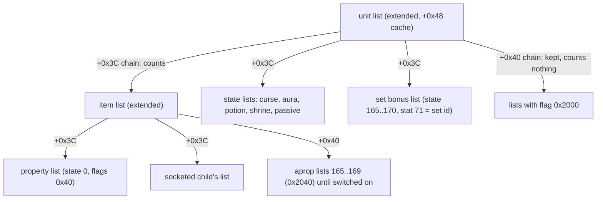
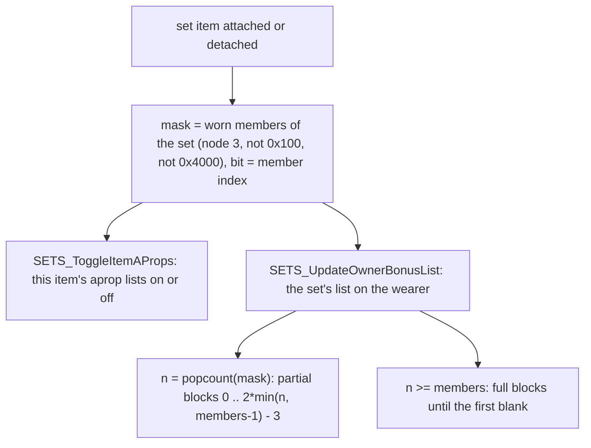

# 0001 — Stat aggregation: the stat lists, the `op` derivations, the maxima, items and set bonuses

> **Subsystem:** stats/aggregate
> **Question:** given a unit's base stats, its equipped items, its set bonuses, its passives, the auras around it and
> the states on it, what value does the server read for a stat, and when is that value recomputed?
> **Date:** 2026-10-17   **Plan:** 0041 (Phase 1 and 1b, static; Phase 2 run)   **Status:** Phase 2 run done, review requested

## Answer (summary)

Phase 2 (run:2026-10-17-stats) replayed the server player's lists of six characters against the model of this
finding, write for write; § 9 lists what each claim was checked against and what stays `[I]`.

- [C] **A unit owns one "extended" stat list; every other list hangs under it.** `sub_00626D40_UnitStatListCreate`
  makes it (0x64 bytes, flag `0x80000000`) with the stat callback `0x0055B800` for players and monsters and none for
  items and objects. Item property lists, set lists, state lists (curses, auras, potions, shrines, passives) and the
  wearer's item lists are linked under a unit list by `STATLIST_LinkToUnit`: on the `+0x3C` chain they count, on the
  `+0x40` chain (list flag `0x2000`) they are kept but count for nothing. (fn:sub_00626D40_UnitStatListCreate@0x00626D40,
  fn:STATLIST_LinkToUnit@0x00626E10, struct:StatList+0x3C, run:2026-10-17-stats)
- [C] **Every full read is a cache read.** `sub_00625500_UnitGetStat` and `STATS_GetUnitStat` read the unit list's
  `+0x48` array (the "full" values); `STATS_GetUnitBaseStat` reads its `+0x24` array (the unit's own entries). Nothing
  is summed at read time. (fn:sub_00625420_StatListGetStat@0x00625420, fn:sub_00624F60_StatListGetValue@0x00624F60,
  fn:sub_00624ED0_StatListGetBaseValue@0x00624ED0, run:2026-10-17-stats)
- [I] Both readers floor the value at `MinAccr << ValShift` when the stat has `fMin` and the unit is a player or a
  monster: no read of the run reached the floor. (fn:sub_00624F60_StatListGetValue@0x00624F60, tbl:ItemStatCost.txt:fMin,
  tbl:ItemStatCost.txt:MinAccr)
- [C] **The cache is kept by propagation.** Every add or set on any list passes the delta up the parent chain
  (`STATLIST_Propagate`): a stat with no `op` link adds the delta to each extended list's cache; a stat that feeds an
  `op` or is an `op` target is re-evaluated (`sub_006266C0_StatRecompute`). The walk stops after a list with flag
  `0x2000`, and, for a `damagerelated` stat, after a list linked "without damage" (flag `0x40000000`). Linking and
  unlinking a list propagate all its entries the same way. (fn:STATLIST_Propagate@0x00626920,
  fn:STATLIST_CacheAdd@0x006250B0, fn:STATLIST_Unlink@0x006269F0, run:2026-10-17-stats)
- [C] **The full value of a stat** on an extended list is `own + Σ children` (its `+0x24` entry plus each `+0x3C`
  child's active array, one level), then each `op` input in `ITEMSTATCOST_Load`'s order (source-row order) adds its
  term: op 1/11/13 a percentage of a base value, op 2/4 `(src × level) >> param`, op 5 a percentage of that, op 8/9
  `CharStats × (full − own) × 64` for energy and vitality. The arithmetic is § 4. (fn:sub_00626200_StatEvaluate@0x00626200,
  fn:ITEMSTATCOST_Load@0x00637A00, run:2026-10-17-stats)
- [I] Op 3 (no row), op 6 and 7 (time of day; no spawnable row) and the empty ops 10 and 12 were not reached.
  (fn:sub_00626200_StatEvaluate@0x00626200, fn:STAT_ByTimeValue@0x0065CA30)
- [C] **The maxima** are the cached full stats 7, 9 and 11 (`UnitGetMaxHp`, `UNIT_GetMaxMana`,
  `UNIT_GetMaxStamina`). Item and state life reaches them through the cache; vitality and energy from items through
  op 9 and op 8 with the class's `LifePerVitality`, `StaminaPerVitality`, `ManaPerMagic` (quarter points); `item_maxhp_percent` and `item_maxmana_percent` (op 11) are a
  percentage of the summed flat value only (op 11: 92 predicted writes, § 9).
  (fn:sub_00625D10_UnitGetMaxHp@0x00625D10, fn:UNIT_GetMaxMana@0x00625D60, fn:UNIT_GetMaxStamina@0x00625DB0,
  tbl:CharStats.txt:LifePerVitality, run:2026-10-17-stats)
- [C] **When a maximum changes, the current value is rescaled** by the stat callback (stats 7, 9, 11 → 6, 8, 10):
  `cur' = min(max(trunc(f32(new / max(old, 256) × cur)), 1), new)`, as monsters/0004 § 11 reads it for stat 7.
  (fn:sub_0055B800_MonStatCallback@0x0055B800, run:2026-10-17-stats)
- [I] Removing an item also clamps life, mana and stamina to their maxima (`UNIT_ClampVitals`); the floor of `maxhp`
  is 1 life (`MinAccr` 1). Neither value was predicted by the run (the clamp's writes were taken as inputs).
  (fn:UNIT_ClampVitals@0x006275B0, tbl:ItemStatCost.txt:MinAccr)
- [C] **Items count only while linked.** An equipped item's list is linked when its requirements are met
  (`sub_0062EAF0_ItemReqCheck`: identified, strength and dexterity, with the ethereal −10 deciding 30 checks);
  the refresh `sub_0055DBC0_EquipReqRefresh` unlinks the failing ones (flag `0x4000`) and re-links in a loop until no
  item changes. Charms count from the inventory. For a Barbarian the weapon that is not the active one is linked
  "without damage". (fn:sub_0055DBC0_EquipReqRefresh@0x0055DBC0, fn:sub_0062EAF0_ItemReqCheck@0x0062EAF0,
  fn:ITEMS_AttachToOwner@0x0055C2C0, run:2026-10-17-stats)
- [I] The `item_req_percent` (stat 91) term of the requirement changed no outcome in the run; the level and class
  tests, a broken item (flag `0x100`) and an Assassin's second weapon were not reached by the run. (fn:sub_0062EAF0_ItemReqCheck@0x0062EAF0, fn:sub_0055F850_ItemBreak@0x0055F850, fn:UNIT_CanDualWield@0x006235A0)
- [C] **Set bonuses** live in two places: each worn set item's own `aprop` lists (states 165–169, flags `0x2040`,
  switched on or off by `add func`: 1 = by which other member is worn, 2 = by how many), and one list per set on
  the wearer (a state from 165–170, marked by stat 71 = the set id) rebuilt from Sets' partial blocks
  `0 .. 2·(n−1)−1` (with `n` capped at members − 1) and, when every member is worn, the full blocks. Items whose
  requirements fail are not counted, and a duplicate member counts once. (fn:SETS_UpdateOnEquip@0x00663CC0,
  fn:SETS_ToggleItemAProps@0x00663A20, fn:SETS_UpdateOwnerBonusList@0x00663B40, fn:sub_00660120_SetBonusApply@0x00660120,
  fn:SETS_WornMemberMask@0x0062A370, run:2026-10-17-stats)
- [I] A broken member (flag `0x100`) was not reached. (fn:SETS_WornMemberMask@0x0062A370)

## Leads used

Phase 1b, compared after the code reading of § 4 – § 8 (blind first).

- [L] src:pk-itemstatcost-guide: op 1 adds `opstat.base × statvalue / 100`. **held with refinement**
  Detail: the base is the item's own base stat on an item, else the target's summed value before any op term (the
  running `[ebp-8]`, § 4), through `MulDiv`; any owner type, not only items.
- [L] src:pk-itemstatcost-guide: op 2 adds `(statvalue × basevalue) / 2^param`, refreshed on re-equip, save or
  level-up. **held**
  Detail: `(p × b) >> param` in signed 32 bits on a player or monster list; a level change re-evaluates the
  `+0x5E` dependents of `level`, so level-up refreshes it (§ 4, § 3).
- [L] src:pk-itemstatcost-guide: op 3 is the percentage form of op 2; op 4 and 5 are op 2 and 3 "on the item".
  **held with refinement**
  Detail: op 4/5 are evaluated on an item's list with the level of the unit the item is linked to (`list +0x04`), a
  player or a monster; op 3/5 take `MulDiv(base, term, 100)` with the same base as op 1.
- [L] src:pk-itemstatcost-guide: op 6 "does not work" and op 7 updates only on the client. **contradicted**
  Detail: the server evaluator computes both (§ 4, `STAT_ByTimeValue`), op 7 as a percentage of the running total.
  Not reachable on stock data: the only stock rows that write a `…/time` property are the magic suffixes *of Dawn*
  and *of Sunlight*, both `spawnable` 0 and `frequency` 0. Not a Phase 2 case; [backlog](../../backlog.md) entry
  filed.
- [L] src:pk-itemstatcost-guide: op 8 and 9 give mana and life/stamina from CharStats for the energy and vitality
  "added", characters only; op 11 is op 1 with extra checks; 10 and 12 do nothing; 13 is op 1 on items only.
  **held with refinement**
  Detail: "added" is precisely `full − own` of the source on the evaluated list (§ 4), so a player's spent points do
  not pass through op 8/9 (they are added to the base maxima, player/0001); op 11 needs a player or monster owner and
  a non-zero base; 10 and 12 are empty cases; op 1 and 12 also hide the source's own cached value (§ 4).
- [L] src:pk-itemstatcost-guide: `fMin` keeps the stat in range; `MinAccr` is the floor. **held with refinement**
  Detail: a read-time floor of `MinAccr << ValShift` for players and monsters only; the stored entries are not
  clamped.
- [L] src:pk-itemstatcost-guide: `keepzero` is at most client-side; `direct` + `maxstat` give a capped current value.
  **held with refinement**
  Detail: `keepzero` keeps a 0 entry in the server's full cache (§ 3); the cap of a `direct` stat is applied by the
  writers (the regeneration ticks, the aura heal, stats/0002), not by the aggregation.
- [L] src:arreat-summit-class-pages: Barbarian, 1 vitality = 4 life and 1 stamina, 1 energy = 1 mana.
  **held with refinement**
  Detail: `CharStats` 16, 4 and 4 quarter points; through op 9/8 the factor is applied to item vitality and energy as
  `× n × 64` on the 1/256 scale, exact in integers (§ 4).
- [L] src:arreat-summit-item-pages: partial bonuses from two worn pieces, full bonus with the whole set, one set item
  cannot count twice, the green bonuses are per item, an inactive weapon slot does not count.
  **held with refinement**
  Detail: the worn mask is one bit per member index, so a duplicate counts once (§ 7); the partial blocks are pairs
  per worn count; broken and unusable members are not counted. The weapon-switch slot was not read: **not covered**
  (open question).

## Functions

| Address | Name | Role | Tag |
|---|---|---|---|
| `0x00626D40` | `sub_00626D40_UnitStatListCreate` | a unit's extended list, its callback and its state bit-sets | I |
| `0x006251F0` | `STATLIST_Alloc` | a plain list (pool, flags, `+0x18`, owner type and guid) | I |
| `0x00626E10` | `STATLIST_LinkToUnit` | attach a list under a unit's list and propagate its entries | I |
| `0x006269F0` | `STATLIST_Unlink` | detach, propagate the negated entries, run the remove callback | I |
| `0x00626C00` | `STATLIST_Free` | unlink and free, freeing plain children | I |
| `0x00627910` | `sub_00627910_StatListLinkOwner` | link an item's list to a unit, with or without damage | I |
| `0x00627A40` / `0x00627860` | `STATLIST_DisableDamageStats` / `STATLIST_EnableDamageStats` | flip `0x40000000` and propagate the damage-related entries | I |
| `0x006279A0` | `UNIT_ToggleStatListByState` | move a state's list between the counting and the off chain | I |
| `0x00624FE0` | `STATLIST_SumOwnAndChildren` | own entry plus each counting child's entry | I |
| `0x00626200` | `sub_00626200_StatEvaluate` | the full evaluation with the op terms | C (items/0006 for op 13) |
| `0x006266C0` | `sub_006266C0_StatRecompute` | evaluate, write the cache, recompute targets and dependents | I |
| `0x00626920` | `STATLIST_Propagate` | pass a delta up the parent chain | I |
| `0x006250B0` / `0x00625150` | `STATLIST_CacheAdd` / `STATLIST_CacheWrite` | update the `+0x48` cache, fire the stat callback | I |
| `0x00624ED0` / `0x00624F60` | `sub_00624ED0_StatListGetBaseValue` / `sub_00624F60_StatListGetValue` | the readers, with the `fMin` floor | I |
| `0x00637A00` | `ITEMSTATCOST_Load` | builds the op graph (`+0x51..+0x53`, `+0x5E`, `+0x0DE`) | I |
| `0x0065CA30` | `STAT_ByTimeValue` | the op 6/7 time-of-day value | I |
| `0x00625D10`, `0x00625D60`, `0x00625DB0` | `sub_00625D10_UnitGetMaxHp`, `UNIT_GetMaxMana`, `UNIT_GetMaxStamina` | full stats 7, 9, 11 | I |
| `0x0055B800` | `sub_0055B800_MonStatCallback` | the stat callback of players and monsters | I (C for stat 7 on monsters, monsters/0004) |
| `0x006275B0` | `UNIT_ClampVitals` | stamina, mana, life down to their maxima | I |
| `0x0055C2C0` / `0x0055C730` | `ITEMS_AttachToOwner` / `ITEMS_DetachFromOwner` | equip and unequip, with the set update | I |
| `0x0055DBC0` | `sub_0055DBC0_EquipReqRefresh` | the requirement pass over charms and body slots 1..10 | I |
| `0x0062EAF0` | `sub_0062EAF0_ItemReqCheck` | strength, dexterity, level, identified, class | I |
| `0x0055F850` | `sub_0055F850_ItemBreak` | flag `0x100`, durability 0, unlink, set update | I |
| `0x00663CC0`, `0x00663A20`, `0x00663B40`, `0x00660120` | `SETS_UpdateOnEquip`, `SETS_ToggleItemAProps`, `SETS_UpdateOwnerBonusList`, `sub_00660120_SetBonusApply` | the set activation | I |
| `0x00535D10`, `0x00623C80` | `sub_00535D10_WeaponListsRelink`, `sub_00623C80_WeaponListsRelink2` | relink the two hands of a dual-wielder | I |

## Walkthrough

### 1. The list structure (`struct:StatList+0x10`)



- [I] A plain list is 0x3C bytes: pool, the unit it is linked to (`+0x04`), the type and guid of the unit that made
  it (`+0x08`, `+0x0C`), flags (`+0x10`), state (`+0x14`), the expiry frame (`+0x18`), skill and skill level
  (`+0x1C`, `+0x20`), its entries (`+0x24`: pointer, s16 count, s16 capacity), siblings (`+0x2C`, `+0x30`), parent
  list (`+0x34`) and a remove callback (`+0x38`). An extended list adds the two child chains (`+0x3C`, `+0x40`),
  its unit (`+0x44`), the full cache (`+0x48`), the changed-stat keys for the client (`+0x50`), the two state
  bit-sets (`+0x58`) and the stat callback with its argument (`+0x5C`, `+0x60`). (fn:STATLIST_Alloc@0x006251F0,
  fn:sub_00626D40_UnitStatListCreate@0x00626D40, struct:StatList+0x48)
- [I] Entries are `{key, value}` with `key = stat << 16 | param`, sorted ascending and found by binary search;
  the arrays grow and shrink by four. `STATLIST_AddStat` adds to the entry and removes it at 0;
  `STATLIST_SetStatEx` replaces it and removes it when the new value is 0; both propagate the difference and, on a
  player's own (extended) list, record the key for the client when the stat has ISC `+0x05` bit 4 (`Saved`) and is
  not 6, 8, 10, 13 or 14. (fn:STATLIST_FindIndex@0x00624B90, fn:STATLIST_AddStat@0x00627030,
  fn:STATLIST_SetStatEx@0x006270B0, fn:STATLIST_MarkClientDirty@0x00624DD0)
- [I] Flags seen: `0x2` timed, `0x4` dropped on a mode change, `0x8` the state's `aura` bit, `0x20` a curse, `0x40`
  an item's property list, `0x800` the state's `exp` bit, `0x2000` off chain, `0x20000000` holds an op-4/5 source,
  `0x40000000` linked without damage, `0x80000000` extended. Flags `0x1`, `0x80`, `0x100` are tested by the death
  purge (stats/0002 § 5) and not set by any code read here. (fn:STATE_ApplyTimed@0x0056E970,
  fn:sub_006272E0_StatListsDropOnMode@0x006272E0, fn:sub_00627540_StatListsPurgeOnDeath@0x00627540)

### 2. Linking and unlinking

```c
// fn:STATLIST_LinkToUnit@0x00626E10 (unit, list, withDamage)
STATLIST_Unlink(list);
if (list already in unit->pStatList's parent chain) return;
if (list->flags & 4) unitList->flags |= 2;
if (list->flags & 0x2000) { push list on unitList->+0x40; list->pParent = unitList; list->pUnit = unit; return; }
push list on unitList->+0x3C; list->pParent = unitList; list->pUnit = unit;
if (list is extended && list->flags & 0x20000000)          // op-4/5 sources: re-evaluate with the new wearer's level
    for each key in list->full with ISC[stat].+0x53: StatRecompute(list, key);
if (!withDamage) { list->flags |= 0x40000000; for each entry not damagerelated: Propagate(list, entry, +value); }
else             { list->flags &= ~0x40000000; for each entry: Propagate(list, entry, +value); }
```

- [I] The entries propagated are the list's active array: the cache for an extended list (an item: its own entries,
  its property list, its sockets, its counting set lists), else its own entries. Unlinking propagates the negated
  values (all of them, or the non-damage ones under `0x40000000`) and then calls the remove callback `+0x38` if the
  list was linked to a unit. (fn:STATLIST_LinkToUnit@0x00626E10, fn:STATLIST_Unlink@0x006269F0)
- [I] `sub_00627910_StatListLinkOwner(unit, item, withDamage)`: an item in socket or belt-like locations 11 and 12
  (item data `+0x44`) is only unlinked; an item already linked to the unit only switches damage on or off
  (`STATLIST_EnableDamageStats` / `STATLIST_DisableDamageStats` propagate the damage-related entries);
  otherwise it is linked. (fn:sub_00627910_StatListLinkOwner@0x00627910, fn:STATLIST_DisableDamageStats@0x00627A40)
- [I] `UNIT_ToggleStatListByState(unit, state, off)`: finds the list by state and, when its `0x2000` bit differs,
  unlinks it, flips the bit and links it again with damage, so a set list moves between the off and the counting
  chain with a full propagation. (fn:UNIT_ToggleStatListByState@0x006279A0)

### 3. The cache: propagation and recompute

```c
// fn:STATLIST_Propagate@0x00626920 (ECX list where the change happened, EDX key, delta, srcItem)
if (list->flags & 0x2000) return;
if (!(list->flags & 0x80000000)) list = list->pParent;
while (list) {
    if (!ISC[stat].hasDependents(+0x51) && !ISC[stat].hasOpIn(+0x52)) STATLIST_CacheAdd(list, key, delta, srcItem);
    else                                                              sub_006266C0_StatRecompute(list, key, srcItem);
    stop = list->flags & 0x2000 || (ISC[stat].damagerelated && list->flags & 0x40000000);
    list = list->pParent; if (stop) return;
}
```

- [I] `STATLIST_CacheAdd` adds the delta to the cache entry (creating it), removes it at 0 unless `keepzero`, and
  calls the stat callback when the stat has `fCallback`, with `(arg, key, old, new)`; `STATLIST_CacheWrite` sets the
  value and calls the callback only when it changed. Both set list flag `0x20000000` for a stat with ISC `+0x53`.
  (fn:STATLIST_CacheAdd@0x006250B0, fn:STATLIST_CacheWrite@0x00625150, tbl:ItemStatCost.txt:keepzero)
- [I] `StatRecompute(list, key)`: `v = Evaluate(list, key)`. A stat without dependents writes `v` and returns. Else:
  when `v` is 0 it is written at once; each `op stat1..3` target is recomputed and written; then, only if no target
  "took" a contribution **and** `v ≠ 0`, `v` is written and every `+0x5E` dependent (the stats whose `op base` is this
  one) is recomputed and written. So a source that evaluates to 0 never walks its dependents (no stock `op base` row
  reaches 0: they are all `level`). (0x006266FB–0x00626708, 0x00626847–0x00626856; review 2026-10-17) A target "takes" when its new value is non-zero and the source's `op` is 1 or 12 (always), 2/3 (list of a
  player or monster and a positive cached stat 0, see below), 4/5 (linked unit a player or monster with positive
  stat 0), 6/7 (list of a player or monster) or 13 (list of an item); ops 8, 9, 10, 11 never take. So a source of op
  1, 2–7, 12 or 13 keeps its **old** cache value (0 on first use) while its target is non-zero, and its dependents are
  not walked. (fn:sub_006266C0_StatRecompute@0x006266C0, 0x006267AD the op class table at 0x0062690C)
- [I] **A quirk in the take test for ops 2–5:** the `op base` it reads is not the source row's `+0x56` but the
  source row's own `opIn[k].opBase` (`+0x0DE + 6k`, `k` = the target's index), which is 0 for every row that is not
  itself a target, so it tests the list's (or the linked unit's) stat 0 `strength`. Players have strength, so on a
  player the per-level sources are hidden; a monster's strength is usually 0. The loader fills only `+0x5E..+0xDD`
  with `0xFFFF` (`rep stos`, 0x20 dwords), not `+0x0DE`, so the 0 of a non-target row is the record's initial
  content, which no code read here writes; Phase 2 question 3 confirms it. (0x006267C0–0x006267DA,
  0x006267F7–0x00626811, 0x00638250–0x00638262)
- [I] **Level-up.** `level` is the `op base` of the 37 per-level rows, so it has dependents; a change of stat 12
  re-evaluates `level` (no targets, so it is always written) and then every per-level row and their targets.
  (fn:ITEMSTATCOST_Load@0x00637A00, tbl:ItemStatCost.txt:op base)
- [I] There is no other cache and no lazy recompute: the full value read at any frame is the result of the last
  propagation. The "recompute triggers" are therefore every list write, link, unlink and toggle.
  (fn:sub_00624F60_StatListGetValue@0x00624F60, fn:STATLIST_Propagate@0x00626920)
- [I] Helpers named on the way (no behaviour beyond their names): `STATLIST_FindInsertPos`, `STATLIST_InsertEntry`,
  `STATLIST_RemoveEntry` (the sorted arrays), `STATLIST_GetActiveArray` (`+0x48` when extended, else `+0x24`),
  `STATLIST_GetOwnerUnit` (an item list's wearer and whether it is linked with damage), `STATLIST_Clear` (removes
  every entry with propagation), `UNIT_FreeStatList`, `UNIT_UnlinkItemStatList`. (fn:STATLIST_FindInsertPos@0x00624BD0,
  fn:STATLIST_InsertEntry@0x00624C80, fn:STATLIST_RemoveEntry@0x00624D10, fn:STATLIST_GetActiveArray@0x00624F40,
  fn:STATLIST_GetOwnerUnit@0x00625820, fn:STATLIST_Clear@0x00627340, fn:UNIT_FreeStatList@0x00626D10,
  fn:UNIT_UnlinkItemStatList@0x006277F0)

### 4. The evaluation: the `op` terms (`fn:sub_00626200_StatEvaluate@0x00626200`)

```c
// ECX list, EDX key (target stat t << 16 | param)
v  = list->base[key] + Σ_{c in list->+0x3C} c->active[key]   // children with 0x40000000 skipped for damagerelated t
b0 = v;  acc = v;                                            // b0 is "[ebp-8]", acc is "[ebp-4]"
if (ISC[t].hasOpIn)
  for (k = 0; k < 16 && ISC[t].opIn[k].op != 0; k++) {       // source-row order (ITEMSTATCOST_Load)
    e = ISC[t].opIn[k]; src = e.source << 16;                // param 0
    switch (e.op) {
    case 1:  if (owner) { if (owner is item) b0 = BaseStat(owner, t); if (b0) { p = Eval(src); if (p) acc += MulDiv(b0, p, 100); } } break;
    case 2:  if (list->ownerType in {0,1} && e.opBase != 0xFFFF) { b = list->active[opBase] >> ValShift(opBase);
               if (b > 0 && (p = Eval(src))) acc += (p * b) >> e.opParam; } break;
    case 3:  same b; if (b > 0 && (p = Eval(src))) acc += MulDiv(b0, (p * b) >> e.opParam, 100); break;
    case 4:  as 2 with b = STATS_GetUnitStat(list->pUnit, opBase) >> ValShift, pUnit a player or monster; break;
    case 5:  as 3 with the b of case 4; break;
    case 6:  if (owner && owner->+0x1C && (p = Eval(src))) acc += STAT_ByTimeValue(p, ActTimeOfDay(owner->+0x1C, &x), x); break;
    case 7:  if (owner && owner->+0x1C && (p = Eval(src))) acc += MulDiv(acc, STAT_ByTimeValue(p, ...), 100); break;
    case 8:  if (owner is player) { d = Eval(src) - list->base[src]; if (d) acc += CharStats(owner).ManaPerMagic * d * 64; } break;
    case 9:  as 8 with LifePerVitality (+0x46), or StaminaPerVitality (+0x47) when t == 11; break;
    case 11: if (b0 && owner is player or monster) { p = Eval(src); if (p) acc += MulDiv(b0, p, 100); } break;
    case 13: if (owner is item) { b0 = BaseStat(owner, t); if (b0 && (p = Eval(src))) acc += MulDiv(b0, p, 100); } break;
    case 10: case 12: break;
    }
  }
return acc;
```

- [I] `owner` is the list's unit `+0x44`, `BaseStat` reads the owner's own `+0x24` entry, `Eval(src)` is the full
  recursive evaluation on the **same** list, `MulDiv` is monsters/stats A1. The products of ops 2–5 are signed 32-bit
  `imul` then an arithmetic shift. `b0` starts as the own-plus-children sum and only ops 1 and 13 on an item replace
  it, so on a player op 11 is a percentage of the flat sum, not of vitality's share; op 7 alone uses the running
  total. (0x00626294–0x00626662, jump table 0x00626688, fn:sub_00483360_MulDiv@0x00483360)
- [I] **The order is fixed by the loader:** `ITEMSTATCOST_Load` walks the rows in id order and appends each row to
  the `opIn` table of every `op stat1..3` target, so e.g. `armorclass` evaluates 16 (op 13), 214 (op 4), 215 (op 5),
  268 (op 6), 269 (op 7) in that order and `maxhp` 3 (op 9), 76 (op 11), 216 (op 2), 270 (op 6). An `op` outside
  1..13 is zeroed. It sets `+0x51` on each source with a target and on each `op base` row (appending the source to
  that row's `+0x5E` list), `+0x52` on each target and `+0x53` on op-4/5 sources, and marks rows touching 7, 9 or
  11 in the ISC flag bytes (`+0x04` bits 5–7, `+0x05` bit 0). (fn:ITEMSTATCOST_Load@0x00637A00, 0x006382E0–0x00638490)
- [I] **op 6/7 (by time):** the source value is `Encode` 4: bits 0–1 a period `q`, bits 2–11 `lo + 256`, bits 12–21
  `hi + 256`. With the phase `x` from `sub_0061C100_ActTimeOfDay`: `a = |x − 90q|`, rounded to a multiple of 15
  (`(a + 7) / 15 × 15`, 0 below 1), then `a ≥ 359 → 360 − 359`, `a ≥ 180 → 360 − a`; value `hi − (hi − lo)·a/180`.
  The phase source (`owner +0x1C`) is not read further; stock data never reaches this case (Leads used).
  (fn:STAT_ByTimeValue@0x0065CA30, fn:sub_0061C100_ActTimeOfDay@0x0061C100)
- [I] **op 8/9:** the term uses only `full − own` of the source on the list being evaluated. On a player's list
  `own` is the base attribute, so only item, state and set vitality/energy give life, stamina and mana here; the
  spent points are added to the base maxima by the stat-point code (player/0001). (0x00626511–0x00626606,
  fn:CHARSTATS_GetRecord@0x004833E0, fn:PLAYER_SpendStatPoint@0x00570D60)

### 5. The maxima and the current values

- [I] `UnitGetMaxHp`, `UNIT_GetMaxMana` and `UNIT_GetMaxStamina` read the cached full stats 7, 9 and 11 with the
  `fMin` floor (`MinAccr` 1, 0, 0). So `maxhp = base 7 + Σ items/states/sets flat 7 + op 9 + op 11 + op 2 + op 6`,
  each as § 4. (fn:sub_00625D10_UnitGetMaxHp@0x00625D10, fn:UNIT_GetMaxMana@0x00625D60,
  fn:UNIT_GetMaxStamina@0x00625DB0, tbl:ItemStatCost.txt:MinAccr)
- [I] **The rescale callback.** On a cache change of stat 7, 9 or 11 with `new ≠ old`, `old > 0` and current
  (6, 8, 10) > 0: `r = ftol((float)(new / max(old, 256) × cur))` (`fild`/`fidiv`/`fimul`, stored to a float32), and
  the current value becomes `r` (at least 1) when `max(r, 1) < new`, else `new`. A monster with a MonStats `+0x1A0`
  factor also gets `hpregen = ((new >> 8) × factor) >> 4` (monsters/0004 § 11). (fn:sub_0055B800_MonStatCallback@0x0055B800,
  0x0055B8EC–0x0055B998)
- [I] The callback also: (re)registers the stat's item events (`itemevent1/2`) when the value goes to or from 0;
  adds or refreshes skills for 83, 97, 107, 126, 127, 188, 204; starts or stops an item aura for 151
  (stats/0002 § 4); and for 98 `state` sets or clears that state with the group exclusion (stats/0002 § 2).
  (fn:sub_0055B800_MonStatCallback@0x0055B800, tbl:ItemStatCost.txt:itemevent1)
- [I] `UNIT_ClampVitals` (run by `ITEMS_DetachFromOwner` when asked): stamina, mana and life, in that order, are
  lowered to their maxima when above (`AddStat(current, max − current)`). (fn:UNIT_ClampVitals@0x006275B0)

### 6. Items: equip, requirements, broken, ethereal, sockets

- [I] `ITEMS_AttachToOwner(owner, item)`: refused for a player in state 7 `playerbody`; a gem, rune or jewel gets its
  `gems` mods (items/0007); a set item runs `SETS_UpdateOnEquip(owner, item, 0, 0)`; then the item's list is linked
  with damage, except for a unit that can dual-wield (`UNIT_CanDualWield`: player classes 4 and 6, monster classes 417
  and 418) when the item is a weapon other than the primary one, which is linked without damage. A broken item
  (flag `0x100`) is linked only when the caller forces it. (fn:ITEMS_AttachToOwner@0x0055C2C0,
  fn:UNIT_CanDualWield@0x006235A0, fn:INV_GetPrimaryWeapon@0x0063BEF0)
- [I] `ITEMS_DetachFromOwner(owner, force, clamp)`: refused for a player in state 7; a set item runs
  `SETS_UpdateOnEquip(owner, item, 1, 0)`; the list is unlinked (unless broken and not forced); for a dual-wielder
  the remaining primary weapon is re-linked with damage; `clamp` runs `UNIT_ClampVitals`.
  (fn:ITEMS_DetachFromOwner@0x0055C730)
- [I] **Requirements** (`sub_0062EAF0_ItemReqCheck(item, unit)`): `str = reqstr + MulDiv(reqstr, stat 91, 100)`,
  `dex` the same with `reqdex` (record `+0x10A`, `+0x10C`), each −10 when ethereal (`0x400000`); the unit's full
  strength and dexterity must be ≥ 1 and ≥ the requirement; level ≥ the item's level requirement; the item must be
  identified (`0x10`); a type-18 base needs a positive stat 70; the class must match: item class 7 is any class, a
  player needs its own class, and a monster passes only for class-4 (Barbarian) items when
  `sub_00463900_MonClassCheck` gives 560 or 561. (fn:sub_0062EAF0_ItemReqCheck@0x0062EAF0, 0x0062EB63–0x0062EBBE,
  tbl:ItemStatCost.txt:Stat)
- [I] **The refresh** (`sub_0055DBC0_EquipReqRefresh`, after equip, place, break, repair, identify and more): (1)
  each inventory charm (type 13) that is usable and not linked is linked; (2) body slots 1..10: each item that is
  linked or not marked, and fails its requirements, is marked `0x4000` and unlinked with the clamp; (3) repeat over
  slots 1..10 until nothing changes: each unbroken item that is marked or unlinked and now passes is unmarked and
  linked; (4) every equipped, unbroken, unmarked set item is detached and re-attached (refreshing every set list).
  Step (2) runs once, so an unlink that breaks another item's requirement is caught at the next refresh, not in this
  one. (fn:sub_0055DBC0_EquipReqRefresh@0x0055DBC0, fn:sub_0055DB00_ItemUsableBy@0x0055DB00,
  fn:ITEMS_IsActiveCharm@0x0062FF70)
- [I] **Broken:** `sub_0055F850_ItemBreak` sets `0x100`, unlinks the item when equipped, sets durability 72 to 0 and updates
  its set with the item excluded; `sub_0055F900_ItemRepairBroken` clears it and re-runs the refresh. Ethereal and
  sockets change only the item's own lists (items/0006 § 6, items/0007), which reach the wearer through the item's
  cache. (fn:sub_0055F850_ItemBreak@0x0055F850, fn:sub_0055F900_ItemRepairBroken@0x0055F900)

### 7. Set bonuses



- [I] **Per item (`add func`).** `SETS_ToggleItemAProps(item, mask)`: `add func` 1 → for each other member index
  `k` (0..5, skipping the item's own), the state slot `k` (or `k − 1` above the own index) of
  `g_SetBonusStates` = 165..170 is switched on iff member `k` is worn; `add func` 2 → with `c = popcount(mask) − 1`
  other members worn, states 165.. `165 + c − 1` on and the rest off. The lists are the item's `aprop` lists
  (items/0006: pair *k* → state `165 + k − 1`, flags `0x2040`), so pair *k* counts when its member (func 1) or
  *k* other members (func 2) are worn. (fn:SETS_ToggleItemAProps@0x00663A20, fn:SETITEMS_GetMemberIndex@0x0062B3A0,
  data:g_SetBonusStates@0x006EE424, data:g_PopCount6B@0x006EE440, tbl:SetItems.txt:add func)
- [I] **Per set on the wearer.** `SETS_UpdateOwnerBonusList(owner, item, mode)`: finds the wearer's list with a
  state in 165..170 whose stat 71 equals the set id (SetItems `+0x2C`); equip (mode 0) clears it, or creates one in
  the first free state, sets stat 71 and calls `SetBonusApply`; unequip (mode 1) unlinks and frees it, which the
  refresh's step (4) then rebuilds from the remaining members. `SetBonusApply`: `n = popcount(mask)` counting the
  item itself (`g_PopCount6A`), partial Sets blocks `0 .. 2·min(n, members − 1) − 3` (each with a code ≥ 0), and when
  `n ≥ members` the eight full blocks until the first code < 0, each through `PROP_ApplyBlockByVersion` (mode 4)
  into that list. (fn:SETS_UpdateOwnerBonusList@0x00663B40, fn:sub_00660120_SetBonusApply@0x00660120,
  data:g_PopCount6A@0x006EDA40, struct:SetsRec+0x0C)
- [I] Stat 71 (`value`) of the marker is an ordinary entry, so the wearer's full stat 71 is the **sum** of its
  active sets' ids (set id 0 adds nothing) plus any other stat-71 entry under it. The lookup reads stat 71 of each
  set list itself, not the cache, so the sum does not disturb it. (0x00663C93, 0x00663BDD,
  fn:STATLIST_AddStat@0x00627030)
- [I] The worn mask counts an item only in node page 3 (equipped), quality 5, not broken, not marked `0x4000`,
  and of the same set; a duplicate member sets the same bit. (fn:SETS_WornMemberMask@0x0062A370)

### 8. Passives and auras (stat lists only; the lifecycle is stats/0002)

- [I] A passive's list is a state list (the skill's `passivestate`) holding `passivestat1..5` = `passivecalc` at the
  skill's current level (with bonuses), each with param = `passiveitype` (0 when none), plus 350 = skill and
  351 = level; it is rebuilt only when 351 differs. It is removed while the skill's `aurastate` is on the unit.
  (fn:SKILLS_RefreshPassive@0x00646D60, fn:SKILLS_EvalCalc@0x00646CA0, tbl:Skills.txt:passivestat1)
- [I] An aura's target list is the `auratargetstate` list made by `AURA_ApplyToTarget` with `aurastat1..6` =
  `aurastatcalc`; stats 350/351 again; details in stats/0002 § 4. (fn:AURA_ApplyToTarget@0x005CEDC0)

### 9. The Phase 2 run (`run:2026-10-17-stats`)

The run logged the server player's whole stat-list tree and replayed it with `tools/stats.py`, which mirrors the tree
and predicts every line from § 1–§ 8 (method and counts in the run record). What each claim was checked against:

- [C] **The loader's op graph** (§ 4): the run-time ISC tail the logger dumps (targets `+0x58`, dependents `+0x5E`, the
  `opIn` table `+0x0DE`, the `+0x51`/`+0x52`/`+0x53` flags, the op byte, ValShift, MinAccr, keepzero and the
  damagerelated, fMin and fCallback bits) equals, for every one of the 359 rows (103 392 fields), what the rules of
  § 4 build from ItemStatCost; the take test's word `+0x0DE + 6k` is 0 on every row that is not itself a target
  (the record's initial content, § 3). (fn:ITEMSTATCOST_Load@0x00637A00, tbl:ItemStatCost.txt:op stat1,
  run:2026-10-17-stats)
- [C] **Linking, unlinking and propagation** (§ 2, § 3): 26 087 top-level and nested links and unlinks (item lists,
  set lists, state and passive lists, socketed children, the aprop toggles) and 207 017 Propagate calls; every
  Propagate a link or unlink makes was predicted (list, key, delta: 96 342), and every write inside each Propagate
  (137 242 CacheAdd, 94 800 CacheWrite) was predicted in order, with the old value it found; the tree after every
  top-level event equalled the mirror (5 143 snapshots, own entries, caches, flags and chains). Linking without
  damage (32, the dual-wield second weapon) and the `0x20000000` re-evaluation on link and unlink are among
  them. (fn:STATLIST_LinkToUnit@0x00626E10, fn:STATLIST_Unlink@0x006269F0, fn:STATLIST_Propagate@0x00626920,
  fn:sub_006266C0_StatRecompute@0x006266C0, run:2026-10-17-stats)
- [C] **The take test** (§ 3) as far as stock rows reach it: op 1 taken 156, op 2 taken 280, op 4 taken 2 568 and not
  taken 3 467 (the item unlinked: no linked unit), op 5 taken 26 and not 70, ops 8 and 9 never taken
  (615); 24 279 cache entries of sources whose target took kept their old value, and 1 239 recomputes of a source
  evaluating to 0 wrote it at once and walked no dependent. Op 3, 6, 7, 12 and 13's class were not reached by a
  source with a target that took. (0x006267AD, 0x0062690C, run:2026-10-17-stats)
- [C] **The evaluation** (§ 4) for the ops a stock row reached in a predicted write: op 1 348, op 2 1 490, op 4 2 568, op 5
  26, op 8 919, op 9 3 784, op 11 92, op 13 136 (each of the eight stock ops at least 20). Every other cached entry of every extended list evaluated to its cache (646 835 evaluations at the tree snapshots), except the stale
  sources above and the item op-4/5 values below. Op 3 and op 10 have no row, op 6, 7 and 12 none spawnable: those
  stay `[I]`. (fn:sub_00626200_StatEvaluate@0x00626200, run:2026-10-17-stats)
- [C] **An item's op-4/5 value is not refreshed when the wearer levels up.** After the Paladin's level-ups the
  item lists with an op-4 source (`item_armor_perlevel` on Stormshield) kept the value of their last link (94
  entries), equal to the evaluation at the wearer's previous level: nothing propagates a stat of the linked unit into
  an item list; only `STATLIST_LinkToUnit` and `STATLIST_Unlink` re-evaluate the `+0x53` keys. The wearer's own
  per-level rows are re-evaluated by the level write (9 level changes, their dependent writes predicted).
  (0x00626EC4, 0x00626A84, run:2026-10-17-stats)
- [C] **Reads** (§ 1): 891 844 reads of the player's unit list by `sub_00624F60_StatListGetValue` in the 50-frame windows,
  of 120 stat ids, each equal to the mirrored cache entry with the fMin floor; no read reached the floor
  (0). (fn:sub_00624F60_StatListGetValue@0x00624F60, run:2026-10-17-stats)
- [C] **The rescale callback** (§ 5): 5 752 changes of stats 7, 9 and 11 with a positive current value; the
  current value written after each equals `min(max(ftol(f32(new / max(old, 256) × cur)), 1), new)` (stat 7: falls 1 797, rises 1 810, capped 57; stat 9: falls 432, rises 446,
  capped 702; stat 11: rises 5, capped 503).
  (fn:sub_0055B800_MonStatCallback@0x0055B800, 0x0055B8EC, run:2026-10-17-stats)
- [C] **The stat callback fires** exactly for the player-list writes of `fCallback` stats that change the value
  (14 522 calls, key, old and new predicted). (fn:STATLIST_CacheAdd@0x006250B0, fn:STATLIST_CacheWrite@0x00625150,
  run:2026-10-17-stats)
- [C] **Requirements** (§ 6): 17 634 checks; the strength and dexterity flags and the result predicted from the base
  record, stat 91, the ethereal −10 and the mirrored unit stats (passed 15 610 plain, 814 with stat 91, 428 ethereal; failed 428 by
  strength, 24 ethereal by strength, 240 by dexterity, 90 unidentified). **The ethereal −10 decided 30 checks**
  (`StatsBarD`, strength 85: the ethereal War Boots, 125 strength, pass with 115..124 and would fail without the −10;
  `bard-town1`, `bard-town2`): `[C]`. The `item_req_percent` term (stat 91) changed no outcome in its 814 checks (a
  reading without it predicts the same flags), the level test and the class test passed in every check (no item
  failed them), and a broken item was never checked: those branches stay `[I]`.
  (fn:sub_0062EAF0_ItemReqCheck@0x0062EAF0, run:2026-10-17-stats)
- [C] **Sets** (§ 7): 11 343 worn masks predicted from the inventory (page 3, quality 5, flags `0x4000` and `0x100`,
  member index; the Soul Cage, whose strength fails, never counted; two Angelic Halo set one bit); 5 749 aprop toggle
  sequences (add func 0: 1 844, 1: 819, 2: 3 086) with 19 525 toggles; 5 749 wearer set lists, of which 5 569 equal
  the Sets blocks for `n = popcount(mask)` (Angelical Raiment n=1 830; Civerb's n=1 22, n=2 880, n=3 1 152; Immortal
  King n=1 60, n=2 228, n=3 2 317; Trang-Oul's n=4 80). The 180 full Trang-Oul's lists (n=5, the full blocks with
  `state` and `oskill`) were taken as logged: the model does not build a `state` or `oskill` property list (a
  tool limit, the set's mask and count were predicted). The full blocks of a set whose last member is a broken item
  were not reached.
  (fn:SETS_WornMemberMask@0x0062A370, fn:SETS_ToggleItemAProps@0x00663A20, fn:sub_00660120_SetBonusApply@0x00660120,
  run:2026-10-17-stats)
- [C] **Passives** (§ 8): 8 832 refreshes; each `passivestate` list holds `passivestat` = `passivecalc` at the level it
  records in 351 (an input), with param `passiveitype`, and 350 = the skill (Sword Mastery 127 at 4–8, Increased Stamina 141 at 13–17, Iron Skin
  145 at 5–9, Natural Resistance 153 at 6–10; Fire Mastery 61 at 3–4 from the full Trang-Oul's `oskill`).
  Another 540 refreshes found no `passivestate` list on the player and were only counted.
  (fn:SKILLS_RefreshPassive@0x00646D60, run:2026-10-17-stats)
- [C] **`itemspecific` does not stop the propagation** (open question): the player's cache holds the sum of the
  equipped items' 72 and 73 in every snapshot, evaluated as an ordinary sum. (fn:STATLIST_Propagate@0x00626920,
  run:2026-10-17-stats)
- [I] **The weapon switch** (open question): a W press runs `sub_005616A0_PlayerSwapWeapons` (from
  `sub_0054CE70_SwapWeaponsReq`), which detaches both hands through `ITEMS_DetachFromOwner` (return addresses
  0x005617C9, 0x005617DD) and attaches the other pair through `ITEMS_AttachToOwner` (0x00561930): the logged caller
  chains; the function itself was not read. (fn:sub_005616A0_PlayerSwapWeapons@0x005616A0,
  fn:sub_0054CE70_SwapWeaponsReq@0x0054CE70, run:2026-10-17-stats)
- [C] **Step 4 of the refresh** (§ 6): every `sub_0055DBC0_EquipReqRefresh` (972) detached and re-attached every
  equipped, usable set item (`SETS_UpdateOnEquip` mode 1 then 0, each item's list unlinked and linked), as predicted.
  (fn:sub_0055DBC0_EquipReqRefresh@0x0055DBC0, run:2026-10-17-stats)
- [I] The refresh also ran with no click on a period of 136 frames on every character of the run (the commonest gap
  between two refreshes in every session); what queues it was not read. (fn:sub_0055DBC0_EquipReqRefresh@0x0055DBC0,
  run:2026-10-17-stats)

## Data touched

tbl:ItemStatCost.txt:op, tbl:ItemStatCost.txt:op param, tbl:ItemStatCost.txt:op base, tbl:ItemStatCost.txt:op stat1,
tbl:ItemStatCost.txt:keepzero, tbl:ItemStatCost.txt:fMin, tbl:ItemStatCost.txt:MinAccr,
tbl:ItemStatCost.txt:damagerelated, tbl:ItemStatCost.txt:fCallback, tbl:ItemStatCost.txt:ValShift,
tbl:CharStats.txt:LifePerVitality, tbl:CharStats.txt:StaminaPerVitality, tbl:CharStats.txt:ManaPerMagic,
tbl:SetItems.txt:add func, tbl:Sets.txt:PCode2a, tbl:Sets.txt:FCode1, tbl:Skills.txt:passivestat1,
tbl:Skills.txt:passiveitype; struct:StatList+0x10, struct:StatList+0x34, struct:StatList+0x48,
struct:ItemStatCostOps+0x5E, struct:ItemStatCostOps+0xDE.

## Phase 0 surprises

- [I] **(b) The off-name `op stat` cells are honoured as written.** The loader appends a source to every target its
  `op stat1..3` name, with no check of the names, so 273 `item_maxdamage_percent_bytime` feeds `maxdamage`,
  `secondary_mindamage` and `item_throw_mindamage`, and 237 and 291 feed `item_absorbmagic`. 237 is reachable only
  through a `…/lvl` property and 273/291 through `…/time` ones; whether a stock item carries 237 is a data check for
  Phase 2 (291 and 273: none, Leads used). (fn:ITEMSTATCOST_Load@0x00637A00, tbl:ItemStatCost.txt:op stat1)
- [I] **(e) A Sets param name resolves by a fixed table order, not by the property** (plan 0041 P1 review follow-up,
  2026-10-17). In the Sets descriptor built by `sub_00634DC0_LoadSetTables`, all 16 param fields (`pparam2a..5b`,
  `fparam1..8`) are type `0x19` with the callback `sub_006336A0_PropParamCell` (EBX = 0x006336A0 at 0x00634DD7, stored
  into the 16 entries from 0x00634EAE to 0x00635779; the code fields beside them are type `0x13` name lookups in
  `g_PropertiesLink`). The callback reads only the cell (ECX), the record (EDX) and the field offset: a cell starting
  with `-` or a digit is `atol`; otherwise the first `EXCEL_FindName` hit, in order, in the `skills` link
  (`0x0096C7CC`), the `montype` link (`0x0096C868`) and the `states` link (`0x0096BCF0`), is stored; a blank cell or a
  name in none of them stores 0. It never reads the block's code field, so an `oskill` and a `state` block with the
  same name store the same number, and a name that is both a skill and a state (44 such names) stores the **skill**
  row in either block. The same callback compiles Runes `T1Param` (items/0007 § 9) and is stored in 35 descriptor
  entries of this loader (the 16 Sets params, and SetItems `par1..9` and `apar1a..5b`). The ten stock named cells (Sets § Bonus blocks)
  are consistent with it: the four `oskill` names are skills, the six `state` names (`fullsetgeneric`, `monsterset`)
  are neither a skill nor a montype; no montype name equals a state name, and only `mosquito` is both a montype and
  a skill. (fn:sub_00634DC0_LoadSetTables@0x00634DC0, fn:sub_006336A0_PropParamCell@0x006336A0 0x006336A0–0x00633727,
  fn:EXCEL_FindName@0x006BD3C0, tbl:Sets.txt:FParam5)
- [I] **(a), (c)** are answered in [stats/0002 § 4](0002-states.md#4-auras-and-passives) (they are skill-state
  questions). (fn:SKILLS_RefreshPassive@0x00646D60, fn:sub_005CF010_PalAuraDo@0x005CF010)

## Dead ends

- Looking for a `UnitGetStat` that sums lists at read time: there is none; every reader reads the `+0x48` cache.
- The `+0x0DE` "opBase" read in `StatRecompute` looked like the row's `op base`; the address arithmetic says it is
  the row's own first `opIn` entry (§ 3).

## Open questions

- *Answered by the run (§ 9):* `itemspecific` does not stop the propagation; the weapon switch detaches and
  re-attaches both hands through `sub_005616A0_PlayerSwapWeapons` (the function itself not read).
- [L] The take test's stat-0 quirk hides a per-level source's own value on a player (§ 3); which readers read the
  per-level stats themselves (the character screen is client-side). Phase 2 logs one.
- [L] `sub_0061C100_ActTimeOfDay` and `owner +0x1C` (op 6/7): not read; unreachable on stock data.
