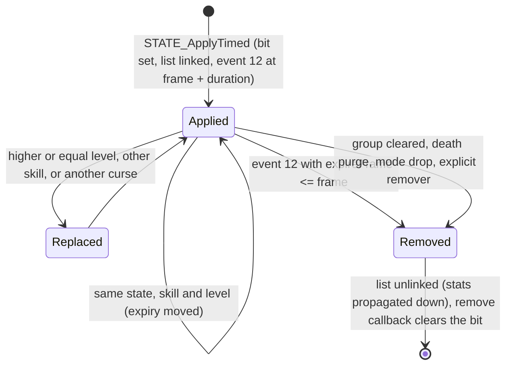

# 0002 — States: apply, refresh, stacking, expiry, the regeneration ticks, auras, passives, shrines and wells

> **Subsystem:** stats/states
> **Question:** when a state is put on a unit (a curse, an aura, cold, poison, a potion, a shrine), how long does it
> last in frames, what stat list does it carry, how does it refresh, expire and tick, and what draws does it make?
> **Date:** 2026-10-17   **Plan:** 0041 (Phase 1 and 1b, static; Phase 2 run)   **Status:** Phase 2 run done, review requested

## Answer (summary)

Phase 2 (run:2026-10-17-stats) replayed the Paladins' states, ticks and auras and the Necromancer's set state
against this finding; § 8 lists what each claim was checked against and what stays `[I]`.

- [C] **A state is two things:** a bit in the unit list's state bit-set (`UNIT_HasState`) and, usually, a stat list
  carrying the state id at `+0x14` under the unit. `STATE_Set` writes the bit (and the "changed" bit for the client);
  most removers free the list and clear the bit together. (fn:STATE_Set@0x00639DB0, fn:UNIT_SetStateBit@0x00625A70,
  fn:UNIT_HasState@0x00639DF0, struct:StatList+0x14, run:2026-10-17-stats)
- [C] **`STATE_ApplyTimed` is the common apply.** It takes `{source, target, skill, level, duration, stat, value,
  state, remove callback}`. An existing list of the same state (for a curse: any curse list, flag `0x20`) with the
  same skill and level is **refreshed** (expiry = frame + duration); with the same skill and a lower new level the
  call is **refused**; otherwise the old list is freed and a new one made (a higher-level aura replaces). The new
  list expires at `frame + duration` through unit event 12. Shrine states are curses (§ 5). No draw.
  (fn:STATE_ApplyTimed@0x0056E970, 0x0056EA4B, tbl:States.txt:curse, run:2026-10-17-stats)
- [I] A curse is refused when the target's `curse_resistance` (109) is ≥ 100 or the target is in state 57
  `attract`, and its duration loses `MulDiv(duration, r, 100)` with `r` = stat 109 (a negative `r` lengthens it; the
  test is signed): unreachable on stock data for the player (no item or affix carries stat 109; no monster casts
  Attract). (0x0056E9C9–0x0056EA4A, tbl:ItemStatCost.txt:Stat)
- [C] **Expiry.** Unit event 12 (`EVENT_TimedListExpire`) frees every timed list (flag `0x2`) whose `+0x18` ≤ the
  current frame; each request queues its own event, so a refreshed list's earlier event fires and frees nothing.
  (fn:EVENT_TimedListExpire@0x00580800, fn:UNIT_ExpireTimedLists@0x00627460, run:2026-10-17-stats)
- [I] The list's remove callback (default `STATE_DefaultRemoveCB`) keeps the bit on a dead unit when the state has
  `plrstaydeath`/`monstaydeath`; death purges every non-item list without flags `0x181` whose state does not stay on
  death: no death in the run. (fn:STATE_DefaultRemoveCB@0x0056E900, fn:sub_00627540_StatListsPurgeOnDeath@0x00627540)
- [C] **`group` exclusion** is done by `STATE_GroupClear`, not by the apply: it clears every other state of the same
  non-zero `group` on the unit and frees its list; the stock potions' states (178–180) have no `group`, so the
  potions' call clears nothing. The full Trang-Oul's Avatar's `state` = monsterset (stat 98) runs it through the stat callback (counts pending,
  see the plan log). (fn:STATE_GroupClear@0x0056C740, tbl:States.txt:group,
  run:2026-10-17-stats)
- [C] **The per-frame ticks** (player event 3, every frame): stamina `+= max >> 8` standing, `>> 9` walking (not
  below 1 point outside town), none running unless `staminarecoverybonus` ≥ 1000, `× (100 + bonus)/100`; mana
  `+= MulDiv(max / (ManaRegen·25), 100 + manarecoverybonus, 100) + manarecovery`, off under state 85 `nomanaregen`;
  life unchanged while stat 74 is 0. No draw. (fn:sub_00580810_RegenEvent@0x00580810, fn:PLAYER_StaminaRegenTick@0x00580500,
  fn:PLAYER_ManaRegenTick@0x005806F0, run:2026-10-17-stats)
- [I] Life `+= stat 74` capped at max (dropping the `healthpot` list at the cap) and floored at 256: no poison or
  open wounds reached the player in the run so far (Phase 2 in progress). (fn:sub_00580610_LifeRegenTick@0x00580610)
- [C] **Auras are refreshed timed states.** An aura skill runs from unit event 8 (the selected right skill) or event
  9 (an item's `item_aura`, stat 151) every `p = max(perdelay, 5)` frames on a grid (`((frame − 1 + p) / p)·p + 1`);
  each run applies `auratargetstate` to the units in range with a duration that ends one frame after the next run.
  Two auras of one state: equal level refreshes, higher replaces, lower is refused. A mercenary's aura runs the same
  way. (fn:EVENT_SelectedAuraTick@0x0056FCB0, fn:EVENT_ItemAuraTick@0x0056FE40, fn:SKILLS_NextPeriodicFrame@0x0056CD50,
  fn:AURA_ApplyToTarget@0x005CEDC0, run:2026-10-17-stats)
- [C] **Shrines** apply their state through a table at `0x006E1850` (code → stat, state) for `Duration in frames`,
  the stat value `Arg0` for the resists and the other `SHRINE_TimedStat` codes. (fn:OBJOP_Shrine@0x00583C70,
  data:g_ShrineEffects@0x006E1850, fn:SHRINE_TimedStat@0x00583B30, run:2026-10-17-stats)
- [I] Combat and stamina shrines' own handlers, the re-arm after `reset × 1200 + 1` frames and the wells (`Parm1/256`
  of each maximum per use, poison and freeze cured) were not reached or not predicted.
  (fn:SHRINE_Combat@0x005839B0, fn:SHRINE_Stamina@0x00583A70, tbl:Shrines.txt:reset)

## Leads used

Phase 1b, compared after the code reading of § 2 – § 7 (blind first).

- [L] src:arreat-summit-character-basics: stamina regenerates `Max_Stamina / 256` per frame standing, half of that
  walking in town and walking outside town when stamina > 0; recovery bonus multiplies by `(100 + %)/100`.
  **held with refinement**
  Detail: modes 1 and 5 `max >> 8`, 6 `max >> 9`, 2 `max >> 9` only when stamina ≥ 256 (one point); running and the
  other modes none unless `staminarecoverybonus` ≥ 1000; the bonus term is `d·bonus/100` truncated toward zero, added
  to `d` (§ 6).
- [L] src:arreat-summit-character-basics: mana regenerates `25·[[256·max/(25·120)]·(100 + %)/100]/256` per second; the
  Warmth example (900 mana, +258 %) gives 272 per frame on the 1/256 scale. **held with refinement**
  Detail: per frame `d = (max << 8)/(ManaRegen·25)` (120 for every class), at least 1, then `MulDiv(d, 100 + stat 27,
  100) + stat 26`; 230 400 / 3 000 = 76, `MulDiv(76, 358, 100)` = 272, as the page computes. State 85 removes the
  first term; the `manapot` list is dropped once mana is full (§ 6).
- [L] src:pk-itemstatcost-guide: `direct` stats have a `maxstat`. **held with refinement**
  Detail: the aura heal (`hitpoints` of Prayer, Meditation, Cleansing) adds to the current value capped at the full
  `maxstat` (§ 4).
- Searches for shrine durations and aura stacking found no page that served (the Arreat Summit shrine and paladin
  pages return "not found"); no lead registered for them.

## Functions

| Address | Name | Role | Tag |
|---|---|---|---|
| `0x0056E970` | `STATE_ApplyTimed` | the timed apply: curse rules, refresh, replace, expiry event | I |
| `0x00639DB0` | `STATE_Set` | set or clear a state bit (and the client bit) | I |
| `0x00625A70` / `0x00625B70` | `UNIT_SetStateBit` / `UNIT_TestStateBit` | the bit-sets at unit list `+0x58` | I |
| `0x0056C740` | `STATE_GroupClear` | clear the states of the same `group` | I |
| `0x0056E900` | `STATE_DefaultRemoveCB` | the remove callback: state bit, passives | I |
| `0x00580800` | `EVENT_TimedListExpire` | unit event 12 | I |
| `0x00627460` | `UNIT_ExpireTimedLists` | free timed lists at or past their frame | I |
| `0x00627540` | `sub_00627540_StatListsPurgeOnDeath` | drop non-item states that do not stay on death | I |
| `0x006272E0` | `sub_006272E0_StatListsDropOnMode` | drop flag-4 lists on a mode change | I |
| `0x00580810`, `0x00580610`, `0x00580500`, `0x005806F0` | `sub_00580810_RegenEvent`, `sub_00580610_LifeRegenTick`, `PLAYER_StaminaRegenTick`, `PLAYER_ManaRegenTick` | the player's per-frame tick | I |
| `0x0056FCB0`, `0x0056FE40` | `EVENT_SelectedAuraTick`, `EVENT_ItemAuraTick` | unit events 8 and 9 | I |
| `0x005BF510` / `0x005BF5D0` | `ITEMAURA_Start` / `ITEMAURA_Stop` | stat 151 on and off | I |
| `0x0056CD50` | `SKILLS_NextPeriodicFrame` | the `perdelay` grid | I |
| `0x0056B7E0` | `SKILLS_ForUnitsInRange` | near rooms, squared distance, filter | I |
| `0x005CF010` | `sub_005CF010_PalAuraDo` | a paladin aura run (SkilPal.cpp) | I |
| `0x005CEDC0` | `AURA_ApplyToTarget` | the target's aura state and its stats | I |
| `0x00646D60`, `0x00646F20` | `SKILLS_RefreshPassive`, `SKILLS_RefreshPassivesInState` | the passive state lists | I |
| `0x00583C70` | `OBJOP_Shrine` | the shrine operate (OperateFn 2) | I |
| `0x00583B30`, `0x005839B0`, `0x00583A70`, `0x00583BF0` | `SHRINE_TimedStat`, `SHRINE_Combat`, `SHRINE_Stamina`, `SHRINE_Skill` | the timed shrine handlers | I |
| `0x00583840` | `SHRINE_StatValue` | the stat value of a timed shrine | I |
| `0x005828E0`, `0x00582860`, `0x005828A0`, `0x00582940`, `0x005829A0` | `SHRINE_Refill`, `SHRINE_HealthBoost`, `SHRINE_ManaBoost`, `SHRINE_HealthExchange`, `SHRINE_ManaExchange` | the recharge shrines | I |
| `0x006E1810`, `0x006E2490` | `g_PlayerEventFuncs`, `g_MonEventFuncs` | unit event handlers by type | I |

## Walkthrough

### 1. The state bit and its list

- [I] The unit list's `+0x58` holds two bit-sets of `ceil(nStates / 32)` dwords: the states on, then the states
  changed (set whenever a bit flips, for the client). `STATE_Set` also maintains unit flag `+0xC8` bit 3 for states
  with States flag bit 16 `disguise`. `UNIT_HasState` answers for players, monsters and objects (types 0, 1, 3).
  (fn:UNIT_SetStateBit@0x00625A70, fn:UNIT_TestStateBit@0x00625B70, fn:STATE_Set@0x00639DB0)
- [I] The States flag columns are read through the 40 bit-sets at `DataTables+0xCC + 4i` (the states loader);
  those used here: 11 `curse` (`+0xF8`), 13 `plrstaydeath` (`+0x100`), 14 `monstaydeath` (`+0x104`), 30 `exp`
  (`+0x144`), 32 `life` (`+0x14C`). (fn:STATES_IsCurse@0x0063A420, fn:STATES_StaysOnDeath@0x0063A4A0,
  fn:STATES_IsExp@0x0063A6B0, tbl:States.txt:curse)

### 2. Apply: `STATE_ApplyTimed` (`struct:TimedStateReq+0x1C`)

```c
// fn:STATE_ApplyTimed@0x0056E970 (ECX req)
if (state out of range) return 0;
if (target is a monster && (MonStats(target) +0x0D bit 0 || !(MonStats2(target) +0x05 bit 1))) return 0;
curse = STATES_IsCurse(state);
if (curse) { r = STATS_GetUnitStat(target, 109 curse_resistance);
             if (r > 99) return 0;
             if (r) req->duration -= MulDiv(req->duration, r, 100);
             if (UNIT_HasState(target, 57 attract)) return 0; }
old = curse ? first list with flag 0x20 : UNIT_FindStatListByState(target, state);
if (old) {
  if (old->state == state && old->skill == req->skill) {
    if (old->skillLevel == req->skillLevel) {                      // refresh
      if (req->duration) { f = frame + duration; old->expireFrame = f, flags |= 2; UnitQueueEvent(12, f); }
      return old; }
    if (req->skillLevel < old->skillLevel) return 0;               // a lower level never replaces
  }
  UNIT_UnlinkStatList(target, old); STATLIST_FreeIfPlain(old);     // remove callback runs (§ 3)
}
STATE_Set(target, state, 1);
flags = curse ? 0x20 : 0;  exp = 0;
if (req->duration) { exp = frame + req->duration; flags |= 2; UnitQueueEvent(12, exp); }
if (STATES_IsExp(state)) flags |= 0x800;   if (States(state).aura) flags |= 8;
list = STATLIST_Alloc(pool, flags, exp, source type (6 if none), source guid (-1 if none));
list->state = state; list->skill = req->skill; list->skillLevel = req->skillLevel;
if (req->stat != -1) STATLIST_SetStat(list, req->stat, req->statValue, 0);
STATLIST_LinkToUnit(target, list, 1);
list->pfnRemove = req->pfnRemove ? req->pfnRemove : STATE_DefaultRemoveCB;
```

- [I] The frame is `game +0xA8`, the duration is in frames and is not rounded. A refresh keeps the list (and its
  stats: the new request's stat is **not** written on a refresh), only its expiry moves. A curse looks up any list
  with flag `0x20`, so one curse at a time: a different curse frees the old one. (0x0056EA2F–0x0056EA4B,
  fn:sub_00625760_StatListFindFlag@0x00625760)
- [I] The monster gate refuses every timed state on a monster whose MonStats `+0x0D` bit 0 is set or whose
  MonStats2 `+0x05` bit 1 is clear (columns not named here). (0x0056E9A7–0x0056E9C3, fn:sub_00451FE0_MonStats2Rec@0x00451FE0)
- [I] Callers: open wounds (state 62, 200 frames), prevent-heal, the aura target callback, the shrines, and about
  twenty skill functions; poison, burn, cold and freeze use their own appliers (combat/0001 § 9) with the same list
  shape. (fn:STATEVENT_OpenWounds@0x005BFE60, fn:sub_0057D810_PreventHealHook@0x0057D810, fn:COMBAT_ApplyPoison@0x0057AC50)
- [I] **Potions** (`sub_005BEDA0_ItemUseTimedState`, data/0005) call `STATE_GroupClear` before applying, so an
  antidote, thawing or stamina potion replaces another state of its group. (fn:sub_005BEDA0_ItemUseTimedState@0x005BEDA0,
  fn:STATE_GroupClear@0x0056C740)
- [I] **The `state` stat (98).** When a list gains stat 98 with param `s` (the property `state`, Sets blocks of
  `fullsetgeneric` 175 and `monsterset` 176), the stat callback clears the other states of `s`'s group and sets `s`;
  when the stat goes to 0 it clears the group including `s`. (fn:sub_0055B800_MonStatCallback@0x0055B800,
  0x0055BD8F–0x0055BDC4, tbl:Sets.txt:FCode5)

### 3. Removal and expiry



- [I] `EVENT_TimedListExpire` (index 12 of both `g_PlayerEventFuncs` and `g_MonEventFuncs`) calls
  `UNIT_ExpireTimedLists(unit, frame)`: each `+0x3C` child with flag 2 and `+0x18 ≤ frame` is freed (an extended
  child is left). The client copy calls the same function with frame 0, which counts `+0x18` down by one per call.
  (fn:EVENT_TimedListExpire@0x00580800, fn:UNIT_ExpireTimedLists@0x00627460, data:g_PlayerEventFuncs@0x006E1810,
  data:g_MonEventFuncs@0x006E2490)
- [I] `STATE_DefaultRemoveCB(unit, state)`: on a dead unit a state that stays on death (players `plrstaydeath`,
  others `monstaydeath`) keeps its bit; otherwise the bit is cleared; then the unit is refreshed, its passives in
  state are rebuilt (`SKILLS_RefreshPassivesInState`), and a player gets a skill refresh. (fn:STATE_DefaultRemoveCB@0x0056E900,
  fn:SKILLS_RefreshPassivesInState@0x00646F20)
- [I] Death (`0x0057F330`, `0x005A6520`) frees every `+0x3C` child that is not from an item (`+0x08 ≠ 4`), has none of
  flags `0x1`, `0x80`, `0x100`, and whose state does not stay on death. A mode change (`UNIT_SetMode`) frees every
  flag-4 list and clears its state. (fn:sub_00627540_StatListsPurgeOnDeath@0x00627540,
  fn:sub_006272E0_StatListsDropOnMode@0x006272E0, fn:UNIT_SetMode@0x00624690)
- [I] The stats of a removed list leave the full cache by the unlink's propagation (stats/0001 § 2); a maximum
  that drops rescales the current value through the stat callback (stats/0001 § 5). (fn:STATLIST_Unlink@0x006269F0,
  fn:sub_0055B800_MonStatCallback@0x0055B800)
- [I] List accessors used by the apply: `STATLIST_SetState`/`STATLIST_GetState` (`+0x14`), `STATLIST_SetExpireFrame`
  (`+0x18`, and flag 2 when > 0), `STATLIST_SetSkill`/`STATLIST_GetSkill` (`+0x1C`),
  `STATLIST_SetSkillLevel`/`STATLIST_GetSkillLevel` (`+0x20`), `STATLIST_SetRemoveCallback` (`+0x38`), and
  `STATES_GetRecord` (a 0x3C-byte States record). (fn:STATLIST_SetState@0x006252D0, fn:STATLIST_GetState@0x006252F0,
  fn:STATLIST_SetExpireFrame@0x00625310, fn:STATLIST_SetSkill@0x006260D0, fn:STATLIST_GetSkill@0x006260E0,
  fn:STATLIST_SetSkillLevel@0x006260F0, fn:STATLIST_GetSkillLevel@0x00626100, fn:STATLIST_SetRemoveCallback@0x00625CE0,
  fn:STATES_GetRecord@0x00452040)

### 4. Auras and passives

- [I] **Scheduling.** `ITEMAURA_Start` (stat 151 gains a level for skill `s`, which needs `aura` and an `aurastate`)
  cancels the item's event 9 and queues it at `SKILLS_NextPeriodicFrame`; `EVENT_ItemAuraTick` re-reads stat 151
  (param `s`) and, while it is > 0 and the unit lives, runs the skill and requeues; at 0 it cancels.
  `EVENT_SelectedAuraTick` does the same for the unit's selected right skill when it has the `aura` bit. Both are
  entries 8 and 9 of the player and the monster tables, so a hireling's aura runs the same way.
  `SKILLS_NextPeriodicFrame = ((frame − 1 + p) / p)·p + 1`, `p = perdelay` calc, 5 when the calc gives less than 6.
  (fn:ITEMAURA_Start@0x005BF510, fn:EVENT_ItemAuraTick@0x0056FE40, fn:EVENT_SelectedAuraTick@0x0056FCB0,
  fn:SKILLS_NextPeriodicFrame@0x0056CD50, tbl:Skills.txt:perdelay)
- [I] **A paladin aura run** (`sub_005CF010_PalAuraDo`): evaluates `aurastat1..6` (`aurastatcalc` at the skill
  level) until the first blank stat; applies the caster's `aurastate`; when the mana check passes and the skill has
  no `passivestate`, writes the `passivestat` values onto that state list; then for `auratargetstate`:
  `SKILLS_ForUnitsInRange(range = aurarangecalc, filter = aurafilter, AURA_ApplyToTarget)`; the duration is
  `SKILLS_NextPeriodicFrame + 1 − frame`, so a target keeps the state one frame past the next run. For a player
  caster with a positive mana cost, state 85 `nomanaregen` is set while the run wrote at least one stat on a target
  (the context's counter at `+0x40`, which `AURA_ApplyToTarget` increments) and cleared otherwise. (fn:sub_005CF010_PalAuraDo@0x005CF010, tbl:Skills.txt:aurastatcalc1)
- [I] **Range and filter.** The caster's near rooms; a unit counts when its squared distance to the caster
  (subtiles) is ≤ `range²` and it passes the filter (`aurafilter`, `0x583` when 0); a monster with a MonStats flag
  can be excluded. (fn:SKILLS_ForUnitsInRange@0x0056B7E0, tbl:Skills.txt:aurafilter)
- [I] **`AURA_ApplyToTarget`**: `STATE_ApplyTimed` (so the stacking of § 2: two auras of the same target state from
  different casters keep the higher level; at equal level the second refreshes); then for each of the six stats with a
  non-zero value: stat 110 `item_poisonlengthresist` goes to `0x005CEC90` (Cleansing; not read); a non-`direct` stat is
  set on the state list, with 67–68 floored at the target's cold-effect value and 68 copied to 69; a `direct` stat
  (`hitpoints`) is **added to the current value** capped at its `maxstat` (Prayer's heal). Then 350 = skill,
  351 = level, and a state named by the request (`+0x48`) is removed. (fn:AURA_ApplyToTarget@0x005CEDC0,
  0x005CEE0B–0x005CEE9C, tbl:ItemStatCost.txt:direct)
- [I] **Passives** (`SKILLS_RefreshPassive(unit, skill)`): with a `passivestate`, a skill the unit has, and the
  skill's `aurastate` not on the unit, the list of `passivestate` is written with `passivestat1..5` = `passivecalc`
  (param `passiveitype`), 350 and 351, when 351 differs from the current level; otherwise the list is freed. Called
  from the skill-granting stat callbacks and from the remove callback (§ 3). (fn:SKILLS_RefreshPassive@0x00646D60)
- [I] **Phase 0 surprise (a):** the masteries 127–129 set `aura` but have no `aurastate`; the passive code tests only
  `passivestate` and `aurastate` (blank → always the passive), and the two aura events need an `aurastate` (item aura)
  or the skill to be the selected right skill. No code read here gives the bit an effect for them. (fn:SKILLS_RefreshPassive@0x00646D60,
  fn:ITEMAURA_Start@0x005BF510)
- [I] **Phase 0 surprise (c):** a paladin aura run stops at the first blank `aurastat`, and `AURA_ApplyToTarget`
  skips a value of 0, so an `aurastatcalc` with no stat is never written and an `aurastat` with no calc (blank calc
  evaluates to 0 in `SKILLS_EvalCalc`) is never written. Holy Shield (117) and the progressive skills use other
  skill functions, not read: open question. (fn:sub_005CF010_PalAuraDo@0x005CF010, fn:SKILLS_EvalCalc@0x00646CA0)

### 5. Shrines and wells

- [I] `OBJOP_Shrine` (OperateFn 2): on an unused shrine, sets mode 1, runs `g_ShrineEffects[code].fn` (or
  `SHRINE_Refill` when none), and when `reset` ≠ 0 queues object event 5 at `frame + reset × 1200 + 1`.
  (fn:OBJOP_Shrine@0x00583C70, data:g_ShrineEffects@0x006E1850, tbl:Shrines.txt:reset)
- [I] The table, `{fn, stat, state}` by Shrines `Code`: 6 armour → 171 `skill_armor_percent`, state 128; 7 combat →
  state 129; 8 fire → 39, 131; 9 cold → 43, 132; 10 lightning → 41, 130; 11 poison → 45, 133; 12 skill → 11, state 134
  (the table's stat is not read: `SHRINE_Skill` writes stat 11 = 0 itself);
  13 recharge → 27, 135; 14 stamina → 162, 136; 15 experience → 85, 137. So the name pairing of the Phase 0 table is
  right for all ten (Phase 0 surprise (d)), and the state is **not** always the States row's `stat`: shrine 6 writes
  171 although row 128 names `armorclass`. (data:g_ShrineEffects@0x006E1850, tbl:States.txt:stat)
- [I] **Values.** `SHRINE_TimedStat`: `SHRINE_ApplyState(duration = Duration in frames, value, stat, state)`, the
  value from `SHRINE_StatValue(stat)` with `Arg0`: for stats 11, 27, 39, 41, 43, 45, 85, 171 the value is `Arg0`
  itself (armour 100, resists 75, mana 400, experience 50); for 19 a to-hit figure from the right skill; for 21 the
  weapon's damage; otherwise `stat × Arg0 / 100` of the player. `SHRINE_Combat`: 25 `damagepercent` = `Arg1` (200)
  in state 129, then 19 `tohit` on the same list from `SHRINE_StatValue(19)`. `SHRINE_Stamina`: stamina set to max,
  then state 136 with 162 = `stat 162 × Arg0 / 100`, stat 10 = twice that, and 28 `staminarecoverybonus` = 1000 (so
  stamina regenerates while running, § 6), with its own remove callback `0x00583A40`. `SHRINE_Skill`: state 134 with
  no stat (stat 11 value 0), then a skill refresh. (fn:SHRINE_TimedStat@0x00583B30, fn:SHRINE_StatValue@0x00583840,
  fn:SHRINE_Combat@0x005839B0, fn:SHRINE_Stamina@0x00583A70, fn:SHRINE_Skill@0x00583BF0, tbl:Shrines.txt:Arg0)
- [I] **Recharge shrines**: 1 refill (life and mana to max), 2 life to max, 3 mana to max, 4 `h = ⌊Arg0·⌊life/256⌋/100⌋`
  points: life −h, mana + `⌊Arg1·h·256/100⌋`; 5 mana `m = ⌊Arg0·mana/100⌋`: mana −m, life + `⌊Arg1·m/100⌋`
  (unsigned arithmetic). (fn:SHRINE_Refill@0x005828E0, fn:SHRINE_HealthExchange@0x00582940,
  fn:SHRINE_ManaExchange@0x005829A0)
- [I] **Wells** (OperateFn 22, `0x005858A0`): with charges left (object data `+0x04`), `0x00585720` adds
  `Parm1 · max >> 8` to life (when `Parm3` bit 1), mana (bit 0) and stamina, each capped, and frees the `poison` (2)
  and `freeze` (1) lists; a use that changed something costs a charge and re-arms at `frame + 1 + Parm0`.
  (tbl:Objects.txt:Parm0, 0x00585747–0x005857EE)

### 6. The regeneration ticks

- [I] **Player event 3** (`sub_00580810_RegenEvent`): requeues itself at `frame + 1`; when alive, the life tick,
  then stamina, then mana (the life tick returns 1 always). Monsters use `sub_005A6920_MonRegenEvent` (combat/0001
  § 14). (fn:sub_00580810_RegenEvent@0x00580810, data:g_PlayerEventFuncs@0x006E1810)
- [I] **Life**: when stat 74 ≠ 0, `hp = stat 6 + stat 74`; above the maximum it is the maximum and the `healthpot`
  (100) list is freed; below 256 it is 256; written with `UnitSetStat`. Then the life-orb byte stat 352 is updated when
  it moves by more than 4. (fn:sub_00580610_LifeRegenTick@0x00580610, 0x0058065B–0x0058066E)
- [I] **Stamina** (`PLAYER_StaminaRegenTick`): `s` = stat 10, `b` = stat 28; by mode (unit `+0x10`): 1 and 5 shift
  8; 6 shift 9; 2 shift 9 but nothing while `s < 256`; any other mode nothing unless `b ≥ 1000` (then shift 8). When
  `s < max`: `d = max >> shift; if (b) d += (d·b)/100` (signed, truncated); `s = min(s + d, max)`.
  (fn:PLAYER_StaminaRegenTick@0x00580500, 0x00580565–0x005805AB, jump table 0x005805B8)
- [I] **Mana** (`PLAYER_ManaRegenTick`): `d = 0` under state 85; else `k = CharStats.ManaRegen × 25` (7500 if 0),
  `d = max(maxmana / k, 1)`, `d = MulDiv(d, stat 27 + 100, 100)`; then `d += stat 26`; when mana is already at the
  maximum and `d > 0` the `manapot` (106) list is freed; `d` is clamped to `[−mana, max − mana]` and added.
  (fn:PLAYER_ManaRegenTick@0x005806F0, 0x00580757–0x00580790, tbl:CharStats.txt:ManaRegen)
- [I] So poison and open wounds (stat 74 < 0 in their state lists) bleed a player through the life tick but never
  below 1 life; when their list expires the stat leaves the cache and the tick stops changing life.
  (fn:sub_00580610_LifeRegenTick@0x00580610)

### 7. Events, inputs, outputs, draws

| Event | Entry | Inputs | Outputs | Draws |
|---|---|---|---|---|
| apply | `STATE_ApplyTimed` (and the combat appliers) | the request, frame, target stats 109, state 57, existing lists | list made, refreshed or refused; event 12 | none |
| expire | `EVENT_TimedListExpire` | frame, the timed lists | lists freed, bits cleared, passives rebuilt | none |
| tick | `sub_00580810_RegenEvent` (player), `sub_005A6920_MonRegenEvent` | stats 6–11, 26–28, 74, mode, states 85, 100, 106 | stats 6, 8, 10 | none |
| aura | events 8, 9 | skill, level, calcs, units in range | target lists via apply | none in the code read; the calcs are data/calc's |
| recompute | any list write, link, unlink (stats/0001 § 3) | the lists | the `+0x48` cache, callbacks | none |
| shrine, well | `OBJOP_Shrine`, OperateFn 22 | Shrines/Objects row, player stats | apply, refill, re-arm event | none for codes 0–15 and wells |

- [I] **Chaining reading (ADR-0014).** None of the functions read for these events calls an RNG function or holds an
  inline LCG step (a scan of their address ranges for calls to `RNG_Range`, `RNG_RangeB`, `RNG_Step` and the
  others and for `0x6AC690C5`; the only hits are in shrine codes 18, 21, 22, out of scope). So no event kind of this
  plan draws, and Phase 2's chaining minimum has no pairs to log: their draw-order claims stay `[I]`.
  (0x00582CE3, 0x0058311D, 0x0058344D, fn:RNG_Range@0x0045C390)

## Data touched

tbl:States.txt:curse, tbl:States.txt:group, tbl:States.txt:plrstaydeath, tbl:States.txt:monstaydeath,
tbl:States.txt:aura, tbl:States.txt:stat, tbl:Skills.txt:aurastate, tbl:Skills.txt:auratargetstate,
tbl:Skills.txt:aurastat1, tbl:Skills.txt:aurarangecalc, tbl:Skills.txt:aurafilter, tbl:Skills.txt:perdelay,
tbl:Skills.txt:passivestate, tbl:Shrines.txt:Arg0, tbl:Shrines.txt:Arg1, tbl:Shrines.txt:Duration in frames,
tbl:Shrines.txt:reset, tbl:Objects.txt:Parm0, tbl:CharStats.txt:ManaRegen; struct:TimedStateReq+0x10,
struct:StatList+0x18, struct:ShrineEffect+0x8.

## Phase 0 surprise (f): the 56 rows no data names

- [I] Set by code, from this finding: 128–137 (the shrine table), 165–170 (`g_SetBonusStates`: the item `aprop`
  lists and the wearer's set lists), 85 `nomanaregen` (the aura mana check), and, from combat/0001, 52, 62, 107, 115.
  Tested only: 7 `playerbody` (equip refused), 57 `attract` (curses refused), 100 `healthpot` and 106 `manapot` (named
  by Misc; freed by the ticks). (data:g_ShrineEffects@0x006E1850, data:g_SetBonusStates@0x006EE424,
  fn:sub_005CF010_PalAuraDo@0x005CF010)
- [L] The rest (0, 6, 12, 18, 21, 25, 29, 39, 54, 86, 90–93, 96, 98, 99, 102, 104, 105, 108–110, 116, 118, 121, 142,
  146, 154, 164, 171–173, 184): skill functions and monster code not read. A scan for `push <id>` before `STATE_Set`
  and `STATE_ApplyTimed` would list their setters (static follow-up).

## Dead ends

- Looking for the `group` test inside `STATE_ApplyTimed`: there is none; the exclusion is the callers'.
- The States `stat` column as the shrine's stat: the shrine table holds its own stat (§ 5).

## Open questions

- [L] Whether the unit event queue keeps one event 12 per unit or one per call (`sub_005417D0_UnitQueueEvent` →
  `0x005416B0` not read). Either way the handler frees all expired lists; it matters for which frame a later,
  shorter state ends. Phase 2 logs each event-12 run.
- [L] The monster gate's two bits (MonStats `+0x0D` bit 0, MonStats2 `+0x05` bit 1): which columns.
- [L] The skill shrine's `Arg0` (2): no stat is written, so the +2 skills come from a reader of state 134 not read here.
- [L] Holy Shield, the progressive skills and the timed self-states (armours, shouts): their skill functions.
- [L] The `+0x48` field of the aura request ("remove this state") and `SKILLS_ForUnitsInRange`'s monster exclusion
  flag.
